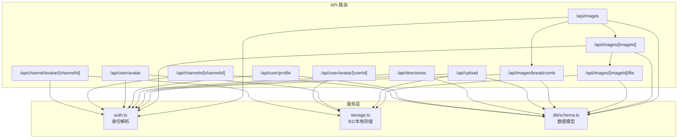
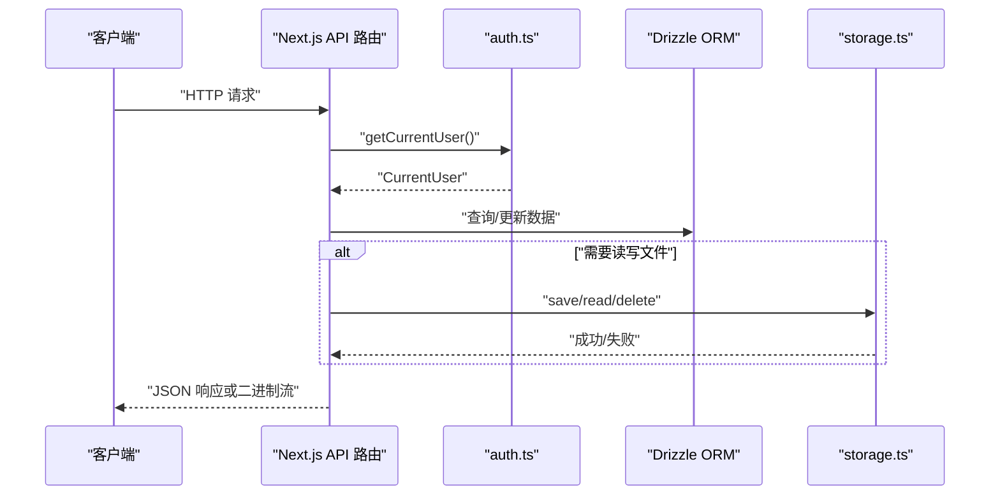
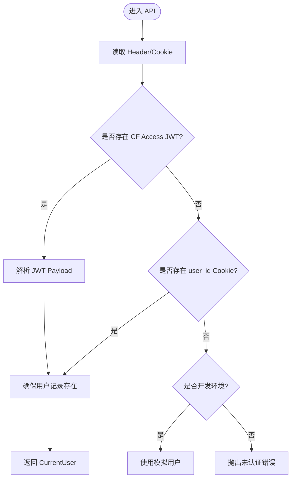
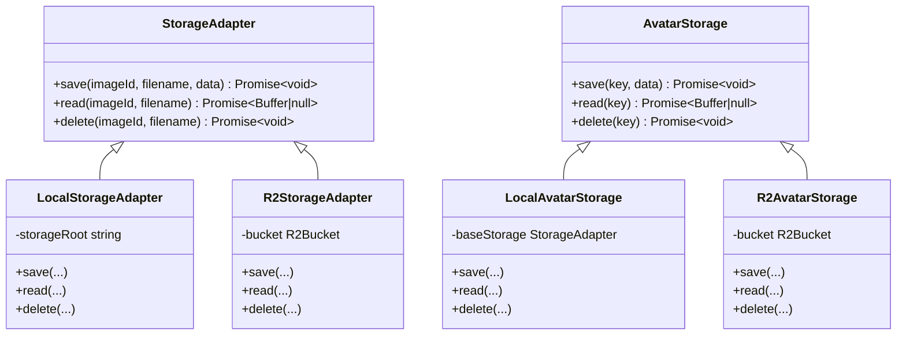
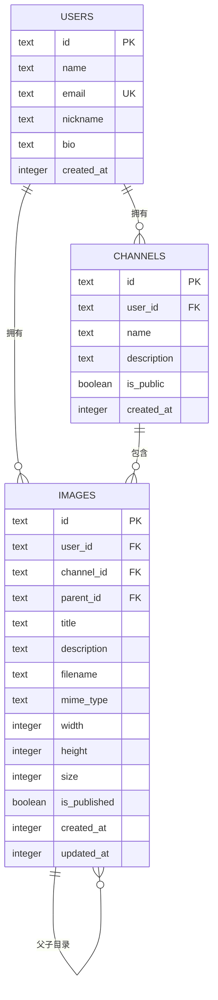
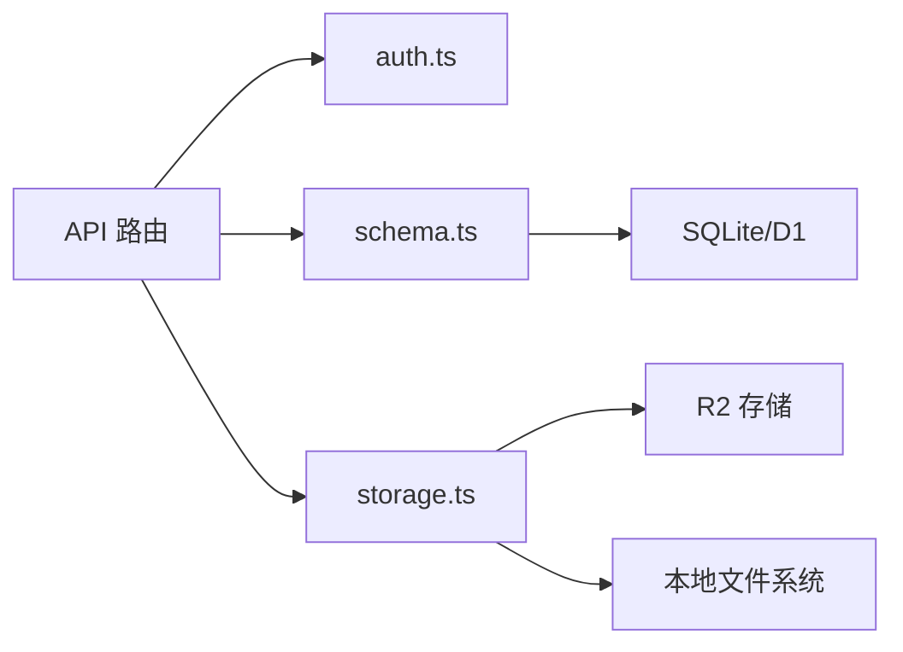

# API 接口文档

<cite>
**本文引用的文件**
- [src/app/api/images/route.ts](file://src/app/api/images/route.ts)
- [src/app/api/images/[imageId]/route.ts](file://src/app/api/images/[imageId]/route.ts)
- [src/app/api/images/[imageId]/file/route.ts](file://src/app/api/images/[imageId]/file/route.ts)
- [src/app/api/images/breadcrumb/route.ts](file://src/app/api/images/breadcrumb/route.ts)
- [src/app/api/upload/route.ts](file://src/app/api/upload/route.ts)
- [src/app/api/directories/route.ts](file://src/app/api/directories/route.ts)
- [src/app/api/user/profile/route.ts](file://src/app/api/user/profile/route.ts)
- [src/app/api/user/avatar/route.ts](file://src/app/api/user/avatar/route.ts)
- [src/app/api/user/avatar/[userId]/route.ts](file://src/app/api/user/avatar/[userId]/route.ts)
- [src/app/api/channels/[channelId]/route.ts](file://src/app/api/channels/[channelId]/route.ts)
- [src/app/api/channel/avatar/[channelId]/route.ts](file://src/app/api/channel/avatar/[channelId]/route.ts)
- [src/lib/auth.ts](file://src/lib/auth.ts)
- [src/lib/storage.ts](file://src/lib/storage.ts)
- [src/db/schema.ts](file://src/db/schema.ts)
- [wrangler.jsonc](file://wrangler.jsonc)
- [package.json](file://package.json)
- [README.md](file://README.md)
</cite>

## 目录
1. [简介](#简介)
2. [项目结构](#项目结构)
3. [核心组件](#核心组件)
4. [架构总览](#架构总览)
5. [详细组件分析](#详细组件分析)
6. [依赖关系分析](#依赖关系分析)
7. [性能考虑](#性能考虑)
8. [故障排查指南](#故障排查指南)
9. [结论](#结论)
10. [附录](#附录)

## 简介
本文件为 Weable 应用的完整 RESTful API 接口文档，覆盖图片管理（上传、删除、元数据操作）、用户管理（个人资料、头像）、频道管理与目录管理等核心能力。文档包含每个端点的 HTTP 方法、URL 模式、请求/响应格式、认证方式、错误处理策略与安全注意事项，并提供速率限制、版本控制与调试工具的使用建议，以及常见用例、客户端实现指南和性能优化技巧。

Weable 是一个部署在 Cloudflare Worker 上的图片管理应用，使用 Next.js App Router 暴露 API 路由，通过 Drizzle ORM 访问 SQLite/D1 数据库，并通过 R2 或本地文件系统存储图片与头像资源。

**章节来源**
- [README.md:1-1](file://README.md#L1-L1)
- [package.json:1-40](file://package.json#L1-L40)

## 项目结构
API 路由位于 src/app/api 下，采用 Next.js App Router 的文件路由约定：
- /api/images：图片列表、按目录过滤
- /api/images/[imageId]：图片元数据更新、删除
- /api/images/[imageId]/file：获取图片二进制
- /api/images/breadcrumb：根据目录 ID 生成面包屑路径
- /api/upload：批量上传图片
- /api/directories：创建目录
- /api/user/profile：更新用户资料
- /api/user/avatar：上传当前用户头像
- /api/user/avatar/[userId]：读取指定用户头像
- /api/channels/[channelId]：删除频道
- /api/channel/avatar/[channelId]：上传/读取频道头像

**图表来源**
- [src/app/api/images/route.ts:1-66](file://src/app/api/images/route.ts#L1-L66)
- [src/app/api/images/[imageId]/route.ts:1-84](file://src/app/api/images/[imageId]/route.ts#L1-L84)
- [src/app/api/images/[imageId]/file/route.ts:1-48](file://src/app/api/images/[imageId]/file/route.ts#L1-L48)
- [src/app/api/images/breadcrumb/route.ts:1-40](file://src/app/api/images/breadcrumb/route.ts#L1-L40)
- [src/app/api/upload/route.ts:1-75](file://src/app/api/upload/route.ts#L1-L75)
- [src/app/api/directories/route.ts:1-95](file://src/app/api/directories/route.ts#L1-L95)
- [src/app/api/user/profile/route.ts:1-31](file://src/app/api/user/profile/route.ts#L1-L31)
- [src/app/api/user/avatar/route.ts:1-34](file://src/app/api/user/avatar/route.ts#L1-L34)
- [src/app/api/user/avatar/[userId]/route.ts:1-29](file://src/app/api/user/avatar/[userId]/route.ts#L1-L29)
- [src/app/api/channels/[channelId]/route.ts:1-44](file://src/app/api/channels/[channelId]/route.ts#L1-L44)
- [src/app/api/channel/avatar/[channelId]/route.ts:1-64](file://src/app/api/channel/avatar/[channelId]/route.ts#L1-L64)
- [src/lib/auth.ts:1-118](file://src/lib/auth.ts#L1-L118)
- [src/lib/storage.ts:1-214](file://src/lib/storage.ts#L1-L214)
- [src/db/schema.ts:1-100](file://src/db/schema.ts#L1-L100)

**章节来源**
- [src/app/api/images/route.ts:1-66](file://src/app/api/images/route.ts#L1-L66)
- [src/app/api/images/[imageId]/route.ts:1-84](file://src/app/api/images/[imageId]/route.ts#L1-L84)
- [src/app/api/images/[imageId]/file/route.ts:1-48](file://src/app/api/images/[imageId]/file/route.ts#L1-L48)
- [src/app/api/images/breadcrumb/route.ts:1-40](file://src/app/api/images/breadcrumb/route.ts#L1-L40)
- [src/app/api/upload/route.ts:1-75](file://src/app/api/upload/route.ts#L1-L75)
- [src/app/api/directories/route.ts:1-95](file://src/app/api/directories/route.ts#L1-L95)
- [src/app/api/user/profile/route.ts:1-31](file://src/app/api/user/profile/route.ts#L1-L31)
- [src/app/api/user/avatar/route.ts:1-34](file://src/app/api/user/avatar/route.ts#L1-L34)
- [src/app/api/user/avatar/[userId]/route.ts:1-29](file://src/app/api/user/avatar/[userId]/route.ts#L1-L29)
- [src/app/api/channels/[channelId]/route.ts:1-44](file://src/app/api/channels/[channelId]/route.ts#L1-L44)
- [src/app/api/channel/avatar/[channelId]/route.ts:1-64](file://src/app/api/channel/avatar/[channelId]/route.ts#L1-L64)

## 核心组件
- 认证组件 auth.ts：从 Cloudflare Access JWT 或会话 Cookie 解析当前用户，并保证用户记录存在；开发环境支持模拟用户。
- 存储组件 storage.ts：抽象 StorageAdapter 与 AvatarStorage，支持 R2 与本地文件系统两种后端；提供 getStorage() 与 getAvatarStorage() 工厂函数。
- 数据模型 schema.ts：定义 users、channels、images 三张表及其关系，统一 ID 生成策略（UUIDv7 + Base58）。

这些组件被所有 API 路由复用，确保一致的身份校验、存储行为与数据一致性。

**章节来源**
- [src/lib/auth.ts:1-118](file://src/lib/auth.ts#L1-L118)
- [src/lib/storage.ts:1-214](file://src/lib/storage.ts#L1-L214)
- [src/db/schema.ts:1-100](file://src/db/schema.ts#L1-L100)

## 架构总览
API 层基于 Next.js App Router，调用 auth.ts 进行鉴权，再通过 drizzle-orm 访问数据库，必要时调用 storage.ts 读写对象存储。

**图表来源**
- [src/lib/auth.ts:1-118](file://src/lib/auth.ts#L1-L118)
- [src/lib/storage.ts:1-214](file://src/lib/storage.ts#L1-L214)
- [src/db/schema.ts:1-100](file://src/db/schema.ts#L1-L100)

## 详细组件分析

### 认证与鉴权
- 认证来源优先级：Cloudflare Access JWT（Header/Cookie） > 本地会话 Cookie（user_id） > 开发环境模拟用户。
- 鉴权策略：所有写操作均通过 getCurrentUser() 获取用户上下文，并在数据库查询中强制匹配 userId，确保资源隔离。
- 安全要点：JWT payload 字段解析具备空值保护；开发环境可关闭严格校验。

**图表来源**
- [src/lib/auth.ts:1-118](file://src/lib/auth.ts#L1-L118)

**章节来源**
- [src/lib/auth.ts:1-118](file://src/lib/auth.ts#L1-L118)

### 存储抽象与适配器
- StorageAdapter：针对图片文件的 save/read/delete，支持 R2 与本地文件系统。
- AvatarStorage：针对头像的 save/read/delete，键名前缀区分用户与频道。
- 工厂函数：getStorage() 与 getAvatarStorage() 自动选择 R2 或本地实现，并在 Cloudflare 环境下检查绑定配置。

**图表来源**
- [src/lib/storage.ts:1-214](file://src/lib/storage.ts#L1-L214)

**章节来源**
- [src/lib/storage.ts:1-214](file://src/lib/storage.ts#L1-L214)

### 数据模型与关系
- users：用户基本信息与扩展字段 nickname、bio。
- channels：频道信息，关联用户，支持公开标志。
- images：图片与目录的统一实体，通过 mimeType 区分类型，支持 parentId 形成树形结构，支持 channelId 与 isPublished 发布状态。

**图表来源**
- [src/db/schema.ts:1-100](file://src/db/schema.ts#L1-L100)

**章节来源**
- [src/db/schema.ts:1-100](file://src/db/schema.ts#L1-L100)

### 图片管理 API

#### 列出图片（支持按目录过滤）
- 方法：GET
- URL：/api/images?parentId={parentId}
- 认证：需要登录（getCurrentUser）
- 查询参数：
  - parentId：可选，目录 ID；若提供则仅返回该目录下条目，且会校验目录存在性与归属
- 排序规则：目录优先，其次按 updatedAt 降序
- 响应体：
  - items：数组，每项包含 id、title、mimeType、description、size、width、height、parentId、channelId、isPublished、createdAt、updatedAt
- 错误：
  - 404：当指定 parentId 不存在或不属于当前用户时返回

示例请求：
- GET /api/images
- GET /api/images?parentId=abc123

示例响应：
- { "items": [...] }

**章节来源**
- [src/app/api/images/route.ts:1-66](file://src/app/api/images/route.ts#L1-L66)

#### 更新图片元数据
- 方法：PATCH
- URL：/api/images/{imageId}
- 认证：需要登录
- 路径参数：
  - imageId：图片 ID（字母数字、下划线、连字符）
- 请求体（部分更新）：
  - title：字符串，会被 trim
  - description：字符串
  - channelId：字符串或 null
  - isPublished：布尔值
- 响应体：
  - ok：true
- 错误：
  - 400：imageId 非法
  - 404：图片不存在或不属于当前用户

示例请求：
- PATCH /api/images/img_001
- Body: { "title": "新标题", "isPublished": true }

示例响应：
- { "ok": true }

**章节来源**
- [src/app/api/images/[imageId]/route.ts:1-84](file://src/app/api/images/[imageId]/route.ts#L1-L84)

#### 删除图片
- 方法：DELETE
- URL：/api/images/{imageId}
- 认证：需要登录
- 路径参数：imageId（同上）
- 行为：先删除存储中的文件，再删除数据库记录
- 响应：204 No Content
- 错误：
  - 400：imageId 非法
  - 404：图片不存在或不属于当前用户

示例请求：
- DELETE /api/images/img_001

示例响应：
- 204 No Content

**章节来源**
- [src/app/api/images/[imageId]/route.ts:1-84](file://src/app/api/images/[imageId]/route.ts#L1-L84)

#### 获取图片二进制
- 方法：GET
- URL：/api/images/{imageId}/file
- 认证：无需登录（公开读取）
- 路径参数：imageId（同上）
- 行为：若 mimeType 为 directory 则返回 404；否则从存储读取并返回二进制
- 响应头：
  - Content-Type：图片 MIME 类型
  - Cache-Control：public, max-age=31536000, immutable
- 错误：
  - 400：imageId 非法
  - 404：图片或目录不存在

示例请求：
- GET /api/images/img_001/file

示例响应：
- 二进制图片数据

**章节来源**
- [src/app/api/images/[imageId]/file/route.ts:1-48](file://src/app/api/images/[imageId]/file/route.ts#L1-L48)

#### 图片上传（批量）
- 方法：POST
- URL：/api/upload
- 认证：需要登录
- 表单字段：
  - file：多个 File（仅允许 image/* 类型）
  - parentId：可选，目标目录 ID（需存在且属于当前用户）
- 限制：
  - 最大文件数：50
  - 单文件大小：5 MB
  - 仅允许 image/* 类型
- 行为：
  - 校验 parentId（可选）
  - 保存文件到存储（R2 或本地）
  - 插入图片记录（自动生成 id、title、filename、mimeType、size）
- 响应体：
  - ids：上传成功的图片 ID 数组
- 错误：
  - 400：无文件或类型/大小不合法
  - 404：parentId 不存在或不属于当前用户

示例请求：
- POST /api/upload (multipart/form-data)
- 字段：file=[...], parentId=dir_001

示例响应：
- { "ids": ["id1","id2"] }

**章节来源**
- [src/app/api/upload/route.ts:1-75](file://src/app/api/upload/route.ts#L1-L75)

#### 图片面包屑
- 方法：GET
- URL：/api/images/breadcrumb?parentId={parentId}
- 认证：需要登录
- 查询参数：
  - parentId：必填，目录 ID
- 行为：向上遍历父目录，最多 20 级，构建面包屑数组
- 响应体：
  - breadcrumb：[{ id, title }, ...]
- 错误：
  - 400：缺少 parentId
  - 404：目录不存在或不属于当前用户

示例请求：
- GET /api/images/breadcrumb?parentId=dir_001

示例响应：
- { "breadcrumb": [{"id":"root","title":"根"},{"id":"dir_001","title":"工作区"}] }

**章节来源**
- [src/app/api/images/breadcrumb/route.ts:1-40](file://src/app/api/images/breadcrumb/route.ts#L1-L40)

### 目录管理 API

#### 创建目录
- 方法：POST
- URL：/api/directories
- 认证：需要登录
- 请求体：
  - title：必填，长度 ≤ 200，不允许包含 / \ 及 “..”
  - description：可选，长度 ≤ 1000
  - parentId：可选，目录 ID（需存在且属于当前用户）
- 行为：
  - 校验 title 合法性与长度
  - 校验 parentId 有效性
  - 同层级重复名称检测（409）
  - 插入目录记录（mimeType=directory，size=0）
- 响应体：
  - id：新建目录 ID
- 错误：
  - 400：title 非法或过长、description 过长
  - 404：parentId 不存在或不属于当前用户
  - 409：同层级已存在同名目录

示例请求：
- POST /api/directories
- Body: { "title": "工作区", "description": "项目素材", "parentId": "dir_root" }

示例响应：
- { "id": "dir_new" }

**章节来源**
- [src/app/api/directories/route.ts:1-95](file://src/app/api/directories/route.ts#L1-L95)

### 用户管理 API

#### 更新用户资料
- 方法：PATCH
- URL：/api/user/profile
- 认证：需要登录
- 请求体（部分更新）：
  - nickname：字符串或 null，长度 ≤ 50
  - bio：字符串或 null，长度 ≤ 500
- 响应体：
  - ok：true
- 错误：
  - 400：无有效字段

示例请求：
- PATCH /api/user/profile
- Body: { "nickname": "昵称", "bio": "个人简介" }

示例响应：
- { "ok": true }

**章节来源**
- [src/app/api/user/profile/route.ts:1-31](file://src/app/api/user/profile/route.ts#L1-L31)

#### 上传当前用户头像
- 方法：POST
- URL：/api/user/avatar
- 认证：需要登录
- 表单字段：
  - file：单个图片文件（仅允许 jpeg/png/gif/webp），≤ 2 MB
- 行为：保存到头像存储（R2 或本地），键名为 user_{userId}
- 响应体：
  - ok：true
- 错误：
  - 400：无文件或类型/大小不合法

示例请求：
- POST /api/user/avatar (multipart/form-data)
- 字段：file=[图片]

示例响应：
- { "ok": true }

**章节来源**
- [src/app/api/user/avatar/route.ts:1-34](file://src/app/api/user/avatar/route.ts#L1-L34)

#### 读取指定用户头像
- 方法：GET
- URL：/api/user/avatar/{userId}
- 认证：无需登录（公开读取）
- 路径参数：
  - userId：用户 ID（字母数字、下划线、连字符）
- 行为：从头像存储读取并返回二进制
- 响应头：
  - Content-Type：image/png
  - Cache-Control：public, max-age=3600
- 错误：
  - 400：userId 非法
  - 404：头像不存在

示例请求：
- GET /api/user/avatar/user_001

示例响应：
- 二进制图片数据

**章节来源**
- [src/app/api/user/avatar/[userId]/route.ts:1-29](file://src/app/api/user/avatar/[userId]/route.ts#L1-L29)

### 频道管理 API

#### 删除频道
- 方法：DELETE
- URL：/api/channels/{channelId}
- 认证：需要登录
- 路径参数：
  - channelId：频道 ID（字母数字、下划线、连字符）
- 行为：
  - 校验频道存在性与归属
  - 检查是否有已发布的图片（isPublished=true）关联该频道，若有则拒绝删除
  - 删除频道记录
- 响应：204 No Content
- 错误：
  - 400：channelId 非法
  - 404：频道不存在或不属于当前用户
  - 409：频道包含已发布图片

示例请求：
- DELETE /api/channels/ch_001

示例响应：
- 204 No Content

**章节来源**
- [src/app/api/channels/[channelId]/route.ts:1-44](file://src/app/api/channels/[channelId]/route.ts#L1-L44)

#### 上传频道头像
- 方法：POST
- URL：/api/channel/avatar/{channelId}
- 认证：需要登录
- 路径参数：
  - channelId：频道 ID（同上）
- 表单字段：
  - file：单个图片文件（仅允许 jpeg/png/gif/webp），≤ 2 MB
- 行为：保存到头像存储，键名为 channel_{channelId}
- 响应体：
  - ok：true
- 错误：
  - 400：channelId 非法、无文件或类型/大小不合法

示例请求：
- POST /api/channel/avatar/ch_001 (multipart/form-data)
- 字段：file=[图片]

示例响应：
- { "ok": true }

**章节来源**
- [src/app/api/channel/avatar/[channelId]/route.ts:1-64](file://src/app/api/channel/avatar/[channelId]/route.ts#L1-L64)

#### 读取频道头像
- 方法：GET
- URL：/api/channel/avatar/{channelId}
- 认证：无需登录（公开读取）
- 路径参数：
  - channelId：频道 ID（同上）
- 行为：从头像存储读取并返回二进制
- 响应头：
  - Content-Type：image/png
  - Cache-Control：public, max-age=3600
- 错误：
  - 400：channelId 非法
  - 404：头像不存在

示例请求：
- GET /api/channel/avatar/ch_001

示例响应：
- 二进制图片数据

**章节来源**
- [src/app/api/channel/avatar/[channelId]/route.ts:1-64](file://src/app/api/channel/avatar/[channelId]/route.ts#L1-L64)

## 依赖关系分析
- API 路由依赖 auth.ts 进行身份解析，依赖 db/schema.ts 进行数据建模与查询，依赖 storage.ts 进行对象存储读写。
- 存储适配器在 Cloudflare 环境中优先使用 R2，否则回退到本地文件系统。
- 数据库通过 Drizzle ORM 访问，生产环境通常使用 D1（见 wrangler.jsonc）。

**图表来源**
- [src/lib/auth.ts:1-118](file://src/lib/auth.ts#L1-L118)
- [src/lib/storage.ts:1-214](file://src/lib/storage.ts#L1-L214)
- [src/db/schema.ts:1-100](file://src/db/schema.ts#L1-L100)
- [wrangler.jsonc:1-34](file://wrangler.jsonc#L1-L34)

**章节来源**
- [wrangler.jsonc:1-34](file://wrangler.jsonc#L1-L34)
- [package.json:1-40](file://package.json#L1-L40)

## 性能考虑
- 图片读取缓存：/api/images/{id}/file 设置 long-lived 缓存头，适合 CDN 缓存静态资源。
- 头像读取缓存：/api/user/avatar/{userId} 与 /api/channel/avatar/{channelId} 设置 1 小时缓存。
- 批量上传：单次最多 50 个文件，减少网络往返；服务端对类型与大小进行快速校验。
- 目录树遍历：面包屑上限 20 级，避免无限递归。
- 存储选择：Cloudflare 环境下优先使用 R2，降低冷启动与延迟；本地环境用于开发与测试。

[本节为通用指导，不直接分析具体文件]

## 故障排查指南
- 认证失败：
  - 检查是否携带 Cloudflare Access JWT（Header 或 Cookie）或 user_id Cookie；开发环境默认使用模拟用户。
  - 若在生产环境未配置 JWT，将抛出未认证错误。
- 存储不可用：
  - Cloudflare 环境下需配置 IMAGES_BUCKET 绑定；否则抛出配置缺失错误。
  - 本地环境需确保 IMAGE_STORAGE_PATH 指向可用目录。
- 权限问题：
  - 所有写操作均校验 userId，确保资源归属；出现 404 时需确认资源是否存在且属于当前用户。
- 上传失败：
  - 检查文件类型与大小限制；确认 multipart/form-data 字段名为 file。
- 目录相关错误：
  - 创建目录时注意同层级唯一性；删除频道时需确保没有已发布图片。

**章节来源**
- [src/lib/auth.ts:1-118](file://src/lib/auth.ts#L1-L118)
- [src/lib/storage.ts:1-214](file://src/lib/storage.ts#L1-L214)
- [src/app/api/upload/route.ts:1-75](file://src/app/api/upload/route.ts#L1-L75)
- [src/app/api/directories/route.ts:1-95](file://src/app/api/directories/route.ts#L1-L95)
- [src/app/api/channels/[channelId]/route.ts:1-44](file://src/app/api/channels/[channelId]/route.ts#L1-L44)

## 结论
Weable 的 API 设计遵循 RESTful 原则，结合 Next.js App Router 与 Drizzle ORM，实现了统一的图片与目录管理、用户与频道资料维护能力。通过存储抽象适配 R2 与本地文件系统，兼顾生产与开发场景。建议在客户端实现中遵循限流与重试策略，利用缓存头提升性能，并严格遵循字段校验与错误码规范。

[本节为总结性内容，不直接分析具体文件]

## 附录

### 速率限制
- 当前代码未内置速率限制。建议在网关层（如 Cloudflare Workers KV/Rate Limiting）或反向代理层实现，以保护上传与敏感接口。

### 版本控制
- 当前 API 未显式版本化。建议在 URL 前缀引入版本（如 /api/v1/...），或在响应头中声明版本号，便于后续演进与兼容。

### 调试工具
- 本地开发：使用 pnpm dev 启动 Next.js 开发服务器，端口 7600。
- 数据库迁移：pnpm db:migrate 执行迁移脚本。
- 日志与观测：Wrangler 启用 observability，可在 Cloudflare 控制台查看运行指标。

**章节来源**
- [package.json:1-40](file://package.json#L1-L40)
- [wrangler.jsonc:1-34](file://wrangler.jsonc#L1-L34)

### 常见用例与客户端实现指南
- 上传并分配到目录：
  - 步骤：POST /api/upload，携带 file 与 parentId；成功后使用返回的 ids 更新元数据（PATCH /api/images/{id}）。
- 浏览目录树：
  - 步骤：GET /api/images?parentId=...；如需面包屑，调用 GET /api/images/breadcrumb?parentId=...。
- 更新图片发布状态：
  - 步骤：PATCH /api/images/{id}，设置 isPublished=true/false。
- 头像与频道头像：
  - 步骤：POST 上传至对应接口；GET 公开读取，配合 CDN 缓存。

[本节为通用指导，不直接分析具体文件]