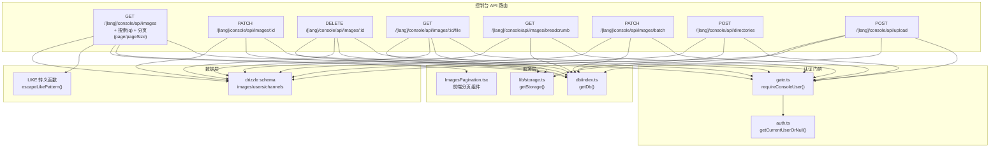
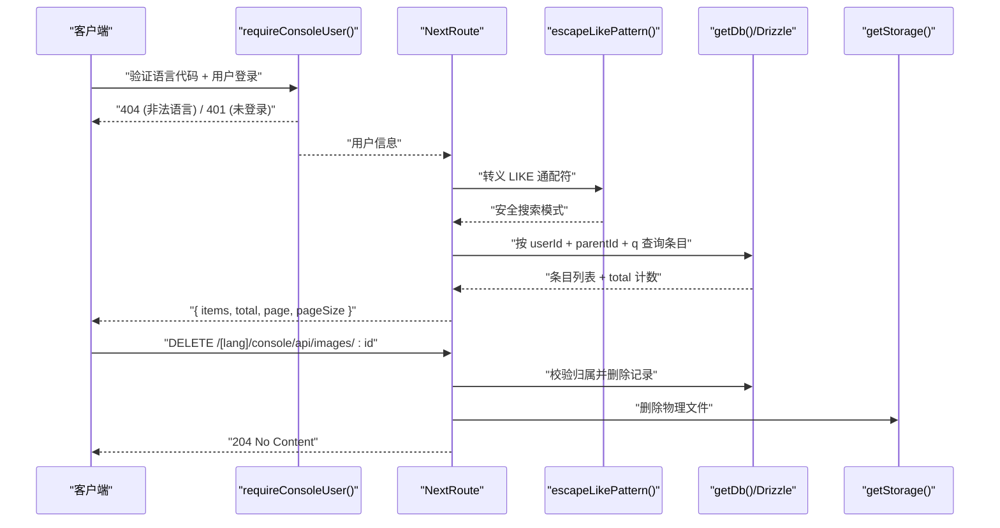
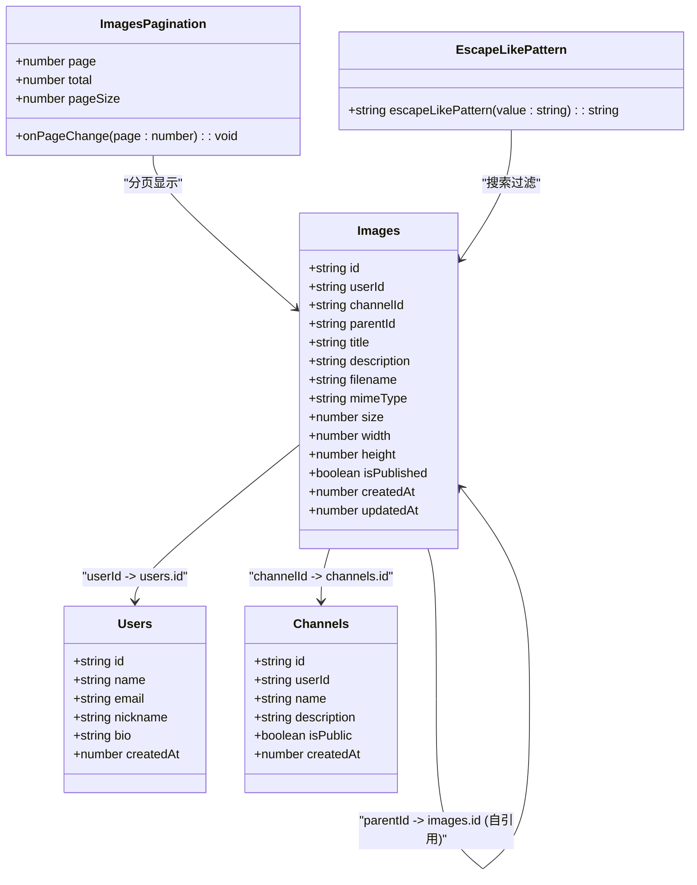

# 图片管理 API

<cite>
**本文引用的文件**   
- [src/app/[lang]/console/api/images/route.ts](file://src/app/[lang]/console/api/images/route.ts)
- [src/app/[lang]/console/api/images/[imageId]/route.ts](file://src/app/[lang]/console/api/images/[imageId]/route.ts)
- [src/app/[lang]/console/api/images/[imageId]/file/route.ts](file://src/app/[lang]/console/api/images/[imageId]/file/route.ts)
- [src/app/[lang]/console/api/images/breadcrumb/route.ts](file://src/app/[lang]/console/api/images/breadcrumb/route.ts)
- [src/app/[lang]/console/api/images/batch/route.ts](file://src/app/[lang]/console/api/images/batch/route.ts)
- [src/app/[lang]/console/api/directories/route.ts](file://src/app/[lang]/console/api/directories/route.ts)
- [src/app/[lang]/console/api/upload/route.ts](file://src/app/[lang]/console/api/upload/route.ts)
- [src/app/[lang]/console/api/_lib/gate.ts](file://src/app/[lang]/console/api/_lib/gate.ts)
- [src/db/schema.ts](file://src/db/schema.ts)
- [src/lib/auth.ts](file://src/lib/auth.ts)
- [specs/003-batch-publish-channel/contracts/console-api-migration.md](file://specs/003-batch-publish-channel/contracts/console-api-migration.md)
- [specs/004-images-search-pagination/contracts/get-images-list-search-pagination.md](file://specs/004-images-search-pagination/contracts/get-images-list-search-pagination.md)
- [specs/004-images-search-pagination/data-model.md](file://specs/004-images-search-pagination/data-model.md)
- [src/components/ImagesPagination.tsx](file://src/components/ImagesPagination.tsx)
</cite>

## 更新摘要
**所做更改**   
- 更新了 GET /api/images 端点，新增关键词搜索（q 参数）和分页功能（page/pageSize 参数）
- 增强了响应格式，新增 total 计数、channelName 字段和改进的元数据展示
- 添加了 SQL 注入保护和 LIKE 通配符转义机制
- 新增了 ImagesPagination 组件用于前端分页控制
- 更新了架构图以反映新的搜索和分页功能
- 完善了错误处理和边界情况处理说明

## 目录
1. [简介](#简介)
2. [项目结构](#项目结构)
3. [核心组件](#核心组件)
4. [架构总览](#架构总览)
5. [详细接口说明](#详细接口说明)
6. [依赖关系分析](#依赖关系分析)
7. [性能与扩展性](#性能与扩展性)
8. [故障排查指南](#故障排查指南)
9. [结论](#结论)
10. [附录：数据模型与字段说明](#附录数据模型与字段说明)

## 简介
本文件为 Weable 应用的"图片管理"RESTful API 文档，覆盖图片列表、单个图片详情、删除、更新、文件读取、目录创建、面包屑导航以及批量上传等能力。**重要更新**：所有控制台 API 已迁移至 `/[lang]/console/api/*` 路径，并采用增强的认证门禁系统。当前实现已包含完整的分页机制与搜索功能，支持关键词搜索、传统分页、SQL 注入防护等功能。

## 项目结构
图片相关 API 位于 Next.js App Router 的 `src/app/[lang]/console/api` 目录下，采用按资源划分的路由组织方式。所有控制台 API 都通过统一的认证门禁系统进行保护：

- `/[lang]/console/api/images`：获取图片/目录列表（支持 parentId 过滤、关键词搜索 q、分页 page/pageSize）
- `/[lang]/console/api/images/:id`：单个图片的更新与删除
- `/[lang]/console/api/images/:id/file`：获取图片二进制文件流
- `/[lang]/console/api/images/breadcrumb`：根据目标目录 ID 返回从根到该目录的面包屑路径
- `/[lang]/console/api/images/batch`：批量操作图片状态或频道关联
- `/[lang]/console/api/directories`：创建目录条目
- `/[lang]/console/api/upload`：批量上传图片（支持指定 parentId）

**图表来源**
- [src/app/[lang]/console/api/images/route.ts:1-122](file://src/app/[lang]/console/api/images/route.ts#L1-L122)
- [src/app/[lang]/console/api/images/[imageId]/route.ts:1-88](file://src/app/[lang]/console/api/images/[imageId]/route.ts#L1-L88)
- [src/app/[lang]/console/api/images/[imageId]/file/route.ts:1-52](file://src/app/[lang]/console/api/images/[imageId]/file/route.ts#L1-L52)
- [src/app/[lang]/console/api/images/breadcrumb/route.ts:1-46](file://src/app/[lang]/console/api/images/breadcrumb/route.ts#L1-L46)
- [src/app/[lang]/console/api/images/batch/route.ts:1-107](file://src/app/[lang]/console/api/images/batch/route.ts#L1-L107)
- [src/app/[lang]/console/api/directories/route.ts:1-100](file://src/app/[lang]/console/api/directories/route.ts#L1-L100)
- [src/app/[lang]/console/api/upload/route.ts:1-81](file://src/app/[lang]/console/api/upload/route.ts#L1-81)
- [src/app/[lang]/console/api/_lib/gate.ts:1-21](file://src/app/[lang]/console/api/_lib/gate.ts#L1-L21)
- [src/components/ImagesPagination.tsx:1-78](file://src/components/ImagesPagination.tsx#L1-L78)

## 核心组件
- **增强的认证门禁**：`requireConsoleUser()` 函数提供统一的登录验证，检查语言代码有效性并强制用户登录。
- **数据库访问**：通过 `getDb()` 获取 Drizzle ORM 客户端，操作 images/users/channels 表。
- **存储访问**：通过 `getStorage()` 抽象对象存储（R2/本地），用于图片读写与删除。
- **搜索与分页**：支持关键词搜索（q 参数）、传统分页（page/pageSize 参数）、SQL 注入防护。
- **数据模型**：images 表支持父子层级（parentId 自引用），区分目录与图片（mimeType）。

**章节来源**
- [src/app/[lang]/console/api/_lib/gate.ts:1-21](file://src/app/[lang]/console/api/_lib/gate.ts#L1-L21)
- [src/db/schema.ts:1-100](file://src/db/schema.ts#L1-L100)
- [src/app/[lang]/console/api/images/route.ts:11-15](file://src/app/[lang]/console/api/images/route.ts#L11-L15)

## 架构总览
图片管理 API 遵循"路由 -> 认证门禁 -> 业务逻辑 -> 数据/存储访问"的分层模式。所有写操作均通过 `requireConsoleUser()` 校验当前用户身份，确保数据隔离。目录与图片统一存储在 images 表中，通过 mimeType 区分。新增的搜索和分页功能通过参数化查询和 LIKE 通配符转义确保安全性和性能。

**图表来源**
- [src/app/[lang]/console/api/images/route.ts:17-103](file://src/app/[lang]/console/api/images/route.ts#L17-L103)
- [src/app/[lang]/console/api/_lib/gate.ts:7-20](file://src/app/[lang]/console/api/_lib/gate.ts#L7-L20)

## 详细接口说明

### GET /[lang]/console/api/images
- **功能**：获取当前用户的图片/目录列表，支持按父目录过滤、关键词搜索和分页。
- **认证**：需要已登录用户，通过 `requireConsoleUser()` 验证。
- **查询参数**：
  - parentId：可选，string。若提供，则仅返回该目录的直接子项；未提供时返回根级（parent_id IS NULL）条目。
  - q：可选，string。关键词搜索，对标题进行模糊匹配；服务端 trim 后为空视为无搜索条件；支持 SQL 注入防护。
  - page：可选，number。页码，1 起；非法值回退为 1；仅在启用分页时生效。
  - pageSize：可选，number。**分页开关**：提供合法正整数时启用分页；缺省或非法时返回全量（树展开调用路径，行为同现状）。
- **排序规则**：目录优先（mimeType = 'directory'），同类型按 updatedAt 降序。
- **成功响应（200）**：
  - **启用分页时**：{ items[], total, page, pageSize }，其中 total 为过滤后的总数。
  - **未启用分页时**：{ items[] }，全量返回。
  - 每项包含 id、title、mimeType、description、size、width、height、parentId、channelId、channelName、isPublished、createdAt、updatedAt。
- **错误响应**：
  - 404：当 parentId 存在但非目录或不属于当前用户时，返回 { error: "parent directory not found" }。
  - 401：未登录（由 requireConsoleUser() 抛出）。

示例请求
- GET /[lang]/console/api/images
- GET /[lang]/console/api/images?parentId=AbC123XyZ&q=logo&page=1&pageSize=20

示例响应（启用分页，200）
{
  "items": [
    {
      "id": "AbC123XyZ",
      "title": "设计稿",
      "mimeType": "directory",
      "description": "UI 设计相关",
      "size": 0,
      "parentId": null,
      "channelId": null,
      "channelName": null,
      "isPublished": false,
      "createdAt": 1753920000000,
      "updatedAt": 1753920000000
    },
    {
      "id": "Qw9ErTy2K",
      "title": "banner.jpg",
      "mimeType": "image/jpeg",
      "description": "",
      "size": 204800,
      "width": 1920,
      "height": 1080,
      "parentId": null,
      "channelId": "ch_abc",
      "channelName": "旅行",
      "isPublished": false,
      "createdAt": 1753920001000,
      "updatedAt": 1753920001000
    }
  ],
  "total": 45,
  "page": 1,
  "pageSize": 20
}

**章节来源**
- [src/app/[lang]/console/api/images/route.ts:17-103](file://src/app/[lang]/console/api/images/route.ts#L17-L103)
- [specs/004-images-search-pagination/contracts/get-images-list-search-pagination.md:1-93](file://specs/004-images-search-pagination/contracts/get-images-list-search-pagination.md#L1-L93)

### GET /[lang]/console/api/images/breadcrumb
- **功能**：根据目标目录 ID 返回从根到该目录的祖先路径（面包屑）。
- **认证**：需要已登录用户。
- **查询参数**：
  - parentId：必填，string。目标目录 ID。
- **成功响应（200）**：
  - 字段：breadcrumb[]，每项包含 id、title，顺序从根到当前目录。
- **错误响应**：
  - 400：缺少 parentId。
  - 404：目录不存在或不属于当前用户。
  - 401：未登录。

示例请求
- GET /[lang]/console/api/images/breadcrumb?parentId=AbC123XyZ

示例响应（200）
{
  "breadcrumb": [
    { "id": "root_abc", "title": "设计稿" },
    { "id": "child_xyz", "title": "2026年Q1" }
  ]
}

**章节来源**
- [src/app/[lang]/console/api/images/breadcrumb/route.ts:11-45](file://src/app/[lang]/console/api/images/breadcrumb/route.ts#L11-L45)

### PATCH /[lang]/console/api/images/:id
- **功能**：更新图片元数据（标题、描述、频道、发布状态）。
- **认证**：需要已登录用户，且只能更新属于当前用户的图片。
- **路径参数**：
  - imageId：string，仅允许字母数字及 _ -。
- **请求体（JSON）**：
  - title：可选，string，自动 trim。
  - description：可选，string。
  - channelId：可选，null 或 string。
  - isPublished：可选，boolean。
- **成功响应（200）**：
  - { ok: true }
- **错误响应**：
  - 400：imageId 非法。
  - 404：图片不存在或不属于当前用户。
  - 401：未登录。

示例请求
- PATCH /[lang]/console/api/images/Qw9ErTy2K
- Body: { "title": "新标题", "isPublished": true }

示例响应（200）
{ "ok": true }

**章节来源**
- [src/app/[lang]/console/api/images/[imageId]/route.ts:42-87](file://src/app/[lang]/console/api/images/[imageId]/route.ts#L42-L87)

### DELETE /[lang]/console/api/images/:id
- **功能**：删除图片及其物理文件。
- **认证**：需要已登录用户，且只能删除属于当前用户的图片。
- **路径参数**：
  - imageId：string，仅允许字母数字及 _ -。
- **成功响应（204）**：无内容。
- **错误响应**：
  - 400：imageId 非法。
  - 404：图片不存在或不属于当前用户。
  - 401：未登录。

示例请求
- DELETE /[lang]/console/api/images/Qw9ErTy2K

示例响应（204）
(空)

**章节来源**
- [src/app/[lang]/console/api/images/[imageId]/route.ts:12-40](file://src/app/[lang]/console/api/images/[imageId]/route.ts#L12-L40)

### GET /[lang]/console/api/images/:id/file
- **功能**：获取图片二进制文件流（仅适用于 mimeType != 'directory'）。
- **认证**：需要已登录用户（控制台副本，比公开接口更安全）。
- **路径参数**：
  - imageId：string，仅允许字母数字及 _ -。
- **成功响应（200）**：
  - 二进制流，Content-Type 为图片 MIME 类型，附带缓存头。
- **错误响应**：
  - 400：imageId 非法。
  - 404：图片不存在或为目录。
  - 404：存储中找不到文件。

示例请求
- GET /[lang]/console/api/images/Qw9ErTy2K/file

示例响应（200）
二进制图片数据（Content-Type: image/jpeg）

**章节来源**
- [src/app/[lang]/console/api/images/[imageId]/file/route.ts:13-51](file://src/app/[lang]/console/api/images/[imageId]/file/route.ts#L13-L51)

### PATCH /[lang]/console/api/images/batch
- **功能**：批量设置图片的发布状态或所属频道。
- **认证**：需要已登录用户。
- **请求体（JSON）**：
  - ids：必填，数组，最多 500 个有效 ID 字符串。
  - isPublished：可选，boolean，设置发布状态。
  - channelId：可选，null 或字符串，设置频道关联。
- **约束**：必须提供 isPublished 或 channelId 中的一个，不能同时提供或都不提供。
- **成功响应（200）**：
  - { ok: true, updated: number }，updated 表示实际更新的记录数。
- **错误响应**：
  - 400：参数验证失败（ids 格式、数量限制、字段类型等）。
  - 404：没有找到匹配的图片记录。
  - 401：未登录。

示例请求
- PATCH /[lang]/console/api/images/batch
- Body: { "ids": ["img_1", "img_2"], "isPublished": true }

示例响应（200）
{ "ok": true, "updated": 2 }

**章节来源**
- [src/app/[lang]/console/api/images/batch/route.ts:15-106](file://src/app/[lang]/console/api/images/batch/route.ts#L15-L106)

### POST /[lang]/console/api/directories
- **功能**：创建目录条目（在 images 表中插入 mimeType = 'directory' 的记录）。
- **认证**：需要已登录用户。
- **请求体（JSON）**：
  - title：必填，string，长度 1–200，禁止包含 / \ ..。
  - description：可选，string，最长 1000 字符。
  - parentId：可选，string；缺省或 null 表示根目录。
- **成功响应（201）**：
  - { id: "新目录ID" }
- **错误响应**：
  - 400：title 缺失/为空、包含非法字符、过长、description 过长。
  - 404：parentId 指定的目录不存在或不属于当前用户。
  - 409：同级已存在同名条目。
  - 401：未登录。

示例请求
- POST /[lang]/console/api/directories
- Body: { "title": "设计稿", "description": "UI 设计相关", "parentId": "AbC123XyZ" }

示例响应（201）
{ "id": "Qw9ErTy2K" }

**章节来源**
- [src/app/[lang]/console/api/directories/route.ts:14-99](file://src/app/[lang]/console/api/directories/route.ts#L14-L99)

### POST /[lang]/console/api/upload
- **功能**：批量上传图片（支持指定 parentId）。
- **认证**：需要已登录用户。
- **请求体（multipart/form-data）**：
  - file：File，1–50 个，必须为 image/* 类型，单文件不超过 5 MB。
  - parentId：可选，string；指向当前用户可访问且 mimeType = 'directory' 的目录。
- **成功响应（201）**：
  - { ids: ["img_1", "img_2", ...] }，顺序与接收一致。
- **错误响应**：
  - 400：无文件、数量超限、类型不合法、大小超限。
  - 404：parentId 无效或不可访问。
  - 500：存储或数据库异常。

示例请求
- POST /[lang]/console/api/upload
- FormData: file=[...], parentId=AbC123XyZ

示例响应（201）
{ "ids": ["img_1", "img_2"] }

**章节来源**
- [src/app/[lang]/console/api/upload/route.ts:16-80](file://src/app/[lang]/console/api/upload/route.ts#L16-L80)

## 依赖关系分析
- **路由层依赖**：
  - gate.ts：requireConsoleUser() 负责统一的认证门禁和用户解析。
  - db/index.ts：getDb() 提供数据库连接。
  - lib/storage.ts：getStorage() 提供对象存储读写。
  - db/schema.ts：images/users/channels 表结构与关系。
- **数据模型关键点**：
  - images.parentId 自引用，形成树形结构。
  - images.mimeType 区分目录与图片。
  - images.userId 保证数据隔离。
  - images.channelId 关联频道，可为空。
- **搜索与分页依赖**：
  - escapeLikePattern()：LIKE 通配符转义函数，防止 SQL 注入。
  - ImagesPagination 组件：前端分页控件。
  - Drizzle ORM like() 函数：参数化查询，绑定用户输入。

**图表来源**
- [src/db/schema.ts:26-69](file://src/db/schema.ts#L26-L69)
- [src/app/[lang]/console/api/images/route.ts:11-15](file://src/app/[lang]/console/api/images/route.ts#L11-L15)
- [src/components/ImagesPagination.tsx:1-78](file://src/components/ImagesPagination.tsx#L1-L78)

**章节来源**
- [src/db/schema.ts:1-100](file://src/db/schema.ts#L1-L100)

## 性能与扩展性
- **排序与查询**：
  - 列表按目录优先与 updatedAt 降序，适合展示最近更新的目录与图片。
  - 关键词搜索使用参数化查询和 LIKE 通配符转义，防止 SQL 注入。
  - 分页使用 limit/offset 机制，支持大数据量场景。
- **缓存策略**：
  - 文件读取接口设置了强缓存头，有利于前端重复加载。
- **并发与事务**：
  - 批量上传逐条写入存储与数据库，可在高并发下考虑事务或重试机制保障一致性。
- **扩展建议**：
  - 搜索优化：可增加全文索引提升搜索性能。
  - 分页优化：可考虑游标分页替代 offset 分页。
  - 排序：增加 sortBy（updatedAt/title/size）与 sortOrder（asc/desc）。
  - 权限：如需公开分享，可增加 isPublic 或 token 访问控制。

## 故障排查指南
- **401 Unauthorized**：
  - 检查是否携带有效的 Cloudflare Access JWT 或会话 Cookie。
  - 确认语言代码 `[lang]` 是合法的（如 zh、en、ja 等）。
  - 开发环境可通过环境变量注入 DEV_USER。
- **404 Not Found**：
  - 图片/目录不存在或不属于当前用户。
  - 文件读取接口可能因存储层缺失导致 404。
  - 非法的语言代码也会返回 404。
- **400 Bad Request**：
  - 参数校验失败（imageId 格式、title 非法字符、文件大小限制等）。
  - 批量操作中 ids 数组格式错误或超出限制。
  - 分页参数非法（page 非正整数、pageSize 非正整数）。
- **409 Conflict**：
  - 同级目录重名。
- **500 Internal Server Error**：
  - 存储或数据库异常，需检查日志与外部依赖可用性。
- **搜索相关问题**：
  - 关键词搜索结果为空：检查 q 参数是否正确传递，确认数据库中是否存在匹配的标题。
  - SQL 注入攻击：确认使用了 escapeLikePattern() 函数进行通配符转义。
  - 分页结果不正确：检查 page 和 pageSize 参数计算是否正确。

**章节来源**
- [src/app/[lang]/console/api/_lib/gate.ts:7-20](file://src/app/[lang]/console/api/_lib/gate.ts#L7-L20)
- [src/app/[lang]/console/api/images/route.ts:22-36](file://src/app/[lang]/console/api/images/route.ts#L22-L36)
- [src/app/[lang]/console/api/images/route.ts:26-34](file://src/app/[lang]/console/api/images/route.ts#L26-L34)
- [src/app/[lang]/console/api/images/batch/route.ts:28-43](file://src/app/[lang]/console/api/images/batch/route.ts#L28-L43)

## 结论
Weable 的图片管理 API 已完成向 `/[lang]/console/api/*` 路径的迁移，采用增强的认证门禁系统保障安全性。统一的 images 表承载目录与图片，通过 mimeType 与 parentId 构建树形结构，并提供完整的 CRUD 与文件读取能力。新增的批量操作端点提升了批量管理的效率。**最新增强**：GET /api/images 端点现已支持关键词搜索（q 参数）和传统分页（page/pageSize 参数），具备完善的 SQL 注入防护机制，响应格式包含 total 计数和 channelName 字段，为前端提供了更好的用户体验和数据展示能力。

## 附录：数据模型与字段说明
- **images 表关键字段**：
  - id：主键，Base58 编码 UUIDv7。
  - userId：所属用户，关联 users.id。
  - channelId：可选，关联 channels.id。
  - parentId：自引用，构建树形结构。
  - title：名称（目录/图片），支持关键词搜索。
  - description：描述。
  - filename：原始文件名（目录与 title 相同）。
  - mimeType：区分目录与图片。
  - size/width/height：媒体属性。
  - isPublished：发布状态。
  - createdAt/updatedAt：时间戳。
- **新增功能字段**：
  - channelName：LEFT JOIN channels.name 所得，用于列表展示。
  - total：分页时的总数统计。
  - page/pageSize：分页参数，用于前端分页控件。

**章节来源**
- [src/db/schema.ts:46-69](file://src/db/schema.ts#L46-L69)
- [specs/004-images-search-pagination/data-model.md:9-58](file://specs/004-images-search-pagination/data-model.md#L9-L58)