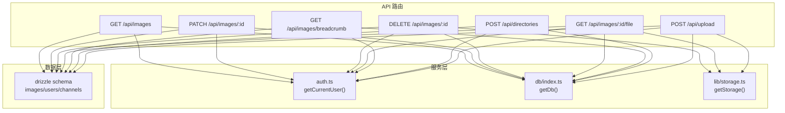
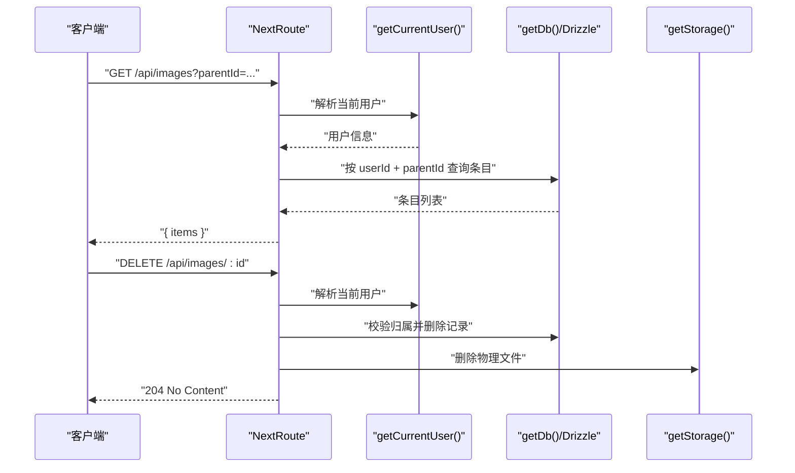
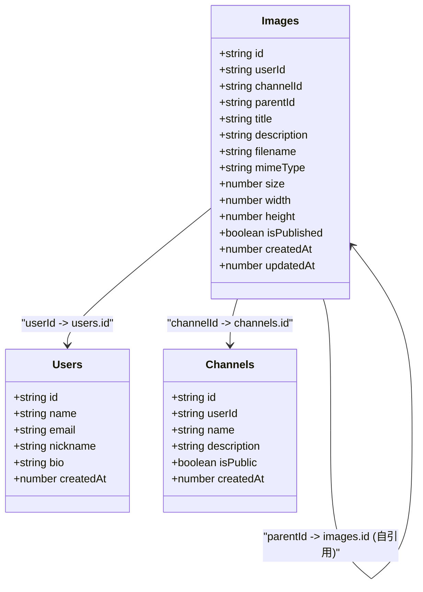

# 图片管理 API

<cite>
**本文引用的文件**   
- [src/app/api/images/route.ts](file://src/app/api/images/route.ts)
- [src/app/api/images/[imageId]/route.ts](file://src/app/api/images/[imageId]/route.ts)
- [src/app/api/images/[imageId]/file/route.ts](file://src/app/api/images/[imageId]/file/route.ts)
- [src/app/api/images/breadcrumb/route.ts](file://src/app/api/images/breadcrumb/route.ts)
- [src/app/api/directories/route.ts](file://src/app/api/directories/route.ts)
- [src/app/api/upload/route.ts](file://src/app/api/upload/route.ts)
- [src/db/schema.ts](file://src/db/schema.ts)
- [src/lib/auth.ts](file://src/lib/auth.ts)
- [specs/001-image-directory-tree/contracts/get-images-and-breadcrumb.md](file://specs/001-image-directory-tree/contracts/get-images-and-breadcrumb.md)
- [specs/001-image-directory-tree/contracts/post-directories.md](file://specs/001-image-directory-tree/contracts/post-directories.md)
- [specs/002-image-upload-tree-refine/contracts/post-upload.md](file://specs/002-image-upload-tree-refine/contracts/post-upload.md)
</cite>

## 目录
1. [简介](#简介)
2. [项目结构](#项目结构)
3. [核心组件](#核心组件)
4. [架构总览](#架构总览)
5. [详细接口说明](#详细接口说明)
6. [依赖关系分析](#依赖关系分析)
7. [性能与扩展性](#性能与扩展性)
8. [故障排查指南](#故障排查指南)
9. [结论](#结论)
10. [附录：数据模型与字段说明](#附录数据模型与字段说明)

## 简介
本文件为 Weable 应用的“图片管理”RESTful API 文档，覆盖图片列表、单个图片详情、删除、更新、文件读取、目录创建、面包屑导航以及批量上传等能力。重点说明请求参数（含查询字符串如 parentId）、响应格式、错误处理、认证与权限控制，并给出树形目录结构与排序规则的实现要点。当前实现未包含分页机制与搜索功能，将在“扩展建议”中提供落地方案。

## 项目结构
图片相关 API 位于 Next.js App Router 的 src/app/api 目录下，采用按资源划分的路由组织方式：
- /api/images：获取图片/目录列表（支持 parentId 过滤）
- /api/images/:id：单个图片的更新与删除
- /api/images/:id/file：获取图片二进制文件流
- /api/images/breadcrumb：根据目标目录 ID 返回从根到该目录的面包屑路径
- /api/directories：创建目录条目
- /api/upload：批量上传图片（支持指定 parentId）

图表来源
- [src/app/api/images/route.ts:1-66](file://src/app/api/images/route.ts#L1-L66)
- [src/app/api/images/[imageId]/route.ts:1-84](file://src/app/api/images/[imageId]/route.ts#L1-L84)
- [src/app/api/images/[imageId]/file/route.ts:1-48](file://src/app/api/images/[imageId]/file/route.ts#L1-L48)
- [src/app/api/images/breadcrumb/route.ts:1-40](file://src/app/api/images/breadcrumb/route.ts#L1-L40)
- [src/app/api/directories/route.ts:1-95](file://src/app/api/directories/route.ts#L1-L95)
- [src/app/api/upload/route.ts:1-75](file://src/app/api/upload/route.ts#L1-L75)
- [src/db/schema.ts:1-100](file://src/db/schema.ts#L1-L100)
- [src/lib/auth.ts:1-118](file://src/lib/auth.ts#L1-L118)

章节来源
- [src/app/api/images/route.ts:1-66](file://src/app/api/images/route.ts#L1-L66)
- [src/app/api/images/[imageId]/route.ts:1-84](file://src/app/api/images/[imageId]/route.ts#L1-L84)
- [src/app/api/images/[imageId]/file/route.ts:1-48](file://src/app/api/images/[imageId]/file/route.ts#L1-L48)
- [src/app/api/images/breadcrumb/route.ts:1-40](file://src/app/api/images/breadcrumb/route.ts#L1-L40)
- [src/app/api/directories/route.ts:1-95](file://src/app/api/directories/route.ts#L1-L95)
- [src/app/api/upload/route.ts:1-75](file://src/app/api/upload/route.ts#L1-L75)
- [src/db/schema.ts:1-100](file://src/db/schema.ts#L1-L100)
- [src/lib/auth.ts:1-118](file://src/lib/auth.ts#L1-L118)

## 核心组件
- 认证与用户解析：getCurrentUser() 从 Cloudflare Access JWT 或会话 Cookie 解析用户，生产环境未登录将抛出错误；开发环境使用固定 DEV_USER。
- 数据库访问：通过 getDb() 获取 Drizzle ORM 客户端，操作 images/users/channels 表。
- 存储访问：通过 getStorage() 抽象对象存储（R2/本地），用于图片读写与删除。
- 数据模型：images 表支持父子层级（parentId 自引用），区分目录与图片（mimeType）。

章节来源
- [src/lib/auth.ts:1-118](file://src/lib/auth.ts#L1-L118)
- [src/db/schema.ts:1-100](file://src/db/schema.ts#L1-L100)

## 架构总览
图片管理 API 遵循“路由 -> 鉴权 -> 业务逻辑 -> 数据/存储访问”的分层模式。所有写操作均校验当前用户身份，确保数据隔离。目录与图片统一存储在 images 表中，通过 mimeType 区分。

图表来源
- [src/app/api/images/route.ts:1-66](file://src/app/api/images/route.ts#L1-L66)
- [src/app/api/images/[imageId]/route.ts:1-84](file://src/app/api/images/[imageId]/route.ts#L1-L84)
- [src/lib/auth.ts:1-118](file://src/lib/auth.ts#L1-L118)

## 详细接口说明

### GET /api/images
- 功能：获取当前用户的图片/目录列表，支持按父目录过滤。
- 认证：需要已登录用户。
- 查询参数：
  - parentId：可选，string。若提供，则仅返回该目录的直接子项；未提供时返回根级（parent_id IS NULL）条目。
- 排序规则：目录优先（mimeType = 'directory'），同类型按 updatedAt 降序。
- 成功响应（200）：
  - 字段：items[]，每项包含 id、title、mimeType、description、size、width、height、parentId、channelId、isPublished、createdAt、updatedAt。
- 错误响应：
  - 404：当 parentId 存在但非目录或不属于当前用户时，返回 { error: "parent directory not found" }。
  - 401：未登录（由 getCurrentUser() 抛出）。

示例请求
- GET /api/images
- GET /api/images?parentId=AbC123XyZ

示例响应（200）
{
  "items": [
    {
      "id": "AbC123XyZ",
      "title": "设计稿",
      "mimeType": "directory",
      "description": "UI 设计相关",
      "size": 0,
      "parentId": null,
      "createdAt": 1753920000000,
      "updatedAt": 1753920000000
    },
    {
      "id": "Qw9ErTy2K",
      "title": "banner.jpg",
      "mimeType": "image/jpeg",
      "description": "",
      "size": 204800,
      "width": 1920,
      "height": 1080,
      "parentId": null,
      "channelId": "ch_abc",
      "isPublished": false,
      "createdAt": 1753920001000,
      "updatedAt": 1753920001000
    }
  ]
}

章节来源
- [src/app/api/images/route.ts:1-66](file://src/app/api/images/route.ts#L1-L66)
- [specs/001-image-directory-tree/contracts/get-images-and-breadcrumb.md:1-132](file://specs/001-image-directory-tree/contracts/get-images-and-breadcrumb.md#L1-L132)

### GET /api/images/breadcrumb
- 功能：根据目标目录 ID 返回从根到该目录的祖先路径（面包屑）。
- 认证：需要已登录用户。
- 查询参数：
  - parentId：必填，string。目标目录 ID。
- 成功响应（200）：
  - 字段：breadcrumb[]，每项包含 id、title，顺序从根到当前目录。
- 错误响应：
  - 400：缺少 parentId。
  - 404：目录不存在或不属于当前用户。
  - 401：未登录。

示例请求
- GET /api/images/breadcrumb?parentId=AbC123XyZ

示例响应（200）
{
  "breadcrumb": [
    { "id": "root_abc", "title": "设计稿" },
    { "id": "child_xyz", "title": "2026年Q1" }
  ]
}

章节来源
- [src/app/api/images/breadcrumb/route.ts:1-40](file://src/app/api/images/breadcrumb/route.ts#L1-L40)
- [specs/001-image-directory-tree/contracts/get-images-and-breadcrumb.md:76-118](file://specs/001-image-directory-tree/contracts/get-images-and-breadcrumb.md#L76-L118)

### PATCH /api/images/:id
- 功能：更新图片元数据（标题、描述、频道、发布状态）。
- 认证：需要已登录用户，且只能更新属于当前用户的图片。
- 路径参数：
  - imageId：string，仅允许字母数字及 _ -。
- 请求体（JSON）：
  - title：可选，string，自动 trim。
  - description：可选，string。
  - channelId：可选，null 或 string。
  - isPublished：可选，boolean。
- 成功响应（200）：
  - { ok: true }
- 错误响应：
  - 400：imageId 非法。
  - 404：图片不存在或不属于当前用户。
  - 401：未登录。

示例请求
- PATCH /api/images/Qw9ErTy2K
- Body: { "title": "新标题", "isPublished": true }

示例响应（200）
{ "ok": true }

章节来源
- [src/app/api/images/[imageId]/route.ts:40-84](file://src/app/api/images/[imageId]/route.ts#L40-L84)

### DELETE /api/images/:id
- 功能：删除图片及其物理文件。
- 认证：需要已登录用户，且只能删除属于当前用户的图片。
- 路径参数：
  - imageId：string，仅允许字母数字及 _ -。
- 成功响应（204）：无内容。
- 错误响应：
  - 400：imageId 非法。
  - 404：图片不存在或不属于当前用户。
  - 401：未登录。

示例请求
- DELETE /api/images/Qw9ErTy2K

示例响应（204）
(空)

章节来源
- [src/app/api/images/[imageId]/route.ts:12-38](file://src/app/api/images/[imageId]/route.ts#L12-L38)

### GET /api/images/:id/file
- 功能：获取图片二进制文件流（仅适用于 mimeType != 'directory'）。
- 认证：无需鉴权（直接基于 imageId 读取，不校验 userId）。
- 路径参数：
  - imageId：string，仅允许字母数字及 _ -。
- 成功响应（200）：
  - 二进制流，Content-Type 为图片 MIME 类型，附带缓存头。
- 错误响应：
  - 400：imageId 非法。
  - 404：图片不存在或为目录。
  - 404：存储中找不到文件。

示例请求
- GET /api/images/Qw9ErTy2K/file

示例响应（200）
二进制图片数据（Content-Type: image/jpeg）

章节来源
- [src/app/api/images/[imageId]/file/route.ts:1-48](file://src/app/api/images/[imageId]/file/route.ts#L1-L48)

### POST /api/directories
- 功能：创建目录条目（在 images 表中插入 mimeType = 'directory' 的记录）。
- 认证：需要已登录用户。
- 请求体（JSON）：
  - title：必填，string，长度 1–200，禁止包含 / \ ..。
  - description：可选，string，最长 1000 字符。
  - parentId：可选，string；缺省或 null 表示根目录。
- 成功响应（201）：
  - { id: "新目录ID" }
- 错误响应：
  - 400：title 缺失/为空、包含非法字符、过长、description 过长。
  - 404：parentId 指定的目录不存在或不属于当前用户。
  - 409：同级已存在同名条目。
  - 401：未登录。

示例请求
- POST /api/directories
- Body: { "title": "设计稿", "description": "UI 设计相关", "parentId": "AbC123XyZ" }

示例响应（201）
{ "id": "Qw9ErTy2K" }

章节来源
- [src/app/api/directories/route.ts:1-95](file://src/app/api/directories/route.ts#L1-L95)
- [specs/001-image-directory-tree/contracts/post-directories.md:1-72](file://specs/001-image-directory-tree/contracts/post-directories.md#L1-L72)

### POST /api/upload
- 功能：批量上传图片（支持指定 parentId）。
- 认证：需要已登录用户。
- 请求体（multipart/form-data）：
  - file：File，1–50 个，必须为 image/* 类型，单文件不超过 5 MB。
  - parentId：可选，string；指向当前用户可访问且 mimeType = 'directory' 的目录。
- 成功响应（201）：
  - { ids: ["img_1", "img_2", ...] }，顺序与接收一致。
- 错误响应：
  - 400：无文件、数量超限、类型不合法、大小超限。
  - 404：parentId 无效或不可访问。
  - 500：存储或数据库异常。

示例请求
- POST /api/upload
- FormData: file=[...], parentId=AbC123XyZ

示例响应（201）
{ "ids": ["img_1", "img_2"] }

章节来源
- [src/app/api/upload/route.ts:1-75](file://src/app/api/upload/route.ts#L1-L75)
- [specs/002-image-upload-tree-refine/contracts/post-upload.md:1-63](file://specs/002-image-upload-tree-refine/contracts/post-upload.md#L1-L63)

## 依赖关系分析
- 路由层依赖：
  - auth.ts：getCurrentUser() 负责认证与用户解析。
  - db/index.ts：getDb() 提供数据库连接。
  - lib/storage.ts：getStorage() 提供对象存储读写。
  - db/schema.ts：images/users/channels 表结构与关系。
- 数据模型关键点：
  - images.parentId 自引用，形成树形结构。
  - images.mimeType 区分目录与图片。
  - images.userId 保证数据隔离。
  - images.channelId 关联频道，可为空。

图表来源
- [src/db/schema.ts:26-69](file://src/db/schema.ts#L26-L69)

章节来源
- [src/db/schema.ts:1-100](file://src/db/schema.ts#L1-L100)

## 性能与扩展性
- 排序与查询：
  - 列表按目录优先与 updatedAt 降序，适合展示最近更新的目录与图片。
  - 当前未实现分页与搜索，建议在大数据量场景增加分页（limit/offset 或游标）与全文检索（title/description 模糊匹配）。
- 缓存策略：
  - 文件读取接口设置了强缓存头，有利于前端重复加载。
- 并发与事务：
  - 批量上传逐条写入存储与数据库，可在高并发下考虑事务或重试机制保障一致性。
- 扩展建议：
  - 分页：在 GET /api/images 增加 page、pageSize 或 cursor 参数。
  - 搜索：增加 q 参数对 title/description 进行 LIKE 或全文索引匹配。
  - 排序：增加 sortBy（updatedAt/title/size）与 sortOrder（asc/desc）。
  - 权限：如需公开分享，可增加 isPublic 或 token 访问控制。

[本节为通用指导，不涉及具体文件分析]

## 故障排查指南
- 401 Unauthorized：
  - 检查是否携带有效的 Cloudflare Access JWT 或会话 Cookie。
  - 开发环境可通过环境变量注入 DEV_USER。
- 404 Not Found：
  - 图片/目录不存在或不属于当前用户。
  - 文件读取接口可能因存储层缺失导致 404。
- 400 Bad Request：
  - 参数校验失败（imageId 格式、title 非法字符、文件大小限制等）。
- 409 Conflict：
  - 同级目录重名。
- 500 Internal Server Error：
  - 存储或数据库异常，需检查日志与外部依赖可用性。

章节来源
- [src/app/api/images/route.ts:16-31](file://src/app/api/images/route.ts#L16-L31)
- [src/app/api/images/[imageId]/route.ts:12-38](file://src/app/api/images/[imageId]/route.ts#L12-L38)
- [src/app/api/images/[imageId]/file/route.ts:12-48](file://src/app/api/images/[imageId]/file/route.ts#L12-L48)
- [src/app/api/directories/route.ts:22-40](file://src/app/api/directories/route.ts#L22-L40)
- [src/app/api/upload/route.ts:21-35](file://src/app/api/upload/route.ts#L21-L35)

## 结论
Weable 的图片管理 API 以统一的 images 表承载目录与图片，通过 mimeType 与 parentId 构建树形结构，并提供完整的 CRUD 与文件读取能力。认证与权限通过 getCurrentUser() 保障数据隔离。当前实现未包含分页与搜索，建议在后续迭代中补充以提升可扩展性与用户体验。

[本节为总结，不涉及具体文件分析]

## 附录：数据模型与字段说明
- images 表关键字段：
  - id：主键，Base58 编码 UUIDv7。
  - userId：所属用户，关联 users.id。
  - channelId：可选，关联 channels.id。
  - parentId：自引用，构建树形结构。
  - title：名称（目录/图片）。
  - description：描述。
  - filename：原始文件名（目录与 title 相同）。
  - mimeType：区分目录与图片。
  - size/width/height：媒体属性。
  - isPublished：发布状态。
  - createdAt/updatedAt：时间戳。

章节来源
- [src/db/schema.ts:46-69](file://src/db/schema.ts#L46-L69)