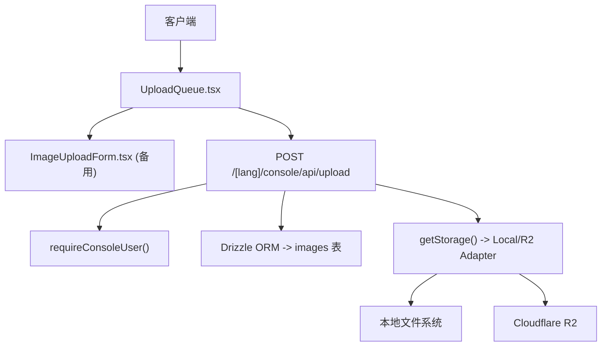
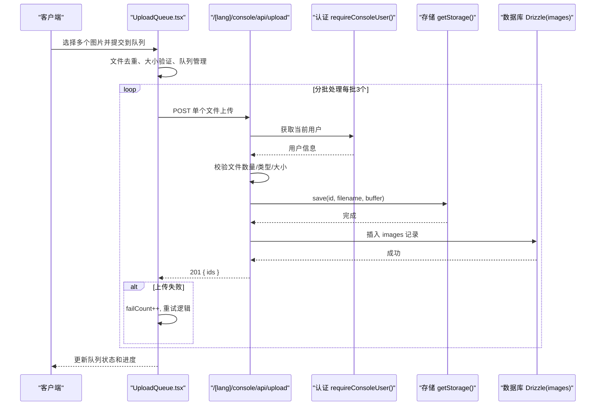
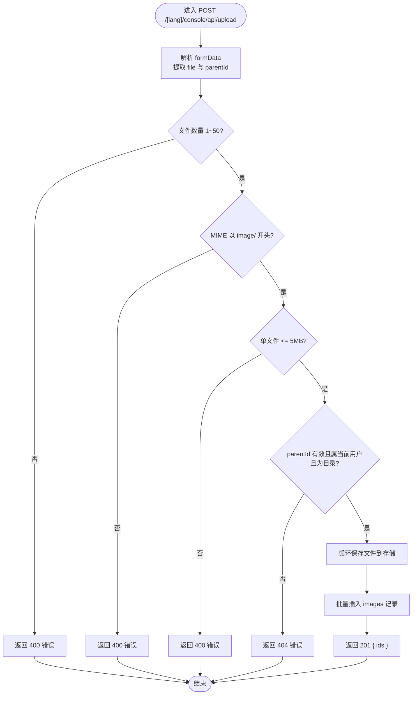
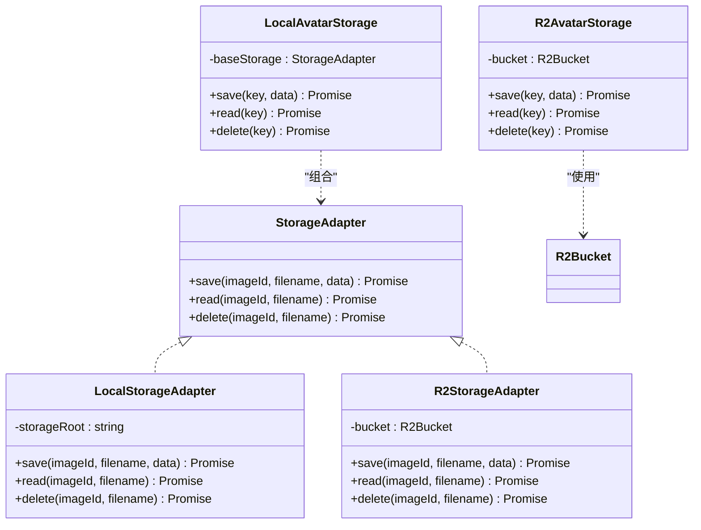
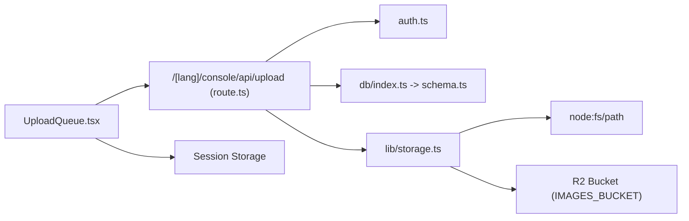

# 文件上传 API

<cite>
**本文引用的文件**
- [src/app/[lang]/console/api/upload/route.ts](file://src/app/[lang]/console/api/upload/route.ts)
- [src/components/UploadQueue.tsx](file://src/components/UploadQueue.tsx)
- [src/components/ImageUploadForm.tsx](file://src/components/ImageUploadForm.tsx)
- [src/lib/storage.ts](file://src/lib/storage.ts)
- [src/db/schema.ts](file://src/db/schema.ts)
- [specs/002-image-upload-tree-refine/contracts/post-upload.md](file://specs/002-image-upload-tree-refine/contracts/post-upload.md)
- [specs/010-batch-delete-upload-queue/spec.md](file://specs/010-batch-delete-upload-queue/spec.md)
- [specs/010-batch-delete-upload-queue/contracts/upload-queue-session-storage.md](file://specs/010-batch-delete-upload-queue/contracts/upload-queue-session-storage.md)
- [wrangler.jsonc](file://wrangler.jsonc)
</cite>

## 更新摘要
**变更内容**
- 新增 UploadQueue 组件，实现基于 Session Storage 的队列管理，解决 Cloudflare Workers 请求频率限制问题
- 支持批量处理（每批3个文件）、重试逻辑（最多3次）、文件去重和大小验证（5MB限制）
- 更新了前端集成方式，新的上传页面使用 UploadQueue 替代原有的 ImageUploadForm
- 增强了错误处理和用户界面反馈机制

## 目录
1. [简介](#简介)
2. [项目结构](#项目结构)
3. [核心组件](#核心组件)
4. [架构总览](#架构总览)
5. [详细组件分析](#详细组件分析)
6. [依赖关系分析](#依赖关系分析)
7. [性能考量](#性能考量)
8. [故障排查指南](#故障排查指南)
9. [结论](#结论)
10. [附录：客户端集成与最佳实践](#附录客户端集成与最佳实践)

## 简介
本文件为 Weable 应用的"文件上传 API"提供完整文档，聚焦 POST /api/upload 端点。内容涵盖表单数据处理、文件验证（类型与大小）、多文件上传支持、错误处理策略、存储路径规则、数据库元数据写入、以及 CDN/R2 集成方式。同时给出请求示例、响应格式、错误码说明和客户端集成建议。

**重要更新**：现已引入 UploadQueue 组件，实现了会话级队列管理，支持批量上传、重试机制和速率限制，以应对 Cloudflare Workers 的请求频率限制。

## 项目结构
- API 路由：Next.js App Router 下的 `/[lang]/console/api/upload/route.ts` 负责接收并处理上传请求。
- 前端组件：UploadQueue.tsx 提供智能上传队列 UI，支持批量处理、状态跟踪和错误恢复；ImageUploadForm.tsx 作为基础上传表单组件。
- 存储抽象：storage.ts 定义 StorageAdapter 接口，并提供 LocalStorageAdapter 与 R2StorageAdapter 两种实现，按运行环境自动选择。
- 数据模型：schema.ts 定义 images 表结构与 ID 生成函数 createId()。
- 规范契约：post-upload.md 明确上传接口的约束、成功与失败响应语义。
- 部署配置：wrangler.jsonc 声明 R2 Bucket 绑定 IMAGES_BUCKET。

**图表来源**
- [src/components/UploadQueue.tsx:149-446](file://src/components/UploadQueue.tsx#L149-L446)
- [src/app/[lang]/console/api/upload/route.ts:16-81](file://src/app/[lang]/console/api/upload/route.ts#L16-L81)
- [src/lib/storage.ts:1-214](file://src/lib/storage.ts#L1-L214)
- [src/db/schema.ts:1-100](file://src/db/schema.ts#L1-L100)

**章节来源**
- [src/app/[lang]/console/api/upload/route.ts:16-81](file://src/app/[lang]/console/api/upload/route.ts#L16-L81)
- [src/components/UploadQueue.tsx:1-446](file://src/components/UploadQueue.tsx#L1-L446)
- [src/components/ImageUploadForm.tsx:1-105](file://src/components/ImageUploadForm.tsx#L1-L105)
- [src/lib/storage.ts:1-214](file://src/lib/storage.ts#L1-L214)
- [src/db/schema.ts:1-100](file://src/db/schema.ts#L1-L100)
- [specs/002-image-upload-tree-refine/contracts/post-upload.md:1-63](file://specs/002-image-upload-tree-refine/contracts/post-upload.md#L1-L63)
- [wrangler.jsonc:1-34](file://wrangler.jsonc#L1-L34)

## 核心组件
- **上传路由（POST /[lang]/console/api/upload）**
  - 解析 multipart/form-data，校验文件数量、类型、大小。
  - 可选 parentId 校验（必须属于当前用户且类型为目录）。
  - 逐文件生成唯一 ID，持久化到存储，并在数据库中插入记录。
  - 返回 201 及 ids 列表。
- **上传队列组件（UploadQueue.tsx）**
  - 实现会话级队列管理，支持批量上传（每批3个文件）。
  - 提供文件去重、大小验证（5MB限制）、重试逻辑（最多3次）。
  - 使用 Session Storage 持久化队列状态，支持页面刷新后恢复。
  - 提供直观的UI界面，显示上传进度、状态和错误信息。
- **存储适配器**
  - 统一接口 save/read/delete。
  - 本地模式：IMAGE_STORAGE_PATH 或默认 .data/uploads，路径安全校验后落盘。
  - R2 模式：通过 IMAGES_BUCKET 绑定，对象键为 imageId/filename。
- **数据模型**
  - images 表包含 id、userId、parentId、title、filename、mimeType、size 等字段。
  - ID 使用 uuidv7 + base58 编码生成。

**章节来源**
- [src/app/[lang]/console/api/upload/route.ts:16-81](file://src/app/[lang]/console/api/upload/route.ts#L16-L81)
- [src/components/UploadQueue.tsx:1-446](file://src/components/UploadQueue.tsx#L1-L446)
- [src/lib/storage.ts:1-214](file://src/lib/storage.ts#L1-L214)
- [src/db/schema.ts:1-100](file://src/db/schema.ts#L1-L100)
- [specs/002-image-upload-tree-refine/contracts/post-upload.md:1-63](file://specs/002-image-upload-tree-refine/contracts/post-upload.md#L1-L63)

## 架构总览
上传流程时序如下，现已增强为支持批量处理和重试机制：

**图表来源**
- [src/components/UploadQueue.tsx:231-281](file://src/components/UploadQueue.tsx#L231-L281)
- [src/app/[lang]/console/api/upload/route.ts:16-81](file://src/app/[lang]/console/api/upload/route.ts#L16-L81)
- [src/lib/storage.ts:184-197](file://src/lib/storage.ts#L184-L197)
- [src/db/schema.ts:46-69](file://src/db/schema.ts#L46-L69)

## 详细组件分析

### 上传路由 POST /[lang]/console/api/upload
- **输入**
  - Content-Type: multipart/form-data
  - 字段 file：可重复，1~50 个
  - 字段 parentId：可选字符串，目标目录 ID
- **校验逻辑**
  - 至少 1 个文件，最多 50 个
  - 每个文件 MIME 必须以 image/ 开头
  - 每个文件大小不超过 5 MB
  - 若提供 parentId，需存在且属于当前用户且 mimeType=directory
- **处理流程**
  - 生成唯一 ID（createId）
  - 将文件转为 Buffer 并调用 storage.save
  - 批量插入 images 记录（id、userId、parentId、title、filename、mimeType、size）
- **输出**
  - 成功：201 Created，{ ids: string[] }
  - 失败：400（无文件/超限/类型不合法/过大），404（parentId 无效），500（存储/DB 异常）

**图表来源**
- [src/app/[lang]/console/api/upload/route.ts:16-81](file://src/app/[lang]/console/api/upload/route.ts#L16-L81)

**章节来源**
- [src/app/[lang]/console/api/upload/route.ts:16-81](file://src/app/[lang]/console/api/upload/route.ts#L16-L81)
- [specs/002-image-upload-tree-refine/contracts/post-upload.md:1-63](file://specs/002-image-upload-tree-refine/contracts/post-upload.md#L1-L63)

### 上传队列组件 UploadQueue.tsx
**新增功能**：实现了完整的上传队列管理系统

- **核心特性**
  - 批量处理：每批最多3个文件，批次间串行执行
  - 重试机制：单个文件最多重试3次，超过后禁用复选框
  - 文件去重：同一目录下同名文件不会重复添加到队列
  - 大小验证：客户端预检查5MB限制，标记过大的文件
  - 状态持久化：使用 Session Storage 保存队列状态，支持页面刷新恢复
  - 错误处理：详细的错误信息和用户友好的状态提示

- **队列状态管理**
  - pending：待上传状态
  - uploading：正在上传中
  - success：上传成功
  - failed：上传失败（带失败次数）
  - oversized：文件过大
  - needs_file：需要重新选择文件（页面刷新后）

- **Session Storage 协议**
  - Key 格式：`weable_upload_queue_{parentId ?? 'root'}`
  - 存储内容：队列条目元数据（不含 File 对象）
  - 恢复逻辑：页面加载时自动恢复队列状态

**章节来源**
- [src/components/UploadQueue.tsx:1-446](file://src/components/UploadQueue.tsx#L1-L446)
- [specs/010-batch-delete-upload-queue/contracts/upload-queue-session-storage.md:1-153](file://specs/010-batch-delete-upload-queue/contracts/upload-queue-session-storage.md#L1-L153)

### 前端上传表单 ImageUploadForm.tsx
- **功能要点**
  - 限制最大文件数与单文件大小
  - 构建 FormData，追加 file 与可选 parentId
  - 使用 fetch 调用 /api/upload
  - 成功后根据 parentId 跳转至控制台图片列表页
- **错误处理**
  - 前端先做基础校验（数量、大小）
  - 服务端错误通过 res.json().error 展示

**章节来源**
- [src/components/ImageUploadForm.tsx:1-105](file://src/components/ImageUploadForm.tsx#L1-L105)

### 存储适配器 storage.ts
- **接口设计**
  - StorageAdapter：save(imageId, filename, data)、read(imageId, filename)、delete(imageId, filename)
  - AvatarStorage：用于头像的简化接口
- **实现**
  - LocalStorageAdapter：基于 node:fs/promises，路径拼接为 storageRoot/imageId/filename，含安全段校验
  - R2StorageAdapter：基于 Cloudflare R2，对象键为 imageId/filename
- **运行时选择**
  - getStorage() 优先检测 R2 绑定（IMAGES_BUCKET），否则回退到本地存储
  - 在 Cloudflare 环境中未配置绑定会抛出错误提示

**图表来源**
- [src/lib/storage.ts:1-214](file://src/lib/storage.ts#L1-L214)

**章节来源**
- [src/lib/storage.ts:1-214](file://src/lib/storage.ts#L1-L214)

### 数据模型 schema.ts
- **images 表关键字段**
  - id：主键，uuidv7 + base58 编码
  - userId：关联用户
  - parentId：自引用目录父节点
  - title、filename、mimeType、size：文件元数据
  - width、height：预留尺寸字段（当前上传未填充）
  - isPublished、createdAt、updatedAt：发布状态与时间戳
- **createId() 用于生成短小稳定的 ID**

**章节来源**
- [src/db/schema.ts:1-100](file://src/db/schema.ts#L1-L100)

## 依赖关系分析
- **路由层依赖**
  - auth：requireConsoleUser() 从 Cookie/Header 解析用户身份
  - db：Drizzle ORM 操作 images 表
  - storage：getStorage() 动态选择本地或 R2 存储
- **存储层依赖**
  - 本地：node:fs/promises、node:path
  - R2：Cloudflare R2 绑定 IMAGES_BUCKET（由 wrangler.jsonc 声明）
- **前端依赖**
  - React Hooks、Fetch API、Session Storage API

**图表来源**
- [src/app/[lang]/console/api/upload/route.ts:16-81](file://src/app/[lang]/console/api/upload/route.ts#L16-L81)
- [src/lib/storage.ts:1-214](file://src/lib/storage.ts#L1-L214)
- [wrangler.jsonc:16-32](file://wrangler.jsonc#L16-L32)

**章节来源**
- [src/app/[lang]/console/api/upload/route.ts:16-81](file://src/app/[lang]/console/api/upload/route.ts#L16-L81)
- [src/lib/storage.ts:1-214](file://src/lib/storage.ts#L1-L214)
- [wrangler.jsonc:1-34](file://wrangler.jsonc#L1-L34)

## 性能考量
- **并发与顺序**
  - 当前实现采用批次化处理：每批最多3个文件，批次内并发执行，批次间串行等待。
  - 这种设计有效控制了 Cloudflare Workers 的请求频率，避免触发速率限制。
- **I/O 路径**
  - 本地模式：磁盘写入，受限于文件系统性能与配额。
  - R2 模式：网络写入，受限于带宽与远端服务延迟。
- **内存占用**
  - 文件被转换为 Buffer，大文件或大量文件可能增加内存压力。
  - UploadQueue 组件通过流式处理和批次控制优化内存使用。
- **可扩展性**
  - 可通过调整 BATCH_SIZE 参数平衡吞吐量和速率限制。
  - 支持异步任务队列扩展，提升整体处理能力。

## 故障排查指南
- **常见错误**
  - 400：无文件、数量超限、类型不合法、单文件过大
  - 404：parentId 不存在或不可访问
  - 500：存储写入失败或数据库异常
- **定位步骤**
  - 检查前端是否满足数量与大小限制
  - 确认浏览器开发者工具中 FormData 字段是否正确
  - 查看服务端日志与存储后端（本地目录或 R2）是否存在权限问题
  - 在 Cloudflare 环境中确认 IMAGES_BUCKET 绑定已正确配置
  - 检查 UploadQueue 组件的 Session Storage 状态是否正常

**章节来源**
- [src/app/[lang]/console/api/upload/route.ts:27-55](file://src/app/[lang]/console/api/upload/route.ts#L27-L55)
- [src/lib/storage.ts:184-197](file://src/lib/storage.ts#L184-L197)
- [wrangler.jsonc:23-32](file://wrangler.jsonc#L23-L32)

## 结论
POST /[lang]/console/api/upload 提供了稳定可靠的多图片上传能力，现已通过 UploadQueue 组件实现了智能的队列管理和速率限制控制。系统具备完善的表单校验、类型与大小限制、目录上下文校验与统一的存储抽象。新版本特别针对 Cloudflare Workers 环境进行了优化，通过批次化处理、重试机制和会话级状态管理，有效解决了请求频率限制问题。

## 附录：客户端集成与最佳实践

### 接口规范
- **方法**：POST
- **URL**：/[lang]/console/api/upload
- **Content-Type**：multipart/form-data
- **请求体字段**
  - file：File[]，1~50 个
  - parentId：string，可选，目标目录 ID
- **成功响应**
  - 状态码：201
  - 响应体：{ ids: string[] }
- **失败响应**
  - 状态码：400/404/500
  - 响应体：{ error: string }

**章节来源**
- [specs/002-image-upload-tree-refine/contracts/post-upload.md:1-63](file://specs/002-image-upload-tree-refine/contracts/post-upload.md#L1-L63)

### 请求示例（FormData）
- **字段名**：file（可重复）
- **字段名**：parentId（可选）
- **示例片段**（概念性描述）
  - 选择多张图片，构造 FormData，append("file", file)，必要时 append("parentId", id)
  - 使用 fetch("/[lang]/console/api/upload", { method: "POST", body: formData }) 提交

**章节来源**
- [src/components/ImageUploadForm.tsx:48-55](file://src/components/ImageUploadForm.tsx#L48-L55)

### 响应处理
- **成功**：读取 ids 数组，刷新或跳转到对应目录列表页
- **失败**：显示 error 消息，保持页面状态以便重试

**章节来源**
- [src/components/ImageUploadForm.tsx:56-71](file://src/components/ImageUploadForm.tsx#L56-L71)

### 错误代码与处理策略
- **400**：提示用户减少文件数量、降低单文件大小或更换文件类型
- **404**：提示用户重新选择正确的目录
- **500**：提示稍后重试，必要时联系管理员

**章节来源**
- [specs/002-image-upload-tree-refine/contracts/post-upload.md:42-57](file://specs/002-image-upload-tree-refine/contracts/post-upload.md#L42-L57)

### 存储路径规则
- **本地模式**
  - 根路径：IMAGE_STORAGE_PATH 环境变量，默认 .data/uploads
  - 对象路径：storageRoot/imageId/filename
  - 安全校验：imageId 与 filename 不得包含路径分隔符或特殊字符
- **R2 模式**
  - 对象键：imageId/filename
  - 绑定名称：IMAGES_BUCKET（见 wrangler.jsonc）

**章节来源**
- [src/lib/storage.ts:27-33](file://src/lib/storage.ts#L27-L33)
- [src/lib/storage.ts:55-59](file://src/lib/storage.ts#L55-L59)
- [wrangler.jsonc:23-32](file://wrangler.jsonc#L23-L32)

### 元数据与扩展建议
- **当前元数据**
  - 写入字段：id、userId、parentId、title、filename、mimeType、size
  - 预留字段：width、height（当前上传未填充）
- **扩展建议**
  - EXIF 元数据提取：在服务端解析图片 EXIF，更新 width、height 及其他元数据
  - 缩略图生成：异步任务生成缩略图并存储，提供缩略图访问端点
  - CDN 集成：通过 R2 的自定义域名或 CDN 加速静态资源访问
  - 断点续传与进度跟踪：采用分块上传与事件监听，提升大文件体验

**章节来源**
- [src/db/schema.ts:46-69](file://src/db/schema.ts#L46-L69)
- [src/lib/storage.ts:184-197](file://src/lib/storage.ts#L184-L197)

### UploadQueue 组件集成指南
**新增功能**：推荐使用 UploadQueue 组件替代传统的直接上传方式

- **组件特性**
  - 自动批次处理：每批最多3个文件，避免触发速率限制
  - 智能重试：单个文件最多重试3次，超过后自动禁用
  - 状态持久化：使用 Session Storage 保存队列状态
  - 用户友好：实时状态更新和错误提示

- **集成步骤**
  1. 在页面中导入 UploadQueue 组件
  2. 传入必要的 props：lang、parentId、labels
  3. 组件会自动处理文件选择和上传流程

- **Session Storage 协议**
  - Key 格式：`weable_upload_queue_{parentId ?? 'root'}`
  - 存储内容：队列元数据（文件名、大小、状态、失败次数等）
  - 恢复机制：页面加载时自动恢复队列状态

**章节来源**
- [src/components/UploadQueue.tsx:149-446](file://src/components/UploadQueue.tsx#L149-L446)
- [specs/010-batch-delete-upload-queue/contracts/upload-queue-session-storage.md:1-153](file://specs/010-batch-delete-upload-queue/contracts/upload-queue-session-storage.md#L1-L153)