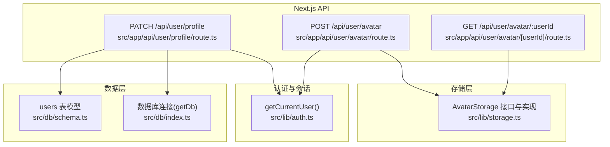
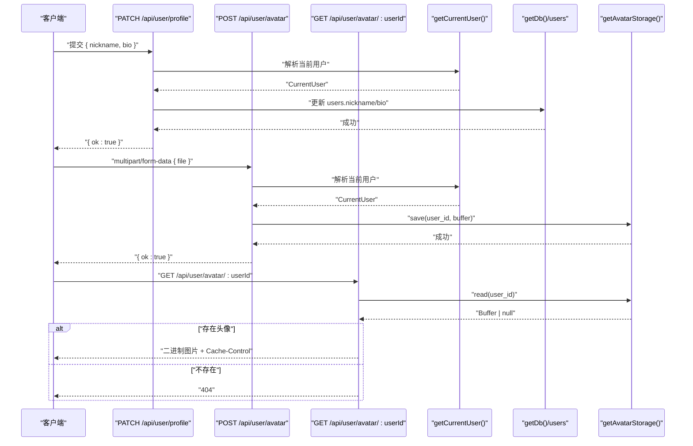
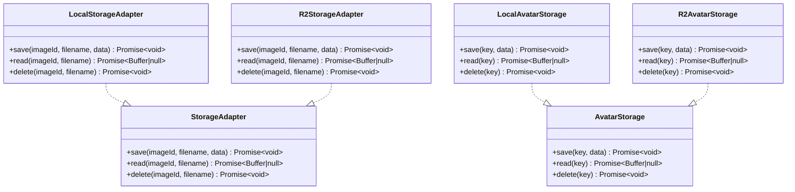
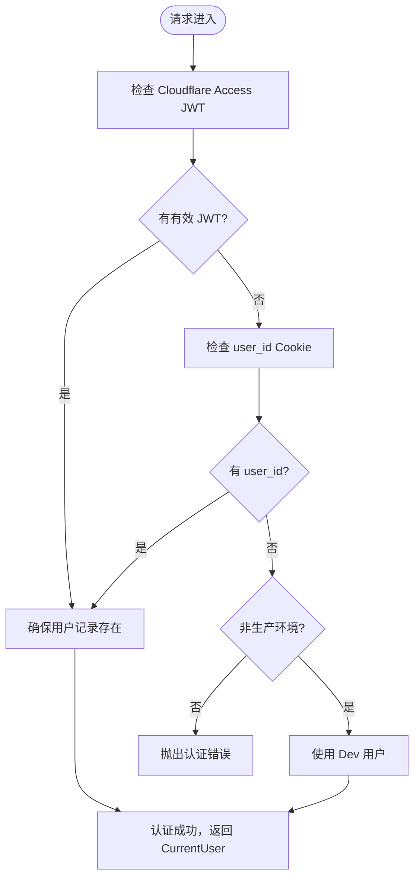

# 用户管理 API

<cite>
**本文引用的文件**   
- [src/app/api/user/profile/route.ts](file://src/app/api/user/profile/route.ts)
- [src/app/api/user/avatar/route.ts](file://src/app/api/user/avatar/route.ts)
- [src/app/api/user/avatar/[userId]/route.ts](file://src/app/api/user/avatar/[userId]/route.ts)
- [src/lib/auth.ts](file://src/lib/auth.ts)
- [src/db/schema.ts](file://src/db/schema.ts)
- [src/lib/storage.ts](file://src/lib/storage.ts)
- [src/db/index.ts](file://src/db/index.ts)
- [src/components/UserProfileClient.tsx](file://src/components/UserProfileClient.tsx)
- [src/app/[lang]/console/profile/page.tsx](file://src/app/[lang]/console/profile/page.tsx)
</cite>

## 目录
1. [简介](#简介)
2. [项目结构](#项目结构)
3. [核心组件](#核心组件)
4. [架构总览](#架构总览)
5. [详细组件分析](#详细组件分析)
6. [依赖分析](#依赖分析)
7. [性能考虑](#性能考虑)
8. [故障排查指南](#故障排查指南)
9. [结论](#结论)
10. [附录：API 参考与示例](#附录api-参考与示例)

## 简介
本文件为 Weable 应用的“用户管理”相关 API 提供完整文档，覆盖以下端点：
- PATCH /api/user/profile：获取并更新当前登录用户的个人资料（昵称、个人简介）
- POST /api/user/avatar：上传头像
- GET /api/user/avatar/:userId：按用户 ID 获取头像图片

文档包含数据模型、字段验证规则、头像处理限制（格式与大小）、认证流程与会话管理、权限控制、调用示例、响应格式与错误处理方案。

## 项目结构
用户管理功能位于 Next.js App Router 的 API 路由中，配合认证模块、数据库模型与存储适配器实现。关键路径如下：
- API 路由：src/app/api/user/...
- 认证与会话：src/lib/auth.ts
- 数据模型与关系：src/db/schema.ts
- 存储抽象与适配：src/lib/storage.ts
- 前端展示与交互：src/components/UserProfileClient.tsx、src/app/[lang]/console/profile/page.tsx

图表来源
- [src/app/api/user/profile/route.ts:1-31](file://src/app/api/user/profile/route.ts#L1-L31)
- [src/app/api/user/avatar/route.ts:1-34](file://src/app/api/user/avatar/route.ts#L1-L34)
- [src/app/api/user/avatar/[userId]/route.ts:1-29](file://src/app/api/user/avatar/[userId]/route.ts#L1-L29)
- [src/lib/auth.ts:1-118](file://src/lib/auth.ts#L1-L118)
- [src/db/schema.ts:26-33](file://src/db/schema.ts#L26-L33)
- [src/db/index.ts:43-61](file://src/db/index.ts#L43-L61)
- [src/lib/storage.ts:9-13](file://src/lib/storage.ts#L9-L13)

章节来源
- [src/app/api/user/profile/route.ts:1-31](file://src/app/api/user/profile/route.ts#L1-L31)
- [src/app/api/user/avatar/route.ts:1-34](file://src/app/api/user/avatar/route.ts#L1-L34)
- [src/app/api/user/avatar/[userId]/route.ts:1-29](file://src/app/api/user/avatar/[userId]/route.ts#L1-L29)
- [src/lib/auth.ts:1-118](file://src/lib/auth.ts#L1-L118)
- [src/db/schema.ts:26-33](file://src/db/schema.ts#L26-L33)
- [src/db/index.ts:43-61](file://src/db/index.ts#L43-L61)
- [src/lib/storage.ts:9-13](file://src/lib/storage.ts#L9-L13)

## 核心组件
- 用户资料更新接口：支持部分更新 nickname 与 bio，具备长度与类型校验，失败返回 400。
- 头像上传接口：支持 multipart/form-data，限定 MIME 类型与文件大小，成功保存后返回 ok。
- 头像读取接口：按 userId 读取头像二进制流，未命中返回 404，命中设置缓存头。
- 认证与会话：优先 Cloudflare Access JWT，其次会话 Cookie，开发环境回退到固定 Dev 用户；未解析则抛错。
- 数据模型：users 表包含 id、name、email、nickname、bio、createdAt 等字段。
- 存储抽象：AvatarStorage 统一头像存取，本地或 R2 后端自动选择。

章节来源
- [src/app/api/user/profile/route.ts:9-30](file://src/app/api/user/profile/route.ts#L9-L30)
- [src/app/api/user/avatar/route.ts:7-33](file://src/app/api/user/avatar/route.ts#L7-L33)
- [src/app/api/user/avatar/[userId]/route.ts:8-28](file://src/app/api/user/avatar/[userId]/route.ts#L8-L28)
- [src/lib/auth.ts:93-117](file://src/lib/auth.ts#L93-L117)
- [src/db/schema.ts:26-33](file://src/db/schema.ts#L26-L33)
- [src/lib/storage.ts:9-13](file://src/lib/storage.ts#L9-L13)

## 架构总览
下图展示了用户资料与头像处理的端到端流程：请求进入 API 路由，先进行身份鉴权，再访问数据库或存储层完成业务逻辑。

图表来源
- [src/app/api/user/profile/route.ts:9-30](file://src/app/api/user/profile/route.ts#L9-L30)
- [src/app/api/user/avatar/route.ts:10-33](file://src/app/api/user/avatar/route.ts#L10-L33)
- [src/app/api/user/avatar/[userId]/route.ts:8-28](file://src/app/api/user/avatar/[userId]/route.ts#L8-L28)
- [src/lib/auth.ts:93-117](file://src/lib/auth.ts#L93-L117)
- [src/db/index.ts:43-61](file://src/db/index.ts#L43-L61)
- [src/lib/storage.ts:199-213](file://src/lib/storage.ts#L199-L213)

## 详细组件分析

### 数据模型与字段约束
- 用户表 users
  - id：主键，默认生成
  - name：必填
  - email：必填且唯一
  - nickname：可选字符串
  - bio：可选字符串
  - createdAt：创建时间戳

- 字段验证规则（服务端）
  - nickname：仅接受 string 或 null；若为字符串则去除首尾空白并截断至 50 字符
  - bio：仅接受 string 或 null；若为字符串则去除首尾空白并截断至 500 字符
  - 其他字段不在本次更新范围内，忽略

- 前端输入限制（辅助）
  - nickname 最大长度 50
  - bio 最大长度 500
  - 头像上传 accept 限制 image/jpeg,image/png,image/gif,image/webp

章节来源
- [src/db/schema.ts:26-33](file://src/db/schema.ts#L26-L33)
- [src/app/api/user/profile/route.ts:15-24](file://src/app/api/user/profile/route.ts#L15-L24)
- [src/components/UserProfileClient.tsx:82-88](file://src/components/UserProfileClient.tsx#L82-L88)

### 认证流程与会话管理
- 优先级顺序
  1) Cloudflare Access JWT（Header cf-access-jwt-assertion 或 Cookie CF_Authorization/cf_authorization）
  2) 自定义会话 Cookie user_id
  3) 非生产环境回退到 DEV_USER_* 环境变量定义的固定用户
  4) 以上均不满足时抛出错误

- 行为说明
  - 首次访问会确保用户记录存在（插入或查询），并返回 CurrentUser（含 nickname、bio）
  - 生产环境无有效凭证将直接报错

章节来源
- [src/lib/auth.ts:93-117](file://src/lib/auth.ts#L93-L117)
- [src/lib/auth.ts:80-91](file://src/lib/auth.ts#L80-L91)

### 头像处理：尺寸限制与格式支持
- 允许的类型：image/jpeg、image/png、image/gif、image/webp
- 最大大小：2 MB
- 存储策略：
  - 优先使用 Cloudflare R2（若绑定 IMAGES_BUCKET）
  - 否则使用本地文件系统（IMAGE_STORAGE_PATH 或默认 .data/uploads）
- 读取响应：
  - 成功：返回二进制图片，Content-Type 设置为 image/png，并附带 Cache-Control 公共缓存头
  - 失败：未找到返回 404

章节来源
- [src/app/api/user/avatar/route.ts:7-26](file://src/app/api/user/avatar/route.ts#L7-L26)
- [src/app/api/user/avatar/[userId]/route.ts:18-27](file://src/app/api/user/avatar/[userId]/route.ts#L18-L27)
- [src/lib/storage.ts:199-213](file://src/lib/storage.ts#L199-L213)

### 权限控制
- 所有写操作（更新资料、上传头像）均需通过 getCurrentUser() 鉴权，未通过则无法继续
- 头像读取无需鉴权，但需合法 userId（仅允许字母、数字、下划线、连字符）

章节来源
- [src/app/api/user/profile/route.ts:10](file://src/app/api/user/profile/route.ts#L10)
- [src/app/api/user/avatar/route.ts:11](file://src/app/api/user/avatar/route.ts#L11)
- [src/app/api/user/avatar/[userId]/route.ts:11](file://src/app/api/user/avatar/[userId]/route.ts#L11)

### 错误处理
- 参数校验失败：返回 400，包含 error 字段
- 资源不存在：返回 404
- 未认证：抛出错误（由运行时处理）
- 常见错误信息
  - “No valid fields”：未提供可更新的字段
  - “No file provided”：未上传文件
  - “Invalid file type”：不支持的文件类型
  - “File too large (max 2 MB)”：超过大小限制
  - “Invalid user ID”：用户 ID 格式非法

章节来源
- [src/app/api/user/profile/route.ts:22-24](file://src/app/api/user/profile/route.ts#L22-L24)
- [src/app/api/user/avatar/route.ts:16-26](file://src/app/api/user/avatar/route.ts#L16-L26)
- [src/app/api/user/avatar/[userId]/route.ts:11-13](file://src/app/api/user/avatar/[userId]/route.ts#L11-L13)

### 前端交互要点
- 头像上传使用 FormData 发送 file 字段
- 上传成功后刷新头像 URL（带时间戳避免缓存）
- 更新资料使用 JSON 提交 nickname 与 bio，空值转为 null

章节来源
- [src/components/UserProfileClient.tsx:31-54](file://src/components/UserProfileClient.tsx#L31-L54)

## 依赖分析
- API 路由依赖
  - profile 路由：auth、db、schema
  - avatar 上传路由：auth、storage
  - avatar 读取路由：storage
- 存储层
  - LocalAvatarStorage 基于 StorageAdapter（本地文件系统）
  - R2AvatarStorage 基于 R2Bucket（Cloudflare R2）
- 数据库层
  - getDb() 根据运行环境选择 D1 或本地 SQLite

图表来源
- [src/lib/storage.ts:3-13](file://src/lib/storage.ts#L3-L13)
- [src/lib/storage.ts:61-114](file://src/lib/storage.ts#L61-L114)
- [src/lib/storage.ts:116-136](file://src/lib/storage.ts#L116-L136)
- [src/lib/storage.ts:138-152](file://src/lib/storage.ts#L138-L152)
- [src/lib/storage.ts:154-179](file://src/lib/storage.ts#L154-L179)

章节来源
- [src/lib/storage.ts:3-13](file://src/lib/storage.ts#L3-L13)
- [src/lib/storage.ts:184-213](file://src/lib/storage.ts#L184-L213)
- [src/db/index.ts:43-61](file://src/db/index.ts#L43-L61)

## 性能考虑
- 头像读取启用浏览器缓存（Cache-Control: public, max-age=3600），减少重复请求
- 存储层在 Cloudflare 环境下优先使用 R2，降低 I/O 延迟
- 数据库连接采用单例模式，避免重复初始化
- 上传前在前端做 accept 限制，减少无效请求

[本节为通用指导，不直接分析具体文件]

## 故障排查指南
- 400 错误
  - 检查请求体是否包含 nickname 或 bio（至少一个）
  - 检查上传文件的 MIME 类型是否在允许列表内
  - 检查文件大小是否不超过 2 MB
  - 检查 userId 是否仅包含字母、数字、下划线、连字符
- 404 错误
  - 头像读取时确认该用户是否存在头像
- 认证失败
  - 检查是否携带 Cloudflare Access JWT 或 user_id Cookie
  - 非生产环境未配置凭证时会回退到 Dev 用户；生产环境必须提供有效凭证

章节来源
- [src/app/api/user/profile/route.ts:22-24](file://src/app/api/user/profile/route.ts#L22-L24)
- [src/app/api/user/avatar/route.ts:16-26](file://src/app/api/user/avatar/route.ts#L16-L26)
- [src/app/api/user/avatar/[userId]/route.ts:11-13](file://src/app/api/user/avatar/[userId]/route.ts#L11-L13)
- [src/lib/auth.ts:93-117](file://src/lib/auth.ts#L93-L117)

## 结论
用户管理 API 围绕“资料更新”和“头像上传/读取”两大能力构建，具备严格的字段校验、安全的认证机制与灵活的存储后端。遵循本文档的规范可实现稳定、可扩展的用户信息管理。

[本节为总结性内容，不直接分析具体文件]

## 附录：API 参考与示例

### 通用约定
- 认证：所有写端点需要已登录用户（getCurrentUser）
- Content-Type：
  - 资料更新：application/json
  - 头像上传：multipart/form-data（字段名 file）
- 响应体：
  - 成功：{ ok: true }
  - 失败：{ error: "..." }

### PATCH /api/user/profile
- 功能：更新当前用户的 nickname 与 bio
- 请求体字段
  - nickname：string | null，长度上限 50
  - bio：string | null，长度上限 500
- 成功响应：{ ok: true }
- 错误响应
  - 400：{ error: "No valid fields" }
- 调用示例
  - curl -X PATCH http://localhost:3000/api/user/profile -H "Content-Type: application/json" -d '{"nickname":"新昵称","bio":"新的简介"}'
  - fetch("/api/user/profile", { method:"PATCH", headers:{"Content-Type":"application/json"}, body:JSON.stringify({nickname:"新昵称",bio:"新的简介"}) })

章节来源
- [src/app/api/user/profile/route.ts:9-30](file://src/app/api/user/profile/route.ts#L9-L30)
- [src/components/UserProfileClient.tsx:42-54](file://src/components/UserProfileClient.tsx#L42-L54)

### POST /api/user/avatar
- 功能：上传当前用户的头像
- 请求体：multipart/form-data，字段名为 file
- 限制
  - 类型：image/jpeg、image/png、image/gif、image/webp
  - 大小：≤ 2 MB
- 成功响应：{ ok: true }
- 错误响应
  - 400：{ error: "No file provided" }
  - 400：{ error: "Invalid file type" }
  - 400：{ error: "File too large (max 2 MB)" }
- 调用示例
  - curl -X POST http://localhost:3000/api/user/avatar -F "file=@avatar.png"
  - const fd = new FormData(); fd.append("file", file); await fetch("/api/user/avatar", { method:"POST", body:fd })

章节来源
- [src/app/api/user/avatar/route.ts:10-33](file://src/app/api/user/avatar/route.ts#L10-L33)
- [src/components/UserProfileClient.tsx:31-40](file://src/components/UserProfileClient.tsx#L31-L40)

### GET /api/user/avatar/:userId
- 功能：获取指定用户的头像图片
- 路径参数
  - userId：仅允许字母、数字、下划线、连字符
- 成功响应：二进制图片，Content-Type: image/png，Cache-Control: public, max-age=3600
- 错误响应
  - 400：{ error: "Invalid user ID" }
  - 404：无响应体（空响应）
- 调用示例
  - fetch("/api/user/avatar/" + userId).then(r => r.blob())
  - 

章节来源
- [src/app/api/user/avatar/[userId]/route.ts:8-28](file://src/app/api/user/avatar/[userId]/route.ts#L8-L28)
- [src/components/UserProfileClient.tsx:29](file://src/components/UserProfileClient.tsx#L29)

### 数据模型（users）
- 字段
  - id：主键（自动生成）
  - name：用户名（必填）
  - email：邮箱（必填，唯一）
  - nickname：昵称（可选）
  - bio：个人简介（可选）
  - createdAt：创建时间（自动）

章节来源
- [src/db/schema.ts:26-33](file://src/db/schema.ts#L26-L33)

### 认证与权限流程图

图表来源
- [src/lib/auth.ts:93-117](file://src/lib/auth.ts#L93-L117)
- [src/lib/auth.ts:80-91](file://src/lib/auth.ts#L80-L91)