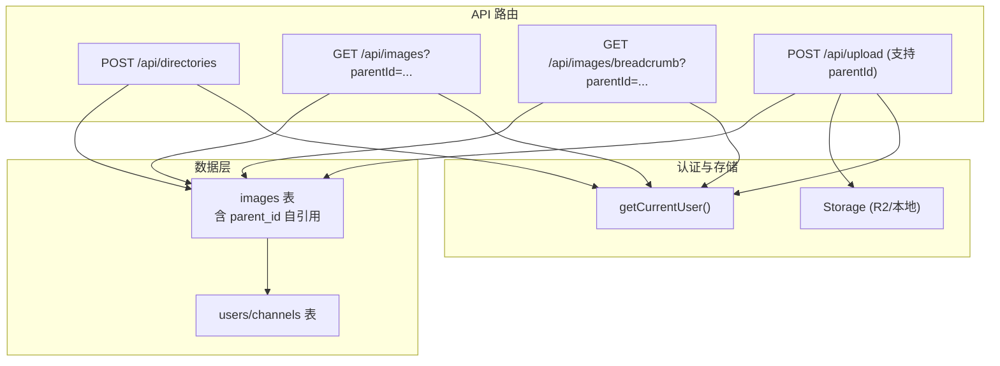
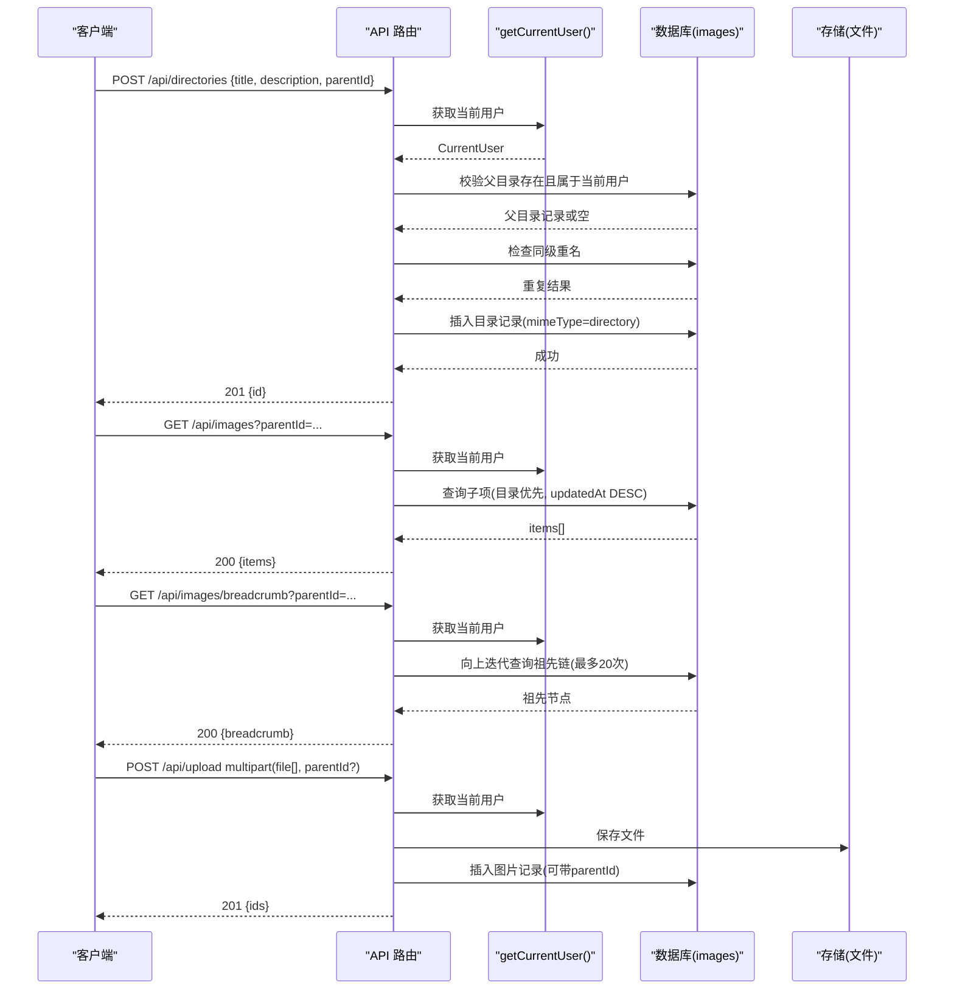
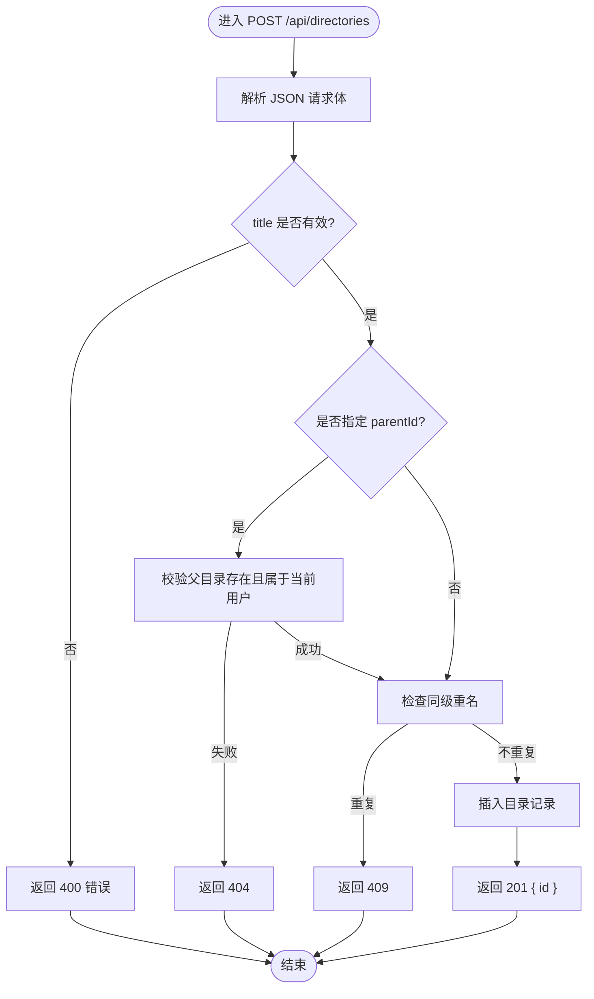
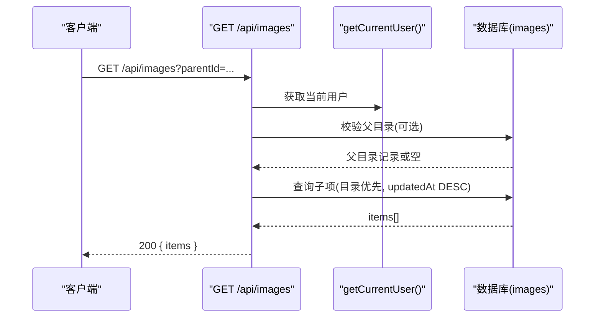
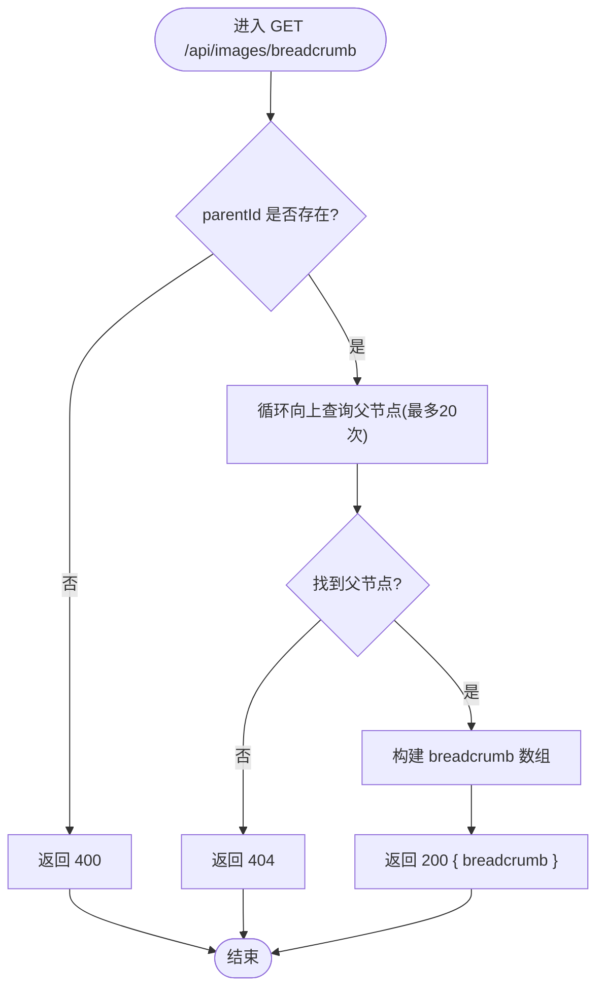
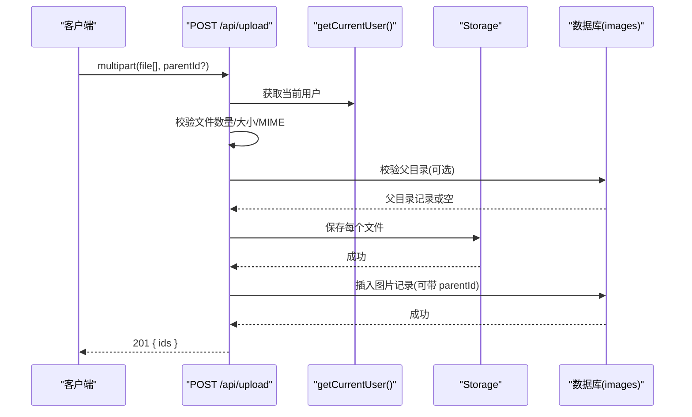
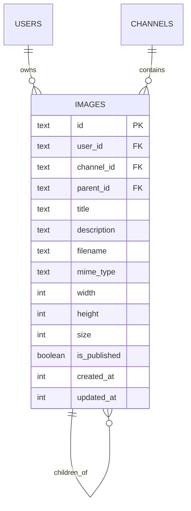
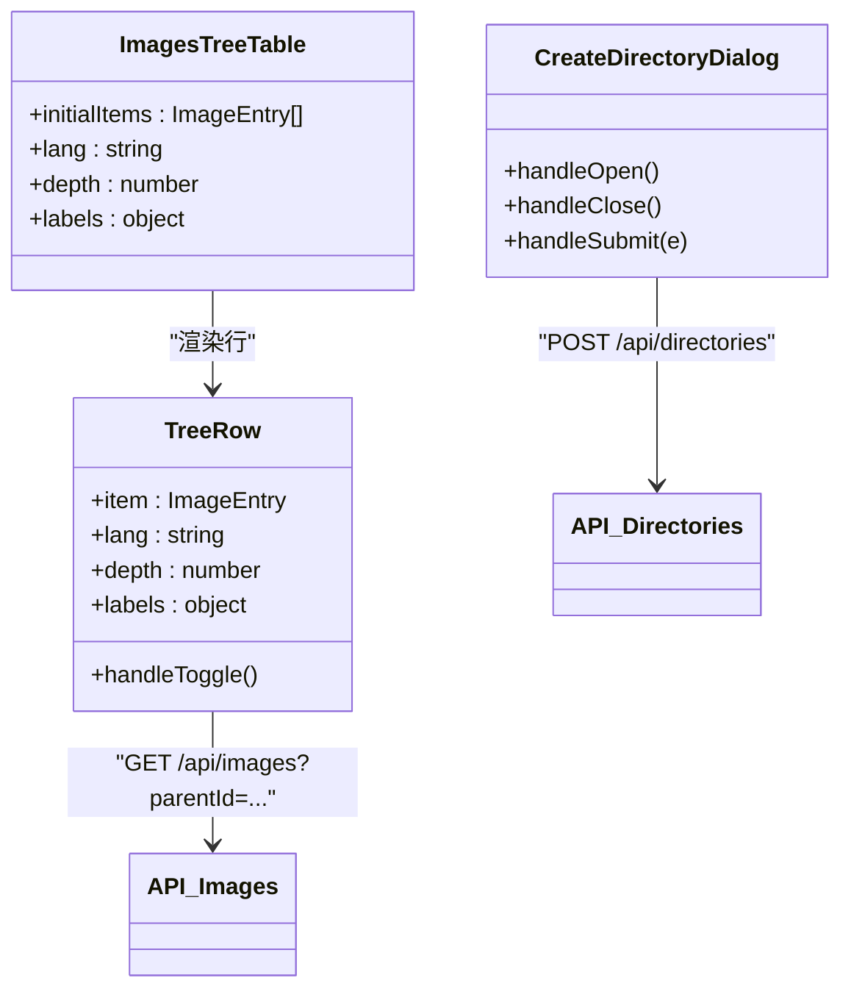
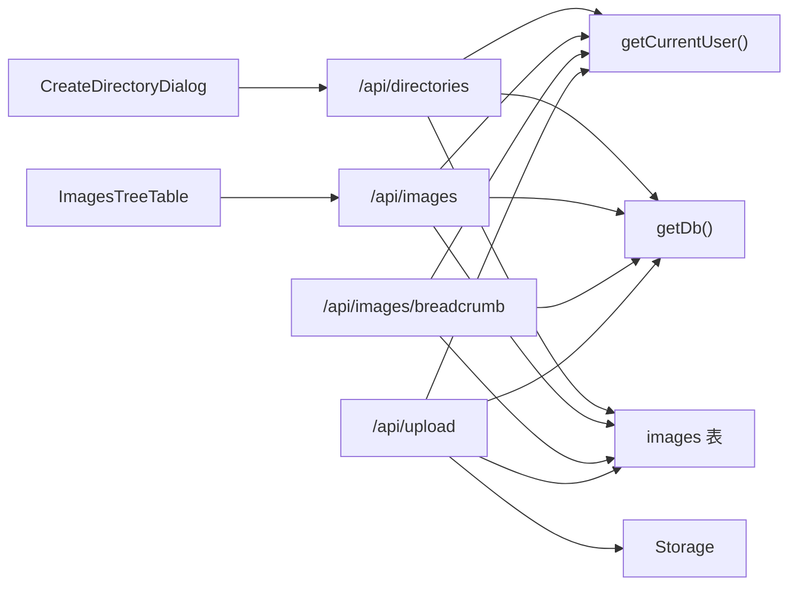

# 目录管理 API

<cite>
**本文档引用的文件**   
- [src/app/api/directories/route.ts](file://src/app/api/directories/route.ts)
- [src/app/api/images/route.ts](file://src/app/api/images/route.ts)
- [src/app/api/images/breadcrumb/route.ts](file://src/app/api/images/breadcrumb/route.ts)
- [src/app/api/upload/route.ts](file://src/app/api/upload/route.ts)
- [src/db/schema.ts](file://src/db/schema.ts)
- [src/lib/auth.ts](file://src/lib/auth.ts)
- [src/db/index.ts](file://src/db/index.ts)
- [specs/001-image-directory-tree/contracts/post-directories.md](file://specs/001-image-directory-tree/contracts/post-directories.md)
- [specs/001-image-directory-tree/contracts/get-images-and-breadcrumb.md](file://specs/001-image-directory-tree/contracts/get-images-and-breadcrumb.md)
- [specs/001-image-directory-tree/data-model.md](file://specs/001-image-directory-tree/data-model.md)
- [src/components/CreateDirectoryDialog.tsx](file://src/components/CreateDirectoryDialog.tsx)
- [src/components/ImagesTreeTable.tsx](file://src/components/ImagesTreeTable.tsx)
</cite>

## 目录
1. [简介](#简介)
2. [项目结构](#项目结构)
3. [核心组件](#核心组件)
4. [架构总览](#架构总览)
5. [详细组件分析](#详细组件分析)
6. [依赖关系分析](#依赖关系分析)
7. [性能考量](#性能考量)
8. [故障排查指南](#故障排查指南)
9. [结论](#结论)
10. [附录](#附录)

## 简介
本文件为 Weable 应用的“目录管理 API”提供完整的技术文档，覆盖 RESTful 端点、树形目录结构的创建与嵌套层级管理、路径解析（面包屑）、父子关系维护、命名规则、权限隔离、与图片文件的关联方式以及批量操作支持。文档面向开发者与产品人员，力求以循序渐进的方式解释系统设计与实现细节，并给出可操作的调用示例、参数校验、响应格式与错误处理策略。

## 项目结构
与目录管理相关的代码主要分布在以下位置：
- API 路由：Next.js App Router 的 /api 目录下
  - 目录创建：POST /api/directories
  - 子项查询：GET /api/images?parentId=...
  - 面包屑：GET /api/images/breadcrumb?parentId=...
  - 图片上传：POST /api/upload（支持将图片归属到指定目录）
- 数据模型：Drizzle schema 定义 images 表及自引用 parent_id
- 认证与用户：getCurrentUser() 从 JWT/Cookie 中解析当前用户
- 前端交互：CreateDirectoryDialog 与 ImagesTreeTable 负责创建目录与树形展示

图表来源
- [src/app/api/directories/route.ts:12-94](file://src/app/api/directories/route.ts#L12-L94)
- [src/app/api/images/route.ts:9-65](file://src/app/api/images/route.ts#L9-L65)
- [src/app/api/images/breadcrumb/route.ts:9-39](file://src/app/api/images/breadcrumb/route.ts#L9-L39)
- [src/app/api/upload/route.ts:14-74](file://src/app/api/upload/route.ts#L14-L74)
- [src/db/schema.ts:46-69](file://src/db/schema.ts#L46-L69)
- [src/lib/auth.ts:93-117](file://src/lib/auth.ts#L93-L117)

章节来源
- [src/app/api/directories/route.ts:12-94](file://src/app/api/directories/route.ts#L12-L94)
- [src/app/api/images/route.ts:9-65](file://src/app/api/images/route.ts#L9-L65)
- [src/app/api/images/breadcrumb/route.ts:9-39](file://src/app/api/images/breadcrumb/route.ts#L9-L39)
- [src/app/api/upload/route.ts:14-74](file://src/app/api/upload/route.ts#L14-L74)
- [src/db/schema.ts:46-69](file://src/db/schema.ts#L46-L69)
- [src/lib/auth.ts:93-117](file://src/lib/auth.ts#L93-L117)

## 核心组件
- 目录创建接口 POST /api/directories
  - 功能：在当前用户下创建目录条目；支持指定父目录 ID；同名同层级唯一性校验；非法字符与长度限制
  - 输入：JSON body { title, description?, parentId? }
  - 输出：{ id } 201 Created
  - 错误：400/401/404/409 等
- 子项查询接口 GET /api/images?parentId=...
  - 功能：返回指定父目录下的直接子项（目录+图片），目录优先排序
  - 输入：查询参数 parentId（可选，缺省表示根目录）
  - 输出：{ items: [...] }
  - 错误：401/404
- 面包屑接口 GET /api/images/breadcrumb?parentId=...
  - 功能：从根到目标目录的祖先链（用于导航）
  - 输入：查询参数 parentId（必填）
  - 输出：{ breadcrumb: [{ id, title }, ...] }
  - 错误：400/401/404
- 图片上传接口 POST /api/upload
  - 功能：上传多张图片，支持通过表单字段 parentId 将图片归属到指定目录
  - 输入：multipart/form-data，包含 file[] 与可选 parentId
  - 输出：{ ids: [...] } 201 Created
  - 错误：400/401/404

章节来源
- [specs/001-image-directory-tree/contracts/post-directories.md:1-72](file://specs/001-image-directory-tree/contracts/post-directories.md#L1-L72)
- [specs/001-image-directory-tree/contracts/get-images-and-breadcrumb.md:1-132](file://specs/001-image-directory-tree/contracts/get-images-and-breadcrumb.md#L1-L132)
- [src/app/api/directories/route.ts:12-94](file://src/app/api/directories/route.ts#L12-L94)
- [src/app/api/images/route.ts:9-65](file://src/app/api/images/route.ts#L9-L65)
- [src/app/api/images/breadcrumb/route.ts:9-39](file://src/app/api/images/breadcrumb/route.ts#L9-L39)
- [src/app/api/upload/route.ts:14-74](file://src/app/api/upload/route.ts#L14-L74)

## 架构总览
目录管理采用 Next.js App Router 的 API 路由模式，结合 Drizzle ORM 访问 SQLite/D1 数据库。认证通过 getCurrentUser() 统一处理，确保所有资源按用户隔离。目录与图片共用 images 表，通过 mimeType 区分类型，并通过 parent_id 实现自引用树形结构。

图表来源
- [src/app/api/directories/route.ts:12-94](file://src/app/api/directories/route.ts#L12-L94)
- [src/app/api/images/route.ts:9-65](file://src/app/api/images/route.ts#L9-L65)
- [src/app/api/images/breadcrumb/route.ts:9-39](file://src/app/api/images/breadcrumb/route.ts#L9-L39)
- [src/app/api/upload/route.ts:14-74](file://src/app/api/upload/route.ts#L14-L74)
- [src/lib/auth.ts:93-117](file://src/lib/auth.ts#L93-L117)

## 详细组件分析

### 目录创建：POST /api/directories
- 请求体字段
  - title: string，必填，1–200 字符，禁止包含 /、\、..
  - description: string，可选，最长 1000 字符
  - parentId: string，可选，指向父目录 ID；缺省或 null 表示根目录
- 校验逻辑
  - 非空与长度限制
  - 非法字符检测（包括 .. 与路径分隔符）
  - 父目录存在性与所有权校验（mimeType=directory 且 userId 匹配）
  - 同级唯一性校验（同一 user_id + parent_id 组合下 title 唯一）
- 写入行为
  - 在 images 表中插入一条 mimeType=directory 的记录
  - filename 设置为与 title 相同
  - size=0，width/height=NULL，channelId=NULL，isPublished=false
  - 不写入任何文件到存储
- 响应与错误
  - 成功：201 { id }
  - 错误：400（标题为空/非法/过长/描述过长）、401（未登录）、404（父目录不存在或不属于当前用户）、409（同级重名）

图表来源
- [src/app/api/directories/route.ts:12-94](file://src/app/api/directories/route.ts#L12-L94)

章节来源
- [src/app/api/directories/route.ts:12-94](file://src/app/api/directories/route.ts#L12-L94)
- [specs/001-image-directory-tree/contracts/post-directories.md:1-72](file://specs/001-image-directory-tree/contracts/post-directories.md#L1-L72)

### 子项查询：GET /api/images?parentId=...
- 查询参数
  - parentId: string，可选；缺省时查询根目录（parent_id IS NULL）
- 返回内容
  - items: 数组，包含目录与图片的直接子项
  - 排序规则：目录优先（mimeType=directory），同类型按 updatedAt 降序
- 权限与安全
  - 仅返回当前用户的条目
  - 若指定 parentId，需验证该目录存在且属于当前用户且 mimeType=directory
- 错误处理
  - 401：未登录
  - 404：父目录不存在或不属于当前用户

图表来源
- [src/app/api/images/route.ts:9-65](file://src/app/api/images/route.ts#L9-L65)

章节来源
- [src/app/api/images/route.ts:9-65](file://src/app/api/images/route.ts#L9-L65)
- [specs/001-image-directory-tree/contracts/get-images-and-breadcrumb.md:1-74](file://specs/001-image-directory-tree/contracts/get-images-and-breadcrumb.md#L1-L74)

### 面包屑导航：GET /api/images/breadcrumb?parentId=...
- 查询参数
  - parentId: string，必填
- 返回内容
  - breadcrumb: 从根到目标目录的祖先链，每项包含 id 与 title
- 算法说明
  - 从 parentId 出发，逐级向上查询父节点，最多循环 20 次防止异常环
  - 构建数组时逆序插入，保证顺序从根到当前目录
- 错误处理
  - 400：缺少 parentId
  - 401：未登录
  - 404：目录不存在或不属于当前用户

图表来源
- [src/app/api/images/breadcrumb/route.ts:9-39](file://src/app/api/images/breadcrumb/route.ts#L9-L39)

章节来源
- [src/app/api/images/breadcrumb/route.ts:9-39](file://src/app/api/images/breadcrumb/route.ts#L9-L39)
- [specs/001-image-directory-tree/contracts/get-images-and-breadcrumb.md:76-118](file://specs/001-image-directory-tree/contracts/get-images-and-breadcrumb.md#L76-L118)

### 图片上传：POST /api/upload（支持 parentId）
- 请求体
  - multipart/form-data
  - file[]: 图片文件数组（最多 50 个，单个最大 5 MB，MIME 前缀 image/*）
  - parentId: string，可选；用于将图片归属到指定目录
- 校验逻辑
  - 文件数量、大小、MIME 类型限制
  - 若指定 parentId，需验证该目录存在且属于当前用户且 mimeType=directory
- 写入行为
  - 使用 Storage.save(id, name, buffer) 持久化文件
  - 在 images 表中插入图片记录，filename 为原始文件名，title 为去除扩展名的名称
- 响应与错误
  - 成功：201 { ids: [...] }
  - 错误：400（文件无效/过大/MIME 不支持/超过数量）、401（未登录）、404（父目录不存在或不属于当前用户）

图表来源
- [src/app/api/upload/route.ts:14-74](file://src/app/api/upload/route.ts#L14-L74)

章节来源
- [src/app/api/upload/route.ts:14-74](file://src/app/api/upload/route.ts#L14-L74)
- [specs/001-image-directory-tree/contracts/get-images-and-breadcrumb.md:121-132](file://specs/001-image-directory-tree/contracts/get-images-and-breadcrumb.md#L121-L132)

### 数据模型与树形结构
- images 表新增 parent_id 自引用字段，形成树形结构
- 目录条目固定值规则：
  - mimeType = 'directory'
  - filename = title
  - size = 0
  - width/height = NULL
  - channelId = NULL
  - isPublished = false
- 同级唯一性约束由应用层实现（INSERT 前 SELECT 计数校验）
- 删除父目录时，子条目的 parent_id 设为 NULL（SET NULL），本期不实现目录删除

图表来源
- [src/db/schema.ts:46-69](file://src/db/schema.ts#L46-L69)
- [specs/001-image-directory-tree/data-model.md:14-44](file://specs/001-image-directory-tree/data-model.md#L14-L44)

章节来源
- [src/db/schema.ts:46-69](file://src/db/schema.ts#L46-L69)
- [specs/001-image-directory-tree/data-model.md:14-44](file://specs/001-image-directory-tree/data-model.md#L14-L44)

### 前端交互与树形展示
- CreateDirectoryDialog：用户界面弹窗，提交 title、description、parentId 到 /api/directories，处理错误提示与刷新
- ImagesTreeTable：客户端组件，懒加载子节点，点击目录展开调用 /api/images?parentId=...，递归渲染子项

图表来源
- [src/components/CreateDirectoryDialog.tsx:22-77](file://src/components/CreateDirectoryDialog.tsx#L22-L77)
- [src/components/ImagesTreeTable.tsx:39-71](file://src/components/ImagesTreeTable.tsx#L39-L71)

章节来源
- [src/components/CreateDirectoryDialog.tsx:22-77](file://src/components/CreateDirectoryDialog.tsx#L22-L77)
- [src/components/ImagesTreeTable.tsx:39-71](file://src/components/ImagesTreeTable.tsx#L39-L71)

## 依赖关系分析
- API 路由依赖
  - auth.ts：getCurrentUser() 解析用户身份
  - db/index.ts：getDb() 根据环境选择 SQLite 或 D1
  - db/schema.ts：images 表结构与关系
- 前端组件依赖
  - CreateDirectoryDialog：调用 /api/directories
  - ImagesTreeTable：调用 /api/images?parentId=...

图表来源
- [src/app/api/directories/route.ts:12-94](file://src/app/api/directories/route.ts#L12-L94)
- [src/app/api/images/route.ts:9-65](file://src/app/api/images/route.ts#L9-L65)
- [src/app/api/images/breadcrumb/route.ts:9-39](file://src/app/api/images/breadcrumb/route.ts#L9-L39)
- [src/app/api/upload/route.ts:14-74](file://src/app/api/upload/route.ts#L14-L74)
- [src/lib/auth.ts:93-117](file://src/lib/auth.ts#L93-L117)
- [src/db/index.ts:43-60](file://src/db/index.ts#L43-L60)
- [src/db/schema.ts:46-69](file://src/db/schema.ts#L46-L69)
- [src/components/CreateDirectoryDialog.tsx:22-77](file://src/components/CreateDirectoryDialog.tsx#L22-L77)
- [src/components/ImagesTreeTable.tsx:39-71](file://src/components/ImagesTreeTable.tsx#L39-L71)

章节来源
- [src/lib/auth.ts:93-117](file://src/lib/auth.ts#L93-L117)
- [src/db/index.ts:43-60](file://src/db/index.ts#L43-L60)
- [src/db/schema.ts:46-69](file://src/db/schema.ts#L46-L69)

## 性能考量
- 目录创建与子项查询均为单条或少量记录的读写，复杂度低
- 面包屑查询采用迭代方式，最多 20 次 DB 调用，实际目录深度预期不超过 5 层，性能可接受
- 图片上传支持批量（最多 50 个文件），存储写入与数据库插入并行处理，注意并发与磁盘 I/O
- 建议对 images 表的 user_id、parent_id、mimeType 建立索引以提升查询性能（当前实现依赖应用层校验与简单 WHERE 条件）

[本节为通用指导，无需特定文件引用]

## 故障排查指南
- 常见错误与定位
  - 400：请求体缺失或非法（如 title 为空/非法字符/过长、描述过长、文件无效/过大/MIME 不支持）
  - 401：未登录或认证失败（检查 getCurrentUser() 的 JWT/Cookie 解析）
  - 404：父目录不存在或不属于当前用户（检查 parentId 与用户权限）
  - 409：同级重名（检查 title 在同一 user_id + parent_id 下是否已存在）
- 调试建议
  - 查看 API 路由的错误返回消息
  - 检查数据库 images 表中的 user_id、parent_id、mimeType 字段
  - 确认前端组件是否正确传递 parentId 与 title

章节来源
- [src/app/api/directories/route.ts:26-39](file://src/app/api/directories/route.ts#L26-L39)
- [src/app/api/images/route.ts:16-31](file://src/app/api/images/route.ts#L16-L31)
- [src/app/api/images/breadcrumb/route.ts:14-16](file://src/app/api/images/breadcrumb/route.ts#L14-L16)
- [src/app/api/upload/route.ts:21-35](file://src/app/api/upload/route.ts#L21-L35)

## 结论
Weable 的目录管理 API 通过简洁的 RESTful 设计实现了树形目录的创建、查询与面包屑导航，并与图片上传流程无缝集成。数据模型采用自引用 parent_id 实现层级关系，应用层校验确保同级唯一性与权限隔离。前端组件提供直观的创建与树形展示体验。整体架构清晰、可扩展性强，适合后续增加移动、重命名、删除等高级功能。

[本节为总结，无需特定文件引用]

## 附录
- API 调用示例
  - 创建目录：POST /api/directories，body { title: "设计稿", description: "UI 设计相关图片", parentId: "AbC123XyZ" }
  - 查询子项：GET /api/images?parentId=AbC123XyZ
  - 获取面包屑：GET /api/images/breadcrumb?parentId=AbC123XyZ
  - 上传图片：POST /api/upload，multipart form data 包含 file[] 与可选 parentId
- 命名规则
  - title 不允许包含 /、\、..，长度 1–200
  - description 最长 1000
- 权限继承与内容迁移
  - 权限基于用户隔离（user_id），目录与图片均受此约束
  - 内容迁移（移动/重命名/删除）本期未实现，未来可在现有 schema 上扩展

[本节为补充信息，无需特定文件引用]