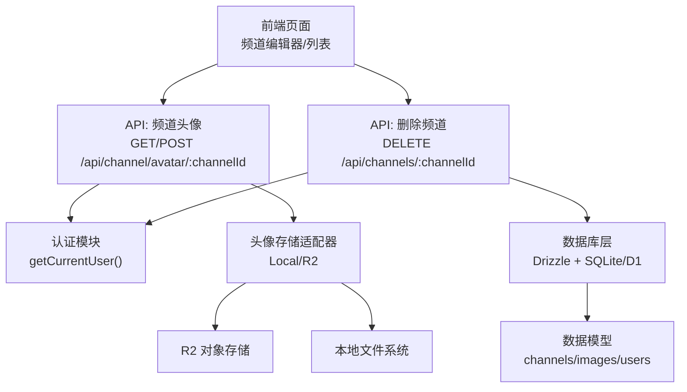
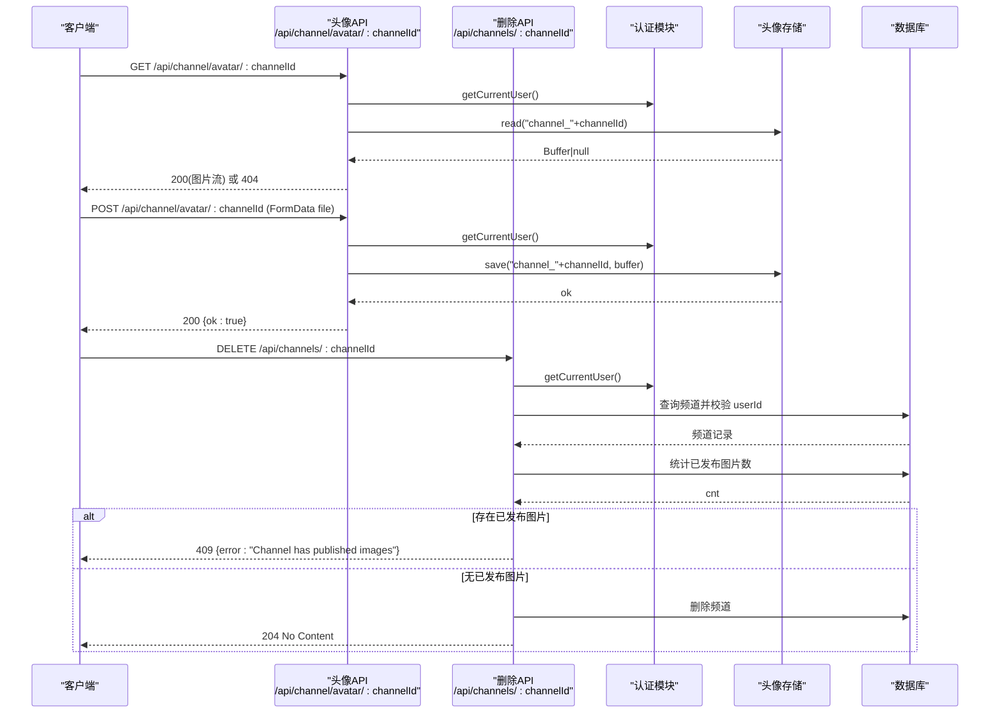
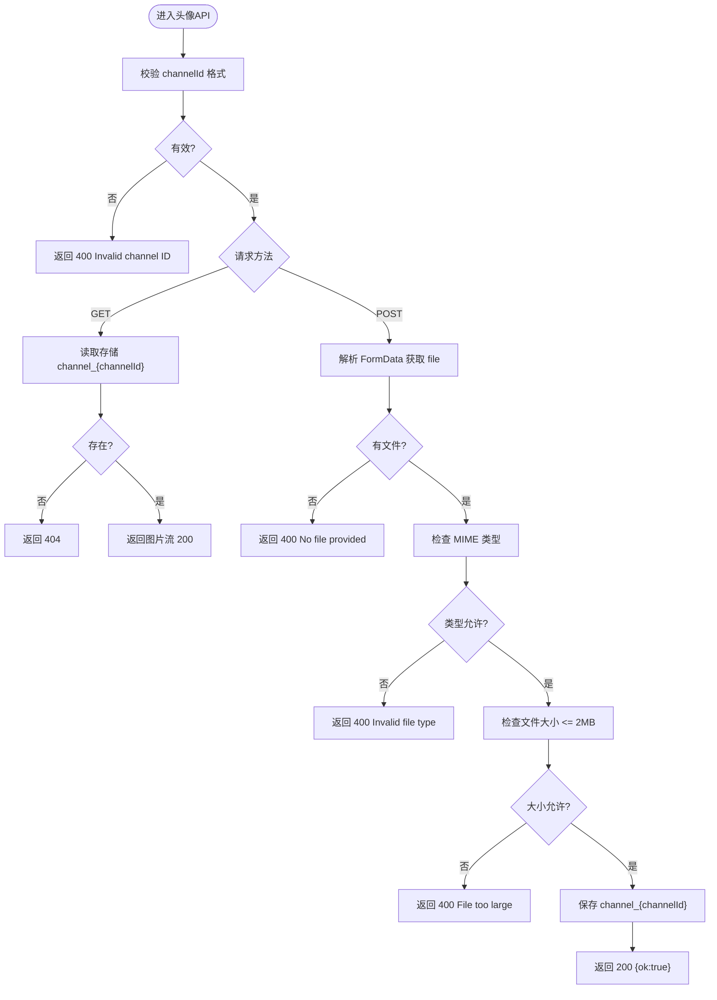
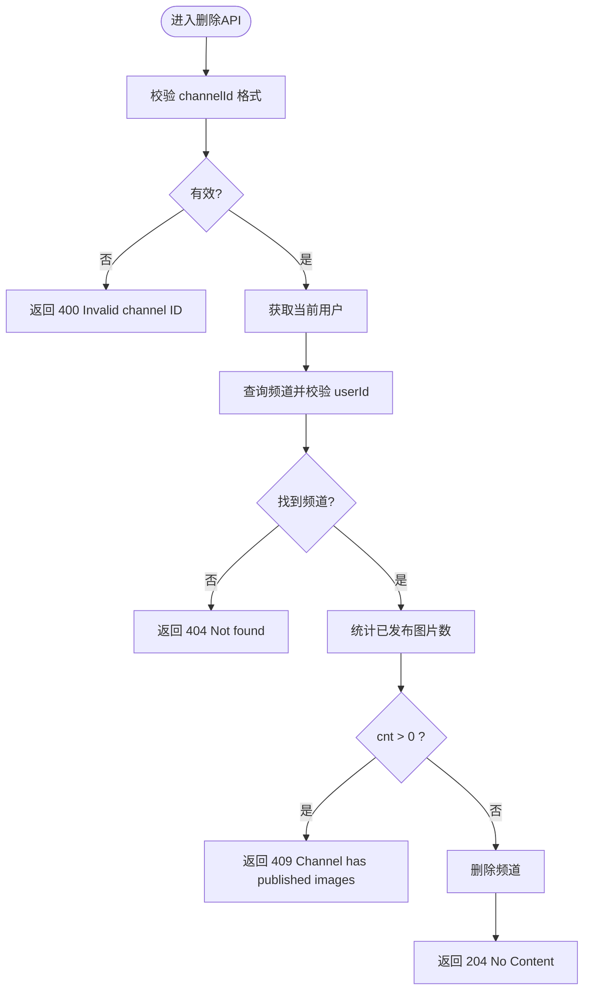
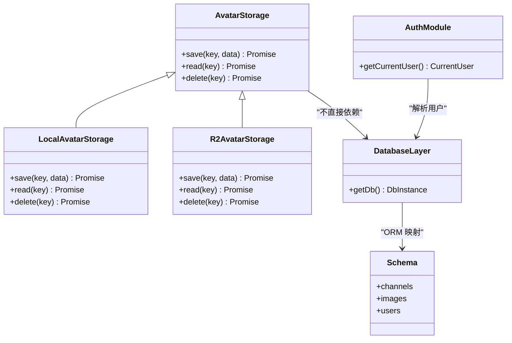

# 频道管理 API

<cite>
**本文档中引用的文件**
- [src/app/api/channels/[channelId]/route.ts](file://src/app/api/channels/[channelId]/route.ts)
- [src/app/api/channel/avatar/[channelId]/route.ts](file://src/app/api/channel/avatar/[channelId]/route.ts)
- [src/db/schema.ts](file://src/db/schema.ts)
- [src/lib/auth.ts](file://src/lib/auth.ts)
- [src/lib/storage.ts](file://src/lib/storage.ts)
- [src/db/index.ts](file://src/db/index.ts)
- [src/components/ChannelDeleteSection.tsx](file://src/components/ChannelDeleteSection.tsx)
- [src/components/ChannelAvatarUpload.tsx](file://src/components/ChannelAvatarUpload.tsx)
- [src/app/[lang]/console/channels/[channelId]/page.tsx](file://src/app/[lang]/console/channels/[channelId]/page.tsx)
</cite>

## 目录
1. [简介](#简介)
2. [项目结构](#项目结构)
3. [核心组件](#核心组件)
4. [架构总览](#架构总览)
5. [详细组件分析](#详细组件分析)
6. [依赖关系分析](#依赖关系分析)
7. [性能考虑](#性能考虑)
8. [故障排查指南](#故障排查指南)
9. [结论](#结论)
10. [附录](#附录)

## 简介
本文件为 Weable 应用的“频道管理”相关 API 提供完整的技术文档。当前仓库实现了以下与频道相关的接口能力：
- 获取频道头像：GET /api/channel/avatar/:channelId
- 设置频道头像：POST /api/channel/avatar/:channelId
- 删除频道：DELETE /api/channels/:channelId

说明：
- 频道的创建与编辑目前由服务端渲染的前端页面（Server Component）直接操作数据库，未暴露独立的 POST/PUT 频道 API。
- 频道列表与详情展示亦由前端页面完成，未暴露独立 GET 频道列表或详情的 API。
- 如需将创建、编辑、列表等能力统一为 RESTful API，可在现有路由基础上扩展新的 Next.js Route Handler。

## 项目结构
频道管理相关的路由与数据模型分布如下：
- API 路由
  - 频道头像：src/app/api/channel/avatar/[channelId]/route.ts
  - 频道删除：src/app/api/channels/[channelId]/route.ts
- 数据模型与 ORM
  - 表结构与关系：src/db/schema.ts
  - 数据库连接适配：src/db/index.ts
- 认证与存储
  - 用户身份解析：src/lib/auth.ts
  - 头像存储适配器：src/lib/storage.ts
- 前端交互
  - 频道编辑器（含创建/编辑逻辑）：src/app/[lang]/console/channels/[channelId]/page.tsx
  - 删除按钮组件：src/components/ChannelDeleteSection.tsx
  - 头像上传组件：src/components/ChannelAvatarUpload.tsx

图表来源
- [src/app/api/channel/avatar/[channelId]/route.ts](file://src/app/api/channel/avatar/[channelId]/route.ts)
- [src/app/api/channels/[channelId]/route.ts](file://src/app/api/channels/[channelId]/route.ts)
- [src/lib/auth.ts](file://src/lib/auth.ts)
- [src/lib/storage.ts](file://src/lib/storage.ts)
- [src/db/index.ts](file://src/db/index.ts)
- [src/db/schema.ts](file://src/db/schema.ts)

章节来源
- [src/app/api/channel/avatar/[channelId]/route.ts](file://src/app/api/channel/avatar/[channelId]/route.ts)
- [src/app/api/channels/[channelId]/route.ts](file://src/app/api/channels/[channelId]/route.ts)
- [src/db/schema.ts](file://src/db/schema.ts)
- [src/lib/auth.ts](file://src/lib/auth.ts)
- [src/lib/storage.ts](file://src/lib/storage.ts)
- [src/db/index.ts](file://src/db/index.ts)
- [src/app/[lang]/console/channels/[channelId]/page.tsx](file://src/app/[lang]/console/channels/[channelId]/page.tsx)

## 核心组件
- 认证模块（getCurrentUser）
  - 支持 Cloudflare Access JWT、Cookie 会话以及开发环境回退用户。
  - 返回当前用户信息，用于权限校验与资源归属判断。
- 存储适配器（AvatarStorage）
  - 在 Cloudflare R2 可用时优先使用 R2；否则回退到本地文件系统。
  - 提供 save/read/delete 方法，统一处理二进制数据。
- 数据库层（Db）
  - 根据运行环境自动选择 D1 或本地 SQLite。
  - 通过 Drizzle ORM 访问 channels、images、users 表。
- 频道数据模型（schema）
  - channels：id、userId、name、description、isPublic、createdAt
  - images：关联 channelId、是否已发布 isPublished 等字段
  - users：基础用户信息

章节来源
- [src/lib/auth.ts](file://src/lib/auth.ts)
- [src/lib/storage.ts](file://src/lib/storage.ts)
- [src/db/index.ts](file://src/db/index.ts)
- [src/db/schema.ts](file://src/db/schema.ts)

## 架构总览
频道管理的整体流程如下：
- 头像读取：客户端请求 GET /api/channel/avatar/:channelId，服务端校验 channel ID，从存储读取并返回图片流。
- 头像上传：客户端提交 FormData 至 POST /api/channel/avatar/:channelId，服务端校验类型与大小后写入存储。
- 删除频道：客户端调用 DELETE /api/channels/:channelId，服务端校验用户所有权与是否存在已发布图片，满足条件则删除。

图表来源
- [src/app/api/channel/avatar/[channelId]/route.ts](file://src/app/api/channel/avatar/[channelId]/route.ts)
- [src/app/api/channels/[channelId]/route.ts](file://src/app/api/channels/[channelId]/route.ts)
- [src/lib/auth.ts](file://src/lib/auth.ts)
- [src/lib/storage.ts](file://src/lib/storage.ts)
- [src/db/index.ts](file://src/db/index.ts)
- [src/db/schema.ts](file://src/db/schema.ts)

## 详细组件分析

### 频道头像 API：GET/POST /api/channel/avatar/:channelId
- 功能
  - GET：按 channelId 读取并返回头像图片二进制流。
  - POST：接收 FormData 中的 file 字段，校验类型与大小后保存为频道头像。
- 输入与校验
  - channelId 必须匹配正则 /^[a-zA-Z0-9_-]+$/，否则返回 400。
  - POST 仅允许 image/jpeg、image/png、image/gif、image/webp，且最大 2MB。
- 输出与状态码
  - GET 成功返回图片流，Content-Type 设置为 image/png，并附带缓存头。
  - GET 未找到返回 404。
  - POST 成功返回 JSON { ok: true }。
  - 参数错误、类型错误、大小超限均返回 400。
- 认证与权限
  - POST 会调用 getCurrentUser() 进行鉴权，但当前实现未校验 channelId 与用户的归属关系。
- 存储机制
  - 使用 getAvatarStorage() 获取 AvatarStorage 实例，键名为 channel_{channelId}。
  - 在 R2 环境下以 avatar/channel_{channelId} 作为对象键；本地环境以 __avatar__ 根目录存储。

图表来源
- [src/app/api/channel/avatar/[channelId]/route.ts](file://src/app/api/channel/avatar/[channelId]/route.ts)
- [src/lib/storage.ts](file://src/lib/storage.ts)

章节来源
- [src/app/api/channel/avatar/[channelId]/route.ts](file://src/app/api/channel/avatar/[channelId]/route.ts)
- [src/lib/storage.ts](file://src/lib/storage.ts)

### 频道删除 API：DELETE /api/channels/:channelId
- 功能
  - 删除指定频道，需满足：频道存在且属于当前用户，且该频道下没有已发布的图片。
- 输入与校验
  - channelId 必须匹配正则 /^[a-zA-Z0-9_-]+$/，否则返回 400。
- 输出与状态码
  - 成功删除返回 204 No Content。
  - 未找到频道返回 404。
  - 存在已发布图片返回 409 Conflict。
- 认证与权限
  - 通过 getCurrentUser() 获取用户，并在查询频道时限制 userId，确保只能删除自己的频道。
- 业务规则
  - 删除前统计 images 表中 channelId 对应且 isPublished=true 的记录数量，若大于 0 则拒绝删除。

图表来源
- [src/app/api/channels/[channelId]/route.ts](file://src/app/api/channels/[channelId]/route.ts)
- [src/db/schema.ts](file://src/db/schema.ts)

章节来源
- [src/app/api/channels/[channelId]/route.ts](file://src/app/api/channels/[channelId]/route.ts)
- [src/db/schema.ts](file://src/db/schema.ts)

### 频道创建与编辑（前端直连数据库）
- 现状
  - 频道创建与编辑通过服务端组件的表单提交直接操作数据库，未暴露独立的 POST/PUT 频道 API。
  - 创建时生成唯一 id（createId），写入 channels 表；编辑时更新 name、description、isPublic。
- 前端交互
  - 频道编辑器页面负责渲染表单与保存逻辑。
  - 删除按钮组件调用 DELETE /api/channels/:channelId 执行删除。
  - 头像上传组件调用 POST /api/channel/avatar/:channelId 上传头像。

章节来源
- [src/app/[lang]/console/channels/[channelId]/page.tsx](file://src/app/[lang]/console/channels/[channelId]/page.tsx)
- [src/components/ChannelDeleteSection.tsx](file://src/components/ChannelDeleteSection.tsx)
- [src/components/ChannelAvatarUpload.tsx](file://src/components/ChannelAvatarUpload.tsx)

## 依赖关系分析
- 认证依赖
  - 所有 API 均依赖 getCurrentUser() 进行身份解析，支持多种来源（JWT、Cookie、开发回退）。
- 存储依赖
  - 头像 API 依赖 AvatarStorage 抽象，运行时根据环境选择 R2 或本地文件系统。
- 数据库依赖
  - 删除频道依赖 Drizzle ORM 对 channels 与 images 表的查询与更新。
- 前端依赖
  - 前端组件通过 fetch 调用上述 API，处理响应状态与错误提示。

图表来源
- [src/lib/auth.ts](file://src/lib/auth.ts)
- [src/lib/storage.ts](file://src/lib/storage.ts)
- [src/db/index.ts](file://src/db/index.ts)
- [src/db/schema.ts](file://src/db/schema.ts)

章节来源
- [src/lib/auth.ts](file://src/lib/auth.ts)
- [src/lib/storage.ts](file://src/lib/storage.ts)
- [src/db/index.ts](file://src/db/index.ts)
- [src/db/schema.ts](file://src/db/schema.ts)

## 性能考虑
- 头像读取
  - 返回图片流并设置 Cache-Control，利于浏览器与 CDN 缓存。
  - 建议在网关或 CDN 层开启静态资源缓存策略。
- 头像上传
  - 限制文件类型与大小，减少无效请求与存储压力。
  - 大文件上传建议分片或压缩后再上传（当前实现为全量上传）。
- 删除频道
  - 先统计已发布图片再删除，避免不必要的删除失败重试。
  - 可考虑异步清理或软删除策略以提升可用性（当前为硬删除）。

[本节为通用指导，无需引用具体文件]

## 故障排查指南
- 常见错误与原因
  - 400 Invalid channel ID：channelId 不符合正则要求。
  - 400 No file provided：POST 头像未包含 file 字段。
  - 400 Invalid file type：MIME 类型不在允许列表。
  - 400 File too large：超过 2MB 限制。
  - 404 Not found：频道不存在或未找到头像。
  - 409 Channel has published images：频道下仍有已发布图片，无法删除。
- 调试建议
  - 确认环境变量与绑定配置（D1、R2）是否正确。
  - 检查 getCurrentUser() 是否能正确解析用户身份。
  - 查看存储路径与对象键是否符合预期（avatar/channel_{channelId} 或 __avatar__/channel_{channelId}）。

章节来源
- [src/app/api/channel/avatar/[channelId]/route.ts](file://src/app/api/channel/avatar/[channelId]/route.ts)
- [src/app/api/channels/[channelId]/route.ts](file://src/app/api/channels/[channelId]/route.ts)
- [src/lib/storage.ts](file://src/lib/storage.ts)
- [src/lib/auth.ts](file://src/lib/auth.ts)

## 结论
当前 Weable 应用已实现频道头像的读取与上传、以及频道的删除能力。频道创建与编辑通过前端直连数据库完成，尚未暴露统一的 RESTful 接口。若需要标准化 API，建议新增 POST/PUT /api/channels 路由，并完善权限校验与错误处理。同时，可考虑引入成员管理与更细粒度的权限控制，以满足多用户协作场景。

[本节为总结性内容，无需引用具体文件]

## 附录

### 数据结构定义（channels、images、users）
- channels
  - id：主键，自动生成
  - userId：外键关联 users.id，级联删除
  - name：非空
  - description：可选
  - isPublic：布尔，默认 false
  - createdAt：时间戳
- images
  - id：主键，自动生成
  - userId：外键关联 users.id
  - channelId：外键关联 channels.id（可为空）
  - parentId：自引用，用于层级组织
  - title、description、filename、mimeType、width、height、size
  - isPublished：布尔，默认 false
  - createdAt、updatedAt
- users
  - id、name、email、nickname、bio、createdAt

章节来源
- [src/db/schema.ts](file://src/db/schema.ts)

### API 请求与响应示例
- 获取频道头像
  - 请求：GET /api/channel/avatar/{channelId}
  - 响应：200 图片流（Content-Type: image/png）或 404
- 设置频道头像
  - 请求：POST /api/channel/avatar/{channelId}，FormData 包含 file
  - 响应：200 { ok: true }，或 400/404
- 删除频道
  - 请求：DELETE /api/channels/{channelId}
  - 响应：204 或 404/409

[本节为概念性说明，无需引用具体文件]

### 与图片内容的关联与访问控制
- 关联关系
  - images.channelId 指向 channels.id，表示图片所属频道。
  - images.parentId 指向 images.id，形成树状结构。
- 访问控制
  - 频道删除需验证 userId，确保仅所有者可删除。
  - 头像上传虽调用 getCurrentUser()，但未校验 channelId 归属，建议补充校验。
  - 公开频道列表与详情通过 isPublic 过滤，仅展示公开频道。

章节来源
- [src/db/schema.ts](file://src/db/schema.ts)
- [src/app/api/channels/[channelId]/route.ts](file://src/app/api/channels/[channelId]/route.ts)
- [src/app/api/channel/avatar/[channelId]/route.ts](file://src/app/api/channel/avatar/[channelId]/route.ts)