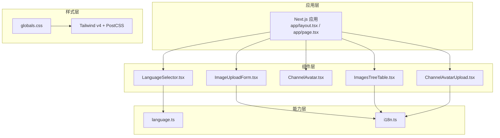
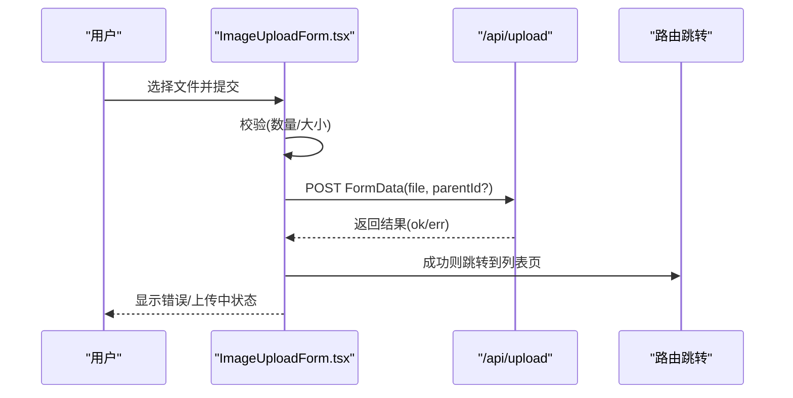
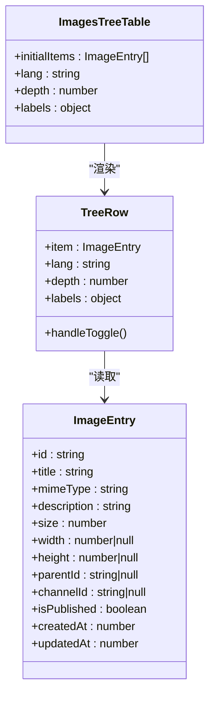
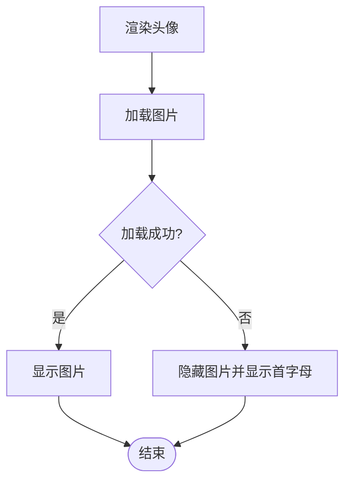
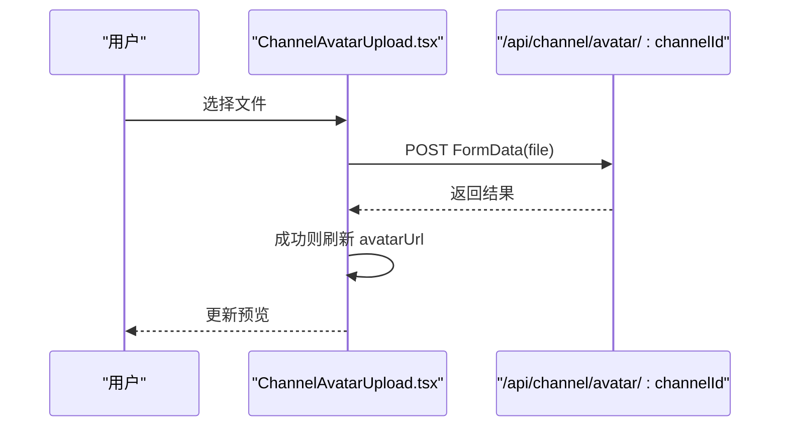
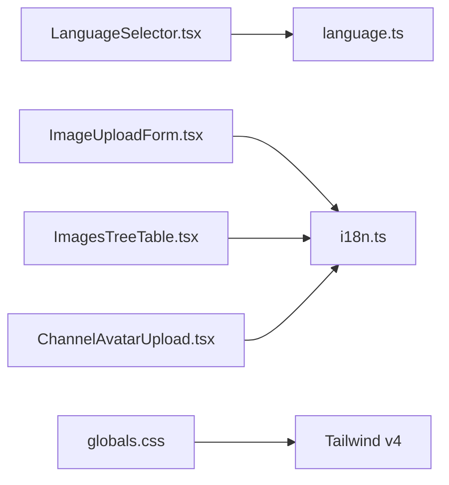

# 前端组件

<cite>
**本文引用的文件**   
- [ImageUploadForm.tsx](file://src/components/ImageUploadForm.tsx)
- [ImagesTreeTable.tsx](file://src/components/ImagesTreeTable.tsx)
- [ChannelAvatar.tsx](file://src/components/ChannelAvatar.tsx)
- [ChannelAvatarUpload.tsx](file://src/components/ChannelAvatarUpload.tsx)
- [LanguageSelector.tsx](file://src/components/LanguageSelector.tsx)
- [language.ts](file://src/lib/language.ts)
- [i18n.ts](file://src/lib/i18n.ts)
- [globals.css](file://src/app/globals.css)
- [package.json](file://package.json)
- [postcss.config.mjs](file://postcss.config.mjs)
- [zh.json](file://src/locales/zh.json)
</cite>

## 目录
1. [简介](#简介)
2. [项目结构](#项目结构)
3. [核心组件](#核心组件)
4. [架构总览](#架构总览)
5. [详细组件分析](#详细组件分析)
6. [依赖关系分析](#依赖关系分析)
7. [性能考量](#性能考量)
8. [故障排查指南](#故障排查指南)
9. [结论](#结论)
10. [附录](#附录)

## 简介
本文件为 Weable 前端组件的权威文档，聚焦图片上传表单、树形目录表格、频道头像与语言选择器等关键 UI 组件。内容涵盖视觉外观、交互行为、属性/事件/插槽、状态与动画过渡、样式与主题、响应式与无障碍、跨浏览器兼容性与性能优化，以及与其他 UI 元素的组合集成方式。所有说明均基于仓库中的实际实现，便于开发者快速上手与扩展。

## 项目结构
Weable 采用 Next.js 应用结构，组件集中在 src/components 下，国际化资源在 src/locales，语言能力在 src/lib。样式通过 Tailwind CSS v4 与全局变量管理主题色。

图表来源
- [package.json:1-40](file://package.json#L1-L40)
- [postcss.config.mjs:1-7](file://postcss.config.mjs#L1-L7)
- [globals.css:1-27](file://src/app/globals.css#L1-L27)

章节来源
- [package.json:1-40](file://package.json#L1-L40)
- [postcss.config.mjs:1-7](file://postcss.config.mjs#L1-L7)
- [globals.css:1-27](file://src/app/globals.css#L1-L27)

## 核心组件
本节概述各组件的职责、输入输出与交互要点，后续章节将深入展开。

- 图片上传表单（ImageUploadForm）
  - 职责：多文件图片上传、大小与数量校验、错误提示、上传后跳转列表页。
  - 输入：语言代码、父目录 ID、本地化文案对象。
  - 行为：提交时构建 FormData，POST 到 /api/upload；成功则重定向至对应列表页。
  - 状态：error、uploading。
  - 限制：最多 50 张，单张不超过 5 MB。

- 树形目录表格（ImagesTreeTable）
  - 职责：以表格形式展示图片与目录的层级结构，支持按需加载子节点。
  - 输入：初始数据数组、语言代码、深度、本地化文案。
  - 行为：点击目录行展开并请求 /api/images?parentId=...；根据 isPublished 显示状态标签；更新时间按语言格式化。
  - 状态：expanded、childState（idle/loading/loaded/error）、children。

- 频道头像（ChannelAvatar）
  - 职责：展示频道头像，失败时回退为首字母占位。
  - 输入：channelId、channelName、size。
  - 行为：img onError 隐藏图片并显示首字母。

- 频道头像上传（ChannelAvatarUpload）
  - 职责：上传频道头像，成功后刷新预览。
  - 输入：channelId、channelName、本地化文案。
  - 行为：选择文件后 POST 到 /api/channel/avatar/[channelId]，成功后通过时间戳参数强制刷新缓存。

- 语言选择器（LanguageSelector）
  - 职责：切换当前语言，更新路由前缀。
  - 输入：currentLang、pathSuffix。
  - 行为：select onChange 使用 router.push 跳转到 /{lang}/{pathSuffix}。

章节来源
- [ImageUploadForm.tsx:1-105](file://src/components/ImageUploadForm.tsx#L1-L105)
- [ImagesTreeTable.tsx:1-216](file://src/components/ImagesTreeTable.tsx#L1-L216)
- [ChannelAvatar.tsx:1-30](file://src/components/ChannelAvatar.tsx#L1-L30)
- [ChannelAvatarUpload.tsx:1-73](file://src/components/ChannelAvatarUpload.tsx#L1-L73)
- [LanguageSelector.tsx:1-34](file://src/components/LanguageSelector.tsx#L1-L34)

## 架构总览
组件通过 Next.js 客户端渲染，调用后端 API 完成数据读写；语言与本地化由 language.ts 与 i18n.ts 提供；样式由 Tailwind 与全局 CSS 变量驱动。

图表来源
- [ImageUploadForm.tsx:26-72](file://src/components/ImageUploadForm.tsx#L26-L72)

章节来源
- [ImageUploadForm.tsx:1-105](file://src/components/ImageUploadForm.tsx#L1-L105)

## 详细组件分析

### 图片上传表单（ImageUploadForm）
- 视觉外观
  - 表单区域包含标题、多文件 input、提示信息与提交按钮。
  - 错误信息以红色背景条显示；上传中按钮禁用并改变文案。
- 交互模式
  - 提交时先进行前端校验（数量、大小），再发起上传；成功后跳转到对应语言下的图片列表或指定父目录列表。
- 属性
  - lang: string（用于构造跳转 URL）
  - parentId?: string | null（可选，作为上传目标目录）
  - labels: 本地化文案对象（newImage、imageTooLarge、uploadError、uploadTooManyFiles、uploadLimitsHint、uploadingImages）
- 事件
  - onSubmit：触发自定义 handleSubmit，负责校验、构建 FormData、请求与跳转。
- 插槽
  - 无显式插槽，可通过外层包裹自定义布局。
- 状态与动画
  - error: string（错误消息）
  - uploading: boolean（上传中）
  - 无显式动画，仅通过 disabled 与文案变化反馈状态。
- 样式与主题
  - 使用 Tailwind 类名；颜色与字体受 globals.css 变量影响。
- 响应式与无障碍
  - input 使用 required 与 accept="image/*"；按钮 disabled 提升可访问性；错误文本语义清晰。
- 错误处理
  - 前端校验失败直接设置 error；网络或后端错误捕获并显示。
- 性能
  - 批量上传时构建 FormData 一次性发送；避免重复渲染。

```mermaid
flowchart TD
Start(["提交"]) --> Validate["校验文件数量与大小"]
Validate --> Valid{"是否有效?"}
Valid --> |否| ShowErr["设置错误信息"]
Valid --> |是| BuildFD["构建 FormData"]
BuildFD --> Upload["POST /api/upload"]
Upload --> Ok{"响应 ok ?"}
Ok --> |否| HandleErr["捕获错误并显示"]
Ok --> |是| Redirect["跳转到列表页"]
HandleErr --> End(["结束"])
Redirect --> End
ShowErr --> End
```

图表来源
- [ImageUploadForm.tsx:26-72](file://src/components/ImageUploadForm.tsx#L26-L72)

章节来源
- [ImageUploadForm.tsx:1-105](file://src/components/ImageUploadForm.tsx#L1-L105)

### 树形目录表格（ImagesTreeTable）
- 视觉外观
  - 表格列包括：展开/缩略图、标题、状态、更新时间。
  - 目录项显示文件夹图标与箭头；图片项显示缩略图与发布状态标签。
- 交互模式
  - 点击目录箭头展开子节点，首次展开触发懒加载；再次点击折叠。
  - 标题为链接，目录跳转到其列表页，图片跳转到详情页。
- 属性
  - initialItems: ImageEntry[]（根级条目）
  - lang: string（日期格式化与路由）
  - depth?: number（递归深度）
  - labels: 本地化文案（imagePublished、imageDraft、updated）
- 事件
  - 行内按钮 onClick：handleToggle（展开/折叠与懒加载）。
- 插槽
  - 无显式插槽；可通过外层容器定制布局。
- 数据结构与复杂度
  - ImageEntry 包含 id、title、mimeType、description、size、width/height、parentId、channelId、isPublished、createdAt、updatedAt。
  - 树形渲染为递归组件 TreeRow；时间复杂度 O(N)，空间复杂度 O(D)（D 为最大深度）。
- 状态与动画
  - expanded: boolean（是否展开）
  - childState: "idle" | "loading" | "loaded" | "error"
  - children: ImageEntry[]
  - 无显式动画，通过条件渲染与文本指示加载/错误。
- 样式与主题
  - 使用 Tailwind 类名；缩略图与状态标签配色区分。
- 响应式与无障碍
  - 表格横向滚动；展开按钮 aria-label 明确；空目录显示占位行。
- 错误处理
  - 懒加载失败设置 childState 为 error 并显示错误行。

图表来源
- [ImagesTreeTable.tsx:11-37](file://src/components/ImagesTreeTable.tsx#L11-L37)
- [ImagesTreeTable.tsx:39-191](file://src/components/ImagesTreeTable.tsx#L39-L191)

章节来源
- [ImagesTreeTable.tsx:1-216](file://src/components/ImagesTreeTable.tsx#L1-L216)

### 频道头像（ChannelAvatar）
- 视觉外观
  - 圆形头像容器，默认尺寸 40px，可配置 size。
  - 图片加载失败时显示通道名称首字母占位。
- 交互模式
  - 纯展示组件，无交互事件。
- 属性
  - channelId: string
  - channelName: string
  - size?: number（默认 40）
- 事件
  - img onError：隐藏图片并显示占位字符。
- 插槽
  - 无。
- 状态与动画
  - 无状态；错误回退即时生效。
- 样式与主题
  - 使用 Tailwind 圆角与居中布局；颜色跟随主题变量。
- 响应式与无障碍
  - alt 描述通道名；尺寸固定但可缩放。
- 错误处理
  - onError 隐藏失败图片并显示首字母。

图表来源
- [ChannelAvatar.tsx:1-30](file://src/components/ChannelAvatar.tsx#L1-L30)

章节来源
- [ChannelAvatar.tsx:1-30](file://src/components/ChannelAvatar.tsx#L1-L30)

### 频道头像上传（ChannelAvatarUpload）
- 视觉外观
  - 左侧为 16x16 头像预览，右侧为上传按钮与提示文案。
  - 上传中按钮文案变为省略号并禁用。
- 交互模式
  - 选择图片后 POST 到 /api/channel/avatar/[channelId]；成功后通过时间戳刷新预览。
- 属性
  - channelId: string
  - channelName: string
  - labels: 本地化文案（avatar、uploadAvatar、avatarHint）
- 事件
  - input onChange：handleUpload。
- 插槽
  - 无。
- 状态与动画
  - uploading: boolean
  - avatarUrl: string（带时间戳防缓存）
- 样式与主题
  - 使用 Tailwind 类名；按钮 hover 效果。
- 响应式与无障碍
  - 按钮包裹 input 并隐藏原生控件；提示文案可读。
- 错误处理
  - 未处理具体错误分支，仅依据 res.ok 决定是否刷新预览。

图表来源
- [ChannelAvatarUpload.tsx:19-36](file://src/components/ChannelAvatarUpload.tsx#L19-L36)

章节来源
- [ChannelAvatarUpload.tsx:1-73](file://src/components/ChannelAvatarUpload.tsx#L1-L73)

### 语言选择器（LanguageSelector）
- 视觉外观
  - 下拉框样式简洁，聚焦时有蓝色边框高亮。
- 交互模式
  - 选择语言后通过 Next Router 跳转到 /{lang}/{pathSuffix}。
- 属性
  - currentLang: LangKey
  - pathSuffix?: string（路径后缀）
- 事件
  - select onChange：handleChange。
- 插槽
  - 无。
- 状态与动画
  - 无状态。
- 样式与主题
  - Tailwind 类名；focus ring 提升可访问性。
- 响应式与无障碍
  - select 元素具备键盘操作与焦点样式。
- 错误处理
  - 无；路由跳转由 Next 处理。

章节来源
- [LanguageSelector.tsx:1-34](file://src/components/LanguageSelector.tsx#L1-L34)
- [language.ts:1-49](file://src/lib/language.ts#L1-L49)

## 依赖关系分析
组件之间的依赖主要体现在语言与本地化能力上；样式统一由 Tailwind 与全局变量管理。

图表来源
- [LanguageSelector.tsx:1-34](file://src/components/LanguageSelector.tsx#L1-L34)
- [language.ts:1-49](file://src/lib/language.ts#L1-L49)
- [i18n.ts:1-28](file://src/lib/i18n.ts#L1-L28)
- [globals.css:1-27](file://src/app/globals.css#L1-L27)
- [postcss.config.mjs:1-7](file://postcss.config.mjs#L1-L7)

章节来源
- [package.json:1-40](file://package.json#L1-L40)
- [postcss.config.mjs:1-7](file://postcss.config.mjs#L1-L7)

## 性能考量
- 图片上传
  - 批量上传使用 FormData 一次请求，减少往返；建议在后端做并发与限流。
  - 前端限制单文件大小与数量，降低带宽压力。
- 树形表格
  - 子节点懒加载，避免一次性渲染大量 DOM；注意递归深度对内存的影响。
  - 缩略图建议使用服务端裁剪或 CDN 加速。
- 头像缓存
  - ChannelAvatarUpload 通过时间戳参数规避浏览器缓存；必要时可增加 ETag/Cache-Control 策略。
- 语言切换
  - LanguageSelector 使用客户端路由跳转，避免整页刷新；确保路由段正确。
- 样式与主题
  - Tailwind v4 按需生成样式，减少包体；全局 CSS 变量控制明暗主题。

[本节为通用指导，不直接分析具体文件]

## 故障排查指南
- 图片上传失败
  - 检查前端校验（数量、大小）与错误提示；确认 /api/upload 接口可用性。
  - 查看 Network 面板响应体中的 error 字段。
- 树形表格子节点加载失败
  - 检查 /api/images?parentId=... 返回状态码；确认 childState 是否为 error。
- 头像无法显示
  - ChannelAvatar 的 img onError 会隐藏图片并显示首字母；检查 /api/channel/avatar/[channelId] 是否可达。
- 头像上传后未刷新
  - 确认 ChannelAvatarUpload 成功分支是否更新了 avatarUrl（带时间戳）。
- 语言切换无效
  - 检查 LanguageSelector 的 currentLang 与 pathSuffix 是否正确拼接；确认路由存在对应语言段。

章节来源
- [ImageUploadForm.tsx:26-72](file://src/components/ImageUploadForm.tsx#L26-L72)
- [ImagesTreeTable.tsx:55-71](file://src/components/ImagesTreeTable.tsx#L55-L71)
- [ChannelAvatar.tsx:21-25](file://src/components/ChannelAvatar.tsx#L21-L25)
- [ChannelAvatarUpload.tsx:19-36](file://src/components/ChannelAvatarUpload.tsx#L19-L36)
- [LanguageSelector.tsx:16-18](file://src/components/LanguageSelector.tsx#L16-L18)

## 结论
Weable 的前端组件围绕图片管理与频道头像等核心场景构建，采用 React 客户端组件与 Next.js 路由/API 集成，结合 Tailwind 与全局变量实现一致的视觉与主题体验。通过懒加载、FormData 批量上传与缓存策略等手段保障性能与用户体验。建议在后续迭代中补充更完善的错误提示、动画过渡与无障碍增强，并持续优化图片资源与网络请求。

[本节为总结性内容，不直接分析具体文件]

## 附录

### 组件属性与事件速查
- ImageUploadForm
  - 属性：lang、parentId、labels
  - 事件：onSubmit
  - 状态：error、uploading
- ImagesTreeTable
  - 属性：initialItems、lang、depth、labels
  - 事件：行内展开/折叠
  - 状态：expanded、childState、children
- ChannelAvatar
  - 属性：channelId、channelName、size
  - 事件：img onError
- ChannelAvatarUpload
  - 属性：channelId、channelName、labels
  - 事件：input onChange
  - 状态：uploading、avatarUrl
- LanguageSelector
  - 属性：currentLang、pathSuffix
  - 事件：select onChange

章节来源
- [ImageUploadForm.tsx:8-19](file://src/components/ImageUploadForm.tsx#L8-L19)
- [ImagesTreeTable.tsx:28-37](file://src/components/ImagesTreeTable.tsx#L28-L37)
- [ChannelAvatar.tsx:3-7](file://src/components/ChannelAvatar.tsx#L3-L7)
- [ChannelAvatarUpload.tsx:5-13](file://src/components/ChannelAvatarUpload.tsx#L5-L13)
- [LanguageSelector.tsx:7-11](file://src/components/LanguageSelector.tsx#L7-L11)

### 样式与主题
- 主题变量
  - background、foreground 在 :root 中定义，支持 prefers-color-scheme: dark 自动切换。
- Tailwind
  - 使用 v4，PostCSS 插件 @tailwindcss/postcss 启用。
- 自定义建议
  - 通过 CSS 变量覆盖主题色；组件内尽量使用 Tailwind 原子类，保持风格一致。

章节来源
- [globals.css:1-27](file://src/app/globals.css#L1-L27)
- [postcss.config.mjs:1-7](file://postcss.config.mjs#L1-L7)
- [package.json:25-38](file://package.json#L25-L38)

### 国际化与本地化
- 语言键与名称
  - supportedLanguages 定义可用语言键与显示名；getTargetLang 与 isValidLang 提供匹配与校验。
- 文案获取
  - i18n.t(lang, key) 从 locales 映射中取值，缺失时回退英文。
- 组件文案
  - 组件通过 props.labels 注入文案，便于页面级统一管理。

章节来源
- [language.ts:25-44](file://src/lib/language.ts#L25-L44)
- [i18n.ts:14-27](file://src/lib/i18n.ts#L14-L27)
- [zh.json:1-84](file://src/locales/zh.json#L1-L84)

### 响应式设计与无障碍
- 响应式
  - 表格容器 overflow-x-auto 适配小屏；头像尺寸可配置。
- 无障碍
  - 按钮 aria-label、alt 文本、focus ring、disabled 状态均有体现；建议为复杂交互补充更多 ARIA 属性。

章节来源
- [ImagesTreeTable.tsx:197-214](file://src/components/ImagesTreeTable.tsx#L197-L214)
- [ChannelAvatar.tsx:17-25](file://src/components/ChannelAvatar.tsx#L17-L25)
- [LanguageSelector.tsx:21-31](file://src/components/LanguageSelector.tsx#L21-L31)

### 跨浏览器兼容性与性能优化
- 兼容性
  - Next.js 16、React 19、Tailwind v4；现代浏览器支持良好；IE 不在支持范围。
- 优化建议
  - 图片资源使用 CDN 与 WebP；懒加载与分页；减少不必要的 re-render；服务端压缩与缓存。

章节来源
- [package.json:11-24](file://package.json#L11-L24)