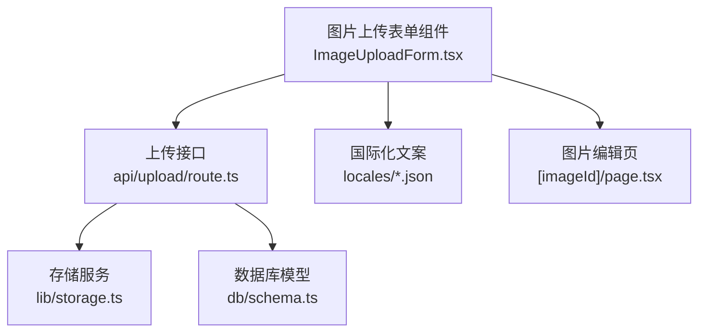
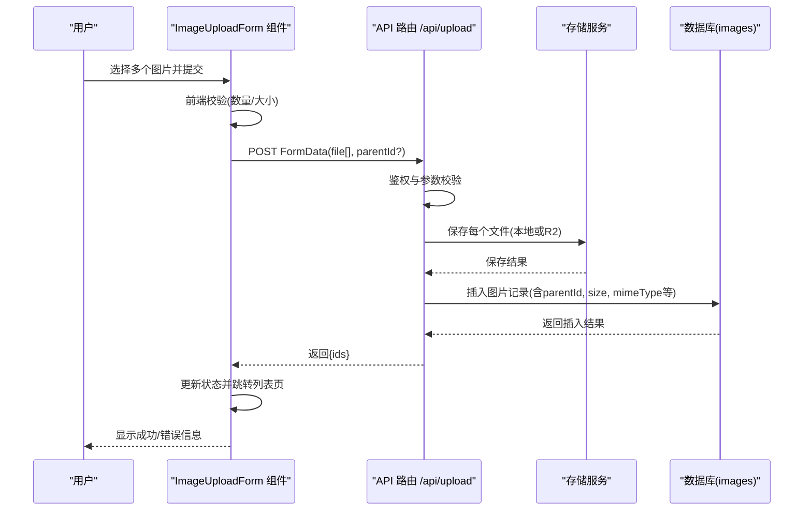

# 图片上传表单组件

<cite>
**本文引用的文件**   
- [ImageUploadForm.tsx](file://src/components/ImageUploadForm.tsx)
- [upload/route.ts](file://src/app/api/upload/route.ts)
- [storage.ts](file://src/lib/storage.ts)
- [schema.ts](file://src/db/schema.ts)
- [en.json](file://src/locales/en.json)
- [zh.json](file://src/locales/zh.json)
- [page.tsx（图片编辑页）](file://src/app/[lang]/console/images/[imageId]/page.tsx)
</cite>

## 目录
1. [简介](#简介)
2. [项目结构](#项目结构)
3. [核心组件与属性](#核心组件与属性)
4. [架构总览](#架构总览)
5. [详细组件分析](#详细组件分析)
6. [依赖关系分析](#依赖关系分析)
7. [性能考量](#性能考量)
8. [故障排查指南](#故障排查指南)
9. [结论](#结论)
10. [附录：使用示例与集成步骤](#附录使用示例与集成步骤)

## 简介
本组件为“图片上传表单”，用于在控制台页面中支持多图片批量上传、大小与数量限制、错误提示、上传状态反馈，并在成功后自动跳转至对应语言下的图片列表页。组件采用 React 客户端组件实现，配合 Next.js API 路由进行服务端校验与持久化存储，同时通过 i18n 文案注入实现多语言支持。

## 项目结构
该功能涉及前端组件、API 路由、存储服务与数据库模型四个层次：
- 前端组件：负责用户交互、本地校验与上传流程控制
- API 路由：接收 FormData、校验文件类型与大小、写入存储与数据库
- 存储服务：抽象本地文件系统与 R2 对象存储两种实现
- 数据模型：定义图片表结构与关联关系



图表来源
- [ImageUploadForm.tsx:1-105](file://src/components/ImageUploadForm.tsx#L1-L105)
- [upload/route.ts:1-75](file://src/app/api/upload/route.ts#L1-L75)
- [storage.ts:1-214](file://src/lib/storage.ts#L1-L214)
- [schema.ts:46-69](file://src/db/schema.ts#L46-L69)
- [en.json:66-70](file://src/locales/en.json#L66-L70)
- [zh.json:66-70](file://src/locales/zh.json#L66-L70)
- [page.tsx（图片编辑页）:42-53](file://src/app/[lang]/console/images/[imageId]/page.tsx#L42-L53)

章节来源
- [ImageUploadForm.tsx:1-105](file://src/components/ImageUploadForm.tsx#L1-L105)
- [upload/route.ts:1-75](file://src/app/api/upload/route.ts#L1-L75)
- [storage.ts:1-214](file://src/lib/storage.ts#L1-L214)
- [schema.ts:46-69](file://src/db/schema.ts#L46-L69)
- [en.json:66-70](file://src/locales/en.json#L66-L70)
- [zh.json:66-70](file://src/locales/zh.json#L66-L70)
- [page.tsx（图片编辑页）:42-53](file://src/app/[lang]/console/images/[imageId]/page.tsx#L42-L53)

## 核心组件与属性
- 组件名称：ImageUploadForm
- 运行环境：React 客户端组件（"use client"）
- 主要职责：
  - 提供多文件选择输入框，限制仅接受图片类型
  - 前端校验：文件数量上限、单文件大小上限
  - 构建 FormData 并调用 /api/upload
  - 错误提示与上传状态管理
  - 上传成功后根据 lang 与 parentId 跳转到对应列表页

- 属性（Props）
  - lang: string — 当前语言代码，用于成功后的跳转路径
  - parentId?: string | null — 可选的父目录 ID，上传时作为附加字段传递
  - labels: object — 文案映射，包含以下键：
    - newImage: string — 按钮/标题文案
    - imageTooLarge: string — 单张图片过大提示
    - uploadError: string — 上传失败通用提示
    - uploadTooManyFiles: string — 文件数量过多提示
    - uploadLimitsHint: string — 上传限制说明文案
    - uploadingImages: string — 上传中按钮文案

- 内部状态
  - error: string — 错误消息
  - uploading: boolean — 是否正在上传
  - formRef: Ref<HTMLFormElement> — 表单引用，用于获取文件输入

章节来源
- [ImageUploadForm.tsx:8-19](file://src/components/ImageUploadForm.tsx#L8-L19)
- [ImageUploadForm.tsx:21-72](file://src/components/ImageUploadForm.tsx#L21-L72)
- [page.tsx（图片编辑页）:42-53](file://src/app/[lang]/console/images/[imageId]/page.tsx#L42-L53)

## 架构总览
下图展示从用户操作到后端落盘的完整调用链，包括前端校验、API 处理、存储适配与数据库写入。



图表来源
- [ImageUploadForm.tsx:26-72](file://src/components/ImageUploadForm.tsx#L26-L72)
- [upload/route.ts:14-74](file://src/app/api/upload/route.ts#L14-L74)
- [storage.ts:184-197](file://src/lib/storage.ts#L184-L197)
- [schema.ts:46-69](file://src/db/schema.ts#L46-L69)

## 详细组件分析

### 视觉外观与用户交互
- 表单布局：
  - 标签文本来自 labels.newImage
  - 文件输入框支持多选 multiple，且 accept="image/*"
  - 上传限制提示文案来自 labels.uploadLimitsHint
  - 提交按钮在上传过程中禁用，文案切换为 labels.uploadingImages
- 错误提示：
  - 当出现错误时，以红色背景卡片形式展示 labels.uploadError 或具体错误文案
- 无障碍与可访问性：
  - 使用 label 元素绑定文本，提升屏幕阅读器体验
  - 按钮具备 disabled 状态，避免重复提交
  - 颜色对比度遵循 Tailwind 默认语义色，保证可读性

章节来源
- [ImageUploadForm.tsx:74-104](file://src/components/ImageUploadForm.tsx#L74-L104)

### 文件上传与限制逻辑
- 多文件上传：
  - 通过 input[type="file"] 的 multiple 属性启用多选
  - 将 files 数组逐项 append("file", file) 到 FormData
- 数量限制：
  - 前端常量 MAX_UPLOAD_FILES = 50
  - 超过限制时设置错误文案 labels.uploadTooManyFiles
- 大小限制：
  - 前端常量 MAX_FILE_SIZE_BYTES = 5 * 1024 * 1024（5MB）
  - 任一文件超过限制时设置错误文案 labels.imageTooLarge
- 父目录支持：
  - 若传入 parentId，则将其追加到 FormData，以便服务端写入 images.parentId

章节来源
- [ImageUploadForm.tsx:5-6](file://src/components/ImageUploadForm.tsx#L5-L6)
- [ImageUploadForm.tsx:37-45](file://src/components/ImageUploadForm.tsx#L37-L45)
- [ImageUploadForm.tsx:49-55](file://src/components/ImageUploadForm.tsx#L49-L55)

### 事件处理与状态管理
- handleSubmit：
  - 阻止默认提交行为
  - 清空历史错误
  - 读取文件输入并执行前端校验
  - 构建 FormData 并发起 fetch("/api/upload")
  - 非 2xx 响应时解析错误消息并设置 error
  - 成功时根据 lang 与 parentId 构造跳转 URL 并刷新页面
  - finally 中重置 uploading 状态
- 状态变量：
  - error: string — 错误消息
  - uploading: boolean — 上传进行中标志
  - formRef: Ref<HTMLFormElement> — 表单引用

章节来源
- [ImageUploadForm.tsx:22-24](file://src/components/ImageUploadForm.tsx#L22-L24)
- [ImageUploadForm.tsx:26-72](file://src/components/ImageUploadForm.tsx#L26-L72)

### 服务端处理与存储
- API 路由 /api/upload：
  - 鉴权：获取当前用户
  - 解析 FormData，过滤出 File 实例
  - 校验：无文件、文件数超限、非图片 MIME、单文件超 5MB
  - 校验 parentId 存在性与归属（必须属于当前用户且类型为目录）
  - 存储：遍历文件，生成 id，写入 Buffer 到存储服务
  - 数据库：批量插入 images 记录（title、filename、mimeType、size、parentId 等）
  - 返回 { ids } 列表
- 存储服务：
  - 抽象接口 StorageAdapter（save/read/delete）
  - 运行时检测 Cloudflare R2 绑定，优先使用 R2StorageAdapter，否则回退 LocalStorageAdapter
  - 头像存储适配器 AvatarStorage 复用底层存储

章节来源
- [upload/route.ts:14-74](file://src/app/api/upload/route.ts#L14-L74)
- [storage.ts:184-197](file://src/lib/storage.ts#L184-L197)
- [storage.ts:61-114](file://src/lib/storage.ts#L61-L114)
- [storage.ts:116-136](file://src/lib/storage.ts#L116-L136)

### 数据模型与字段映射
- images 表关键字段：
  - id: 主键（Base58 编码 UUIDv7）
  - userId: 所属用户
  - parentId: 父目录（自引用）
  - title/filename/mimeType/size: 元数据
  - isPublished/createdAt/updatedAt: 状态与时间戳
- 上传时映射：
  - title 由文件名去除扩展名得到
  - filename 保留原始文件名
  - mimeType 取自 file.type
  - size 取自 file.size
  - parentId 来自表单附加字段

章节来源
- [schema.ts:46-69](file://src/db/schema.ts#L46-L69)
- [upload/route.ts:61-71](file://src/app/api/upload/route.ts#L61-L71)

### 国际化与文案
- 组件通过 labels 注入文案，确保界面完全可本地化
- 关键文案键值：
  - newImage、imageTooLarge、uploadError、uploadTooManyFiles、uploadLimitsHint、uploadingImages
- 多语言资源位于 locales 目录下，例如 en.json 与 zh.json

章节来源
- [en.json:66-70](file://src/locales/en.json#L66-L70)
- [zh.json:66-70](file://src/locales/zh.json#L66-L70)
- [page.tsx（图片编辑页）:42-53](file://src/app/[lang]/console/images/[imageId]/page.tsx#L42-L53)

## 依赖关系分析
- 组件依赖：
  - React 基础能力（useState、useRef）
  - 国际化文案（由调用方注入）
- API 路由依赖：
  - NextRequest/NextResponse
  - 鉴权模块 getCurrentUser
  - 数据库 getDb 与 schema
  - 存储服务 getStorage
- 存储服务依赖：
  - Node fs/promises（本地模式）
  - Cloudflare R2（云模式）

```mermaid
classDiagram
class ImageUploadForm {
+props : { lang, parentId, labels }
+state : { error, uploading }
+handleSubmit()
}
class UploadAPI {
+POST(req)
-validateFiles()
-persistToStorage()
-insertToDB()
}
class StorageAdapter {
<<interface>>
+save(id, filename, data)
+read(id, filename)
+delete(id, filename)
}
class LocalStorageAdapter {
+save()
+read()
+delete()
}
class R2StorageAdapter {
+save()
+read()
+delete()
}
class ImagesSchema {
+id
+userId
+parentId
+title
+filename
+mimeType
+size
+isPublished
+createdAt
+updatedAt
}
ImageUploadForm --> UploadAPI : "fetch POST"
UploadAPI --> StorageAdapter : "使用"
StorageAdapter <|-- LocalStorageAdapter
StorageAdapter <|-- R2StorageAdapter
UploadAPI --> ImagesSchema : "写入"
```

图表来源
- [ImageUploadForm.tsx:1-105](file://src/components/ImageUploadForm.tsx#L1-L105)
- [upload/route.ts:1-75](file://src/app/api/upload/route.ts#L1-L75)
- [storage.ts:1-214](file://src/lib/storage.ts#L1-L214)
- [schema.ts:46-69](file://src/db/schema.ts#L46-L69)

章节来源
- [ImageUploadForm.tsx:1-105](file://src/components/ImageUploadForm.tsx#L1-L105)
- [upload/route.ts:1-75](file://src/app/api/upload/route.ts#L1-L75)
- [storage.ts:1-214](file://src/lib/storage.ts#L1-L214)
- [schema.ts:46-69](file://src/db/schema.ts#L46-L69)

## 性能考量
- 前端校验先行，减少无效网络请求
- 批量上传时逐个写入存储与数据库，避免单次请求体过大导致超时
- 存储服务在云环境下使用 R2，降低磁盘 IO 压力；本地开发回退到文件系统
- 上传完成后直接跳转列表页，避免额外渲染开销
- 建议优化方向：
  - 增加进度条与分片上传（大文件场景）
  - 并发控制与重试机制（网络不稳定）
  - 压缩与格式转换（如 WebP）以减少体积

## 故障排查指南
- 常见问题与定位：
  - 未选择文件或选择非图片类型：检查 input 的 accept 与 API 的 MIME 校验
  - 单文件超过 5MB：确认前端与后端大小阈值一致
  - 文件数量超过 50：检查前端 MAX_UPLOAD_FILES 与后端校验
  - 父目录不存在或非当前用户所有：检查 parentId 校验逻辑
  - 存储不可用：确认 R2 绑定配置或本地存储路径权限
- 调试建议：
  - 查看浏览器 Network 面板中的 /api/upload 请求与响应
  - 在服务端日志中打印错误信息（如“parent directory not found”、“Only image files are allowed”）
  - 验证 storage.ts 的 getStorage 分支是否正确选择 R2 或本地实现

章节来源
- [upload/route.ts:21-35](file://src/app/api/upload/route.ts#L21-L35)
- [upload/route.ts:40-49](file://src/app/api/upload/route.ts#L40-L49)
- [storage.ts:184-197](file://src/lib/storage.ts#L184-L197)

## 结论
ImageUploadForm 组件实现了完整的图片上传工作流，涵盖多文件选择、前后端双重校验、错误提示、状态管理与国际化文案。结合 API 路由与存储服务，系统具备良好的可扩展性与容错能力。通过合理的限制策略与清晰的错误反馈，提供了良好的用户体验。

## 附录：使用示例与集成步骤
- 在页面中引入组件并传入必要属性：
  - 需要传入 lang、可选的 parentId，以及 labels 文案对象
  - 成功上传后会自动跳转到对应语言的图片列表页
- 文案来源：
  - 从 locales 文件中读取 key，并通过 t(lang, key) 获取实际文案
- 典型集成位置：
  - 图片编辑页（new 模式）下渲染上传表单
- 注意事项：
  - 确保 /api/upload 路由可用且鉴权正常
  - 若使用 R2，需正确配置环境变量与绑定
  - 本地开发时确保 IMAGE_STORAGE_PATH 指向有效目录

章节来源
- [page.tsx（图片编辑页）:42-53](file://src/app/[lang]/console/images/[imageId]/page.tsx#L42-L53)
- [en.json:66-70](file://src/locales/en.json#L66-L70)
- [zh.json:66-70](file://src/locales/zh.json#L66-L70)