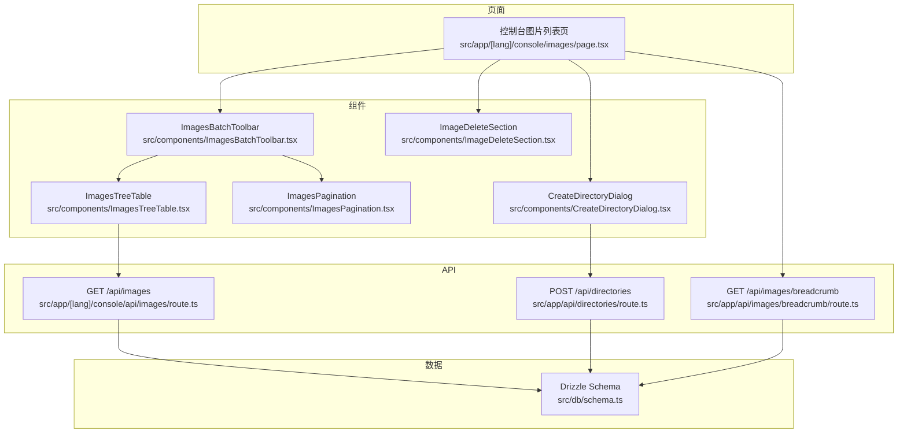
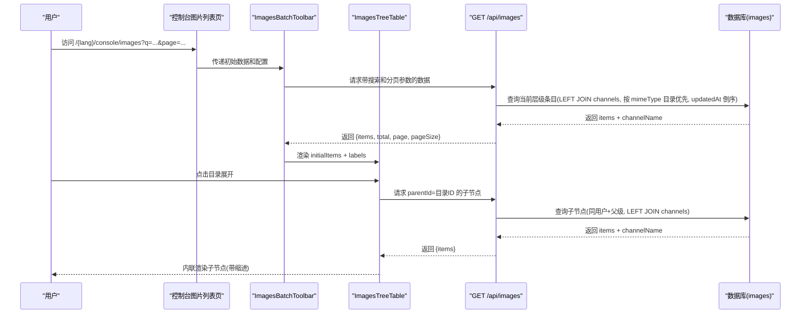
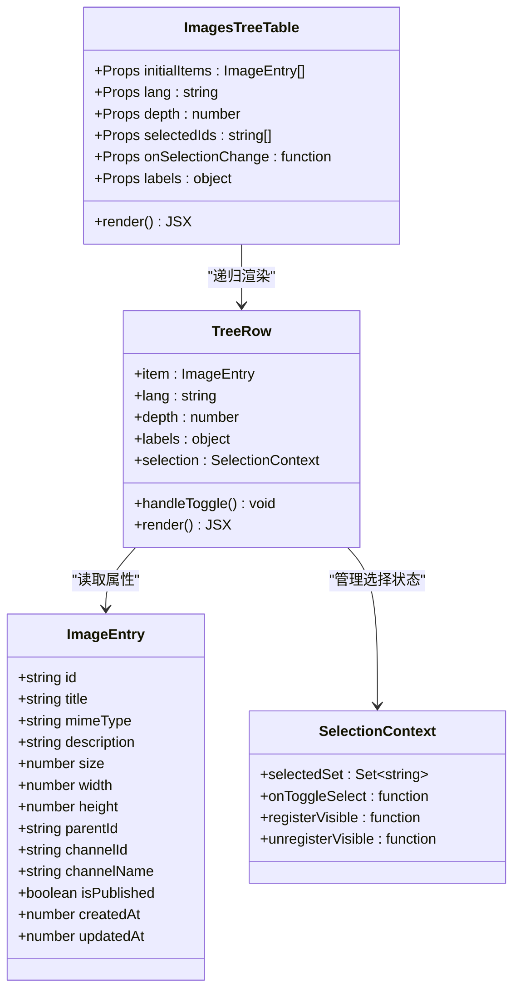
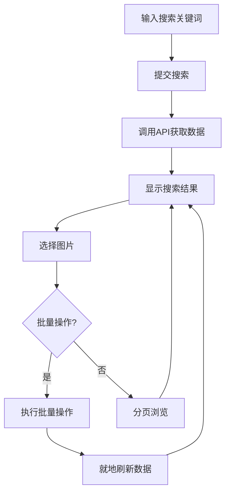
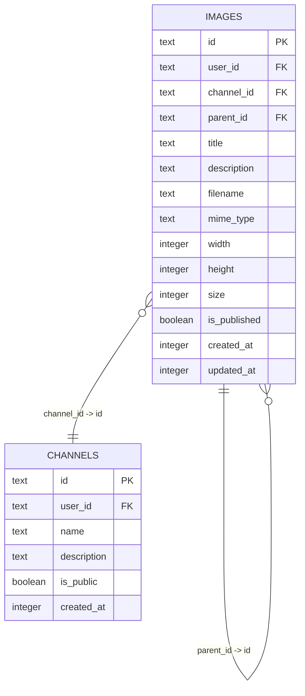
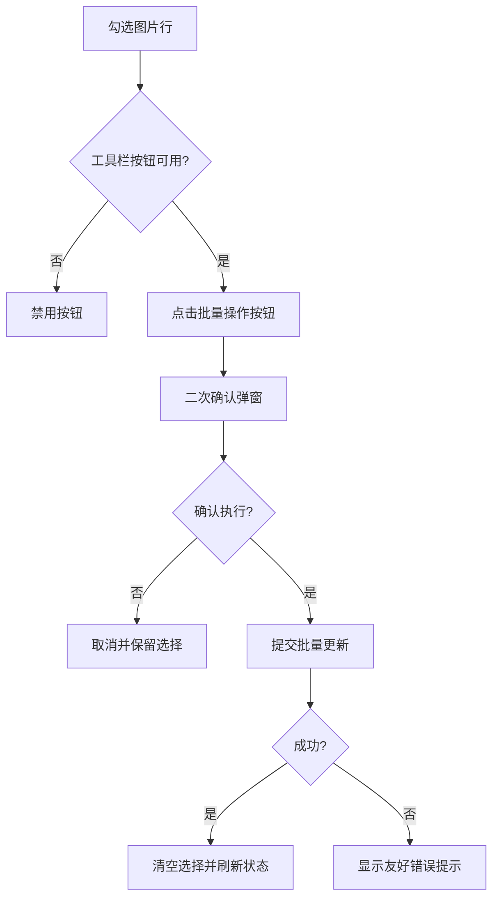
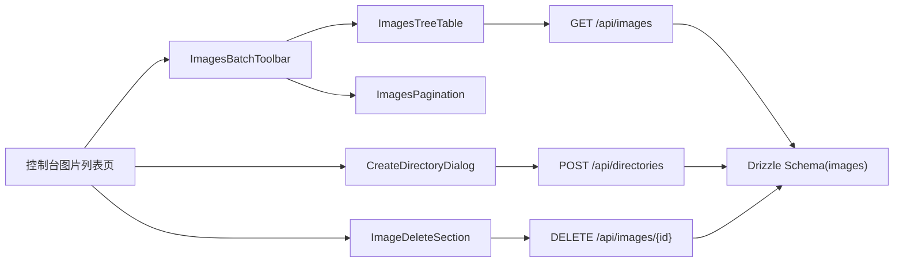

# 图片树形表格组件

<cite>
**本文引用的文件**   
- [ImagesTreeTable.tsx](file://src/components/ImagesTreeTable.tsx)
- [ImagesBatchToolbar.tsx](file://src/components/ImagesBatchToolbar.tsx)
- [ImagesPagination.tsx](file://src/components/ImagesPagination.tsx)
- [route.ts](file://src/app/[lang]/console/api/images/route.ts)
- [schema.ts](file://src/db/schema.ts)
- [zh.json](file://src/locales/zh.json)
</cite>

## 更新摘要
**所做更改**
- 更新了ImagesTreeTable组件的元数据列展示功能
- 新增了频道名称显示（通过LEFT JOIN查询）
- 实现了文件大小格式化显示（KB/MB自动转换）
- 集成了搜索和分页功能
- 增强了批量操作支持

## 目录
1. [简介](#简介)
2. [项目结构](#项目结构)
3. [核心组件](#核心组件)
4. [架构总览](#架构总览)
5. [详细组件分析](#详细组件分析)
6. [依赖关系分析](#依赖关系分析)
7. [性能考虑](#性能考虑)
8. [故障排查指南](#故障排查指南)
9. [结论](#结论)
10. [附录](#附录)

## 简介
本组件文档围绕"图片树形表格"能力展开，涵盖：
- 树形目录展示与内联展开/折叠
- 图片列表管理与交互（状态徽章、更新时间、缩进对齐）
- **新增**：频道名称显示、文件大小格式化、修改时间戳展示
- **新增**：搜索功能和分页集成
- 目录创建、面包屑导航、URL 参数驱动的层级切换
- 批量操作（发布状态、频道归属）、删除确认与状态管理
- 排序与筛选（服务端排序策略与前端扩展建议）
- 性能优化（虚拟滚动、懒加载）与样式定制/主题适配

该能力基于现有 images 表，通过新增自引用字段 parent_id 实现目录结构，配合 Next.js App Router 的 Server Component 与 Client Component 协作完成。

**章节来源**
- [ImagesTreeTable.tsx:1-332](file://src/components/ImagesTreeTable.tsx#L1-L332)
- [route.ts:1-122](file://src/app/[lang]/console/api/images/route.ts#L1-L122)

## 项目结构
- 页面层：控制台图片列表页负责数据获取、面包屑构建、传入初始数据给树形表格组件。
- 组件层：ImagesTreeTable 为客户端组件，负责树形渲染、子节点懒加载、展开/折叠交互；CreateDirectoryDialog 提供目录创建弹窗；ImageDeleteSection 提供单图删除确认。
- API 层：images 路由提供按父级查询与排序；directories 路由提供目录创建；breadcrumb 路由提供面包屑数据。
- 数据层：Drizzle schema 定义 images 表的自引用关系与字段约束。

**图表来源**
- [ImagesBatchToolbar.tsx:1-229](file://src/components/ImagesBatchToolbar.tsx#L1-L229)
- [ImagesTreeTable.tsx:1-332](file://src/components/ImagesTreeTable.tsx#L1-L332)
- [route.ts:1-122](file://src/app/[lang]/console/api/images/route.ts#L1-L122)

**章节来源**
- [ImagesBatchToolbar.tsx:1-229](file://src/components/ImagesBatchToolbar.tsx#L1-L229)
- [ImagesTreeTable.tsx:1-332](file://src/components/ImagesTreeTable.tsx#L1-L332)
- [schema.ts:1-100](file://src/db/schema.ts#L1-L100)

## 核心组件
- **ImagesTreeTable**：树形表格渲染与交互的核心，支持目录内联展开、子节点懒加载、缩进对齐、状态徽章显示与更新时间格式化。**已增强**：新增频道名称列、文件大小格式化显示、修改时间戳展示。
- **ImagesBatchToolbar**：批量操作容器，持有选择状态与列表数据源，集成搜索、分页和批量操作功能。
- **ImagesPagination**：分页控件，支持传统分页界面，包含上一页/下一页按钮和页码窗口。
- CreateDirectoryDialog：创建目录弹窗，包含表单校验、错误提示、提交后刷新当前视图。
- ImageDeleteSection：单图删除确认与执行，成功后跳转回指定路径。

关键属性与行为（ImagesTreeTable）：
- initialItems：初始根级条目数组（含目录与图片），由页面在服务端查询并传入。
- lang：语言代码，用于日期本地化与链接生成。
- depth：递归深度，默认 0，用于计算缩进。
- selectedIds：当前选中的图片ID数组，用于批量操作。
- onSelectionChange：选中状态变化回调函数。
- labels：国际化文案对象，包含"已发布/草稿/更新于"等键。

关键方法（TreeRow 内部）：
- handleToggle：目录首次展开时发起 GET /api/images?parentId=... 请求，缓存子节点，切换 expanded 状态。

事件与副作用：
- 点击目录行标题进入对应详情页或子目录列表页（通过 Link）。
- 图片缩略图通过 /api/images/{id}/file 动态加载。

**章节来源**
- [ImagesTreeTable.tsx:1-332](file://src/components/ImagesTreeTable.tsx#L1-L332)
- [ImagesBatchToolbar.tsx:1-229](file://src/components/ImagesBatchToolbar.tsx#L1-L229)

## 架构总览
整体采用 Next.js App Router 全栈模式：
- 服务端渲染页面数据（images 列表、面包屑），注入到客户端组件。
- 客户端组件按需懒加载子目录数据，避免一次性加载整棵树。
- API 层统一鉴权与权限校验（仅当前用户可见），并按 mimeType 将目录置顶，再按 updatedAt 倒序排列。
- **新增**：支持搜索过滤和分页功能，通过可选参数控制分页行为。

**图表来源**
- [ImagesBatchToolbar.tsx:1-229](file://src/components/ImagesBatchToolbar.tsx#L1-L229)
- [ImagesTreeTable.tsx:1-332](file://src/components/ImagesTreeTable.tsx#L1-L332)
- [route.ts:1-122](file://src/app/[lang]/console/api/images/route.ts#L1-L122)

**章节来源**
- [route.ts:1-122](file://src/app/[lang]/console/api/images/route.ts#L1-L122)
- [ImagesBatchToolbar.tsx:1-229](file://src/components/ImagesBatchToolbar.tsx#L1-L229)

## 详细组件分析

### ImagesTreeTable 组件
- **数据结构**：ImageEntry 类型定义了 id、title、mimeType、description、size、width、height、parentId、channelId、**channelName**、isPublished、createdAt、updatedAt。
- **渲染逻辑**：
  - 目录项：显示文件夹图标、可展开按钮、标题链接至子目录列表。
  - 图片项：显示缩略图、标题链接至图片详情、状态徽章（已发布/草稿）、**频道名称**、**文件大小**、更新时间。
- **交互逻辑**：
  - 目录首次展开触发懒加载，状态机 idle→loading→loaded/error。
  - 使用 transform translateX 实现稳定缩进，避免列抖动。
  - 空目录与加载失败行有专门占位与提示。
  - **新增**：支持复选框选择和批量操作。

**图表来源**
- [ImagesTreeTable.tsx:1-332](file://src/components/ImagesTreeTable.tsx#L1-L332)

**章节来源**
- [ImagesTreeTable.tsx:1-332](file://src/components/ImagesTreeTable.tsx#L1-L332)

### ImagesBatchToolbar 组件
- **功能**：批量操作容器，持有选择状态与列表数据源，集成搜索、分页和批量操作功能。
- **特性**：
  - 搜索功能：支持按标题模糊搜索，重置到第1页。
  - 分页功能：支持分页浏览，保留搜索条件和父目录上下文。
  - 批量操作：支持设置发布状态和频道归属。
  - 就地刷新：操作成功后不整页刷新，保持已展开目录状态。

**图表来源**
- [ImagesBatchToolbar.tsx:1-229](file://src/components/ImagesBatchToolbar.tsx#L1-L229)

**章节来源**
- [ImagesBatchToolbar.tsx:1-229](file://src/components/ImagesBatchToolbar.tsx#L1-L229)

### ImagesPagination 组件
- **功能**：传统分页控件，支持上一页/下一页按钮和页码窗口。
- **特性**：
  - 智能页码窗口：显示首页、尾页、当前页±1，缺口以省略号呈现。
  - 响应式控制：当total ≤ pageSize时不渲染分页控件。
  - 无障碍支持：使用aria-current标识当前页。

**章节来源**
- [ImagesPagination.tsx:1-78](file://src/components/ImagesPagination.tsx#L1-L78)

### 数据模型与排序规则
- **数据模型**：images 表新增 parent_id 自引用字段，目录条目固定 mimeType='directory'，filename=title，size=0，width/height=NULL，isPublished=false。
- **排序规则**：目录优先（CASE WHEN mimeType='directory' THEN 0 ELSE 1 END），同级按 updatedAt 倒序。
- **关联查询**：通过 LEFT JOIN channels 表获取频道名称信息。

**图表来源**
- [schema.ts:1-100](file://src/db/schema.ts#L1-L100)

**章节来源**
- [schema.ts:1-100](file://src/db/schema.ts#L1-L100)

### 搜索和分页功能
- **搜索功能**：
  - 支持按标题模糊搜索，使用 LIKE 查询和通配符转义。
  - 搜索条件重置到第1页，确保用户体验一致性。
  - 支持特殊字符转义，防止SQL注入攻击。
- **分页功能**：
  - 通过可选参数 pageSize 控制分页行为。
  - 仅当显式传入合法 pageSize 时启用分页。
  - 返回 total、page、pageSize 信息供前端使用。
  - 树展开调用不加参数，维持现有行为不变。

**章节来源**
- [route.ts:1-122](file://src/app/[lang]/console/api/images/route.ts#L1-L122)
- [ImagesBatchToolbar.tsx:1-229](file://src/components/ImagesBatchToolbar.tsx#L1-L229)

### 批量操作与选择状态
- **选择机制**：
  - 仅图片行可被选择，目录行不可选。
  - 支持全选/半选态，通过 visibleIds 集合跟踪当前可见的图片ID。
  - 表头复选框支持部分选择状态指示。
- **批量操作**：
  - 支持设置发布状态和频道归属。
  - 操作期间防止重复提交。
  - 成功后就地刷新数据，保持已展开目录状态。

**图表来源**
- [ImagesBatchToolbar.tsx:1-229](file://src/components/ImagesBatchToolbar.tsx#L1-L229)

**章节来源**
- [ImagesBatchToolbar.tsx:1-229](file://src/components/ImagesBatchToolbar.tsx#L1-L229)

## 依赖关系分析
- **页面依赖组件**：ImagesBatchToolbar、ImagesTreeTable、ImagesPagination、CreateDirectoryDialog、ImageDeleteSection。
- **组件依赖 API**：ImagesTreeTable 依赖 GET /api/images；CreateDirectoryDialog 依赖 POST /api/directories；删除依赖 DELETE /api/images/{id}。
- **API 依赖数据层**：所有 API 均通过 Drizzle ORM 访问 images 表，遵循用户隔离与权限校验。
- **新增依赖**：ImagesBatchToolbar 依赖 ImagesPagination 进行分页控制。

**图表来源**
- [ImagesBatchToolbar.tsx:1-229](file://src/components/ImagesBatchToolbar.tsx#L1-L229)
- [ImagesTreeTable.tsx:1-332](file://src/components/ImagesTreeTable.tsx#L1-L332)
- [route.ts:1-122](file://src/app/[lang]/console/api/images/route.ts#L1-L122)

**章节来源**
- [ImagesBatchToolbar.tsx:1-229](file://src/components/ImagesBatchToolbar.tsx#L1-L229)
- [schema.ts:1-100](file://src/db/schema.ts#L1-L100)

## 性能考虑
- **懒加载**：目录子节点仅在首次展开时请求，减少首屏负载。
- **缩进稳定**：使用 transform translateX 避免重排导致的列抖动。
- **排序优化**：服务端按 mimeType 与 updatedAt 排序，避免前端额外开销。
- **分页优化**：通过分页限制单次加载的数据量，提升大数据集性能。
- **搜索优化**：服务端模糊搜索，避免前端大量数据处理。
- **可扩展优化**：
  - 虚拟滚动：当单目录条目数较大（如 >500）时，可引入 react-window 或 @tanstack/virtual 进行虚拟化渲染。
  - 预取与缓存：对常用目录的子节点做内存缓存或浏览器缓存（Cache-Control），减少重复请求。
  - 图片懒加载：缩略图使用 loading="lazy" 与合适的尺寸裁剪，降低带宽压力。
  - **新增**：文件大小格式化在客户端进行，避免服务器端计算开销。

## 故障排查指南
- **目录展开失败**：检查网络请求 /api/images?parentId=... 是否返回 200 与正确 items；确认用户权限与 parentId 有效性。
- **重复名称创建失败**：POST /api/directories 返回 409，表示同级已有同名条目，需修改名称。
- **非法字符报错**：名称包含 /、\、.. 将被拒绝，请修正输入。
- **删除失败**：确认 DELETE /api/images/{id} 返回 200；若失败，检查鉴权与资源存在性。
- **面包屑异常**：GET /api/images/breadcrumb 要求 parentId 存在且属于当前用户，否则返回 404。
- **搜索无结果**：检查搜索关键词是否正确，确认数据库中是否存在匹配记录。
- **分页异常**：验证 pageSize 参数是否为正整数，page 参数是否有效。
- **频道名称显示为空**：检查 images.channelId 是否正确关联到 channels.id。

**章节来源**
- [route.ts:1-122](file://src/app/[lang]/console/api/images/route.ts#L1-L122)
- [ImagesBatchToolbar.tsx:1-229](file://src/components/ImagesBatchToolbar.tsx#L1-L229)

## 结论
图片树形表格组件经过增强后，提供了更丰富的元数据展示功能，包括频道名称、文件大小格式化和修改时间戳。通过与搜索和分页功能的无缝集成，组件能够更好地处理大规模图片数据集的管理需求。服务端优化的查询逻辑和客户端的智能渲染策略，确保了良好的用户体验和性能表现。

## 附录

### 组件属性与方法速查
- **ImagesTreeTable**
  - 属性：initialItems、lang、depth、labels、selectedIds、onSelectionChange
  - 行为：递归渲染、懒加载子节点、缩进对齐、状态徽章与时间格式化、**频道名称显示、文件大小格式化**
- **ImagesBatchToolbar**
  - 属性：lang、parentId、initialItems、initialQ、initialPage、initialTotal、channels、labels
  - 行为：**搜索、分页、批量操作、就地刷新**
- **ImagesPagination**
  - 属性：page、total、pageSize、onPageChange、labels
  - 行为：**分页导航、页码窗口生成**
- CreateDirectoryDialog
  - 属性：lang、parentId、labels
  - 行为：表单校验、错误提示、提交后刷新
- ImageDeleteSection
  - 属性：imageId、redirectTo、labels
  - 行为：确认删除、调用 API、跳转

**章节来源**
- [ImagesTreeTable.tsx:1-332](file://src/components/ImagesTreeTable.tsx#L1-L332)
- [ImagesBatchToolbar.tsx:1-229](file://src/components/ImagesBatchToolbar.tsx#L1-L229)
- [ImagesPagination.tsx:1-78](file://src/components/ImagesPagination.tsx#L1-L78)

### 多语言文案键参考
- **图片与目录相关文案键**：images、newImage、imagePublished、imageDraft、updated、newDirectory、directoryName、createDirectory、duplicateEntryName、nameRequired、breadcrumbRoot、invalidTitleChars 等。
- **新增文案键**：selectAllImages、searchPlaceholder、searchButton、noSearchResults、prevPage、nextPage、fileSize、batchSetPublishStatus、batchSetChannel、batchConfirm、batchOperationFailed 等。

**章节来源**
- [zh.json:1-95](file://src/locales/zh.json#L1-L95)

### API 接口规范
- **GET /api/images**：支持搜索和分页
  - 参数：parentId、q（搜索关键词）、page（页码）、pageSize（每页数量）
  - 返回：items（图片列表）、total（总数）、page（当前页）、pageSize（每页数量）
- **POST /api/directories**：创建目录
- **DELETE /api/images/{id}**：删除图片
- **GET /api/images/breadcrumb**：获取面包屑导航

**章节来源**
- [route.ts:1-122](file://src/app/[lang]/console/api/images/route.ts#L1-L122)