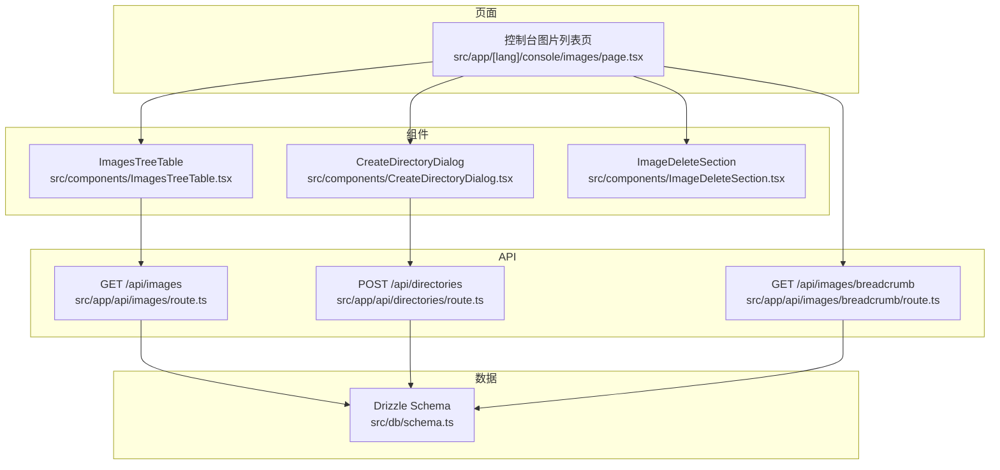
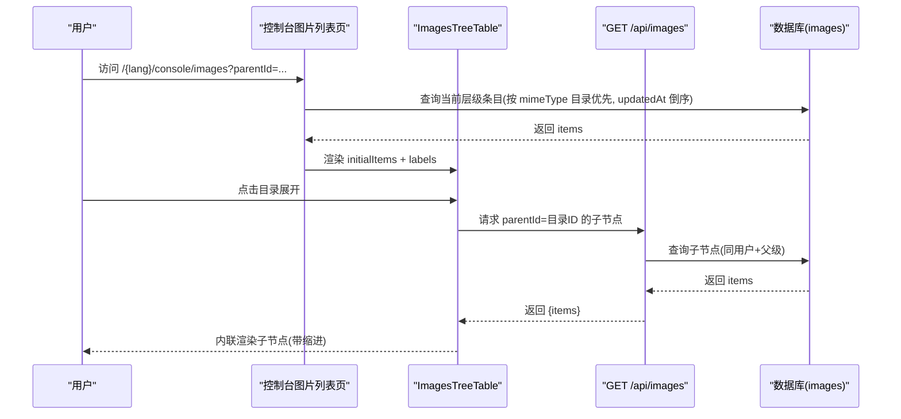
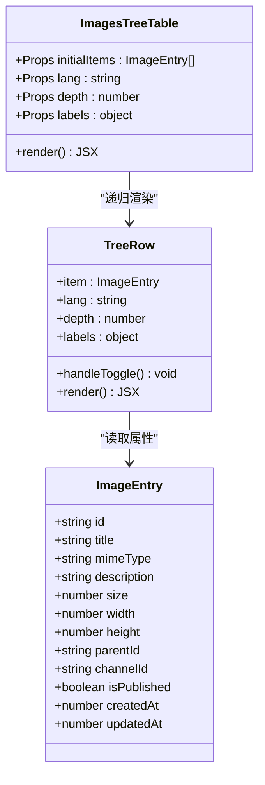
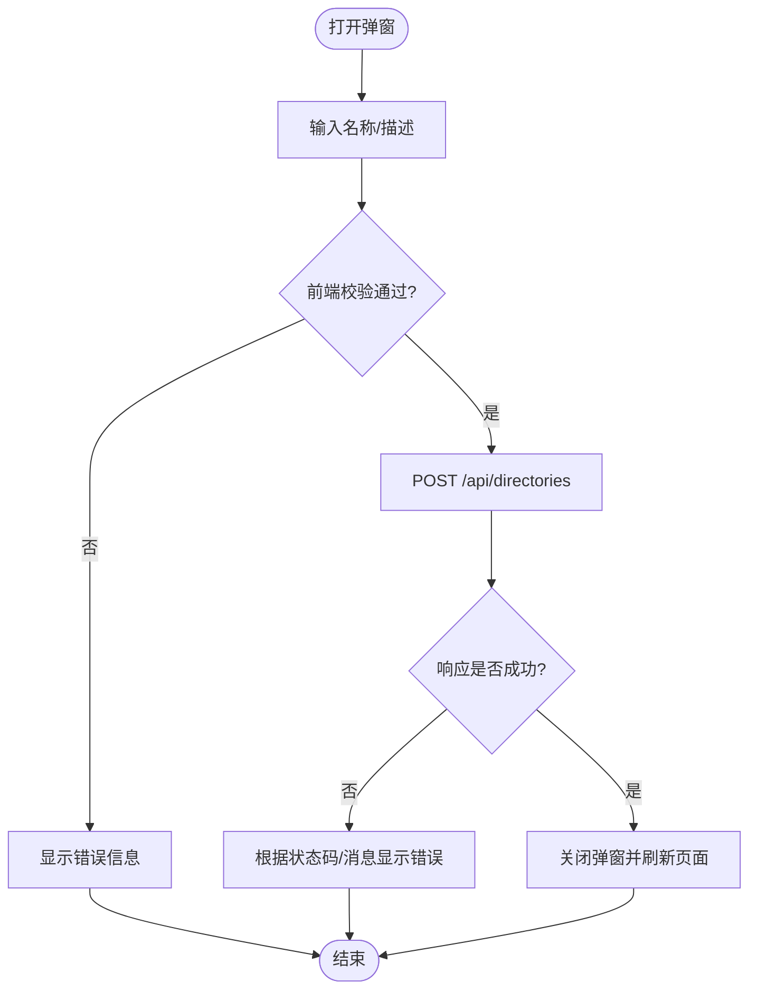
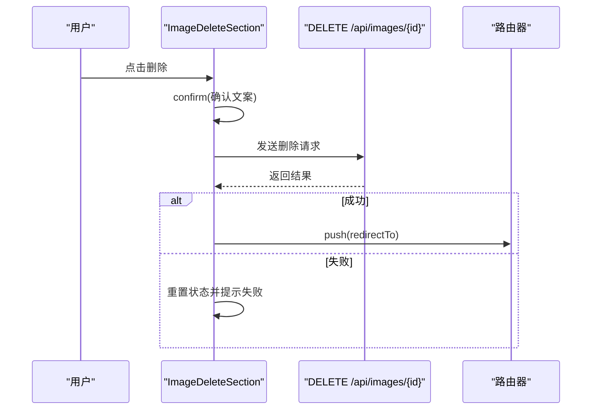
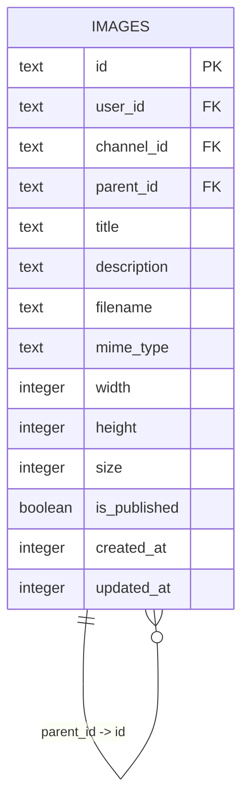
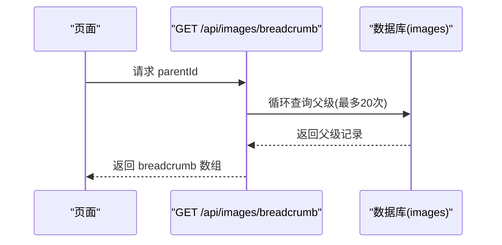
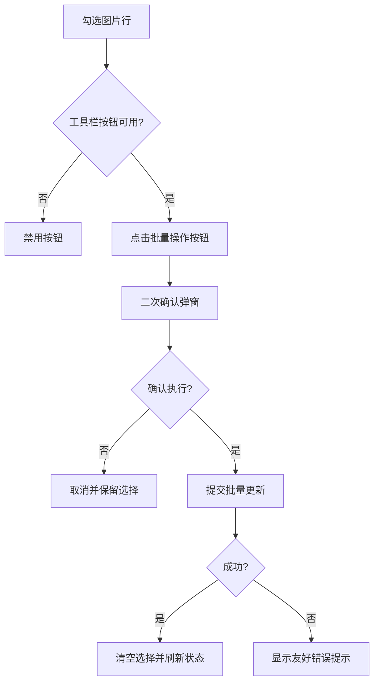
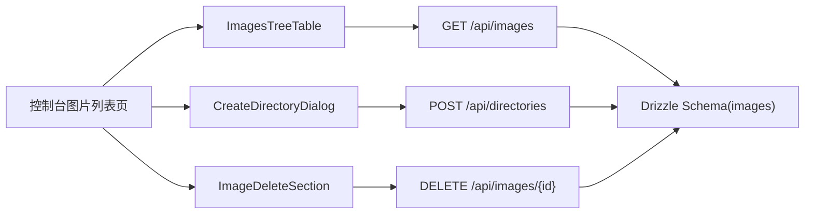

# 图片树形表格组件

<cite>
**本文引用的文件**   
- [ImagesTreeTable.tsx](file://src/components/ImagesTreeTable.tsx)
- [page.tsx](file://src/app/[lang]/console/images/page.tsx)
- [route.ts](file://src/app/api/images/route.ts)
- [route.ts](file://src/app/api/directories/route.ts)
- [route.ts](file://src/app/api/images/breadcrumb/route.ts)
- [schema.ts](file://src/db/schema.ts)
- [CreateDirectoryDialog.tsx](file://src/components/CreateDirectoryDialog.tsx)
- [ImageDeleteSection.tsx](file://src/components/ImageDeleteSection.tsx)
- [zh.json](file://src/locales/zh.json)
- [data-model.md](file://specs/001-image-directory-tree/data-model.md)
- [plan.md](file://specs/001-image-directory-tree/plan.md)
- [spec.md](file://specs/003-batch-publish-channel/spec.md)
</cite>

## 目录
1. [简介](#简介)
2. [项目结构](#项目结构)
3. [核心组件](#核心组件)
4. [架构总览](#架构总览)
5. [详细组件分析](#详细组件分析)
6. [依赖关系分析](#依赖关系分析)
7. [性能考虑](#性能考虑)
8. [故障排查指南](#故障排查指南)
9. [结论](#结论)
10. [附录](#附录)

## 简介
本组件文档围绕“图片树形表格”能力展开，涵盖：
- 树形目录展示与内联展开/折叠
- 图片列表管理与交互（状态徽章、更新时间、缩进对齐）
- 目录创建、面包屑导航、URL 参数驱动的层级切换
- 批量操作（发布状态、频道归属）、删除确认与状态管理
- 排序与筛选（服务端排序策略与前端扩展建议）
- 性能优化（虚拟滚动、懒加载）与样式定制/主题适配

该能力基于现有 images 表，通过新增自引用字段 parent_id 实现目录结构，配合 Next.js App Router 的 Server Component 与 Client Component 协作完成。

**章节来源**
- [plan.md:1-97](file://specs/001-image-directory-tree/plan.md#L1-L97)
- [data-model.md:1-113](file://specs/001-image-directory-tree/data-model.md#L1-L113)

## 项目结构
- 页面层：控制台图片列表页负责数据获取、面包屑构建、传入初始数据给树形表格组件。
- 组件层：ImagesTreeTable 为客户端组件，负责树形渲染、子节点懒加载、展开/折叠交互；CreateDirectoryDialog 提供目录创建弹窗；ImageDeleteSection 提供单图删除确认。
- API 层：images 路由提供按父级查询与排序；directories 路由提供目录创建；breadcrumb 路由提供面包屑数据。
- 数据层：Drizzle schema 定义 images 表的自引用关系与字段约束。

**图表来源**
- [page.tsx:1-160](file://src/app/[lang]/console/images/page.tsx#L1-L160)
- [ImagesTreeTable.tsx:1-216](file://src/components/ImagesTreeTable.tsx#L1-L216)
- [route.ts:1-66](file://src/app/api/images/route.ts#L1-L66)
- [route.ts:1-95](file://src/app/api/directories/route.ts#L1-L95)
- [route.ts:1-40](file://src/app/api/images/breadcrumb/route.ts#L1-L40)
- [schema.ts:1-100](file://src/db/schema.ts#L1-L100)

**章节来源**
- [page.tsx:1-160](file://src/app/[lang]/console/images/page.tsx#L1-L160)
- [ImagesTreeTable.tsx:1-216](file://src/components/ImagesTreeTable.tsx#L1-L216)
- [schema.ts:1-100](file://src/db/schema.ts#L1-L100)

## 核心组件
- ImagesTreeTable：树形表格渲染与交互的核心，支持目录内联展开、子节点懒加载、缩进对齐、状态徽章显示与更新时间格式化。
- CreateDirectoryDialog：创建目录弹窗，包含表单校验、错误提示、提交后刷新当前视图。
- ImageDeleteSection：单图删除确认与执行，成功后跳转回指定路径。

关键属性与行为（ImagesTreeTable）：
- initialItems：初始根级条目数组（含目录与图片），由页面在服务端查询并传入。
- lang：语言代码，用于日期本地化与链接生成。
- depth：递归深度，默认 0，用于计算缩进。
- labels：国际化文案对象，包含“已发布/草稿/更新于”等键。

关键方法（TreeRow 内部）：
- handleToggle：目录首次展开时发起 GET /api/images?parentId=... 请求，缓存子节点，切换 expanded 状态。

事件与副作用：
- 点击目录行标题进入对应详情页或子目录列表页（通过 Link）。
- 图片缩略图通过 /api/images/{id}/file 动态加载。

**章节来源**
- [ImagesTreeTable.tsx:1-216](file://src/components/ImagesTreeTable.tsx#L1-L216)
- [page.tsx:1-160](file://src/app/[lang]/console/images/page.tsx#L1-L160)

## 架构总览
整体采用 Next.js App Router 全栈模式：
- 服务端渲染页面数据（images 列表、面包屑），注入到客户端组件。
- 客户端组件按需懒加载子目录数据，避免一次性加载整棵树。
- API 层统一鉴权与权限校验（仅当前用户可见），并按 mimeType 将目录置顶，再按 updatedAt 倒序排列。

**图表来源**
- [page.tsx:1-160](file://src/app/[lang]/console/images/page.tsx#L1-L160)
- [ImagesTreeTable.tsx:1-216](file://src/components/ImagesTreeTable.tsx#L1-L216)
- [route.ts:1-66](file://src/app/api/images/route.ts#L1-L66)

**章节来源**
- [route.ts:1-66](file://src/app/api/images/route.ts#L1-L66)
- [page.tsx:1-160](file://src/app/[lang]/console/images/page.tsx#L1-L160)

## 详细组件分析

### ImagesTreeTable 组件
- 数据结构：ImageEntry 类型定义了 id、title、mimeType、description、size、width、height、parentId、channelId、isPublished、createdAt、updatedAt。
- 渲染逻辑：
  - 目录项：显示文件夹图标、可展开按钮、标题链接至子目录列表。
  - 图片项：显示缩略图、标题链接至图片详情、状态徽章（已发布/草稿）、更新时间。
- 交互逻辑：
  - 目录首次展开触发懒加载，状态机 idle→loading→loaded/error。
  - 使用 transform translateX 实现稳定缩进，避免列抖动。
  - 空目录与加载失败行有专门占位与提示。

**图表来源**
- [ImagesTreeTable.tsx:1-216](file://src/components/ImagesTreeTable.tsx#L1-L216)

**章节来源**
- [ImagesTreeTable.tsx:1-216](file://src/components/ImagesTreeTable.tsx#L1-L216)

### 目录创建对话框 CreateDirectoryDialog
- 功能：打开弹窗输入目录名称与描述，提交 POST /api/directories，处理重复名、非法字符、长度限制等错误。
- 成功回调：关闭弹窗并刷新页面，保持当前目录上下文（parentId）。

**图表来源**
- [CreateDirectoryDialog.tsx:1-147](file://src/components/CreateDirectoryDialog.tsx#L1-L147)
- [route.ts:1-95](file://src/app/api/directories/route.ts#L1-L95)

**章节来源**
- [CreateDirectoryDialog.tsx:1-147](file://src/components/CreateDirectoryDialog.tsx#L1-L147)
- [route.ts:1-95](file://src/app/api/directories/route.ts#L1-L95)

### 单图删除确认 ImageDeleteSection
- 功能：点击删除按钮弹出确认框，确认后调用 DELETE /api/images/{imageId}，成功后跳转到指定路径。

**图表来源**
- [ImageDeleteSection.tsx:1-43](file://src/components/ImageDeleteSection.tsx#L1-L43)

**章节来源**
- [ImageDeleteSection.tsx:1-43](file://src/components/ImageDeleteSection.tsx#L1-L43)

### 数据模型与排序规则
- 数据模型：images 表新增 parent_id 自引用字段，目录条目固定 mimeType='directory'，filename=title，size=0，width/height=NULL，isPublished=false。
- 排序规则：目录优先（CASE WHEN mimeType='directory' THEN 0 ELSE 1 END），同级按 updatedAt 倒序。

**图表来源**
- [schema.ts:1-100](file://src/db/schema.ts#L1-L100)
- [data-model.md:1-113](file://specs/001-image-directory-tree/data-model.md#L1-L113)

**章节来源**
- [schema.ts:1-100](file://src/db/schema.ts#L1-L100)
- [data-model.md:1-113](file://specs/001-image-directory-tree/data-model.md#L1-L113)

### 面包屑导航
- 服务端构建：从目标目录向上迭代查询最多 20 层，组装面包屑数组。
- 接口：GET /api/images/breadcrumb?parentId=... 返回 { breadcrumb: [{id,title}] }。

**图表来源**
- [route.ts:1-40](file://src/app/api/images/breadcrumb/route.ts#L1-L40)
- [page.tsx:1-160](file://src/app/[lang]/console/images/page.tsx#L1-L160)

**章节来源**
- [route.ts:1-40](file://src/app/api/images/breadcrumb/route.ts#L1-L40)
- [page.tsx:1-160](file://src/app/[lang]/console/images/page.tsx#L1-L160)

### 批量操作与选择状态（规划）
- 规范：在列表项与表头增加复选框，支持全选/半选态；工具栏提供“设置发布状态”和“设置频道”按钮；未选择时禁用按钮；操作期间防止重复提交；失败友好提示。
- 范围：仅对当前视图中可见的图片行生效；目录行不参与选择。

**图表来源**
- [spec.md:1-115](file://specs/003-batch-publish-channel/spec.md#L1-L115)

**章节来源**
- [spec.md:1-115](file://specs/003-batch-publish-channel/spec.md#L1-L115)

## 依赖关系分析
- 页面依赖组件：ImagesTreeTable、CreateDirectoryDialog、ImageDeleteSection。
- 组件依赖 API：ImagesTreeTable 依赖 GET /api/images；CreateDirectoryDialog 依赖 POST /api/directories；删除依赖 DELETE /api/images/{id}。
- API 依赖数据层：所有 API 均通过 Drizzle ORM 访问 images 表，遵循用户隔离与权限校验。

**图表来源**
- [page.tsx:1-160](file://src/app/[lang]/console/images/page.tsx#L1-L160)
- [ImagesTreeTable.tsx:1-216](file://src/components/ImagesTreeTable.tsx#L1-L216)
- [CreateDirectoryDialog.tsx:1-147](file://src/components/CreateDirectoryDialog.tsx#L1-L147)
- [ImageDeleteSection.tsx:1-43](file://src/components/ImageDeleteSection.tsx#L1-L43)
- [schema.ts:1-100](file://src/db/schema.ts#L1-L100)

**章节来源**
- [page.tsx:1-160](file://src/app/[lang]/console/images/page.tsx#L1-L160)
- [schema.ts:1-100](file://src/db/schema.ts#L1-L100)

## 性能考虑
- 懒加载：目录子节点仅在首次展开时请求，减少首屏负载。
- 缩进稳定：使用 transform translateX 避免重排导致的列抖动。
- 排序优化：服务端按 mimeType 与 updatedAt 排序，避免前端额外开销。
- 可扩展优化：
  - 虚拟滚动：当单目录条目数较大（如 >500）时，可引入 react-window 或 @tanstack/virtual 进行虚拟化渲染。
  - 预取与缓存：对常用目录的子节点做内存缓存或浏览器缓存（Cache-Control），减少重复请求。
  - 分页：对超大目录实施分页加载（如每页 100 条），结合“加载更多”交互。
  - 图片懒加载：缩略图使用 loading="lazy" 与合适的尺寸裁剪，降低带宽压力。

[本节为通用指导，不直接分析具体文件]

## 故障排查指南
- 目录展开失败：检查网络请求 /api/images?parentId=... 是否返回 200 与正确 items；确认用户权限与 parentId 有效性。
- 重复名称创建失败：POST /api/directories 返回 409，表示同级已有同名条目，需修改名称。
- 非法字符报错：名称包含 /、\、.. 将被拒绝，请修正输入。
- 删除失败：确认 DELETE /api/images/{id} 返回 200；若失败，检查鉴权与资源存在性。
- 面包屑异常：GET /api/images/breadcrumb 要求 parentId 存在且属于当前用户，否则返回 404。

**章节来源**
- [route.ts:1-95](file://src/app/api/directories/route.ts#L1-L95)
- [route.ts:1-40](file://src/app/api/images/breadcrumb/route.ts#L1-L40)
- [ImageDeleteSection.tsx:1-43](file://src/components/ImageDeleteSection.tsx#L1-L43)

## 结论
图片树形表格组件以最小改动复用现有数据模型，实现了目录化管理与高效交互。通过服务端排序与客户端懒加载，兼顾了性能与用户体验。后续可按规范逐步实现批量操作与更丰富的筛选/排序能力，并结合虚拟滚动与缓存策略进一步提升大规模数据下的表现。

[本节为总结，不直接分析具体文件]

## 附录

### 组件属性与方法速查
- ImagesTreeTable
  - 属性：initialItems、lang、depth、labels
  - 行为：递归渲染、懒加载子节点、缩进对齐、状态徽章与时间格式化
- CreateDirectoryDialog
  - 属性：lang、parentId、labels
  - 行为：表单校验、错误提示、提交后刷新
- ImageDeleteSection
  - 属性：imageId、redirectTo、labels
  - 行为：确认删除、调用 API、跳转

**章节来源**
- [ImagesTreeTable.tsx:1-216](file://src/components/ImagesTreeTable.tsx#L1-L216)
- [CreateDirectoryDialog.tsx:1-147](file://src/components/CreateDirectoryDialog.tsx#L1-L147)
- [ImageDeleteSection.tsx:1-43](file://src/components/ImageDeleteSection.tsx#L1-L43)

### 多语言文案键参考
- 图片与目录相关文案键（示例）：images、newImage、imagePublished、imageDraft、updated、newDirectory、directoryName、createDirectory、duplicateEntryName、nameRequired、breadcrumbRoot、invalidTitleChars 等。

**章节来源**
- [zh.json:1-84](file://src/locales/zh.json#L1-L84)