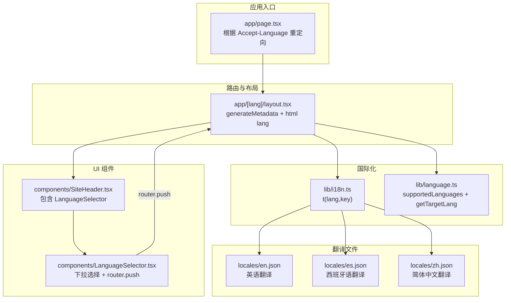
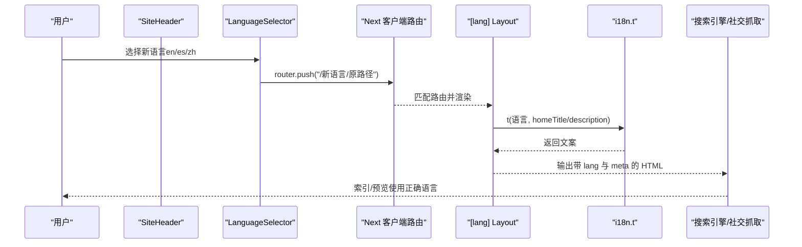
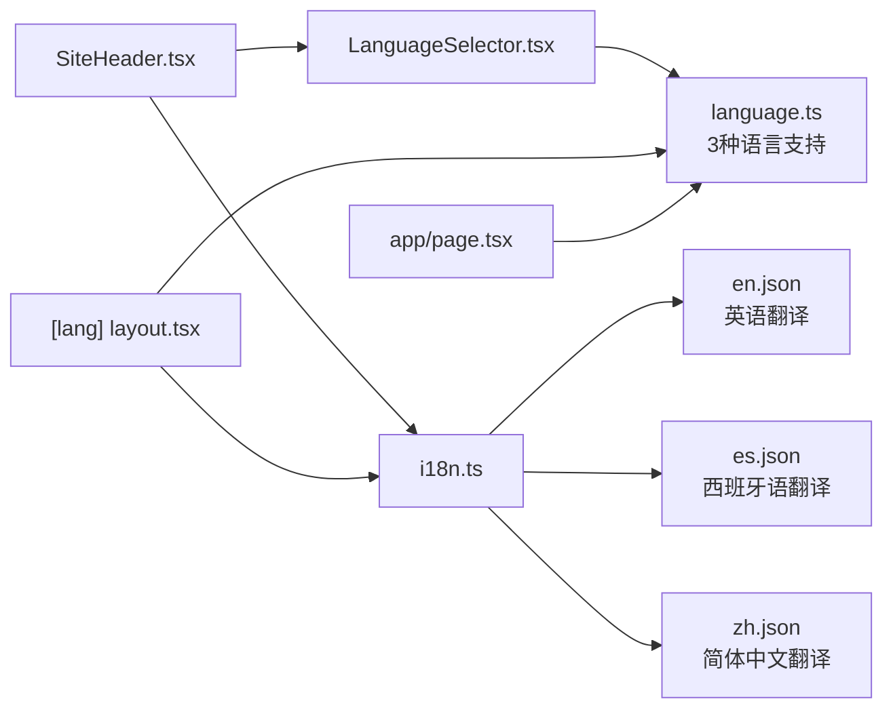

# 语言选择器组件

<cite>
**本文引用的文件**   
- [LanguageSelector.tsx](file://src/components/LanguageSelector.tsx)
- [i18n.ts](file://src/lib/i18n.ts)
- [language.ts](file://src/lib/language.ts)
- [layout.tsx（[lang] 布局）](file://src/app/[lang]/layout.tsx)
- [SiteHeader.tsx](file://src/components/SiteHeader.tsx)
- [en.json](file://src/locales/en.json)
- [es.json](file://src/locales/es.json)
- [zh.json](file://src/locales/zh.json)
</cite>

## 更新摘要
**所做更改**
- 更新了语言选择器组件的语言选项，从8种语言减少到3种语言（英语、西班牙语、简体中文）
- 更新了UI文档以反映当前的语言选项
- 更新了国际化配置和翻译文件管理部分
- 更新了架构图和流程图以反映新的语言支持

## 目录
1. [简介](#简介)
2. [项目结构](#项目结构)
3. [核心组件与能力](#核心组件与能力)
4. [架构总览](#架构总览)
5. [详细组件分析](#详细组件分析)
6. [依赖关系分析](#依赖关系分析)
7. [性能优化建议](#性能优化建议)
8. [故障排查指南](#故障排查指南)
9. [结论](#结论)
10. [附录：集成示例与最佳实践](#附录集成示例与最佳实践)

## 简介
本文件为"语言选择器组件"的完整技术文档，覆盖多语言切换功能的实现、用户界面、支持的语种、语言检测机制、URL 路由处理、国际化配置与翻译文件管理、动态语言切换、SEO 友好的多语言 URL 结构与元数据管理、按需加载与缓存策略、无障碍访问以及多语言内容渲染的最佳实践。该方案基于 Next.js App Router，采用以语言为前缀的路由（如 /zh、/en、/es），并通过客户端下拉框进行即时切换。

**更新** 当前版本支持3种语言：英语（English）、西班牙语（Español）和简体中文（简体中文），相比之前版本减少了语言选项数量，专注于核心市场。

## 项目结构
- 组件层
  - LanguageSelector：客户端组件，提供语言下拉选择并触发路由跳转
  - SiteHeader：在站点头部集成语言选择器
- 国际化库
  - i18n.ts：集中导入各语言 JSON 并提供 t(lang, key) 函数
  - language.ts：定义支持的语言键、名称、默认语言、校验与浏览器 Accept-Language 解析
- 路由与布局
  - app/[lang]/layout.tsx：按语言生成 SEO 元数据、设置 html lang、静态参数预生成
  - app/page.tsx：根据请求头自动跳转到对应语言路径
- 翻译资源
  - locales/*.json：每种语言的文案集合（en.json、es.json、zh.json）

**图表来源**
- [page.tsx（根重定向）:1-12](file://src/app/page.tsx#L1-L12)
- [layout.tsx（[lang] 布局）:1-48](file://src/app/[lang]/layout.tsx#L1-L48)
- [SiteHeader.tsx:1-38](file://src/components/SiteHeader.tsx#L1-L38)
- [LanguageSelector.tsx:1-34](file://src/components/LanguageSelector.tsx#L1-L34)
- [i18n.ts:1-18](file://src/lib/i18n.ts#L1-L18)
- [language.ts:1-34](file://src/lib/language.ts#L1-L34)
- [en.json:1-82](file://src/locales/en.json#L1-L82)
- [es.json:1-82](file://src/locales/es.json#L1-L82)
- [zh.json:1-82](file://src/locales/zh.json#L1-L82)

**章节来源**
- [LanguageSelector.tsx:1-34](file://src/components/LanguageSelector.tsx#L1-L34)
- [i18n.ts:1-18](file://src/lib/i18n.ts#L1-L18)
- [language.ts:1-34](file://src/lib/language.ts#L1-L34)
- [layout.tsx（[lang] 布局）:1-48](file://src/app/[lang]/layout.tsx#L1-L48)
- [SiteHeader.tsx:1-38](file://src/components/SiteHeader.tsx#L1-L38)
- [en.json:1-82](file://src/locales/en.json#L1-L82)
- [es.json:1-82](file://src/locales/es.json#L1-L82)
- [zh.json:1-82](file://src/locales/zh.json#L1-L82)

## 核心组件与能力
- 语言选择器组件（LanguageSelector）
  - 功能：展示当前语言的下拉列表，切换时通过 Next.js 客户端路由跳转到新语言路径
  - 输入：currentLang（当前语言键）、pathSuffix（语言前缀后的路径段）
  - 行为：onChange 事件将目标语言与 pathSuffix 拼接为 /{lang}/{pathSuffix} 并导航
  - **更新** 当前仅支持3种语言：英语（en）、西班牙语（es）、简体中文（zh）
- 国际化 API（i18n.t）
  - 功能：根据语言键和键名返回对应文案，缺失时回退到英文或原键
- 语言工具（language.ts）
  - 功能：维护支持的语言键与显示名、默认语言、语言有效性校验、Accept-Language 解析
  - **更新** supportedLanguages 数组现在只包含3个语言选项
- 路由与 SEO（[lang] 布局）
  - 功能：根据 params.lang 生成页面标题与描述、OpenGraph 元数据；设置 html lang；预生成所有语言静态参数

**章节来源**
- [LanguageSelector.tsx:1-34](file://src/components/LanguageSelector.tsx#L1-L34)
- [i18n.ts:1-18](file://src/lib/i18n.ts#L1-L18)
- [language.ts:1-34](file://src/lib/language.ts#L1-L34)
- [layout.tsx（[lang] 布局）:1-48](file://src/app/[lang]/layout.tsx#L1-L48)

## 架构总览
语言切换流程从 UI 组件出发，通过客户端路由改变 URL 中的语言前缀，Next.js 服务端根据路由参数重新渲染布局与页面，同时更新 HTML 的 lang 属性与 SEO 元数据。翻译文本通过 t(lang, key) 在服务端渲染时获取，确保首屏内容与 SEO 信息均为目标语言。

**图表来源**
- [SiteHeader.tsx:1-38](file://src/components/SiteHeader.tsx#L1-L38)
- [LanguageSelector.tsx:1-34](file://src/components/LanguageSelector.tsx#L1-L34)
- [layout.tsx（[lang] 布局）:1-48](file://src/app/[lang]/layout.tsx#L1-L48)
- [i18n.ts:1-18](file://src/lib/i18n.ts#L1-L18)

## 详细组件分析

### LanguageSelector 组件
- 职责：提供语言下拉选择，驱动客户端路由跳转
- 关键逻辑
  - 使用 Next.js useRouter 进行导航
  - onChange 中构造目标路径：/{e.target.value}/{pathSuffix}
  - 选项来源于 supportedLanguages，保证只暴露已支持的语言
  - **更新** 当前仅显示3种语言选项：English、Español、简体中文
- 可访问性
  - 原生 select 元素具备键盘与屏幕阅读器支持
  - 建议为外层容器添加 aria-label 或 title 说明"切换语言"
- 样式
  - 使用 Tailwind 类名，聚焦时高亮边框

```mermaid
flowchart TD
Start(["组件渲染"]) --> RenderSelect["渲染 <select> 选项<br/>3种语言：en/es/zh"]
RenderSelect --> UserChange{"用户更改选择?"}
UserChange --> |是| BuildPath["构建目标路径 /{lang}/{pathSuffix}"]
BuildPath --> Navigate["router.push 跳转"]
Navigate --> End(["完成"])
UserChange --> |否| End
```

**图表来源**
- [LanguageSelector.tsx:1-34](file://src/components/LanguageSelector.tsx#L1-L34)

**章节来源**
- [LanguageSelector.tsx:1-34](file://src/components/LanguageSelector.tsx#L1-L34)

### 国际化 API（i18n.ts）
- 职责：集中导入各语言 JSON，提供 t(lang, key) 函数
- 行为
  - 优先返回指定语言的文案
  - 若缺失则回退到英文文案
  - 若仍缺失则返回键名本身（便于开发期定位缺失键）
- 类型安全
  - 使用 TypeScript 类型约束键名，避免拼写错误
  - **更新** 仅支持3种语言：en、es、zh

**章节来源**
- [i18n.ts:1-18](file://src/lib/i18n.ts#L1-L18)

### 语言工具（language.ts）
- 职责：定义支持的语言键、名称、默认语言、校验与浏览器语言解析
- 关键点
  - supportedLanguages：用于 UI 渲染选项与静态参数生成
  - **更新** 现在只包含3个语言：English、Español、简体中文
  - isValidLang：校验传入语言是否受支持
  - getTargetLang：基于 accept-language 解析 Accept-Language 头，返回最匹配语言或回退值
  - acceptLanguage.languages：注册支持的语言集合

**章节来源**
- [language.ts:1-34](file://src/lib/language.ts#L1-L34)

### 路由与 SEO（[lang] 布局）
- 职责：根据路由参数生成 SEO 元数据、设置 html lang、预生成静态参数
- 关键点
  - generateMetadata：根据语言调用 t 生成 title、description、openGraph
  - generateStaticParams：为所有支持语言生成静态路由参数
  - **更新** 现在只为3种语言生成静态参数
  - html lang：确保文档语言与当前路由一致

**章节来源**
- [layout.tsx（[lang] 布局）:1-48](file://src/app/[lang]/layout.tsx#L1-L48)

### 头部集成（SiteHeader.tsx）
- 职责：在站点头部集成语言选择器与其他导航链接
- 关键点
  - 将 currentLang 与 pathSuffix 传递给 LanguageSelector
  - 所有导航链接均带上语言前缀

**章节来源**
- [SiteHeader.tsx:1-38](file://src/components/SiteHeader.tsx#L1-L38)

## 依赖关系分析
- 组件依赖
  - LanguageSelector 依赖 next/navigation 与 lib/language
  - SiteHeader 依赖 LanguageSelector 与 i18n.t
- 国际化依赖
  - i18n.ts 直接导入各语言 JSON（en.json、es.json、zh.json）
  - layout.tsx 与 page.tsx 依赖 language.ts 的工具函数
- 路由依赖
  - [lang] 布局依赖 isValidLang 与 supportedLanguages
  - 根重定向依赖 getTargetLang 与 defaultLanguage

**图表来源**
- [LanguageSelector.tsx:1-34](file://src/components/LanguageSelector.tsx#L1-L34)
- [SiteHeader.tsx:1-38](file://src/components/SiteHeader.tsx#L1-L38)
- [i18n.ts:1-18](file://src/lib/i18n.ts#L1-L18)
- [language.ts:1-34](file://src/lib/language.ts#L1-L34)
- [layout.tsx（[lang] 布局）:1-48](file://src/app/[lang]/layout.tsx#L1-L48)
- [en.json:1-82](file://src/locales/en.json#L1-L82)
- [es.json:1-82](file://src/locales/es.json#L1-L82)
- [zh.json:1-82](file://src/locales/zh.json#L1-L82)

**章节来源**
- [language.ts:1-34](file://src/lib/language.ts#L1-L34)
- [i18n.ts:1-18](file://src/lib/i18n.ts#L1-L18)
- [layout.tsx（[lang] 布局）:1-48](file://src/app/[lang]/layout.tsx#L1-L48)
- [SiteHeader.tsx:1-38](file://src/components/SiteHeader.tsx#L1-L38)
- [LanguageSelector.tsx:1-34](file://src/components/LanguageSelector.tsx#L1-L34)

## 性能优化建议
- 翻译文件按需加载
  - 当前 i18n.ts 直接 import 所有语言 JSON，会在打包时全部引入。建议在构建阶段使用动态 import 或 Next.js 的模块联邦/代码分割，仅加载当前语言对应的 JSON，减少首包体积
  - 可在客户端切换语言时懒加载新语言 JSON，并在内存中缓存，避免重复请求
  - **更新** 由于只有3种语言，打包体积影响相对较小，但仍建议优化
- 缓存策略
  - 对已加载的语言 JSON 做内存缓存，避免重复解析
  - 对于服务端渲染的元数据，利用 Next.js 的缓存与增量静态再生成（ISR）策略，结合路由参数生成缓存键
- 路由与渲染
  - 使用 generateStaticParams 预生成所有语言路由，提升首次访问速度
  - **更新** 现在只需为3种语言生成静态参数，构建时间更短
  - 保持页面为 force-dynamic 时注意数据库查询等耗时操作的缓存与重试策略

## 故障排查指南
- 语言无效导致 404
  - 现象：访问 /xx/ 时出现 404
  - 原因：isValidLang 校验失败，路由未匹配
  - 解决：确认语言键是否在 supportedLanguages 中（现在只支持 en、es、zh），检查路由与参数传递
- 翻译键缺失
  - 现象：页面显示键名而非文案
  - 原因：JSON 中缺少对应键，且回退到英文后仍缺失
  - 解决：在对应语言 JSON 中添加缺失键，或在 i18n 中增加更明确的回退策略
- 语言检测不准确
  - 现象：进入首页被重定向到非预期语言
  - 原因：Accept-Language 头解析结果不在支持列表中
  - 解决：检查 getTargetLang 的回退逻辑与 supportedKeys 配置（现在只支持3种语言）
- SEO 元数据不正确
  - 现象：搜索引擎抓取到的标题/描述不是目标语言
  - 原因：generateMetadata 使用的语言与路由不一致
  - 解决：确保 params.lang 有效且传递给 t()

**章节来源**
- [language.ts:1-34](file://src/lib/language.ts#L1-L34)
- [i18n.ts:1-18](file://src/lib/i18n.ts#L1-L18)
- [layout.tsx（[lang] 布局）:1-48](file://src/app/[lang]/layout.tsx#L1-L48)

## 结论
该语言选择器组件以简洁的客户端交互驱动 Next.js 路由变化，配合服务端布局与 SEO 元数据生成，实现了端到端的多语言体验。通过统一的国际化 API 与语言工具，保证了类型安全与一致性。**更新** 当前版本专注于3种核心语言（英语、西班牙语、简体中文），简化了用户体验并提高了维护效率。后续可通过按需加载与缓存进一步优化性能，并结合无障碍与 SEO 最佳实践提升用户体验与可发现性。

## 附录：集成示例与最佳实践

### 如何集成到应用中
- 在需要的位置引入 LanguageSelector，并传入当前语言与路径后缀
- 在站点头部（SiteHeader）中放置语言选择器，确保所有导航链接都带有语言前缀
- 在布局中使用 generateMetadata 与 html lang 设置，确保 SEO 与文档语言一致
- **更新** 当前仅支持3种语言：英语（en）、西班牙语（es）、简体中文（zh）

**章节来源**
- [SiteHeader.tsx:1-38](file://src/components/SiteHeader.tsx#L1-L38)
- [LanguageSelector.tsx:1-34](file://src/components/LanguageSelector.tsx#L1-L34)
- [layout.tsx（[lang] 布局）:1-48](file://src/app/[lang]/layout.tsx#L1-L48)

### SEO 友好的多语言 URL 结构与元数据管理
- URL 结构：/{lang}/...，例如 /zh/images、/en/games/spacewar/、/es/channels
- **更新** 现在只支持3种语言前缀：/en、/es、/zh
- 元数据：每个语言页面通过 generateMetadata 设置 title、description、openGraph
- html lang：布局中设置 html lang 属性，帮助搜索引擎识别页面语言

**章节来源**
- [layout.tsx（[lang] 布局）:1-48](file://src/app/[lang]/layout.tsx#L1-L48)

### 无障碍访问与多语言内容渲染最佳实践
- 为语言选择器添加语义化标签与提示（如 aria-label="切换语言"）
- 确保所有可交互元素具备键盘可达性与焦点可见性
- 使用正确的 heading 层级与 alt 文本，保证屏幕阅读器友好
- 在动态内容切换时，通知辅助技术更新（如使用 live region）
- **更新** 由于语言选项减少，用户体验更加简洁直观

### 支持的语种详情
**更新** 当前版本支持以下3种语言：

1. **英语（English）** - 代码：`en`
   - 显示名称：English
   - 翻译文件：locales/en.json
   
2. **西班牙语（Spanish）** - 代码：`es`
   - 显示名称：Español
   - 翻译文件：locales/es.json
   
3. **简体中文（Simplified Chinese）** - 代码：`zh`
   - 显示名称：简体中文
   - 翻译文件：locales/zh.json

**章节来源**
- [language.ts:15-19](file://src/lib/language.ts#L15-L19)
- [en.json:1-82](file://src/locales/en.json#L1-L82)
- [es.json:1-82](file://src/locales/es.json#L1-L82)
- [zh.json:1-82](file://src/locales/zh.json#L1-L82)