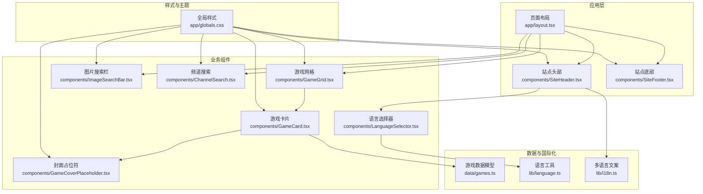
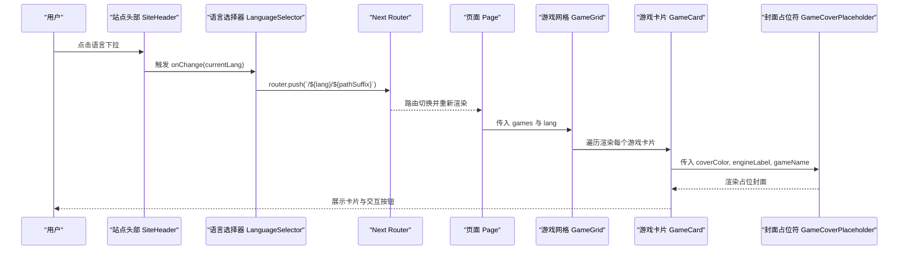
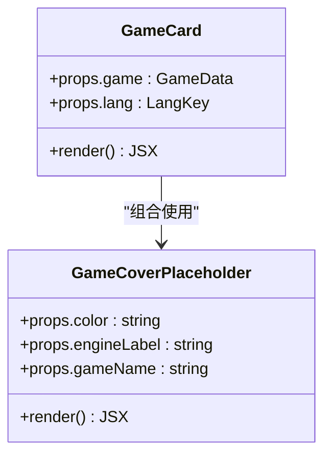
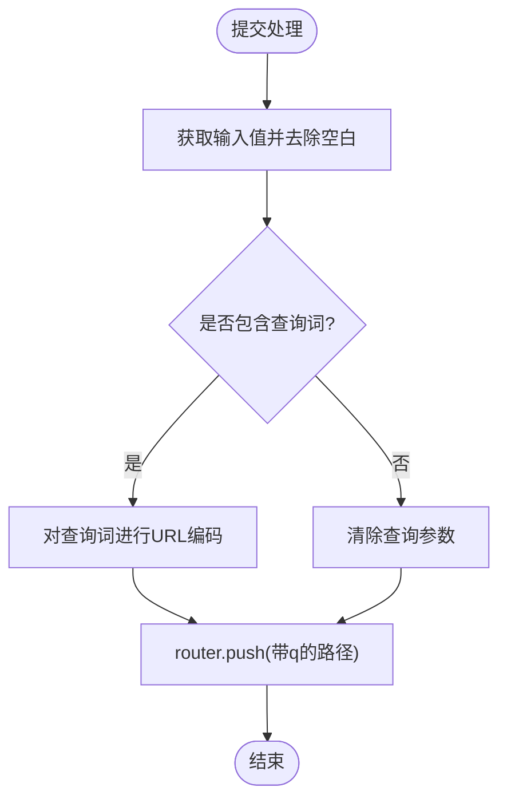
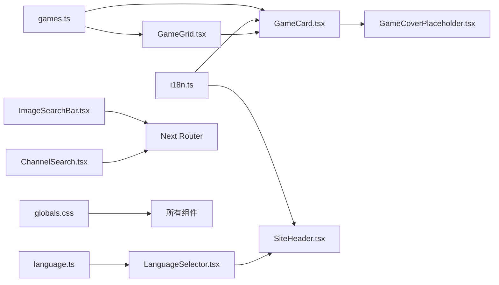

# 通用UI组件

<cite>
**本文引用的文件**   
- [GameCard.tsx](file://src/components/GameCard.tsx)
- [GameCoverPlaceholder.tsx](file://src/components/GameCoverPlaceholder.tsx)
- [GameGrid.tsx](file://src/components/GameGrid.tsx)
- [ImageSearchBar.tsx](file://src/components/ImageSearchBar.tsx)
- [SiteHeader.tsx](file://src/components/SiteHeader.tsx)
- [SiteFooter.tsx](file://src/components/SiteFooter.tsx)
- [LanguageSelector.tsx](file://src/components/LanguageSelector.tsx)
- [ChannelSearch.tsx](file://src/components/ChannelSearch.tsx)
- [games.ts](file://src/data/games.ts)
- [language.ts](file://src/lib/language.ts)
- [i18n.ts](file://src/lib/i18n.ts)
- [globals.css](file://src/app/globals.css)
- [package.json](file://package.json)
</cite>

## 目录
1. [简介](#简介)
2. [项目结构](#项目结构)
3. [核心组件](#核心组件)
4. [架构总览](#架构总览)
5. [组件详细分析](#组件详细分析)
6. [依赖关系分析](#依赖关系分析)
7. [性能与内存优化](#性能与内存优化)
8. [可访问性与跨浏览器兼容](#可访问性与跨浏览器兼容)
9. [故障排查指南](#故障排查指南)
10. [结论](#结论)
11. [附录：设计系统与样式规范](#附录设计系统与样式规范)

## 简介
本文件为“通用UI组件”集合的权威文档，覆盖游戏卡片、封面占位符、游戏网格、搜索栏、站点头部与底部等组件。内容包含功能说明、属性与事件、样式定制、响应式布局、动画与交互反馈、使用示例与最佳实践、可访问性支持与跨浏览器兼容性，以及性能优化与内存管理策略。

## 项目结构
本项目采用 Next.js + React + Tailwind CSS 的技术栈，组件位于 src/components 目录，数据模型与多语言文案分别位于 src/data 与 src/lib/locales。全局样式与主题变量定义在 src/app/globals.css。

图表来源
- [SiteHeader.tsx:1-46](file://src/components/SiteHeader.tsx#L1-L46)
- [SiteFooter.tsx:1-17](file://src/components/SiteFooter.tsx#L1-L17)
- [GameGrid.tsx:1-19](file://src/components/GameGrid.tsx#L1-L19)
- [GameCard.tsx:1-72](file://src/components/GameCard.tsx#L1-L72)
- [GameCoverPlaceholder.tsx:1-36](file://src/components/GameCoverPlaceholder.tsx#L1-L36)
- [ImageSearchBar.tsx:1-42](file://src/components/ImageSearchBar.tsx#L1-L42)
- [ChannelSearch.tsx:1-45](file://src/components/ChannelSearch.tsx#L1-L45)
- [LanguageSelector.tsx:1-34](file://src/components/LanguageSelector.tsx#L1-L34)
- [games.ts:1-474](file://src/data/games.ts#L1-L474)
- [language.ts:1-49](file://src/lib/language.ts#L1-L49)
- [i18n.ts:1-28](file://src/lib/i18n.ts#L1-L28)
- [globals.css:1-27](file://src/app/globals.css#L1-L27)

章节来源
- [SiteHeader.tsx:1-46](file://src/components/SiteHeader.tsx#L1-L46)
- [SiteFooter.tsx:1-17](file://src/components/SiteFooter.tsx#L1-L17)
- [GameGrid.tsx:1-19](file://src/components/GameGrid.tsx#L1-L19)
- [GameCard.tsx:1-72](file://src/components/GameCard.tsx#L1-L72)
- [GameCoverPlaceholder.tsx:1-36](file://src/components/GameCoverPlaceholder.tsx#L1-L36)
- [ImageSearchBar.tsx:1-42](file://src/components/ImageSearchBar.tsx#L1-L42)
- [ChannelSearch.tsx:1-45](file://src/components/ChannelSearch.tsx#L1-L45)
- [LanguageSelector.tsx:1-34](file://src/components/LanguageSelector.tsx#L1-L34)
- [games.ts:1-474](file://src/data/games.ts#L1-L474)
- [language.ts:1-49](file://src/lib/language.ts#L1-L49)
- [i18n.ts:1-28](file://src/lib/i18n.ts#L1-L28)
- [globals.css:1-27](file://src/app/globals.css#L1-L27)

## 核心组件
- 游戏卡片（GameCard）：展示单个游戏的封面占位、标题、描述摘要与标签，并提供“了解更多”和“开始游戏”两个操作入口。
- 封面占位符（GameCoverPlaceholder）：以背景色与图标呈现无图时的占位效果，并显示引擎标签。
- 游戏网格（GameGrid）：基于响应式栅格渲染多个游戏卡片。
- 图片搜索栏（ImageSearchBar）：客户端表单，提交后通过路由跳转携带查询参数。
- 频道搜索（ChannelSearch）：基于 URL 查询参数的搜索输入框，支持清空与重置页码。
- 站点头部（SiteHeader）：站点名称、导航链接、语言选择器与快捷入口。
- 站点底部（SiteFooter）：版权信息与站点名称。
- 语言选择器（LanguageSelector）：根据当前语言切换路由前缀。

章节来源
- [GameCard.tsx:1-72](file://src/components/GameCard.tsx#L1-L72)
- [GameCoverPlaceholder.tsx:1-36](file://src/components/GameCoverPlaceholder.tsx#L1-L36)
- [GameGrid.tsx:1-19](file://src/components/GameGrid.tsx#L1-L19)
- [ImageSearchBar.tsx:1-42](file://src/components/ImageSearchBar.tsx#L1-L42)
- [ChannelSearch.tsx:1-45](file://src/components/ChannelSearch.tsx#L1-L45)
- [SiteHeader.tsx:1-46](file://src/components/SiteHeader.tsx#L1-L46)
- [SiteFooter.tsx:1-17](file://src/components/SiteFooter.tsx#L1-L17)
- [LanguageSelector.tsx:1-34](file://src/components/LanguageSelector.tsx#L1-L34)

## 架构总览
组件间通过 props 传递数据，结合 i18n 工具函数进行文案渲染；路由由 Next.js 提供，搜索行为通过 URL 查询参数驱动。

图表来源
- [SiteHeader.tsx:1-46](file://src/components/SiteHeader.tsx#L1-L46)
- [LanguageSelector.tsx:1-34](file://src/components/LanguageSelector.tsx#L1-L34)
- [GameGrid.tsx:1-19](file://src/components/GameGrid.tsx#L1-L19)
- [GameCard.tsx:1-72](file://src/components/GameCard.tsx#L1-L72)
- [GameCoverPlaceholder.tsx:1-36](file://src/components/GameCoverPlaceholder.tsx#L1-L36)

## 组件详细分析

### 游戏卡片 GameCard
- 功能
  - 展示游戏封面占位、标题、描述摘要与标签。
  - “了解更多”跳转到详情页，“开始游戏”外链到游戏地址。
- 属性
  - game: 游戏数据对象（含 id、url、coverColor、engineLabel、name、description、tags 等）。
  - lang: 当前语言键值，用于选择 name/description 的多语言字段。
- 事件
  - 无自定义事件；通过 Link 与 a 标签完成导航。
- 样式与交互
  - 圆角卡片、阴影与边框，hover 时提升阴影与边框颜色。
  - 标题 hover 变色，过渡动画时长 200ms。
  - 标签最多显示前三个，超出省略。
- 可访问性
  - 封面区域设置 aria-label 为游戏名（由子组件实现），便于屏幕阅读器识别。
- 使用示例
  - 在页面中引入 GameGrid，传入游戏数组与当前语言即可自动渲染。
- 最佳实践
  - 确保 game.name[lang] 与 game.description[lang] 存在，避免空文本。
  - 对外链 target="_blank" 必须配合 rel="noopener noreferrer" 保证安全。

图表来源
- [GameCard.tsx:1-72](file://src/components/GameCard.tsx#L1-L72)
- [GameCoverPlaceholder.tsx:1-36](file://src/components/GameCoverPlaceholder.tsx#L1-L36)

章节来源
- [GameCard.tsx:1-72](file://src/components/GameCard.tsx#L1-L72)
- [GameCoverPlaceholder.tsx:1-36](file://src/components/GameCoverPlaceholder.tsx#L1-L36)
- [games.ts:1-474](file://src/data/games.ts#L1-L474)

### 封面占位符 GameCoverPlaceholder
- 功能
  - 以纯色背景与控制器图标作为封面占位，并在下方显示引擎标签。
- 属性
  - color: 背景色（CSS 颜色字符串）。
  - engineLabel: 引擎标签文本。
  - gameName: 用于 aria-label 的可访问性文本。
- 样式与交互
  - 使用内联 style 设置背景色，图标与标签使用半透明白色以保证对比度。
- 可访问性
  - 根元素设置 aria-label 为游戏名，禁用文本选择以提升视觉一致性。

章节来源
- [GameCoverPlaceholder.tsx:1-36](file://src/components/GameCoverPlaceholder.tsx#L1-L36)

### 游戏网格 GameGrid
- 功能
  - 将游戏列表渲染为响应式网格，每行列数随视口变化。
- 属性
  - games: 游戏数据数组。
  - lang: 当前语言键值。
- 响应式布局
  - 小屏单列，中等双列，大屏三列，间距统一。
- 性能
  - 列表渲染使用 key 为 game.id，确保高效更新。

章节来源
- [GameGrid.tsx:1-19](file://src/components/GameGrid.tsx#L1-L19)

### 图片搜索栏 ImageSearchBar
- 功能
  - 客户端表单，提交后将查询词编码为 URL 查询参数并跳转。
- 属性
  - lang: 语言前缀。
  - defaultValue: 默认搜索词。
  - placeholder: 输入框提示文本。
  - searchLabel: 按钮文案。
- 事件
  - onSubmit: 阻止默认提交，读取输入值，构造 URL 并调用 router.push。
- 可访问性
  - 输入框聚焦时显示蓝色外发光环，提升键盘导航可见性。
- 使用示例
  - 在页面顶部放置该组件，用户输入后回车或点击按钮即执行搜索。

图表来源
- [ImageSearchBar.tsx:1-42](file://src/components/ImageSearchBar.tsx#L1-L42)

章节来源
- [ImageSearchBar.tsx:1-42](file://src/components/ImageSearchBar.tsx#L1-L42)

### 频道搜索 ChannelSearch
- 功能
  - 基于 URL 查询参数的搜索输入框，支持清空与重置页码。
- 属性
  - placeholder: 输入框提示文本（可选）。
- 事件
  - onSubmit: 更新查询参数 q，删除 page，并跳转。
- 状态管理
  - 使用 useState 同步输入值，useSearchParams 读取当前查询参数。

章节来源
- [ChannelSearch.tsx:1-45](file://src/components/ChannelSearch.tsx#L1-L45)

### 站点头部 SiteHeader
- 功能
  - 站点名称、首页与频道导航、语言选择器、控制台与应用入口。
- 属性
  - lang: 当前语言键值。
  - pathSuffix: 路径后缀（用于语言切换时保留原路径）。
- 交互
  - 语言切换通过 LanguageSelector 改变路由前缀。
- 可访问性
  - 图标链接提供 title 文案，便于辅助技术理解。

章节来源
- [SiteHeader.tsx:1-46](file://src/components/SiteHeader.tsx#L1-L46)
- [LanguageSelector.tsx:1-34](file://src/components/LanguageSelector.tsx#L1-L34)

### 站点底部 SiteFooter
- 功能
  - 显示版权年份与站点名称。
- 属性
  - lang: 当前语言键值。

章节来源
- [SiteFooter.tsx:1-17](file://src/components/SiteFooter.tsx#L1-L17)

### 语言选择器 LanguageSelector
- 功能
  - 下拉选择语言并跳转至对应语言路径。
- 属性
  - currentLang: 当前语言键值。
  - pathSuffix: 路径后缀（例如 "" 或 "games/spacewar/"）。
- 事件
  - onChange: 拼接新语言前缀与路径后缀，调用 router.push。

章节来源
- [LanguageSelector.tsx:1-34](file://src/components/LanguageSelector.tsx#L1-L34)
- [language.ts:1-49](file://src/lib/language.ts#L1-L49)

## 依赖关系分析
- 组件依赖
  - GameCard 依赖 GameCoverPlaceholder 与 i18n 工具。
  - GameGrid 依赖 GameCard。
  - SiteHeader 依赖 LanguageSelector 与 i18n。
  - ImageSearchBar 与 ChannelSearch 依赖 Next.js 路由与查询参数。
- 数据依赖
  - 游戏数据来自 data/games.ts，类型定义被多处引用。
  - 多语言文案通过 lib/i18n.ts 的 t 函数获取。
  - 语言键值与校验逻辑来自 lib/language.ts。
- 样式依赖
  - 所有组件均使用 Tailwind 类名，主题变量来自 app/globals.css。

图表来源
- [games.ts:1-474](file://src/data/games.ts#L1-L474)
- [i18n.ts:1-28](file://src/lib/i18n.ts#L1-L28)
- [language.ts:1-49](file://src/lib/language.ts#L1-L49)
- [GameCard.tsx:1-72](file://src/components/GameCard.tsx#L1-L72)
- [GameGrid.tsx:1-19](file://src/components/GameGrid.tsx#L1-L19)
- [SiteHeader.tsx:1-46](file://src/components/SiteHeader.tsx#L1-L46)
- [LanguageSelector.tsx:1-34](file://src/components/LanguageSelector.tsx#L1-L34)
- [GameCoverPlaceholder.tsx:1-36](file://src/components/GameCoverPlaceholder.tsx#L1-L36)
- [ImageSearchBar.tsx:1-42](file://src/components/ImageSearchBar.tsx#L1-L42)
- [ChannelSearch.tsx:1-45](file://src/components/ChannelSearch.tsx#L1-L45)
- [globals.css:1-27](file://src/app/globals.css#L1-L27)

章节来源
- [games.ts:1-474](file://src/data/games.ts#L1-L474)
- [i18n.ts:1-28](file://src/lib/i18n.ts#L1-L28)
- [language.ts:1-49](file://src/lib/language.ts#L1-L49)
- [GameCard.tsx:1-72](file://src/components/GameCard.tsx#L1-L72)
- [GameGrid.tsx:1-19](file://src/components/GameGrid.tsx#L1-L19)
- [SiteHeader.tsx:1-46](file://src/components/SiteHeader.tsx#L1-L46)
- [LanguageSelector.tsx:1-34](file://src/components/LanguageSelector.tsx#L1-L34)
- [GameCoverPlaceholder.tsx:1-36](file://src/components/GameCoverPlaceholder.tsx#L1-L36)
- [ImageSearchBar.tsx:1-42](file://src/components/ImageSearchBar.tsx#L1-L42)
- [ChannelSearch.tsx:1-45](file://src/components/ChannelSearch.tsx#L1-L45)
- [globals.css:1-27](file://src/app/globals.css#L1-L27)

## 性能与内存优化
- 列表渲染
  - 使用稳定 key（game.id）减少重渲染开销。
  - 对于长列表，考虑分页或虚拟滚动（当前为静态数据，影响较小）。
- 路由与搜索
  - 搜索仅更新 URL 查询参数，避免不必要的状态同步；必要时可加入防抖以减少频繁跳转。
- 资源加载
  - 封面使用占位符，避免大图加载；若后续替换为真实图片，建议懒加载与尺寸限定。
- 样式与动画
  - 使用 Tailwind 原子类与 transition-all 控制过渡，保持 GPU 加速（transform、opacity、shadow）。
- 内存管理
  - 避免在组件内创建大对象；将游戏数据置于上层并通过 props 传递。
  - 清理副作用：如未来添加定时器或监听器，需在卸载时清理。

章节来源
- [GameGrid.tsx:1-19](file://src/components/GameGrid.tsx#L1-L19)
- [ImageSearchBar.tsx:1-42](file://src/components/ImageSearchBar.tsx#L1-L42)
- [ChannelSearch.tsx:1-45](file://src/components/ChannelSearch.tsx#L1-L45)
- [GameCard.tsx:1-72](file://src/components/GameCard.tsx#L1-L72)

## 可访问性与跨浏览器兼容
- 可访问性
  - 封面占位符使用 aria-label 提供语义化描述。
  - 输入框与按钮具备清晰的焦点样式（focus ring），便于键盘导航。
  - 外链使用 rel="noopener noreferrer" 防止反向标签劫持。
- 跨浏览器兼容
  - 基于 Next.js 与 React 19，Tailwind v4 提供现代浏览器支持。
  - 深色模式通过 prefers-color-scheme 媒体查询生效，需目标浏览器支持。
- 字体与主题
  - 全局字体回退到 Arial/Helvetica/sans-serif，确保跨平台一致性。
  - 主题变量 --background 与 --foreground 支持明暗主题切换。

章节来源
- [GameCoverPlaceholder.tsx:1-36](file://src/components/GameCoverPlaceholder.tsx#L1-L36)
- [ImageSearchBar.tsx:1-42](file://src/components/ImageSearchBar.tsx#L1-L42)
- [ChannelSearch.tsx:1-45](file://src/components/ChannelSearch.tsx#L1-L45)
- [globals.css:1-27](file://src/app/globals.css#L1-L27)
- [package.json:1-40](file://package.json#L1-L40)

## 故障排查指南
- 语言切换无效
  - 检查 LanguageSelector 的 pathSuffix 是否正确拼接。
  - 确认 language.ts 中的 supportedLanguages 包含目标语言键值。
- 搜索不生效
  - 检查 ImageSearchBar 与 ChannelSearch 的 onSubmit 是否阻止默认提交。
  - 确认路由参数 q 是否被正确编码与传递。
- 卡片显示异常
  - 验证 game.name[lang] 与 game.description[lang] 是否存在。
  - 检查 coverColor 是否为合法 CSS 颜色字符串。
- 样式未生效
  - 确认 Tailwind 已正确导入（globals.css 中 @import "tailwindcss"）。
  - 检查浏览器开发者工具中类名是否被编译输出。

章节来源
- [LanguageSelector.tsx:1-34](file://src/components/LanguageSelector.tsx#L1-L34)
- [language.ts:1-49](file://src/lib/language.ts#L1-L49)
- [ImageSearchBar.tsx:1-42](file://src/components/ImageSearchBar.tsx#L1-L42)
- [ChannelSearch.tsx:1-45](file://src/components/ChannelSearch.tsx#L1-L45)
- [GameCard.tsx:1-72](file://src/components/GameCard.tsx#L1-L72)
- [globals.css:1-27](file://src/app/globals.css#L1-L27)

## 结论
本组件集合围绕游戏展示与站点导航构建，采用简洁的 Props 驱动与 Next.js 路由机制，结合 Tailwind 原子样式与 i18n 多语言支持，具备良好的可维护性与扩展性。遵循本文档的最佳实践与性能建议，可在不同设备与浏览器上获得一致的体验。

## 附录：设计系统与样式规范
- 颜色方案
  - 主色：蓝色系（blue-600/blue-500）用于强调与交互反馈。
  - 中性色：gray-900/gray-600/gray-500/gray-400/gray-200 用于文本与边框。
  - 背景与前景：通过 --background 与 --foreground 变量支持明暗主题。
- 字体规范
  - 全局字体族：Arial, Helvetica, sans-serif。
  - Tailwind 主题变量 --font-sans 与 --font-mono 可用于特定场景。
- 间距与布局
  - 使用 Tailwind 的 gap、p-*、m-* 控制间距；网格使用 grid-cols-* 实现响应式布局。
- 动画与过渡
  - 使用 transition-all 与 duration-200 实现平滑过渡；hover 时调整阴影与边框颜色。
- 可访问性
  - 为关键元素提供 aria-label/title；确保焦点可见与键盘可达。
- 依赖版本
  - Next.js 16.2.4、React 19.2.4、Tailwind v4、react-icons 5.6.0。

章节来源
- [globals.css:1-27](file://src/app/globals.css#L1-L27)
- [package.json:1-40](file://package.json#L1-L40)