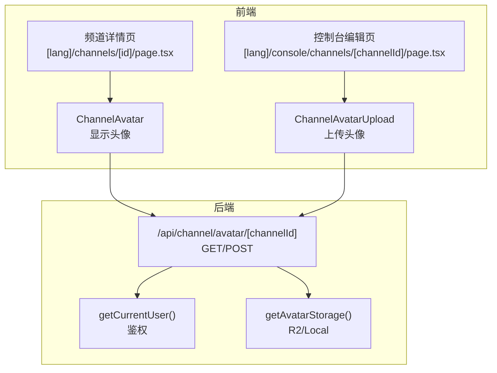
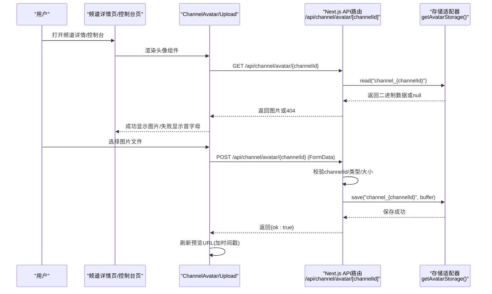
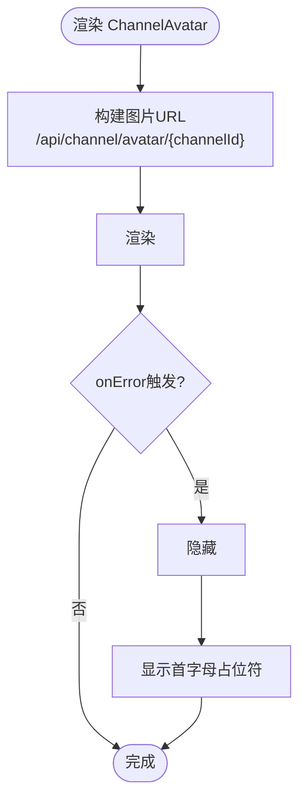
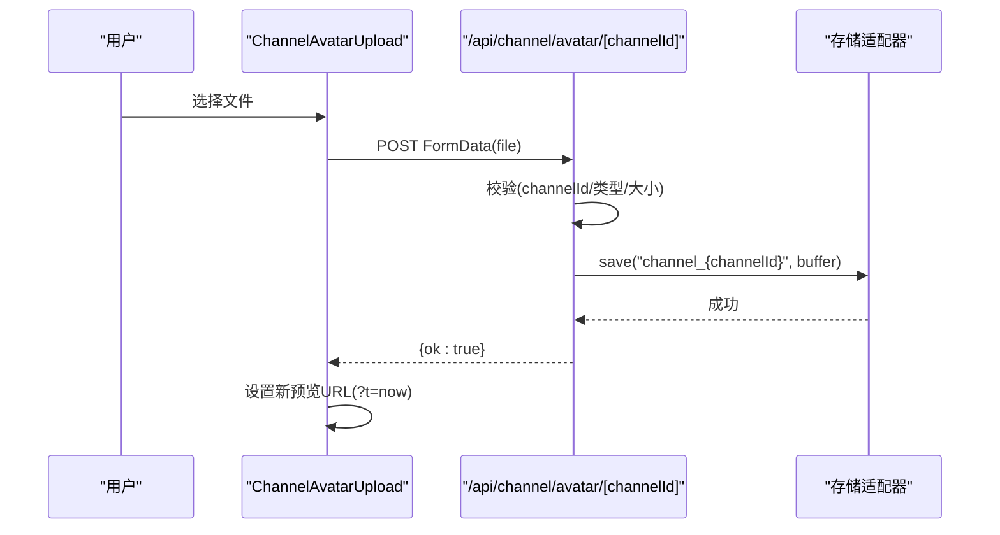
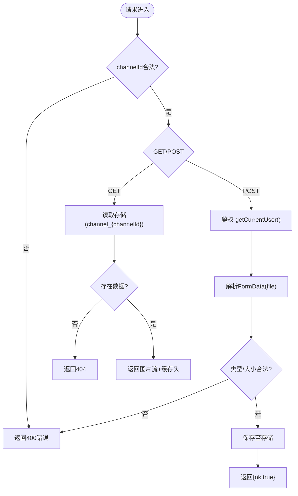
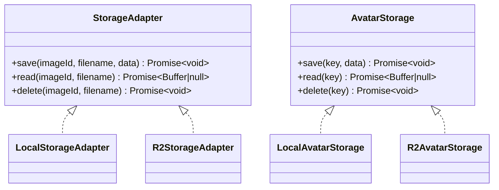
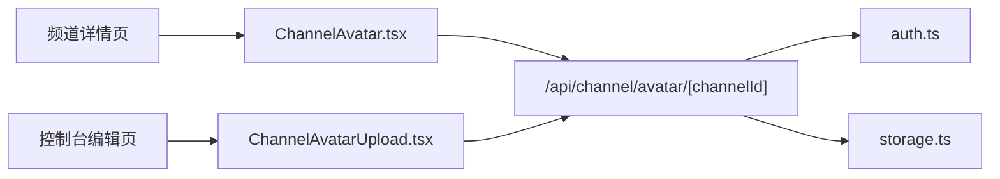

# 频道头像组件

<cite>
**本文引用的文件**   
- [ChannelAvatar.tsx](file://src/components/ChannelAvatar.tsx)
- [ChannelAvatarUpload.tsx](file://src/components/ChannelAvatarUpload.tsx)
- [route.ts](file://src/app/api/channel/avatar/[channelId]/route.ts)
- [storage.ts](file://src/lib/storage.ts)
- [auth.ts](file://src/lib/auth.ts)
- [page.tsx](file://src/app/[lang]/channels/[id]/page.tsx)
- [page.tsx](file://src/app/[lang]/console/channels/[channelId]/page.tsx)
- [zh.json](file://src/locales/zh.json)
- [globals.css](file://src/app/globals.css)
</cite>

## 目录
1. [简介](#简介)
2. [项目结构](#项目结构)
3. [核心组件](#核心组件)
4. [架构总览](#架构总览)
5. [详细组件分析](#详细组件分析)
6. [依赖关系分析](#依赖关系分析)
7. [性能考虑](#性能考虑)
8. [故障排查指南](#故障排查指南)
9. [结论](#结论)
10. [附录](#附录)

## 简介
本文件为“频道头像组件”的完整技术文档，涵盖以下方面：
- 头像显示组件与上传组件的功能、接口与用法
- 头像显示格式、尺寸控制与默认头像处理策略
- 头像上传流程、文件验证与后端存储
- 异步加载、缓存策略与错误处理
- 使用示例（在不同页面场景下的集成方式）
- 自定义样式与响应式设计支持
- 无障碍访问与SEO优化建议

## 项目结构
频道头像功能由前端组件与后端API共同实现：
- 前端组件
  - ChannelAvatar：用于展示频道头像，支持尺寸参数与失败回退
  - ChannelAvatarUpload：用于上传频道头像，包含表单交互与状态管理
- 后端API
  - /api/channel/avatar/[channelId]：提供GET读取与POST上传能力
- 存储与鉴权
  - storage.ts：抽象存储适配器（本地/R2），并提供头像专用存储封装
  - auth.ts：鉴权获取当前用户，保护上传接口

**图表来源** 
- [ChannelAvatar.tsx](file://src/components/ChannelAvatar.tsx)
- [ChannelAvatarUpload.tsx](file://src/components/ChannelAvatarUpload.tsx)
- [route.ts](file://src/app/api/channel/avatar/[channelId]/route.ts)
- [storage.ts](file://src/lib/storage.ts)
- [auth.ts](file://src/lib/auth.ts)
- [page.tsx](file://src/app/[lang]/channels/[id]/page.tsx)
- [page.tsx](file://src/app/[lang]/console/channels/[channelId]/page.tsx)

**章节来源**
- [ChannelAvatar.tsx:1-30](file://src/components/ChannelAvatar.tsx#L1-L30)
- [ChannelAvatarUpload.tsx:1-73](file://src/components/ChannelAvatarUpload.tsx#L1-L73)
- [route.ts:1-64](file://src/app/api/channel/avatar/[channelId]/route.ts#L1-L64)
- [storage.ts:1-214](file://src/lib/storage.ts#L1-L214)
- [auth.ts:1-118](file://src/lib/auth.ts#L1-L118)
- [page.tsx](file://src/app/[lang]/channels/[id]/page.tsx)
- [page.tsx](file://src/app/[lang]/console/channels/[channelId]/page.tsx)

## 核心组件
- ChannelAvatar
  - 输入参数：channelId、channelName、size（可选，默认40）
  - 行为：从 /api/channel/avatar/{channelId} 拉取图片；失败时隐藏img并显示首字母占位符
  - 样式：圆形容器、等比缩放、固定宽高
- ChannelAvatarUpload
  - 输入参数：channelId、channelName、labels（国际化文案）
  - 行为：选择图片后通过FormData POST到 /api/channel/avatar/{channelId}；成功后刷新预览URL
  - 校验：accept限制JPG/PNG/GIF/WebP；上传中禁用按钮
  - 样式：固定16x16预览区，失败时显示首字母占位符

**章节来源**
- [ChannelAvatar.tsx:1-30](file://src/components/ChannelAvatar.tsx#L1-L30)
- [ChannelAvatarUpload.tsx:1-73](file://src/components/ChannelAvatarUpload.tsx#L1-L73)

## 架构总览
头像读取与上传的整体数据流如下：

**图表来源** 
- [ChannelAvatar.tsx:1-30](file://src/components/ChannelAvatar.tsx#L1-L30)
- [ChannelAvatarUpload.tsx:1-73](file://src/components/ChannelAvatarUpload.tsx#L1-L73)
- [route.ts:1-64](file://src/app/api/channel/avatar/[channelId]/route.ts#L1-L64)
- [storage.ts:1-214](file://src/lib/storage.ts#L1-L214)

## 详细组件分析

### ChannelAvatar（显示组件）
- 功能要点
  - 根据size控制宽高，保持圆形裁剪
  - 图片加载失败时，隐藏img并显示首字母占位符
  - alt文本使用channelName，提升可访问性
- 使用示例
  - 频道详情页：传入size=64
  - 频道列表页：传入size=48
- 样式与响应式
  - 使用Tailwind类名实现圆角、居中、溢出隐藏、弹性布局
  - 可通过外层容器覆盖尺寸与主题色

**图表来源** 
- [ChannelAvatar.tsx:1-30](file://src/components/ChannelAvatar.tsx#L1-L30)

**章节来源**
- [ChannelAvatar.tsx:1-30](file://src/components/ChannelAvatar.tsx#L1-L30)
- [page.tsx](file://src/app/[lang]/channels/[id]/page.tsx)

### ChannelAvatarUpload（上传组件）
- 功能要点
  - 接受image/jpeg、image/png、image/gif、image/webp
  - 上传成功后通过追加时间戳强制刷新预览图
  - 上传过程中禁用按钮并显示提示文案
- 使用示例
  - 控制台编辑页：传入国际化labels（头像、上传头像、提示文案）
- 错误处理
  - 非200响应不更新预览，保持原图
  - 网络异常或服务器错误时，保持loading结束但不刷新

**图表来源** 
- [ChannelAvatarUpload.tsx:1-73](file://src/components/ChannelAvatarUpload.tsx#L1-L73)
- [route.ts:1-64](file://src/app/api/channel/avatar/[channelId]/route.ts#L1-L64)
- [storage.ts:1-214](file://src/lib/storage.ts#L1-L214)

**章节来源**
- [ChannelAvatarUpload.tsx:1-73](file://src/components/ChannelAvatarUpload.tsx#L1-L73)
- [page.tsx](file://src/app/[lang]/console/channels/[channelId]/page.tsx)

### API路由（/api/channel/avatar/[channelId]）
- GET
  - 校验channelId格式
  - 从存储读取二进制数据，返回图片流
  - 设置Cache-Control: public, max-age=3600
- POST
  - 校验channelId格式
  - 鉴权：调用getCurrentUser()
  - 解析FormData中的file
  - 校验MIME类型与文件大小（最大2MB）
  - 将Buffer写入存储（key为channel_{channelId}）
  - 返回{ok:true}

**图表来源** 
- [route.ts:1-64](file://src/app/api/channel/avatar/[channelId]/route.ts#L1-L64)
- [auth.ts:1-118](file://src/lib/auth.ts#L1-L118)
- [storage.ts:1-214](file://src/lib/storage.ts#L1-L214)

**章节来源**
- [route.ts:1-64](file://src/app/api/channel/avatar/[channelId]/route.ts#L1-L64)
- [auth.ts:1-118](file://src/lib/auth.ts#L1-L118)

### 存储适配与鉴权
- 存储适配器
  - LocalAvatarStorage：基于本地文件系统（IMAGE_STORAGE_PATH或默认路径）
  - R2AvatarStorage：基于Cloudflare R2桶（需配置IMAGES_BUCKET绑定）
  - getAvatarStorage()：自动选择R2或Local，单例缓存实例
- 鉴权
  - getCurrentUser()：优先解析Cloudflare Access JWT，其次Cookie，开发环境提供默认用户

**图表来源** 
- [storage.ts:1-214](file://src/lib/storage.ts#L1-L214)

**章节来源**
- [storage.ts:1-214](file://src/lib/storage.ts#L1-L214)
- [auth.ts:1-118](file://src/lib/auth.ts#L1-L118)

## 依赖关系分析
- 组件依赖
  - ChannelAvatar：仅依赖React与Next.js客户端渲染
  - ChannelAvatarUpload：依赖React状态管理与fetch API
- API依赖
  - route.ts：依赖auth.ts与storage.ts
  - storage.ts：依赖运行时环境（Node或Cloudflare上下文）
- 页面集成
  - 频道详情页：使用ChannelAvatar展示头像
  - 控制台编辑页：使用ChannelAvatarUpload进行头像上传

**图表来源** 
- [ChannelAvatar.tsx:1-30](file://src/components/ChannelAvatar.tsx#L1-L30)
- [ChannelAvatarUpload.tsx:1-73](file://src/components/ChannelAvatarUpload.tsx#L1-L73)
- [route.ts:1-64](file://src/app/api/channel/avatar/[channelId]/route.ts#L1-L64)
- [storage.ts:1-214](file://src/lib/storage.ts#L1-L214)
- [auth.ts:1-118](file://src/lib/auth.ts#L1-L118)
- [page.tsx](file://src/app/[lang]/channels/[id]/page.tsx)
- [page.tsx](file://src/app/[lang]/console/channels/[channelId]/page.tsx)

**章节来源**
- [ChannelAvatar.tsx:1-30](file://src/components/ChannelAvatar.tsx#L1-L30)
- [ChannelAvatarUpload.tsx:1-73](file://src/components/ChannelAvatarUpload.tsx#L1-L73)
- [route.ts:1-64](file://src/app/api/channel/avatar/[channelId]/route.ts#L1-L64)
- [storage.ts:1-214](file://src/lib/storage.ts#L1-L214)
- [auth.ts:1-118](file://src/lib/auth.ts#L1-L118)
- [page.tsx](file://src/app/[lang]/channels/[id]/page.tsx)
- [page.tsx](file://src/app/[lang]/console/channels/[channelId]/page.tsx)

## 性能考虑
- 缓存策略
  - GET头像接口设置Cache-Control: public, max-age=3600，利于CDN与浏览器缓存
  - 上传成功后通过追加?t=now强制刷新预览，避免缓存旧图
- 传输优化
  - 前端accept限制减少无效上传
  - 后端限制最大2MB，降低带宽与存储压力
- 渲染优化
  - 使用object-cover确保图片填充且不变形
  - 失败时立即回退到首字母占位符，避免闪烁

[本节为通用指导，无需代码引用]

## 故障排查指南
- 常见问题
  - 头像无法显示：检查channelId是否合法、存储是否存在对应数据、网络请求是否返回404
  - 上传失败：检查MIME类型是否在允许列表、文件大小是否超过2MB、鉴权是否通过
  - 预览未更新：确认上传成功后是否重新设置预览URL（带时间戳）
- 调试建议
  - 在浏览器开发者工具查看Network面板的请求与响应
  - 检查服务端日志（如存储读写异常、鉴权失败）
  - 确认环境变量与R2绑定是否正确配置（生产环境）

**章节来源**
- [route.ts:1-64](file://src/app/api/channel/avatar/[channelId]/route.ts#L1-L64)
- [ChannelAvatarUpload.tsx:1-73](file://src/components/ChannelAvatarUpload.tsx#L1-L73)
- [storage.ts:1-214](file://src/lib/storage.ts#L1-L214)

## 结论
频道头像组件通过简洁的前端组件与稳健的后端API实现了完整的头像展示与上传流程。结合缓存策略、错误回退与鉴权机制，能够在多场景下稳定运行。建议在生产环境中启用R2存储与CDN缓存，以获得更好的性能与可靠性。

[本节为总结性内容，无需代码引用]

## 附录
- 使用示例
  - 频道详情页：传入size=64，用于头部展示
  - 频道列表页：传入size=48，用于卡片缩略
  - 控制台编辑页：传入国际化labels，提供上传入口
- 自定义样式
  - 通过外层容器调整尺寸与背景色
  - 使用Tailwind类名快速定制圆角、阴影、边框等
- 响应式设计
  - 组件本身不依赖媒体查询，尺寸由父级控制
  - 建议在移动端适当减小size以提升体验
- 无障碍访问
  - 为img设置alt文本（channelName）
  - 上传按钮使用label包裹input，提升键盘可达性
- SEO优化
  - 头像作为装饰性图片，alt应描述频道名称
  - 避免将头像作为唯一信息载体，确保语义化标题与描述

**章节来源**
- [zh.json:49-51](file://src/locales/zh.json#L49-L51)
- [globals.css:1-27](file://src/app/globals.css#L1-L27)
- [ChannelAvatar.tsx:1-30](file://src/components/ChannelAvatar.tsx#L1-L30)
- [ChannelAvatarUpload.tsx:1-73](file://src/components/ChannelAvatarUpload.tsx#L1-L73)