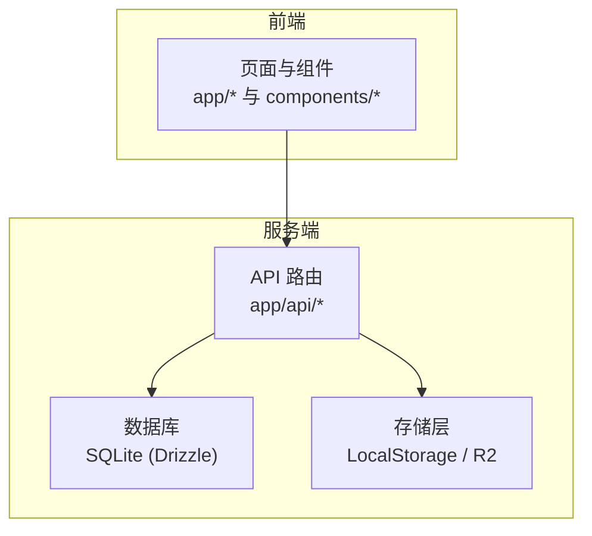
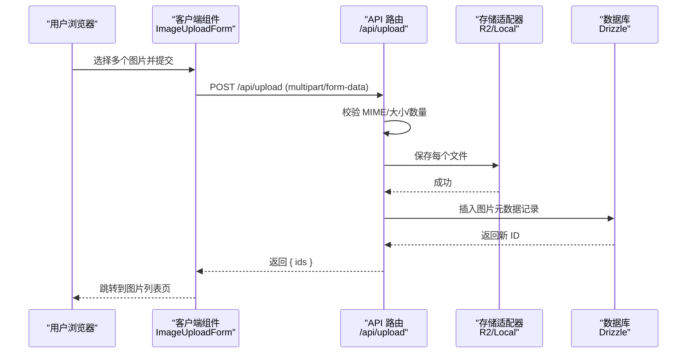
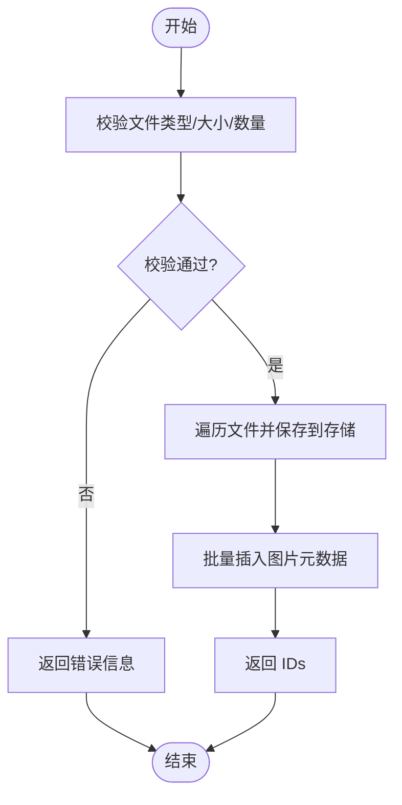
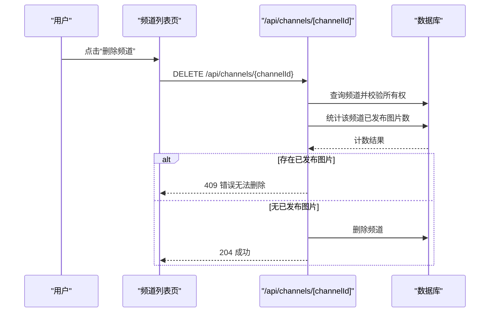
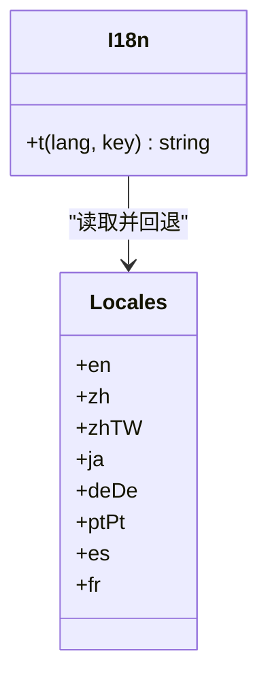
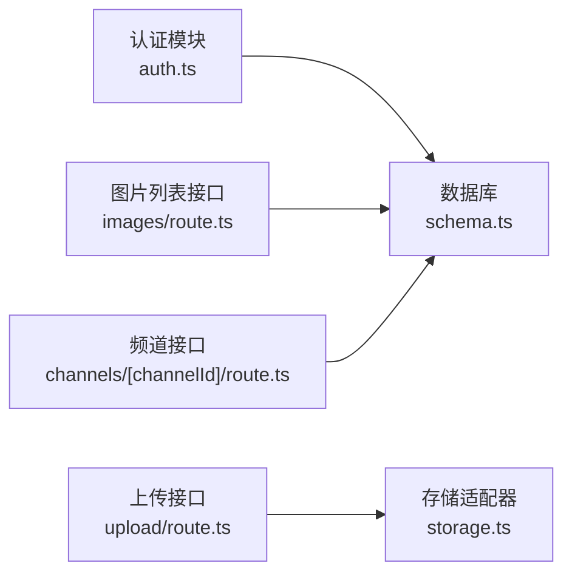

# 功能特性

<cite>
**本文引用的文件**
- [README.md](file://README.md)
- [package.json](file://package.json)
- [src/app/layout.tsx](file://src/app/layout.tsx)
- [src/lib/i18n.ts](file://src/lib/i18n.ts)
- [src/db/schema.ts](file://src/db/schema.ts)
- [src/app/api/images/route.ts](file://src/app/api/images/route.ts)
- [src/app/api/upload/route.ts](file://src/app/api/upload/route.ts)
- [src/app/api/channels/[channelId]/route.ts](file://src/app/api/channels/[channelId]/route.ts)
- [src/components/ImageUploadForm.tsx](file://src/components/ImageUploadForm.tsx)
- [src/components/ImagesTreeTable.tsx](file://src/components/ImagesTreeTable.tsx)
- [src/app/[lang]/console/channels/page.tsx](file://src/app/[lang]/console/channels/page.tsx)
- [src/components/ChannelAvatarUpload.tsx](file://src/components/ChannelAvatarUpload.tsx)
- [src/lib/auth.ts](file://src/lib/auth.ts)
- [src/lib/storage.ts](file://src/lib/storage.ts)
</cite>

## 目录
1. [简介](#简介)
2. [项目结构](#项目结构)
3. [核心组件](#核心组件)
4. [架构总览](#架构总览)
5. [详细组件分析](#详细组件分析)
6. [依赖关系分析](#依赖关系分析)
7. [性能考量](#性能考量)
8. [故障排除指南](#故障排除指南)
9. [结论](#结论)
10. [附录](#附录)

## 简介
Weable 是一个部署在 Cloudflare Worker 上的图片管理应用，提供图片上传、删除、元数据编辑与批量操作，频道系统（创建、编辑、权限控制），响应式用户界面以及多语言国际化支持。本指南面向初学者与有经验的开发者，既包含用户工作流程与最佳实践，也涵盖后端 API、存储适配与认证鉴权的技术细节。

## 项目结构
- 前端页面与路由：Next.js App Router，按功能划分到 app 目录下的 [lang]、api、console 等路径。
- 组件：React 客户端组件位于 components，负责上传表单、树形表格、头像上传等交互。
- 数据模型：Drizzle ORM schema 定义 users、channels、images 三张表及关系。
- 存储抽象：storage.ts 提供本地与 R2 两种适配器，自动选择。
- 国际化：locales 下多语言 JSON，i18n.ts 提供 t(lang, key) 函数。
- 认证：auth.ts 解析 Cloudflare Access JWT 或本地开发回退用户。

图表来源
- [src/app/layout.tsx:1-8](file://src/app/layout.tsx#L1-L8)
- [src/app/api/images/route.ts:1-66](file://src/app/api/images/route.ts#L1-L66)
- [src/lib/storage.ts:1-214](file://src/lib/storage.ts#L1-L214)

章节来源
- [README.md:1-1](file://README.md#L1-L1)
- [package.json:1-40](file://package.json#L1-L40)
- [src/app/layout.tsx:1-8](file://src/app/layout.tsx#L1-L8)

## 核心组件
- 图片上传表单：支持多选、大小校验、错误提示与上传后跳转。
- 图片树形表格：懒加载子目录、缩略图预览、状态标签与更新时间显示。
- 频道列表页：展示用户频道、可见性、图片数量与创建时间。
- 频道头像上传：支持常见图片格式与缓存刷新。
- 认证模块：从 Cloudflare Access JWT 或本地 Cookie 解析当前用户。
- 存储适配器：本地文件系统与 R2 对象存储的抽象实现。

章节来源
- [src/components/ImageUploadForm.tsx:1-105](file://src/components/ImageUploadForm.tsx#L1-L105)
- [src/components/ImagesTreeTable.tsx:1-216](file://src/components/ImagesTreeTable.tsx#L1-L216)
- [src/app/[lang]/console/channels/page.tsx:1-93](file://src/app/[lang]/console/channels/page.tsx#L1-L93)
- [src/components/ChannelAvatarUpload.tsx:1-73](file://src/components/ChannelAvatarUpload.tsx#L1-L73)
- [src/lib/auth.ts:1-118](file://src/lib/auth.ts#L1-L118)
- [src/lib/storage.ts:1-214](file://src/lib/storage.ts#L1-L214)

## 架构总览
整体采用 Next.js App Router + Drizzle ORM + 存储适配器模式。前端通过 API 路由进行数据读写，后端统一鉴权并访问 SQLite 与对象存储。

图表来源
- [src/components/ImageUploadForm.tsx:26-72](file://src/components/ImageUploadForm.tsx#L26-L72)
- [src/app/api/upload/route.ts:14-74](file://src/app/api/upload/route.ts#L14-L74)
- [src/lib/storage.ts:184-214](file://src/lib/storage.ts#L184-L214)
- [src/db/schema.ts:46-69](file://src/db/schema.ts#L46-L69)

## 详细组件分析

### 图片管理（上传、删除、元数据编辑、批量操作）
- 上传流程
  - 前端表单限制：最多 50 个文件，单个最大 5 MB，仅允许 image/*。
  - 后端校验：重复校验 MIME、大小、数量；可选 parentId 指向目录。
  - 存储写入：根据环境选择 R2 或本地存储；成功后写入 images 表元数据。
  - 结果反馈：返回新图片 ID 数组，前端跳转至对应列表页。
- 列表与浏览
  - 列表接口支持按 parentId 过滤，目录优先排序，按 updatedAt 降序。
  - 树形表格懒加载子目录，缩略图通过 /api/images/[id]/file 获取。
- 删除与批量
  - 删除图片需调用对应资源接口（示例中未展示具体删除路由，但可参考上传与列表接口的鉴权与参数风格）。
  - 批量操作可通过前端循环调用单条接口或使用批量接口（若后续扩展）。
- 元数据编辑
  - images 表包含 title、description、mimeType、width、height、size、isPublished 等字段，可在详情页或列表页进行编辑。

图表来源
- [src/app/api/upload/route.ts:14-74](file://src/app/api/upload/route.ts#L14-L74)
- [src/lib/storage.ts:184-214](file://src/lib/storage.ts#L184-L214)
- [src/db/schema.ts:46-69](file://src/db/schema.ts#L46-L69)

章节来源
- [src/app/api/upload/route.ts:1-75](file://src/app/api/upload/route.ts#L1-L75)
- [src/components/ImageUploadForm.tsx:1-105](file://src/components/ImageUploadForm.tsx#L1-L105)
- [src/app/api/images/route.ts:1-66](file://src/app/api/images/route.ts#L1-L66)
- [src/components/ImagesTreeTable.tsx:1-216](file://src/components/ImagesTreeTable.tsx#L1-L216)
- [src/db/schema.ts:46-69](file://src/db/schema.ts#L46-L69)

### 频道系统（创建、编辑、权限控制）
- 频道列表页
  - 展示用户的频道名称、可见性（公开/私有）、关联图片数量与创建时间。
  - 提供新建频道入口。
- 频道删除
  - 校验 channelId 合法性与所有权。
  - 若频道存在已发布的图片，则拒绝删除（防止数据不一致）。
- 权限控制
  - 所有受保护接口均通过 getCurrentUser() 获取当前用户，确保资源归属。
- 头像上传
  - 支持 JPG/PNG/GIF/WebP，上传后通过带时间戳的 URL 刷新缓存。

图表来源
- [src/app/[lang]/console/channels/page.tsx:1-93](file://src/app/[lang]/console/channels/page.tsx#L1-L93)
- [src/app/api/channels/[channelId]/route.ts:1-44](file://src/app/api/channels/[channelId]/route.ts#L1-L44)
- [src/components/ChannelAvatarUpload.tsx:1-73](file://src/components/ChannelAvatarUpload.tsx#L1-L73)

章节来源
- [src/app/[lang]/console/channels/page.tsx:1-93](file://src/app/[lang]/console/channels/page.tsx#L1-L93)
- [src/app/api/channels/[channelId]/route.ts:1-44](file://src/app/api/channels/[channelId]/route.ts#L1-L44)
- [src/components/ChannelAvatarUpload.tsx:1-73](file://src/components/ChannelAvatarUpload.tsx#L1-L73)

### 用户界面（响应式设计、交互体验）
- 响应式布局：使用 Tailwind 类名在不同屏幕尺寸下调整间距与排版。
- 交互体验：
  - 上传表单即时校验与错误提示，上传中禁用按钮。
  - 树形表格懒加载子目录，避免一次性加载大量数据。
  - 头像上传失败时回退为默认首字母占位符。
- 导航与路由：基于 Next.js App Router，支持多语言前缀 [lang]。

章节来源
- [src/components/ImageUploadForm.tsx:1-105](file://src/components/ImageUploadForm.tsx#L1-L105)
- [src/components/ImagesTreeTable.tsx:1-216](file://src/components/ImagesTreeTable.tsx#L1-L216)
- [src/components/ChannelAvatarUpload.tsx:1-73](file://src/components/ChannelAvatarUpload.tsx#L1-L73)

### 国际化支持
- 多语言资源：locales 目录下包含 en、zh、zh-TW、ja、de-DE、pt-PT、es、fr 等语言包。
- 翻译函数：t(lang, key) 在找不到键时回退到英文或键名本身。
- 使用方式：页面与组件通过传入 lang 与 labels 对象渲染文案。

图表来源
- [src/lib/i18n.ts:1-28](file://src/lib/i18n.ts#L1-L28)
- [src/locales/en.json:1-84](file://src/locales/en.json#L1-L84)

章节来源
- [src/lib/i18n.ts:1-28](file://src/lib/i18n.ts#L1-L28)
- [src/locales/en.json:1-84](file://src/locales/en.json#L1-L84)

## 依赖关系分析
- 认证依赖：getCurrentUser() 依赖 headers/cookies 与数据库，解析 Cloudflare Access JWT 或本地回退。
- 存储依赖：getStorage()/getAvatarStorage() 根据环境变量与运行时上下文选择 R2 或本地存储。
- 数据模型：users、channels、images 三表通过 userId/channelId/parentId 建立关系。

图表来源
- [src/lib/auth.ts:93-118](file://src/lib/auth.ts#L93-L118)
- [src/lib/storage.ts:184-214](file://src/lib/storage.ts#L184-L214)
- [src/db/schema.ts:26-69](file://src/db/schema.ts#L26-L69)
- [src/app/api/upload/route.ts:1-75](file://src/app/api/upload/route.ts#L1-L75)
- [src/app/api/images/route.ts:1-66](file://src/app/api/images/route.ts#L1-L66)
- [src/app/api/channels/[channelId]/route.ts:1-44](file://src/app/api/channels/[channelId]/route.ts#L1-L44)

章节来源
- [src/lib/auth.ts:1-118](file://src/lib/auth.ts#L1-L118)
- [src/lib/storage.ts:1-214](file://src/lib/storage.ts#L1-L214)
- [src/db/schema.ts:1-100](file://src/db/schema.ts#L1-L100)

## 性能考量
- 懒加载目录：ImagesTreeTable 仅在展开目录时请求子项，减少初始负载。
- 缩略图优化：图片缩略图通过独立接口按需加载，避免大图阻塞。
- 存储选择：生产环境优先使用 R2，降低冷启动与磁盘 IO 开销。
- 并发上传：前端支持批量选择，后端限制最大文件数与大小，避免过载。

[本节为通用指导，不直接分析具体文件]

## 故障排除指南
- 上传失败
  - 检查文件类型是否为 image/*，大小是否超过 5 MB，数量是否超过 50。
  - 确认存储绑定配置（R2 IMAGES_BUCKET）或本地存储路径可用。
  - 查看后端返回的错误消息（如“父目录不存在”、“仅允许图片文件”等）。
- 列表为空或加载失败
  - 确认当前用户拥有该目录或根级资源。
  - 检查网络请求与鉴权头是否正确传递。
- 频道删除失败
  - 若频道包含已发布图片，需先取消发布或删除图片后再删除频道。
- 头像不更新
  - 上传成功后通过带时间戳的 URL 强制刷新缓存。
- 认证问题
  - 生产环境需正确配置 Cloudflare Access JWT；开发环境可使用本地回退用户。

章节来源
- [src/app/api/upload/route.ts:14-74](file://src/app/api/upload/route.ts#L14-L74)
- [src/lib/storage.ts:184-214](file://src/lib/storage.ts#L184-L214)
- [src/app/api/channels/[channelId]/route.ts:11-43](file://src/app/api/channels/[channelId]/route.ts#L11-L43)
- [src/lib/auth.ts:93-118](file://src/lib/auth.ts#L93-L118)

## 结论
Weable 以清晰的模块化设计与可扩展的存储抽象，提供了完整的图片管理与频道管理能力。其响应式界面与多语言支持提升了用户体验，同时通过严格的校验与鉴权保障数据安全。建议在生产环境中启用 R2 存储与 Cloudflare Access，以获得更好的性能与安全性。

[本节为总结，不直接分析具体文件]

## 附录
- 常用操作流程
  - 上传图片：进入控制台图片页，选择文件并提交，等待完成后跳转列表。
  - 创建目录：在图片列表中新增目录，设置名称与描述。
  - 编辑元数据：在图片详情或列表页修改标题、描述、发布状态等。
  - 管理频道：在频道列表页创建、编辑可见性、删除频道（需无已发布图片）。
  - 设置头像：在频道详情页上传头像，刷新缓存查看效果。
- 最佳实践
  - 合理组织目录结构，避免过深层级影响加载性能。
  - 使用合适的图片格式与尺寸，减少带宽消耗。
  - 定期清理草稿与未发布图片，保持资源整洁。
  - 开启 CDN 与缓存策略，提升静态资源访问速度。

[本节为补充说明，不直接分析具体文件]