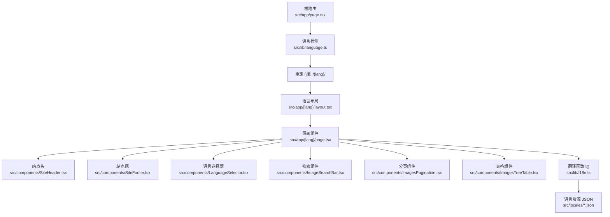
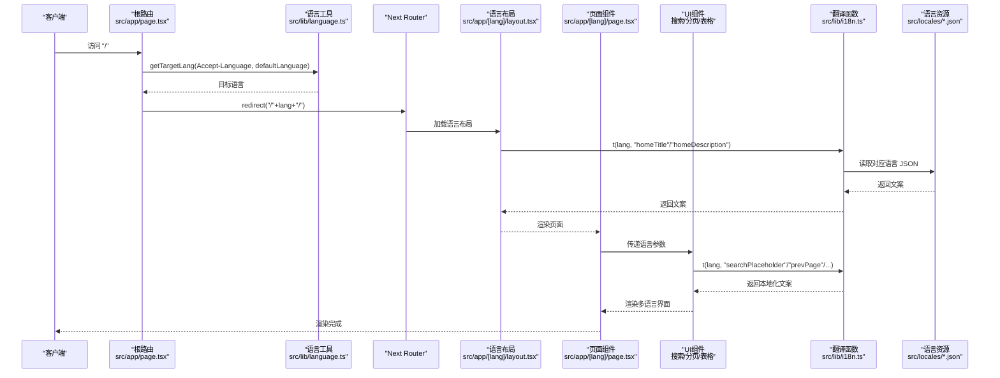
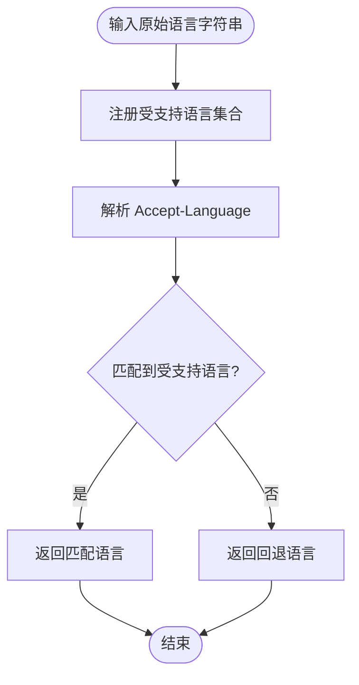
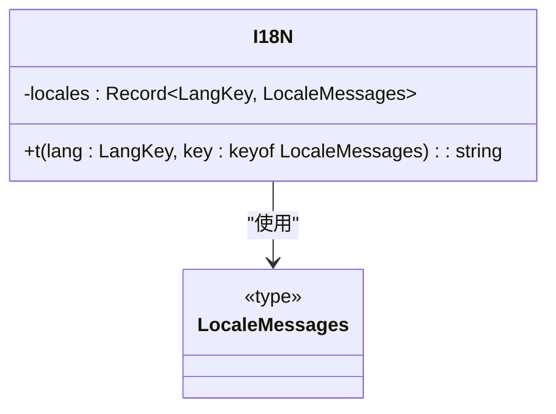
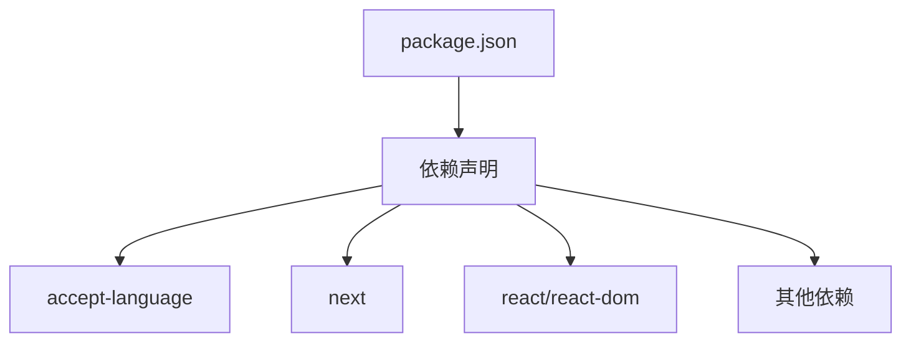

# 国际化支持

<cite>
**本文引用的文件**   
- [src/lib/i18n.ts](file://src/lib/i18n.ts)
- [src/lib/language.ts](file://src/lib/language.ts)
- [src/components/LanguageSelector.tsx](file://src/components/LanguageSelector.tsx)
- [src/app/[lang]/layout.tsx](file://src/app/[lang]/layout.tsx)
- [src/app/layout.tsx](file://src/app/layout.tsx)
- [src/app/page.tsx](file://src/app/page.tsx)
- [src/app/[lang]/page.tsx](file://src/app/[lang]/page.tsx)
- [src/components/SiteHeader.tsx](file://src/components/SiteHeader.tsx)
- [src/components/SiteFooter.tsx](file://src/components/SiteFooter.tsx)
- [src/components/ImageSearchBar.tsx](file://src/components/ImageSearchBar.tsx)
- [src/components/ImagesPagination.tsx](file://src/components/ImagesPagination.tsx)
- [src/components/ImagesTreeTable.tsx](file://src/components/ImagesTreeTable.tsx)
- [src/locales/en.json](file://src/locales/en.json)
- [src/locales/zh.json](file://src/locales/zh.json)
- [src/locales/ja.json](file://src/locales/ja.json)
- [src/locales/de-DE.json](file://src/locales/de-DE.json)
- [src/locales/es.json](file://src/locales/es.json)
- [src/locales/fr.json](file://src/locales/fr.json)
- [src/locales/pt-PT.json](file://src/locales/pt-PT.json)
- [src/locales/zh-TW.json](file://src/locales/zh-TW.json)
- [package.json](file://package.json)
</cite>

## 更新摘要
**变更内容**   
- 更新了搜索功能相关的翻译键，包括搜索占位符、搜索按钮标签和搜索结果提示
- 增强了分页控制组件的国际化支持，添加了上一页/下一页按钮的多语言支持
- 完善了表格列头的多语言支持，包括文件大小、状态等列头翻译
- 扩展了所有八种内置语言的完整翻译覆盖，确保界面一致性

## 目录
1. [简介](#简介)
2. [项目结构](#项目结构)
3. [核心组件](#核心组件)
4. [架构总览](#架构总览)
5. [详细组件分析](#详细组件分析)
6. [依赖分析](#依赖分析)
7. [性能考虑](#性能考虑)
8. [故障排查指南](#故障排查指南)
9. [结论](#结论)
10. [附录](#附录)

## 简介
本文件为 Weable 应用的国际化（i18n）系统提供全面文档，涵盖多语言支持的架构设计、语言检测与动态切换机制、内容缓存策略、8 种内置语言的配置与使用方式、i18n 库使用方法（翻译键值管理、复数形式处理、日期时间格式化、数字格式化）、新增语言流程、SEO 优化策略以及最佳实践与常见问题解决方案。

**更新** 本次更新重点增强了搜索功能和分页控制的国际化支持，确保所有用户界面元素都能正确显示目标语言文案。

## 项目结构
Weable 的国际化实现基于 Next.js App Router，采用"路由前缀 + JSON 资源包"的模式：
- 路由层：通过 [src/app/[lang]/...](file://src/app/[lang]/page.tsx) 等路由段承载语言前缀；根入口 [src/app/page.tsx](file://src/app/page.tsx) 负责根据浏览器 Accept-Language 自动重定向到对应语言路径。
- 语言工具：[src/lib/language.ts](file://src/lib/language.ts) 定义语言常量、类型、默认语言、受支持语言列表及语言检测函数。
- i18n 核心：[src/lib/i18n.ts](file://src/lib/i18n.ts) 聚合各语言 JSON 资源，并提供 t(lang, key) 翻译函数。
- UI 组件：[src/components/LanguageSelector.tsx](file://src/components/LanguageSelector.tsx) 提供前端语言切换下拉框；头部与底部组件通过 t() 渲染文案。
- 资源文件：[src/locales/*.json](file://src/locales/en.json) 存放各语言键值对。

**图表来源** 
- [src/app/page.tsx:1-12](file://src/app/page.tsx#L1-L12)
- [src/lib/language.ts:1-49](file://src/lib/language.ts#L1-L49)
- [src/app/[lang]/layout.tsx:1-48](file://src/app/[lang]/layout.tsx#L1-L48)
- [src/app/[lang]/page.tsx:1-172](file://src/app/[lang]/page.tsx#L1-L172)
- [src/components/SiteHeader.tsx:1-46](file://src/components/SiteHeader.tsx#L1-L46)
- [src/components/SiteFooter.tsx:1-17](file://src/components/SiteFooter.tsx#L1-L17)
- [src/components/LanguageSelector.tsx:1-34](file://src/components/LanguageSelector.tsx#L1-L34)
- [src/components/ImageSearchBar.tsx:1-42](file://src/components/ImageSearchBar.tsx#L1-L42)
- [src/components/ImagesPagination.tsx:1-78](file://src/components/ImagesPagination.tsx#L1-L78)
- [src/components/ImagesTreeTable.tsx:1-332](file://src/components/ImagesTreeTable.tsx#L1-L332)
- [src/lib/i18n.ts:1-28](file://src/lib/i18n.ts#L1-L28)
- [src/locales/en.json:1-95](file://src/locales/en.json#L1-L95)

**章节来源**
- [src/app/page.tsx:1-12](file://src/app/page.tsx#L1-L12)
- [src/lib/language.ts:1-49](file://src/lib/language.ts#L1-L49)
- [src/lib/i18n.ts:1-28](file://src/lib/i18n.ts#L1-L28)
- [src/app/[lang]/layout.tsx:1-48](file://src/app/[lang]/layout.tsx#L1-L48)
- [src/app/[lang]/page.tsx:1-172](file://src/app/[lang]/page.tsx#L1-L172)
- [src/components/LanguageSelector.tsx:1-34](file://src/components/LanguageSelector.tsx#L1-L34)
- [src/components/SiteHeader.tsx:1-46](file://src/components/SiteHeader.tsx#L1-L46)
- [src/components/SiteFooter.tsx:1-17](file://src/components/SiteFooter.tsx#L1-L17)
- [src/locales/en.json:1-95](file://src/locales/en.json#L1-L95)

## 核心组件
- 语言检测与校验
  - 使用 accept-language 解析请求头中的 Accept-Language，匹配受支持语言集合，返回目标语言或回退语言。
  - 提供 isValidLang 用于校验传入语言是否受支持。
- i18n 翻译函数
  - 聚合所有语言 JSON 资源，t(lang, key) 优先取当前语言键值，缺失时回退到英语，再缺失则返回键名本身。
- 路由与元数据
  - 根路由根据 Accept-Language 自动重定向到 /{lang}/。
  - 语言布局生成 SEO 元数据（标题、描述、OpenGraph），并设置 html lang 属性。
- 界面组件
  - LanguageSelector 提供语言切换下拉框，通过 Next.js 客户端路由跳转到新语言路径。
  - SiteHeader 与 SiteFooter 通过 t() 渲染文案。
  - **新增** ImageSearchBar 组件支持搜索功能的国际化，包括搜索占位符和按钮标签。
  - **新增** ImagesPagination 组件提供分页控件的多语言支持。
  - **新增** ImagesTreeTable 组件支持表格列头的多语言显示。

**章节来源**
- [src/lib/language.ts:1-49](file://src/lib/language.ts#L1-L49)
- [src/lib/i18n.ts:1-28](file://src/lib/i18n.ts#L1-L28)
- [src/app/page.tsx:1-12](file://src/app/page.tsx#L1-L12)
- [src/app/[lang]/layout.tsx:1-48](file://src/app/[lang]/layout.tsx#L1-L48)
- [src/components/LanguageSelector.tsx:1-34](file://src/components/LanguageSelector.tsx#L1-L34)
- [src/components/SiteHeader.tsx:1-46](file://src/components/SiteHeader.tsx#L1-L46)
- [src/components/SiteFooter.tsx:1-17](file://src/components/SiteFooter.tsx#L1-L17)
- [src/components/ImageSearchBar.tsx:1-42](file://src/components/ImageSearchBar.tsx#L1-L42)
- [src/components/ImagesPagination.tsx:1-78](file://src/components/ImagesPagination.tsx#L1-L78)
- [src/components/ImagesTreeTable.tsx:1-332](file://src/components/ImagesTreeTable.tsx#L1-L332)

## 架构总览
下图展示从用户访问到最终渲染的多语言流程，包括语言检测、路由重定向、布局元数据生成与组件文案渲染。

**图表来源** 
- [src/app/page.tsx:1-12](file://src/app/page.tsx#L1-L12)
- [src/lib/language.ts:1-49](file://src/lib/language.ts#L1-L49)
- [src/app/[lang]/layout.tsx:1-48](file://src/app/[lang]/layout.tsx#L1-L48)
- [src/app/[lang]/page.tsx:1-172](file://src/app/[lang]/page.tsx#L1-L172)
- [src/components/ImageSearchBar.tsx:1-42](file://src/components/ImageSearchBar.tsx#L1-L42)
- [src/components/ImagesPagination.tsx:1-78](file://src/components/ImagesPagination.tsx#L1-L78)
- [src/components/ImagesTreeTable.tsx:1-332](file://src/components/ImagesTreeTable.tsx#L1-L332)
- [src/lib/i18n.ts:1-28](file://src/lib/i18n.ts#L1-L28)
- [src/locales/en.json:1-95](file://src/locales/en.json#L1-L95)

## 详细组件分析

### 语言检测与类型定义（language.ts）
- 定义 8 种语言常量与 LangKey 联合类型，确保类型安全。
- supportedLanguages 提供语言键与本地化名称映射，供 UI 渲染。
- 使用 accept-language 注册受支持语言集合，getTargetLang 解析请求头并返回匹配语言或回退语言。
- isValidLang 用于校验语言键是否在受支持集合中。

**图表来源** 
- [src/lib/language.ts:1-49](file://src/lib/language.ts#L1-L49)

**章节来源**
- [src/lib/language.ts:1-49](file://src/lib/language.ts#L1-L49)

### i18n 翻译函数（i18n.ts）
- 静态导入所有语言 JSON 资源，构建 locales 映射。
- t(lang, key) 按优先级查找：当前语言 -> 英语 -> 键名本身。
- 通过 TypeScript 类型 LocaleMessages 保证键名一致性。

**图表来源** 
- [src/lib/i18n.ts:1-28](file://src/lib/i18n.ts#L1-L28)

**章节来源**
- [src/lib/i18n.ts:1-28](file://src/lib/i18n.ts#L1-L28)

### 根路由与语言重定向（app/page.tsx）
- 读取请求头 Accept-Language，调用 getTargetLang 获取目标语言。
- 使用 redirect 将用户重定向到 /{lang}/ 路径，确保后续路由与布局均处于正确语言上下文。

**章节来源**
- [src/app/page.tsx:1-12](file://src/app/page.tsx#L1-L12)

### 语言布局与 SEO 元数据（app/[lang]/layout.tsx）
- generateMetadata 根据当前语言生成 title、description 与 OpenGraph 元数据，利于搜索引擎抓取。
- generateStaticParams 预生成所有受支持语言的静态参数，提升构建期可预测性。
- 默认布局设置 html lang 与基础样式，children 渲染具体页面。

**章节来源**
- [src/app/[lang]/layout.tsx:1-48](file://src/app/[lang]/layout.tsx#L1-L48)

### 首页与文案渲染（app/[lang]/page.tsx）
- 验证语言有效性，无效则触发 notFound。
- 使用 t(l, key) 渲染页面文案，如"最新图片"、"搜索占位符"、"上一页/下一页"等。
- 构建分页 URL 时保留语言前缀与查询参数。
- **更新** 集成了新的搜索组件和分页组件，支持完整的国际化功能。

**章节来源**
- [src/app/[lang]/page.tsx:1-172](file://src/app/[lang]/page.tsx#L1-L172)

### 搜索组件（ImageSearchBar.tsx）
- 接收 lang、defaultValue、placeholder 和 searchLabel 参数。
- 通过 t() 函数获取搜索占位符和按钮标签的多语言文案。
- 提交表单时保持语言前缀，确保搜索结果的 URL 包含正确的语言信息。

**章节来源**
- [src/components/ImageSearchBar.tsx:1-42](file://src/components/ImageSearchBar.tsx#L1-L42)

### 分页组件（ImagesPagination.tsx）
- 提供上一页/下一页按钮和页码窗口功能。
- 通过 labels 参数接收 prevPage 和 nextPage 的多语言文案。
- 当总页数小于等于每页大小时不渲染分页控件。
- **更新** 完全支持多语言的分页导航体验。

**章节来源**
- [src/components/ImagesPagination.tsx:1-78](file://src/components/ImagesPagination.tsx#L1-L78)

### 表格组件（ImagesTreeTable.tsx）
- 支持树形结构的图片和目录展示。
- 通过 labels 参数接收表格列头的多语言文案，包括状态、频道、大小等列头。
- 支持全选/部分选择功能，仅图片行可选择。
- **更新** 表格列头现在完全支持多语言显示。

**章节来源**
- [src/components/ImagesTreeTable.tsx:1-332](file://src/components/ImagesTreeTable.tsx#L1-L332)

### 语言选择器组件（components/LanguageSelector.tsx）
- 接收 currentLang 与 pathSuffix，渲染 select 下拉框。
- onChange 事件通过 Next.js 客户端路由跳转到新语言路径，保持页面后缀一致。

**章节来源**
- [src/components/LanguageSelector.tsx:1-34](file://src/components/LanguageSelector.tsx#L1-L34)

### 站点头与尾部（components/SiteHeader.tsx, components/SiteFooter.tsx）
- 通过 t(lang, key) 渲染站点名称、导航项、控制台与图标提示文案。
- 统一在头部与尾部注入语言上下文，确保全站文案一致性。

**章节来源**
- [src/components/SiteHeader.tsx:1-46](file://src/components/SiteHeader.tsx#L1-L46)
- [src/components/SiteFooter.tsx:1-17](file://src/components/SiteFooter.tsx#L1-L17)

### 语言资源文件（src/locales/*.json）
- 每个语言一个 JSON 文件，包含统一的键集合，便于维护与对比。
- **更新** 新增了搜索相关键：searchPlaceholder、searchButton、noSearchResults。
- **更新** 增强了分页相关键：prevPage、nextPage。
- **更新** 添加了表格相关键：fileSize、selectAllImages。
- 示例键包括 siteName、homeTitle、playGame、channels、images 等。

**章节来源**
- [src/locales/en.json:1-95](file://src/locales/en.json#L1-L95)
- [src/locales/zh.json:1-95](file://src/locales/zh.json#L1-L95)
- [src/locales/ja.json:1-95](file://src/locales/ja.json#L1-L95)
- [src/locales/de-DE.json:1-95](file://src/locales/de-DE.json#L1-L95)
- [src/locales/es.json:1-95](file://src/locales/es.json#L1-L95)
- [src/locales/fr.json:1-95](file://src/locales/fr.json#L1-L95)
- [src/locales/pt-PT.json:1-95](file://src/locales/pt-PT.json#L1-L95)
- [src/locales/zh-TW.json:1-95](file://src/locales/zh-TW.json#L1-L95)

## 依赖分析
- 运行时依赖
  - accept-language：解析浏览器 Accept-Language 头，进行语言匹配。
  - next：App Router、路由重定向、元数据生成。
  - react/react-dom：组件渲染与状态管理。
- 开发依赖
  - typescript、tailwindcss、drizzle-kit、wrangler 等用于类型检查、样式、数据库迁移与部署。

**图表来源** 
- [package.json:1-40](file://package.json#L1-L40)

**章节来源**
- [package.json:1-40](file://package.json#L1-L40)

## 性能考虑
- 构建期静态参数生成：generateStaticParams 预生成所有语言路由，减少运行期开销。
- 资源加载策略：JSON 资源在 i18n.ts 中静态导入，打包时可被 Tree-shaking 优化。
- 动态渲染控制：页面组件设置 dynamic = "force-dynamic"，按需渲染避免不必要的缓存。
- **更新** 组件级国际化：搜索、分页、表格组件通过 props 接收翻译文案，避免重复计算。
- 建议优化方向：
  - 引入懒加载语言资源（按需 import），降低首屏体积。
  - 对常用文案进行内存级缓存（如 Map），减少重复查找。
  - 使用 CDN 缓存静态资源与 API 响应，提升多语言页面加载速度。

## 故障排查指南
- 翻译缺失
  - 现象：显示键名而非文案。
  - 原因：当前语言 JSON 缺少该键，且英语也不存在。
  - 解决：在对应语言文件中补充缺失键，或确保英语资源完整。
- 字符编码问题
  - 现象：非 ASCII 字符显示异常。
  - 原因：文件编码或传输编码不一致。
  - 解决：确保 JSON 文件为 UTF-8 编码，HTML meta charset 设置为 utf-8。
- RTL 语言支持
  - 现状：当前未实现 RTL（从右到左）布局。
  - 建议：为 RTL 语言添加 CSS 类与布局开关，结合 html dir 属性切换。
- 语言检测失败
  - 现象：始终回退到默认语言。
  - 原因：Accept-Language 头缺失或不匹配。
  - 解决：检查浏览器请求头，或在服务端提供默认语言回退逻辑。
- **新增** 搜索功能国际化问题
  - 现象：搜索框占位符或按钮显示英文。
  - 解决：确保 ImageSearchBar 组件正确接收 lang 参数，并在组件中使用 t() 函数获取文案。
- **新增** 分页控件国际化问题
  - 现象：分页按钮显示英文。
  - 解决：确保 ImagesPagination 组件的 labels 参数包含正确的多语言文案。

## 结论
Weable 的国际化系统以简洁清晰的架构实现了多语言支持：通过路由前缀、JSON 资源包与轻量翻译函数，满足常见业务需求。**更新** 本次增强了对搜索功能、分页控制和表格组件的全面国际化支持，确保所有用户界面元素都能正确显示目标语言文案。未来可扩展复数形式、日期时间与数字格式化能力，并结合懒加载与缓存策略进一步优化性能。遵循本文的最佳实践与排查指南，可有效保障翻译一致性与用户体验。

## 附录

### 8 种内置语言配置与使用
- 语言列表与名称
  - 英语 en、中文简体 zh、中文繁体 zh-TW、日语 ja、法语 fr、德语 de-DE、西班牙语 es、葡萄牙语 pt-PT。
- 配置位置
  - 语言常量与类型：src/lib/language.ts。
  - 语言资源：src/locales/*.json。
- 使用方法
  - 在组件中通过 t(lang, key) 获取文案，lang 来自路由参数或组件 props。
  - 使用 LanguageSelector 组件进行语言切换，自动更新路由前缀。

**章节来源**
- [src/lib/language.ts:1-49](file://src/lib/language.ts#L1-L49)
- [src/lib/i18n.ts:1-28](file://src/lib/i18n.ts#L1-L28)
- [src/components/LanguageSelector.tsx:1-34](file://src/components/LanguageSelector.tsx#L1-L34)

### i18n 库使用方法
- 翻译键值管理
  - 所有语言 JSON 保持一致的键集合，便于对比与维护。
  - 使用 TypeScript 类型 LocaleMessages 约束键名，避免拼写错误。
- 复数形式处理
  - 当前未实现复数规则，可在 t() 中扩展参数（如 count）与规则引擎。
- 日期时间格式化
  - 当前未集成日期时间格式化库，建议使用 Intl.DateTimeFormat 或第三方库（如 date-fns-tz）。
- 数字格式化
  - 当前未集成数字格式化，建议使用 Intl.NumberFormat 或第三方库。

**章节来源**
- [src/lib/i18n.ts:1-28](file://src/lib/i18n.ts#L1-L28)
- [src/locales/en.json:1-95](file://src/locales/en.json#L1-L95)

### 新增语言完整流程
- 创建语言包
  - 在 src/locales 下新增语言 JSON 文件（如 it.json），复制现有键集合并填写翻译。
- 更新语言工具
  - 在 src/lib/language.ts 中添加语言常量、类型与 supportedLanguages 条目。
- 更新 i18n 聚合
  - 在 src/lib/i18n.ts 中导入新语言 JSON，并在 locales 映射中注册。
- 界面更新
  - 确保 LanguageSelector 能显示新语言名称（由 supportedLanguages 提供）。
  - 测试路由重定向与页面渲染是否正常。
- SEO 与构建
  - generateStaticParams 会自动包含新语言，无需额外修改。
  - 重新构建应用，验证元数据与页面内容。

**章节来源**
- [src/lib/language.ts:1-49](file://src/lib/language.ts#L1-L49)
- [src/lib/i18n.ts:1-28](file://src/lib/i18n.ts#L1-L28)
- [src/app/[lang]/layout.tsx:1-48](file://src/app/[lang]/layout.tsx#L1-L48)

### SEO 优化策略
- 多语言路由
  - 使用 /{lang}/ 前缀区分语言，便于搜索引擎索引与用户分享。
- 元数据翻译
  - 在 generateMetadata 中根据语言生成 title、description 与 OpenGraph。
- 结构化数据支持
  - 可为不同语言页面注入对应的 schema.org 标记，提升搜索结果展示效果。

**章节来源**
- [src/app/[lang]/layout.tsx:1-48](file://src/app/[lang]/layout.tsx#L1-L48)

### 最佳实践指南
- 翻译一致性检查
  - 定期对比各语言 JSON 键集合，确保无缺失或多余键。
  - 使用脚本自动化校验键一致性。
- 性能优化技巧
  - 懒加载语言资源，按需导入。
  - 对高频文案进行内存缓存。
- 调试工具使用
  - 在开发环境打印 t() 调用栈，定位缺失键。
  - 使用浏览器开发者工具检查 Accept-Language 头与重定向行为。

### 常见问题与解决方案
- 翻译缺失
  - 检查语言 JSON 是否包含对应键，必要时回退到英语或键名。
- 字符编码问题
  - 确保 JSON 与 HTML 均为 UTF-8 编码。
- RTL 语言支持
  - 为 RTL 语言添加布局切换逻辑与 CSS 类。
- 语言检测失败
  - 检查服务器请求头与 accept-language 配置。
- **新增** 搜索功能国际化问题
  - 确保 ImageSearchBar 组件正确接收 lang 参数。
  - 检查搜索相关键（searchPlaceholder、searchButton）是否在所有语言文件中存在。
- **新增** 分页控件国际化问题
  - 确保 ImagesPagination 组件的 labels 参数包含 prevPage 和 nextPage 键。
  - 验证分页组件是否正确传递语言参数给父组件。
- **新增** 表格列头国际化问题
  - 确保 ImagesTreeTable 组件的 labels 参数包含所有列头相关键。
  - 检查表格组件是否正确接收和使用多语言文案。