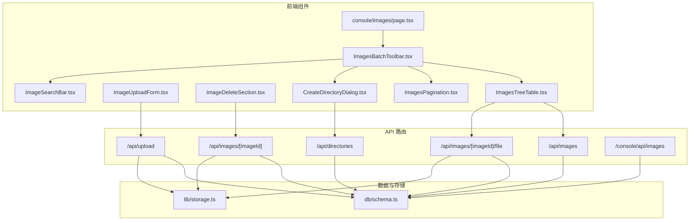
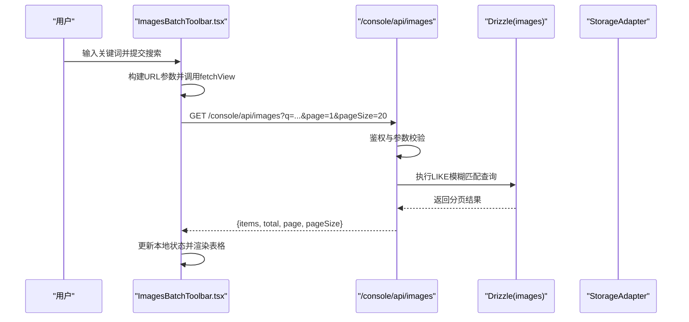
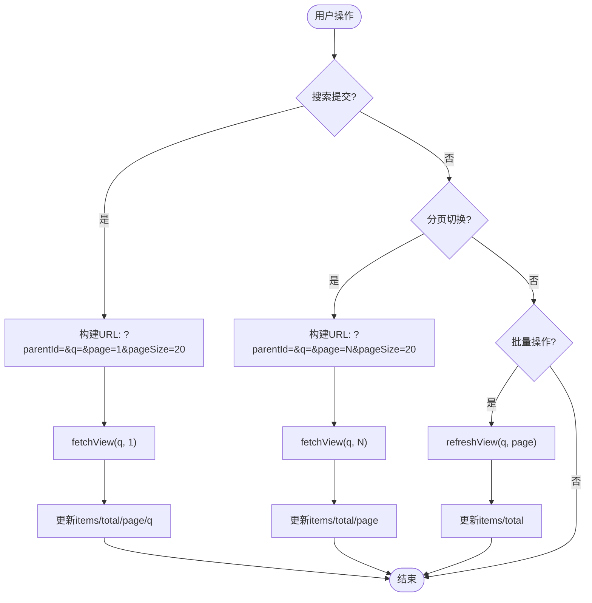
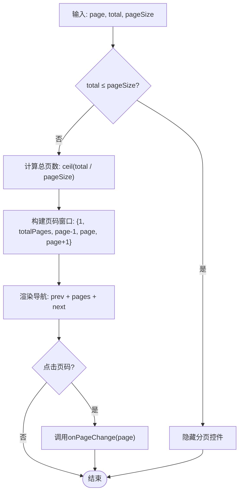
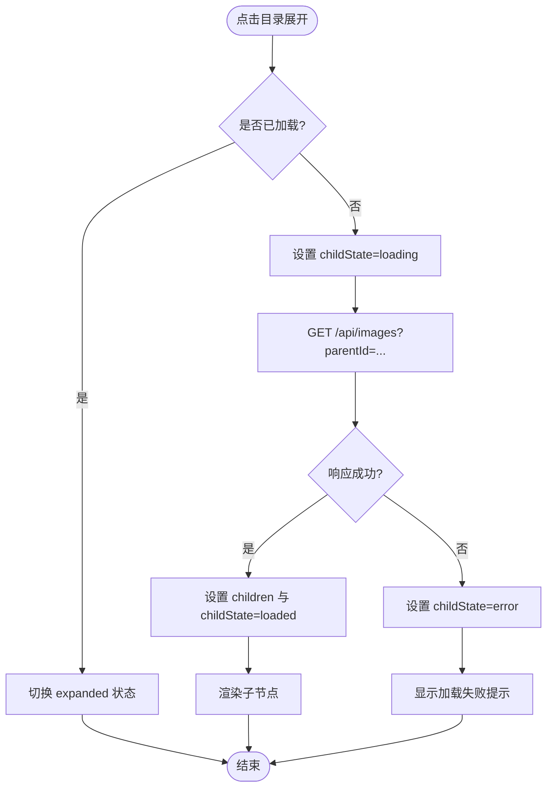
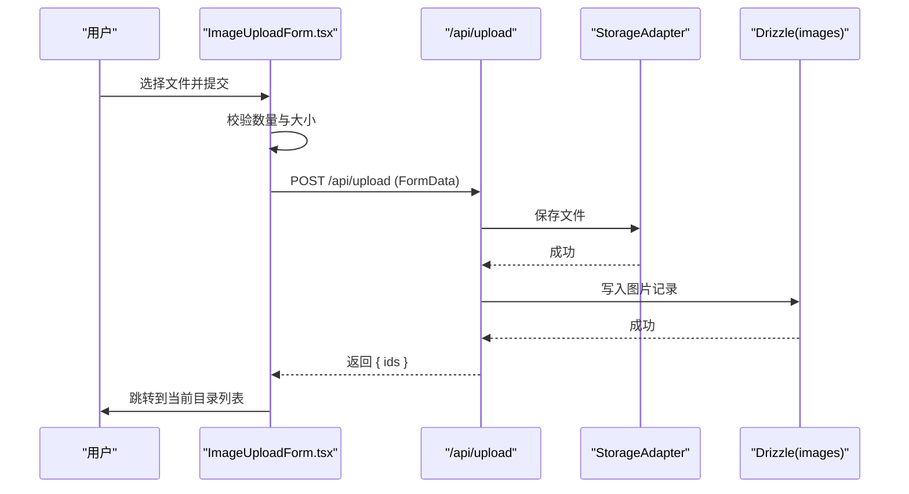
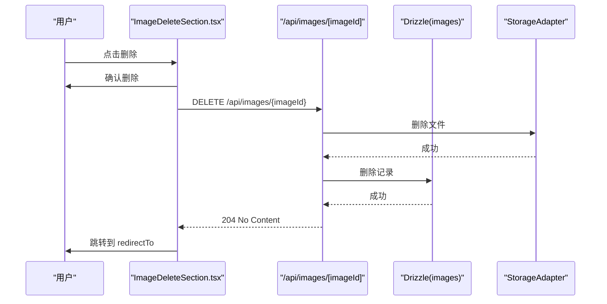
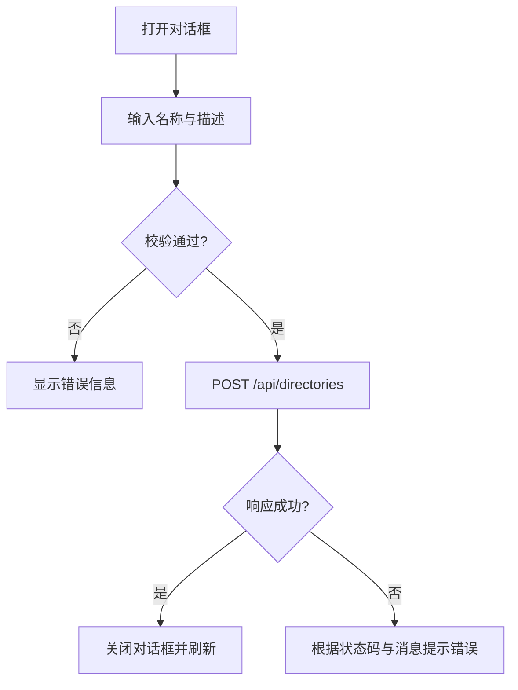
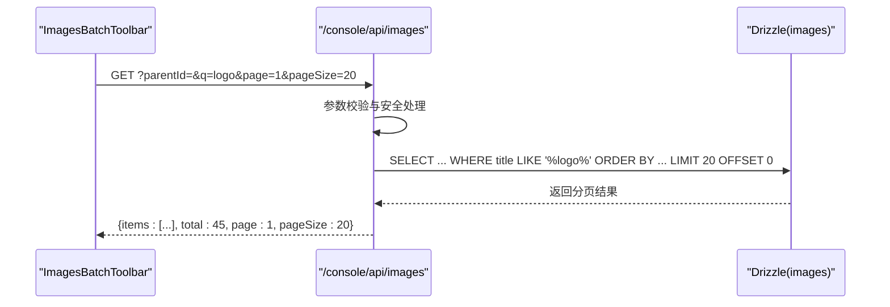
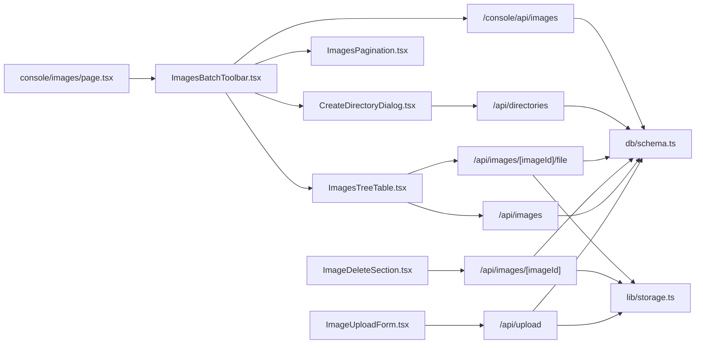

# 图片管理

<cite>
**本文引用的文件**   
- [ImagesTreeTable.tsx](file://src/components/ImagesTreeTable.tsx)
- [ImageUploadForm.tsx](file://src/components/ImageUploadForm.tsx)
- [ImageDeleteSection.tsx](file://src/components/ImageDeleteSection.tsx)
- [CreateDirectoryDialog.tsx](file://src/components/CreateDirectoryDialog.tsx)
- [ImageSearchBar.tsx](file://src/components/ImageSearchBar.tsx)
- [ImagesPagination.tsx](file://src/components/ImagesPagination.tsx)
- [ImagesBatchToolbar.tsx](file://src/components/ImagesBatchToolbar.tsx)
- [upload/route.ts](file://src/app/api/upload/route.ts)
- [images/route.ts](file://src/app/api/images/route.ts)
- [images/[imageId]/route.ts](file://src/app/api/images/[imageId]/route.ts)
- [images/[imageId]/file/route.ts](file://src/app/api/images/[imageId]/file/route.ts)
- [directories/route.ts](file://src/app/api/directories/route.ts)
- [console/images/page.tsx](file://src/app/[lang]/console/images/page.tsx)
- [console/api/images/route.ts](file://src/app/[lang]/console/api/images/route.ts)
- [schema.ts](file://src/db/schema.ts)
- [storage.ts](file://src/lib/storage.ts)
- [data-model.md（001）](file://specs/001-image-directory-tree/data-model.md)
- [data-model.md（002）](file://specs/002-image-upload-tree-refine/data-model.md)
- [data-model.md（004）](file://specs/004-images-search-pagination/data-model.md)
</cite>

## 更新摘要
**所做更改**   
- 新增 ImagesPagination 组件章节，详细介绍智能分页导航功能
- 更新 ImagesBatchToolbar 组件章节，说明其作为批量操作容器的核心作用
- 增强控制台图片列表页章节，详细说明服务器端渲染与客户端交互的集成
- 扩展 API 路由章节，介绍关键词搜索和服务端分页功能
- 更新性能考虑章节，包含分页优化策略
- 完善故障排除指南，涵盖搜索和分页相关问题

## 目录
1. [简介](#简介)
2. [项目结构](#项目结构)
3. [核心组件](#核心组件)
4. [架构总览](#架构总览)
5. [详细组件分析](#详细组件分析)
6. [依赖关系分析](#依赖关系分析)
7. [性能考虑](#性能考虑)
8. [故障排除指南](#故障排除指南)
9. [结论](#结论)
10. [附录：集成示例与最佳实践](#附录：集成示例与最佳实践)

## 简介
本文件为 Weable 应用的"图片管理"功能提供系统化文档，覆盖以下能力：
- 图片上传流程：支持多文件、类型校验、大小限制、错误提示与跳转。
- 图片删除：单张删除与确认机制。
- 元数据编辑：标题、描述、发布状态、频道关联等字段更新。
- 树形目录结构：创建文件夹、路径导航、按需展开子节点。
- ImagesTreeTable 交互逻辑：懒加载子目录、缩进展示、状态反馈。
- 关键词搜索：基于标题的模糊匹配搜索，支持通配符转义和安全查询。
- 传统分页：智能分页导航，支持首页/尾页、当前页、相邻页和省略号间隙。
- 文件验证与错误处理：前端与后端双重校验、统一错误返回。
- 性能优化策略：懒加载、缓存头、服务端排序与分页。
- 故障排除：上传失败、权限问题、存储限制等常见问题的定位与解决。

## 项目结构
图片管理相关的前端组件、API 路由、数据库模型与存储适配器的组织如下：
- 前端组件：上传表单、删除区块、目录创建对话框、树形表格、搜索栏、分页控件、批量工具栏。
- API 路由：上传、列表、按 ID 删除/更新、文件读取、目录创建、搜索分页接口。
- 数据模型：Drizzle schema 定义 images 表及自引用 parent_id。
- 存储适配器：本地文件系统与 Cloudflare R2 的统一接口。

图表来源 
- [ImagesTreeTable.tsx:1-332](file://src/components/ImagesTreeTable.tsx#L1-L332)
- [ImageUploadForm.tsx:1-105](file://src/components/ImageUploadForm.tsx#L1-L105)
- [ImageDeleteSection.tsx:1-43](file://src/components/ImageDeleteSection.tsx#L1-L43)
- [CreateDirectoryDialog.tsx:1-147](file://src/components/CreateDirectoryDialog.tsx#L1-L147)
- [ImageSearchBar.tsx:1-42](file://src/components/ImageSearchBar.tsx#L1-L42)
- [ImagesPagination.tsx:1-78](file://src/components/ImagesPagination.tsx#L1-L78)
- [ImagesBatchToolbar.tsx:1-229](file://src/components/ImagesBatchToolbar.tsx#L1-L229)
- [console/images/page.tsx:1-224](file://src/app/[lang]/console/images/page.tsx#L1-L224)
- [upload/route.ts:1-75](file://src/app/api/upload/route.ts#L1-L75)
- [images/route.ts:1-66](file://src/app/api/images/route.ts#L1-L66)
- [images/[imageId]/route.ts:1-84](file://src/app/api/images/[imageId]/route.ts#L1-L84)
- [images/[imageId]/file/route.ts:1-48](file://src/app/api/images/[imageId]/file/route.ts#L1-L48)
- [directories/route.ts:1-95](file://src/app/api/directories/route.ts#L1-L95)
- [console/api/images/route.ts:1-122](file://src/app/[lang]/console/api/images/route.ts#L1-L122)
- [schema.ts:1-100](file://src/db/schema.ts#L1-L100)
- [storage.ts:1-214](file://src/lib/storage.ts#L1-L214)

章节来源
- [console/images/page.tsx:1-224](file://src/app/[lang]/console/images/page.tsx#L1-L224)
- [schema.ts:1-100](file://src/db/schema.ts#L1-L100)
- [storage.ts:1-214](file://src/lib/storage.ts#L1-L214)

## 核心组件
- ImagesTreeTable：树形表格展示目录与图片，支持懒加载子目录、缩进、状态标签与更新时间显示。
- ImageUploadForm：多文件上传表单，包含数量与大小校验、错误提示与上传后跳转。
- ImageDeleteSection：单张图片删除，含确认弹窗与成功跳转。
- CreateDirectoryDialog：创建目录对话框，包含名称与描述输入、重复名与非法字符校验。
- ImageSearchBar：搜索栏，提交后通过 URL 参数驱动页面级搜索。
- ImagesPagination：智能分页控件，支持首页/尾页、当前页、相邻页和省略号间隙。
- ImagesBatchToolbar：批量操作容器，集成搜索、分页、树形表格和批量操作功能。

章节来源
- [ImagesTreeTable.tsx:1-332](file://src/components/ImagesTreeTable.tsx#L1-L332)
- [ImageUploadForm.tsx:1-105](file://src/components/ImageUploadForm.tsx#L1-L105)
- [ImageDeleteSection.tsx:1-43](file://src/components/ImageDeleteSection.tsx#L1-L43)
- [CreateDirectoryDialog.tsx:1-147](file://src/components/CreateDirectoryDialog.tsx#L1-L147)
- [ImageSearchBar.tsx:1-42](file://src/components/ImageSearchBar.tsx#L1-L42)
- [ImagesPagination.tsx:1-78](file://src/components/ImagesPagination.tsx#L1-L78)
- [ImagesBatchToolbar.tsx:1-229](file://src/components/ImagesBatchToolbar.tsx#L1-L229)

## 架构总览
整体采用 Next.js App Router 前后端一体化设计：
- 前端组件负责用户交互与状态管理。
- API 路由负责鉴权、参数校验、业务逻辑与数据持久化。
- Drizzle ORM 操作 SQLite 数据库。
- StorageAdapter 抽象本地与 R2 存储实现，统一 save/read/delete。

图表来源 
- [ImagesBatchToolbar.tsx:1-229](file://src/components/ImagesBatchToolbar.tsx#L1-L229)
- [console/api/images/route.ts:1-122](file://src/app/[lang]/console/api/images/route.ts#L1-L122)
- [schema.ts:1-100](file://src/db/schema.ts#L1-L100)
- [storage.ts:1-214](file://src/lib/storage.ts#L1-L214)

## 详细组件分析

### ImagesBatchToolbar 组件
**更新** 新增作为批量操作容器的核心功能，集成搜索、分页和树形表格。

- 功能要点：
  - 持有选择状态与列表数据源，支持搜索/翻页/就地刷新。
  - 构建列表接口地址，支持分页开关（pageSize）。
  - 维护视图状态与 URL 同步，支持分享和还原。
  - 集成搜索表单，提交时重置到第 1 页。
  - 集成分页控件，翻页时保留搜索条件。
  - 批量操作成功后就地刷新当前视图。

图表来源 
- [ImagesBatchToolbar.tsx:1-229](file://src/components/ImagesBatchToolbar.tsx#L1-L229)
- [console/api/images/route.ts:1-122](file://src/app/[lang]/console/api/images/route.ts#L1-L122)

章节来源
- [ImagesBatchToolbar.tsx:1-229](file://src/components/ImagesBatchToolbar.tsx#L1-L229)

### ImagesPagination 组件
**新增** 智能分页控件，提供传统分页导航体验。

- 功能特性：
  - 智能页码窗口：首页、尾页、当前页 ±1，缺口以省略号呈现。
  - 边界处理：上一页/下一页按钮在边界时禁用。
  - 当前页高亮：使用蓝色背景突出显示当前页码。
  - 响应式设计：当 total ≤ pageSize 时不渲染控件。
  - 无障碍支持：使用 aria-current 属性标记当前页。

图表来源 
- [ImagesPagination.tsx:1-78](file://src/components/ImagesPagination.tsx#L1-L78)

章节来源
- [ImagesPagination.tsx:1-78](file://src/components/ImagesPagination.tsx#L1-L78)

### ImagesTreeTable 组件
**更新** 增强了列显示功能，新增频道名称、文件大小和修改时间列。

- 数据结构：ImageEntry 表示目录或图片条目，mimeType 为 "directory" 时视为目录。
- 交互逻辑：
  - 点击目录行左侧展开按钮，首次展开触发懒加载子节点。
  - 子节点通过 GET /api/images?parentId=... 获取，并按目录优先、更新时间倒序排列。
  - 展开状态与加载状态（idle/loading/loaded/error）控制 UI。
- 视觉与布局：
  - 每层缩进固定步长，使用 transform 平移实现。
  - 图片项显示缩略图，目录项显示图标。
  - 新增频道名称列、文件大小列（KB/MB格式）、修改时间列。
  - 非目录项显示发布状态标签与更新时间。
- 性能优化：
  - 懒加载子目录，避免一次性渲染深层树。
  - 图片资源通过 /api/images/[imageId]/file 提供，并设置长期缓存头。

图表来源 
- [ImagesTreeTable.tsx:1-332](file://src/components/ImagesTreeTable.tsx#L1-L332)
- [images/route.ts:1-66](file://src/app/api/images/route.ts#L1-L66)

章节来源
- [ImagesTreeTable.tsx:1-332](file://src/components/ImagesTreeTable.tsx#L1-L332)
- [images/route.ts:1-66](file://src/app/api/images/route.ts#L1-L66)

### ImageUploadForm 组件
- 功能要点：
  - 支持多文件选择，限制最大数量与单文件大小。
  - 构建 FormData，附加 parentId（可选），POST 到 /api/upload。
  - 根据响应结果进行错误提示或跳转至目标目录列表。
- 用户体验：
  - 上传中禁用按钮，显示上传文案。
  - 错误信息以红色提示框展示。

图表来源 
- [ImageUploadForm.tsx:1-105](file://src/components/ImageUploadForm.tsx#L1-L105)
- [upload/route.ts:1-75](file://src/app/api/upload/route.ts#L1-L75)
- [storage.ts:1-214](file://src/lib/storage.ts#L1-L214)
- [schema.ts:1-100](file://src/db/schema.ts#L1-L100)

章节来源
- [ImageUploadForm.tsx:1-105](file://src/components/ImageUploadForm.tsx#L1-L105)
- [upload/route.ts:1-75](file://src/app/api/upload/route.ts#L1-L75)

### ImageDeleteSection 组件
- 功能要点：
  - 点击删除按钮弹出确认框。
  - 调用 DELETE /api/images/[imageId]，成功后跳转到指定页面。
- 错误处理：
  - 请求失败时提示删除失败。

图表来源 
- [ImageDeleteSection.tsx:1-43](file://src/components/ImageDeleteSection.tsx#L1-L43)
- [images/[imageId]/route.ts:1-84](file://src/app/api/images/[imageId]/route.ts#L1-L84)
- [storage.ts:1-214](file://src/lib/storage.ts#L1-L214)

章节来源
- [ImageDeleteSection.tsx:1-43](file://src/components/ImageDeleteSection.tsx#L1-L43)
- [images/[imageId]/route.ts:1-84](file://src/app/api/images/[imageId]/route.ts#L1-L84)

### CreateDirectoryDialog 组件
- 功能要点：
  - 输入目录名称与描述，提交到 /api/directories。
  - 校验名称必填、长度、非法字符与重复名。
  - 成功后关闭对话框并刷新页面。
- 错误处理：
  - 409 重复名错误、非法字符错误、网络错误等分别提示。

图表来源 
- [CreateDirectoryDialog.tsx:1-147](file://src/components/CreateDirectoryDialog.tsx#L1-L147)
- [directories/route.ts:1-95](file://src/app/api/directories/route.ts#L1-L95)

章节来源
- [CreateDirectoryDialog.tsx:1-147](file://src/components/CreateDirectoryDialog.tsx#L1-L147)
- [directories/route.ts:1-95](file://src/app/api/directories/route.ts#L1-L95)

### ImageSearchBar 组件
- 功能要点：
  - 输入关键词后提交，将 q 参数拼接到 URL，由页面侧进行搜索过滤。
- 使用场景：
  - 控制台图片列表页可结合该组件实现搜索。

章节来源
- [ImageSearchBar.tsx:1-42](file://src/components/ImageSearchBar.tsx#L1-L42)

### 控制台图片列表页（console/images/page.tsx）
**更新** 增强了服务器端渲染与客户端交互的集成，支持搜索和分页。

- 功能要点：
  - 解析 searchParams 中的 parentId、q、page 参数。
  - 根据 parentId 查询当前层级目录与图片，生成面包屑导航。
  - 提供"新建目录"与"上传图片"入口。
  - 渲染 ImagesBatchToolbar 作为主内容区域。
  - 支持关键词搜索和服务端分页。
  - 维护 URL 状态同步，支持分享和还原。

章节来源
- [console/images/page.tsx:1-224](file://src/app/[lang]/console/images/page.tsx#L1-L224)

### 搜索分页 API 路由（console/api/images/route.ts）
**新增** 支持关键词搜索和服务端分页的核心 API。

- 功能特性：
  - 支持关键词搜索：基于 title 字段的 LIKE 模糊匹配。
  - 服务端分页：支持 page 和 pageSize 参数，默认每页 20 条。
  - 安全查询：对 LIKE 通配符进行转义，防止 SQL 注入。
  - 兼容模式：未传 pageSize 时返回全量数据，保持向后兼容。
  - 频道关联：LEFT JOIN channels 表获取频道名称。

图表来源 
- [console/api/images/route.ts:1-122](file://src/app/[lang]/console/api/images/route.ts#L1-L122)

章节来源
- [console/api/images/route.ts:1-122](file://src/app/[lang]/console/api/images/route.ts#L1-L122)

## 依赖关系分析
**更新** 新增了 ImagesBatchToolbar 和 ImagesPagination 组件的依赖关系。

- 组件依赖：
  - console/images/page.tsx 依赖 ImagesBatchToolbar、CreateDirectoryDialog。
  - ImagesBatchToolbar 依赖 ImagesTreeTable、ImagesPagination、批量操作对话框。
  - ImagesTreeTable 依赖 /api/images 与 /api/images/[imageId]/file。
  - ImageUploadForm 依赖 /api/upload。
  - ImageDeleteSection 依赖 /api/images/[imageId]。
  - CreateDirectoryDialog 依赖 /api/directories。
- API 依赖：
  - 所有 API 均依赖鉴权 getCurrentUser。
  - 读写数据依赖 Drizzle ORM 与 db/schema.ts。
  - 文件存取依赖 storage.ts 的 StorageAdapter。

图表来源 
- [console/images/page.tsx:1-224](file://src/app/[lang]/console/images/page.tsx#L1-L224)
- [ImagesBatchToolbar.tsx:1-229](file://src/components/ImagesBatchToolbar.tsx#L1-L229)
- [ImagesTreeTable.tsx:1-332](file://src/components/ImagesTreeTable.tsx#L1-L332)
- [ImagesPagination.tsx:1-78](file://src/components/ImagesPagination.tsx#L1-L78)
- [ImageUploadForm.tsx:1-105](file://src/components/ImageUploadForm.tsx#L1-L105)
- [ImageDeleteSection.tsx:1-43](file://src/components/ImageDeleteSection.tsx#L1-L43)
- [CreateDirectoryDialog.tsx:1-147](file://src/components/CreateDirectoryDialog.tsx#L1-L147)
- [upload/route.ts:1-75](file://src/app/api/upload/route.ts#L1-L75)
- [images/route.ts:1-66](file://src/app/api/images/route.ts#L1-L66)
- [images/[imageId]/route.ts:1-84](file://src/app/api/images/[imageId]/route.ts#L1-L84)
- [images/[imageId]/file/route.ts:1-48](file://src/app/api/images/[imageId]/file/route.ts#L1-L48)
- [directories/route.ts:1-95](file://src/app/api/directories/route.ts#L1-L95)
- [console/api/images/route.ts:1-122](file://src/app/[lang]/console/api/images/route.ts#L1-L122)
- [schema.ts:1-100](file://src/db/schema.ts#L1-L100)
- [storage.ts:1-214](file://src/lib/storage.ts#L1-L214)

章节来源
- [schema.ts:1-100](file://src/db/schema.ts#L1-L100)
- [storage.ts:1-214](file://src/lib/storage.ts#L1-L214)

## 性能考虑
**更新** 增加了分页和搜索相关的性能优化策略。

- 懒加载与按需渲染：
  - ImagesTreeTable 仅在展开目录时加载子节点，减少初始渲染压力。
- 缓存策略：
  - 文件读取接口设置 Cache-Control 公共缓存与不可变标识，提升浏览器缓存命中率。
- 服务端排序：
  - 列表接口按目录优先与更新时间倒序，保证常用内容靠前。
- 分页优化：
  - 服务端分页减少数据传输量，提高大列表加载速度。
  - 智能页码窗口只显示关键页码，减少 DOM 节点数量。
  - 当 total ≤ pageSize 时自动隐藏分页控件，节省空间。
- 搜索优化：
  - 关键词搜索使用 LIKE 模糊匹配，配合通配符转义确保安全。
  - 搜索结果实时更新，无需整页刷新。
- 可扩展性建议：
  - 搜索功能可进一步优化为全文索引。
  - 大文件上传可引入分片与断点续传。
  - 可考虑添加虚拟滚动支持超大数据集。

[本节为通用指导，不直接分析具体文件]

## 故障排除指南
**更新** 增加了搜索和分页相关的故障排除内容。

- 上传失败
  - 现象：前端显示"上传错误"或"文件过大/数量过多"。
  - 排查：检查前端校验阈值与后端 MAX_UPLOAD_FILES/MAX_FILE_SIZE_BYTES 是否一致；查看 /api/upload 返回的错误消息。
  - 参考：
    - [ImageUploadForm.tsx:1-105](file://src/components/ImageUploadForm.tsx#L1-L105)
    - [upload/route.ts:1-75](file://src/app/api/upload/route.ts#L1-L75)
- 权限问题
  - 现象：删除或访问图片返回 404 或鉴权失败。
  - 排查：确认当前用户身份与图片 userId 匹配；检查路由中的鉴权逻辑。
  - 参考：
    - [images/[imageId]/route.ts:1-84](file://src/app/api/images/[imageId]/route.ts#L1-L84)
- 存储限制
  - 现象：上传成功但无法读取文件或删除失败。
  - 排查：检查 StorageAdapter 配置（本地路径或 R2 Bucket）；确认文件存在且路径安全。
  - 参考：
    - [storage.ts:1-214](file://src/lib/storage.ts#L1-L214)
- 目录重名与非法字符
  - 现象：创建目录时报 409 或非法字符错误。
  - 排查：检查目录名称是否重复、是否包含非法字符（如 / \ 或 ..）。
  - 参考：
    - [directories/route.ts:1-95](file://src/app/api/directories/route.ts#L1-L95)
    - [CreateDirectoryDialog.tsx:1-147](file://src/components/CreateDirectoryDialog.tsx#L1-L147)
- 文件读取 404
  - 现象：图片缩略图无法加载。
  - 排查：确认图片 mimeType 不是 directory；检查文件是否存在于存储。
  - 参考：
    - [images/[imageId]/file/route.ts:1-48](file://src/app/api/images/[imageId]/file/route.ts#L1-L48)
- 搜索无结果
  - 现象：输入关键词后显示"没有匹配的条目"。
  - 排查：检查关键词是否正确、数据库是否有匹配数据、LIKE 查询是否正常工作。
  - 参考：
    - [ImagesBatchToolbar.tsx:1-229](file://src/components/ImagesBatchToolbar.tsx#L1-L229)
    - [console/api/images/route.ts:1-122](file://src/app/[lang]/console/api/images/route.ts#L1-L122)
- 分页异常
  - 现象：分页控件不显示或翻页无效。
  - 排查：检查 total 值是否正确、pageSize 是否为正整数、page 参数是否在有效范围内。
  - 参考：
    - [ImagesPagination.tsx:1-78](file://src/components/ImagesPagination.tsx#L1-L78)
    - [ImagesBatchToolbar.tsx:1-229](file://src/components/ImagesBatchToolbar.tsx#L1-L229)

章节来源
- [ImageUploadForm.tsx:1-105](file://src/components/ImageUploadForm.tsx#L1-L105)
- [upload/route.ts:1-75](file://src/app/api/upload/route.ts#L1-L75)
- [images/[imageId]/route.ts:1-84](file://src/app/api/images/[imageId]/route.ts#L1-L84)
- [storage.ts:1-214](file://src/lib/storage.ts#L1-L214)
- [directories/route.ts:1-95](file://src/app/api/directories/route.ts#L1-L95)
- [CreateDirectoryDialog.tsx:1-147](file://src/components/CreateDirectoryDialog.tsx#L1-L147)
- [images/[imageId]/file/route.ts:1-48](file://src/app/api/images/[imageId]/file/route.ts#L1-L48)
- [ImagesBatchToolbar.tsx:1-229](file://src/components/ImagesBatchToolbar.tsx#L1-L229)
- [ImagesPagination.tsx:1-78](file://src/components/ImagesPagination.tsx#L1-L78)
- [console/api/images/route.ts:1-122](file://src/app/[lang]/console/api/images/route.ts#L1-L122)

## 结论
Weable 的图片管理模块通过清晰的组件分层与统一的 API 设计，实现了从上传、删除、元数据编辑到目录管理的完整闭环。新增的 ImagesBatchToolbar 组件作为核心容器，集成了搜索、分页和批量操作功能，提供了现代化的用户体验。ImagesPagination 组件的智能分页导航提升了大数据集的浏览效率。ImagesTreeTable 的懒加载与缩进展示配合新增的频道、大小、时间列，提供了丰富的信息展示。前后端双重校验与完善的错误处理保障了稳定性。存储适配器抽象使得部署环境灵活可控。后续可在搜索索引、虚拟滚动和分片上传方面进一步优化性能与可用性。

[本节为总结，不直接分析具体文件]

## 附录：集成示例与最佳实践
**更新** 增加了搜索和分页相关的集成示例。

- 集成上传表单
  - 在控制台页面放置 ImageUploadForm，传入 lang 与可选 parentId，确保上传后跳转回当前目录。
  - 参考：
    - [ImageUploadForm.tsx:1-105](file://src/components/ImageUploadForm.tsx#L1-L105)
    - [console/images/page.tsx:1-224](file://src/app/[lang]/console/images/page.tsx#L1-L224)
- 处理文件流
  - 使用 FormData 收集多文件，附加 parentId，POST 到 /api/upload。
  - 参考：
    - [upload/route.ts:1-75](file://src/app/api/upload/route.ts#L1-L75)
- 管理图片状态
  - 通过 PATCH /api/images/[imageId] 更新 title、description、channelId、isPublished 等字段。
  - 参考：
    - [images/[imageId]/route.ts:1-84](file://src/app/api/images/[imageId]/route.ts#L1-L84)
- 实现搜索过滤
  - 使用 ImagesBatchToolbar 内置的搜索功能，支持实时搜索和 URL 状态同步。
  - 关键词通过 q 参数传递，服务端进行 LIKE 模糊匹配。
  - 参考：
    - [ImagesBatchToolbar.tsx:1-229](file://src/components/ImagesBatchToolbar.tsx#L1-L229)
    - [console/api/images/route.ts:1-122](file://src/app/[lang]/console/api/images/route.ts#L1-L122)
- 实现分页浏览
  - 使用 ImagesPagination 组件提供智能分页导航。
  - 分页参数通过 URL 状态管理，支持分享和还原。
  - 参考：
    - [ImagesPagination.tsx:1-78](file://src/components/ImagesPagination.tsx#L1-L78)
    - [ImagesBatchToolbar.tsx:1-229](file://src/components/ImagesBatchToolbar.tsx#L1-L229)
- 目录结构与导航
  - 通过 CreateDirectoryDialog 创建目录，并在 console/images 页面渲染 ImagesBatchToolbar 展示层级。
  - 支持面包屑导航和目录层级跳转。
  - 参考：
    - [CreateDirectoryDialog.tsx:1-147](file://src/components/CreateDirectoryDialog.tsx#L1-L147)
    - [console/images/page.tsx:1-224](file://src/app/[lang]/console/images/page.tsx#L1-L224)
    - [ImagesTreeTable.tsx:1-332](file://src/components/ImagesTreeTable.tsx#L1-L332)
- 批量操作集成
  - 使用 ImagesBatchToolbar 提供的批量操作功能。
  - 支持批量设置发布状态和频道关联。
  - 操作成功后就地刷新列表，保持交互状态。
  - 参考：
    - [ImagesBatchToolbar.tsx:1-229](file://src/components/ImagesBatchToolbar.tsx#L1-L229)

章节来源
- [ImageUploadForm.tsx:1-105](file://src/components/ImageUploadForm.tsx#L1-L105)
- [upload/route.ts:1-75](file://src/app/api/upload/route.ts#L1-L75)
- [images/[imageId]/route.ts:1-84](file://src/app/api/images/[imageId]/route.ts#L1-L84)
- [ImagesBatchToolbar.tsx:1-229](file://src/components/ImagesBatchToolbar.tsx#L1-L229)
- [ImagesPagination.tsx:1-78](file://src/components/ImagesPagination.tsx#L1-L78)
- [CreateDirectoryDialog.tsx:1-147](file://src/components/CreateDirectoryDialog.tsx#L1-L147)
- [console/images/page.tsx:1-224](file://src/app/[lang]/console/images/page.tsx#L1-L224)
- [ImagesTreeTable.tsx:1-332](file://src/components/ImagesTreeTable.tsx#L1-L332)
- [console/api/images/route.ts:1-122](file://src/app/[lang]/console/api/images/route.ts#L1-L122)