# 批量图片管理

<cite>
**本文引用的文件**   
- [README.md](file://README.md)
- [package.json](file://package.json)
- [src/db/schema.ts](file://src/db/schema.ts)
- [src/db/index.ts](file://src/db/index.ts)
- [src/lib/storage.ts](file://src/lib/storage.ts)
- [src/app/[lang]/console/api/images/route.ts](file://src/app/[lang]/console/api/images/route.ts)
- [src/app/[lang]/console/api/images/batch/route.ts](file://src/app/[lang]/console/api/images/batch/route.ts)
- [src/app/[lang]/console/api/directories/route.ts](file://src/app/[lang]/console/api/directories/route.ts)
- [src/app/[lang]/console/api/images/breadcrumb/route.ts](file://src/app/[lang]/console/api/images/breadcrumb/route.ts)
- [src/app/[lang]/console/api/upload/route.ts](file://src/app/[lang]/console/api/upload/route.ts)
- [src/components/ImagesBatchToolbar.tsx](file://src/components/ImagesBatchToolbar.tsx)
- [src/components/ImagesTreeTable.tsx](file://src/components/ImagesTreeTable.tsx)
- [src/components/BatchPublishDialog.tsx](file://src/components/BatchPublishDialog.tsx)
</cite>

## 目录
1. [简介](#简介)
2. [项目结构](#项目结构)
3. [核心组件](#核心组件)
4. [架构总览](#架构总览)
5. [详细组件分析](#详细组件分析)
6. [依赖分析](#依赖分析)
7. [性能考量](#性能考量)
8. [故障排查指南](#故障排查指南)
9. [结论](#结论)
10. [附录](#附录)

## 简介
本项目是一个部署在 Cloudflare Worker 上的图片管理应用，基于 Next.js App Router、Drizzle ORM 与 SQLite/D1 存储，提供控制台端的图片目录树、批量操作（批量设置发布状态/所属频道）、批量上传等能力。通过“images”表复用 mime_type=directory 的方式实现目录管理，结合前端树形表格与对话框完成交互。

## 项目结构
- 数据层：Drizzle Schema 定义用户、频道、图片（含自引用 parent_id），以及数据库连接适配（本地 SQLite / D1）。
- 存储层：统一 StorageAdapter 抽象，支持本地文件系统与 R2 对象存储；头像存储封装。
- API 路由：图片列表（支持 parentId 过滤）、批量更新（PATCH /api/images/batch）、目录创建（POST /api/directories）、面包屑（GET /api/images/breadcrumb）、上传（POST /api/upload）、单图删除/更新。
- 前端组件：ImagesTreeTable（树形表格，懒加载子节点）、ImagesBatchToolbar（批量操作工具栏）、BatchPublishDialog（批量发布对话框）等。

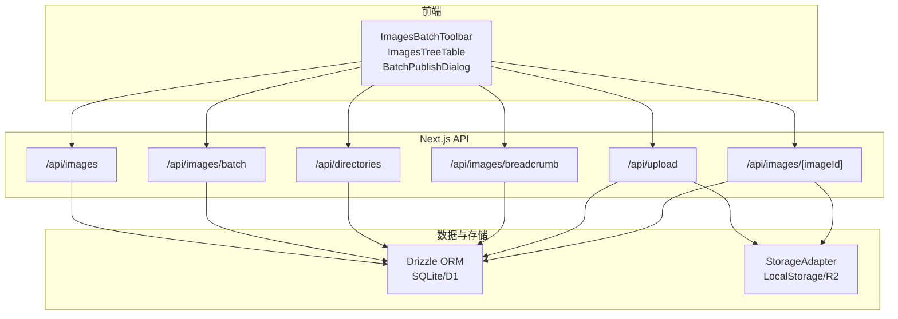

图表来源
- [src/app/[lang]/console/api/images/route.ts:1-72](file://src/app/[lang]/console/api/images/route.ts#L1-L72)
- [src/app/[lang]/console/api/images/batch/route.ts:1-107](file://src/app/[lang]/console/api/images/batch/route.ts#L1-L107)
- [src/app/[lang]/console/api/directories/route.ts:1-100](file://src/app/[lang]/console/api/directories/route.ts#L1-L100)
- [src/app/[lang]/console/api/images/breadcrumb/route.ts:1-46](file://src/app/[lang]/console/api/images/breadcrumb/route.ts#L1-L46)
- [src/app/[lang]/console/api/upload/route.ts:43-80](file://src/app/[lang]/console/api/upload/route.ts#L43-L80)
- [src/db/index.ts:1-61](file://src/db/index.ts#L1-L61)
- [src/lib/storage.ts:1-214](file://src/lib/storage.ts#L1-L214)

章节来源
- [README.md:1-1](file://README.md#L1-L1)
- [package.json:1-40](file://package.json#L1-L40)

## 核心组件
- 数据模型与关系
  - 用户、频道、图片三张表，图片支持自引用 parent_id 形成目录树；频道关联图片，用户关联频道与图片。
- 存储适配器
  - LocalStorageAdapter/R2StorageAdapter 实现统一接口；头像存储封装为 LocalAvatarStorage/R2AvatarStorage；自动选择运行时环境。
- 批量操作
  - PATCH /api/images/batch 支持批量设置 isPublished 或 channelId，限制 ids 数量与合法性，严格校验参数。
- 目录与树形展示
  - POST /api/directories 创建目录（mime_type=directory），GET /api/images?parentId= 返回当前层级条目，GET /api/images/breadcrumb 生成面包屑。
- 上传
  - POST /api/upload 支持多文件上传（最多 50），可选 parentId，成功后返回 ids 数组。

章节来源
- [src/db/schema.ts:1-100](file://src/db/schema.ts#L1-L100)
- [src/lib/storage.ts:1-214](file://src/lib/storage.ts#L1-L214)
- [src/app/[lang]/console/api/images/batch/route.ts:1-107](file://src/app/[lang]/console/api/images/batch/route.ts#L1-L107)
- [src/app/[lang]/console/api/directories/route.ts:1-100](file://src/app/[lang]/console/api/directories/route.ts#L1-L100)
- [src/app/[lang]/console/api/images/route.ts:1-72](file://src/app/[lang]/console/api/images/route.ts#L1-L72)
- [src/app/[lang]/console/api/images/breadcrumb/route.ts:1-46](file://src/app/[lang]/console/api/images/breadcrumb/route.ts#L1-L46)
- [src/app/[lang]/console/api/upload/route.ts:43-80](file://src/app/[lang]/console/api/upload/route.ts#L43-L80)

## 架构总览
系统采用前后端同仓的 Next.js 全栈模式：
- 前端以 React Client Components 驱动交互（树形表格、对话框），通过 fetch 调用 Next.js API。
- API 路由负责鉴权、参数校验、业务编排，使用 Drizzle ORM 访问数据库，必要时调用 StorageAdapter 读写文件。
- 存储层根据运行环境自动选择本地文件系统或 R2；数据库根据是否处于 Cloudflare 上下文选择 D1 或本地 SQLite。

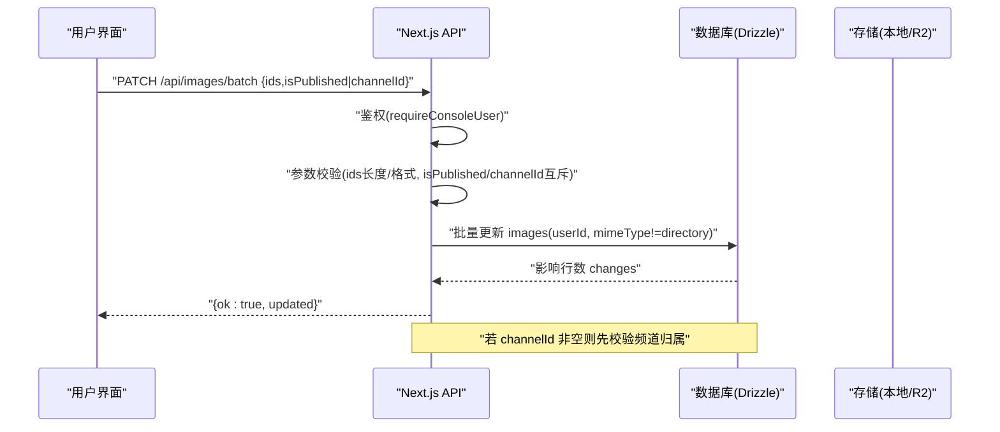

图表来源
- [src/app/[lang]/console/api/images/batch/route.ts:1-107](file://src/app/[lang]/console/api/images/batch/route.ts#L1-L107)
- [src/db/index.ts:1-61](file://src/db/index.ts#L1-L61)

## 详细组件分析

### 数据模型与关系
- 用户(users)、频道(channels)、图片(images)三表，图片支持 parent_id 自引用构建目录树。
- 关系：用户→频道/图片，频道→图片，图片→父图片(parent)。

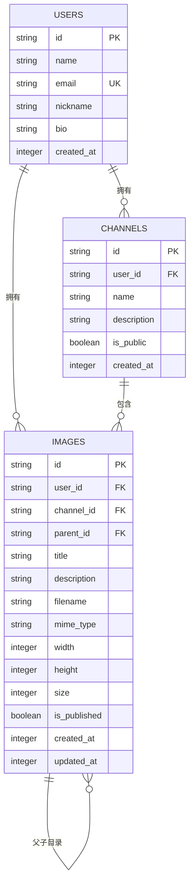

图表来源
- [src/db/schema.ts:26-99](file://src/db/schema.ts#L26-L99)

章节来源
- [src/db/schema.ts:1-100](file://src/db/schema.ts#L1-L100)

### 存储适配器（StorageAdapter）
- 统一接口 save/read/delete，Local/R2 两种实现。
- 头像存储封装，按 key 命名空间隔离。
- 自动检测 Cloudflare 上下文并选择 R2 或本地存储。

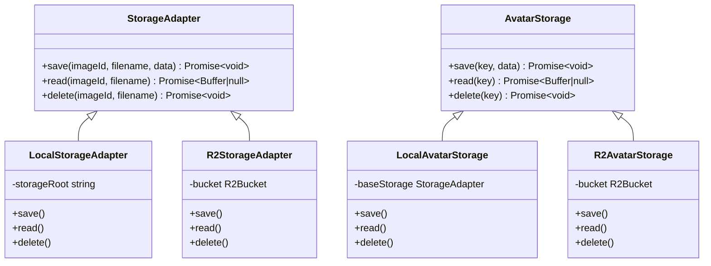

图表来源
- [src/lib/storage.ts:3-13](file://src/lib/storage.ts#L3-L13)
- [src/lib/storage.ts:61-114](file://src/lib/storage.ts#L61-L114)
- [src/lib/storage.ts:116-136](file://src/lib/storage.ts#L116-L136)
- [src/lib/storage.ts:138-152](file://src/lib/storage.ts#L138-L152)
- [src/lib/storage.ts:154-179](file://src/lib/storage.ts#L154-L179)

章节来源
- [src/lib/storage.ts:1-214](file://src/lib/storage.ts#L1-L214)

### 数据库连接（Db）
- 优先使用 Cloudflare D1（若存在绑定），否则回退到本地 SQLite。
- 确保本地数据库目录存在，避免启动失败。

图表来源
- [src/db/index.ts:34-60](file://src/db/index.ts#L34-L60)

章节来源
- [src/db/index.ts:1-61](file://src/db/index.ts#L1-L61)

### 图片列表与目录树（GET /api/images）
- 支持 parentId 过滤，仅返回当前用户可见条目。
- 排序规则：目录优先，其次按更新时间倒序。
- 返回字段包含元信息与状态。

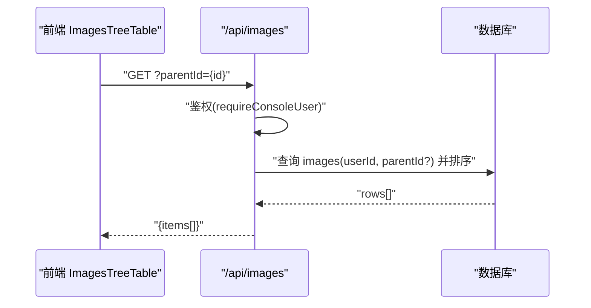

图表来源
- [src/app/[lang]/console/api/images/route.ts:11-71](file://src/app/[lang]/console/api/images/route.ts#L11-L71)

章节来源
- [src/app/[lang]/console/api/images/route.ts:1-72](file://src/app/[lang]/console/api/images/route.ts#L1-L72)

### 目录创建（POST /api/directories）
- 校验标题合法性、长度与重复性（同层级唯一）。
- 可选 parentId 指向父目录，需属于当前用户且为目录类型。
- 插入记录时固定 mime_type=directory，filename=title，size=0。

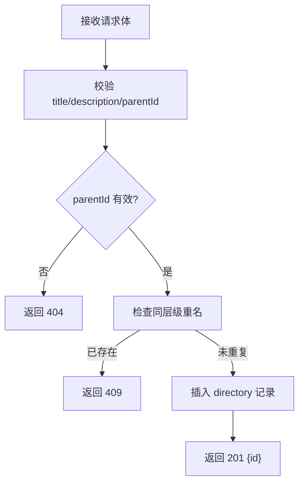

图表来源
- [src/app/[lang]/console/api/directories/route.ts:14-99](file://src/app/[lang]/console/api/directories/route.ts#L14-L99)

章节来源
- [src/app/[lang]/console/api/directories/route.ts:1-100](file://src/app/[lang]/console/api/directories/route.ts#L1-L100)

### 面包屑导航（GET /api/images/breadcrumb）
- 从目标目录向上迭代至根，最多 20 层，返回路径项数组。
- 若中途找不到目录，返回 404。

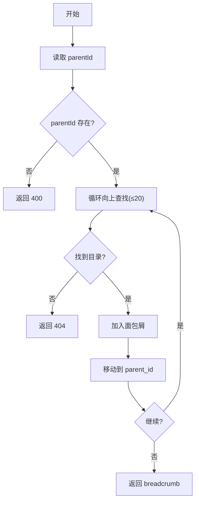

图表来源
- [src/app/[lang]/console/api/images/breadcrumb/route.ts:11-45](file://src/app/[lang]/console/api/images/breadcrumb/route.ts#L11-L45)

章节来源
- [src/app/[lang]/console/api/images/breadcrumb/route.ts:1-46](file://src/app/[lang]/console/api/images/breadcrumb/route.ts#L1-L46)

### 批量上传（POST /api/upload）
- 支持一次上传 1~50 个图片文件，可选 parentId。
- 服务端校验 parentId 有效性（必须为用户可访问的目录）。
- 顺序保存文件到存储，再批量写入数据库，返回 ids 数组。

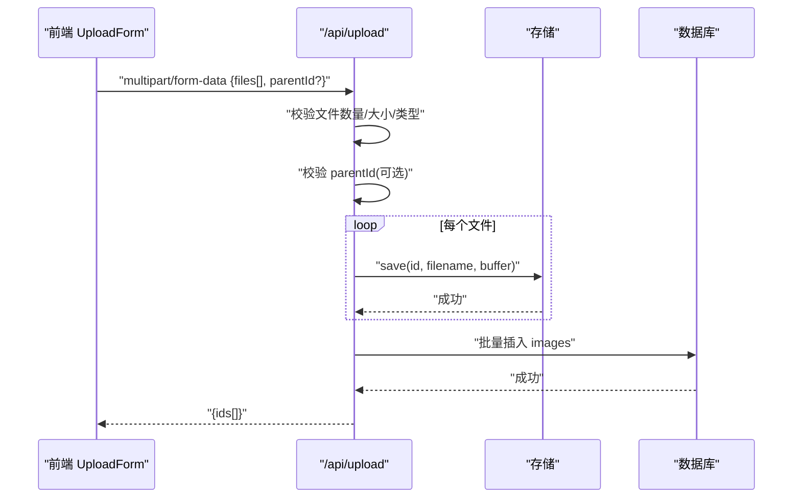

图表来源
- [src/app/[lang]/console/api/upload/route.ts:43-80](file://src/app/[lang]/console/api/upload/route.ts#L43-L80)
- [src/lib/storage.ts:184-197](file://src/lib/storage.ts#L184-L197)

章节来源
- [src/app/[lang]/console/api/upload/route.ts:43-80](file://src/app/[lang]/console/api/upload/route.ts#L43-L80)
- [src/lib/storage.ts:1-214](file://src/lib/storage.ts#L1-L214)

### 批量更新（PATCH /api/images/batch）
- 支持两类操作：批量设置 isPublished 或批量设置 channelId（可为 null 清空）。
- ids 校验：非空数组、上限 500、元素为合法字符串。
- 仅更新非目录行（mimeType != 'directory'）。
- channelId 非空时需校验频道归属当前用户。

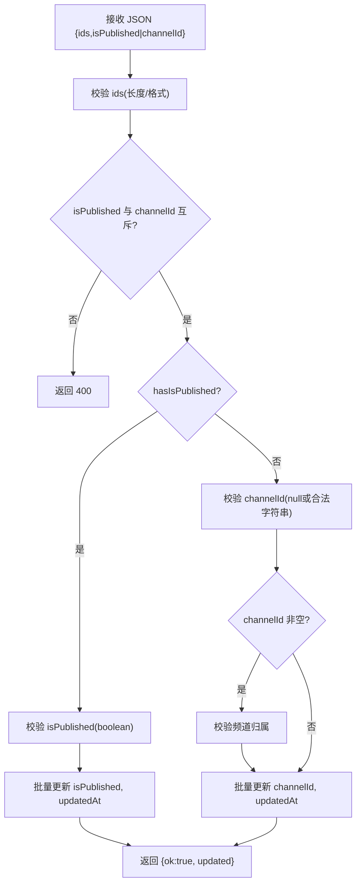

图表来源
- [src/app/[lang]/console/api/images/batch/route.ts:15-106](file://src/app/[lang]/console/api/images/batch/route.ts#L15-L106)

章节来源
- [src/app/[lang]/console/api/images/batch/route.ts:1-107](file://src/app/[lang]/console/api/images/batch/route.ts#L1-L107)

### 前端组件：ImagesTreeTable
- 树形表格，支持目录展开/折叠懒加载子节点。
- 仅图片行可选择，目录行不可选；表头全选/半选逻辑基于可见图片集合。
- 点击目录名称进入子级列表页（URL 带 parentId）。

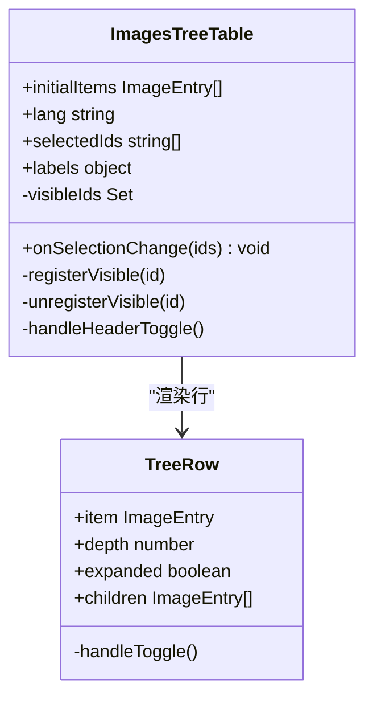

图表来源
- [src/components/ImagesTreeTable.tsx:12-25](file://src/components/ImagesTreeTable.tsx#L12-L25)
- [src/components/ImagesTreeTable.tsx:51-225](file://src/components/ImagesTreeTable.tsx#L51-L225)
- [src/components/ImagesTreeTable.tsx:227-308](file://src/components/ImagesTreeTable.tsx#L227-L308)

章节来源
- [src/components/ImagesTreeTable.tsx:1-308](file://src/components/ImagesTreeTable.tsx#L1-L308)

### 前端组件：ImagesBatchToolbar
- 持有选中状态，渲染批量按钮（设置发布状态/设置频道）。
- 集成 ImagesTreeTable 与两个对话框（发布、频道）。

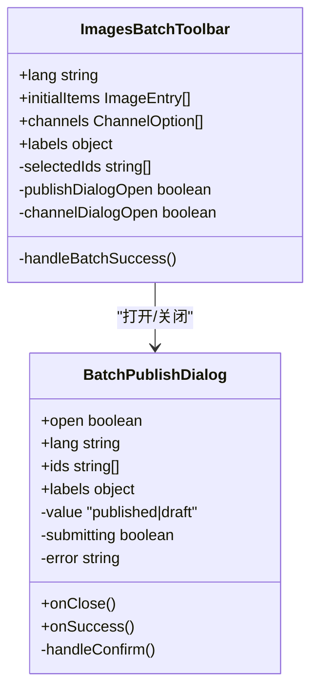

图表来源
- [src/components/ImagesBatchToolbar.tsx:34-114](file://src/components/ImagesBatchToolbar.tsx#L34-L114)
- [src/components/BatchPublishDialog.tsx:21-111](file://src/components/BatchPublishDialog.tsx#L21-L111)

章节来源
- [src/components/ImagesBatchToolbar.tsx:1-115](file://src/components/ImagesBatchToolbar.tsx#L1-L115)
- [src/components/BatchPublishDialog.tsx:1-111](file://src/components/BatchPublishDialog.tsx#L1-L111)

## 依赖分析
- 组件耦合
  - ImagesBatchToolbar 依赖 ImagesTreeTable 与两个对话框，集中管理选中状态与操作结果刷新。
  - ImagesTreeTable 通过 fetch 调用 /api/images 获取子节点，不直接依赖后端实现细节。
- API 与数据层
  - 所有 API 均通过 requireConsoleUser 鉴权，保证用户隔离。
  - 数据库访问统一由 getDb() 提供，屏蔽本地/边缘差异。
  - 存储访问通过 getStorage()/getAvatarStorage() 自动选择实现。

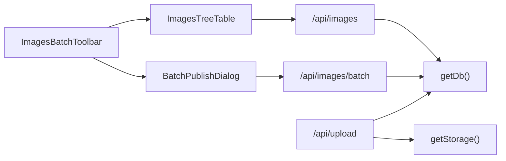

图表来源
- [src/components/ImagesBatchToolbar.tsx:34-114](file://src/components/ImagesBatchToolbar.tsx#L34-L114)
- [src/components/ImagesTreeTable.tsx:76-92](file://src/components/ImagesTreeTable.tsx#L76-L92)
- [src/components/BatchPublishDialog.tsx:34-57](file://src/components/BatchPublishDialog.tsx#L34-L57)
- [src/app/[lang]/console/api/images/route.ts:11-71](file://src/app/[lang]/console/api/images/route.ts#L11-L71)
- [src/app/[lang]/console/api/images/batch/route.ts:15-106](file://src/app/[lang]/console/api/images/batch/route.ts#L15-L106)
- [src/app/[lang]/console/api/upload/route.ts:43-80](file://src/app/[lang]/console/api/upload/route.ts#L43-L80)
- [src/db/index.ts:43-60](file://src/db/index.ts#L43-L60)
- [src/lib/storage.ts:184-197](file://src/lib/storage.ts#L184-L197)

章节来源
- [src/db/index.ts:1-61](file://src/db/index.ts#L1-L61)
- [src/lib/storage.ts:1-214](file://src/lib/storage.ts#L1-L214)

## 性能考量
- 树形表格懒加载：仅在首次展开目录时请求子节点，减少初始负载。
- 批量操作原子性：批量更新在单次 SQL 中完成，降低网络往返。
- 存储选择：生产环境优先 R2，开发环境本地文件系统，避免冷启动开销。
- 数据库连接复用：Db 实例缓存，避免重复初始化。
- 建议优化
  - 对 images 表建立 (userId, parentId) 索引以提升目录查询性能。
  - 对 images.userId、images.channelId、images.parentId 建立合适索引。
  - 大文件上传考虑分片与断点续传（当前约束 5MB/文件）。

[本节为通用指导，不涉及具体文件分析]

## 故障排查指南
- 鉴权失败
  - 现象：API 返回 401。
  - 排查：确认 requireConsoleUser 是否正确执行，会话/令牌是否有效。
- 目录不存在
  - 现象：GET /api/images?parentId=... 返回 404。
  - 排查：确认 parentId 存在且属于当前用户，且 mimeType=directory。
- 批量更新无匹配
  - 现象：PATCH /api/images/batch 返回 no matching images found。
  - 排查：确认 ids 合法且属于当前用户，且非目录行。
- 上传失败
  - 现象：POST /api/upload 返回 400/500。
  - 排查：检查文件大小/类型、parentId 有效性、存储可用性与权限。
- 存储配置错误
  - 现象：R2 绑定缺失报错。
  - 排查：检查 wrangler.jsonc 中 R2 绑定 IMAGES_BUCKET 配置。

章节来源
- [src/app/[lang]/console/api/images/route.ts:22-37](file://src/app/[lang]/console/api/images/route.ts#L22-L37)
- [src/app/[lang]/console/api/images/batch/route.ts:28-37](file://src/app/[lang]/console/api/images/batch/route.ts#L28-L37)
- [src/app/[lang]/console/api/upload/route.ts:43-55](file://src/app/[lang]/console/api/upload/route.ts#L43-L55)
- [src/lib/storage.ts:184-197](file://src/lib/storage.ts#L184-L197)

## 结论
本方案通过统一的存储与数据库抽象，结合 Next.js API 与 React 组件，实现了可扩展的图片目录管理与批量操作能力。目录树懒加载与批量更新策略兼顾了用户体验与性能。后续可在索引优化、上传分片、错误监控等方面持续改进。

[本节为总结，不涉及具体文件分析]

## 附录
- 关键 API 契约参考
  - GET /api/images：支持 parentId 过滤，返回目录与图片混合列表。
  - POST /api/directories：创建目录，标题唯一性校验。
  - GET /api/images/breadcrumb：生成从根到目标目录的路径。
  - POST /api/upload：批量上传，返回 ids。
  - PATCH /api/images/batch：批量设置发布状态或频道。

章节来源
- [src/app/[lang]/console/api/images/route.ts:1-72](file://src/app/[lang]/console/api/images/route.ts#L1-L72)
- [src/app/[lang]/console/api/directories/route.ts:1-100](file://src/app/[lang]/console/api/directories/route.ts#L1-L100)
- [src/app/[lang]/console/api/images/breadcrumb/route.ts:1-46](file://src/app/[lang]/console/api/images/breadcrumb/route.ts#L1-L46)
- [src/app/[lang]/console/api/upload/route.ts:43-80](file://src/app/[lang]/console/api/upload/route.ts#L43-L80)
- [src/app/[lang]/console/api/images/batch/route.ts:1-107](file://src/app/[lang]/console/api/images/batch/route.ts#L1-L107)