# 批量图片管理

<cite>
**本文引用的文件**   
- [README.md](file://README.md)
- [package.json](file://package.json)
- [src/db/schema.ts](file://src/db/schema.ts)
- [src/db/index.ts](file://src/db/index.ts)
- [src/lib/storage.ts](file://src/lib/storage.ts)
- [src/app/[lang]/console/api/images/route.ts](file://src/app/[lang]/console/api/images/route.ts)
- [src/app/[lang]/console/api/images/batch/route.ts](file://src/app/[lang]/console/api/images/batch/route.ts)
- [src/app/[lang]/console/api/directories/route.ts](file://src/app/[lang]/console/api/directories/route.ts)
- [src/app/[lang]/console/api/images/breadcrumb/route.ts](file://src/app/[lang]/console/api/images/breadcrumb/route.ts)
- [src/app/[lang]/console/api/upload/route.ts](file://src/app/[lang]/console/api/upload/route.ts)
- [src/components/ImagesBatchToolbar.tsx](file://src/components/ImagesBatchToolbar.tsx)
- [src/components/ImagesTreeTable.tsx](file://src/components/ImagesTreeTable.tsx)
- [src/components/ImagesPagination.tsx](file://src/components/ImagesPagination.tsx)
- [src/components/BatchPublishDialog.tsx](file://src/components/BatchPublishDialog.tsx)
- [src/components/BatchChannelDialog.tsx](file://src/components/BatchChannelDialog.tsx)
- [src/components/BatchDeleteDialog.tsx](file://src/components/BatchDeleteDialog.tsx)
- [src/app/[lang]/console/images/page.tsx](file://src/app/[lang]/console/images/page.tsx)
- [specs/010-batch-delete-upload-queue/spec.md](file://specs/010-batch-delete-upload-queue/spec.md)
- [specs/010-batch-delete-upload-queue/contracts/delete-images-batch.md](file://specs/010-batch-delete-upload-queue/contracts/delete-images-batch.md)
- [e2e/console-batch-delete.spec.ts](file://e2e/console-batch-delete.spec.ts)
</cite>

## 更新摘要
**所做更改**
- 新增批量删除功能：在 ImagesBatchToolbar 中集成 BatchDeleteDialog 组件，支持选中图片后批量删除
- 增强 batch API 端点：在 src/app/[lang]/console/api/images/batch/route.ts 中添加 DELETE 方法，支持最多 500 个 ID 的批量删除
- 实现完整的存储清理：批量删除时同时清除 R2/本地存储文件和数据库记录，确保数据一致性
- 添加端到端测试：提供 console-batch-delete.spec.ts 测试用例验证批量删除功能的完整流程

## 目录
1. [简介](#简介)
2. [项目结构](#项目结构)
3. [核心组件](#核心组件)
4. [架构总览](#架构总览)
5. [详细组件分析](#详细组件分析)
6. [依赖分析](#依赖分析)
7. [性能考量](#性能考量)
8. [故障排查指南](#故障排查指南)
9. [结论](#结论)
10. [附录](#附录)

## 简介
本项目是一个部署在 Cloudflare Worker 上的图片管理应用，基于 Next.js App Router、Drizzle ORM 与 SQLite/D1 存储，提供控制台端的图片目录树、批量操作（批量设置发布状态/所属频道）、批量上传等能力。通过"images"表复用 mime_type=directory 的方式实现目录管理，结合前端树形表格与对话框完成交互。**最新增强**：新增批量删除功能，支持用户选中多张图片后进行批量删除操作，包括确认对话框、存储文件清理和数据库记录删除，同时保持搜索功能和本地状态管理的现有特性。

## 项目结构
- 数据层：Drizzle Schema 定义用户、频道、图片（含自引用 parent_id），以及数据库连接适配（本地 SQLite / D1）。
- 存储层：统一 StorageAdapter 抽象，支持本地文件系统与 R2 对象存储；头像存储封装。
- API 路由：图片列表（支持 parentId 过滤和搜索）、批量更新（PATCH /api/images/batch）、**批量删除（DELETE /api/images/batch）**、目录创建（POST /api/directories）、面包屑（GET /api/images/breadcrumb）、上传（POST /api/upload）、单图删除/更新。
- 前端组件：ImagesTreeTable（树形表格，懒加载子节点）、ImagesBatchToolbar（批量操作工具栏，集成搜索、分页和批量删除）、BatchPublishDialog（批量发布对话框）、BatchChannelDialog（批量设置频道对话框）、**BatchDeleteDialog（批量删除对话框）**等。

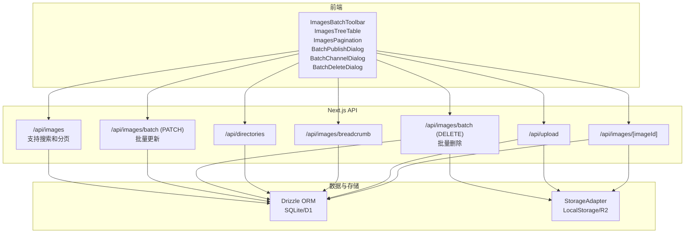

**图表来源**
- [src/app/[lang]/console/api/images/route.ts:17-103](file://src/app/[lang]/console/api/images/route.ts#L17-L103)
- [src/app/[lang]/console/api/images/batch/route.ts:16-107](file://src/app/[lang]/console/api/images/batch/route.ts#L16-L107)
- [src/app/[lang]/console/api/images/batch/route.ts:110-171](file://src/app/[lang]/console/api/images/batch/route.ts#L110-L171)
- [src/app/[lang]/console/api/directories/route.ts:1-100](file://src/app/[lang]/console/api/directories/route.ts#L1-L100)
- [src/app/[lang]/console/api/images/breadcrumb/route.ts:1-46](file://src/app/[lang]/console/api/images/breadcrumb/route.ts#L1-L46)
- [src/app/[lang]/console/api/upload/route.ts:43-80](file://src/app/[lang]/console/api/upload/route.ts#L43-L80)
- [src/db/index.ts:1-61](file://src/db/index.ts#L1-L61)
- [src/lib/storage.ts:1-214](file://src/lib/storage.ts#L1-L214)

**章节来源**
- [README.md:1-1](file://README.md#L1-L1)
- [package.json:1-40](file://package.json#L1-L40)

## 核心组件
- 数据模型与关系
  - 用户、频道、图片三张表，图片支持自引用 parent_id 形成目录树；频道关联图片，用户关联频道与图片。
- 存储适配器
  - LocalStorageAdapter/R2StorageAdapter 实现统一接口；头像存储封装为 LocalAvatarStorage/R2AvatarStorage；自动选择运行时环境。
- 批量操作
  - PATCH /api/images/batch 支持批量设置 isPublished 或 channelId，限制 ids 数量与合法性，严格校验参数。
  - **新增**：DELETE /api/images/batch 支持批量删除图片，包含存储文件清理和数据库记录删除，支持最多 500 个 ID。
- 目录与树形展示
  - POST /api/directories 创建目录（mime_type=directory），GET /api/images?parentId= 返回当前层级条目，GET /api/images/breadcrumb 生成面包屑。
- 上传
  - POST /api/upload 支持多文件上传（最多 50），可选 parentId，成功后返回 ids 数组。
- **新增**：搜索和分页功能
  - GET /api/images 支持 q 参数进行标题模糊搜索，支持 pageSize 和 page 参数进行分页控制
  - ImagesBatchToolbar 组件集成搜索表单、分页控件和本地状态管理

**章节来源**
- [src/db/schema.ts:1-100](file://src/db/schema.ts#L1-L100)
- [src/lib/storage.ts:1-214](file://src/lib/storage.ts#L1-L214)
- [src/app/[lang]/console/api/images/batch/route.ts:16-107](file://src/app/[lang]/console/api/images/batch/route.ts#L16-L107)
- [src/app/[lang]/console/api/images/batch/route.ts:110-171](file://src/app/[lang]/console/api/images/batch/route.ts#L110-L171)
- [src/app/[lang]/console/api/directories/route.ts:1-100](file://src/app/[lang]/console/api/directories/route.ts#L1-L100)
- [src/app/[lang]/console/api/images/route.ts:1-122](file://src/app/[lang]/console/api/images/route.ts#L1-L122)
- [src/app/[lang]/console/api/images/breadcrumb/route.ts:1-46](file://src/app/[lang]/console/api/images/breadcrumb/route.ts#L1-L46)
- [src/app/[lang]/console/api/upload/route.ts:43-80](file://src/app/[lang]/console/api/upload/route.ts#L43-L80)

## 架构总览
系统采用前后端同仓的 Next.js 全栈模式：
- 前端以 React Client Components 驱动交互（树形表格、对话框、搜索表单、分页控件），通过 fetch 调用 Next.js API。
- API 路由负责鉴权、参数校验、业务编排，使用 Drizzle ORM 访问数据库，必要时调用 StorageAdapter 读写文件。
- 存储层根据运行环境自动选择本地文件系统或 R2；数据库根据是否处于 Cloudflare 上下文选择 D1 或本地 SQLite。
- **新增**：客户端状态管理，ImagesBatchToolbar 组件维护搜索查询、当前页码和总项目数的本地状态，提供平滑的用户体验。
- **新增**：批量删除流程，从前端确认对话框到后端存储清理和数据库删除的完整链路。

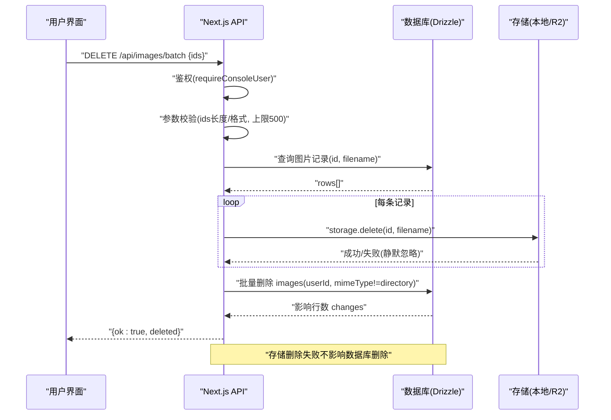

**图表来源**
- [src/app/[lang]/console/api/images/batch/route.ts:110-171](file://src/app/[lang]/console/api/images/batch/route.ts#L110-L171)
- [src/db/index.ts:1-61](file://src/db/index.ts#L1-L61)

## 详细组件分析

### 数据模型与关系
- 用户(users)、频道(channels)、图片(images)三表，图片支持 parent_id 自引用构建目录树。
- 关系：用户→频道/图片，频道→图片，图片→父图片(parent)。

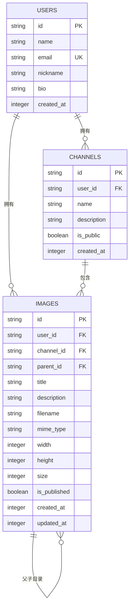

**图表来源**
- [src/db/schema.ts:26-99](file://src/db/schema.ts#L26-L99)

**章节来源**
- [src/db/schema.ts:1-100](file://src/db/schema.ts#L1-L100)

### 存储适配器（StorageAdapter）
- 统一接口 save/read/delete，Local/R2 两种实现。
- 头像存储封装，按 key 命名空间隔离。
- 自动检测 Cloudflare 上下文并选择 R2 或本地存储。

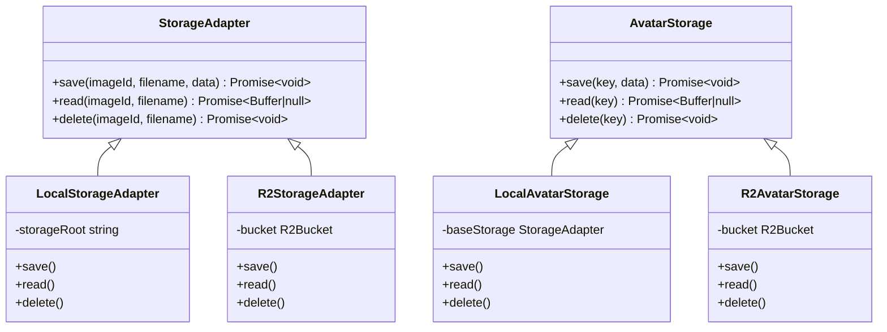

**图表来源**
- [src/lib/storage.ts:3-13](file://src/lib/storage.ts#L3-L13)
- [src/lib/storage.ts:61-114](file://src/lib/storage.ts#L61-L114)
- [src/lib/storage.ts:116-136](file://src/lib/storage.ts#L116-L136)
- [src/lib/storage.ts:138-152](file://src/lib/storage.ts#L138-L152)
- [src/lib/storage.ts:154-179](file://src/lib/storage.ts#L154-L179)

**章节来源**
- [src/lib/storage.ts:1-214](file://src/lib/storage.ts#L1-L214)

### 数据库连接（Db）
- 优先使用 Cloudflare D1（若存在绑定），否则回退到本地 SQLite。
- 确保本地数据库目录存在，避免启动失败。

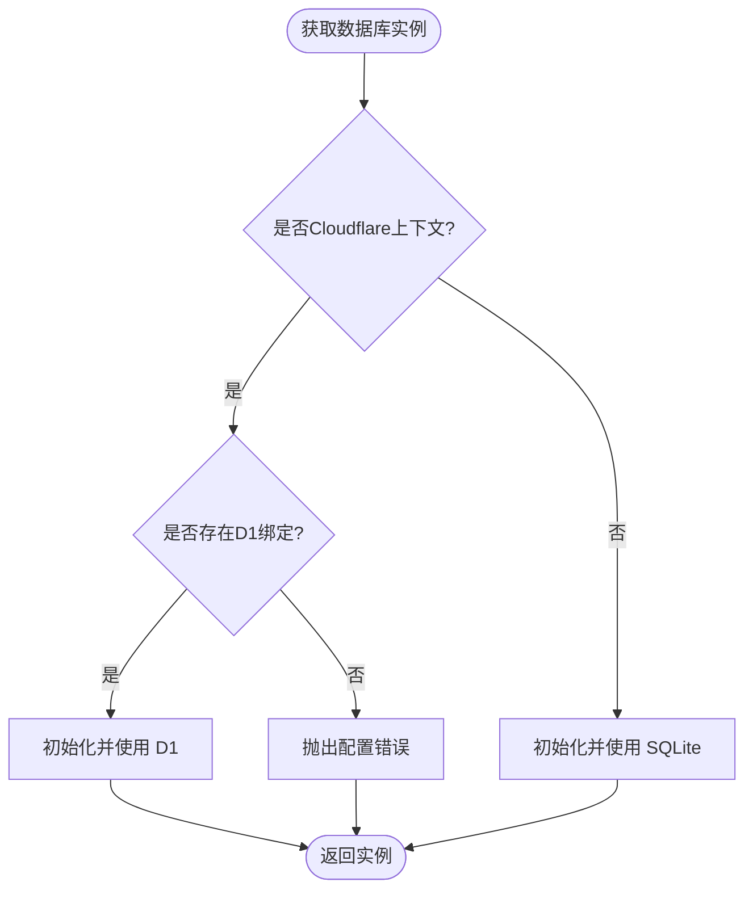

**图表来源**
- [src/db/index.ts:34-60](file://src/db/index.ts#L34-L60)

**章节来源**
- [src/db/index.ts:1-61](file://src/db/index.ts#L1-L61)

### 图片列表与目录树（GET /api/images）
- 支持 parentId 过滤，仅返回当前用户可见条目。
- **新增**：支持 q 参数进行标题模糊搜索，使用 LIKE 查询并转义特殊字符。
- **新增**：支持分页功能，通过 pageSize 和 page 参数控制，返回 items、total、page、pageSize。
- 排序规则：目录优先，其次按更新时间倒序。
- 返回字段包含元信息与状态。

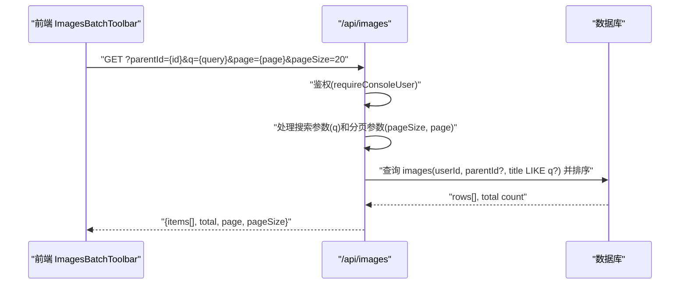

**图表来源**
- [src/app/[lang]/console/api/images/route.ts:17-103](file://src/app/[lang]/console/api/images/route.ts#L17-L103)

**章节来源**
- [src/app/[lang]/console/api/images/route.ts:1-122](file://src/app/[lang]/console/api/images/route.ts#L1-L122)

### 目录创建（POST /api/directories）
- 校验标题合法性、长度与重复性（同层级唯一）。
- 可选 parentId 指向父目录，需属于当前用户且为目录类型。
- 插入记录时固定 mime_type=directory，filename=title，size=0。

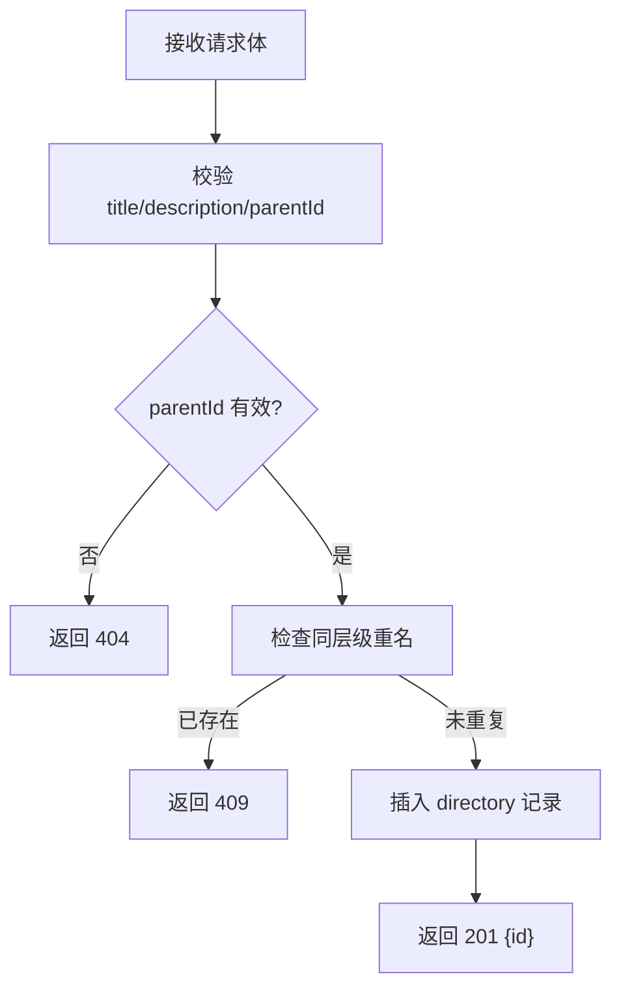

**图表来源**
- [src/app/[lang]/console/api/directories/route.ts:14-99](file://src/app/[lang]/console/api/directories/route.ts#L14-L99)

**章节来源**
- [src/app/[lang]/console/api/directories/route.ts:1-100](file://src/app/[lang]/console/api/directories/route.ts#L1-L100)

### 面包屑导航（GET /api/images/breadcrumb）
- 从目标目录向上迭代至根，最多 20 层，返回路径项数组。
- 若中途找不到目录，返回 404。

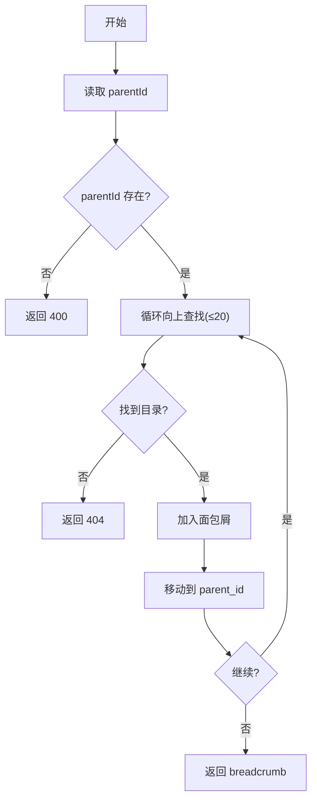

**图表来源**
- [src/app/[lang]/console/api/images/breadcrumb/route.ts:11-45](file://src/app/[lang]/console/api/images/breadcrumb/route.ts#L11-L45)

**章节来源**
- [src/app/[lang]/console/api/images/breadcrumb/route.ts:1-46](file://src/app/[lang]/console/api/images/breadcrumb/route.ts#L1-L46)

### 批量上传（POST /api/upload）
- 支持一次上传 1~50 个图片文件，可选 parentId。
- 服务端校验 parentId 有效性（必须为用户可访问的目录）。
- 顺序保存文件到存储，再批量写入数据库，返回 ids 数组。

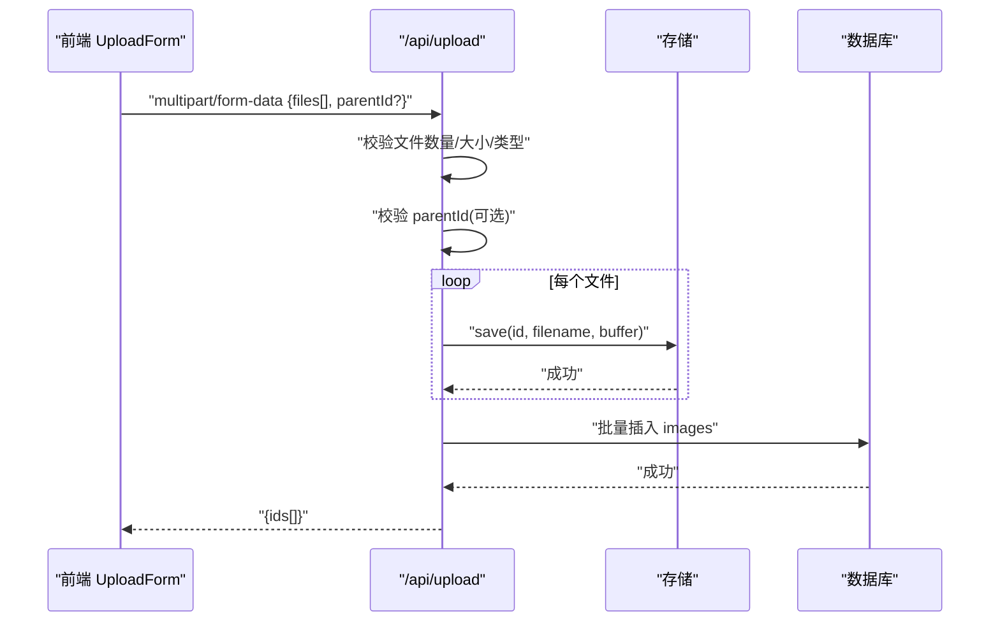

**图表来源**
- [src/app/[lang]/console/api/upload/route.ts:43-80](file://src/app/[lang]/console/api/upload/route.ts#L43-L80)
- [src/lib/storage.ts:184-197](file://src/lib/storage.ts#L184-L197)

**章节来源**
- [src/app/[lang]/console/api/upload/route.ts:43-80](file://src/app/[lang]/console/api/upload/route.ts#L43-L80)
- [src/lib/storage.ts:1-214](file://src/lib/storage.ts#L1-L214)

### 批量更新（PATCH /api/images/batch）
- 支持两类操作：批量设置 isPublished 或批量设置 channelId（可为 null 清空）。
- ids 校验：非空数组、上限 500、元素为合法字符串。
- 仅更新非目录行（mimeType != 'directory'）。
- channelId 非空时需校验频道归属当前用户。

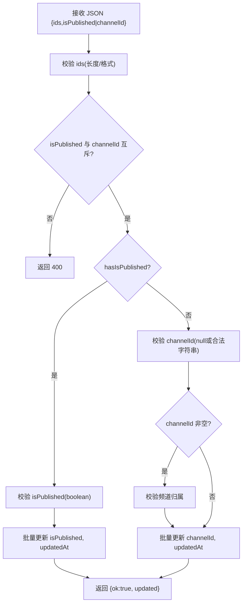

**图表来源**
- [src/app/[lang]/console/api/images/batch/route.ts:15-106](file://src/app/[lang]/console/api/images/batch/route.ts#L15-L106)

**章节来源**
- [src/app/[lang]/console/api/images/batch/route.ts:16-107](file://src/app/[lang]/console/api/images/batch/route.ts#L16-L107)

### 批量删除（DELETE /api/images/batch）
- **新增**：支持批量删除图片，包含存储文件清理和数据库记录删除。
- ids 校验：非空数组、上限 500、元素为合法字符串。
- 仅删除非目录行（mimeType != 'directory'）。
- 逐条删除存储文件（失败静默忽略），然后批量删除数据库记录。
- 返回实际删除的记录数，可能少于请求的 IDs 数量。

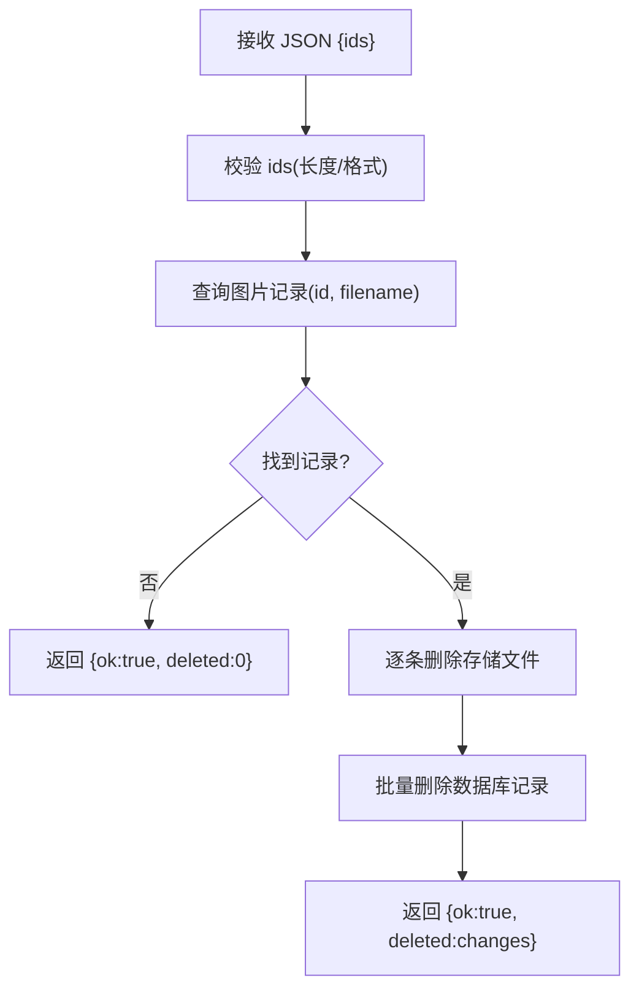

**图表来源**
- [src/app/[lang]/console/api/images/batch/route.ts:110-171](file://src/app/[lang]/console/api/images/batch/route.ts#L110-L171)

**章节来源**
- [src/app/[lang]/console/api/images/batch/route.ts:110-171](file://src/app/[lang]/console/api/images/batch/route.ts#L110-L171)

### 前端组件：ImagesTreeTable
- 树形表格，支持目录展开/折叠懒加载子节点。
- 仅图片行可选择，目录行不可选；表头全选/半选逻辑基于可见图片集合。
- 点击目录名称进入子级列表页（URL 带 parentId）。

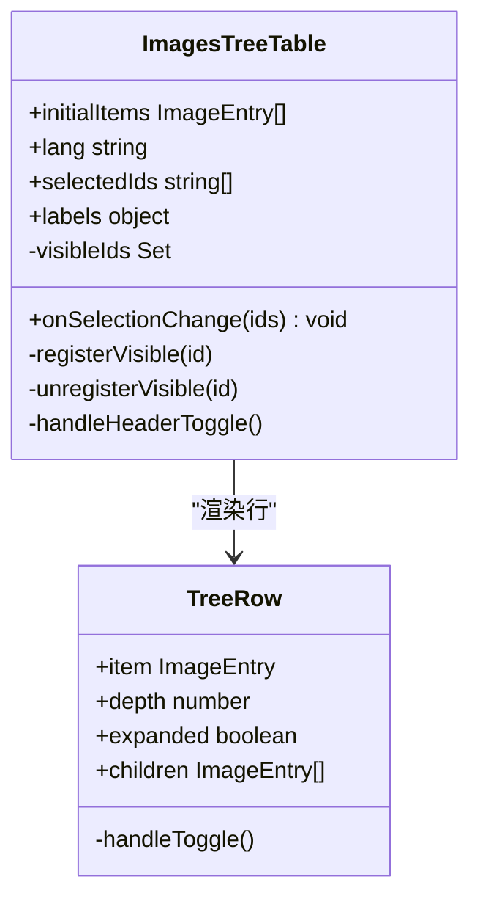

**图表来源**
- [src/components/ImagesTreeTable.tsx:12-25](file://src/components/ImagesTreeTable.tsx#L12-L25)
- [src/components/ImagesTreeTable.tsx:51-225](file://src/components/ImagesTreeTable.tsx#L51-L225)
- [src/components/ImagesTreeTable.tsx:227-308](file://src/components/ImagesTreeTable.tsx#L227-L308)

**章节来源**
- [src/components/ImagesTreeTable.tsx:1-308](file://src/components/ImagesTreeTable.tsx#L1-L308)

### 前端组件：ImagesBatchToolbar（增强版）
- **新增**：集成搜索功能，支持关键词搜索和实时提交
- **新增**：本地状态管理，维护搜索查询、当前页码和总项目数
- **新增**：分页控件集成，支持上一页/下一页和页码跳转
- **新增**：批量删除按钮和确认对话框集成
- 持有选中状态，渲染批量按钮（设置发布状态/设置频道/批量删除）
- 集成 ImagesTreeTable 与三个对话框（发布、频道、删除）
- 支持平滑的客户端交互，无需整页刷新

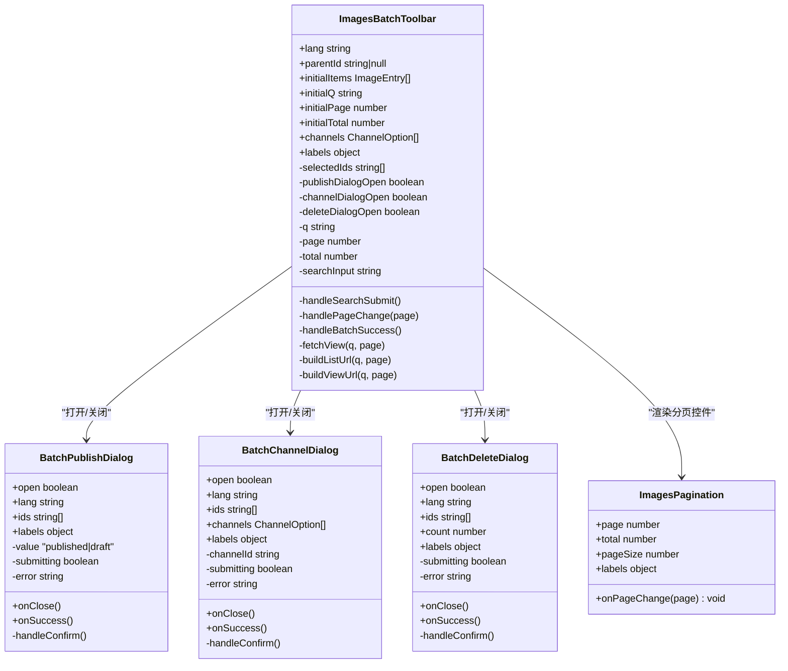

**图表来源**
- [src/components/ImagesBatchToolbar.tsx:53-259](file://src/components/ImagesBatchToolbar.tsx#L53-L259)
- [src/components/BatchPublishDialog.tsx:21-111](file://src/components/BatchPublishDialog.tsx#L21-L111)
- [src/components/BatchChannelDialog.tsx:23-109](file://src/components/BatchChannelDialog.tsx#L23-L109)
- [src/components/BatchDeleteDialog.tsx:21-92](file://src/components/BatchDeleteDialog.tsx#L21-L92)
- [src/components/ImagesPagination.tsx:29-78](file://src/components/ImagesPagination.tsx#L29-L78)

**章节来源**
- [src/components/ImagesBatchToolbar.tsx:1-260](file://src/components/ImagesBatchToolbar.tsx#L1-L260)
- [src/components/BatchPublishDialog.tsx:1-111](file://src/components/BatchPublishDialog.tsx#L1-L111)
- [src/components/BatchChannelDialog.tsx:1-109](file://src/components/BatchChannelDialog.tsx#L1-L109)
- [src/components/BatchDeleteDialog.tsx:1-93](file://src/components/BatchDeleteDialog.tsx#L1-L93)
- [src/components/ImagesPagination.tsx:1-78](file://src/components/ImagesPagination.tsx#L1-L78)

### 前端组件：BatchDeleteDialog（新增）
- **新增**：批量删除确认对话框组件
- 显示删除确认信息，包含选中数量提示
- 调用 DELETE /api/images/batch 执行批量删除
- 处理成功和失败状态，提供用户反馈
- 支持国际化标签，适配多语言环境

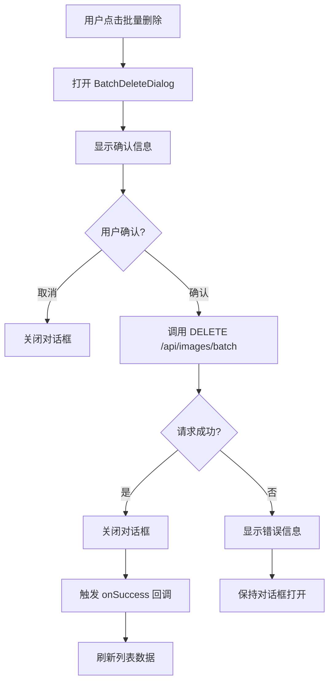

**图表来源**
- [src/components/BatchDeleteDialog.tsx:21-92](file://src/components/BatchDeleteDialog.tsx#L21-L92)

**章节来源**
- [src/components/BatchDeleteDialog.tsx:1-93](file://src/components/BatchDeleteDialog.tsx#L1-L93)

### 前端页面：ImagesListPage
- **新增**：支持搜索参数 q 和分页参数 page 的处理
- **新增**：计算初始总项目数和初始页码
- **新增**：批量删除相关标签的国际化支持
- 渲染 ImagesBatchToolbar 组件并传递初始状态
- 支持面包屑导航和目录创建

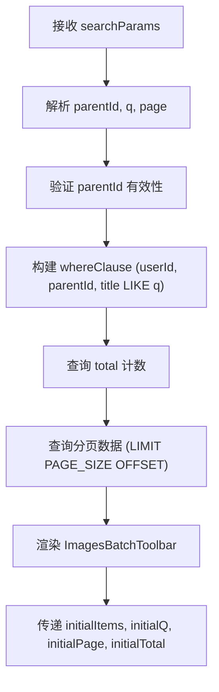

**图表来源**
- [src/app/[lang]/console/images/page.tsx:49-224](file://src/app/[lang]/console/images/page.tsx#L49-L224)

**章节来源**
- [src/app/[lang]/console/images/page.tsx:1-231](file://src/app/[lang]/console/images/page.tsx#L1-L231)

## 依赖分析
- 组件耦合
  - ImagesBatchToolbar 依赖 ImagesTreeTable、ImagesPagination 与三个对话框，集中管理选中状态与操作结果刷新。
  - ImagesTreeTable 通过 fetch 调用 /api/images 获取子节点，不直接依赖后端实现细节。
  - **新增**：ImagesBatchToolbar 内部维护本地状态（q、page、total），与 URL 保持同步。
  - **新增**：BatchDeleteDialog 依赖 DELETE /api/images/batch API 和 ImagesBatchToolbar 的成功回调。
- API 与数据层
  - 所有 API 均通过 requireConsoleUser 鉴权，保证用户隔离。
  - 数据库访问统一由 getDb() 提供，屏蔽本地/边缘差异。
  - 存储访问通过 getStorage()/getAvatarStorage() 自动选择实现。
  - **新增**：/api/images 支持搜索和分页参数，提供更灵活的查询能力。
  - **新增**：/api/images/batch 支持 DELETE 方法，提供批量删除功能。

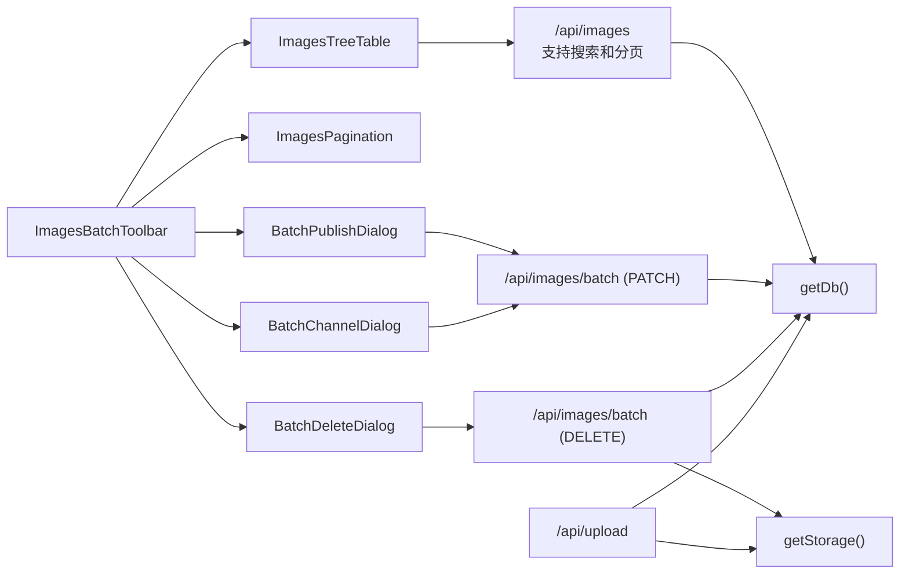

**图表来源**
- [src/components/ImagesBatchToolbar.tsx:53-259](file://src/components/ImagesBatchToolbar.tsx#L53-L259)
- [src/components/ImagesTreeTable.tsx:76-92](file://src/components/ImagesTreeTable.tsx#L76-L92)
- [src/components/BatchPublishDialog.tsx:34-57](file://src/components/BatchPublishDialog.tsx#L34-L57)
- [src/components/BatchChannelDialog.tsx:36-60](file://src/components/BatchChannelDialog.tsx#L36-L60)
- [src/components/BatchDeleteDialog.tsx:33-56](file://src/components/BatchDeleteDialog.tsx#L33-L56)
- [src/app/[lang]/console/api/images/route.ts:17-103](file://src/app/[lang]/console/api/images/route.ts#L17-L103)
- [src/app/[lang]/console/api/images/batch/route.ts:16-107](file://src/app/[lang]/console/api/images/batch/route.ts#L16-L107)
- [src/app/[lang]/console/api/images/batch/route.ts:110-171](file://src/app/[lang]/console/api/images/batch/route.ts#L110-L171)
- [src/app/[lang]/console/api/upload/route.ts:43-80](file://src/app/[lang]/console/api/upload/route.ts#L43-L80)
- [src/db/index.ts:43-60](file://src/db/index.ts#L43-L60)
- [src/lib/storage.ts:184-197](file://src/lib/storage.ts#L184-L197)

**章节来源**
- [src/db/index.ts:1-61](file://src/db/index.ts#L1-L61)
- [src/lib/storage.ts:1-214](file://src/lib/storage.ts#L1-L214)

## 性能考量
- 树形表格懒加载：仅在首次展开目录时请求子节点，减少初始负载。
- 批量操作原子性：批量更新在单次 SQL 中完成，降低网络往返。
- **新增**：批量删除优化：存储删除失败静默忽略，数据库删除使用 inArray 批量操作，提高删除效率。
- 存储选择：生产环境优先 R2，开发环境本地文件系统，避免冷启动开销。
- 数据库连接复用：Db 实例缓存，避免重复初始化。
- **新增**：客户端状态管理：本地维护搜索和分页状态，减少不必要的服务器请求。
- **新增**：平滑交互：搜索和分页操作通过 fetch 异步执行，配合 router.replace 更新 URL，提供流畅的用户体验。
- **新增**：智能分页：当总项目数小于等于每页大小时不显示分页控件，优化小数据集体验。
- **新增**：批量删除性能：支持最多 500 个 ID 的批量删除，减少多次请求的网络开销。
- 建议优化
  - 对 images 表建立 (userId, parentId) 索引以提升目录查询性能。
  - 对 images.userId、images.channelId、images.parentId 建立合适索引。
  - 对 images.title 建立全文索引以优化搜索性能。
  - 大文件上传考虑分片与断点续传（当前约束 5MB/文件）。

## 故障排查指南
- 鉴权失败
  - 现象：API 返回 401。
  - 排查：确认 requireConsoleUser 是否正确执行，会话/令牌是否有效。
- 目录不存在
  - 现象：GET /api/images?parentId=... 返回 404。
  - 排查：确认 parentId 存在且属于当前用户，且 mimeType=directory。
- 批量更新无匹配
  - 现象：PATCH /api/images/batch 返回 no matching images found。
  - 排查：确认 ids 合法且属于当前用户，且非目录行。
- **新增**：批量删除无匹配
  - 现象：DELETE /api/images/batch 返回 deleted: 0。
  - 排查：确认 ids 合法且属于当前用户，且非目录行。
- 上传失败
  - 现象：POST /api/upload 返回 400/500。
  - 排查：检查文件大小/类型、parentId 有效性、存储可用性与权限。
- 存储配置错误
  - 现象：R2 绑定缺失报错。
  - 排查：检查 wrangler.jsonc 中 R2 绑定 IMAGES_BUCKET 配置。
- **新增**：搜索功能问题
  - 现象：搜索无结果或搜索结果不正确。
  - 排查：确认 q 参数正确传递，LIKE 查询语法正确，特殊字符已转义。
- **新增**：分页功能问题
  - 现象：分页按钮无效或页码不正确。
  - 排查：确认 pageSize 和 page 参数正确传递，total 计算准确。
- **新增**：批量删除对话框问题
  - 现象：删除确认对话框无法打开或关闭。
  - 排查：确认 ImagesBatchToolbar 中的 deleteDialogOpen 状态管理正常。
- **新增**：批量删除 API 问题
  - 现象：批量删除请求失败或返回错误。
  - 排查：确认 ids 格式正确、数量不超过 500、用户有权限删除这些图片。

**章节来源**
- [src/app/[lang]/console/api/images/route.ts:22-37](file://src/app/[lang]/console/api/images/route.ts#L22-L37)
- [src/app/[lang]/console/api/images/batch/route.ts:28-37](file://src/app/[lang]/console/api/images/batch/route.ts#L28-L37)
- [src/app/[lang]/console/api/images/batch/route.ts:123-132](file://src/app/[lang]/console/api/images/batch/route.ts#L123-L132)
- [src/app/[lang]/console/api/upload/route.ts:43-55](file://src/app/[lang]/console/api/upload/route.ts#L43-L55)
- [src/lib/storage.ts:184-197](file://src/lib/storage.ts#L184-L197)

## 结论
本方案通过统一的存储与数据库抽象，结合 Next.js API 与 React 组件，实现了可扩展的图片目录管理与批量操作能力。**最新增强**：新增了完整的批量删除功能，包括前端确认对话框、后端批量删除 API、存储文件清理和数据库记录删除，显著提升了图片管理的完整性。同时保持了搜索功能和本地状态管理的现有特性，为用户提供更加丰富和高效的图片管理体验。目录树懒加载与批量更新策略兼顾了用户体验与性能。后续可在索引优化、上传分片、错误监控等方面持续改进。

## 附录
- 关键 API 契约参考
  - GET /api/images：支持 parentId 过滤、q 搜索和分页控制，返回目录与图片混合列表。
  - POST /api/directories：创建目录，标题唯一性校验。
  - GET /api/images/breadcrumb：生成从根到目标目录的路径。
  - POST /api/upload：批量上传，返回 ids。
  - PATCH /api/images/batch：批量设置发布状态或频道。
  - **新增**：DELETE /api/images/batch：批量删除图片，同时清理存储文件和数据库记录。
- **新增**：前端组件接口
  - ImagesBatchToolbar：主容器组件，管理搜索、分页和批量操作状态。
  - ImagesPagination：分页控件，支持页码窗口和跳转。
  - BatchChannelDialog：批量设置频道对话框。
  - BatchPublishDialog：批量发布状态对话框。
  - **新增**：BatchDeleteDialog：批量删除确认对话框。
- **新增**：端到端测试
  - console-batch-delete.spec.ts：包含批量删除功能的完整测试用例，验证用户操作流程和功能正确性。

**章节来源**
- [src/app/[lang]/console/api/images/route.ts:1-122](file://src/app/[lang]/console/api/images/route.ts#L1-L122)
- [src/app/[lang]/console/api/directories/route.ts:1-100](file://src/app/[lang]/console/api/directories/route.ts#L1-L100)
- [src/app/[lang]/console/api/images/breadcrumb/route.ts:1-46](file://src/app/[lang]/console/api/images/breadcrumb/route.ts#L1-L46)
- [src/app/[lang]/console/api/upload/route.ts:43-80](file://src/app/[lang]/console/api/upload/route.ts#L43-L80)
- [src/app/[lang]/console/api/images/batch/route.ts:16-107](file://src/app/[lang]/console/api/images/batch/route.ts#L16-L107)
- [src/app/[lang]/console/api/images/batch/route.ts:110-171](file://src/app/[lang]/console/api/images/batch/route.ts#L110-L171)
- [src/components/ImagesBatchToolbar.tsx:1-260](file://src/components/ImagesBatchToolbar.tsx#L1-L260)
- [src/components/ImagesPagination.tsx:1-78](file://src/components/ImagesPagination.tsx#L1-L78)
- [src/components/BatchChannelDialog.tsx:1-109](file://src/components/BatchChannelDialog.tsx#L1-L109)
- [src/components/BatchPublishDialog.tsx:1-111](file://src/components/BatchPublishDialog.tsx#L1-L111)
- [src/components/BatchDeleteDialog.tsx:1-93](file://src/components/BatchDeleteDialog.tsx#L1-L93)
- [e2e/console-batch-delete.spec.ts:1-89](file://e2e/console-batch-delete.spec.ts#L1-L89)
- [specs/010-batch-delete-upload-queue/spec.md:1-166](file://specs/010-batch-delete-upload-queue/spec.md#L1-L166)
- [specs/010-batch-delete-upload-queue/contracts/delete-images-batch.md:1-112](file://specs/010-batch-delete-upload-queue/contracts/delete-images-batch.md#L1-L112)