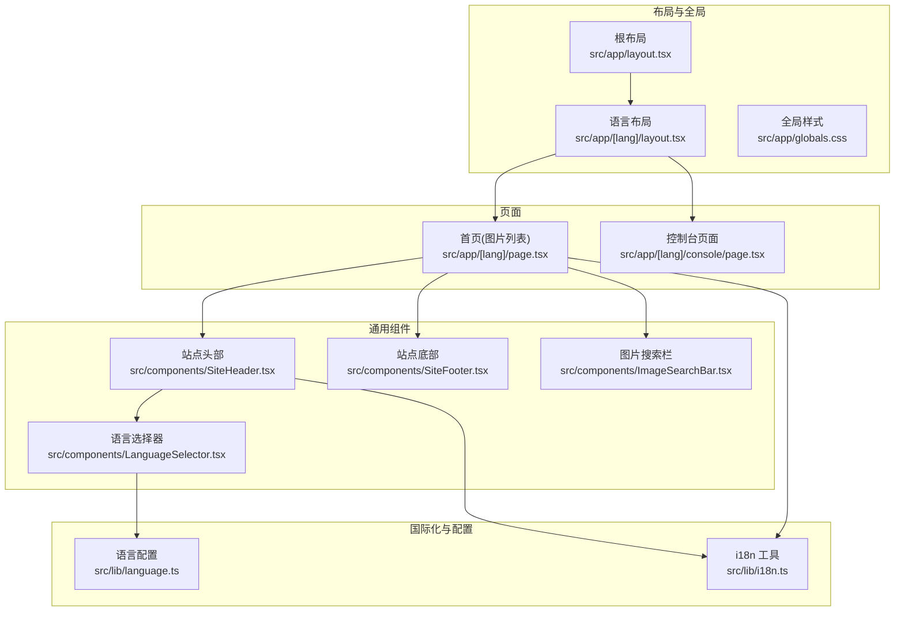
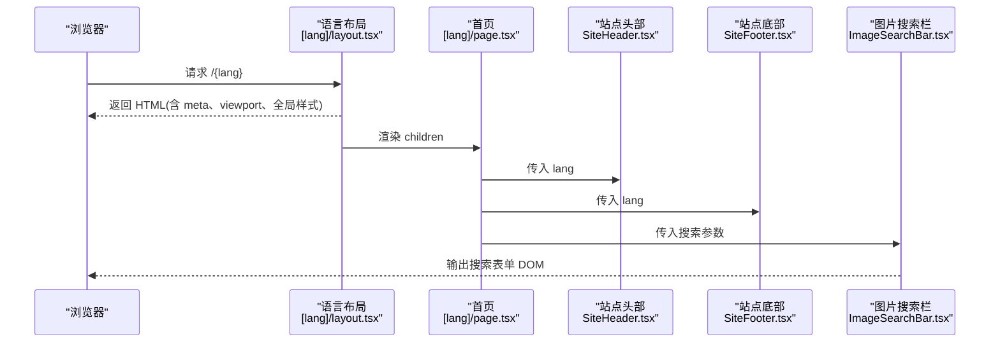
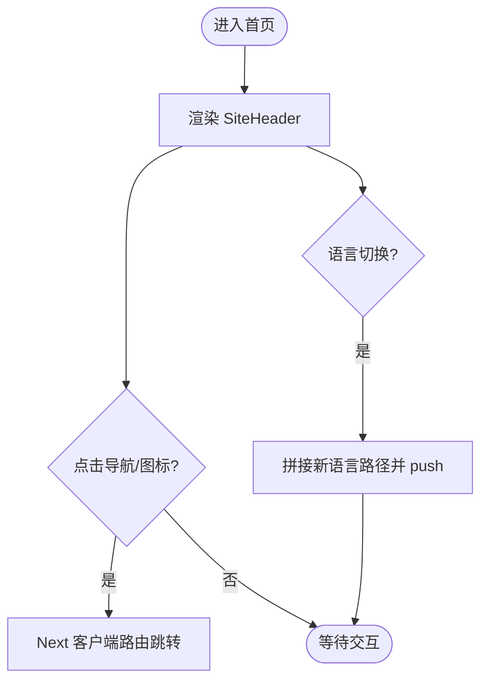
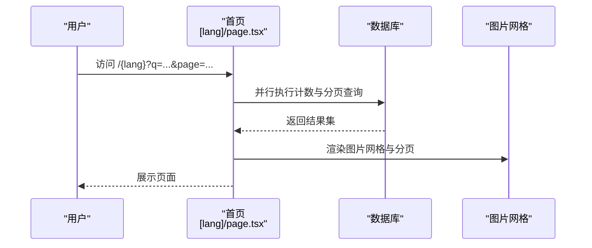
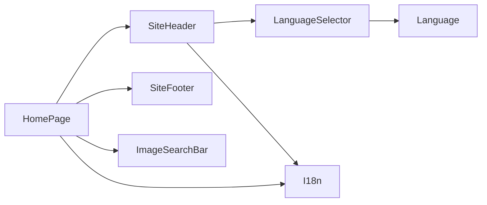

# 用户界面

<cite>
**本文引用的文件**   
- [src/app/[lang]/layout.tsx](file://src/app/[lang]/layout.tsx)
- [src/app/layout.tsx](file://src/app/layout.tsx)
- [src/app/globals.css](file://src/app/globals.css)
- [src/app/[lang]/page.tsx](file://src/app/[lang]/page.tsx)
- [src/components/SiteHeader.tsx](file://src/components/SiteHeader.tsx)
- [src/components/SiteFooter.tsx](file://src/components/SiteFooter.tsx)
- [src/components/LanguageSelector.tsx](file://src/components/LanguageSelector.tsx)
- [src/components/ImageSearchBar.tsx](file://src/components/ImageSearchBar.tsx)
- [src/lib/i18n.ts](file://src/lib/i18n.ts)
- [src/lib/language.ts](file://src/lib/language.ts)
</cite>

## 更新摘要
**变更内容**   
- 移除了所有游戏相关功能模块，包括游戏网格、游戏卡片、封面占位符组件
- 从站点头部中移除了 Apps 导航入口
- 更新了项目结构图，移除了游戏展示相关组件
- 简化了核心组件描述，专注于图片管理和控制台功能
- 更新了依赖关系分析，移除了游戏组件间的依赖关系

## 目录
1. [简介](#简介)
2. [项目结构](#项目结构)
3. [核心组件](#核心组件)
4. [架构总览](#架构总览)
5. [详细组件分析](#详细组件分析)
6. [依赖关系分析](#依赖关系分析)
7. [性能与体验优化](#性能与体验优化)
8. [故障排查指南](#故障排查指南)
9. [结论](#结论)
10. [附录：主题定制与扩展指南](#附录：主题定制与扩展指南)

## 简介
本文件面向 Weable 应用的用户界面，系统性说明响应式布局、移动端适配、桌面端优化与触摸交互支持；详解 SiteHeader、SiteFooter 的结构与功能（导航菜单、语言切换、用户状态入口）；阐述图片搜索栏的设计模式与交互流程；梳理组件间通信机制、状态管理策略与事件处理流程；提供 UI 主题定制方法、样式覆盖技巧与自定义组件开发指南；并给出用户体验优化建议与常见问题解决方案。

## 项目结构
Weable 基于 Next.js App Router，采用"按功能组织"的组件目录与"按路由组织"的页面目录。全局布局与国际化在 [lang] 路由层统一注入，站点头部与底部作为通用容器组件被各页面复用。图片管理功能集中在页面层，UI 组件位于 components 目录，样式通过 Tailwind CSS 与全局 CSS 变量统一管理。

**图表来源** 
- [src/app/layout.tsx:1-8](file://src/app/layout.tsx#L1-L8)
- [src/app/[lang]/layout.tsx:1-48](file://src/app/[lang]/layout.tsx#L1-L48)
- [src/app/globals.css:1-27](file://src/app/globals.css#L1-L27)
- [src/app/[lang]/page.tsx:1-172](file://src/app/[lang]/page.tsx#L1-L172)
- [src/components/SiteHeader.tsx:1-38](file://src/components/SiteHeader.tsx#L1-L38)
- [src/components/SiteFooter.tsx:1-17](file://src/components/SiteFooter.tsx#L1-L17)
- [src/components/LanguageSelector.tsx:1-34](file://src/components/LanguageSelector.tsx#L1-L34)
- [src/components/ImageSearchBar.tsx:1-42](file://src/components/ImageSearchBar.tsx#L1-L42)
- [src/lib/i18n.ts:1-28](file://src/lib/i18n.ts#L1-L28)
- [src/lib/language.ts:1-49](file://src/lib/language.ts#L1-L49)

**章节来源**
- [src/app/layout.tsx:1-8](file://src/app/layout.tsx#L1-L8)
- [src/app/[lang]/layout.tsx:1-48](file://src/app/[lang]/layout.tsx#L1-L48)
- [src/app/globals.css:1-27](file://src/app/globals.css#L1-L27)

## 核心组件
- 站点头部 SiteHeader
  - 职责：品牌标识、主导航链接、语言切换、控制台入口图标。
  - 交互：点击导航与图标进行客户端跳转；语言切换通过下拉框触发路由变更。
  - 可访问性：为图标添加 title 提示，便于屏幕阅读器识别。
- 站点底部 SiteFooter
  - 职责：版权信息与年份动态更新。
  - 样式：使用 Flex 居中布局，保证在不同视口下稳定显示。
- 语言选择器 LanguageSelector
  - 职责：根据当前语言与路径后缀生成新 URL，实现无刷新语言切换。
  - 行为：使用 Next 客户端路由 push 到目标语言路径。
- 图片搜索栏 ImageSearchBar
  - 职责：表单提交将关键词编码后追加到查询参数，驱动服务端分页与过滤。
  - 行为：回车或点击按钮提交，清空时回到根路径。

**章节来源**
- [src/components/SiteHeader.tsx:1-38](file://src/components/SiteHeader.tsx#L1-L38)
- [src/components/SiteFooter.tsx:1-17](file://src/components/SiteFooter.tsx#L1-L17)
- [src/components/LanguageSelector.tsx:1-34](file://src/components/LanguageSelector.tsx#L1-L34)
- [src/components/ImageSearchBar.tsx:1-42](file://src/components/ImageSearchBar.tsx#L1-L42)

## 架构总览
整体采用"布局层 + 页面层 + 组件层"的分层设计：
- 布局层：根布局包裹语言布局，语言布局负责 html/body 元信息、全局样式与字体变量注入。
- 页面层：首页聚合头部、搜索、图片网格与分页；控制台页面提供管理功能。
- 组件层：通用 UI 组件（头尾、语言选择、搜索）解耦，通过 props 传递数据与回调。

**图表来源** 
- [src/app/[lang]/layout.tsx:1-48](file://src/app/[lang]/layout.tsx#L1-L48)
- [src/app/[lang]/page.tsx:1-172](file://src/app/[lang]/page.tsx#L1-L172)
- [src/components/SiteHeader.tsx:1-38](file://src/components/SiteHeader.tsx#L1-L38)
- [src/components/SiteFooter.tsx:1-17](file://src/components/SiteFooter.tsx#L1-L17)
- [src/components/ImageSearchBar.tsx:1-42](file://src/components/ImageSearchBar.tsx#L1-L42)

## 详细组件分析

### 站点头部 SiteHeader
- 结构与功能
  - 左侧品牌名与主导航（首页、频道），右侧语言选择器与控制台入口图标。
  - 所有文案通过 i18n 工具获取，确保多语言一致性。
- 交互与路由
  - 语言切换：LanguageSelector 使用客户端路由跳转到对应语言路径。
  - 图标导航：直接 Link 到控制台页面。
- 可访问性与响应式
  - 图标带 title，键盘可达；Flex 布局在小屏自动换行与间距调整。

**图表来源** 
- [src/components/SiteHeader.tsx:1-38](file://src/components/SiteHeader.tsx#L1-L38)
- [src/components/LanguageSelector.tsx:1-34](file://src/components/LanguageSelector.tsx#L1-L34)

**章节来源**
- [src/components/SiteHeader.tsx:1-38](file://src/components/SiteHeader.tsx#L1-L38)
- [src/components/LanguageSelector.tsx:1-34](file://src/components/LanguageSelector.tsx#L1-L34)

### 站点底部 SiteFooter
- 内容：版权文本与动态年份。
- 样式：顶部边框与居中布局，确保与页面主体一致风格。

**章节来源**
- [src/components/SiteFooter.tsx:1-17](file://src/components/SiteFooter.tsx#L1-L17)

### 语言选择器 LanguageSelector
- 行为：监听 select 变化，构造目标语言路径并执行客户端跳转。
- 输入：currentLang 与 pathSuffix，确保切换后保留原页面路径。
- 可访问性：原生 select 元素，具备良好键盘与屏幕阅读器支持。

**章节来源**
- [src/components/LanguageSelector.tsx:1-34](file://src/components/LanguageSelector.tsx#L1-L34)

### 图片搜索栏 ImageSearchBar
- 行为：表单提交时将关键词编码并拼接到查询参数，驱动服务端分页与过滤。
- 输入：lang、defaultValue、placeholder、searchLabel。
- 交互：回车或点击按钮提交，空值回退到根路径。

**章节来源**
- [src/components/ImageSearchBar.tsx:1-42](file://src/components/ImageSearchBar.tsx#L1-L42)

### 首页与数据流
- 首页聚合头部、搜索、图片网格与分页。
- 数据源：数据库查询（Drizzle ORM）结合分页与搜索条件。
- 错误处理：捕获数据库异常并记录详细信息。

**图表来源** 
- [src/app/[lang]/page.tsx:1-172](file://src/app/[lang]/page.tsx#L1-L172)

**章节来源**
- [src/app/[lang]/page.tsx:1-172](file://src/app/[lang]/page.tsx#L1-L172)

## 依赖关系分析
- 组件耦合
  - SiteHeader 依赖 LanguageSelector 与 i18n；页面层依赖布局层与全局样式，组件之间通过 props 单向数据流。
- 国际化依赖
  - 所有文案通过 t(lang, key) 获取，fallback 到英文键值，确保健壮性。
- 语言配置
  - supportedLanguages 定义可用语言与显示名；getTargetLang 与 isValidLang 用于校验与解析。

**图表来源** 
- [src/components/SiteHeader.tsx:1-38](file://src/components/SiteHeader.tsx#L1-L38)
- [src/components/LanguageSelector.tsx:1-34](file://src/components/LanguageSelector.tsx#L1-L34)
- [src/app/[lang]/page.tsx:1-172](file://src/app/[lang]/page.tsx#L1-L172)
- [src/lib/i18n.ts:1-28](file://src/lib/i18n.ts#L1-L28)
- [src/lib/language.ts:1-49](file://src/lib/language.ts#L1-L49)

**章节来源**
- [src/lib/i18n.ts:1-28](file://src/lib/i18n.ts#L1-L28)
- [src/lib/language.ts:1-49](file://src/lib/language.ts#L1-L49)

## 性能与体验优化
- 响应式设计与移动端适配
  - 使用 Tailwind 响应式类（如 grid-cols-2 sm:grid-cols-3 lg:grid-cols-6）实现自适应布局。
  - viewport 元信息确保移动端缩放正确。
- 桌面端优化
  - 最大宽度与居中布局提升可读性；悬停阴影与过渡动画增强交互反馈。
- 触摸交互支持
  - 原生表单与链接具备良好的触摸命中区域；外链使用 target="_blank" 与 rel="noopener noreferrer" 保障安全。
- 加载性能
  - 图片网格懒加载由浏览器默认行为与 CDN 优化；避免不必要的重绘与回流。
- 无障碍访问
  - aria-label 与语义化标签（header/footer/main/nav）提升可访问性；焦点可见环改善键盘导航。
- 交互反馈
  - 悬停与聚焦状态明确；按钮与链接颜色对比度充足。

## 故障排查指南
- 布局错乱
  - 检查响应式断点与容器最大宽度；确认 viewport 元信息存在。
  - 验证 Flex/Grid 子项是否溢出或高度不一致。
- 样式冲突
  - 全局 CSS 变量与 Tailwind 类优先级冲突时，优先使用 Tailwind 原子类；必要时提高作用域限定。
- 性能瓶颈
  - 大量图片渲染时考虑懒加载与缩略图；避免重复计算与不必要重渲染。
- 国际化问题
  - 确认语言键存在；t 函数 fallback 到英文键值，若仍缺失需补充翻译。
- 语言切换无效
  - 检查 LanguageSelector 的 pathSuffix 是否正确拼接；确认路由前缀生效。
- 搜索无结果
  - 检查查询参数编码与后端过滤逻辑；确认数据库连接与权限。

**章节来源**
- [src/app/[lang]/page.tsx:1-172](file://src/app/[lang]/page.tsx#L1-L172)
- [src/components/LanguageSelector.tsx:1-34](file://src/components/LanguageSelector.tsx#L1-L34)
- [src/lib/i18n.ts:1-28](file://src/lib/i18n.ts#L1-L28)

## 结论
Weable 的 UI 架构清晰、组件职责单一、数据流单向，借助 Tailwind 与全局 CSS 变量实现一致的响应式与主题体系。通过 i18n 与语言配置完成多语言支持，图片管理组件具备良好的可访问性与交互反馈。遵循本文的定制与优化建议，可快速扩展新的页面与组件，并保持性能与体验的一致性。

## 附录：主题定制与扩展指南
- 主题定制
  - 通过全局 CSS 变量（背景、前景、字体）统一主题；dark mode 通过 prefers-color-scheme 自动切换。
  - Tailwind 主题扩展可在 @theme inline 中定义颜色与字体，保持与设计系统一致。
- 样式覆盖技巧
  - 优先使用 Tailwind 原子类；需要覆盖时使用更具体的选择器或作用域限定。
  - 避免内联样式与全局样式混用导致优先级混乱。
- 自定义组件开发
  - 遵循 props 单向数据流；对外暴露必要的事件回调与状态。
  - 为可访问性提供 aria-* 属性与键盘支持；确保焦点可见与对比度达标。
- 扩展语言与文案
  - 在 language.ts 中添加新语言键与显示名；在 locales 中补充对应 JSON 文件；在 i18n.ts 中注册映射。

**章节来源**
- [src/app/globals.css:1-27](file://src/app/globals.css#L1-L27)
- [src/lib/language.ts:1-49](file://src/lib/language.ts#L1-L49)
- [src/lib/i18n.ts:1-28](file://src/lib/i18n.ts#L1-L28)