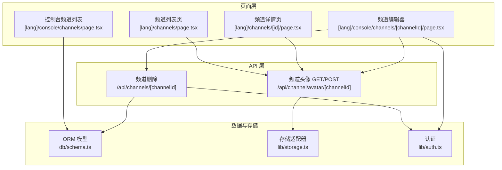
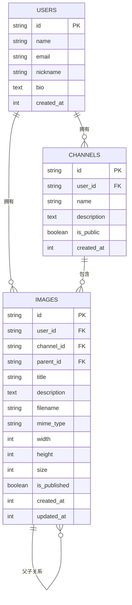
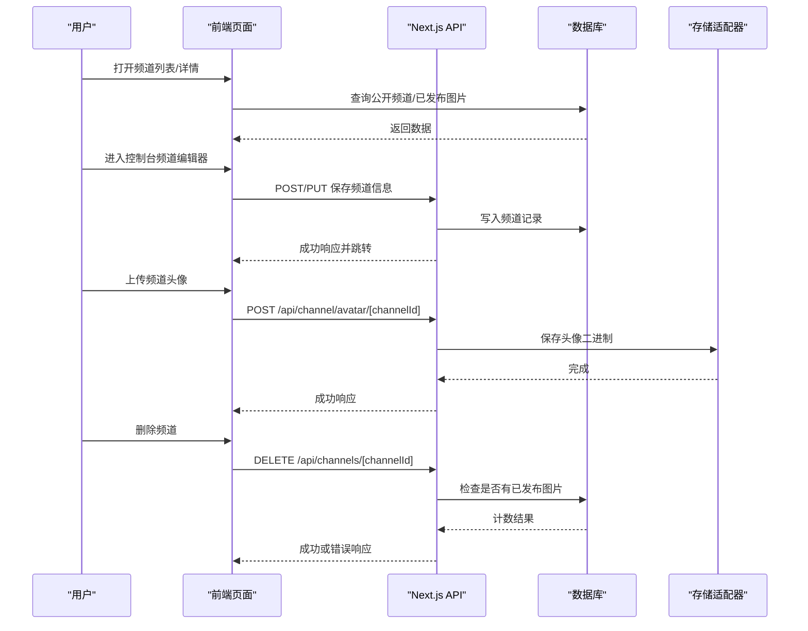
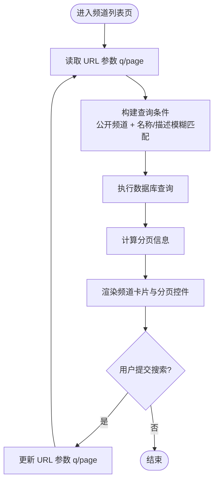
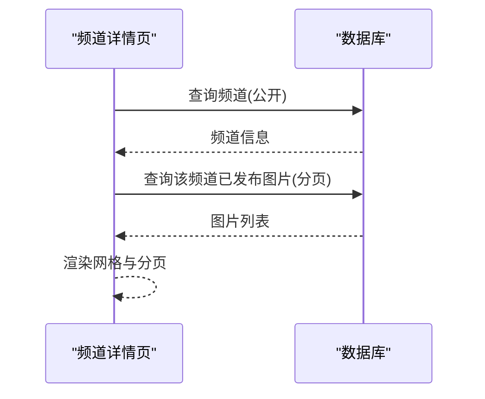
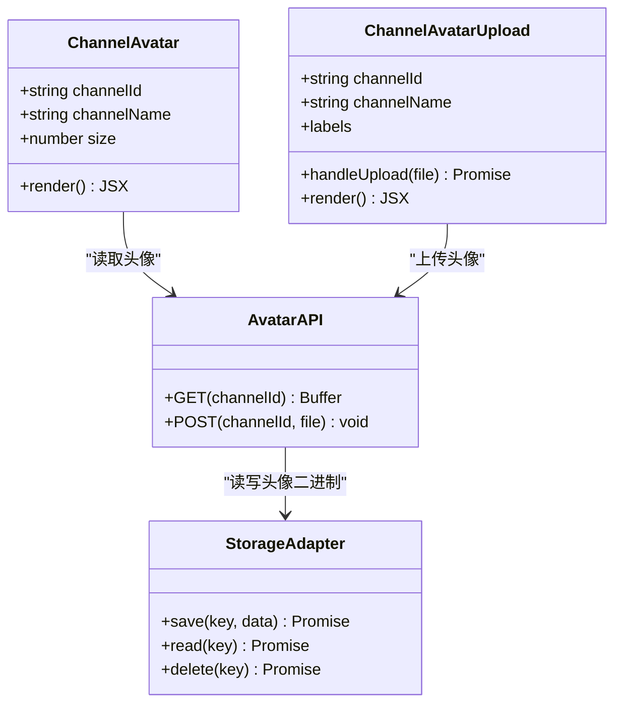
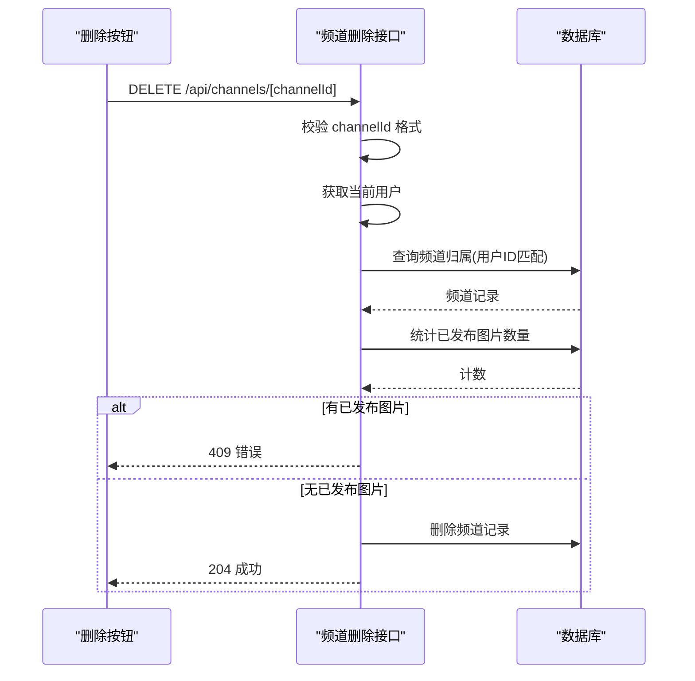
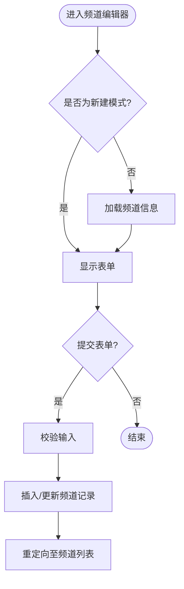
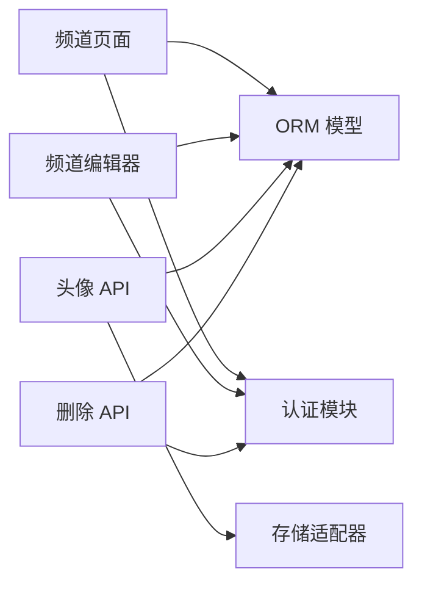

# 频道系统

<cite>
**本文引用的文件**   
- [src/app/api/channels/[channelId]/route.ts](file://src/app/api/channels/%5BchannelId%5D/route.ts)
- [src/app/api/channel/avatar/[channelId]/route.ts](file://src/app/api/channel/avatar/%5BchannelId%5D/route.ts)
- [src/components/ChannelAvatar.tsx](file://src/components/ChannelAvatar.tsx)
- [src/components/ChannelSearch.tsx](file://src/components/ChannelSearch.tsx)
- [src/components/ChannelDeleteSection.tsx](file://src/components/ChannelDeleteSection.tsx)
- [src/db/schema.ts](file://src/db/schema.ts)
- [src/lib/auth.ts](file://src/lib/auth.ts)
- [src/lib/storage.ts](file://src/lib/storage.ts)
- [src/app/[lang]/channels/page.tsx](file://src/app/%5Blang%5D/channels/page.tsx)
- [src/app/[lang]/channels/[id]/page.tsx](file://src/app/%5Blang%5D/channels/%5Bid%5D/page.tsx)
- [src/app/[lang]/console/channels/page.tsx](file://src/app/%5Blang%5D/console/channels/page.tsx)
- [src/app/[lang]/console/channels/[channelId]/page.tsx](file://src/app/%5Blang%5D/console/channels/%5BchannelId%5D/page.tsx)
</cite>

## 目录
1. [简介](#简介)
2. [项目结构](#项目结构)
3. [核心组件与数据模型](#核心组件与数据模型)
4. [架构总览](#架构总览)
5. [详细组件分析](#详细组件分析)
6. [依赖关系分析](#依赖关系分析)
7. [性能考量](#性能考量)
8. [故障排查指南](#故障排查指南)
9. [结论](#结论)
10. [附录：API 使用示例与用户工作流](#附录api-使用示例与用户工作流)

## 简介
本文件为 Weable 应用的“频道系统”提供全面文档，覆盖频道的创建、编辑、删除流程；频道基本信息设置（名称、描述、头像、公开/私有）；权限控制机制（访问权限、编辑权限、成员管理）；内容组织方式（按频道分类图片、频道间内容隔离）；以及 ChannelAvatar 头像上传与预览、ChannelSearch 搜索与过滤逻辑。同时包含频道 API 接口的使用方法与编程式管理示例，并提供从创建频道到发布内容的完整用户工作流和常见问题解决方案。

## 项目结构
频道系统由前端页面、服务端路由、数据库模型与存储适配器共同组成：
- 页面层：频道列表页、频道详情页、控制台频道列表与编辑器
- API 层：频道删除接口、频道头像上传/读取接口
- 数据层：Drizzle ORM 模型定义（users、channels、images）
- 认证与存储：当前用户解析、本地/R2 存储适配

图表来源
- [src/app/[lang]/channels/page.tsx:1-122](file://src/app/%5Blang%5D/channels/page.tsx#L1-L122)
- [src/app/[lang]/channels/[id]/page.tsx:1-112](file://src/app/%5Blang%5D/channels/%5Bid%5D/page.tsx#L1-L112)
- [src/app/[lang]/console/channels/page.tsx:1-93](file://src/app/%5Blang%5D/console/channels/page.tsx#L1-L93)
- [src/app/[lang]/console/channels/[channelId]/page.tsx:1-144](file://src/app/%5Blang%5D/console/channels/%5BchannelId%5D/page.tsx#L1-L144)
- [src/app/api/channels/[channelId]/route.ts:1-44](file://src/app/api/channels/%5BchannelId%5D/route.ts#L1-L44)
- [src/app/api/channel/avatar/[channelId]/route.ts:1-64](file://src/app/api/channel/avatar/%5BchannelId%5D/route.ts#L1-L64)
- [src/db/schema.ts:1-100](file://src/db/schema.ts#L1-L100)
- [src/lib/storage.ts:1-214](file://src/lib/storage.ts#L1-L214)
- [src/lib/auth.ts:1-118](file://src/lib/auth.ts#L1-L118)

章节来源
- [src/app/[lang]/channels/page.tsx:1-122](file://src/app/%5Blang%5D/channels/page.tsx#L1-L122)
- [src/app/[lang]/channels/[id]/page.tsx:1-112](file://src/app/%5Blang%5D/channels/%5Bid%5D/page.tsx#L1-L112)
- [src/app/[lang]/console/channels/page.tsx:1-93](file://src/app/%5Blang%5D/console/channels/page.tsx#L1-L93)
- [src/app/[lang]/console/channels/[channelId]/page.tsx:1-144](file://src/app/%5Blang%5D/console/channels/%5BchannelId%5D/page.tsx#L1-L144)
- [src/app/api/channels/[channelId]/route.ts:1-44](file://src/app/api/channels/%5BchannelId%5D/route.ts#L1-L44)
- [src/app/api/channel/avatar/[channelId]/route.ts:1-64](file://src/app/api/channel/avatar/%5BchannelId%5D/route.ts#L1-L64)
- [src/db/schema.ts:1-100](file://src/db/schema.ts#L1-L100)
- [src/lib/storage.ts:1-214](file://src/lib/storage.ts#L1-L214)
- [src/lib/auth.ts:1-118](file://src/lib/auth.ts#L1-L118)

## 核心组件与数据模型
- 频道数据模型 channels：包含 id、userId、name、description、isPublic、createdAt 等字段，用于标识频道归属、可见性与元信息
- 图片数据模型 images：通过 channelId 关联频道，支持 isPublished 标记是否对外展示
- 用户数据模型 users：作为频道和图片的归属主体
- 关系：一个用户拥有多个频道；一个频道可包含多张图片；图片属于某个用户并可归属某个频道

图表来源
- [src/db/schema.ts:26-69](file://src/db/schema.ts#L26-L69)
- [src/db/schema.ts:71-99](file://src/db/schema.ts#L71-L99)

章节来源
- [src/db/schema.ts:1-100](file://src/db/schema.ts#L1-L100)

## 架构总览
频道系统的整体交互包括：
- 前台浏览：频道列表与详情仅展示公开频道及其已发布的图片
- 后台管理：控制台列出用户自有频道，支持新建、编辑、删除与头像上传
- 头像服务：独立的头像上传与读取接口，基于存储适配器（本地或 R2）
- 认证鉴权：所有写操作均校验当前用户，确保资源归属正确

图表来源
- [src/app/[lang]/channels/page.tsx:1-122](file://src/app/%5Blang%5D/channels/page.tsx#L1-L122)
- [src/app/[lang]/channels/[id]/page.tsx:1-112](file://src/app/%5Blang%5D/channels/%5Bid%5D/page.tsx#L1-L112)
- [src/app/[lang]/console/channels/[channelId]/page.tsx:1-144](file://src/app/%5Blang%5D/console/channels/%5BchannelId%5D/page.tsx#L1-L144)
- [src/app/api/channel/avatar/[channelId]/route.ts:1-64](file://src/app/api/channel/avatar/%5BchannelId%5D/route.ts#L1-L64)
- [src/app/api/channels/[channelId]/route.ts:1-44](file://src/app/api/channels/%5BchannelId%5D/route.ts#L1-L44)
- [src/lib/storage.ts:1-214](file://src/lib/storage.ts#L1-L214)

## 详细组件分析

### 频道列表与搜索（ChannelSearch）
- 功能：在频道列表页提供搜索框，支持按名称与描述模糊匹配，URL 参数 q 驱动查询，分页参数 page 驱动翻页
- 实现要点：
  - 客户端表单提交更新 URL 查询参数，触发服务端渲染重新加载数据
  - 服务端根据 q 构建 like 条件，结合 isPublic=true 过滤公开频道
  - 分页计算 total、totalPages、currentPage，生成前后翻页链接

图表来源
- [src/app/[lang]/channels/page.tsx:1-122](file://src/app/%5Blang%5D/channels/page.tsx#L1-L122)
- [src/components/ChannelSearch.tsx:1-45](file://src/components/ChannelSearch.tsx#L1-L45)

章节来源
- [src/app/[lang]/channels/page.tsx:1-122](file://src/app/%5Blang%5D/channels/page.tsx#L1-L122)
- [src/components/ChannelSearch.tsx:1-45](file://src/components/ChannelSearch.tsx#L1-L45)

### 频道详情页（按频道分类图片）
- 功能：展示指定频道的标题、描述与已发布图片网格，支持分页
- 实现要点：
  - 仅展示 isPublic=true 的频道
  - 图片筛选条件为 channelId=频道ID 且 isPublished=true
  - 按 updatedAt 倒序分页展示

图表来源
- [src/app/[lang]/channels/[id]/page.tsx:1-112](file://src/app/%5Blang%5D/channels/%5Bid%5D/page.tsx#L1-L112)

章节来源
- [src/app/[lang]/channels/[id]/page.tsx:1-112](file://src/app/%5Blang%5D/channels/%5Bid%5D/page.tsx#L1-L112)

### 频道头像组件（ChannelAvatar）与上传（ChannelAvatarUpload）
- ChannelAvatar：
  - 显示频道头像图片，失败时回退为首字母占位符
  - 图片源路径为 /api/channel/avatar/[channelId]
- ChannelAvatarUpload：
  - 调用 /api/channel/avatar/[channelId] 的 POST 接口上传头像
  - 限制类型与大小，成功后刷新头像显示

图表来源
- [src/components/ChannelAvatar.tsx:1-30](file://src/components/ChannelAvatar.tsx#L1-L30)
- [src/app/api/channel/avatar/[channelId]/route.ts:1-64](file://src/app/api/channel/avatar/%5BchannelId%5D/route.ts#L1-L64)
- [src/lib/storage.ts:1-214](file://src/lib/storage.ts#L1-L214)

章节来源
- [src/components/ChannelAvatar.tsx:1-30](file://src/components/ChannelAvatar.tsx#L1-L30)
- [src/app/api/channel/avatar/[channelId]/route.ts:1-64](file://src/app/api/channel/avatar/%5BchannelId%5D/route.ts#L1-L64)
- [src/lib/storage.ts:1-214](file://src/lib/storage.ts#L1-L214)

### 频道删除流程（权限与约束）
- 权限校验：仅频道所有者可删除
- 约束检查：若频道存在已发布图片则禁止删除
- 结果处理：成功返回 204，失败返回相应错误码

图表来源
- [src/app/api/channels/[channelId]/route.ts:1-44](file://src/app/api/channels/%5BchannelId%5D/route.ts#L1-L44)
- [src/components/ChannelDeleteSection.tsx:1-53](file://src/components/ChannelDeleteSection.tsx#L1-L53)

章节来源
- [src/app/api/channels/[channelId]/route.ts:1-44](file://src/app/api/channels/%5BchannelId%5D/route.ts#L1-L44)
- [src/components/ChannelDeleteSection.tsx:1-53](file://src/components/ChannelDeleteSection.tsx#L1-L53)

### 频道编辑器（创建与编辑）
- 新建频道：表单提交 name、description、isPublic，服务端插入记录并跳转
- 编辑频道：校验频道归属后更新字段
- 头像上传：仅在编辑模式下显示上传入口
- 删除入口：当存在已发布图片时禁用删除

图表来源
- [src/app/[lang]/console/channels/[channelId]/page.tsx:1-144](file://src/app/%5Blang%5D/console/channels/%5BchannelId%5D/page.tsx#L1-L144)

章节来源
- [src/app/[lang]/console/channels/[channelId]/page.tsx:1-144](file://src/app/%5Blang%5D/console/channels/%5BchannelId%5D/page.tsx#L1-L144)

## 依赖关系分析
- 页面与服务端路由依赖 ORM 模型进行数据读写
- API 层依赖认证模块获取当前用户，依赖存储适配器进行头像存取
- 频道列表与详情页依赖公开可见性标志与图片发布状态进行过滤
- 控制台频道编辑器依赖用户权限校验与频道归属验证

图表来源
- [src/app/[lang]/channels/page.tsx:1-122](file://src/app/%5Blang%5D/channels/page.tsx#L1-L122)
- [src/app/[lang]/channels/[id]/page.tsx:1-112](file://src/app/%5Blang%5D/channels/%5Bid%5D/page.tsx#L1-L112)
- [src/app/[lang]/console/channels/[channelId]/page.tsx:1-144](file://src/app/%5Blang%5D/console/channels/%5BchannelId%5D/page.tsx#L1-L144)
- [src/app/api/channel/avatar/[channelId]/route.ts:1-64](file://src/app/api/channel/avatar/%5BchannelId%5D/route.ts#L1-L64)
- [src/app/api/channels/[channelId]/route.ts:1-44](file://src/app/api/channels/%5BchannelId%5D/route.ts#L1-L44)
- [src/db/schema.ts:1-100](file://src/db/schema.ts#L1-L100)
- [src/lib/auth.ts:1-118](file://src/lib/auth.ts#L1-L118)
- [src/lib/storage.ts:1-214](file://src/lib/storage.ts#L1-L214)

章节来源
- [src/db/schema.ts:1-100](file://src/db/schema.ts#L1-L100)
- [src/lib/auth.ts:1-118](file://src/lib/auth.ts#L1-L118)
- [src/lib/storage.ts:1-214](file://src/lib/storage.ts#L1-L214)

## 性能考量
- 搜索与分页：频道列表采用 URL 参数驱动的分页，避免一次性加载大量数据；建议对 name/description 建立索引以提升模糊查询性能
- 图片加载：频道详情页按 updatedAt 排序分页展示，减少首屏压力；图片资源可通过 CDN 缓存提升加载速度
- 头像存储：R2 或本地存储适配器按需选择，生产环境建议使用 R2 以获得更好的可扩展性与可用性
- 并发请求：频道列表页并行查询总数与分页数据，降低等待时间

[本节为通用性能建议，不直接分析具体文件]

## 故障排查指南
- 权限冲突
  - 现象：删除频道时报错或无法编辑他人频道
  - 原因：频道归属校验失败或非所有者尝试操作
  - 解决：确认当前用户与频道 userId 一致；检查认证流程是否正确传递用户身份
- 头像上传失败
  - 现象：上传返回错误或图片未显示
  - 原因：文件格式不支持、超过大小限制、存储绑定未配置
  - 解决：检查允许的文件类型与大小；确认 R2 绑定或本地存储路径配置；查看浏览器网络请求响应
- 搜索性能问题
  - 现象：搜索响应慢或卡顿
  - 原因：模糊查询未命中索引、数据量过大
  - 解决：为 name/description 添加索引；优化分页大小；考虑引入后端全文检索
- 频道删除被拒绝
  - 现象：删除返回 409
  - 原因：频道内存在已发布图片
  - 解决：先取消或移除已发布图片后再删除频道

章节来源
- [src/app/api/channels/[channelId]/route.ts:1-44](file://src/app/api/channels/%5BchannelId%5D/route.ts#L1-L44)
- [src/app/api/channel/avatar/[channelId]/route.ts:1-64](file://src/app/api/channel/avatar/%5BchannelId%5D/route.ts#L1-L64)
- [src/lib/storage.ts:1-214](file://src/lib/storage.ts#L1-L214)
- [src/lib/auth.ts:1-118](file://src/lib/auth.ts#L1-L118)

## 结论
Weable 频道系统以清晰的权限边界与内容隔离为基础，提供完整的频道生命周期管理能力。通过公开/私有标志与图片发布状态，实现了前台浏览与后台管理的解耦；ChannelAvatar 与 ChannelSearch 组件提升了用户体验；API 层与存储适配器保证了可扩展性与稳定性。建议在大规模场景下进一步优化搜索索引与缓存策略，并完善成员管理与协作权限模型。

[本节为总结性内容，不直接分析具体文件]

## 附录：API 使用示例与用户工作流

### 频道 API 接口说明
- 频道删除
  - 方法：DELETE
  - 路径：/api/channels/[channelId]
  - 权限：频道所有者
  - 约束：频道内不得存在已发布图片
  - 响应：成功 204；失败 400/404/409
- 频道头像
  - 读取：GET /api/channel/avatar/[channelId]，返回图片二进制
  - 上传：POST /api/channel/avatar/[channelId]，表单字段 file，限制类型与大小
  - 权限：需认证用户

章节来源
- [src/app/api/channels/[channelId]/route.ts:1-44](file://src/app/api/channels/%5BchannelId%5D/route.ts#L1-L44)
- [src/app/api/channel/avatar/[channelId]/route.ts:1-64](file://src/app/api/channel/avatar/%5BchannelId%5D/route.ts#L1-L64)

### 用户工作流示例（创建频道到发布内容）
- 步骤
  1. 登录并进入控制台频道列表
  2. 点击“新建频道”，填写名称、描述、选择公开/私有
  3. 保存后进入频道编辑器，上传频道头像
  4. 上传图片并设置为已发布，图片将归属该频道
  5. 前台频道列表与详情页可浏览公开频道与已发布图片
- 关键点
  - 公开频道才会在前台列表与详情中展示
  - 图片必须标记为已发布才会出现在频道详情页
  - 删除频道前需确保没有已发布图片

章节来源
- [src/app/[lang]/console/channels/page.tsx:1-93](file://src/app/%5Blang%5D/console/channels/page.tsx#L1-L93)
- [src/app/[lang]/console/channels/[channelId]/page.tsx:1-144](file://src/app/%5Blang%5D/console/channels/%5BchannelId%5D/page.tsx#L1-L144)
- [src/app/[lang]/channels/page.tsx:1-122](file://src/app/%5Blang%5D/channels/page.tsx#L1-L122)
- [src/app/[lang]/channels/[id]/page.tsx:1-112](file://src/app/%5Blang%5D/channels/%5Bid%5D/page.tsx#L1-L112)