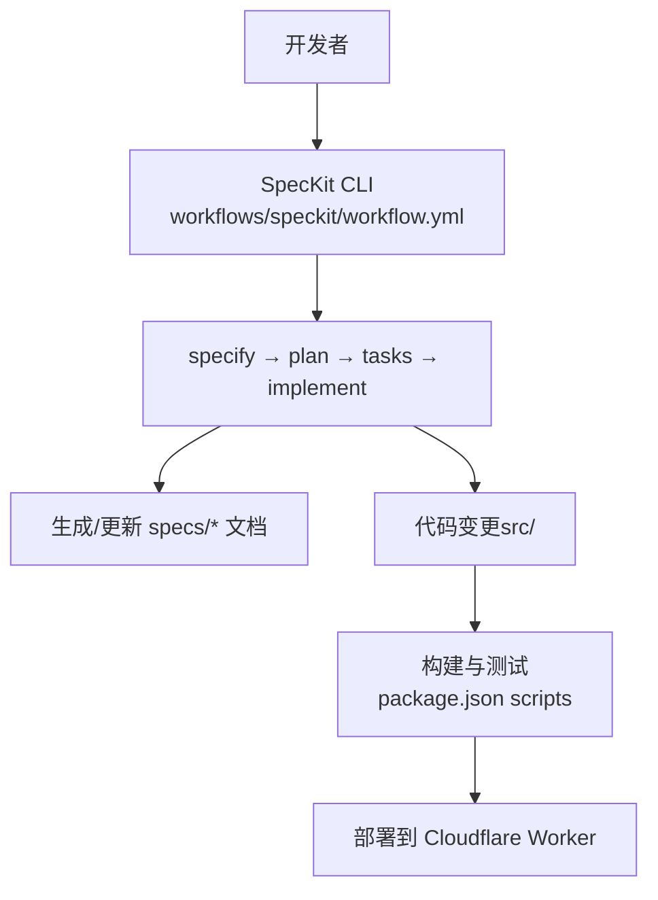
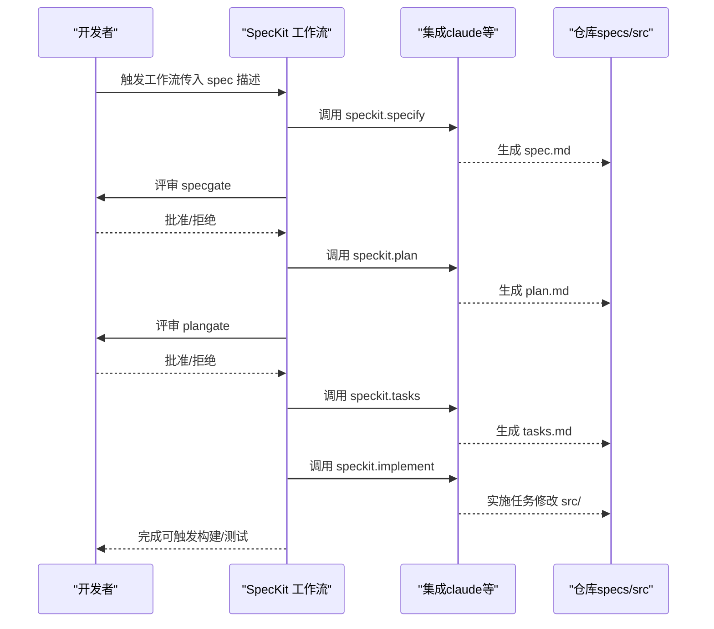
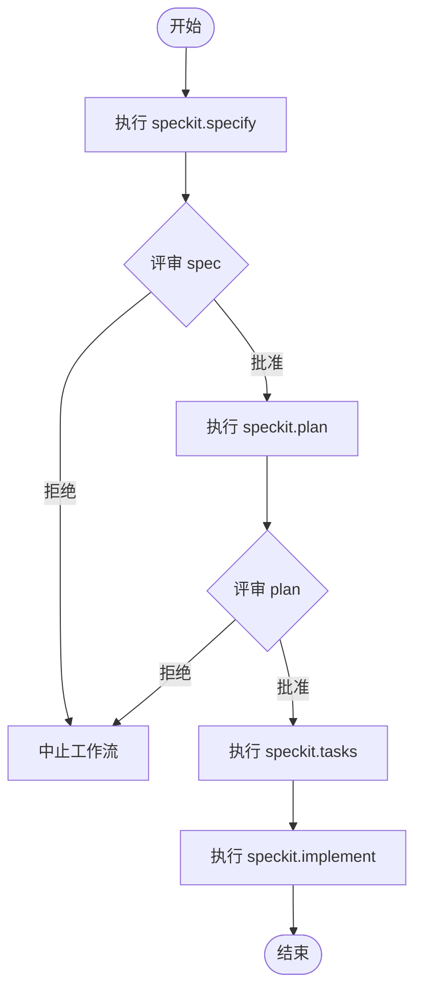
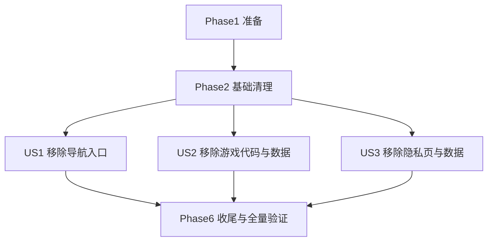
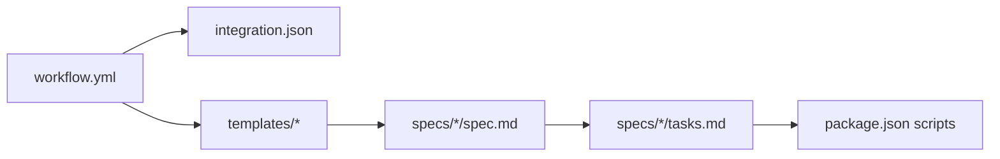

# SpecKit 开发工作流

<cite>
**本文引用的文件**
- [README.md](file://README.md)
- [package.json](file://package.json)
- [.specify/feature.json](file://.specify/feature.json)
- [.specify/integration.json](file://.specify/integration.json)
- [.specify/extensions.yml](file://.specify/extensions.yml)
- [.specify/workflows/speckit/workflow.yml](file://.specify/workflows/speckit/workflow.yml)
- [.specify/workflows/workflow-registry.json](file://.specify/workflows/workflow-registry.json)
- [.specify/templates/spec-template.md](file://.specify/templates/spec-template.md)
- [.specify/templates/tasks-template.md](file://.specify/templates/tasks-template.md)
- [.specify/templates/plan-template.md](file://.specify/templates/plan-template.md)
- [specs/008-remove-apps-privacy/spec.md](file://specs/008-remove-apps-privacy/spec.md)
- [specs/008-remove-apps-privacy/tasks.md](file://specs/008-remove-apps-privacy/tasks.md)
- [specs/008-remove-apps-privacy/data-model.md](file://specs/008-remove-apps-privacy/data-model.md)
</cite>

## 目录
1. [简介](#简介)
2. [项目结构](#项目结构)
3. [核心组件](#核心组件)
4. [架构总览](#架构总览)
5. [详细组件分析](#详细组件分析)
6. [依赖分析](#依赖分析)
7. [性能考虑](#性能考虑)
8. [故障排查指南](#故障排查指南)
9. [结论](#结论)
10. [附录](#附录)

## 简介
本仓库是一个部署在 Cloudflare Worker 上的图片管理应用，使用 Next.js App Router、Drizzle ORM、Vitest 与 Playwright 进行测试，并通过 SpecKit 驱动“规格→计划→任务→实现”的完整开发生命周期。SpecKit 通过工作流编排（workflow）将 specify、plan、tasks、implement 等命令串联，并在关键节点设置人工评审门控，确保交付质量与可追溯性。

## 项目结构
- 顶层工程：Next.js + TypeScript，脚本包含 dev/build/start/test/e2e/db:migrate 等。
- 功能规格与工件：specs 目录下按编号组织每个功能的 spec.md、plan.md、data-model.md、contracts、tasks.md 等。
- 工作流配置：.specify 下维护集成、扩展、模板与工作流定义；当前启用 claude/qodercli/kilocode 集成，默认工作流为 speckit。
- 运行时与环境：README 说明环境变量（CALIEO_CLIENT_ID、CALIEO_CLIENT_SECRET、BASE_URL），用于 OAuth2 回调与本地开发基址。

图表来源
- [.specify/workflows/speckit/workflow.yml:1-79](file://.specify/workflows/speckit/workflow.yml#L1-L79)
- [package.json:5-12](file://package.json#L5-L12)

章节来源
- [README.md:1-16](file://README.md#L1-L16)
- [package.json:1-49](file://package.json#L1-L49)
- [.specify/workflows/speckit/workflow.yml:1-79](file://.specify/workflows/speckit/workflow.yml#L1-L79)

## 核心组件
- 工作流引擎与注册表
  - workflow.yml：定义“Full SDD Cycle”，包含 specify/plan/tasks/implement 四步及两次评审门控（review-spec、review-plan）。
  - workflow-registry.json：注册名为 speckit 的工作流元信息。
- 集成与扩展
  - integration.json：声明已安装集成（claude、qodercli、kilocode）与默认集成。
  - extensions.yml：启用 assess/bug 扩展，自动执行钩子。
- 模板体系
  - spec-template.md、plan-template.md、tasks-template.md：规范输出结构与必填项，保证跨功能一致性。
- 功能工件示例（008）
  - spec.md：用户场景、需求、成功标准、假设。
  - tasks.md：分阶段、可并行的任务清单，含检查点与验证命令。
  - data-model.md：记录被删除的数据实体与 i18n 键变更影响。

章节来源
- [.specify/workflows/speckit/workflow.yml:1-79](file://.specify/workflows/speckit/workflow.yml#L1-L79)
- [.specify/workflows/workflow-registry.json:1-13](file://.specify/workflows/workflow-registry.json#L1-L13)
- [.specify/integration.json:1-26](file://.specify/integration.json#L1-L26)
- [.specify/extensions.yml:1-7](file://.specify/extensions.yml#L1-L7)
- [.specify/templates/spec-template.md:1-132](file://.specify/templates/spec-template.md#L1-L132)
- [.specify/templates/plan-template.md:1-114](file://.specify/templates/plan-template.md#L1-L114)
- [.specify/templates/tasks-template.md:1-253](file://.specify/templates/tasks-template.md#L1-L253)
- [specs/008-remove-apps-privacy/spec.md:1-111](file://specs/008-remove-apps-privacy/spec.md#L1-L111)
- [specs/008-remove-apps-privacy/tasks.md:1-196](file://specs/008-remove-apps-privacy/tasks.md#L1-L196)
- [specs/008-remove-apps-privacy/data-model.md:1-81](file://specs/008-remove-apps-privacy/data-model.md#L1-L81)

## 架构总览
SpecKit 在本仓库中的运行路径如下：
- 输入：用户描述或需求（例如“移除小游戏导航与隐私政策页面”）。
- 步骤：
  - specify：生成 spec.md（遵循 spec-template）。
  - review-spec：人工评审通过后继续。
  - plan：产出 plan.md（遵循 plan-template），明确技术上下文与结构。
  - review-plan：人工评审通过后继续。
  - tasks：生成 tasks.md（遵循 tasks-template），拆解为可并行任务。
  - implement：依据 tasks 进行编码与验证。
- 产物：specs 目录下的文档与 src 代码变更；最终通过 package.json 脚本构建与测试。

图表来源
- [.specify/workflows/speckit/workflow.yml:43-79](file://.specify/workflows/speckit/workflow.yml#L43-L79)

章节来源
- [.specify/workflows/speckit/workflow.yml:1-79](file://.specify/workflows/speckit/workflow.yml#L1-L79)

## 详细组件分析

### 工作流定义（speckit）
- 能力：顺序执行 specify → plan → tasks → implement，并在两个关键节点插入人工评审门控。
- 兼容性：要求 speckit_version >= 0.8.5；支持多种集成（any 列表）。
- 输入参数：spec（必填）、integration（默认 auto）、scope（full/backend-only/frontend-only）。

图表来源
- [.specify/workflows/speckit/workflow.yml:43-79](file://.specify/workflows/speckit/workflow.yml#L43-L79)

章节来源
- [.specify/workflows/speckit/workflow.yml:1-79](file://.specify/workflows/speckit/workflow.yml#L1-L79)

### 功能工件：008 移除小游戏导航与隐私页
- 目标：从站点中移除 /apps 导航入口、游戏相关页面与数据、以及 /privacy 隐私页与数据，保留共享文件。
- 用户场景与验收：
  - US1：顶部导航不再出现 Apps 图标，访问 /{lang}/apps 返回 404。
  - US2：删除游戏路由、组件与数据，清理 i18n 键，构建无错误。
  - US3：删除隐私路由与数据，访问返回 404。
- 任务分解：按 Phase 划分准备、基础清理、三个用户场景、收尾验证；标注 [P] 表示可并行；提供独立测试方法与检查点。

图表来源
- [specs/008-remove-apps-privacy/tasks.md:24-137](file://specs/008-remove-apps-privacy/tasks.md#L24-L137)

章节来源
- [specs/008-remove-apps-privacy/spec.md:13-111](file://specs/008-remove-apps-privacy/spec.md#L13-L111)
- [specs/008-remove-apps-privacy/tasks.md:1-196](file://specs/008-remove-apps-privacy/tasks.md#L1-L196)
- [specs/008-remove-apps-privacy/data-model.md:1-81](file://specs/008-remove-apps-privacy/data-model.md#L1-L81)

### 模板与规范对齐
- spec-template：强制用户场景、优先级、独立测试、验收场景、需求、成功标准、假设。
- plan-template：技术上下文、项目结构、复杂度跟踪等。
- tasks-template：阶段化任务、依赖关系、并行机会、MVP 策略与团队并行建议。
- 本项目 008 的 spec/tasks/data-model 严格遵循上述模板约定，便于自动化与团队协作。

章节来源
- [.specify/templates/spec-template.md:1-132](file://.specify/templates/spec-template.md#L1-L132)
- [.specify/templates/plan-template.md:1-114](file://.specify/templates/plan-template.md#L1-L114)
- [.specify/templates/tasks-template.md:1-253](file://.specify/templates/tasks-template.md#L1-L253)

## 依赖分析
- 工作流与集成
  - workflow.yml 依赖 speckit 版本与提供的四个核心命令；通过 integration.json 选择具体集成。
  - extensions.yml 启用评估与 bug 扩展，自动执行钩子以提升流程自动化程度。
- 工程脚本
  - package.json 提供 dev/build/test/e2e/db:migrate 等脚本，作为工作流落地后的验证与发布手段。
- 功能工件
  - 008 的 tasks.md 对 spec.md 的需求逐项映射，形成可执行的任务图；data-model.md 记录数据侧变更影响。

图表来源
- [.specify/workflows/speckit/workflow.yml:1-79](file://.specify/workflows/speckit/workflow.yml#L1-L79)
- [.specify/integration.json:1-26](file://.specify/integration.json#L1-L26)
- [.specify/templates/spec-template.md:1-132](file://.specify/templates/spec-template.md#L1-L132)
- [.specify/templates/tasks-template.md:1-253](file://.specify/templates/tasks-template.md#L1-L253)
- [package.json:5-12](file://package.json#L5-L12)

章节来源
- [.specify/workflows/speckit/workflow.yml:1-79](file://.specify/workflows/speckit/workflow.yml#L1-L79)
- [.specify/integration.json:1-26](file://.specify/integration.json#L1-L26)
- [package.json:1-49](file://package.json#L1-L49)

## 性能考虑
- 工作流层面：引入评审门控有助于减少返工成本，提升整体交付效率。
- 任务并行：tasks.md 中标注 [P] 的任务可在不同文件或模块上并行推进，缩短交付周期。
- 构建与测试：利用 package.json 的 test/build 脚本在 CI 或本地快速反馈问题，避免累积缺陷。

[本节为通用指导，不直接分析具体文件]

## 故障排查指南
- 工作流失败
  - 若 specify/plan/tasks/implement 任一阶段报错，检查对应集成是否可用、命令行参数是否正确。
  - 评审门控被拒绝时，根据评审意见修订 spec/plan 后重新触发。
- 构建与类型检查
  - 使用 npm run build 与 npx tsc --noEmit 定位编译期问题；参考 tasks.md 的检查点逐步缩小范围。
- 功能回归
  - 针对 008 类删除型变更，使用 grep 搜索残留引用（如 games/privacy 相关标识符），结合 quickstart 中的手动验证步骤确认。

章节来源
- [specs/008-remove-apps-privacy/tasks.md:101-137](file://specs/008-remove-apps-privacy/tasks.md#L101-L137)

## 结论
本仓库以 SpecKit 为核心，将“需求→设计→任务→实现”标准化、可追踪、可评审地贯穿整个开发过程。通过模板约束与任务并行化，既能保障交付质量，又能提升协作效率。008 案例展示了从规格到任务的完整闭环，可作为后续功能的样板。

[本节为总结性内容，不直接分析具体文件]

## 附录
- 环境变量与部署
  - 参考 README 配置 CALIEO_CLIENT_ID、CALIEO_CLIENT_SECRET、BASE_URL，并在生产环境通过 wrangler secret put 注入密钥。
- 常用命令
  - 开发：npm run dev
  - 构建：npm run build
  - 测试：npm run test / npm run test:e2e
  - 数据库迁移：npm run db:migrate

章节来源
- [README.md:3-16](file://README.md#L3-L16)
- [package.json:5-12](file://package.json#L5-L12)