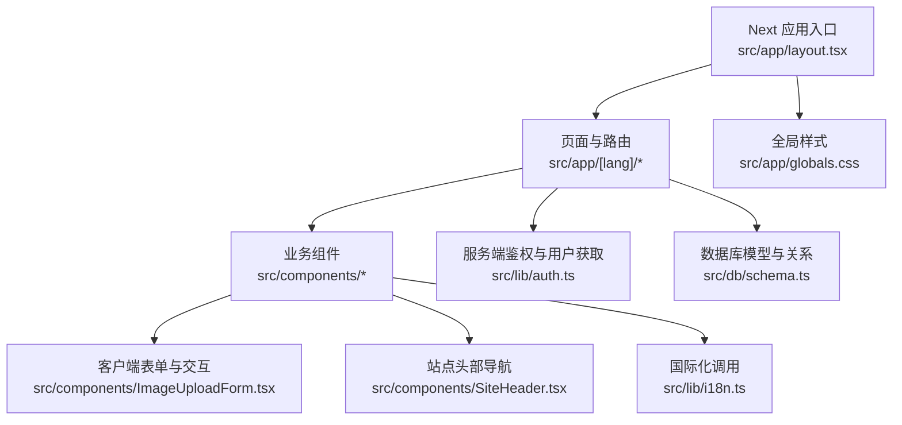
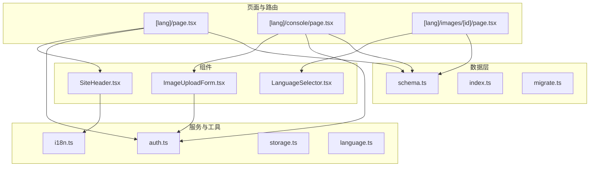
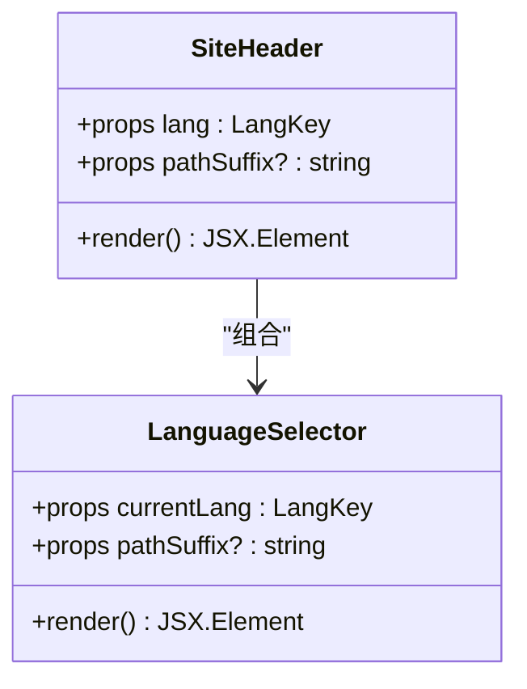
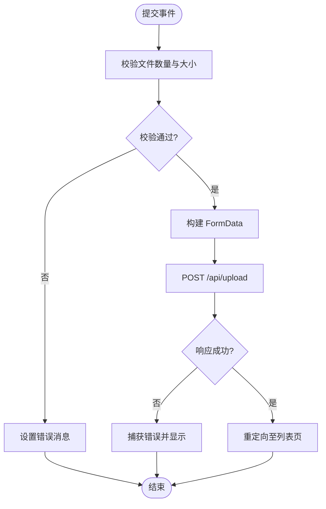
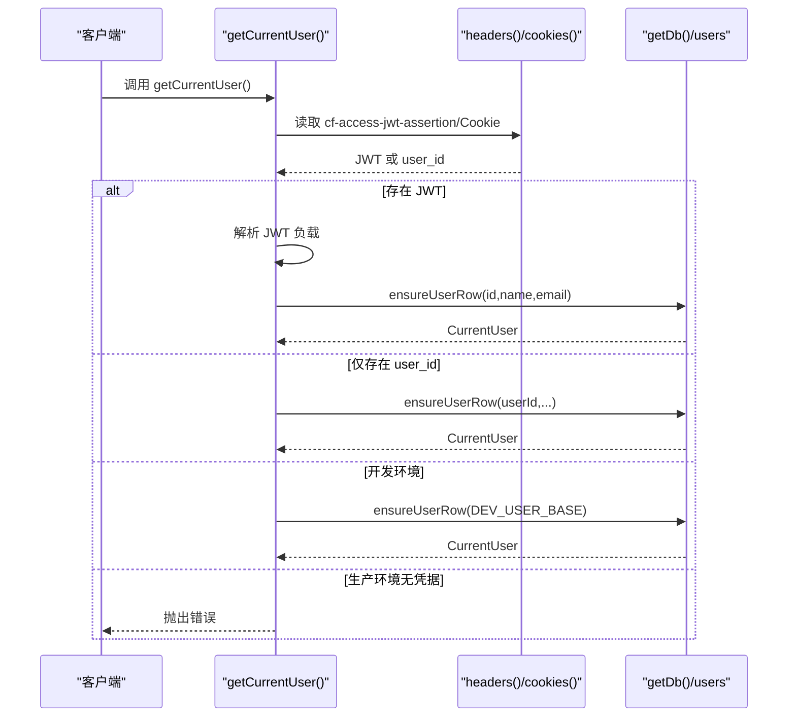
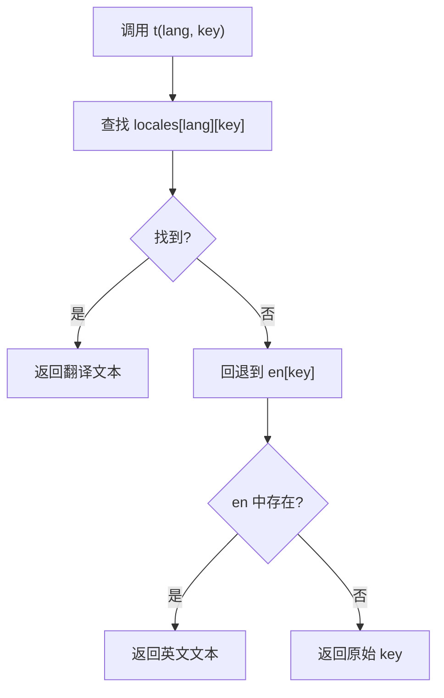
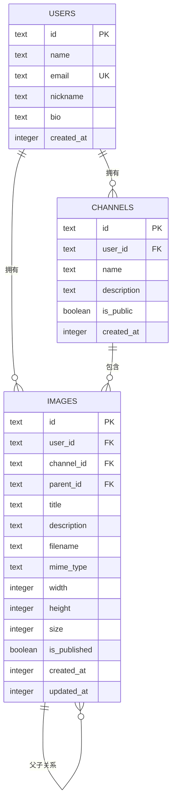
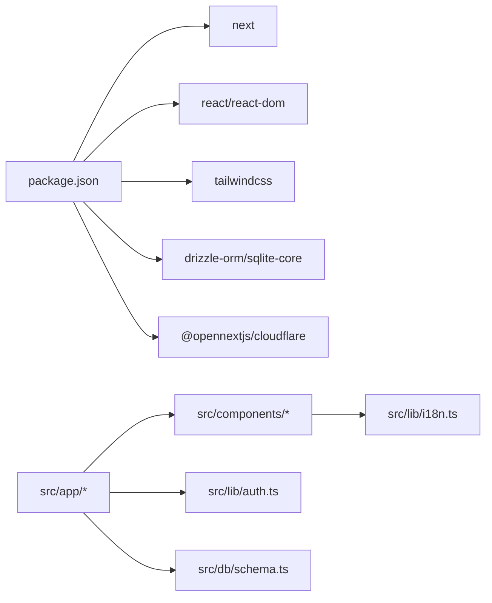

# 代码规范

<cite>
**本文引用的文件**   
- [package.json](file://package.json)
- [tsconfig.json](file://tsconfig.json)
- [next.config.ts](file://next.config.ts)
- [src/app/layout.tsx](file://src/app/layout.tsx)
- [src/components/SiteHeader.tsx](file://src/components/SiteHeader.tsx)
- [src/components/ImageUploadForm.tsx](file://src/components/ImageUploadForm.tsx)
- [src/lib/auth.ts](file://src/lib/auth.ts)
- [src/lib/i18n.ts](file://src/lib/i18n.ts)
- [src/db/schema.ts](file://src/db/schema.ts)
</cite>

## 目录
1. [简介](#简介)
2. [项目结构](#项目结构)
3. [核心组件](#核心组件)
4. [架构总览](#架构总览)
5. [详细组件分析](#详细组件分析)
6. [依赖关系分析](#依赖关系分析)
7. [性能考量](#性能考量)
8. [故障排查指南](#故障排查指南)
9. [结论](#结论)
10. [附录](#附录)

## 简介
本规范面向 Weable 项目的 TypeScript 与 React 开发，覆盖类型定义最佳实践、接口设计原则、泛型使用模式；函数式组件与 Hooks 约定、状态管理模式与性能优化；命名约定、文件组织、注释规范与错误处理策略；以及 ESLint 配置规则、代码格式化标准与导入导出约定。文档以仓库现有实现为依据，提供可落地的实践建议与示例路径，帮助团队保持一致的编码风格与质量基线。

## 项目结构
- 前端采用 Next.js App Router，页面位于 src/app，组件位于 src/components，领域逻辑与工具位于 src/lib，数据模型与 ORM 定义位于 src/db，国际化资源位于 src/locales。
- TypeScript 编译目标为 ES2017，启用严格模式与 JSX 自动运行时，模块解析采用 bundler 模式，支持路径别名 @/* 指向 src。
- Next 配置开启 reactStrictMode，并限制开发允许源。

图表来源
- [src/app/layout.tsx:1-8](file://src/app/layout.tsx#L1-L8)
- [src/components/SiteHeader.tsx:1-46](file://src/components/SiteHeader.tsx#L1-L46)
- [src/components/ImageUploadForm.tsx:1-105](file://src/components/ImageUploadForm.tsx#L1-L105)
- [src/lib/i18n.ts:1-28](file://src/lib/i18n.ts#L1-L28)
- [src/lib/auth.ts:1-118](file://src/lib/auth.ts#L1-L118)
- [src/db/schema.ts:1-100](file://src/db/schema.ts#L1-L100)

章节来源
- [tsconfig.json:1-43](file://tsconfig.json#L1-L43)
- [next.config.ts:1-15](file://next.config.ts#L1-L15)

## 核心组件
本节从类型系统、组件范式、状态管理与错误处理四个维度总结核心实践。

- TypeScript 类型与接口
  - 优先使用 interface 描述对象形状，type 用于联合、交叉与映射类型。
  - 对可选字段使用 ?，对必填字段显式声明 notNull 或默认值。
  - 对外暴露的类型需具备最小暴露原则，避免泄露内部实现细节。
  - 在 API 与服务端逻辑中，对用户输入进行白名单校验与类型收窄（如 asNonEmptyString）。
  - 参考：CurrentUser 接口与 JWT Payload 类型定义。

- 泛型使用模式
  - 将通用数据结构抽象为泛型参数，例如响应包装、分页容器等。
  - 结合条件类型与映射类型提升类型推导能力，减少重复定义。
  - 在 Hook 封装中使用泛型约束，确保返回值与入参类型一致。

- React 组件与 Hooks
  - 统一使用函数组件与 Hooks，避免类组件。
  - 组件 Props 通过独立 type 声明，保持单一职责与可读性。
  - 客户端组件使用 "use client" 指令，服务端渲染逻辑放在 Server Component 或 API Route。
  - 状态管理遵循“就近原则”，优先使用 useState/useRef，跨组件状态考虑 Context 或轻量库。

- 错误处理策略
  - 前端表单提交捕获网络异常与业务错误，展示友好提示。
  - 服务端鉴权失败时抛出明确错误信息，便于上层统一处理。
  - 对第三方输入（JWT、Cookie、Headers）进行健壮解析与容错。

章节来源
- [src/lib/auth.ts:1-118](file://src/lib/auth.ts#L1-L118)
- [src/components/ImageUploadForm.tsx:1-105](file://src/components/ImageUploadForm.tsx#L1-L105)
- [src/components/SiteHeader.tsx:1-46](file://src/components/SiteHeader.tsx#L1-L46)
- [src/lib/i18n.ts:1-28](file://src/lib/i18n.ts#L1-L28)

## 架构总览
Weable 采用 Next.js App Router 前后端一体化架构：
- 页面层：基于路由的页面组件，负责布局与数据组装。
- 组件层：可复用 UI 组件，包含客户端交互与服务端渲染组件。
- 服务层：API Route 与工具函数，处理鉴权、I/O 与业务逻辑。
- 数据层：Drizzle ORM 定义表结构与关系，SQLite 作为存储后端。

图表来源
- [src/app/layout.tsx:1-8](file://src/app/layout.tsx#L1-L8)
- [src/components/SiteHeader.tsx:1-46](file://src/components/SiteHeader.tsx#L1-L46)
- [src/components/ImageUploadForm.tsx:1-105](file://src/components/ImageUploadForm.tsx#L1-L105)
- [src/lib/auth.ts:1-118](file://src/lib/auth.ts#L1-L118)
- [src/lib/i18n.ts:1-28](file://src/lib/i18n.ts#L1-L28)
- [src/db/schema.ts:1-100](file://src/db/schema.ts#L1-L100)

## 详细组件分析

### SiteHeader 组件
- 职责：站点头部导航、语言切换入口、控制台与应用入口。
- 类型与 Props：Props 使用独立 type 声明，lang 来自语言键类型，pathSuffix 可选。
- 国际化：通过 t(lang, key) 获取文案，保证多语言一致性。
- 路由与链接：使用 next/link 构建带语言的 URL，hover 与过渡效果由 Tailwind 控制。

图表来源
- [src/components/SiteHeader.tsx:1-46](file://src/components/SiteHeader.tsx#L1-L46)
- [src/lib/i18n.ts:1-28](file://src/lib/i18n.ts#L1-L28)

章节来源
- [src/components/SiteHeader.tsx:1-46](file://src/components/SiteHeader.tsx#L1-L46)
- [src/lib/i18n.ts:1-28](file://src/lib/i18n.ts#L1-L28)

### ImageUploadForm 组件
- 职责：图片上传表单，包含文件选择、大小与数量校验、上传进度与错误提示。
- 状态管理：useState 管理 error 与 uploading，useRef 引用 form 元素。
- 客户端指令："use client" 表明其为客户端组件。
- 错误处理：前端校验失败直接设置错误消息；网络请求失败捕获并回退到默认错误文案。

图表来源
- [src/components/ImageUploadForm.tsx:1-105](file://src/components/ImageUploadForm.tsx#L1-L105)

章节来源
- [src/components/ImageUploadForm.tsx:1-105](file://src/components/ImageUploadForm.tsx#L1-L105)

### 鉴权与用户获取流程
- 流程要点：从请求头与 Cookie 中解析 Cloudflare Access JWT，提取身份后写入数据库并返回当前用户；若不存在则尝试本地会话 cookie；开发环境提供默认用户；生产环境无法解析时抛出错误。
- 类型安全：JwtPayload 使用宽松类型并通过 asNonEmptyString 收窄；CurrentUser 明确字段与可空性。

图表来源
- [src/lib/auth.ts:1-118](file://src/lib/auth.ts#L1-L118)
- [src/db/schema.ts:1-100](file://src/db/schema.ts#L1-L100)

章节来源
- [src/lib/auth.ts:1-118](file://src/lib/auth.ts#L1-L118)
- [src/db/schema.ts:1-100](file://src/db/schema.ts#L1-L100)

### 国际化模块
- 设计要点：集中管理多语言资源，t(lang, key) 提供类型安全的翻译查找，缺失时回退英文或原 key。
- 扩展性：新增语言只需在 locales 映射中添加对应资源，并在 LangKey 中扩展类型。

图表来源
- [src/lib/i18n.ts:1-28](file://src/lib/i18n.ts#L1-L28)

章节来源
- [src/lib/i18n.ts:1-28](file://src/lib/i18n.ts#L1-L28)

### 数据模型与关系
- 表结构：users、channels、images 三张表，均使用自增 ID 生成器 createId（UUID v7 转 Base58）。
- 关系定义：通过 relations 定义一对多与自引用（parent/children），支持级联删除与置空。
- 字段约束：notNull、unique、default 与布尔模式等，确保数据完整性。

图表来源
- [src/db/schema.ts:1-100](file://src/db/schema.ts#L1-L100)

章节来源
- [src/db/schema.ts:1-100](file://src/db/schema.ts#L1-L100)

## 依赖关系分析
- 包依赖：Next.js、React、Tailwind、Drizzle ORM、SQLite、国际化与工具库。
- 模块耦合：组件依赖 i18n 与图标库；鉴权模块依赖 headers/cookies 与 Drizzle；页面依赖组件与服务。
- 外部集成：Cloudflare Access JWT、SQLite 存储、OpenNext Cloudflare 部署。

图表来源
- [package.json:1-40](file://package.json#L1-L40)
- [src/app/layout.tsx:1-8](file://src/app/layout.tsx#L1-L8)
- [src/components/SiteHeader.tsx:1-46](file://src/components/SiteHeader.tsx#L1-L46)
- [src/lib/i18n.ts:1-28](file://src/lib/i18n.ts#L1-L28)
- [src/lib/auth.ts:1-118](file://src/lib/auth.ts#L1-L118)
- [src/db/schema.ts:1-100](file://src/db/schema.ts#L1-L100)

章节来源
- [package.json:1-40](file://package.json#L1-L40)

## 性能考量
- 编译与运行
  - 启用 incremental 与 strict 模式，缩短构建时间并提高类型安全性。
  - Next 的 reactStrictMode 有助于发现潜在问题。
- 组件渲染
  - 客户端组件按需使用 "use client"，避免不必要的客户端化。
  - 表单与上传逻辑尽量在前端完成基础校验，减少无效请求。
- 数据访问
  - 使用 Drizzle 的关系查询减少 N+1 问题。
  - 合理索引与字段约束降低查询成本。
- 资源加载
  - 图片上传前进行大小与数量限制，避免大文件阻塞。
  - 使用 CDN 与缓存策略提升静态资源加载速度。

## 故障排查指南
- 鉴权失败
  - 检查请求头 cf-access-jwt-assertion 与 Cookie 是否存在且有效。
  - 确认 JWT 负载字段是否满足非空要求。
  - 生产环境缺少凭据会抛出错误，需在网关或中间件正确注入。
- 上传失败
  - 前端校验失败会直接设置错误消息，检查文件大小与数量限制。
  - 网络请求失败时捕获错误并显示默认文案，检查后端 API 响应与日志。
- 国际化缺失
  - t(lang, key) 找不到翻译时会回退英文或原 key，检查 locales 映射与 LangKey 类型。

章节来源
- [src/lib/auth.ts:1-118](file://src/lib/auth.ts#L1-L118)
- [src/components/ImageUploadForm.tsx:1-105](file://src/components/ImageUploadForm.tsx#L1-L105)
- [src/lib/i18n.ts:1-28](file://src/lib/i18n.ts#L1-L28)

## 结论
本规范基于 Weable 项目的实际实现，总结了 TypeScript 类型与接口设计、React 组件与 Hooks 使用、状态管理与错误处理的实践要点，并结合 Next.js 与 Drizzle ORM 的特性给出性能优化建议。团队应遵循统一的命名、文件组织、注释与导入导出约定，配合 ESLint 与格式化工具保障代码质量与一致性。

## 附录

### TypeScript 与 React 编码约定
- 类型定义
  - 使用 interface 描述对象形状，type 用于联合与映射类型。
  - 对外暴露的最小类型集合，避免泄露内部实现。
  - 对可选字段使用 ?，对必填字段显式 notNull 或默认值。
- 泛型模式
  - 通用数据结构使用泛型参数，结合条件类型提升推导能力。
  - Hook 封装使用泛型约束，确保入参与出参类型一致。
- 组件与 Hooks
  - 统一函数组件与 Hooks，Props 使用独立 type。
  - 客户端组件使用 "use client"，服务端逻辑放在 Server Component 或 API Route。
  - 状态就近管理，跨组件状态使用 Context 或轻量库。
- 命名与文件组织
  - 组件文件名 PascalCase，工具函数 camelCase，常量 UPPER_SNAKE_CASE。
  - 按功能域组织文件，避免过度拆分或集中。
- 注释规范
  - 公共 API 与复杂逻辑添加 JSDoc 注释，说明参数、返回值与副作用。
  - 关键分支与边界条件添加行内注释。
- 错误处理
  - 前端表单与网络请求统一捕获并展示友好提示。
  - 服务端鉴权失败抛出明确错误，便于上层统一处理。
- 导入导出
  - 使用路径别名 @/* 简化导入，避免相对路径嵌套过深。
  - 默认导出用于组件与主模块，命名导出用于工具函数与类型。
- ESLint 与格式化
  - 启用严格模式与必要规则，统一代码风格。
  - 使用 Prettier 或编辑器内置格式化，保持提交前一致性。

章节来源
- [tsconfig.json:1-43](file://tsconfig.json#L1-L43)
- [next.config.ts:1-15](file://next.config.ts#L1-L15)
- [src/app/layout.tsx:1-8](file://src/app/layout.tsx#L1-L8)
- [src/components/SiteHeader.tsx:1-46](file://src/components/SiteHeader.tsx#L1-L46)
- [src/components/ImageUploadForm.tsx:1-105](file://src/components/ImageUploadForm.tsx#L1-L105)
- [src/lib/auth.ts:1-118](file://src/lib/auth.ts#L1-L118)
- [src/lib/i18n.ts:1-28](file://src/lib/i18n.ts#L1-L28)
- [src/db/schema.ts:1-100](file://src/db/schema.ts#L1-L100)
- [package.json:1-40](file://package.json#L1-L40)