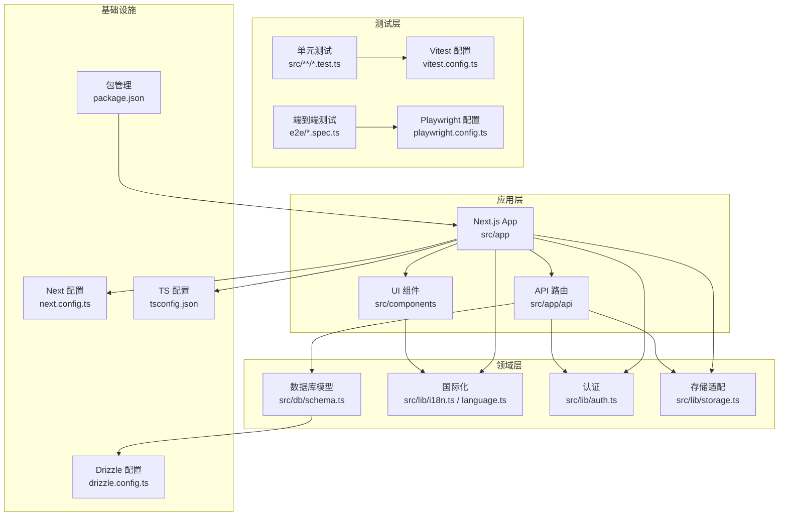
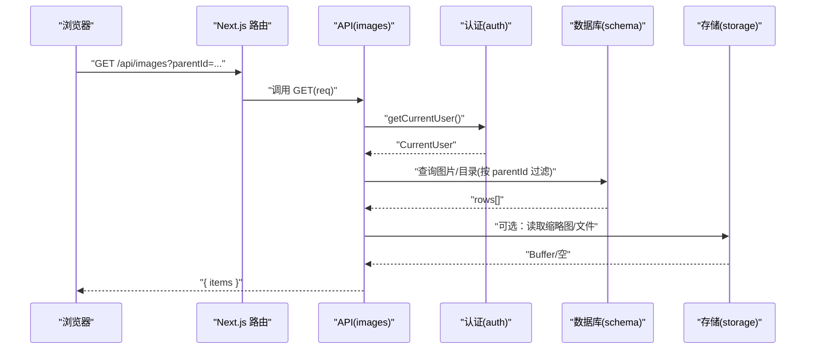
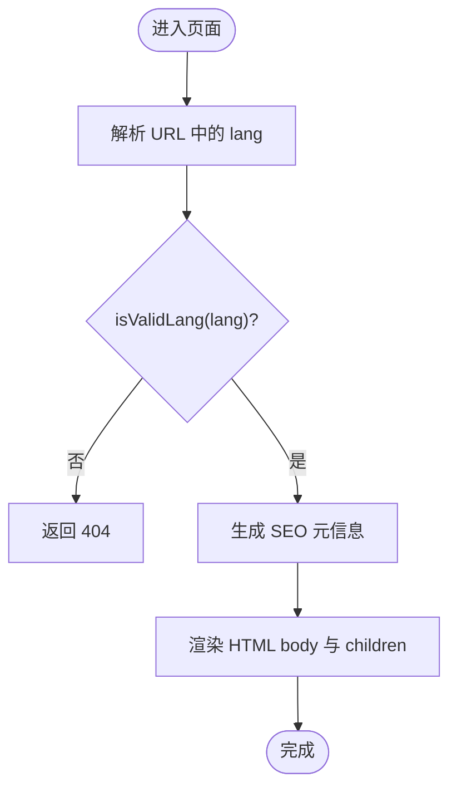
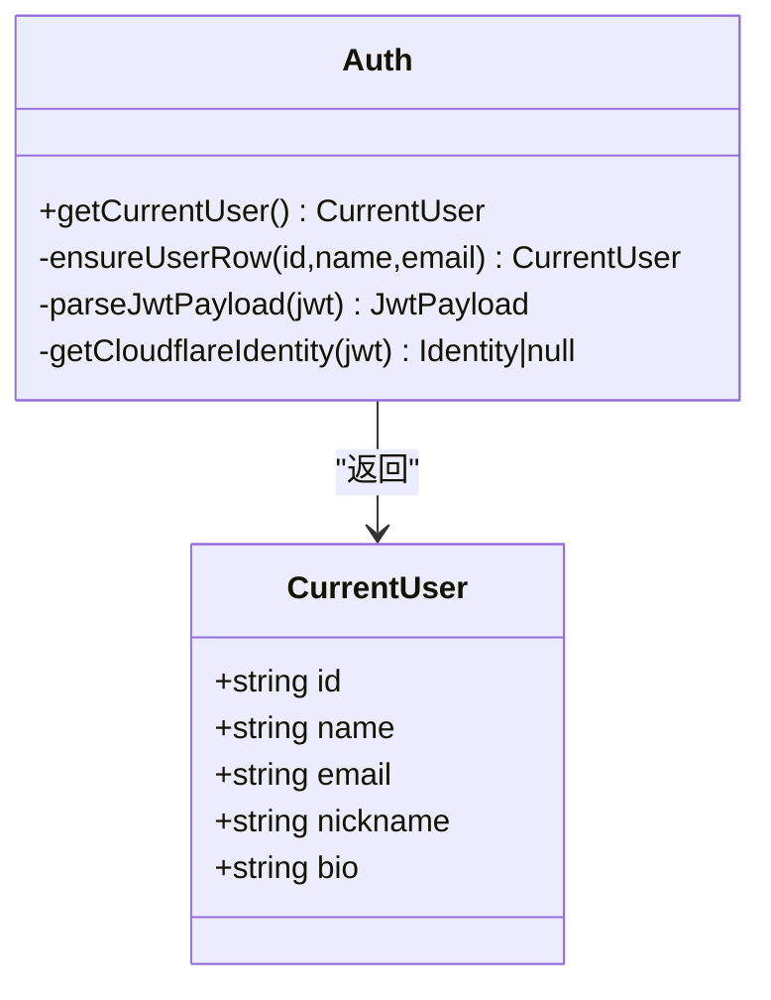
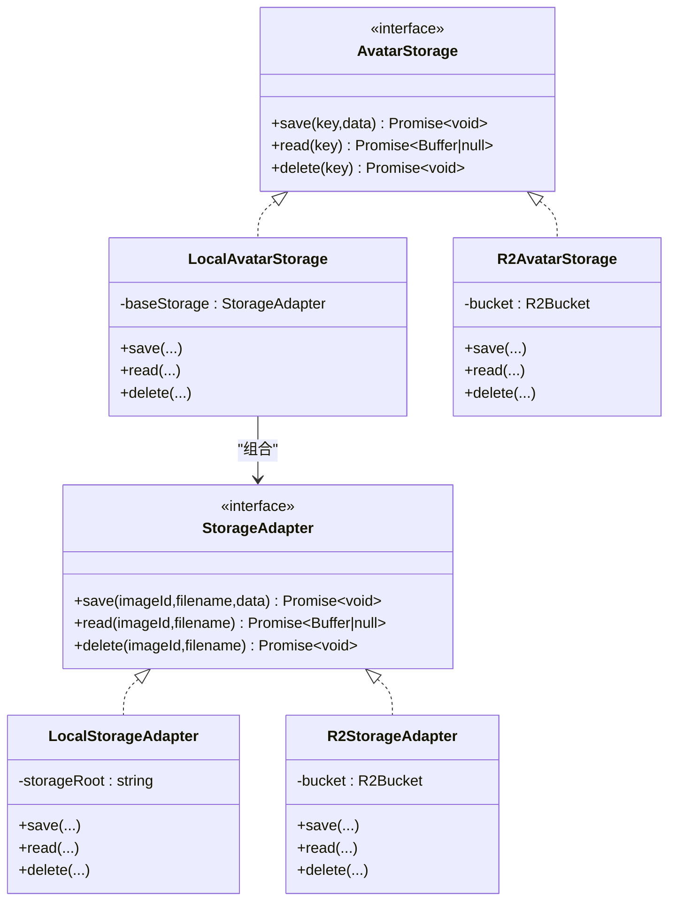
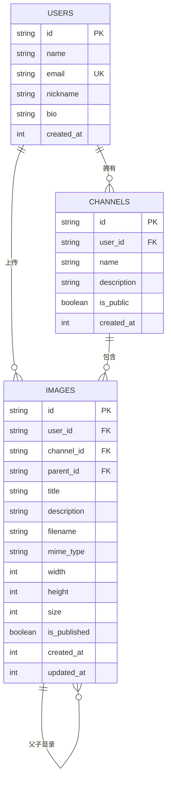
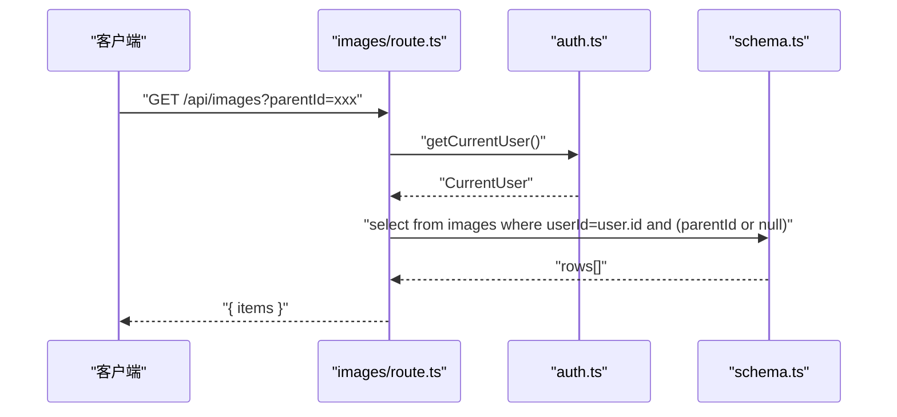
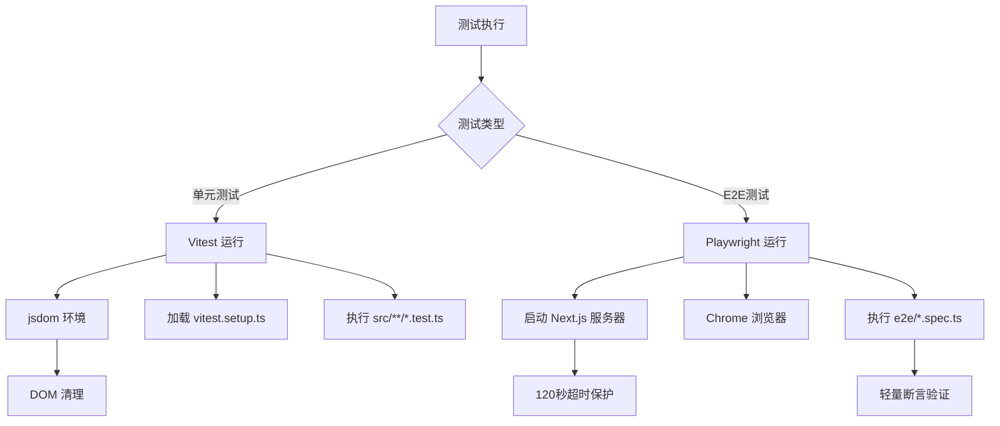
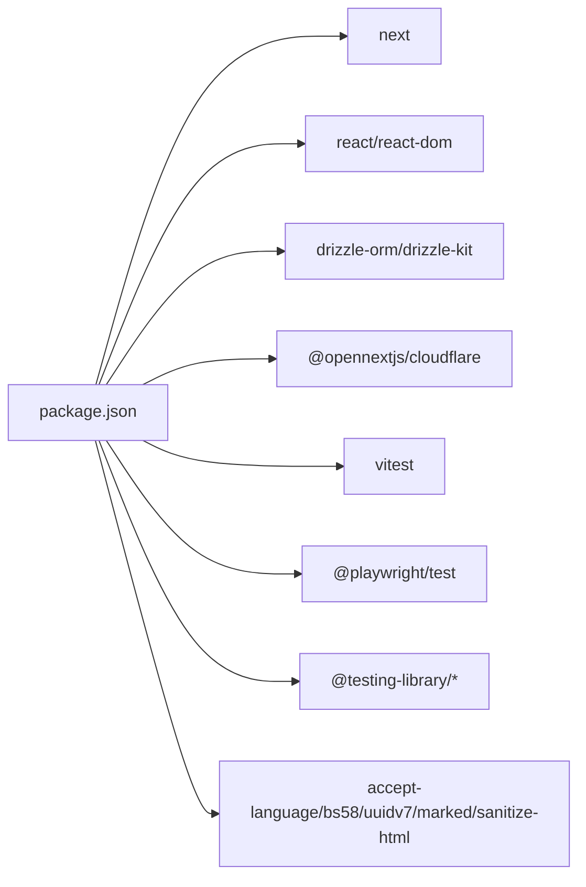

# 开发指南

<cite>
**本文引用的文件**   
- [package.json](file://package.json)
- [README.md](file://README.md)
- [tsconfig.json](file://tsconfig.json)
- [next.config.ts](file://next.config.ts)
- [drizzle.config.ts](file://drizzle.config.ts)
- [vitest.config.ts](file://vitest.config.ts)
- [vitest.setup.ts](file://vitest.setup.ts)
- [playwright.config.ts](file://playwright.config.ts)
- [src/app/layout.tsx](file://src/app/layout.tsx)
- [src/app/[lang]/layout.tsx](file://src/app/[lang]/layout.tsx)
- [src/lib/i18n.ts](file://src/lib/i18n.ts)
- [src/lib/language.ts](file://src/lib/language.ts)
- [src/db/schema.ts](file://src/db/schema.ts)
- [src/components/SiteHeader.tsx](file://src/components/SiteHeader.tsx)
- [src/components/LanguageSelector.tsx](file://src/components/LanguageSelector.tsx)
- [src/app/api/images/route.ts](file://src/app/api/images/route.ts)
- [src/lib/storage.ts](file://src/lib/storage.ts)
- [src/lib/auth.ts](file://src/lib/auth.ts)
- [e2e/home.spec.ts](file://e2e/home.spec.ts)
- [e2e/console-images.spec.ts](file://e2e/console-images.spec.ts)
- [src/components/GameCard.test.tsx](file://src/components/GameCard.test.tsx)
- [src/lib/i18n.test.ts](file://src/lib/i18n.test.ts)
</cite>

## 目录
1. [简介](#简介)
2. [项目结构](#项目结构)
3. [核心组件](#核心组件)
4. [架构总览](#架构总览)
5. [详细组件分析](#详细组件分析)
6. [依赖分析](#依赖分析)
7. [性能考虑](#性能考虑)
8. [故障排查指南](#故障排查指南)
9. [结论](#结论)
10. [附录](#附录)

## 简介
Weable 是一个部署在 Cloudflare Worker 上的图片管理应用，基于 Next.js（App Router）、TypeScript、Drizzle ORM 与 Tailwind CSS 构建。本指南面向新贡献者，涵盖 TypeScript 代码规范、React 组件开发指南、API 设计原则、代码组织与命名约定、新增语言支持、扩展存储适配器、集成第三方服务、代码审查与提交流程、版本管理策略、调试技巧、测试策略与性能优化建议，帮助快速上手并高质量地参与项目开发。

## 项目结构
- 前端页面与布局：位于 src/app，采用 Next.js App Router 的目录路由；[lang] 动态段用于多语言。
- API 路由：位于 src/app/api，按资源划分目录，如 images、upload、user、channels 等。
- 组件：位于 src/components，以功能为维度组织，每个组件一个文件。
- 领域数据与模型：位于 src/db/schema.ts，使用 Drizzle ORM 定义表结构与关系。
- 国际化：位于 src/locales，按语言拆分 JSON 文件；语言键与校验逻辑在 src/lib/language.ts；翻译函数在 src/lib/i18n.ts。
- 存储适配：位于 src/lib/storage.ts，抽象 StorageAdapter 与 AvatarStorage，提供本地与 R2 实现。
- 认证：位于 src/lib/auth.ts，解析 Cloudflare Access JWT 或会话 Cookie，返回当前用户。
- 测试：Vitest 单元测试位于 src/**/*.test.ts，Playwright E2E 测试位于 e2e/*.spec.ts。
- 配置：根级 tsconfig.json、next.config.ts、drizzle.config.ts、vitest.config.ts、playwright.config.ts、package.json。

**图表来源** 
- [next.config.ts:1-15](file://next.config.ts#L1-L15)
- [tsconfig.json:1-43](file://tsconfig.json#L1-L43)
- [drizzle.config.ts:1-8](file://drizzle.config.ts#L1-L8)
- [package.json:1-48](file://package.json#L1-L48)
- [vitest.config.ts:1-21](file://vitest.config.ts#L1-L21)
- [playwright.config.ts:1-26](file://playwright.config.ts#L1-L26)

**章节来源**
- [README.md:1-1](file://README.md#L1-L1)
- [package.json:1-48](file://package.json#L1-L48)
- [next.config.ts:1-15](file://next.config.ts#L1-L15)
- [tsconfig.json:1-43](file://tsconfig.json#L1-L43)
- [drizzle.config.ts:1-8](file://drizzle.config.ts#L1-L8)

## 核心组件
- 多语言布局与元信息：src/app/[lang]/layout.tsx 负责根据语言参数生成 SEO 元信息与 HTML 骨架，并校验语言有效性。
- 国际化工具：src/lib/i18n.ts 提供 t(lang, key) 函数，从对应语言包取值并回退到英文。
- 语言常量与校验：src/lib/language.ts 定义支持的语种、默认语言、未知语言、语言列表及 getTargetLang/isValidLang 工具。
- 站点头部与语言切换：src/components/SiteHeader.tsx 展示导航与图标；src/components/LanguageSelector.tsx 通过 Next 路由切换语言。
- 认证：src/lib/auth.ts 解析 Cloudflare Access JWT 或 Cookie，确保用户存在并返回 CurrentUser。
- 存储适配：src/lib/storage.ts 定义 StorageAdapter/AvatarStorage 接口，并提供 LocalStorageAdapter/R2StorageAdapter 与头像存储封装。
- 数据库模型：src/db/schema.ts 定义 users/channels/images 三张表及其关系，提供 createId 与 Base58 编码 ID。
- API 示例：src/app/api/images/route.ts 演示受保护的 GET 接口，查询当前用户的图片/目录树并按目录优先排序。

**章节来源**
- [src/app/[lang]/layout.tsx:1-48](file://src/app/[lang]/layout.tsx#L1-L48)
- [src/lib/i18n.ts:1-28](file://src/lib/i18n.ts#L1-L28)
- [src/lib/language.ts:1-49](file://src/lib/language.ts#L1-L49)
- [src/components/SiteHeader.tsx:1-46](file://src/components/SiteHeader.tsx#L1-L46)
- [src/components/LanguageSelector.tsx:1-34](file://src/components/LanguageSelector.tsx#L1-L34)
- [src/lib/auth.ts:1-118](file://src/lib/auth.ts#L1-L118)
- [src/lib/storage.ts:1-214](file://src/lib/storage.ts#L1-L214)
- [src/db/schema.ts:1-100](file://src/db/schema.ts#L1-L100)
- [src/app/api/images/route.ts:1-66](file://src/app/api/images/route.ts#L1-L66)

## 架构总览
Weable 采用"前端 + API 路由 + 领域库"的分层架构：
- 表现层：Next.js 页面与组件，处理 UI 渲染与交互。
- 接口层：API 路由统一对外暴露 RESTful 接口，进行鉴权、参数校验、业务编排。
- 领域层：auth、storage、i18n、db schema 等库模块，提供可复用的能力。
- 测试层：Vitest 单元测试验证组件与工具函数，Playwright E2E 测试验证完整用户流程。
- 基础设施：Next 配置、TS 编译、Drizzle 迁移、Cloudflare 运行时绑定。

**图表来源** 
- [src/app/api/images/route.ts:1-66](file://src/app/api/images/route.ts#L1-L66)
- [src/lib/auth.ts:1-118](file://src/lib/auth.ts#L1-L118)
- [src/db/schema.ts:1-100](file://src/db/schema.ts#L1-L100)
- [src/lib/storage.ts:1-214](file://src/lib/storage.ts#L1-L214)

## 详细组件分析

### 多语言与国际化
- 语言键与校验：supportedLanguages 列出所有可用语言，getTargetLang 基于 accept-language 匹配请求语言，isValidLang 校验语言键。
- 翻译函数：t(lang, key) 从 locales 映射中取文本，缺失时回退英文。
- 路由与元信息：[lang]/layout.tsx 根据 params.lang 生成 Metadata 与 html lang，并在无效时返回 404。
- 语言切换：LanguageSelector 使用 Next 客户端路由跳转到 /{newLang}/{pathSuffix}。

**图表来源** 
- [src/app/[lang]/layout.tsx:1-48](file://src/app/[lang]/layout.tsx#L1-L48)
- [src/lib/language.ts:1-49](file://src/lib/language.ts#L1-L49)
- [src/lib/i18n.ts:1-28](file://src/lib/i18n.ts#L1-L28)

**章节来源**
- [src/lib/language.ts:1-49](file://src/lib/language.ts#L1-L49)
- [src/lib/i18n.ts:1-28](file://src/lib/i18n.ts#L1-L28)
- [src/app/[lang]/layout.tsx:1-48](file://src/app/[lang]/layout.tsx#L1-L48)
- [src/components/LanguageSelector.tsx:1-34](file://src/components/LanguageSelector.tsx#L1-L34)

### 认证与授权
- getCurrentUser 优先级：Cloudflare Access JWT > Cookie(user_id) > 开发环境默认用户。
- 用户持久化：ensureUserRow 将用户写入 users 表并返回 CurrentUser。
- 安全注意：JWT payload 字段解析做了非空与类型检查，避免注入风险。

**图表来源** 
- [src/lib/auth.ts:1-118](file://src/lib/auth.ts#L1-L118)

**章节来源**
- [src/lib/auth.ts:1-118](file://src/lib/auth.ts#L1-L118)

### 存储适配器
- 接口设计：StorageAdapter 与 AvatarStorage 分别针对文件与头像存取，屏蔽底层差异。
- 实现类：LocalStorageAdapter（本地文件系统）与 R2StorageAdapter（Cloudflare R2），头像存储通过包装器复用基础存储。
- 工厂方法：getStorage/getAvatarStorage 自动选择 R2 或本地实现，并在未配置 R2 绑定时抛出明确错误。

**图表来源** 
- [src/lib/storage.ts:1-214](file://src/lib/storage.ts#L1-L214)

**章节来源**
- [src/lib/storage.ts:1-214](file://src/lib/storage.ts#L1-L214)

### 数据库模型与关系
- 实体：users、channels、images，均使用 Base58 编码的短 ID。
- 关系：用户与频道一对多，频道与图片一对多，图片父子自引用（目录树）。
- 时间戳：createdAt/updatedAt 默认当前时间。

**图表来源** 
- [src/db/schema.ts:1-100](file://src/db/schema.ts#L1-L100)

**章节来源**
- [src/db/schema.ts:1-100](file://src/db/schema.ts#L1-L100)

### API 设计与示例：获取图片列表
- 鉴权：调用 getCurrentUser 获取当前用户上下文。
- 查询：根据 parentId 过滤，目录优先排序，再按更新时间倒序。
- 响应：仅返回必要字段，便于前端渲染树形结构。

**图表来源** 
- [src/app/api/images/route.ts:1-66](file://src/app/api/images/route.ts#L1-L66)
- [src/lib/auth.ts:1-118](file://src/lib/auth.ts#L1-L118)
- [src/db/schema.ts:1-100](file://src/db/schema.ts#L1-L100)

**章节来源**
- [src/app/api/images/route.ts:1-66](file://src/app/api/images/route.ts#L1-L66)

### 测试框架配置与使用方法

#### Vitest 单元测试配置
- **配置文件**：vitest.config.ts 配置 jsdom 环境承载组件测试，复用 tsconfig 的路径别名，排除 e2e 目录避免冲突。
- **测试环境**：vitest.setup.ts 注册 jest-dom 自定义断言（toBeVisible、toBeDisabled 等），并在每个用例后清理 DOM 残留。
- **测试脚本**：package.json 中定义 test（运行测试）、test:watch（监听模式）命令。
- **测试示例**：GameCard.test.tsx 展示 React 组件测试，i18n.test.ts 展示工具函数测试。

#### Playwright E2E 测试配置
- **配置文件**：playwright.config.ts 配置仅桌面 Chrome 单浏览器项目，串行执行保证稳定性。
- **测试目录**：e2e 目录下存放端到端测试用例，如 home.spec.ts 和 console-images.spec.ts。
- **服务器管理**：自动启动 Next.js 开发服务器，复用已运行的实例，超时保护机制。
- **测试策略**：轻量冒烟级断言，关注关键元素可见性和基本功能验证。

**图表来源** 
- [vitest.config.ts:1-21](file://vitest.config.ts#L1-L21)
- [vitest.setup.ts:1-11](file://vitest.setup.ts#L1-L11)
- [playwright.config.ts:1-26](file://playwright.config.ts#L1-L26)
- [package.json:5-12](file://package.json#L5-L12)

**章节来源**
- [vitest.config.ts:1-21](file://vitest.config.ts#L1-L21)
- [vitest.setup.ts:1-11](file://vitest.setup.ts#L1-L11)
- [playwright.config.ts:1-26](file://playwright.config.ts#L1-L26)
- [package.json:5-12](file://package.json#L5-L12)
- [src/components/GameCard.test.tsx:1-55](file://src/components/GameCard.test.tsx#L1-L55)
- [src/lib/i18n.test.ts:1-25](file://src/lib/i18n.test.ts#L1-L25)
- [e2e/home.spec.ts:1-22](file://e2e/home.spec.ts#L1-L22)
- [e2e/console-images.spec.ts:1-21](file://e2e/console-images.spec.ts#L1-L21)

## 依赖分析
- 运行时与框架：Next.js 16、React 19、Node 运行时（API 路由 runtime=nodejs）。
- 数据库与迁移：Drizzle ORM + SQLite，drizzle-kit 管理迁移。
- 云原生：@opennextjs/cloudflare 用于 Cloudflare Worker 兼容运行。
- 测试框架：Vitest 4.x 用于单元测试，Playwright 1.62 用于 E2E 测试。
- 测试工具：@testing-library/react、@testing-library/jest-dom、jsdom。
- 工具库：accept-language、bs58、uuidv7、marked、sanitize-html 等。

**图表来源** 
- [package.json:1-48](file://package.json#L1-L48)

**章节来源**
- [package.json:1-48](file://package.json#L1-L48)

## 性能考虑
- 渲染与路由
  - 使用 Next.js App Router 的静态参数生成 generateStaticParams 预渲染多语言页面。
  - 合理拆分组件，减少首屏体积；对大组件使用懒加载。
- 数据访问
  - 数据库查询尽量只选所需字段，避免 N+1 问题；利用索引（email、userId、parentId 等）。
  - 对频繁读写的热点数据引入缓存（例如图片元信息、目录树）。
- 存储与网络
  - 优先使用 R2 对象存储，结合 CDN 加速；图片按需压缩与裁剪。
  - 大文件上传分片与断点续传，降低失败重试成本。
- 构建与打包
  - 保持 strict TS 模式，启用 isolatedModules，减少不必要的全局副作用。
  - 按需引入第三方库，避免全量导入。
- 测试性能
  - Vitest 单元测试使用 jsdom 环境，避免真实 DOM 操作开销。
  - Playwright E2E 测试串行执行，减少并发竞争和资源争用。

## 故障排查指南
- 多语言 404
  - 现象：访问 /xx/... 返回 404。
  - 排查：确认语言是否在 supportedLanguages 中；检查 isValidLang 与路由参数。
- 认证失败
  - 现象：API 报无法解析用户。
  - 排查：检查 Cloudflare Access JWT 是否传递；生产环境缺少 Cookie 时的行为；开发环境默认用户是否生效。
- 存储不可用
  - 现象：读写图片失败或抛错。
  - 排查：确认 R2 绑定 IMAGES_BUCKET 已配置；本地路径 IMAGE_STORAGE_PATH 是否存在；权限是否正确。
- 数据库迁移
  - 现象：表结构不一致。
  - 排查：执行 drizzle-kit 相关命令；核对 migrations 目录与 schema.ts 一致性。
- 测试失败
  - 现象：单元测试或 E2E 测试失败。
  - 排查：检查 Vitest 环境配置、Playwright 服务器状态、测试数据准备情况。

**章节来源**
- [src/app/[lang]/layout.tsx:1-48](file://src/app/[lang]/layout.tsx#L1-L48)
- [src/lib/auth.ts:1-118](file://src/lib/auth.ts#L1-L118)
- [src/lib/storage.ts:1-214](file://src/lib/storage.ts#L1-L214)
- [drizzle.config.ts:1-8](file://drizzle.config.ts#L1-L8)
- [vitest.config.ts:1-21](file://vitest.config.ts#L1-L21)
- [playwright.config.ts:1-26](file://playwright.config.ts#L1-L26)

## 结论
Weable 以清晰的层次与可扩展的接口设计，支撑了多语言、认证、存储与数据库等核心能力。新增的测试框架（Vitest 和 Playwright）提供了完整的测试覆盖，确保代码质量和功能稳定性。遵循本指南的规范与实践，可高效迭代功能、稳定集成第三方服务，并保持代码质量与性能。

## 附录

### TypeScript 代码规范
- 严格模式：开启 strict、noEmit、isolatedModules，保证类型安全与增量编译。
- 路径别名：使用 @/* 指向 src，提升可读性与可维护性。
- 模块边界：组件与库分离，避免跨层耦合；API 路由仅做编排与校验。
- 错误处理：统一错误码与消息，服务端抛出明确异常，客户端友好提示。

**章节来源**
- [tsconfig.json:1-43](file://tsconfig.json#L1-L43)

### React 组件开发指南
- 组件职责单一：UI 与状态分离，复杂状态下沉至 hooks 或 store。
- Props 类型化：使用 interface 定义 props，避免 any。
- 样式：优先 Tailwind，保持原子化与一致性。
- 可访问性：语义化标签、键盘导航、ARIA 属性。

### API 设计原则
- RESTful：资源名词化，HTTP 动词表达操作，状态码规范。
- 鉴权前置：所有写操作与敏感读操作需鉴权。
- 输入校验：参数白名单、类型与长度限制。
- 输出最小化：仅返回必要字段，便于前端渲染与缓存。

### 代码组织结构与命名约定
- 目录：app（页面/API）、components（组件）、lib（工具库）、db（模型）、locales（文案）。
- 命名：组件 PascalCase，文件与文件夹 kebab-case；常量 UPPER_SNAKE_CASE。
- 文件粒度：单文件单职责，避免巨型文件。

### 如何添加新的语言支持
- 新增语言键：在 src/lib/language.ts 中添加常量与 supportedLanguages 条目。
- 新增文案：在 src/locales 下新增 xx.json，补齐所有 key。
- 更新 i18n：在 src/lib/i18n.ts 中导入并注册新语言包。
- 验证：通过 LanguageSelector 切换语言，检查页面文案与 SEO 元信息。

**章节来源**
- [src/lib/language.ts:1-49](file://src/lib/language.ts#L1-L49)
- [src/lib/i18n.ts:1-28](file://src/lib/i18n.ts#L1-L28)
- [src/components/LanguageSelector.tsx:1-34](file://src/components/LanguageSelector.tsx#L1-L34)

### 如何扩展存储适配器
- 实现接口：实现 StorageAdapter 或 AvatarStorage 接口。
- 工厂接入：在 getStorage/getAvatarStorage 中增加新实现的检测与实例化。
- 环境变量：如需配置端点/密钥，通过环境变量注入。
- 测试：覆盖 save/read/delete 三种路径，包括不存在与异常场景。

**章节来源**
- [src/lib/storage.ts:1-214](file://src/lib/storage.ts#L1-L214)

### 如何集成第三方服务
- 抽象接口：将第三方能力封装为独立模块，定义清晰接口。
- 配置管理：通过环境变量与类型化配置对象管理密钥与端点。
- 降级策略：在不可用时提供降级实现或错误提示。
- 监控与日志：记录关键指标与错误，便于定位问题。

### 代码审查流程
- 提交前自检：lint、类型检查、单元测试通过。
- PR 模板：描述变更动机、影响范围、测试用例。
- 审查要点：正确性、安全性、性能、可维护性、文档更新。
- 合并策略：至少一名 reviewer 批准，CI 全部通过。

### 提交流程与版本管理策略
- 分支策略：main 保护，feature/fix 分支开发，PR 合并。
- 提交信息：语义化提交（feat/fix/docs 等），关联 Issue。
- 版本发布：语义化版本号，CHANGELOG 自动生成，Tag 标记。

### 调试技巧
- 前端：浏览器开发者工具、Network 面板、React DevTools。
- 后端：API 路由 console.log 或结构化日志；模拟不同用户与头信息。
- 存储：本地文件系统与 R2 控制台对比验证。
- 数据库：Drizzle 查询日志与 SQL 打印。

### 测试策略

#### 单元测试（Vitest）
- **配置环境**：jsdom 环境模拟浏览器 DOM，支持 React 组件测试。
- **测试文件**：位于 src/**/.test.ts，与源代码同目录便于维护。
- **断言库**：使用 @testing-library/jest-dom 提供丰富的 DOM 断言。
- **生命周期**：afterEach 自动清理 DOM，避免测试间污染。
- **运行命令**：`pnpm test` 运行测试，`pnpm test:watch` 监听模式。

#### 端到端测试（Playwright）
- **浏览器配置**：仅使用 Desktop Chrome，串行执行保证稳定性。
- **测试目录**：e2e 目录下存放用户流程测试用例。
- **服务器管理**：自动启动 Next.js 开发服务器，支持复用现有实例。
- **断言策略**：轻量冒烟级断言，关注关键元素可见性和基本功能。
- **运行命令**：`pnpm test:e2e` 执行 E2E 测试。

#### 测试最佳实践
- **组件测试**：测试渲染结果、用户交互、状态变化。
- **工具函数测试**：测试纯函数的输入输出，覆盖边界条件。
- **API 测试**：模拟鉴权、数据库查询，验证接口行为。
- **E2E 测试**：模拟真实用户流程，验证端到端功能。
- **测试数据**：使用固定测试数据，确保测试结果可重复。

**章节来源**
- [vitest.config.ts:1-21](file://vitest.config.ts#L1-L21)
- [vitest.setup.ts:1-11](file://vitest.setup.ts#L1-L11)
- [playwright.config.ts:1-26](file://playwright.config.ts#L1-L26)
- [package.json:5-12](file://package.json#L5-L12)
- [src/components/GameCard.test.tsx:1-55](file://src/components/GameCard.test.tsx#L1-L55)
- [src/lib/i18n.test.ts:1-25](file://src/lib/i18n.test.ts#L1-L25)
- [e2e/home.spec.ts:1-22](file://e2e/home.spec.ts#L1-L22)
- [e2e/console-images.spec.ts:1-21](file://e2e/console-images.spec.ts#L1-L21)

### 性能优化建议
- 首屏优化：代码分割、懒加载、字体与图片优化。
- 缓存策略：浏览器缓存、CDN、服务端缓存。
- 数据库：慢查询分析与索引优化。
- 存储：对象压缩、按需传输、边缘缓存。
- 测试优化：单元测试并行执行，E2E 测试串行稳定运行。