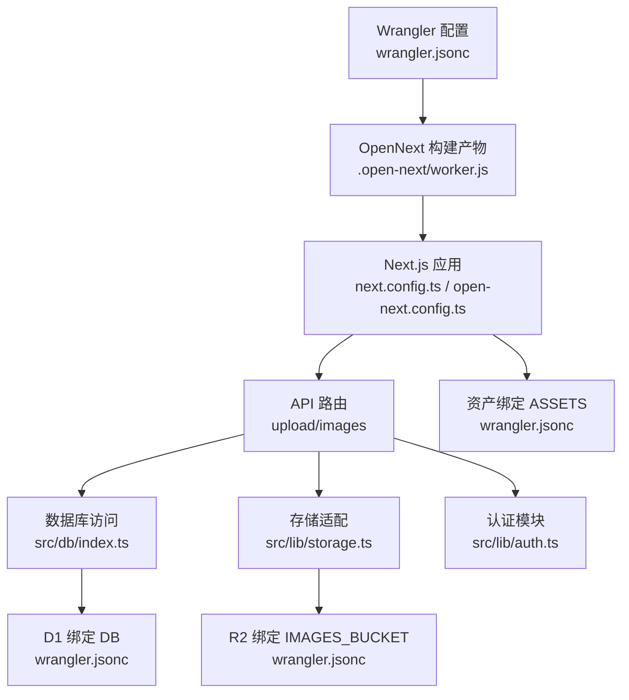
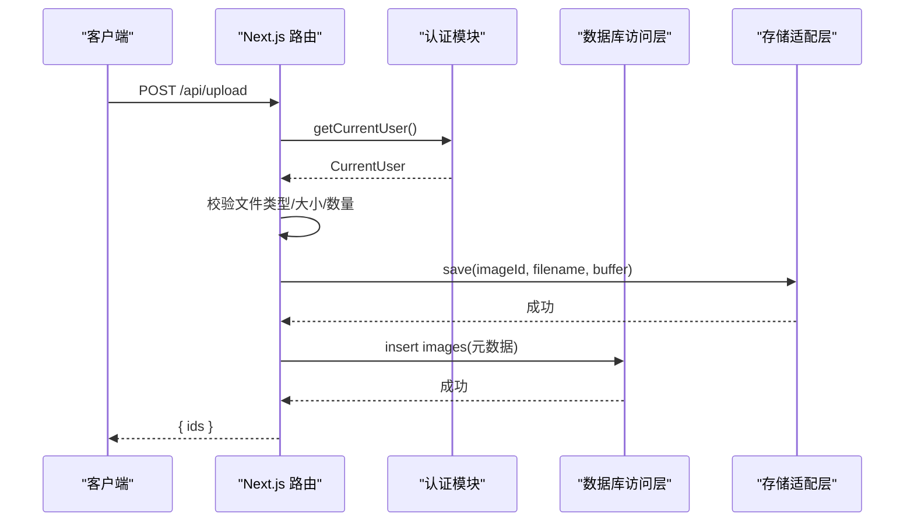
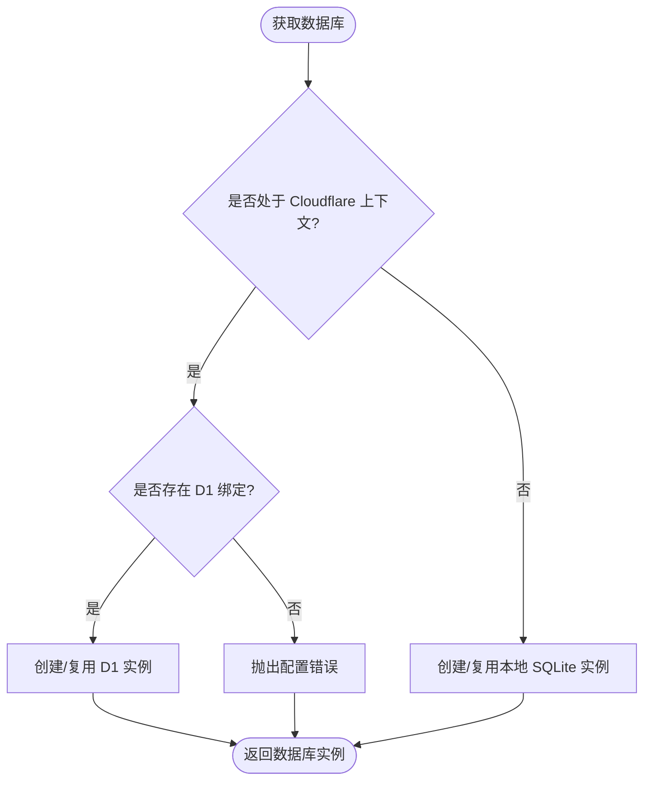
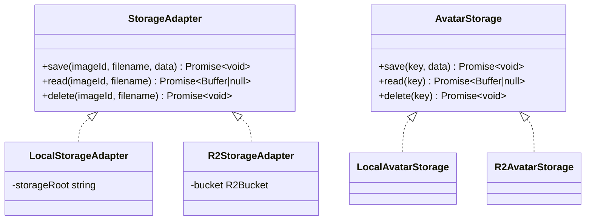
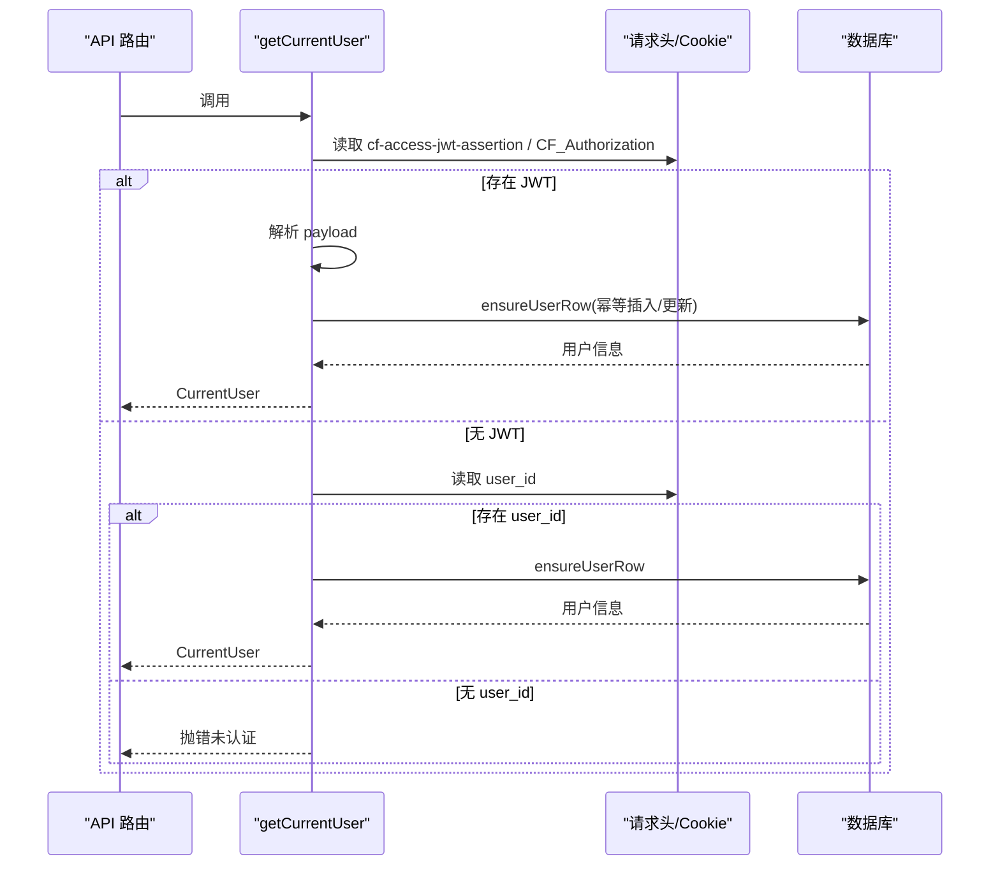
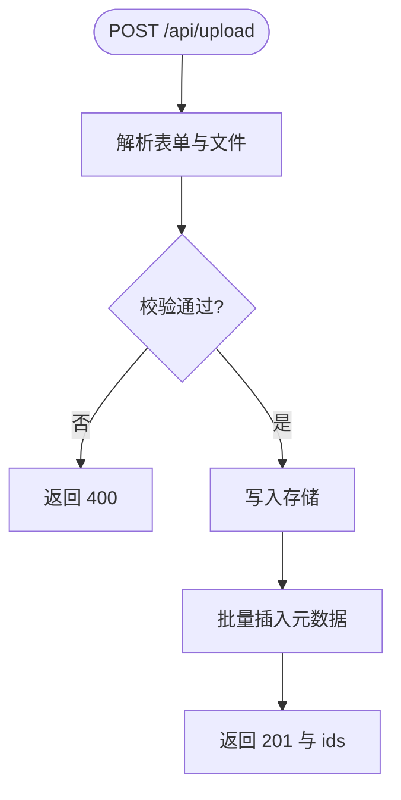
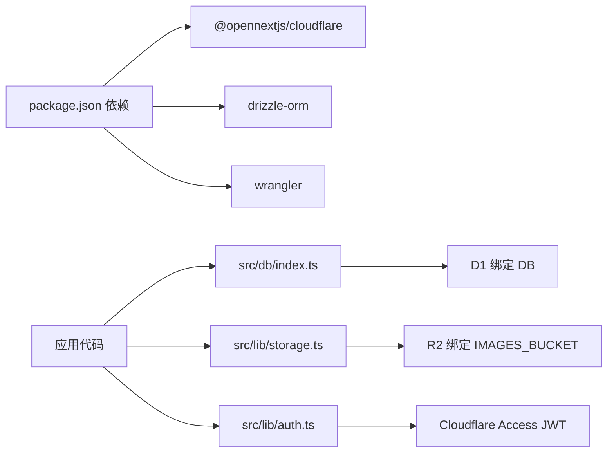

# Cloudflare Workers 扩展

<cite>
**本文引用的文件**   
- [package.json](file://package.json)
- [wrangler.jsonc](file://wrangler.jsonc)
- [next.config.ts](file://next.config.ts)
- [open-next.config.ts](file://open-next.config.ts)
- [drizzle.config.ts](file://drizzle.config.ts)
- [worker-configuration.d.ts](file://worker-configuration.d.ts)
- [src/db/index.ts](file://src/db/index.ts)
- [src/db/schema.ts](file://src/db/schema.ts)
- [src/lib/storage.ts](file://src/lib/storage.ts)
- [src/lib/auth.ts](file://src/lib/auth.ts)
- [src/app/api/upload/route.ts](file://src/app/api/upload/route.ts)
- [src/app/api/images/route.ts](file://src/app/api/images/route.ts)
- [README.md](file://README.md)
</cite>

## 目录
1. [简介](#简介)
2. [项目结构](#项目结构)
3. [核心组件](#核心组件)
4. [架构总览](#架构总览)
5. [详细组件分析](#详细组件分析)
6. [依赖关系分析](#依赖关系分析)
7. [性能与内存优化](#性能与内存优化)
8. [故障排查指南](#故障排查指南)
9. [结论](#结论)
10. [附录：扩展开发清单与最佳实践](#附录扩展开发清单与最佳实践)

## 简介
本指南面向在 Weable 应用上基于 Cloudflare Workers 进行扩展开发的工程师，聚焦以下目标：
- 识别并实现 Workers 环境下的扩展点（环境变量、绑定资源、运行时限制）
- 扩展 Next.js 在 Workers 上的能力（中间件、路由扩展、构建配置）
- 集成 D1 数据库、R2 存储、KV 存储等 Cloudflare 服务
- 提供完整的扩展示例（上传、鉴权、列表），涵盖性能优化、内存管理与调试技巧
- 说明 Workers 安全考虑与部署最佳实践

Weable 是一个部署在 Cloudflare Worker 上的图片管理应用，使用 OpenNext 将 Next.js 编译为 Worker 可执行产物，并通过 Drizzle ORM 访问 D1/SQLite。

**章节来源**
- [README.md:1-1](file://README.md#L1-L1)

## 项目结构
- 入口与运行时
  - Wrangler 配置定义 Worker 主入口、兼容性标志、资产与绑定（D1、R2、ASSETS）
  - OpenNext 配置用于开启 R2 增量缓存等特性
  - Next 配置控制页面扩展名、严格模式与本地开发允许源
- 数据层
  - Drizzle 配置指向 schema 与迁移输出目录
  - 数据库连接抽象支持 D1（生产）与 SQLite（本地/预渲染）自动切换
- 业务逻辑
  - 存储适配器统一封装 Local/R2，按运行环境选择实现
  - 认证模块解析 Cloudflare Access JWT 或回退到本地会话
  - API 路由实现上传与图片列表查询，遵循最小权限与安全校验

**图表来源**
- [wrangler.jsonc:1-34](file://wrangler.jsonc#L1-L34)
- [next.config.ts:1-15](file://next.config.ts#L1-L15)
- [open-next.config.ts:1-10](file://open-next.config.ts#L1-L10)
- [src/db/index.ts:1-61](file://src/db/index.ts#L1-L61)
- [src/lib/storage.ts:1-214](file://src/lib/storage.ts#L1-L214)
- [src/lib/auth.ts:1-118](file://src/lib/auth.ts#L1-L118)
- [src/app/api/upload/route.ts:1-75](file://src/app/api/upload/route.ts#L1-L75)
- [src/app/api/images/route.ts:1-66](file://src/app/api/images/route.ts#L1-L66)

**章节来源**
- [wrangler.jsonc:1-34](file://wrangler.jsonc#L1-L34)
- [next.config.ts:1-15](file://next.config.ts#L1-L15)
- [open-next.config.ts:1-10](file://open-next.config.ts#L1-L10)
- [drizzle.config.ts:1-8](file://drizzle.config.ts#L1-L8)

## 核心组件
- 数据库访问层
  - 通过 getCloudflareContext 判断是否在 Cloudflare 上下文，优先使用 D1 绑定；否则回退到本地 SQLite
  - 单例化 Drizzle 实例以减少初始化开销
- 存储适配层
  - 统一 StorageAdapter 接口，实现 LocalStorageAdapter 与 R2StorageAdapter
  - 头像存储 AvatarStorage 复用基础存储，路径前缀隔离
  - 运行时根据是否存在 R2 绑定自动选择实现，并在缺失时抛出明确错误
- 认证模块
  - 优先从请求头/cookie 解析 Cloudflare Access JWT，失败则回退到本地 user_id cookie
  - 非生产环境支持 DEV_USER_* 环境变量快速登录
- API 路由
  - 上传路由：校验 MIME、大小、数量，写入存储后批量插入元数据
  - 列表路由：按用户与父目录过滤，目录优先并按更新时间排序

**章节来源**
- [src/db/index.ts:1-61](file://src/db/index.ts#L1-L61)
- [src/lib/storage.ts:1-214](file://src/lib/storage.ts#L1-L214)
- [src/lib/auth.ts:1-118](file://src/lib/auth.ts#L1-L118)
- [src/app/api/upload/route.ts:1-75](file://src/app/api/upload/route.ts#L1-L75)
- [src/app/api/images/route.ts:1-66](file://src/app/api/images/route.ts#L1-L66)

## 架构总览
下图展示了请求从 Next.js 路由进入，经过认证与参数校验，调用数据库与存储适配器，最终返回响应的工作流。

**图表来源**
- [src/app/api/upload/route.ts:1-75](file://src/app/api/upload/route.ts#L1-L75)
- [src/lib/auth.ts:1-118](file://src/lib/auth.ts#L1-L118)
- [src/lib/storage.ts:1-214](file://src/lib/storage.ts#L1-L214)
- [src/db/index.ts:1-61](file://src/db/index.ts#L1-L61)

## 详细组件分析

### 数据库访问层（D1/SQLite 双栈）
- 设计要点
  - 通过 @opennextjs/cloudflare 提供的 getCloudflareContext 探测运行环境
  - 若存在 D1 绑定则创建 drizzleD1 实例；否则使用 better-sqlite3 本地文件
  - 单例缓存 db 实例，避免重复初始化
- 复杂度与性能
  - 首次初始化 O(1)，后续查询取决于 SQL 与索引
  - 建议对高频查询字段建立索引（如 userId、parentId、updatedAt）
- 错误处理
  - 在 Cloudflare 上下文但缺少 D1 绑定时抛出明确错误，便于定位配置问题

**图表来源**
- [src/db/index.ts:1-61](file://src/db/index.ts#L1-L61)

**章节来源**
- [src/db/index.ts:1-61](file://src/db/index.ts#L1-L61)
- [drizzle.config.ts:1-8](file://drizzle.config.ts#L1-L8)

### 存储适配层（Local/R2）
- 设计要点
  - 统一接口 StorageAdapter，屏蔽底层差异
  - 运行时检测 R2 绑定，自动选择 R2 或本地实现
  - 头像存储通过前缀隔离，复用基础存储
- 安全性
  - 对 imageId/filename 做路径段校验，防止目录穿越
- 性能与内存
  - 使用 Buffer/Uint8Array 转换减少拷贝
  - 大对象读取建议使用流式处理（如需）

**图表来源**
- [src/lib/storage.ts:1-214](file://src/lib/storage.ts#L1-L214)

**章节来源**
- [src/lib/storage.ts:1-214](file://src/lib/storage.ts#L1-L214)

### 认证模块（Cloudflare Access JWT）
- 设计要点
  - 优先解析 cf-access-jwt-assertion 或 CF_Authorization cookie
  - 解析 JWT payload，提取 sub/email/name 等字段
  - 不存在有效身份时回退到 user_id cookie，开发环境支持 DEV_USER_* 环境变量
- 安全建议
  - 生产环境必须启用 Cloudflare Access 并校验签名
  - 避免将敏感信息写入日志

**图表来源**
- [src/lib/auth.ts:1-118](file://src/lib/auth.ts#L1-L118)

**章节来源**
- [src/lib/auth.ts:1-118](file://src/lib/auth.ts#L1-L118)

### API 路由（上传与列表）
- 上传路由
  - 校验：MIME 前缀、文件大小、数量上限
  - 流程：生成 id -> 写入存储 -> 批量插入元数据
- 列表路由
  - 过滤：userId、parentId（可选）
  - 排序：目录优先，再按 updatedAt 降序

**图表来源**
- [src/app/api/upload/route.ts:1-75](file://src/app/api/upload/route.ts#L1-L75)

**章节来源**
- [src/app/api/upload/route.ts:1-75](file://src/app/api/upload/route.ts#L1-L75)
- [src/app/api/images/route.ts:1-66](file://src/app/api/images/route.ts#L1-L66)

### 构建与运行时配置（Next.js + OpenNext + Wrangler）
- Next 配置
  - 页面扩展名包含 md/mdx
  - 严格模式与本地开发允许源
- OpenNext 配置
  - 可通过覆盖增量缓存至 R2 提升缓存命中率
- Wrangler 配置
  - 主入口 .open-next/worker.js
  - 兼容性标志 nodejs_compat
  - 资产绑定 ASSETS
  - D1 绑定 DB、R2 绑定 IMAGES_BUCKET 与 NEXT_INC_CACHE_R2_BUCKET

**章节来源**
- [next.config.ts:1-15](file://next.config.ts#L1-L15)
- [open-next.config.ts:1-10](file://open-next.config.ts#L1-L10)
- [wrangler.jsonc:1-34](file://wrangler.jsonc#L1-L34)

## 依赖关系分析
- 包依赖
  - @opennextjs/cloudflare：将 Next.js 编译为 Worker 并暴露 getCloudflareContext
  - drizzle-orm：跨 D1/SQLite 的 ORM
  - wrangler：Workers 开发与部署工具
- 运行时依赖
  - D1 数据库、R2 对象存储、ASSETS 静态资源
  - Cloudflare Access（JWT）用于认证

**图表来源**
- [package.json:1-40](file://package.json#L1-L40)
- [src/db/index.ts:1-61](file://src/db/index.ts#L1-L61)
- [src/lib/storage.ts:1-214](file://src/lib/storage.ts#L1-L214)
- [src/lib/auth.ts:1-118](file://src/lib/auth.ts#L1-L118)

**章节来源**
- [package.json:1-40](file://package.json#L1-L40)

## 性能与内存优化
- 数据库
  - 使用 Drizzle 的批处理与合适索引，减少往返与全表扫描
  - 避免在热路径中重复初始化数据库实例（已采用单例）
- 存储
  - 优先使用 R2 以利用边缘缓存与高吞吐
  - 大文件上传尽量流式处理，避免一次性加载到内存
  - 合理设置对象键命名空间，避免热点 key
- 缓存
  - 启用 R2 作为增量缓存后端（OpenNext 支持）
  - 合理使用 Cache-Control 与 ETag
- 内存管理
  - 避免在 Worker 生命周期内持有过大闭包或全局状态
  - 及时释放临时 Buffer/ArrayBuffer 引用
- 调试
  - 启用 observability（已在 Wrangler 配置中开启）
  - 使用 console.log/wrangler tail 查看日志
  - 在本地通过 SQLite 快速验证逻辑，再切到 D1

[本节为通用指导，不直接分析具体文件]

## 故障排查指南
- 常见错误与定位
  - “Cloudflare D1 binding DB is not configured”：检查 wrangler.jsonc 的 d1_databases 绑定名称与 ID
  - “Cloudflare R2 binding IMAGES_BUCKET is not configured”：检查 r2_buckets 绑定名称与桶名
  - 上传失败：确认 MIME 白名单、文件大小限制、存储写入权限
  - 认证失败：确认 Cloudflare Access 规则、JWT 头/cookie 名称是否正确
- 排查步骤
  - 本地开发：使用 SQLite 验证逻辑，逐步切换到 D1/R2
  - 查看 Wrangler 日志与 Observability
  - 检查环境变量与绑定注入是否生效
  - 使用最小复现用例定位问题

**章节来源**
- [src/db/index.ts:43-60](file://src/db/index.ts#L43-L60)
- [src/lib/storage.ts:184-213](file://src/lib/storage.ts#L184-L213)
- [wrangler.jsonc:16-32](file://wrangler.jsonc#L16-L32)

## 结论
Weable 在 Cloudflare Workers 上通过 OpenNext 实现了高效的 Next.js 运行环境，结合 D1、R2 与 Cloudflare Access 提供了可扩展、高性能且安全的图片管理能力。开发者可在现有架构基础上，通过统一的存储与数据库抽象、清晰的认证流程与严格的输入校验，快速扩展新功能并保持良好性能与稳定性。

[本节为总结性内容，不直接分析具体文件]

## 附录：扩展开发清单与最佳实践
- 环境变量与绑定
  - 在 wrangler.jsonc 中声明 D1、R2、ASSETS 绑定，确保名称一致
  - 使用 @opennextjs/cloudflare 的 getCloudflareContext 安全获取 env
- 中间件与路由扩展
  - 新增 API 路由时，遵循最小权限原则，先鉴权再执行业务逻辑
  - 对输入进行严格校验（类型、大小、格式、白名单）
- 构建配置
  - 按需启用 R2 增量缓存以提升性能
  - 保持 next.config.ts 与 open-next.config.ts 的最小化与清晰
- 安全与合规
  - 生产环境强制启用 Cloudflare Access，禁用本地回退
  - 避免记录敏感信息，对日志脱敏
- 部署最佳实践
  - 使用 pnpm 锁定依赖版本，保证一致性
  - 分阶段发布：先预览环境验证，再灰度上线
  - 监控关键指标：延迟、错误率、内存占用

[本节为通用指导，不直接分析具体文件]