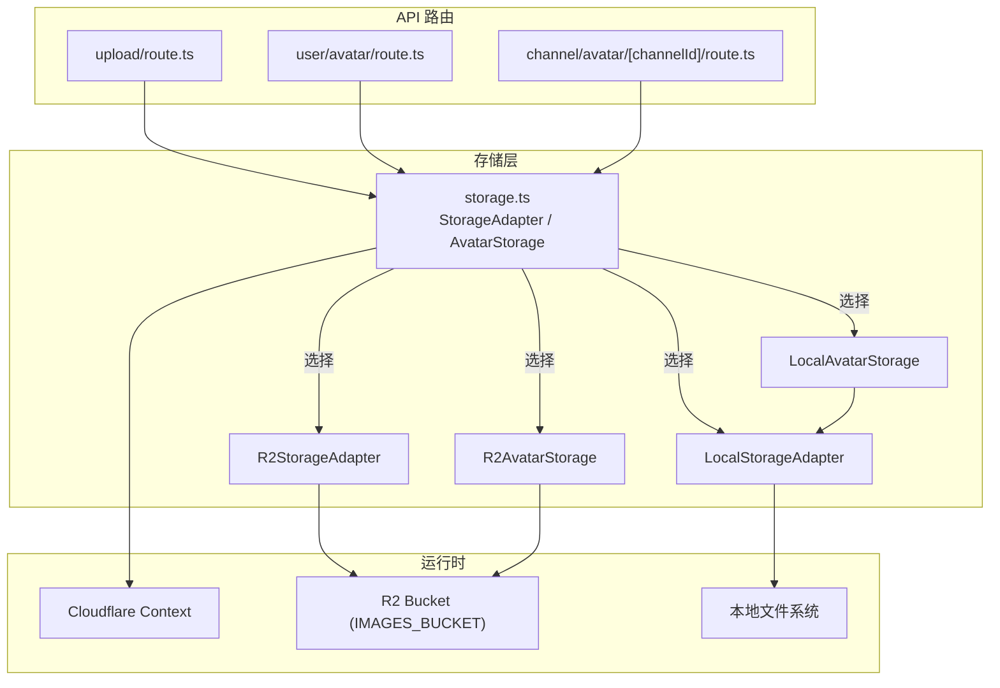
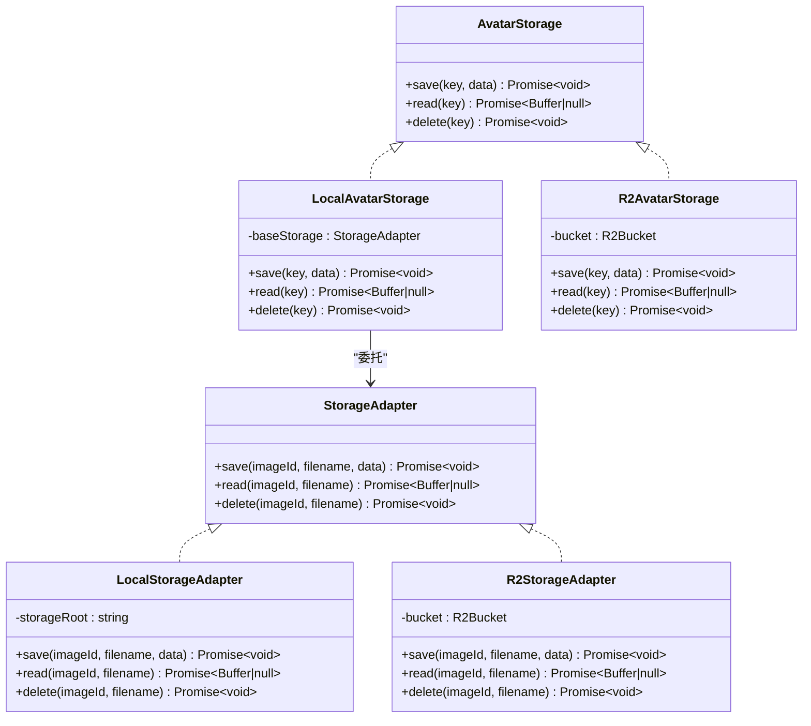
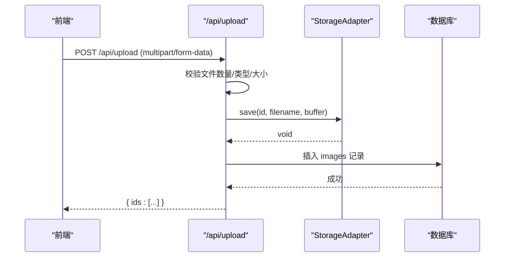
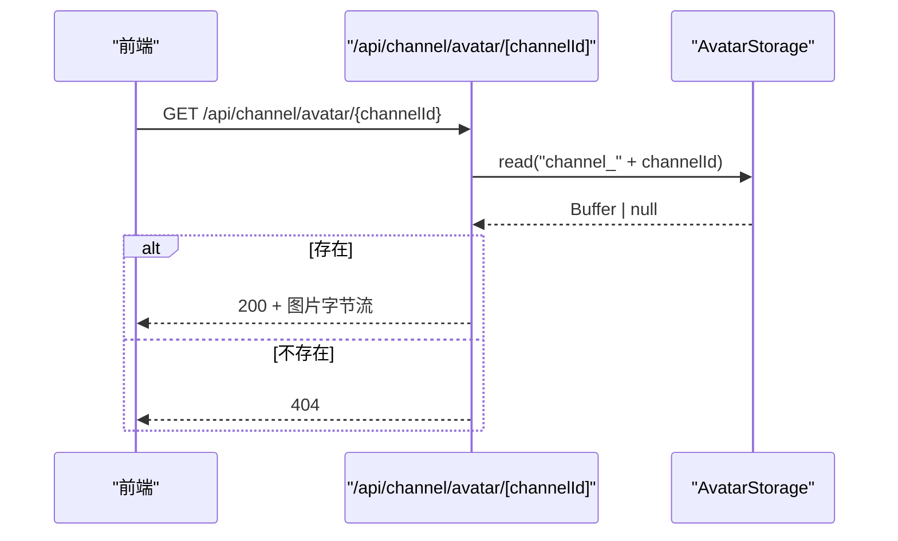
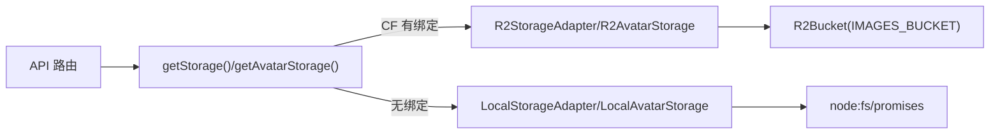

# 存储适配器开发

<cite>
**本文引用的文件**   
- [src/lib/storage.ts](file://src/lib/storage.ts)
- [src/app/api/upload/route.ts](file://src/app/api/upload/route.ts)
- [src/app/api/user/avatar/route.ts](file://src/app/api/user/avatar/route.ts)
- [src/app/api/channel/avatar/[channelId]/route.ts](file://src/app/api/channel/avatar/[channelId]/route.ts)
- [wrangler.jsonc](file://wrangler.jsonc)
</cite>

## 目录
1. [简介](#简介)
2. [项目结构](#项目结构)
3. [核心组件](#核心组件)
4. [架构总览](#架构总览)
5. [详细组件分析](#详细组件分析)
6. [依赖关系分析](#依赖关系分析)
7. [性能考量](#性能考量)
8. [故障排查指南](#故障排查指南)
9. [结论](#结论)
10. [附录](#附录)

## 简介
本指南面向希望为 Weable 应用实现或扩展“存储适配器”的开发者。文档围绕 StorageAdapter 与 AvatarStorage 两个接口展开，系统阐述其设计理念、方法参数与返回值约定，并对比 LocalStorageAdapter 与 R2StorageAdapter 的实现差异（路径处理、错误处理、性能优化）。同时给出 AvatarStorage 的特殊用途与实现方式，提供在 Cloudflare Workers 环境下的配置与部署要点，以及测试与调试技巧。

## 项目结构
Weable 的存储适配逻辑集中在 src/lib/storage.ts，API 路由通过 getStorage() 和 getAvatarStorage() 获取具体实现，并在上传/读取头像等场景中使用。Cloudflare Workers 的 R2 绑定由 wrangler.jsonc 管理。

图表来源
- [src/lib/storage.ts:184-213](file://src/lib/storage.ts#L184-L213)
- [src/app/api/upload/route.ts:51-57](file://src/app/api/upload/route.ts#L51-L57)
- [src/app/api/user/avatar/route.ts:28-31](file://src/app/api/user/avatar/route.ts#L28-L31)
- [src/app/api/channel/avatar/[channelId]/route.ts:19-31](file://src/app/api/channel/avatar/[channelId]/route.ts#L19-L31)
- [wrangler.jsonc:23-32](file://wrangler.jsonc#L23-L32)

章节来源
- [src/lib/storage.ts:1-214](file://src/lib/storage.ts#L1-L214)
- [src/app/api/upload/route.ts:1-75](file://src/app/api/upload/route.ts#L1-L75)
- [src/app/api/user/avatar/route.ts:1-34](file://src/app/api/user/avatar/route.ts#L1-L34)
- [src/app/api/channel/avatar/[channelId]/route.ts:1-64](file://src/app/api/channel/avatar/[channelId]/route.ts#L1-L64)
- [wrangler.jsonc:1-34](file://wrangler.jsonc#L1-L34)

## 核心组件
- StorageAdapter：统一对象存储抽象，定义 save(imageId, filename, data)、read(imageId, filename)、delete(imageId, filename)。
- AvatarStorage：头像专用存储抽象，定义 save(key, data)、read(key)、delete(key)，内部通过固定前缀映射到 StorageAdapter。
- LocalStorageAdapter：基于本地文件系统的实现，使用 node:fs/promises 与 node:path 构建安全路径。
- R2StorageAdapter：基于 Cloudflare R2 的对象存储实现，使用 bucket.put/get/delete。
- LocalAvatarStorage：将头像 key 映射到 StorageAdapter 的固定命名空间（__avatar__）。
- R2AvatarStorage：直接对 R2 进行 avatar/ 前缀的对象键管理。
- 工厂函数：getStorage() 与 getAvatarStorage() 根据运行环境自动选择实现。

章节来源
- [src/lib/storage.ts:3-13](file://src/lib/storage.ts#L3-L13)
- [src/lib/storage.ts:61-136](file://src/lib/storage.ts#L61-L136)
- [src/lib/storage.ts:138-179](file://src/lib/storage.ts#L138-L179)
- [src/lib/storage.ts:184-213](file://src/lib/storage.ts#L184-L213)

## 架构总览
存储层采用“接口 + 多实现 + 工厂选择”的模式：
- API 路由只依赖 getStorage()/getAvatarStorage()，不关心底层是本地还是 R2。
- 工厂函数在首次调用时检测 Cloudflare 上下文是否存在 IMAGES_BUCKET 绑定，决定实例化 R2 或本地实现。
- 头像存储通过 AvatarStorage 接口屏蔽差异，LocalAvatarStorage 复用 StorageAdapter 的 __avatar__ 命名空间，R2AvatarStorage 直接使用 avatar/ 前缀。

图表来源
- [src/lib/storage.ts:3-13](file://src/lib/storage.ts#L3-L13)
- [src/lib/storage.ts:61-136](file://src/lib/storage.ts#L61-L136)
- [src/lib/storage.ts:138-179](file://src/lib/storage.ts#L138-L179)

## 详细组件分析

### StorageAdapter 接口与方法规范
- save(imageId: string, filename: string, data: Buffer): Promise<void>
  - imageId：唯一标识，用于构建存储路径或对象键；必须通过安全校验，不允许包含路径分隔符或特殊片段。
  - filename：文件名，同样需通过安全校验。
  - data：二进制数据（Buffer），写入目标存储。
- read(imageId: string, filename: string): Promise<Buffer | null>
  - 成功返回 Buffer；不存在时返回 null。
- delete(imageId: string, filename: string): Promise<void>
  - 删除目标对象；不存在时通常视为成功（幂等）。

章节来源
- [src/lib/storage.ts:3-7](file://src/lib/storage.ts#L3-L7)
- [src/lib/storage.ts:15-25](file://src/lib/storage.ts#L15-L25)

### LocalStorageAdapter 实现要点
- 路径解析：使用 node:path.join(storageRoot, imageId, filename)，并通过 assertSafeSegment 防止路径穿越。
- 保存：先确保目录存在（mkdir recursive），再写入文件。
- 读取：捕获 ENOENT 异常返回 null，其他异常向上抛出。
- 删除：rm 失败且为 ENOENT 时视为成功，其他异常向上抛出。
- 性能：I/O 为同步阻塞式 Node.js 异步 API，适合本地开发或小规模部署；生产环境建议切换至 R2。

章节来源
- [src/lib/storage.ts:27-33](file://src/lib/storage.ts#L27-L33)
- [src/lib/storage.ts:61-114](file://src/lib/storage.ts#L61-L114)

### R2StorageAdapter 实现要点
- 对象键：resolveR2ObjectKey(imageId, filename) 生成 imageId/filename 形式的键。
- 保存：toUint8Array(data) 转换后调用 bucket.put。
- 读取：bucket.get 返回对象则 arrayBuffer() 转 Buffer；未找到返回 null。
- 删除：bucket.delete 直接删除对象。
- 性能：网络 I/O，具备高可用与可扩展性；注意大对象传输与内存占用。

章节来源
- [src/lib/storage.ts:55-59](file://src/lib/storage.ts#L55-L59)
- [src/lib/storage.ts:116-136](file://src/lib/storage.ts#L116-L136)

### AvatarStorage 接口与实现
- 用途：为头像提供统一的存取接口，屏蔽底层存储差异。
- LocalAvatarStorage：将 key 映射到 StorageAdapter 的固定命名空间 "__avatar__"，复用现有存储实现。
- R2AvatarStorage：使用 avatar/ 前缀组织对象键，直接操作 R2。
- 返回值约定：read 返回 Buffer 或 null；save/delete 返回 void。

章节来源
- [src/lib/storage.ts:9-13](file://src/lib/storage.ts#L9-L13)
- [src/lib/storage.ts:138-179](file://src/lib/storage.ts#L138-L179)

### 工厂函数与环境选择
- getStorage()：优先尝试从 Cloudflare 上下文获取 IMAGES_BUCKET；若存在则返回 R2StorageAdapter，否则返回 LocalStorageAdapter。在 Cloudflare 环境中未配置绑定会抛出明确错误。
- getAvatarStorage()：同理，优先 R2AvatarStorage，否则回退到 LocalAvatarStorage(getStorage())。

章节来源
- [src/lib/storage.ts:46-53](file://src/lib/storage.ts#L46-L53)
- [src/lib/storage.ts:184-213](file://src/lib/storage.ts#L184-L213)

### API 路由中的使用
- 图片上传（/api/upload）：校验文件类型与大小，循环生成 id 并调用 storage.save(id, file.name, buffer)，随后写入数据库。
- 用户头像（/api/user/avatar）：校验类型与大小，调用 getAvatarStorage().save(`user_${userId}`, buffer)。
- 频道头像（/api/channel/avatar/[channelId]）：GET 读取头像返回 Uint8Array 响应；POST 校验后保存 `channel_${channelId}`。

章节来源
- [src/app/api/upload/route.ts:14-74](file://src/app/api/upload/route.ts#L14-L74)
- [src/app/api/user/avatar/route.ts:10-33](file://src/app/api/user/avatar/route.ts#L10-L33)
- [src/app/api/channel/avatar/[channelId]/route.ts:12-32](file://src/app/api/channel/avatar/[channelId]/route.ts#L12-L32)
- [src/app/api/channel/avatar/[channelId]/route.ts:34-63](file://src/app/api/channel/avatar/[channelId]/route.ts#L34-L63)

### 关键流程时序图

#### 图片上传流程

图表来源
- [src/app/api/upload/route.ts:14-74](file://src/app/api/upload/route.ts#L14-L74)
- [src/lib/storage.ts:184-197](file://src/lib/storage.ts#L184-L197)

#### 频道头像读取流程

图表来源
- [src/app/api/channel/avatar/[channelId]/route.ts:12-32](file://src/app/api/channel/avatar/[channelId]/route.ts#L12-L32)
- [src/lib/storage.ts:199-213](file://src/lib/storage.ts#L199-L213)

## 依赖关系分析
- API 路由仅依赖 getStorage()/getAvatarStorage()，降低耦合度。
- 存储实现依赖运行时能力：
  - LocalStorageAdapter 依赖 node:fs/promises 与 node:path。
  - R2StorageAdapter 依赖 R2Bucket 绑定（IMAGES_BUCKET）。
- 工厂函数依赖 @opennextjs/cloudflare 提供的 getCloudflareContext 以判断运行环境与绑定可用性。

图表来源
- [src/lib/storage.ts:184-213](file://src/lib/storage.ts#L184-L213)
- [wrangler.jsonc:23-32](file://wrangler.jsonc#L23-L32)

章节来源
- [src/lib/storage.ts:1-214](file://src/lib/storage.ts#L1-L214)
- [wrangler.jsonc:1-34](file://wrangler.jsonc#L1-L34)

## 性能考量
- 本地存储：
  - 优点：开发便捷、延迟低（本地磁盘）。
  - 缺点：不可横向扩展、受限于单进程 I/O 与磁盘容量。
  - 建议：仅用于本地开发与测试；生产环境切换到 R2。
- R2 存储：
  - 优点：高可用、可扩展、跨地域访问。
  - 缺点：网络开销、内存占用（大对象需合理分块或流式处理）。
  - 建议：设置合理的缓存头（如头像读取已设置 Cache-Control），避免重复请求。
- 数据转换：
  - toUint8Array/toBuffer 减少不必要的拷贝，提升吞吐。
- 并发与限流：
  - 批量上传时控制并发数，避免内存峰值过高。
  - 限制单次上传文件大小与数量（已在路由中实现）。

[本节为通用指导，不直接分析具体文件]

## 故障排查指南
- Cloudflare 环境下报错“IMAGES_BUCKET 未配置”：
  - 检查 wrangler.jsonc 中 r2_buckets 是否包含 binding 为 IMAGES_BUCKET 的配置。
  - 确认部署时绑定了正确的 bucket_name。
- 读取头像返回 404：
  - 确认 key 是否正确（例如 channel_ 前缀），检查存储中是否存在对应对象。
- 本地存储读取/删除抛错：
  - 读取时 ENOENT 会被转换为 null；删除时 ENOENT 视为成功。
  - 其他错误（权限、路径非法）会向上抛出，需检查 storageRoot 与路径安全校验。
- 上传失败：
  - 检查 MIME 类型与大小限制是否符合路由要求。
  - 查看日志定位 save/read/delete 阶段的具体错误。

章节来源
- [src/lib/storage.ts:184-213](file://src/lib/storage.ts#L184-L213)
- [src/app/api/channel/avatar/[channelId]/route.ts:12-32](file://src/app/api/channel/avatar/[channelId]/route.ts#L12-L32)
- [src/app/api/upload/route.ts:14-35](file://src/app/api/upload/route.ts#L14-L35)
- [wrangler.jsonc:23-32](file://wrangler.jsonc#L23-L32)

## 结论
Weable 的存储适配器通过清晰的接口与工厂选择机制，实现了本地与 R2 的统一抽象。AvatarStorage 进一步简化了头像存储的使用。建议在开发阶段使用 LocalStorageAdapter，在生产环境启用 R2StorageAdapter，并结合 wrangler.jsonc 正确配置 R2 绑定。遵循安全校验与错误处理约定，可保证系统的健壮性与可维护性。

[本节为总结，不直接分析具体文件]

## 附录

### 自定义存储适配器开发步骤
- 定义实现类并实现 StorageAdapter 或 AvatarStorage 接口。
- 对于 StorageAdapter：
  - save：确保路径/键安全，写入二进制数据。
  - read：返回 Buffer 或 null。
  - delete：幂等删除，不存在视为成功。
- 对于 AvatarStorage：
  - 可选择复用 StorageAdapter（如 LocalAvatarStorage）或直接操作对象存储（如 R2AvatarStorage）。
- 注册工厂：
  - 在 getStorage()/getAvatarStorage() 中增加新实现的分支，按环境条件选择。
- 部署要点（Cloudflare Workers）：
  - 在 wrangler.jsonc 中配置 r2_buckets 的 binding 与 bucket_name。
  - 确保兼容性标志与主入口正确（见当前配置）。

章节来源
- [src/lib/storage.ts:3-13](file://src/lib/storage.ts#L3-L13)
- [src/lib/storage.ts:184-213](file://src/lib/storage.ts#L184-L213)
- [wrangler.jsonc:1-34](file://wrangler.jsonc#L1-L34)

### 测试方法与调试技巧
- 单元测试：
  - 针对 StorageAdapter/AvatarStorage 的三种方法编写用例，覆盖正常路径与异常路径（ENOENT、无效参数、网络错误等）。
  - 使用 Mock 替换 R2Bucket 或 node:fs/promises 以便隔离外部依赖。
- 集成测试：
  - 启动本地服务，调用 /api/upload 与头像相关路由，验证端到端流程。
  - 在 Cloudflare 本地模拟器中运行，验证 R2 绑定是否生效。
- 调试技巧：
  - 在工厂函数中打印所选实现与绑定状态，快速定位环境问题。
  - 对 read/delete 的错误分支添加日志，便于追踪异常来源。
  - 使用浏览器开发者工具观察上传/下载请求与响应头（如 Cache-Control）。

[本节为通用指导，不直接分析具体文件]