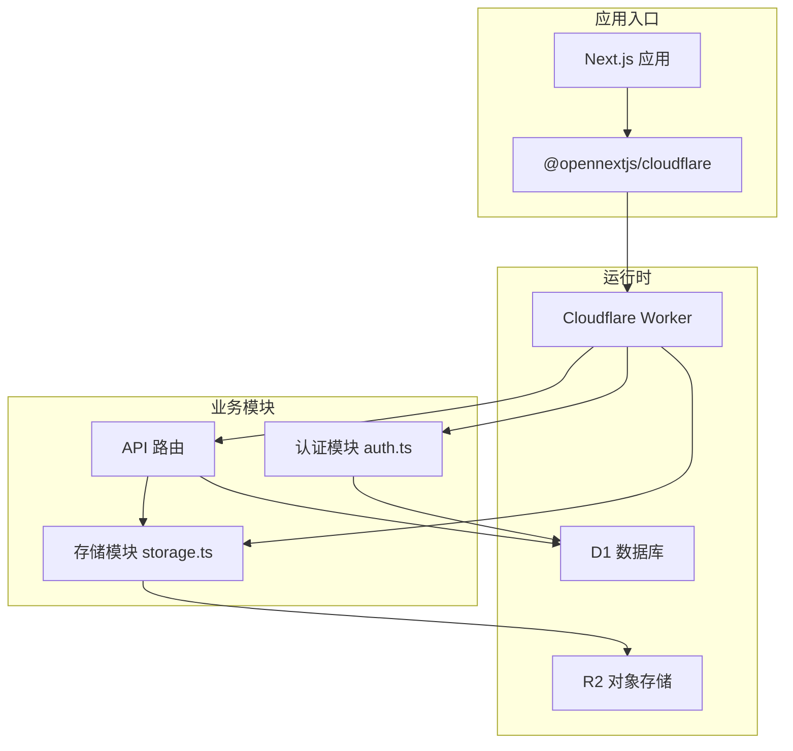
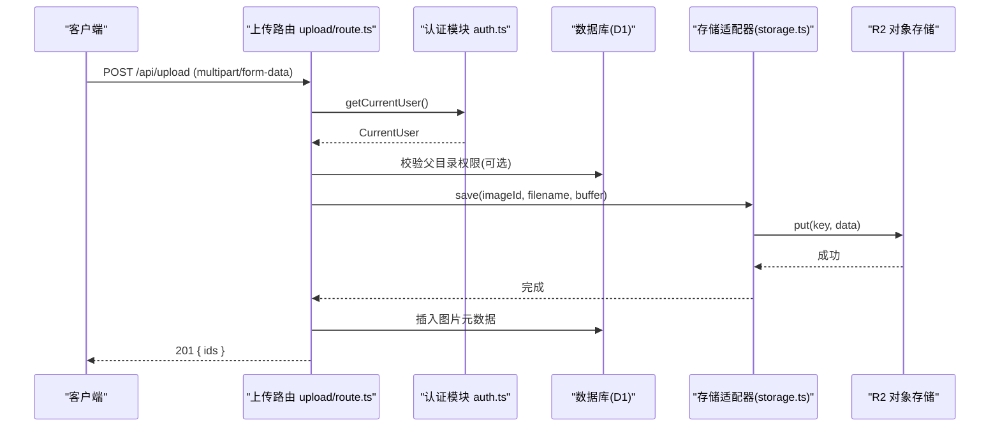
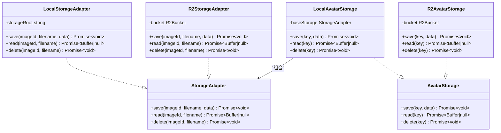
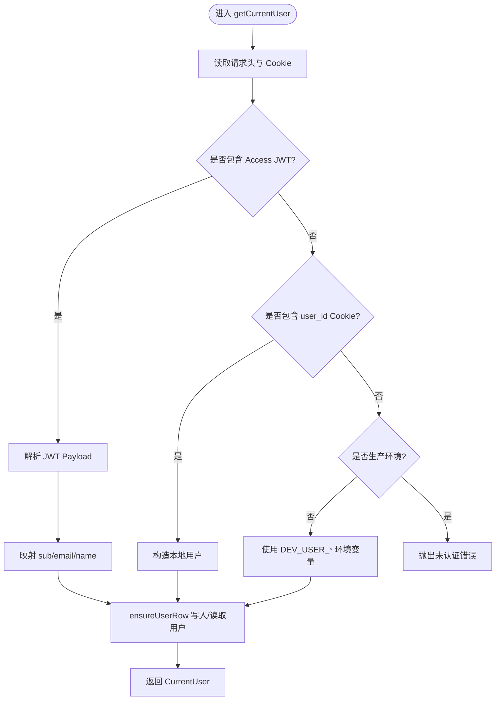
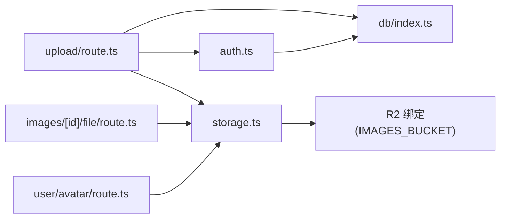

# 扩展开发

<cite>
**本文引用的文件**   
- [src/lib/storage.ts](file://src/lib/storage.ts)
- [src/lib/auth.ts](file://src/lib/auth.ts)
- [wrangler.jsonc](file://wrangler.jsonc)
- [open-next.config.ts](file://open-next.config.ts)
- [worker-configuration.d.ts](file://worker-configuration.d.ts)
- [src/app/api/upload/route.ts](file://src/app/api/upload/route.ts)
- [src/app/api/images/[imageId]/file/route.ts](file://src/app/api/images/[imageId]/file/route.ts)
- [src/app/api/user/avatar/route.ts](file://src/app/api/user/avatar/route.ts)
- [src/db/schema.ts](file://src/db/schema.ts)
- [src/db/index.ts](file://src/db/index.ts)
- [package.json](file://package.json)
</cite>

## 目录
1. [简介](#简介)
2. [项目结构](#项目结构)
3. [核心组件](#核心组件)
4. [架构总览](#架构总览)
5. [详细组件分析](#详细组件分析)
6. [依赖分析](#依赖分析)
7. [性能考虑](#性能考虑)
8. [故障排查指南](#故障排查指南)
9. [结论](#结论)
10. [附录](#附录)

## 简介
本指南面向希望在 Weable 中开发扩展的工程师，重点覆盖：
- 自定义存储适配器（StorageAdapter）实现、文件上传下载与错误处理
- 新增认证提供者（JWT、Cookie、用户信息映射）
- 第三方服务集成（API 客户端封装、缓存策略、重试机制）
- Cloudflare Workers 环境下的扩展要点（环境变量、绑定、依赖管理与性能优化）
- 完整的扩展示例与调试技巧

Weable 是一个部署在 Cloudflare Worker 上的图片管理应用，使用 Next.js + OpenNext 适配层运行于 CF Workers，数据库为 D1，对象存储为 R2。

## 项目结构
- 存储抽象与实现位于 src/lib/storage.ts，提供 StorageAdapter 与 AvatarStorage 接口，以及 Local/R2 两种实现和工厂方法 getStorage/getAvatarStorage。
- 认证逻辑位于 src/lib/auth.ts，支持 Cloudflare Access JWT、CF Authorization Cookie、本地会话 Cookie 与开发模式兜底用户。
- API 路由集中在 src/app/api/*，如上传、头像、图片读取等，均通过 getCurrentUser 获取当前用户并调用存储/数据库。
- Cloudflare 运行时配置在 wrangler.jsonc，定义 D1、R2 绑定；open-next.config.ts 用于 OpenNext 的 Cloudflare 适配与可选增量缓存。
- 类型声明 worker-configuration.d.ts 暴露 D1Database、R2Bucket、CloudflareEnv 等运行时类型。
- 数据库模型与 ID 生成在 src/db/schema.ts，数据库连接在 src/db/index.ts。

图表来源 
- [wrangler.jsonc:1-34](file://wrangler.jsonc#L1-L34)
- [open-next.config.ts:1-10](file://open-next.config.ts#L1-L10)
- [src/lib/storage.ts:1-214](file://src/lib/storage.ts#L1-L214)
- [src/lib/auth.ts:1-118](file://src/lib/auth.ts#L1-L118)

章节来源
- [wrangler.jsonc:1-34](file://wrangler.jsonc#L1-L34)
- [open-next.config.ts:1-10](file://open-next.config.ts#L1-L10)
- [package.json:1-40](file://package.json#L1-L40)

## 核心组件
- 存储适配器
  - StorageAdapter：统一 save/read/delete 三件套，参数包含 imageId、filename、Buffer。
  - AvatarStorage：头像专用接口，save/read/delete，key 作为唯一标识。
  - 实现类：LocalStorageAdapter、R2StorageAdapter、LocalAvatarStorage、R2AvatarStorage。
  - 工厂函数：getStorage()、getAvatarStorage() 自动选择 R2 或本地实现，并在缺失绑定时抛出明确错误。
- 认证模块
  - getCurrentUser()：从请求头/cookie 解析 Cloudflare Access JWT 或 Cookie，映射到 CurrentUser，并写入数据库确保存在。
  - 支持多种字段映射（sub、email、name/preferred_username/common_name）。
- 数据库与模型
  - users、images、channels 表及关系定义；ID 采用 uuidv7 + base58 编码。
  - getDb() 根据环境返回 D1 或本地 SQLite。

章节来源
- [src/lib/storage.ts:1-214](file://src/lib/storage.ts#L1-L214)
- [src/lib/auth.ts:1-118](file://src/lib/auth.ts#L1-L118)
- [src/db/schema.ts:1-100](file://src/db/schema.ts#L1-L100)
- [src/db/index.ts:43-60](file://src/db/index.ts#L43-L60)

## 架构总览
下图展示一次图片上传的端到端流程，体现认证、存储与数据库交互。

图表来源 
- [src/app/api/upload/route.ts:1-75](file://src/app/api/upload/route.ts#L1-L75)
- [src/lib/auth.ts:93-117](file://src/lib/auth.ts#L93-L117)
- [src/lib/storage.ts:184-213](file://src/lib/storage.ts#L184-L213)
- [wrangler.jsonc:23-32](file://wrangler.jsonc#L23-L32)

## 详细组件分析

### 存储适配器扩展指南
- 接口设计
  - StorageAdapter：save(imageId, filename, data)、read(imageId, filename)、delete(imageId, filename)。
  - AvatarStorage：save(key, data)、read(key)、delete(key)。
- 现有实现
  - LocalStorageAdapter：基于 node:fs/promises 与 node:path，路径安全校验，ENOENT 视为不存在。
  - R2StorageAdapter：基于 R2Bucket，put/get/delete，Buffer 与 Uint8Array 转换。
  - LocalAvatarStorage/R2AvatarStorage：对基础存储的包装，固定前缀隔离头像键空间。
- 工厂与绑定
  - getR2BucketBinding() 尝试从 @opennextjs/cloudflare 上下文获取 IMAGES_BUCKET。
  - getStorage()/getAvatarStorage() 单例化实例，优先 R2，否则回退本地；在 CF 环境缺失绑定时抛出明确错误。
- 错误处理
  - 路径段安全校验（禁止 .、..、/、\），防止路径穿越。
  - 读/删 ENOENT 语义化为“不存在”而非异常。
  - CF 环境下缺少绑定直接抛错，便于快速定位配置问题。

图表来源 
- [src/lib/storage.ts:1-214](file://src/lib/storage.ts#L1-L214)

章节来源
- [src/lib/storage.ts:1-214](file://src/lib/storage.ts#L1-L214)

#### 如何添加新的存储适配器
- 步骤
  1. 实现 StorageAdapter 或 AvatarStorage 接口。
  2. 在工厂函数中增加环境判断与实例创建逻辑（例如新云厂商 SDK 初始化）。
  3. 保持错误语义一致：读不到返回 null，删除不存在不抛错。
  4. 若需环境变量，参考现有 IMAGE_STORAGE_PATH、IMAGES_BUCKET 的使用方式。
- 注意事项
  - 避免同步 IO，所有 I/O 必须异步。
  - 严格校验 key/filename，防止路径注入。
  - 在 CF 环境中注意内存与 CPU 限制，尽量流式处理大文件。

章节来源
- [src/lib/storage.ts:15-33](file://src/lib/storage.ts#L15-L33)
- [src/lib/storage.ts:184-213](file://src/lib/storage.ts#L184-L213)

### 认证提供者扩展指南
- 现有流程
  - 从 headers/cookies 获取 cf-access-jwt-assertion、CF_Authorization、cf_authorization。
  - 解析 JWT payload，映射 sub/email/name 等字段为 CurrentUser。
  - ensureUserRow 保证用户存在于数据库，并返回 nickname/bio 等扩展字段。
  - 非生产环境允许通过 user_id cookie 或 DEV_USER_* 环境变量兜底。
- 新增认证提供者建议
  - 在 getCurrentUser 中增加新的解析分支（例如 Bearer Token、OAuth 回调状态码）。
  - 将外部身份映射为 CurrentUser，必要时拉取额外信息并更新数据库。
  - 保持错误语义：无法解析时抛出明确错误，便于上层统一处理。

图表来源 
- [src/lib/auth.ts:93-117](file://src/lib/auth.ts#L93-L117)
- [src/lib/auth.ts:29-78](file://src/lib/auth.ts#L29-L78)

章节来源
- [src/lib/auth.ts:1-118](file://src/lib/auth.ts#L1-L118)

#### 如何添加新的认证提供者
- 步骤
  1. 在 getCurrentUser 中增加新的解析逻辑（如解析 Authorization 头、查询参数或签名验证）。
  2. 将外部身份映射为 CurrentUser，必要时调用数据库写入或更新。
  3. 在错误分支给出明确提示，便于前端反馈。
- 注意事项
  - 避免在 SSR 阶段执行耗时操作，尽量轻量解析。
  - 对敏感字段进行最小化暴露，仅返回必要字段。

章节来源
- [src/lib/auth.ts:93-117](file://src/lib/auth.ts#L93-L117)

### 第三方服务集成指南
- 目标
  - 封装对外部服务的 API 客户端，统一错误处理、重试与缓存策略。
- 建议模式
  - 客户端封装：集中处理 URL、Header、鉴权、序列化。
  - 重试机制：指数退避、最大重试次数、可重试错误分类（网络超时、5xx 等）。
  - 缓存策略：按请求键值缓存响应，设置 TTL，支持失效与预热。
  - 降级与熔断：当外部服务不可用时返回默认值或触发告警。
- 与存储/认证的协作
  - 可将第三方结果落盘至 R2/D1，并通过 StorageAdapter/Auth 保持一致性。
  - 对于敏感数据，遵循最小权限原则，不在日志中输出。

[本节为通用指导，不直接分析具体文件]

### Cloudflare Workers 环境扩展要点
- 环境变量与绑定
  - D1：通过 wrangler.jsonc 的 d1_databases 配置，binding 名称为 DB。
  - R2：r2_buckets 配置，binding 名称为 IMAGES_BUCKET（也可复用同一 bucket 给缓存）。
  - Assets：静态资源目录与 binding ASSETS。
- 运行时类型
  - worker-configuration.d.ts 提供 D1Database、R2Bucket、CloudflareEnv 等类型，便于 TS 开发体验。
- OpenNext 适配
  - open-next.config.ts 启用 Cloudflare 适配，可开启 R2 增量缓存以提升性能。
- 性能优化
  - 使用 nodejs_compat 标志以兼容 Node API。
  - 避免在热路径加载大型依赖，按需动态 import。
  - 合理设置 Cache-Control，减少重复计算与传输。

章节来源
- [wrangler.jsonc:1-34](file://wrangler.jsonc#L1-L34)
- [worker-configuration.d.ts:1-38](file://worker-configuration.d.ts#L1-L38)
- [open-next.config.ts:1-10](file://open-next.config.ts#L1-L10)

## 依赖分析
- 运行时依赖
  - next、react、@opennextjs/cloudflare、drizzle-orm、better-sqlite3、uuidv7、bs58 等。
- 关键耦合
  - API 路由依赖 auth.ts 获取用户、storage.ts 存取文件、db/index.ts 访问数据库。
  - storage.ts 依赖 @opennextjs/cloudflare 获取 CF 上下文与环境绑定。
  - db/index.ts 根据环境返回 D1 或本地 SQLite。

图表来源 
- [src/app/api/upload/route.ts:1-75](file://src/app/api/upload/route.ts#L1-L75)
- [src/app/api/images/[imageId]/file/route.ts:1-47](file://src/app/api/images/[imageId]/file/route.ts#L1-L47)
- [src/app/api/user/avatar/route.ts:1-33](file://src/app/api/user/avatar/route.ts#L1-L33)
- [src/lib/storage.ts:184-213](file://src/lib/storage.ts#L184-L213)
- [src/db/index.ts:43-60](file://src/db/index.ts#L43-L60)

章节来源
- [package.json:1-40](file://package.json#L1-L40)
- [src/app/api/upload/route.ts:1-75](file://src/app/api/upload/route.ts#L1-L75)
- [src/lib/storage.ts:184-213](file://src/lib/storage.ts#L184-L213)
- [src/db/index.ts:43-60](file://src/db/index.ts#L43-L60)

## 性能考虑
- 存储层
  - 优先使用 R2 直传与流式读写，避免 Buffer 拷贝放大。
  - 对频繁读取的图片设置 immutable 缓存头，提升 CDN 命中率。
- 认证层
  - JWT 解析应轻量，避免不必要的字符串操作与 JSON 解析失败开销。
- 数据库层
  - 批量写入与索引优化，减少 N+1 查询。
  - 在 CF 环境优先使用 D1，本地开发回退 SQLite。
- 构建与部署
  - 按需引入依赖，减小包体积。
  - 启用 OpenNext 的 R2 增量缓存以降低冷启动与重复渲染成本。

[本节为通用指导，不直接分析具体文件]

## 故障排查指南
- 常见问题
  - R2 绑定缺失：在 CF 环境会抛出明确错误，检查 wrangler.jsonc 的 r2_buckets 配置。
  - D1 绑定缺失：在 CF 环境会抛出明确错误，检查 wrangler.jsonc 的 d1_databases 配置。
  - 路径非法：StorageAdapter 的路径段校验会拒绝包含 /、\、..、. 的输入。
  - 未认证：getCurrentUser 无法解析任何凭据时会抛出错误，检查请求头/Cookie 或开发环境变量。
- 调试技巧
  - 在 API 路由中打印关键变量（imageId、filename、userId）辅助定位。
  - 使用 Wrangler 本地模拟 CF 环境，验证绑定与环境变量。
  - 利用浏览器开发者工具查看请求头与 Cookie，确认认证信息传递正确。

章节来源
- [src/lib/storage.ts:184-213](file://src/lib/storage.ts#L184-L213)
- [src/db/index.ts:43-60](file://src/db/index.ts#L43-L60)
- [src/lib/auth.ts:93-117](file://src/lib/auth.ts#L93-L117)

## 结论
通过统一的存储适配器与认证模块，Weable 提供了良好的扩展点。开发者可以：
- 轻松替换或新增存储后端（R2、S3、OSS 等）。
- 接入更多认证提供方（OAuth、企业 SSO 等）。
- 封装第三方服务，结合缓存与重试提升稳定性。
- 在 Cloudflare Workers 环境下高效开发与部署，充分利用 D1/R2 能力。

[本节为总结，不直接分析具体文件]

## 附录
- 常用环境变量
  - IMAGE_STORAGE_PATH：本地存储根路径（非 CF 环境）。
  - NODE_ENV：区分生产与非生产行为（如开发用户兜底）。
  - DEV_USER_ID/DEV_USER_NAME/DEV_USER_EMAIL：开发模式用户信息。
- 相关 API 契约
  - 上传接口：POST /api/upload，支持多文件与 parentId。
  - 头像接口：POST /api/user/avatar，限制类型与大小。
  - 图片读取：GET /api/images/[imageId]/file，返回二进制与缓存头。

章节来源
- [src/app/api/upload/route.ts:1-75](file://src/app/api/upload/route.ts#L1-L75)
- [src/app/api/user/avatar/route.ts:1-33](file://src/app/api/user/avatar/route.ts#L1-L33)
- [src/app/api/images/[imageId]/file/route.ts:1-47](file://src/app/api/images/[imageId]/file/route.ts#L1-L47)
- [src/lib/auth.ts:15-19](file://src/lib/auth.ts#L15-L19)