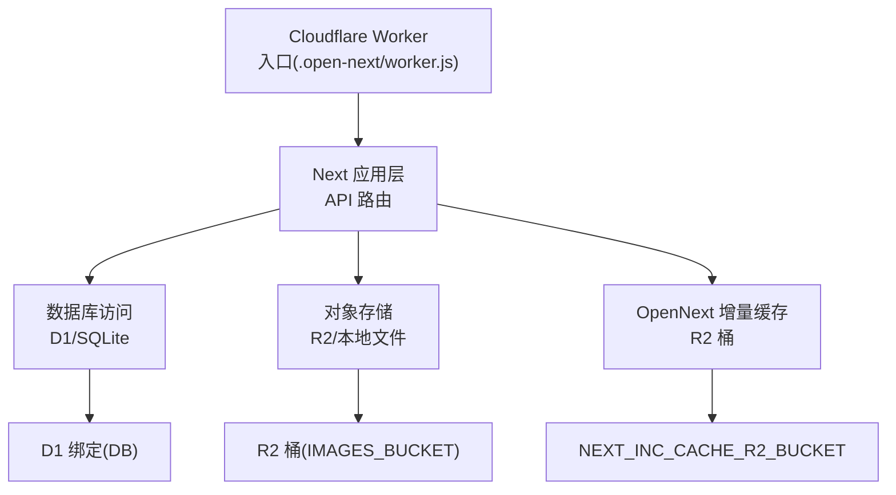
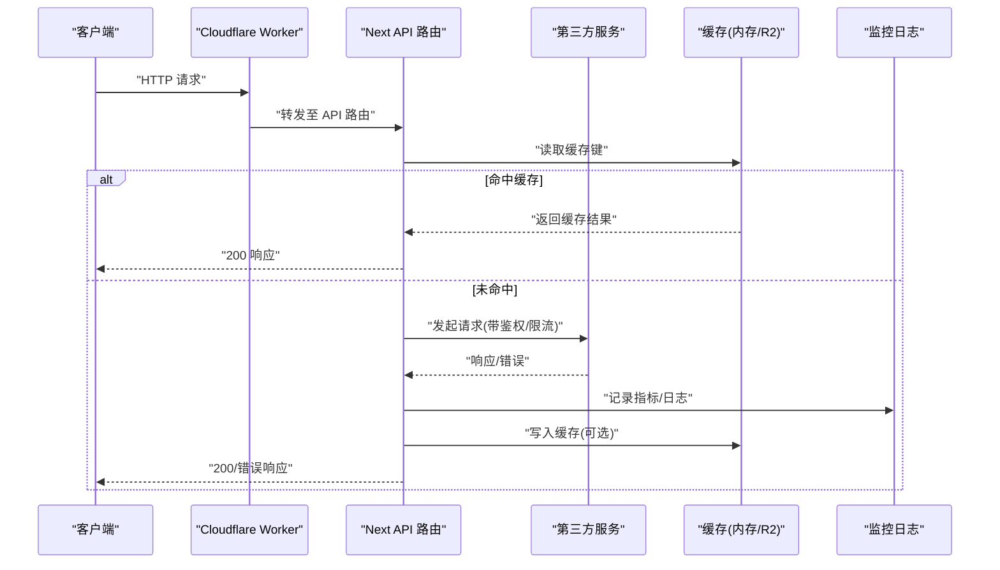
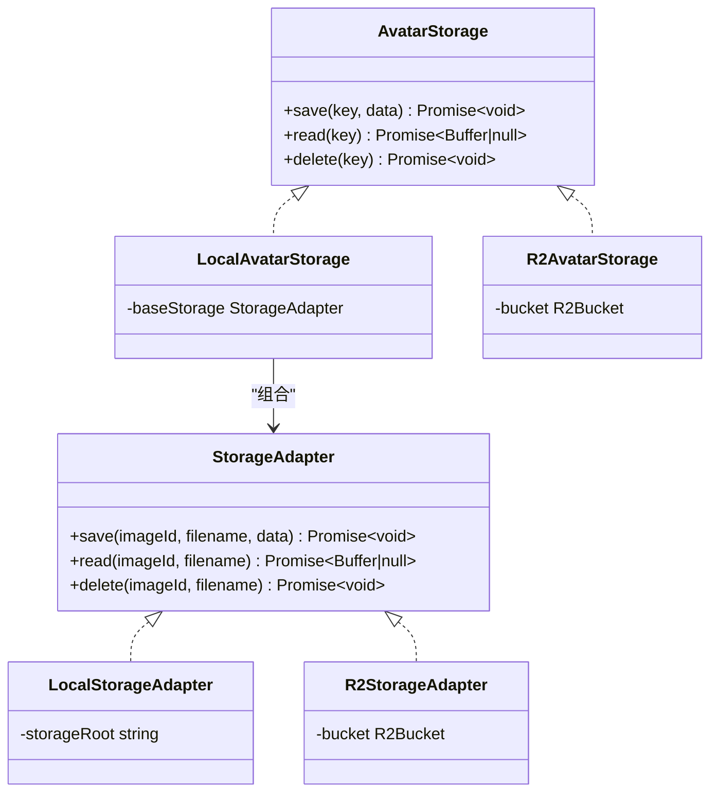
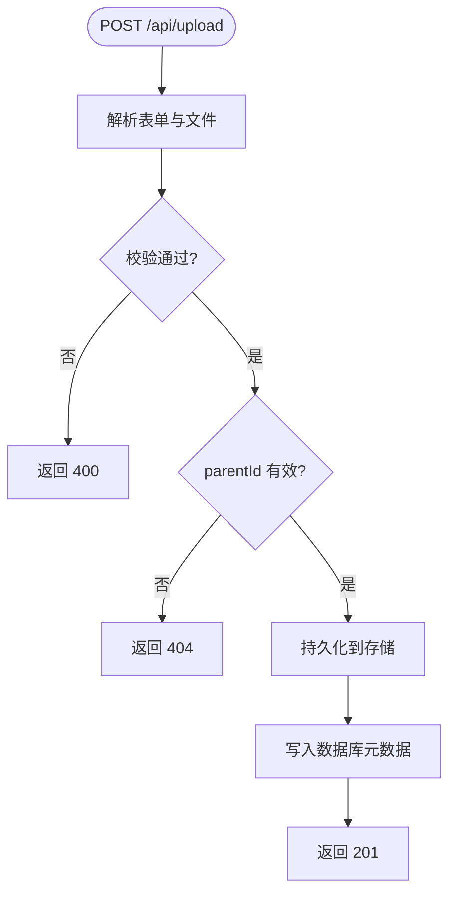
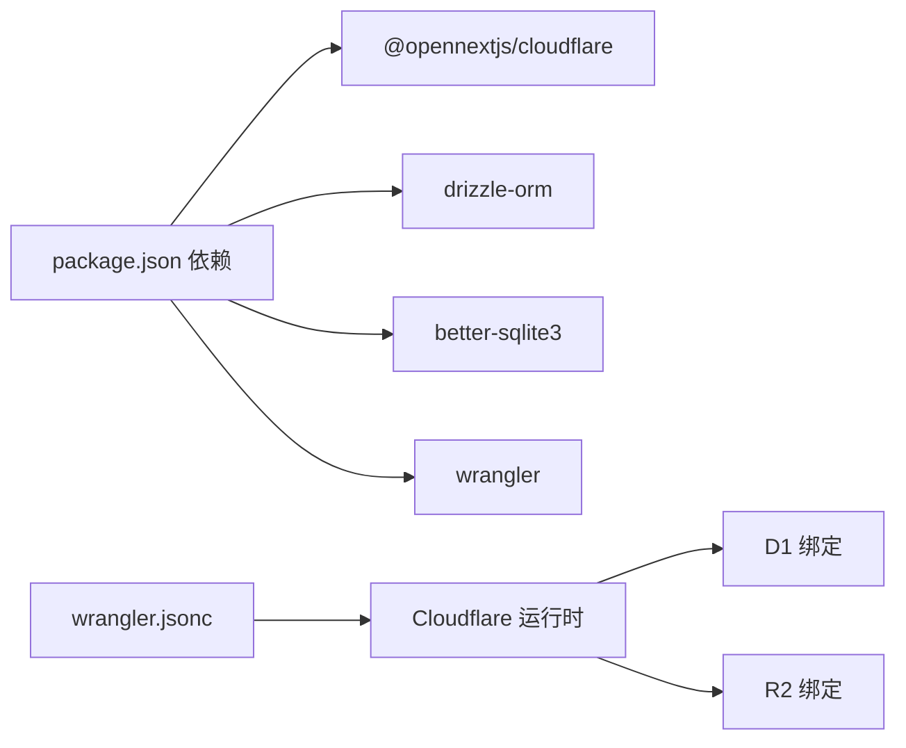

# 第三方服务集成

<cite>
**本文引用的文件**
- [package.json](file://package.json)
- [wrangler.jsonc](file://wrangler.jsonc)
- [worker-configuration.d.ts](file://worker-configuration.d.ts)
- [open-next.config.ts](file://open-next.config.ts)
- [next.config.ts](file://next.config.ts)
- [src/lib/storage.ts](file://src/lib/storage.ts)
- [src/db/index.ts](file://src/db/index.ts)
- [src/app/api/images/route.ts](file://src/app/api/images/route.ts)
- [src/app/api/upload/route.ts](file://src/app/api/upload/route.ts)
</cite>

## 目录
1. [简介](#简介)
2. [项目结构](#项目结构)
3. [核心组件](#核心组件)
4. [架构总览](#架构总览)
5. [详细组件分析](#详细组件分析)
6. [依赖分析](#依赖分析)
7. [性能考虑](#性能考虑)
8. [故障排查指南](#故障排查指南)
9. [结论](#结论)
10. [附录](#附录)

## 简介
本指南面向在 Cloudflare Workers 环境下为 Weable 应用集成外部第三方服务的工程实践。内容涵盖：
- HTTP 客户端封装、请求重试与错误处理策略
- 缓存策略（内存缓存、分布式缓存、缓存失效）
- 完整集成示例（API 密钥管理、请求限流、监控日志）
- 环境变量配置、依赖管理与版本兼容性
- 服务健康检查与故障转移最佳实践

Weable 基于 Next.js + OpenNext + Cloudflare Workers，使用 D1 作为数据库、R2 作为对象存储，并通过 @opennextjs/cloudflare 提供运行时上下文与增量缓存能力。

## 项目结构
- 运行环境与绑定
  - Wrangler 配置定义了 D1 数据库绑定 DB、R2 桶 IMAGES_BUCKET 以及 Next 增量缓存 R2 桶 NEXT_INC_CACHE_R2_BUCKET。
  - worker-configuration.d.ts 声明了 D1 与 R2 的运行时类型，便于 TypeScript 类型提示。
- 数据访问与存储
  - src/db/index.ts 根据是否处于 Cloudflare 环境自动选择 D1 或本地 SQLite。
  - src/lib/storage.ts 抽象 StorageAdapter，支持本地文件系统与 R2 两种实现，并提供头像存储适配。
- API 路由
  - src/app/api/images/route.ts 与 src/app/api/upload/route.ts 展示了认证、参数校验、数据库写入与存储写入的流程。
- 构建与缓存
  - open-next.config.ts 启用/切换 R2 增量缓存。
  - next.config.ts 定义页面扩展名、严格模式等基础配置。

图表来源
- [wrangler.jsonc:1-33](file://wrangler.jsonc#L1-L33)
- [open-next.config.ts:1-9](file://open-next.config.ts#L1-L9)
- [src/db/index.ts:1-61](file://src/db/index.ts#L1-L61)
- [src/lib/storage.ts:1-214](file://src/lib/storage.ts#L1-L214)

章节来源
- [wrangler.jsonc:1-33](file://wrangler.jsonc#L1-L33)
- [worker-configuration.d.ts:1-39](file://worker-configuration.d.ts#L1-L39)
- [open-next.config.ts:1-9](file://open-next.config.ts#L1-L9)
- [next.config.ts:1-15](file://next.config.ts#L1-L15)
- [src/db/index.ts:1-61](file://src/db/index.ts#L1-L61)
- [src/lib/storage.ts:1-214](file://src/lib/storage.ts#L1-L214)

## 核心组件
- 存储适配器
  - StorageAdapter 接口统一 save/read/delete 语义；Local/R2 实现分别对应本地文件与 R2 对象存储。
  - 头像存储通过 LocalAvatarStorage/R2AvatarStorage 复用底层存储。
- 数据库访问
  - getDb() 在 Cloudflare 环境中优先使用 D1，否则回退到本地 SQLite；缺失绑定时抛出明确错误。
- API 路由
  - 上传与列表接口演示了鉴权、参数校验、并发写入与响应构造。

章节来源
- [src/lib/storage.ts:1-214](file://src/lib/storage.ts#L1-L214)
- [src/db/index.ts:1-61](file://src/db/index.ts#L1-L61)
- [src/app/api/upload/route.ts:1-75](file://src/app/api/upload/route.ts#L1-L75)
- [src/app/api/images/route.ts:1-66](file://src/app/api/images/route.ts#L1-L66)

## 架构总览
下图展示从请求进入 Worker 到调用外部服务（如第三方 API）的典型路径，并标注可插拔的重试、限流、缓存与监控点。

图表来源
- [wrangler.jsonc:1-33](file://wrangler.jsonc#L1-L33)
- [open-next.config.ts:1-9](file://open-next.config.ts#L1-L9)
- [src/app/api/upload/route.ts:1-75](file://src/app/api/upload/route.ts#L1-L75)

## 详细组件分析

### 存储适配器与对象存储
- 设计要点
  - 通过 StorageAdapter 抽象屏蔽底层差异，便于在本地与 R2 之间切换。
  - 安全校验：对 imageId/filename/avatar key 进行白名单式校验，防止路径穿越。
  - 运行时检测：getR2BucketBinding 尝试获取 Cloudflare 上下文中的 R2 桶，未配置时抛出明确错误或在本地回退。
- 复杂度与性能
  - 读写均为 I/O 密集型，建议结合连接池/批量操作与压缩传输降低延迟。
  - 大文件上传建议分片与断点续传（当前实现为一次性 Buffer）。

图表来源
- [src/lib/storage.ts:1-214](file://src/lib/storage.ts#L1-L214)

章节来源
- [src/lib/storage.ts:1-214](file://src/lib/storage.ts#L1-L214)

### 数据库访问与运行时选择
- 行为说明
  - 检测到 Cloudflare 环境且存在 D1 绑定则使用 D1；否则若处于 CF 环境但缺少绑定则抛错；否则使用本地 SQLite。
- 建议
  - 生产环境务必配置 D1 绑定，避免误用本地库导致不可预期行为。

章节来源
- [src/db/index.ts:1-61](file://src/db/index.ts#L1-L61)
- [wrangler.jsonc:16-22](file://wrangler.jsonc#L16-L22)
- [worker-configuration.d.ts:1-39](file://worker-configuration.d.ts#L1-L39)

### API 路由与请求处理流程
- 上传流程
  - 校验文件数量、MIME 前缀、大小限制；解析 parentId 并校验目录存在性；写入存储后批量插入元数据。
- 列表流程
  - 按用户与父级过滤，排序目录优先并按更新时间倒序。

图表来源
- [src/app/api/upload/route.ts:1-75](file://src/app/api/upload/route.ts#L1-L75)

章节来源
- [src/app/api/upload/route.ts:1-75](file://src/app/api/upload/route.ts#L1-L75)
- [src/app/api/images/route.ts:1-66](file://src/app/api/images/route.ts#L1-L66)

### 增量缓存与分布式缓存
- OpenNext 增量缓存
  - 可通过 open-next.config.ts 启用 R2 作为增量缓存后端，减少重复渲染成本。
- 自定义缓存策略
  - 建议在 API 层引入“内存缓存 + R2 分布式缓存”双层结构：热数据走内存，冷数据落 R2，并设置合理的 TTL 与失效策略。

章节来源
- [open-next.config.ts:1-9](file://open-next.config.ts#L1-L9)
- [wrangler.jsonc:23-32](file://wrangler.jsonc#L23-L32)

## 依赖分析
- 关键依赖
  - @opennextjs/cloudflare：提供 Cloudflare 运行时上下文与增量缓存能力。
  - drizzle-orm/better-sqlite3/d1：统一 ORM 访问 D1 与本地 SQLite。
  - wrangler：Cloudflare 开发与部署工具链。
- 版本与兼容性
  - compatibility_date 与 compatibility_flags 控制运行时特性。
  - nodejs_compat 标志允许 Node.js 兼容 API。

图表来源
- [package.json:1-40](file://package.json#L1-L40)
- [wrangler.jsonc:1-33](file://wrangler.jsonc#L1-L33)

章节来源
- [package.json:1-40](file://package.json#L1-L40)
- [wrangler.jsonc:1-33](file://wrangler.jsonc#L1-L33)

## 性能考虑
- 网络请求
  - 使用连接复用与超时控制；对幂等 GET 请求启用缓存；对写操作采用批量化。
- 缓存
  - 内存缓存用于短 TTL 热点数据；R2 用于跨实例共享的长 TTL 数据；注意缓存键设计与失效策略。
- I/O
  - 大文件上传建议使用分块与流式处理；存储端开启压缩与 CDN 加速。
- 数据库
  - 合理使用索引与查询条件；避免 N+1 查询；必要时使用批量写入。

[本节为通用指导，不直接分析具体文件]

## 故障排查指南
- 常见错误与定位
  - 缺少 D1/R2 绑定：在 Cloudflare 环境但未配置绑定时会抛出明确错误，检查 wrangler.jsonc 中 d1_databases 与 r2_buckets。
  - 本地开发无法访问绑定：确认是否在 CF 上下文；本地开发将回退到 SQLite/本地文件。
  - 上传失败：检查 MIME 前缀、文件大小限制与父目录存在性。
- 建议的调试步骤
  - 打开 Observability（已在 wrangler.jsonc 启用），查看请求链路日志。
  - 逐步缩小范围：先验证存储与数据库连通性，再验证第三方 API 可达性与鉴权。

章节来源
- [wrangler.jsonc:1-33](file://wrangler.jsonc#L1-L33)
- [src/db/index.ts:43-60](file://src/db/index.ts#L43-L60)
- [src/lib/storage.ts:184-213](file://src/lib/storage.ts#L184-L213)
- [src/app/api/upload/route.ts:14-73](file://src/app/api/upload/route.ts#L14-L73)

## 结论
Weable 在 Cloudflare Workers 上已具备清晰的存储与数据库抽象、完善的 API 路由范式与增量缓存能力。在此基础上，可按本指南引入统一的 HTTP 客户端、重试与限流、多级缓存与健康检查机制，以稳健地集成各类第三方服务。

[本节为总结，不直接分析具体文件]

## 附录

### 第三方服务集成实施清单（可直接落地）
- HTTP 客户端封装
  - 统一封装 fetch，注入鉴权头、超时、重试（指数退避）、熔断与降级。
  - 针对幂等 GET 请求增加缓存键与 TTL 控制。
- 请求重试与错误处理
  - 仅对幂等请求重试；区分网络错误与服务端错误；记录结构化日志。
- 缓存策略
  - 内存缓存：进程内 Map，TTL 秒级，容量上限与 LRU 淘汰。
  - 分布式缓存：R2 或 KV（如需），TTL 分钟/小时级，键命名规范含版本与租户。
  - 失效机制：发布事件触发主动失效；过期时间到期自动失效；写扩散更新。
- API 密钥管理
  - 通过环境变量注入密钥；禁止硬编码；按环境隔离；定期轮换。
- 请求限流
  - 基于令牌桶或漏桶算法；按 IP/用户维度限流；超限返回 429。
- 监控日志
  - 记录请求 ID、耗时、状态码、上游地址、错误堆栈摘要；接入 Observability。
- 环境变量与兼容性
  - 在 wrangler.jsonc 与 .env 中集中管理；使用 worker-configuration.d.ts 提供类型提示。
- 健康检查与故障转移
  - 暴露 /health 端点；多副本/多区域部署；主备切换与快速失败。

[本节为概念性指引，不直接分析具体文件]