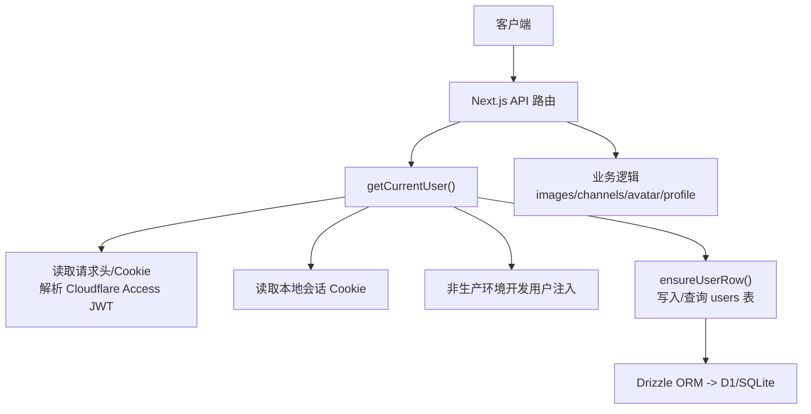
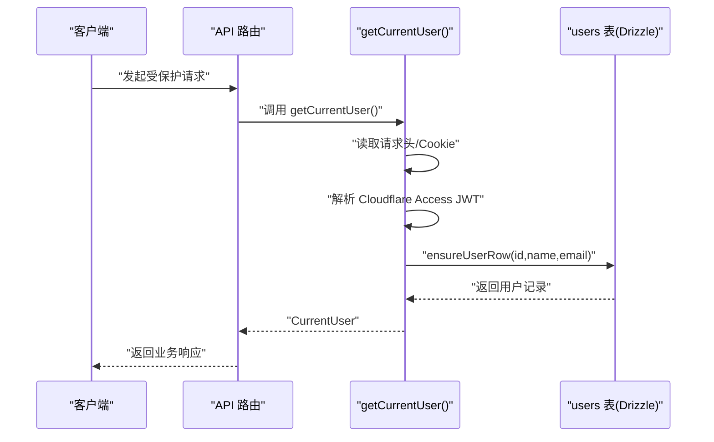
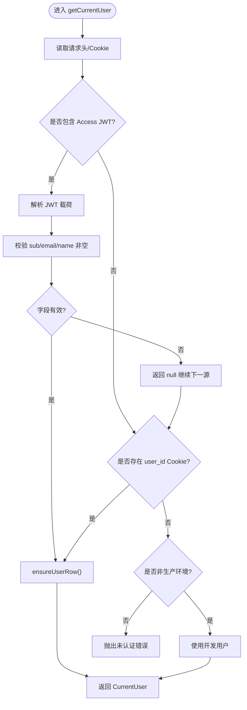
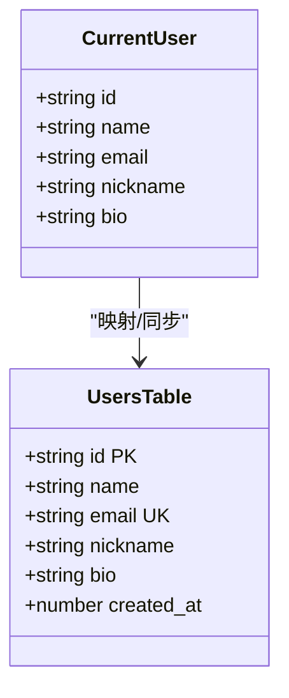
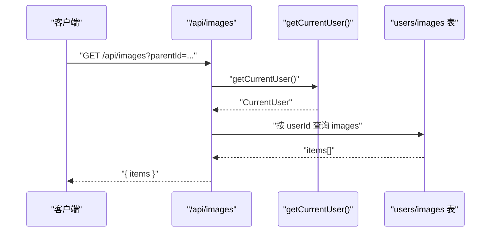
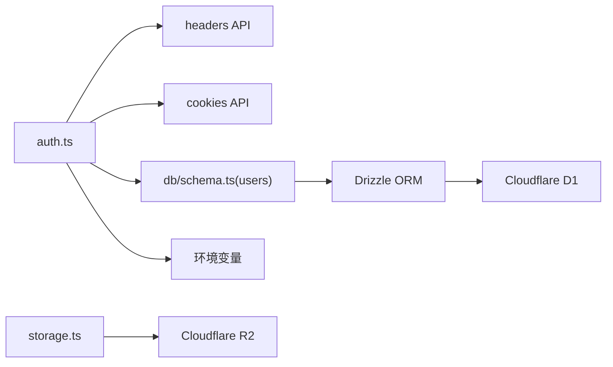

# 认证提供者开发

<cite>
**本文引用的文件**   
- [src/lib/auth.ts](file://src/lib/auth.ts)
- [src/db/schema.ts](file://src/db/schema.ts)
- [src/app/api/user/profile/route.ts](file://src/app/api/user/profile/route.ts)
- [src/app/api/images/route.ts](file://src/app/api/images/route.ts)
- [src/app/api/images/[imageId]/file/route.ts](file://src/app/api/images/[imageId]/file/route.ts)
- [src/app/api/user/avatar/route.ts](file://src/app/api/user/avatar/route.ts)
- [wrangler.jsonc](file://wrangler.jsonc)
</cite>

## 目录
1. [简介](#简介)
2. [项目结构](#项目结构)
3. [核心组件](#核心组件)
4. [架构总览](#架构总览)
5. [详细组件分析](#详细组件分析)
6. [依赖分析](#依赖分析)
7. [性能考虑](#性能考虑)
8. [故障排查指南](#故障排查指南)
9. [结论](#结论)
10. [附录](#附录)

## 简介
本指南面向希望在 Weable 应用中扩展或新增“认证提供者”的开发者。Weable 当前实现了多源认证机制，支持：
- Cloudflare Access JWT（通过请求头与 Cookie 传递）
- 本地会话 Cookie（用于开发/回退场景）
- 非生产环境的开发用户注入

认证流程将外部身份令牌解析为统一的 CurrentUser 对象，并自动在数据库中确保用户记录存在，从而简化业务层鉴权逻辑。本文从架构、数据流、集成方式、错误处理、性能优化到最佳实践，提供完整的开发参考。

## 项目结构
认证相关代码集中在以下位置：
- 认证核心逻辑：src/lib/auth.ts
- 用户模型与数据库表定义：src/db/schema.ts
- API 路由对认证的调用示例：src/app/api/* 下的多个 route.ts
- 部署配置（Cloudflare D1/R2）：wrangler.jsonc

图表来源
- [src/lib/auth.ts:93-117](file://src/lib/auth.ts#L93-L117)
- [src/db/schema.ts:26-33](file://src/db/schema.ts#L26-L33)
- [wrangler.jsonc:16-22](file://wrangler.jsonc#L16-L22)

章节来源
- [src/lib/auth.ts:1-118](file://src/lib/auth.ts#L1-L118)
- [src/db/schema.ts:1-100](file://src/db/schema.ts#L1-L100)
- [wrangler.jsonc:1-34](file://wrangler.jsonc#L1-L34)

## 核心组件
- CurrentUser 接口：统一的用户上下文，包含 id、name、email、nickname、bio。
- getCurrentUser()：入口函数，负责从多种来源解析身份并返回 CurrentUser。
- ensureUserRow()：幂等地确保用户存在于 users 表中，避免重复创建。
- Cloudflare Access JWT 解析：从 cf-access-jwt-assertion 头或 CF_Authorization/cf_authorization Cookie 中获取并解析 payload。
- 本地会话 Cookie：user_id 作为回退方案。
- 开发用户注入：非生产环境使用环境变量注入默认用户。

章节来源
- [src/lib/auth.ts:7-13](file://src/lib/auth.ts#L7-L13)
- [src/lib/auth.ts:93-117](file://src/lib/auth.ts#L93-L117)
- [src/lib/auth.ts:80-91](file://src/lib/auth.ts#L80-L91)
- [src/lib/auth.ts:64-78](file://src/lib/auth.ts#L64-L78)
- [src/lib/auth.ts:15-19](file://src/lib/auth.ts#L15-L19)

## 架构总览
Weable 的认证架构以“多源输入 + 统一输出”为核心：
- 输入源优先级：Cloudflare Access JWT > 本地会话 Cookie > 开发用户注入
- 输出：CurrentUser 对象，供各 API 路由直接使用
- 数据持久化：users 表由 Drizzle ORM 管理，D1/SQLite 存储

图表来源
- [src/lib/auth.ts:93-117](file://src/lib/auth.ts#L93-L117)
- [src/db/schema.ts:26-33](file://src/db/schema.ts#L26-L33)

章节来源
- [src/lib/auth.ts:93-117](file://src/lib/auth.ts#L93-L117)
- [src/db/schema.ts:26-33](file://src/db/schema.ts#L26-L33)

## 详细组件分析

### Cloudflare Access JWT 集成
- 支持的来源：
  - 请求头：cf-access-jwt-assertion
  - Cookie：CF_Authorization、cf_authorization
- 解析策略：
  - 解码 Base64Url 载荷
  - 提取 sub、email、name/preferred_username/common_name
  - 校验必填字段非空
- 安全建议：
  - 在生产环境中应验证签名与过期时间（当前实现仅解析载荷）
  - 建议结合 Cloudflare Access 策略限制访问范围

图表来源
- [src/lib/auth.ts:93-117](file://src/lib/auth.ts#L93-L117)
- [src/lib/auth.ts:64-78](file://src/lib/auth.ts#L64-L78)
- [src/lib/auth.ts:29-56](file://src/lib/auth.ts#L29-L56)

章节来源
- [src/lib/auth.ts:93-117](file://src/lib/auth.ts#L93-L117)
- [src/lib/auth.ts:64-78](file://src/lib/auth.ts#L64-L78)
- [src/lib/auth.ts:29-56](file://src/lib/auth.ts#L29-L56)

### 用户信息映射与同步
- 映射规则：
  - id ← sub
  - email ← email
  - name ← name / preferred_username / common_name / email（回退）
- 同步策略：
  - ensureUserRow() 使用 onConflictDoNothing 保证幂等
  - 若不存在则插入；若已存在则直接读取 nickname/bio 等扩展字段

图表来源
- [src/lib/auth.ts:7-13](file://src/lib/auth.ts#L7-L13)
- [src/db/schema.ts:26-33](file://src/db/schema.ts#L26-L33)

章节来源
- [src/lib/auth.ts:80-91](file://src/lib/auth.ts#L80-L91)
- [src/db/schema.ts:26-33](file://src/db/schema.ts#L26-L33)

### API 路由中的认证使用示例
- 图片列表接口：GET /api/images
  - 调用 getCurrentUser() 获取用户上下文
  - 基于 userId 过滤资源
- 头像上传接口：POST /api/user/avatar
  - 先认证再校验文件类型与大小
  - 将头像保存到 R2/本地存储
- 图片文件下载接口：GET /api/images/[imageId]/file
  - 认证后校验资源归属并返回二进制数据

图表来源
- [src/app/api/images/route.ts:9-31](file://src/app/api/images/route.ts#L9-L31)
- [src/lib/auth.ts:93-117](file://src/lib/auth.ts#L93-L117)

章节来源
- [src/app/api/images/route.ts:1-66](file://src/app/api/images/route.ts#L1-L66)
- [src/app/api/user/avatar/route.ts:1-33](file://src/app/api/user/avatar/route.ts#L1-L33)
- [src/app/api/images/[imageId]/file/route.ts:1-47](file://src/app/api/images/[imageId]/file/route.ts#L1-L47)

### 添加新的认证提供者（步骤与要点）
- 确定新来源：例如 OAuth2 Token、SAML Assertion、企业 IdP 的自定义 JWT。
- 在 getCurrentUser() 中增加解析分支：
  - 优先于现有来源检查新来源的请求头/Cookie
  - 解析并校验必要字段（如 sub、email、name）
- 复用 ensureUserRow() 进行用户同步：
  - 保持幂等插入与读取扩展字段
- 安全加固：
  - 验证签名、有效期、受众（aud）、签发者（iss）
  - 限制允许的算法与密钥来源
- 错误处理：
  - 解析失败时降级到下一来源
  - 所有来源均失败时抛出明确错误
- 测试覆盖：
  - 单元测试：解析器、字段映射、幂等性
  - 集成测试：端到端认证流程

章节来源
- [src/lib/auth.ts:93-117](file://src/lib/auth.ts#L93-L117)
- [src/lib/auth.ts:80-91](file://src/lib/auth.ts#L80-L91)

### 自定义认证逻辑的实现建议
- 中间件模式：封装认证逻辑为可插拔模块，便于切换与组合。
- 策略枚举：定义不同提供者的策略标识，运行时选择解析器。
- 缓存层：对频繁解析的 JWT 做短期缓存（注意失效策略）。
- 审计日志：记录认证成功/失败、来源、IP、UA 等关键信息。

[本节为概念性内容，不直接分析具体文件]

## 依赖分析
- 认证模块依赖：
  - Next.js headers/cookies API
  - Drizzle ORM 与 users 表 schema
  - 环境变量（NODE_ENV、DEV_USER_*）
- 部署依赖：
  - Cloudflare D1（数据库绑定）
  - Cloudflare R2（对象存储绑定）

图表来源
- [src/lib/auth.ts:1-5](file://src/lib/auth.ts#L1-L5)
- [src/db/schema.ts:26-33](file://src/db/schema.ts#L26-L33)
- [wrangler.jsonc:16-32](file://wrangler.jsonc#L16-L32)

章节来源
- [src/lib/auth.ts:1-5](file://src/lib/auth.ts#L1-L5)
- [src/db/schema.ts:26-33](file://src/db/schema.ts#L26-L33)
- [wrangler.jsonc:16-32](file://wrangler.jsonc#L16-L32)

## 性能考虑
- JWT 解析开销：Base64 解码与 JSON 解析应避免重复计算，可在上层缓存解析结果。
- 数据库写入频率：ensureUserRow() 使用 onConflictDoNothing，减少冲突重试成本。
- 连接池与超时：合理配置 Drizzle 连接池与超时，避免高并发下阻塞。
- 缓存策略：对只读用户信息（nickname/bio）可引入短 TTL 缓存。
- 最小化 I/O：仅在必要时读取 Cookie/Header，避免多余解析。

[本节为通用性能指导，不直接分析具体文件]

## 故障排查指南
- 常见错误：
  - “无法从 Cloudflare Access JWT 或会话 Cookie 解析用户”：检查请求头/Cookie 是否正确设置
  - “无效的用户 ID”：校验路径参数格式与白名单
  - “未找到父目录”：确认 parentId 归属当前用户且类型为目录
- 调试建议：
  - 打印请求头与 Cookie 的关键字段（脱敏）
  - 在非生产环境启用开发用户注入以快速定位问题
  - 查看 D1 日志与错误堆栈

章节来源
- [src/lib/auth.ts:116-117](file://src/lib/auth.ts#L116-L117)
- [src/app/api/images/[imageId]/file/route.ts:15-28](file://src/app/api/images/[imageId]/file/route.ts#L15-L28)
- [src/app/api/images/route.ts:16-31](file://src/app/api/images/route.ts#L16-L31)

## 结论
Weable 的认证系统以简洁的多源解析与统一的 CurrentUser 输出为核心，既支持 Cloudflare Access JWT，也兼容本地会话与开发注入。通过 ensureUserRow() 的幂等同步，业务层无需关心用户初始化细节。扩展新的认证提供者只需在入口处增加解析分支并复用同步逻辑，同时加强签名验证与安全策略即可。

[本节为总结性内容，不直接分析具体文件]

## 附录
- 环境变量建议：
  - NODE_ENV：区分开发与生产环境
  - DEV_USER_ID/DEV_USER_NAME/DEV_USER_EMAIL：开发用户注入
  - DB_PATH：本地 SQLite 路径（非 Cloudflare 环境）
  - IMAGE_STORAGE_PATH：头像与文件存储根路径
- 部署配置要点：
  - wrangler.jsonc 中正确绑定 D1 与 R2
  - assets 目录与 binding 名称需匹配

章节来源
- [wrangler.jsonc:16-32](file://wrangler.jsonc#L16-L32)
- [src/lib/auth.ts:15-19](file://src/lib/auth.ts#L15-L19)