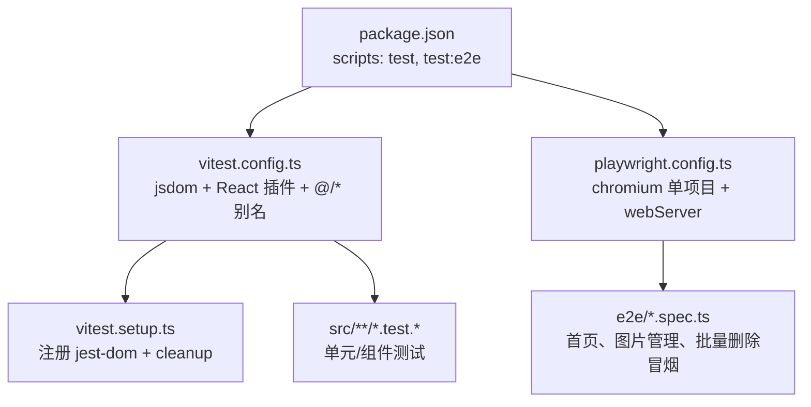
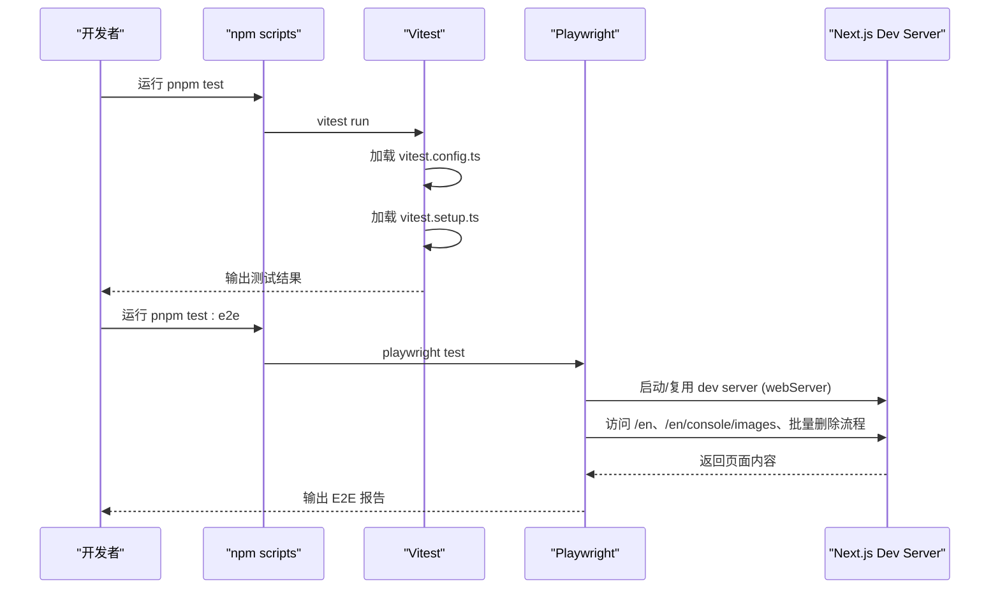
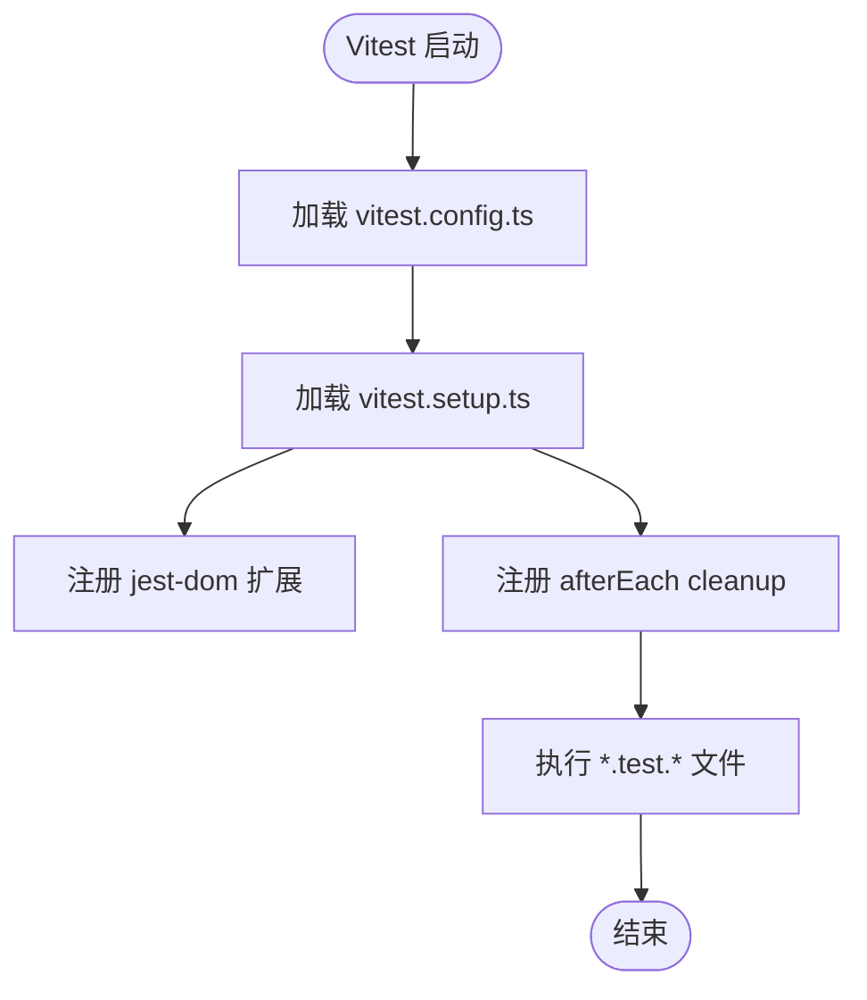
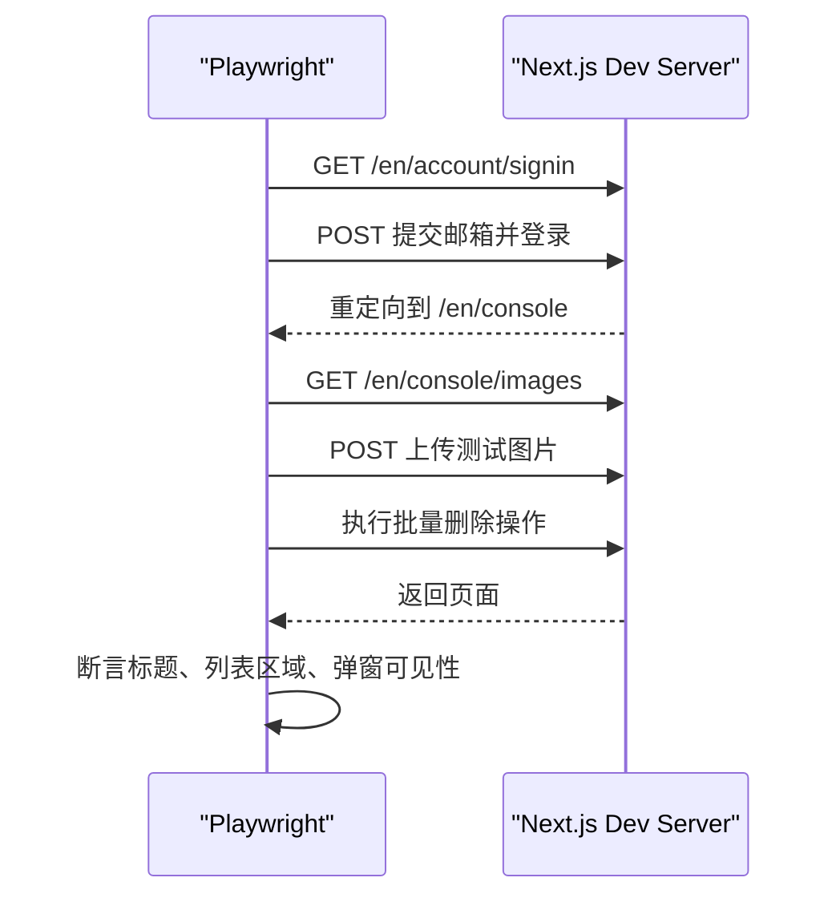
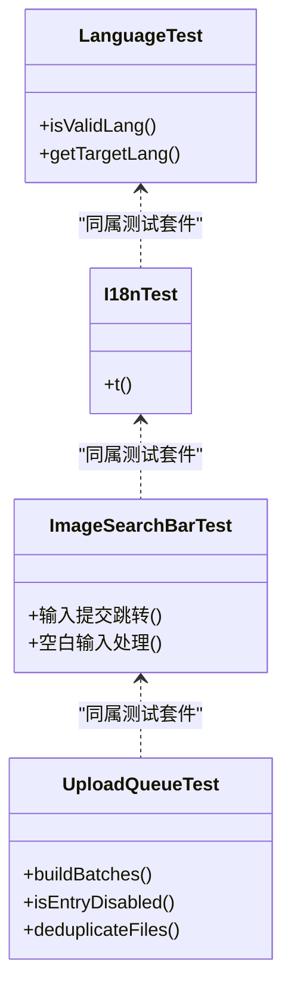
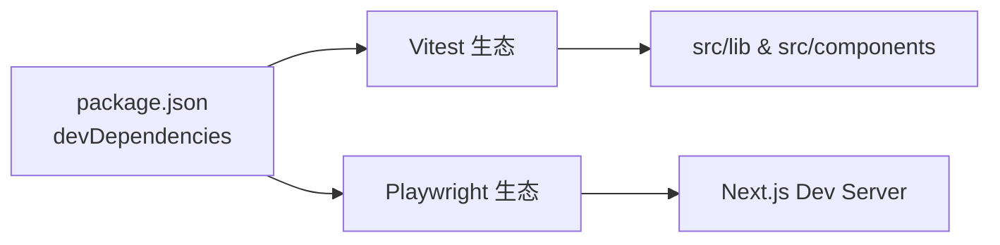

# 测试套件设置

<cite>
**本文引用的文件**
- [package.json](file://package.json)
- [vitest.config.ts](file://vitest.config.ts)
- [vitest.setup.ts](file://vitest.setup.ts)
- [playwright.config.ts](file://playwright.config.ts)
- [e2e/home.spec.ts](file://e2e/home.spec.ts)
- [e2e/console-images.spec.ts](file://e2e/console-images.spec.ts)
- [e2e/console-batch-delete.spec.ts](file://e2e/console-batch-delete.spec.ts)
- [src/lib/language.test.ts](file://src/lib/language.test.ts)
- [src/lib/i18n.test.ts](file://src/lib/i18n.test.ts)
- [src/components/ImageSearchBar.test.tsx](file://src/components/ImageSearchBar.test.tsx)
- [src/components/UploadQueue.test.ts](file://src/components/UploadQueue.test.ts)
</cite>

## 目录
1. [简介](#简介)
2. [项目结构](#项目结构)
3. [核心组件](#核心组件)
4. [架构总览](#架构总览)
5. [详细组件分析](#详细组件分析)
6. [依赖关系分析](#依赖关系分析)
7. [性能考量](#性能考量)
8. [故障排查指南](#故障排查指南)
9. [结论](#结论)
10. [附录](#附录)

## 简介
本特性为 Weable 项目引入两层测试能力：
- 单元与组件测试：基于 Vitest + @testing-library/react（jsdom），覆盖 src/lib 的纯函数模块与 src/components 的纯渲染组件，就近放置 *.test.* 文件。
- E2E 冒烟测试：基于 Playwright Test，单 Chromium 项目，覆盖 /en 首页、/en/console/images 图片管理页以及批量删除工作流，断言轻量、稳定。

测试设施全部位于开发依赖，不影响生产构建产物；E2E 通过 webServer 复用或自动拉起 dev server，保证执行效率与稳定性。

## 项目结构
测试相关配置与用例分布如下：
- 根级配置：vitest.config.ts、vitest.setup.ts、playwright.config.ts
- 单元测试/组件测试：src/lib/*.test.ts、src/components/*.test.tsx（就近共置）
- E2E 用例：e2e/*.spec.ts（独立于 src，避免被 Next.js 编译）

**图表来源**
- [package.json:5-12](file://package.json#L5-L12)
- [vitest.config.ts:7-19](file://vitest.config.ts#L7-L19)
- [vitest.setup.ts:1-11](file://vitest.setup.ts#L1-L11)
- [playwright.config.ts:4-25](file://playwright.config.ts#L4-L25)

## 核心组件
- Vitest 环境
  - 使用 jsdom 承载 React 组件渲染，启用 @vitejs/plugin-react 支持 JSX，并通过 resolve.alias 将 @/* 映射到 ./src/*，复用 tsconfig 路径别名。
  - setupFiles 指向 vitest.setup.ts，全局注册 @testing-library/jest-dom 扩展断言并在每个用例后清理 DOM。
  - 排除 e2e/**，避免与 Playwright 冲突。

- Playwright E2E
  - 单一 chromium 项目，baseURL 指向 http://localhost:7600。
  - webServer 复用已运行的 dev server（reuseExistingServer: true），未运行时自动启动 pnpm dev，超时 120 秒退出而非挂起。
  - 串行执行（workers: 1, fullyParallel: false），利于共享登录态与提升稳定性。

- 测试脚本
  - package.json 提供 test（vitest run）、test:watch（vitest）、test:e2e（playwright test）。

**章节来源**
- [vitest.config.ts:7-19](file://vitest.config.ts#L7-L19)
- [vitest.setup.ts:1-11](file://vitest.setup.ts#L1-L11)
- [playwright.config.ts:4-25](file://playwright.config.ts#L4-L25)
- [package.json:5-12](file://package.json#L5-L12)

## 架构总览
测试套件由两条并行流水线组成：
- 单元/组件测试：Vitest 在 jsdom 中加载 React 组件与 lib 模块，执行快速断言。
- E2E 冒烟测试：Playwright 驱动浏览器访问应用页面，进行轻量可见性断言；console 页面通过 UI 登录建立会话。

**图表来源**
- [package.json:5-12](file://package.json#L5-L12)
- [vitest.config.ts:7-19](file://vitest.config.ts#L7-L19)
- [vitest.setup.ts:1-11](file://vitest.setup.ts#L1-L11)
- [playwright.config.ts:4-25](file://playwright.config.ts#L4-L25)

## 详细组件分析

### Vitest 配置与初始化
- 配置要点
  - 启用 React 插件与 jsdom 环境。
  - 通过 alias 将 @/* 指向 src，确保 import 路径一致。
  - setupFiles 注入 jest-dom 扩展与 afterEach cleanup。
  - exclude 排除 e2e/**，避免误捕获 spec 文件。

- 初始化流程
  - 每次测试前加载 setupFiles，注册断言库。
  - 每个用例结束后调用 cleanup，防止 DOM 残留影响后续查询。

**图表来源**
- [vitest.config.ts:7-19](file://vitest.config.ts#L7-L19)
- [vitest.setup.ts:1-11](file://vitest.setup.ts#L1-L11)

**章节来源**
- [vitest.config.ts:7-19](file://vitest.config.ts#L7-L19)
- [vitest.setup.ts:1-11](file://vitest.setup.ts#L1-L11)

### Playwright E2E 配置与执行
- 配置要点
  - 单 project：chromium（桌面 Chrome 视口）。
  - baseURL 指向本地 dev server。
  - webServer 自动拉起或复用 pnpm dev，超时保护。
  - 串行执行，便于共享登录态。

- 执行流程（以 console-images 为例）
  - 访问 /en/account/signin，填写邮箱并提交，等待跳转至 /en/console。
  - 再访问 /en/console/images，断言标题与列表区域关键元素可见。

- **新增** 批量删除工作流测试
  - 通过 upload API 上传测试图片，验证批量选择、确认删除、弹窗交互等完整流程。
  - 测试未选中时按钮禁用状态，确保用户体验一致性。

**图表来源**
- [playwright.config.ts:4-25](file://playwright.config.ts#L4-L25)
- [e2e/console-images.spec.ts:4-20](file://e2e/console-images.spec.ts#L4-L20)
- [e2e/console-batch-delete.spec.ts:11-68](file://e2e/console-batch-delete.spec.ts#L11-L68)

**章节来源**
- [playwright.config.ts:4-25](file://playwright.config.ts#L4-L25)
- [e2e/home.spec.ts:4-21](file://e2e/home.spec.ts#L4-L21)
- [e2e/console-images.spec.ts:4-20](file://e2e/console-images.spec.ts#L4-L20)
- [e2e/console-batch-delete.spec.ts:11-68](file://e2e/console-batch-delete.spec.ts#L11-L68)

### 单元与组件测试示例
- 语言模块测试（language.test.ts）
  - 验证 isValidLang 对受支持/不受支持语言的判断。
  - 验证 getTargetLang 对 Accept-Language 头解析与回退策略。

- 国际化测试（i18n.test.ts）
  - 验证 t 函数在不同语言下的文案返回。
  - 验证 key 不存在时的回退机制。

- 搜索栏组件测试（ImageSearchBar.test.tsx）
  - 验证输入关键词后跳转带查询参数的路径。
  - 验证空白输入提交后的行为。

- **新增** 上传队列测试（UploadQueue.test.ts）
  - 验证 buildBatches 函数的批次构建逻辑。
  - 验证 isEntryDisabled 的状态判断规则。
  - 验证 deduplicateFiles 的去重逻辑。

**图表来源**
- [src/lib/language.test.ts:10-42](file://src/lib/language.test.ts#L10-L42)
- [src/lib/i18n.test.ts:5-24](file://src/lib/i18n.test.ts#L5-L24)
- [src/components/ImageSearchBar.test.tsx:21-36](file://src/components/ImageSearchBar.test.tsx#L21-L36)
- [src/components/UploadQueue.test.ts:23-178](file://src/components/UploadQueue.test.ts#L23-L178)

**章节来源**
- [src/lib/language.test.ts:10-42](file://src/lib/language.test.ts#L10-L42)
- [src/lib/i18n.test.ts:5-24](file://src/lib/i18n.test.ts#L5-L24)
- [src/components/ImageSearchBar.test.tsx:21-36](file://src/components/ImageSearchBar.test.tsx#L21-L36)
- [src/components/UploadQueue.test.ts:23-178](file://src/components/UploadQueue.test.ts#L23-L178)

## 依赖关系分析
- 测试框架与工具链
  - Vitest、@vitejs/plugin-react、jsdom、@testing-library/react、@testing-library/jest-dom
  - Playwright Test 与内置 Chromium
- 与项目的耦合点
  - 通过 @/* 别名直接引用 src 下的模块。
  - E2E 通过 webServer 复用/启动 dev server，端口与 package.json 的 dev 脚本保持一致。
- 隔离性
  - 所有新增依赖均为 devDependencies，不进入生产构建。
  - e2e 与 *.test.* 不会被 Next.js 打包进 .next。

**图表来源**
- [package.json:31-48](file://package.json#L31-L48)
- [vitest.config.ts:7-19](file://vitest.config.ts#L7-L19)
- [playwright.config.ts:4-25](file://playwright.config.ts#L4-L25)

**章节来源**
- [package.json:31-48](file://package.json#L31-L48)

## 性能考量
- 单元/组件测试目标：全量运行 < 1 分钟。
- E2E 冒烟测试目标：总耗时 < 2 分钟。
- 优化手段
  - 复用已运行的 dev server（reuseExistingServer: true）减少冷启动时间。
  - 串行执行 E2E 用例，避免并发带来的不稳定。
  - 仅对关键元素做轻量断言，降低交互复杂度。
  - 批量删除测试通过 API 直接上传测试数据，减少 UI 操作开销。

## 故障排查指南
- 常见问题
  - 端口占用或未启动 dev server：webServer 会在超时后输出明确错误并退出，检查 7600 端口占用情况。
  - E2E 登录失败：确认 /en/account/signin 可用且能接受测试邮箱；检查网络与页面元素选择器是否匹配。
  - 组件测试 DOM 残留：确保 afterEach cleanup 生效，必要时在测试中显式卸载容器。
  - 构建污染：确认测试相关依赖仅在 devDependencies，且 e2e 与 *.test.* 未被打包。
  - **新增** 批量删除测试失败：检查 upload API 是否正常工作，确认测试图片格式正确。

- 定位建议
  - 单独运行 pnpm test 或 pnpm test:e2e 观察具体失败用例。
  - 逐步缩小范围：先跑单个 spec/test 文件，再扩展到套件。
  - 查看 webServer 日志与浏览器截图（Playwright 默认生成）。
  - **新增** 对于 UploadQueue 测试失败，检查 QueueEntry 构造函数的参数完整性。

**章节来源**
- [playwright.config.ts:18-24](file://playwright.config.ts#L18-L24)
- [vitest.setup.ts:7-10](file://vitest.setup.ts#L7-L10)
- [e2e/console-batch-delete.spec.ts:15-26](file://e2e/console-batch-delete.spec.ts#L15-L26)

## 结论
本项目测试套件采用"Vitest + Playwright"的双层架构，兼顾速度与覆盖面：
- Vitest 负责快速反馈的单元/组件测试，配置简洁、隔离性好，现已覆盖语言处理、国际化、搜索组件和上传队列等核心功能。
- Playwright 负责稳定的 E2E 冒烟测试，单浏览器、轻量断言、自动拉起 dev server，现已涵盖首页、图片管理和批量删除工作流。
整体满足性能目标与生产构建隔离要求，易于维护与扩展。

## 附录
- 数据模型：本特性不涉及新增或变更的持久化数据实体。
- 快速开始：安装依赖、运行测试、验证构建隔离的命令与预期结果详见 quickstart。

**章节来源**
- [e2e/console-batch-delete.spec.ts:11-89](file://e2e/console-batch-delete.spec.ts#L11-L89)
- [src/components/UploadQueue.test.ts:1-179](file://src/components/UploadQueue.test.ts#L1-L179)