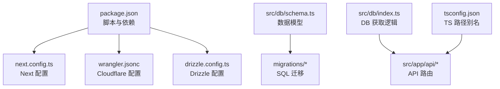
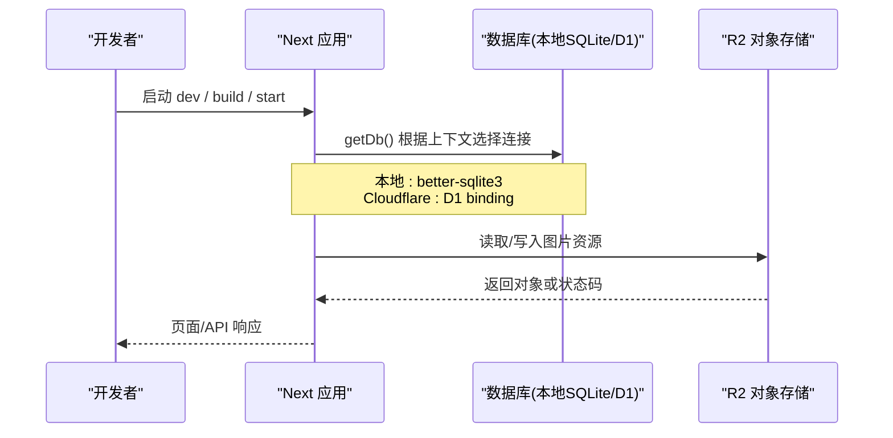
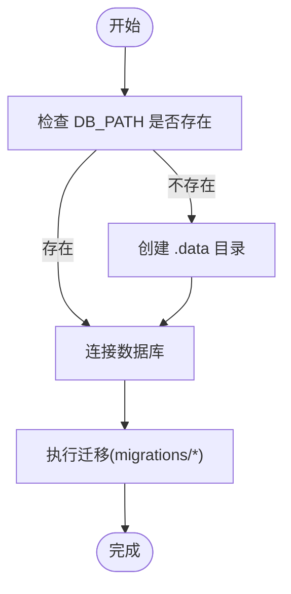
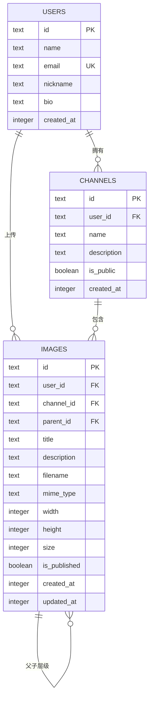
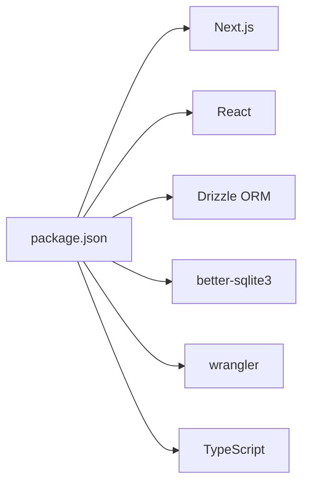

# 贡献指南

<cite>
**本文引用的文件**   
- [package.json](file://package.json)
- [README.md](file://README.md)
- [drizzle.config.ts](file://drizzle.config.ts)
- [next.config.ts](file://next.config.ts)
- [wrangler.jsonc](file://wrangler.jsonc)
- [src/db/index.ts](file://src/db/index.ts)
- [src/db/schema.ts](file://src/db/schema.ts)
- [src/db/migrate.ts](file://src/db/migrate.ts)
- [tsconfig.json](file://tsconfig.json)
- [AGENTS.md](file://AGENTS.md)
- [CLAUDE.md](file://CLAUDE.md)
- [vitest.config.ts](file://vitest.config.ts)
- [playwright.config.ts](file://playwright.config.ts)
- [vitest.setup.ts](file://vitest.setup.ts)
</cite>

## 目录
1. [简介](#简介)
2. [项目结构](#项目结构)
3. [核心组件](#核心组件)
4. [架构总览](#架构总览)
5. [详细组件分析](#详细组件分析)
6. [依赖分析](#依赖分析)
7. [性能考虑](#性能考虑)
8. [故障排查指南](#故障排查指南)
9. [结论](#结论)
10. [附录](#附录)

## 简介
Weable 是一个部署在 Cloudflare Worker 上的图片管理应用，基于 Next.js、Drizzle ORM、SQLite/D1 与 R2 对象存储构建。本指南面向新贡献者，提供本地开发环境搭建、数据库初始化、开发服务器启动、Git 工作流、代码质量与测试、问题报告与版本发布策略等完整说明，帮助你快速上手并高效协作。

## 项目结构
- 前端与 API：Next.js App Router（src/app），API 路由位于 src/app/api。
- 数据层：Drizzle ORM 模型与迁移（src/db/schema.ts、migrations/）。
- 运行时配置：Cloudflare Workers 配置（wrangler.jsonc）、Next.js 配置（next.config.ts）。
- 包管理与脚本：pnpm + package.json scripts。
- 类型与路径：TypeScript 配置（tsconfig.json）定义 @/* 路径别名。

**图表来源** 
- [package.json:1-48](file://package.json#L1-L48)
- [next.config.ts:1-15](file://next.config.ts#L1-L15)
- [wrangler.jsonc:1-34](file://wrangler.jsonc#L1-L34)
- [drizzle.config.ts:1-8](file://drizzle.config.ts#L1-L8)
- [src/db/schema.ts:1-100](file://src/db/schema.ts#L1-L100)
- [src/db/index.ts:1-61](file://src/db/index.ts#L1-L61)
- [tsconfig.json:1-43](file://tsconfig.json#L1-L43)

**章节来源**
- [package.json:1-48](file://package.json#L1-L48)
- [next.config.ts:1-15](file://next.config.ts#L1-L15)
- [wrangler.jsonc:1-34](file://wrangler.jsonc#L1-L34)
- [drizzle.config.ts:1-8](file://drizzle.config.ts#L1-L8)
- [src/db/schema.ts:1-100](file://src/db/schema.ts#L1-L100)
- [src/db/index.ts:1-61](file://src/db/index.ts#L1-L61)
- [tsconfig.json:1-43](file://tsconfig.json#L1-L43)

## 核心组件
- 包与脚本：通过 pnpm 安装依赖；dev/build/start/db:migrate 四个常用命令。
- 数据库：Drizzle ORM + SQLite（本地）/D1（Cloudflare），自动选择运行环境。
- 存储：R2 用于图片存储，绑定名称在 wrangler.jsonc 中声明。
- 国际化与页面扩展：Next 支持 .md/.mdx 页面扩展。
- 类型与路径：@/* 指向 src，统一模块引用。

**章节来源**
- [package.json:1-48](file://package.json#L1-L48)
- [src/db/index.ts:1-61](file://src/db/index.ts#L1-L61)
- [wrangler.jsonc:1-34](file://wrangler.jsonc#L1-L34)
- [next.config.ts:1-15](file://next.config.ts#L1-L15)
- [tsconfig.json:1-43](file://tsconfig.json#L1-L43)

## 架构总览
下图展示了本地开发与 Cloudflare 部署时的数据访问差异：本地使用 SQLite 文件，Cloudflare 使用 D1 绑定；图片存储统一走 R2。

**图表来源** 
- [src/db/index.ts:1-61](file://src/db/index.ts#L1-L61)
- [wrangler.jsonc:1-34](file://wrangler.jsonc#L1-L34)

**章节来源**
- [src/db/index.ts:1-61](file://src/db/index.ts#L1-L61)
- [wrangler.jsonc:1-34](file://wrangler.jsonc#L1-L34)

## 详细组件分析

### 开发环境与依赖安装
- 使用 pnpm 作为包管理器（由 packageManager 字段指定）。
- 安装依赖后，可通过脚本启动开发服务器、构建与生产启动。
- Next 配置启用严格模式与允许的本地开发源。

步骤要点：
- 安装依赖：使用 pnpm install。
- 启动开发服务器：pnpm dev（端口由脚本指定）。
- 构建与启动：pnpm build / pnpm start。

**章节来源**
- [package.json:1-48](file://package.json#L1-L48)
- [next.config.ts:1-15](file://next.config.ts#L1-L15)

### 数据库初始化与迁移
- Drizzle 配置指向 schema 与 migrations 目录，方言为 sqlite。
- 本地迁移脚本会创建必要目录并执行迁移。
- 运行时 getDb() 会根据是否处于 Cloudflare 上下文选择 D1 或 SQLite。

操作步骤：
- 初始化数据库：执行 db:migrate 脚本以应用迁移。
- 环境变量：可通过 DB_PATH 指定本地数据库文件路径。
- 云端绑定：确保 wrangler.jsonc 中的 D1 与 R2 绑定正确。

**图表来源** 
- [src/db/migrate.ts:1-24](file://src/db/migrate.ts#L1-L24)
- [src/db/index.ts:1-61](file://src/db/index.ts#L1-L61)
- [drizzle.config.ts:1-8](file://drizzle.config.ts#L1-L8)

**章节来源**
- [src/db/migrate.ts:1-24](file://src/db/migrate.ts#L1-L24)
- [src/db/index.ts:1-61](file://src/db/index.ts#L1-L61)
- [drizzle.config.ts:1-8](file://drizzle.config.ts#L1-L8)

### 数据模型与关系
- 用户、频道、图片三张表，包含外键与级联删除策略。
- 图片支持父子层级（parentId 引用自身 id）。
- ID 生成采用 uuidv7 并编码为 Base58，保证短且唯一。

**图表来源** 
- [src/db/schema.ts:1-100](file://src/db/schema.ts#L1-L100)

**章节来源**
- [src/db/schema.ts:1-100](file://src/db/schema.ts#L1-L100)

### Cloudflare 运行时与存储绑定
- wrangler.jsonc 定义了主入口、兼容性日期、D1 与 R2 绑定。
- 应用通过 getCloudflareContext 判断是否在 CF 环境，并获取 DB 绑定。
- 若缺少 DB 绑定将抛出明确错误提示。

关键点：
- D1 绑定名：DB
- R2 绑定名：IMAGES_BUCKET 与 NEXT_INC_CACHE_R2_BUCKET
- 资产目录：.open-next/assets

**章节来源**
- [wrangler.jsonc:1-34](file://wrangler.jsonc#L1-L34)
- [src/db/index.ts:1-61](file://src/db/index.ts#L1-L61)

### 类型系统与路径别名
- tsconfig.json 启用严格模式与 Next 插件。
- @/* 映射到 src，便于统一导入。
- include/exclude 控制编译范围。

**章节来源**
- [tsconfig.json:1-43](file://tsconfig.json#L1-L43)

## 依赖分析
- 运行时依赖：Next、React、Drizzle ORM、better-sqlite3、uuidv7、bs58、marked、sanitize-html 等。
- 开发依赖：drizzle-kit、tsx、wrangler、TailwindCSS、TypeScript、@types/*。
- 包管理器：pnpm（锁定版本）。

**图表来源** 
- [package.json:1-48](file://package.json#L1-L48)

**章节来源**
- [package.json:1-48](file://package.json#L1-L48)

## 性能考虑
- 本地开发使用 SQLite 文件，适合快速迭代；生产建议迁移至 D1。
- 图片读写走 R2，注意缓存与 CDN 策略（可在 Next 与 Cloudflare 侧优化）。
- 启用 React Strict Mode 有助于发现潜在问题。
- 避免在热路径中进行不必要的同步 IO 或重复计算。

[本节为通用指导，不直接分析具体文件]

## 故障排查指南
常见问题与定位方法：
- 数据库未初始化：运行 db:migrate 脚本，确认 migrations 目录存在且可写。
- Cloudflare 环境缺少 DB 绑定：检查 wrangler.jsonc 的 d1_databases 配置。
- 本地数据库路径问题：设置 DB_PATH 环境变量并确保目录存在。
- Next 开发源限制：allowedDevOrigins 仅允许 127.0.0.1，跨域请求需调整。

**章节来源**
- [src/db/migrate.ts:1-24](file://src/db/migrate.ts#L1-L24)
- [src/db/index.ts:1-61](file://src/db/index.ts#L1-L61)
- [wrangler.jsonc:1-34](file://wrangler.jsonc#L1-L34)
- [next.config.ts:1-15](file://next.config.ts#L1-L15)

## 结论
通过本指南，你可以快速搭建 Weable 的本地开发环境，理解数据模型与运行时绑定，掌握迁移与排障方法。建议在功能开发时遵循统一的 Git 工作流与代码规范，结合 CI 流程保障质量。

[本节为总结性内容，不直接分析具体文件]

## 附录

### 本地开发环境搭建（快速上手）
- 安装依赖：pnpm install
- 初始化数据库：pnpm db:migrate
- 启动开发服务器：pnpm dev
- 构建与生产启动：pnpm build / pnpm start

**章节来源**
- [package.json:1-48](file://package.json#L1-L48)

### Git 工作流（分支策略、提交规范、审查流程）
- 分支策略：
  - main：稳定发布分支
  - develop：集成开发分支
  - feature/*：新功能分支
  - fix/*：缺陷修复分支
  - release/*：预发布分支
- 提交信息规范：
  - 格式：<type>(<scope>): <subject>
  - type：feat、fix、docs、style、refactor、test、chore
  - subject：简洁描述变更目的
- 代码审查流程：
  - 提交 PR 到目标分支
  - 至少一名维护者审查通过
  - 通过自动化检查（类型检查、构建、迁移验证）
  - 合并前清理分支历史（可选 rebase/squash）

[本节为通用实践建议，不直接分析具体文件]

### 模板与工具使用（功能开发与 Bug 修复）
- 功能开发：
  - 从 feature/* 分支拉取最新 develop
  - 新增 API 路由与页面组件，更新数据模型与迁移
  - 编写单元测试与集成测试（如有）
- Bug 修复：
  - 从 fix/* 分支拉取最新 develop
  - 最小化改动，补充回归测试
  - 在 PR 中说明复现步骤与修复方案

[本节为通用实践建议，不直接分析具体文件]

### 测试要求与代码质量检查

**已更新** 项目现已建立完整的测试体系，包含单元测试、组件测试和端到端测试。

#### 测试框架与配置
- **单元测试与组件测试**：使用 Vitest 框架，配置了 jsdom 环境以支持 React 组件测试
- **端到端测试**：使用 Playwright Test，专注于关键用户流程的冒烟测试
- **测试配置**：独立的 vitest.config.ts 和 playwright.config.ts 配置文件

#### 测试命令
- 运行所有测试：`pnpm test`
- 监听模式运行测试：`pnpm test:watch`
- 运行端到端测试：`pnpm test:e2e`

#### 测试策略
- **单元测试**：针对 lib 模块的功能逻辑进行测试，如国际化、语言处理等
- **组件测试**：针对 React 组件进行渲染和行为测试，使用 Testing Library
- **端到端测试**：覆盖关键用户流程，如首页加载、控制台图片管理等
- **测试隔离**：每个测试用例独立运行，避免相互影响

#### 测试最佳实践
- 组件测试使用 `@testing-library/react` 进行 DOM 操作和断言
- 模拟外部依赖时使用 Vitest 的 mock 功能
- E2E 测试专注于用户体验的关键路径，保持轻量级断言
- 测试文件命名约定：`.test.ts` 或 `.test.tsx` 后缀

#### 代码质量检查
- 类型检查：TypeScript 严格模式已启用
- 构建检查：pnpm build 必须通过
- 迁移验证：确保 drizzle-kit 与迁移一致
- 代码风格：遵循现有风格，保持最小改动原则
- 测试覆盖率：鼓励为新功能添加相应测试用例

**章节来源**
- [package.json:1-48](file://package.json#L1-L48)
- [vitest.config.ts:1-21](file://vitest.config.ts#L1-L21)
- [playwright.config.ts:1-26](file://playwright.config.ts#L1-L26)
- [vitest.setup.ts:1-11](file://vitest.setup.ts#L1-L11)

### 持续集成流程（CI）
- 触发条件：push/PR 到 develop/main
- 检查项：
  - 依赖安装
  - 类型检查
  - 构建成功
  - 迁移校验
  - 单元测试通过
  - 端到端测试通过
- 失败处理：阻塞合并，通知责任人

[本节为通用实践建议，不直接分析具体文件]

### 问题报告模板与功能请求流程
- 问题报告：
  - 标题：简明扼要
  - 环境：操作系统、浏览器、Node/pnpm 版本
  - 复现步骤：逐步说明
  - 期望行为与实际行为
  - 日志与截图
- 功能请求：
  - 背景与动机
  - 需求描述与验收标准
  - 影响范围与风险评估

[本节为通用实践建议，不直接分析具体文件]

### 版本发布策略
- 版本号：语义化版本（主.次.修订）
- 发布分支：release/* 进行冻结与验证
- 合并回 main 与 develop，打标签
- 更新文档与变更日志

[本节为通用实践建议，不直接分析具体文件]

### AI 代理与编码约定
- 语言与注释：优先简体中文，技术标识符保持英文
- 编码原则：简洁、精准、目标驱动
- 沟通风格：禁止废话，先思考再执行

**章节来源**
- [AGENTS.md:1-65](file://AGENTS.md#L1-L65)
- [CLAUDE.md:1-4](file://CLAUDE.md#L1-L4)