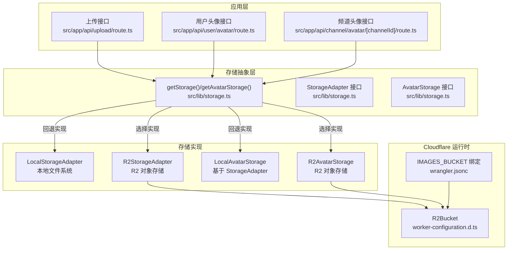
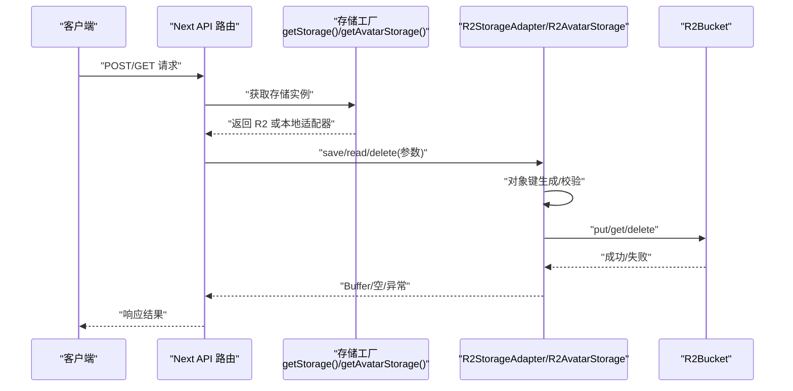
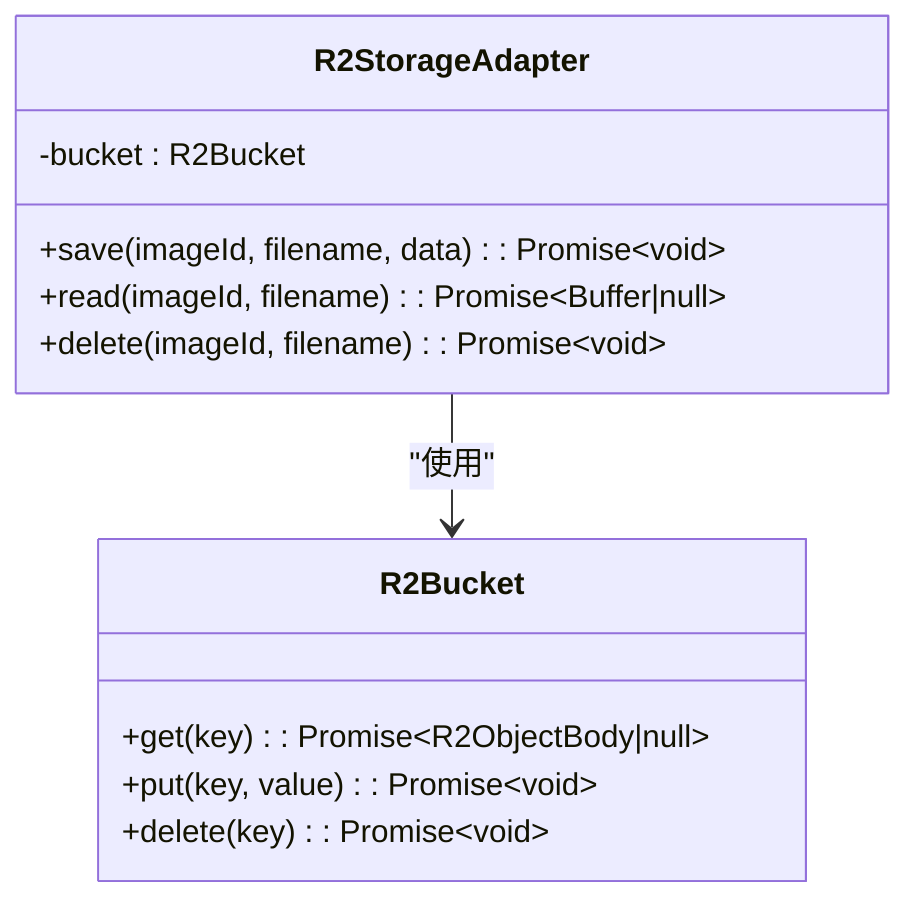
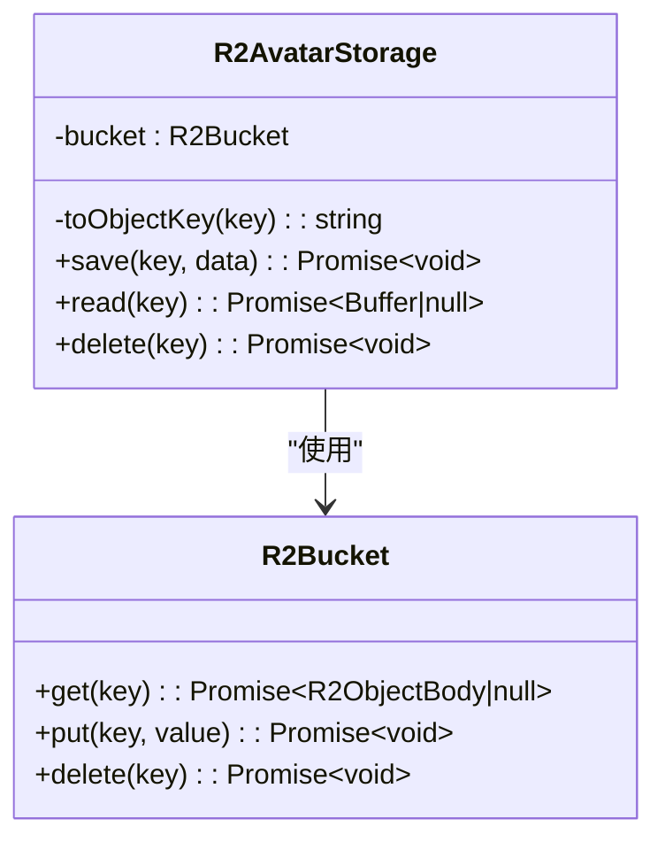
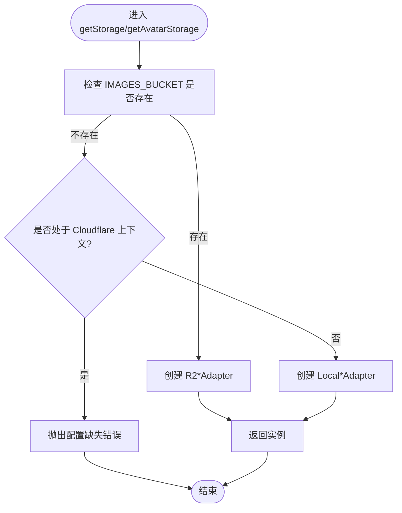
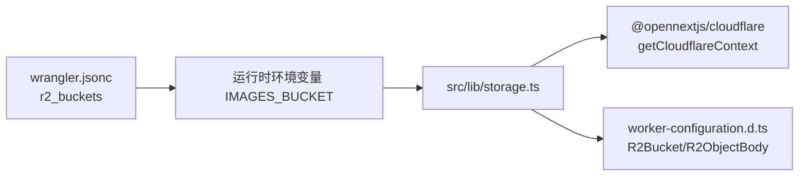

# Cloudflare R2 存储实现

<cite>
**本文引用的文件**   
- [src/lib/storage.ts](file://src/lib/storage.ts)
- [wrangler.jsonc](file://wrangler.jsonc)
- [worker-configuration.d.ts](file://worker-configuration.d.ts)
- [src/app/api/upload/route.ts](file://src/app/api/upload/route.ts)
- [src/app/api/user/avatar/route.ts](file://src/app/api/user/avatar/route.ts)
- [src/app/api/channel/avatar/[channelId]/route.ts](file://src/app/api/channel/avatar/[channelId]/route.ts)
</cite>

## 目录
1. [简介](#简介)
2. [项目结构](#项目结构)
3. [核心组件](#核心组件)
4. [架构总览](#架构总览)
5. [详细组件分析](#详细组件分析)
6. [依赖关系分析](#依赖关系分析)
7. [性能与成本优化](#性能与成本优化)
8. [故障排查指南](#故障排查指南)
9. [结论](#结论)

## 简介
本文件围绕 R2StorageAdapter 与 R2AvatarStorage 两个核心类，系统化阐述 Cloudflare R2 对象存储在 Next.js + OpenNext/Cloudflare 环境中的集成方式。内容涵盖桶绑定、对象键生成策略、数据格式转换、R2 API 调用流程、错误处理机制、配置与环境变量要求、安全最佳实践，以及头像与图片两类存储的不同实现策略（命名空间与路径组织）。同时提供性能调优与成本优化建议，帮助读者在生产环境中稳定、高效地使用 R2 存储。

## 项目结构
- 存储抽象与实现位于 src/lib/storage.ts，定义了统一的 StorageAdapter 与 AvatarStorage 接口，并提供 Local/R2 两套实现及工厂函数。
- Cloudflare 运行时类型定义在 worker-configuration.d.ts，声明了 R2Bucket、R2ObjectBody、CloudflareEnv 等类型，确保类型安全。
- R2 桶绑定通过 wrangler.jsonc 的 r2_buckets 配置注入到运行时的环境变量中。
- API 路由示例展示了如何在上传与头像读写场景中使用 getStorage() 与 getAvatarStorage()。

图表来源
- [src/lib/storage.ts:116-136](file://src/lib/storage.ts#L116-L136)
- [src/lib/storage.ts:154-179](file://src/lib/storage.ts#L154-L179)
- [worker-configuration.d.ts:26-30](file://worker-configuration.d.ts#L26-L30)
- [wrangler.jsonc:23-32](file://wrangler.jsonc#L23-L32)

章节来源
- [src/lib/storage.ts:1-214](file://src/lib/storage.ts#L1-L214)
- [wrangler.jsonc:1-34](file://wrangler.jsonc#L1-L34)
- [worker-configuration.d.ts:1-38](file://worker-configuration.d.ts#L1-L38)

## 核心组件
- StorageAdapter：统一图片存储接口，包含 save(imageId, filename, data)、read(imageId, filename)、delete(imageId, filename)。
- AvatarStorage：统一头像存储接口，包含 save(key, data)、read(key)、delete(key)。
- R2StorageAdapter：基于 R2Bucket 的图片存储实现，对象键为 imageId/filename。
- R2AvatarStorage：基于 R2Bucket 的头像存储实现，对象键为 avatar/key。
- LocalStorageAdapter / LocalAvatarStorage：本地文件系统回退实现，便于开发调试。
- getStorage() / getAvatarStorage()：工厂函数，根据运行环境自动选择 R2 或本地实现。

章节来源
- [src/lib/storage.ts:3-13](file://src/lib/storage.ts#L3-L13)
- [src/lib/storage.ts:116-136](file://src/lib/storage.ts#L116-L136)
- [src/lib/storage.ts:154-179](file://src/lib/storage.ts#L154-L179)
- [src/lib/storage.ts:184-213](file://src/lib/storage.ts#L184-L213)

## 架构总览
下图展示从 API 请求到 R2 存储的完整调用链，包括对象键生成、数据格式转换与返回流程。

图表来源
- [src/app/api/upload/route.ts:51-57](file://src/app/api/upload/route.ts#L51-L57)
- [src/app/api/user/avatar/route.ts:28-31](file://src/app/api/user/avatar/route.ts#L28-L31)
- [src/app/api/channel/avatar/[channelId]/route.ts:19-21](file://src/app/api/channel/avatar/[channelId]/route.ts#L19-L21)
- [src/lib/storage.ts:116-136](file://src/lib/storage.ts#L116-L136)
- [src/lib/storage.ts:154-179](file://src/lib/storage.ts#L154-L179)

## 详细组件分析

### R2StorageAdapter（图片存储）
- 职责：将图片以 Buffer 形式写入 R2 桶，读取时返回 Buffer，删除指定对象。
- 对象键策略：imageId/filename，由 resolveR2ObjectKey 生成，并对 imageId 与 filename 进行安全段校验，防止路径穿越。
- 数据格式转换：toUint8Array 将 Buffer 转为 Uint8Array 供 R2 put；read 时将 R2 对象的 ArrayBuffer 转回 Buffer。
- 错误处理：bucket.get 返回 null 表示不存在；其他异常直接抛出，由上层路由处理。

图表来源
- [src/lib/storage.ts:116-136](file://src/lib/storage.ts#L116-L136)
- [worker-configuration.d.ts:26-30](file://worker-configuration.d.ts#L26-L30)

章节来源
- [src/lib/storage.ts:116-136](file://src/lib/storage.ts#L116-L136)
- [src/lib/storage.ts:55-59](file://src/lib/storage.ts#L55-L59)
- [src/lib/storage.ts:35-44](file://src/lib/storage.ts#L35-L44)

### R2AvatarStorage（头像存储）
- 职责：将头像以 Buffer 形式写入 R2 桶，读取时返回 Buffer，删除指定对象。
- 对象键策略：avatar/key，由 toObjectKey 生成，对 key 进行安全段校验，避免路径穿越。
- 数据格式转换：toUint8Array 用于 put；read 时使用 toBuffer 将 ArrayBuffer 转为 Buffer。
- 错误处理：bucket.get 返回 null 表示不存在；其他异常直接抛出，由上层路由处理。

图表来源
- [src/lib/storage.ts:154-179](file://src/lib/storage.ts#L154-L179)
- [worker-configuration.d.ts:26-30](file://worker-configuration.d.ts#L26-L30)

章节来源
- [src/lib/storage.ts:154-179](file://src/lib/storage.ts#L154-L179)
- [src/lib/storage.ts:157-160](file://src/lib/storage.ts#L157-L160)
- [src/lib/storage.ts:35-44](file://src/lib/storage.ts#L35-L44)

### 工厂函数与运行时选择
- getStorage()：优先使用 R2 桶（IMAGES_BUCKET），若未配置则在 Cloudflare 上下文内抛错提示配置缺失，否则回退到 LocalStorageAdapter。
- getAvatarStorage()：逻辑同上，优先 R2AvatarStorage，回退到 LocalAvatarStorage(getStorage())。
- 桶绑定解析：getR2BucketBinding 通过 @opennextjs/cloudflare 的 getCloudflareContext 获取 env.IMAGES_BUCKET，并标记是否在 CF 上下文。

图表来源
- [src/lib/storage.ts:184-213](file://src/lib/storage.ts#L184-L213)
- [src/lib/storage.ts:46-53](file://src/lib/storage.ts#L46-L53)

章节来源
- [src/lib/storage.ts:184-213](file://src/lib/storage.ts#L184-L213)
- [src/lib/storage.ts:46-53](file://src/lib/storage.ts#L46-L53)

### API 路由集成示例
- 图片上传（upload/route.ts）：校验文件类型与大小，生成唯一 id，调用 storage.save(id, file.name, buffer)，随后写入数据库元信息。
- 用户头像（user/avatar/route.ts）：校验类型与大小，调用 storage.save(`user_${user.id}`, buffer)。
- 频道头像（channel/avatar/[channelId]/route.ts）：GET 读取 `channel_${channelId}` 并返回二进制流；POST 校验后保存。

章节来源
- [src/app/api/upload/route.ts:51-57](file://src/app/api/upload/route.ts#L51-L57)
- [src/app/api/user/avatar/route.ts:28-31](file://src/app/api/user/avatar/route.ts#L28-L31)
- [src/app/api/channel/avatar/[channelId]/route.ts:19-21](file://src/app/api/channel/avatar/[channelId]/route.ts#L19-L21)

## 依赖关系分析
- 运行时类型：worker-configuration.d.ts 声明 R2Bucket、R2ObjectBody、CloudflareEnv，确保编译期类型正确。
- 桶绑定：wrangler.jsonc 的 r2_buckets 将 IMAGES_BUCKET 绑定到 weable-images 桶，供运行时访问。
- 模块依赖：storage.ts 依赖 @opennextjs/cloudflare 获取 Cloudflare 上下文，从而判断是否处于 CF 环境并解析 IMAGERS_BUCKET。

图表来源
- [src/lib/storage.ts:1](file://src/lib/storage.ts#L1)
- [worker-configuration.d.ts:26-35](file://worker-configuration.d.ts#L26-L35)
- [wrangler.jsonc:23-32](file://wrangler.jsonc#L23-L32)

章节来源
- [worker-configuration.d.ts:1-38](file://worker-configuration.d.ts#L1-L38)
- [wrangler.jsonc:1-34](file://wrangler.jsonc#L1-L34)
- [src/lib/storage.ts:1-10](file://src/lib/storage.ts#L1-L10)

## 性能与成本优化
- 对象键设计
  - 图片：imageId/filename，扁平化且无层级嵌套，减少前缀扫描开销。
  - 头像：avatar/key，独立命名空间，避免与图片混用导致不必要的列举与缓存污染。
- 数据格式转换
  - 使用 toUint8Array/toBuffer 避免多次拷贝，尽量复用内存视图，降低 CPU 与内存占用。
- 并发与限流
  - 批量上传时控制并发度，避免触发 R2 限流；结合队列或限速器平滑写入。
- 缓存策略
  - 头像 GET 响应设置 Cache-Control，提升 CDN/浏览器缓存命中率，降低重复读取成本。
- 生命周期与清理
  - 定期清理过期或无用对象，减少存储量与读取延迟。
- 分片与压缩
  - 大文件可考虑分片上传与后端压缩，减少带宽与存储成本。
- 监控与告警
  - 开启 Observability，监控错误率、延迟与吞吐，及时定位瓶颈。

[本节为通用指导，不直接分析具体文件]

## 故障排查指南
- 常见错误
  - 未配置 R2 绑定：在 Cloudflare 上下文内调用 getStorage/getAvatarStorage 会抛出“IMAGES_BUCKET 未配置”的错误。请检查 wrangler.jsonc 的 r2_buckets 配置。
  - 对象不存在：read 返回 null，需在上层路由返回 404 或默认图。
  - 非法对象键：assertSafeSegment 校验失败抛出“Invalid field”，检查 imageId/filename/key 是否包含路径分隔符或特殊字符。
- 排查步骤
  - 确认 wrangler.jsonc 已正确声明 r2_buckets 与 binding 名称。
  - 确认运行环境能访问 @opennextjs/cloudflare 的 getCloudflareContext。
  - 检查 API 路由中对文件类型与大小的校验逻辑，避免无效请求进入存储层。
  - 查看日志与 Observability 指标，定位异常堆栈与耗时热点。

章节来源
- [src/lib/storage.ts:184-213](file://src/lib/storage.ts#L184-L213)
- [src/lib/storage.ts:15-25](file://src/lib/storage.ts#L15-L25)
- [wrangler.jsonc:23-32](file://wrangler.jsonc#L23-L32)

## 结论
R2StorageAdapter 与 R2AvatarStorage 通过统一的接口抽象与工厂模式，实现了图片与头像在不同运行环境下的无缝切换。对象键策略清晰、数据转换高效、错误处理明确，配合 wrangler.jsonc 的桶绑定与 Cloudflare 运行时类型，形成稳定可靠的存储方案。生产环境应关注对象键设计、缓存策略、并发限流与监控告警，以获得更优的性能与成本表现。