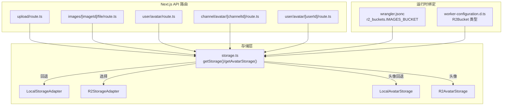
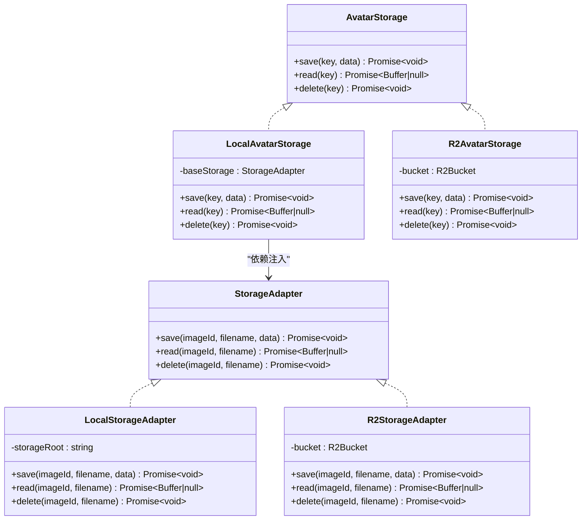
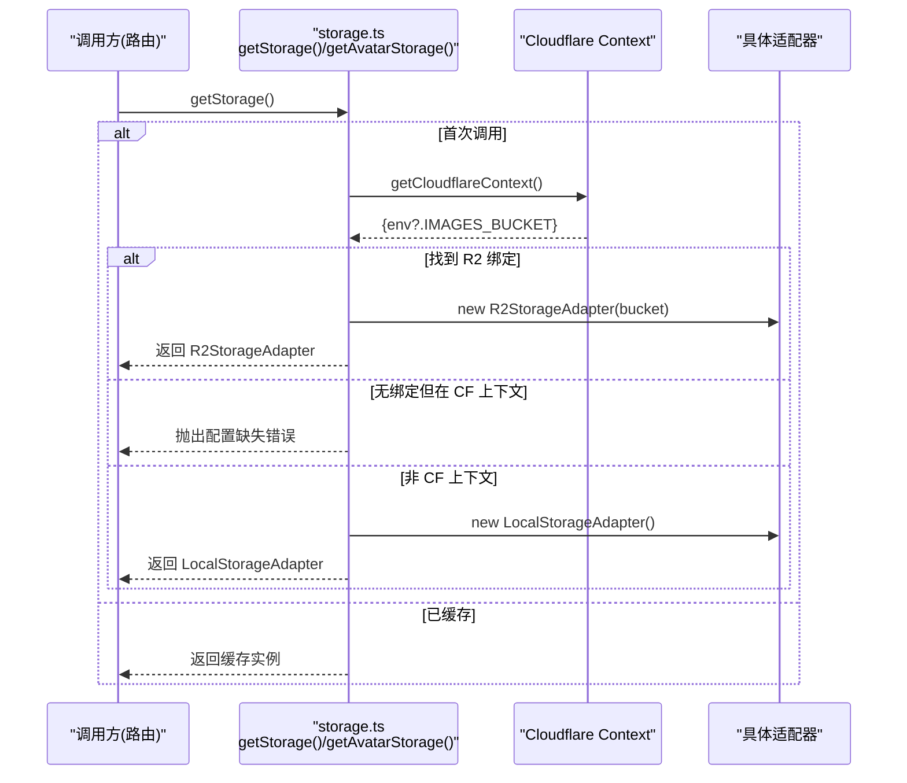
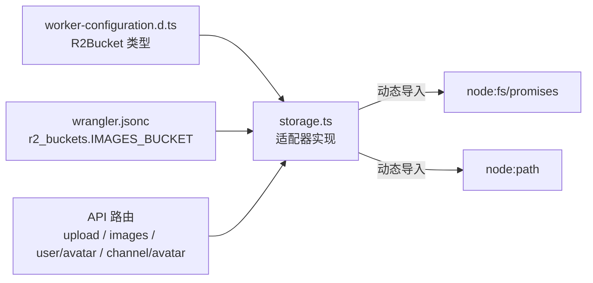

# 存储工厂和实例管理

<cite>
**本文引用的文件**   
- [src/lib/storage.ts](file://src/lib/storage.ts)
- [wrangler.jsonc](file://wrangler.jsonc)
- [worker-configuration.d.ts](file://worker-configuration.d.ts)
- [src/app/api/upload/route.ts](file://src/app/api/upload/route.ts)
- [src/app/api/images/[imageId]/file/route.ts](file://src/app/api/images/[imageId]/file/route.ts)
- [src/app/api/user/avatar/route.ts](file://src/app/api/user/avatar/route.ts)
- [src/app/api/channel/avatar/[channelId]/route.ts](file://src/app/api/channel/avatar/[channelId]/route.ts)
- [src/app/api/user/avatar/[userId]/route.ts](file://src/app/api/user/avatar/[userId]/route.ts)
</cite>

## 目录
1. [简介](#简介)
2. [项目结构](#项目结构)
3. [核心组件](#核心组件)
4. [架构总览](#架构总览)
5. [详细组件分析](#详细组件分析)
6. [依赖关系分析](#依赖关系分析)
7. [性能考量](#性能考量)
8. [故障诊断指南](#故障诊断指南)
9. [结论](#结论)
10. [附录](#附录)

## 简介
本文件围绕存储工厂函数与实例管理机制展开，重点解释 getStorage() 与 getAvatarStorage() 的实现原理、单例模式应用、依赖注入策略、后端自动检测与切换（Cloudflare R2 与本地文件系统回退）、存储实例生命周期、内存缓存与错误处理。同时文档化 wrangler.jsonc 中的 R2 绑定与环境变量配置，并提供存储配置最佳实践与故障诊断方法。

## 项目结构
- 存储抽象与实现位于 src/lib/storage.ts，定义了统一的 StorageAdapter 与 AvatarStorage 接口，以及 Local/R2 两种适配器。
- 工厂函数 getStorage() 与 getAvatarStorage() 提供单例化的存储实例获取入口，内部通过 Cloudflare Context 检测环境并选择具体实现。
- API 路由层通过 Next.js Route Handler 调用工厂函数完成图片上传/读取与头像存取。
- 运行时绑定由 wrangler.jsonc 声明，R2 Bucket 以 IMAGES_BUCKET 绑定暴露给运行时环境。

图表来源
- [src/lib/storage.ts:184-213](file://src/lib/storage.ts#L184-L213)
- [wrangler.jsonc:23-32](file://wrangler.jsonc#L23-L32)
- [worker-configuration.d.ts:26-35](file://worker-configuration.d.ts#L26-L35)

章节来源
- [src/lib/storage.ts:1-214](file://src/lib/storage.ts#L1-L214)
- [wrangler.jsonc:1-34](file://wrangler.jsonc#L1-L34)

## 核心组件
- 存储适配器接口
  - StorageAdapter：统一图片存储的 save/read/delete 操作。
  - AvatarStorage：统一头像存储的 save/read/delete 操作。
- 适配器实现
  - LocalStorageAdapter：基于 Node fs/promises 的文件系统存储，路径由 IMAGE_STORAGE_PATH 环境变量或默认 ./.data/uploads 决定。
  - R2StorageAdapter：基于 Cloudflare R2 Bucket 的对象存储。
  - LocalAvatarStorage：复用基础 StorageAdapter，将头像数据写入固定命名空间 "__avatar__"。
  - R2AvatarStorage：直接对 R2 Bucket 进行头像对象读写，键名前缀为 avatar/。
- 工厂函数与单例
  - getStorage()：返回全局唯一的 StorageAdapter 实例；优先使用 R2，否则在 Cloudflare 环境下抛错提示配置缺失，本地开发回退到 LocalStorageAdapter。
  - getAvatarStorage()：返回全局唯一的 AvatarStorage 实例；优先使用 R2AvatarStorage，否则在 Cloudflare 环境下抛错提示配置缺失，本地开发回退到 LocalAvatarStorage(getStorage())。

章节来源
- [src/lib/storage.ts:3-13](file://src/lib/storage.ts#L3-L13)
- [src/lib/storage.ts:61-114](file://src/lib/storage.ts#L61-L114)
- [src/lib/storage.ts:116-136](file://src/lib/storage.ts#L116-L136)
- [src/lib/storage.ts:138-152](file://src/lib/storage.ts#L138-L152)
- [src/lib/storage.ts:154-179](file://src/lib/storage.ts#L154-L179)
- [src/lib/storage.ts:181-213](file://src/lib/storage.ts#L181-L213)

## 架构总览
存储层采用“适配器 + 工厂 + 单例”的组合模式：
- 适配器模式：隔离不同后端（本地文件系统 vs R2）的差异，对外暴露统一接口。
- 工厂模式：集中封装环境检测与实例创建逻辑，避免调用方感知底层差异。
- 单例模式：模块级变量缓存实例，确保进程内唯一，减少重复初始化开销。
- 依赖注入：AvatarStorage 的本地实现通过构造器注入基础 StorageAdapter，解耦头像与图片存储的具体实现。

图表来源
- [src/lib/storage.ts:3-13](file://src/lib/storage.ts#L3-L13)
- [src/lib/storage.ts:61-114](file://src/lib/storage.ts#L61-L114)
- [src/lib/storage.ts:116-136](file://src/lib/storage.ts#L116-L136)
- [src/lib/storage.ts:138-152](file://src/lib/storage.ts#L138-L152)
- [src/lib/storage.ts:154-179](file://src/lib/storage.ts#L154-L179)

## 详细组件分析

### 工厂函数与单例机制
- getStorage()
  - 首次调用时检测 Cloudflare Context 是否存在且包含 IMAGES_BUCKET。
  - 若存在则创建 R2StorageAdapter 并缓存；若不存在但处于 Cloudflare 上下文，抛出配置缺失错误；否则创建 LocalStorageAdapter 并缓存。
  - 后续调用直接返回缓存实例，保证进程内单例。
- getAvatarStorage()
  - 首次调用时同样检测 R2 绑定，存在则创建 R2AvatarStorage；否则在 Cloudflare 上下文抛错，本地回退到 LocalAvatarStorage(getStorage())。
  - 返回缓存的 AvatarStorage 实例。

图表来源
- [src/lib/storage.ts:46-53](file://src/lib/storage.ts#L46-L53)
- [src/lib/storage.ts:184-197](file://src/lib/storage.ts#L184-L197)

章节来源
- [src/lib/storage.ts:181-213](file://src/lib/storage.ts#L181-L213)

### 存储后端的自动检测与切换
- 环境检测
  - 通过 @opennextjs/cloudflare 提供的 getCloudflareContext() 获取运行时 env，检查 IMAGES_BUCKET 是否可用。
- 切换策略
  - 有 R2 绑定：优先使用 R2 适配器（高性能、可扩展）。
  - 无 R2 绑定且在 Cloudflare 上下文：抛出明确错误，提示检查 wrangler.jsonc 的 R2 配置。
  - 本地开发或非 CF 上下文：回退到 LocalStorageAdapter，便于开发与调试。

章节来源
- [src/lib/storage.ts:46-53](file://src/lib/storage.ts#L46-L53)
- [wrangler.jsonc:23-32](file://wrangler.jsonc#L23-L32)

### 存储实例的生命周期与内存缓存
- 生命周期
  - 模块加载时定义模块级变量 storageInstance 与 avatarStorageInstance，初始为 undefined。
  - 工厂函数首次调用时根据环境创建对应适配器实例并赋值给模块级变量。
  - 实例在整个进程生命周期内保持存活，被多次调用复用。
- 内存缓存
  - 通过模块级变量实现简单高效的内存缓存，避免重复初始化与网络/IO 资源消耗。
- 扩展性建议
  - 如需支持多租户或多桶场景，可在工厂中增加参数或上下文区分，并在缓存键中加入租户标识。

章节来源
- [src/lib/storage.ts:181-213](file://src/lib/storage.ts#L181-L213)

### 安全校验与路径解析
- 安全段校验
  - assertSafeSegment 拒绝空值、相对路径片段（"."、".."）及包含 "/" 或 "\" 的值，防止路径穿越攻击。
- 路径解析
  - 本地存储：通过 node:path.join 拼接 storageRoot/imageId/filename。
  - R2 存储：拼接 imageId/filename 作为对象键。

章节来源
- [src/lib/storage.ts:15-33](file://src/lib/storage.ts#L15-L33)
- [src/lib/storage.ts:55-59](file://src/lib/storage.ts#L55-L59)

### 错误处理策略
- 本地存储
  - read/delete 捕获 ENOENT 异常，read 返回 null，delete 静默忽略，其他异常向上抛出。
- Cloudflare 上下文缺失绑定
  - 在 CF 上下文但未配置 R2 绑定时，工厂函数抛出明确错误，提示检查 wrangler.jsonc。
- 调用方职责
  - 路由层对输入参数进行合法性校验（如 ID 正则），并对存储返回的 null 做 404 响应。

章节来源
- [src/lib/storage.ts:75-113](file://src/lib/storage.ts#L75-L113)
- [src/lib/storage.ts:184-213](file://src/lib/storage.ts#L184-L213)
- [src/app/api/images/[imageId]/file/route.ts:12-47](file://src/app/api/images/[imageId]/file/route.ts#L12-L47)

### 头像存储适配器的设计
- LocalAvatarStorage
  - 通过 baseStorage.save("__avatar__", key, data) 将头像数据写入固定命名空间，复用图片存储实现。
- R2AvatarStorage
  - 将头像对象键前缀为 avatar/，避免与图片键冲突。

章节来源
- [src/lib/storage.ts:138-152](file://src/lib/storage.ts#L138-L152)
- [src/lib/storage.ts:154-179](file://src/lib/storage.ts#L154-L179)

## 依赖关系分析
- 运行时绑定
  - worker-configuration.d.ts 声明了 R2Bucket 与 CloudflareEnv 的类型，供 TypeScript 编译期检查。
  - wrangler.jsonc 声明 r2_buckets，其中 IMAGES_BUCKET 绑定名称必须与代码中读取一致。
- 调用链
  - 各 API 路由通过 import "@/lib/storage" 引入工厂函数，调用 getStorage()/getAvatarStorage() 获取适配器实例。
  - 适配器内部按需动态导入 node:fs/promises 与 node:path，降低冷启动开销。

图表来源
- [worker-configuration.d.ts:26-35](file://worker-configuration.d.ts#L26-L35)
- [wrangler.jsonc:23-32](file://wrangler.jsonc#L23-L32)
- [src/lib/storage.ts:66-73](file://src/lib/storage.ts#L66-L73)
- [src/app/api/upload/route.ts:51](file://src/app/api/upload/route.ts#L51)
- [src/app/api/images/[imageId]/file/route.ts:34](file://src/app/api/images/[imageId]/file/route.ts#L34)
- [src/app/api/user/avatar/route.ts:29](file://src/app/api/user/avatar/route.ts#L29)
- [src/app/api/channel/avatar/[channelId]/route.ts:19](file://src/app/api/channel/avatar/[channelId]/route.ts#L19)

章节来源
- [worker-configuration.d.ts:1-38](file://worker-configuration.d.ts#L1-L38)
- [wrangler.jsonc:1-34](file://wrangler.jsonc#L1-L34)
- [src/lib/storage.ts:1-214](file://src/lib/storage.ts#L1-L214)

## 性能考量
- 动态导入
  - 本地存储相关模块（fs/promises、path）采用动态 import，减少冷启动时间，适合 Serverless/Edge 环境。
- 内存缓存
  - 工厂函数返回的单例实例避免重复创建，降低初始化成本。
- 数据转换
  - toUint8Array/toBuffer 在 Buffer 与 ArrayBuffer 之间高效转换，避免不必要的拷贝。
- 缓存头
  - 图片读取响应设置 Cache-Control 公共缓存，提升 CDN/浏览器缓存命中率。

章节来源
- [src/lib/storage.ts:35-44](file://src/lib/storage.ts#L35-L44)
- [src/app/api/images/[imageId]/file/route.ts:41-46](file://src/app/api/images/[imageId]/file/route.ts#L41-L46)

## 故障诊断指南
- 现象：Cloudflare 环境运行时报错提示 R2 绑定未配置
  - 原因：getR2BucketBinding() 检测到在 CF 上下文但 env.IMAGES_BUCKET 为空。
  - 排查：检查 wrangler.jsonc 的 r2_buckets 中 binding 是否为 IMAGES_BUCKET，bucket_name 是否正确。
- 现象：本地开发无法读取文件
  - 原因：本地存储路径不存在或权限不足。
  - 排查：确认 IMAGE_STORAGE_PATH 环境变量或默认路径 ./.data/uploads 存在并可写。
- 现象：头像读取返回 404
  - 原因：头像键不存在或命名空间不一致。
  - 排查：确认头像键格式（user_xxx、channel_xxx）与存储实现一致；检查 LocalAvatarStorage 使用的 "__avatar__" 命名空间。
- 现象：上传失败或读不到文件
  - 原因：文件名或 imageId 非法导致路径穿越保护触发。
  - 排查：确保 imageId 与 filename 仅包含安全字符，不包含 "/" 或 "\"。

章节来源
- [src/lib/storage.ts:46-53](file://src/lib/storage.ts#L46-L53)
- [src/lib/storage.ts:15-33](file://src/lib/storage.ts#L15-L33)
- [src/lib/storage.ts:75-113](file://src/lib/storage.ts#L75-L113)
- [src/app/api/channel/avatar/[channelId]/route.ts:12-32](file://src/app/api/channel/avatar/[channelId]/route.ts#L12-L32)
- [src/app/api/user/avatar/[userId]/route.ts:8-28](file://src/app/api/user/avatar/[userId]/route.ts#L8-L28)

## 结论
该存储子系统通过适配器模式与工厂函数实现了清晰的后端抽象与自动切换能力，结合单例缓存有效降低了运行时开销。在 Cloudflare 环境中优先使用 R2 以获得更好的可扩展性与性能，在本地开发时自动回退到文件系统，兼顾开发与部署体验。严格的安全校验与明确的错误提示有助于快速定位问题。建议在多租户或多桶场景中扩展工厂参数与缓存键策略，以满足更复杂的业务需求。

## 附录

### wrangler.jsonc 中的 R2 绑定与环境变量配置
- r2_buckets
  - binding: IMAGES_BUCKET（必须与代码中读取一致）
  - bucket_name: weable-images（实际桶名）
- 环境变量
  - IMAGE_STORAGE_PATH：本地开发时指定文件存储根目录，未设置则默认 ./.data/uploads

章节来源
- [wrangler.jsonc:23-32](file://wrangler.jsonc#L23-L32)
- [src/lib/storage.ts:63](file://src/lib/storage.ts#L63)

### 存储配置最佳实践
- 生产环境
  - 始终配置 R2 绑定并确保 IMAGES_BUCKET 正确映射。
  - 启用必要的访问控制与日志观测（如 observability.enabled）。
- 本地开发
  - 设置 IMAGE_STORAGE_PATH 指向可写目录，便于调试与数据持久化。
  - 确保目录权限与磁盘空间充足。
- 安全性
  - 保持 imageId 与 filename 的强校验，避免路径穿越。
  - 限制上传类型与大小，减少滥用风险。
- 可观测性
  - 记录关键操作的耗时与错误码，便于性能分析与问题定位。

章节来源
- [wrangler.jsonc:1-34](file://wrangler.jsonc#L1-L34)
- [src/lib/storage.ts:15-33](file://src/lib/storage.ts#L15-L33)
- [src/app/api/upload/route.ts:10-35](file://src/app/api/upload/route.ts#L10-L35)
- [src/app/api/user/avatar/route.ts:7-26](file://src/app/api/user/avatar/route.ts#L7-L26)