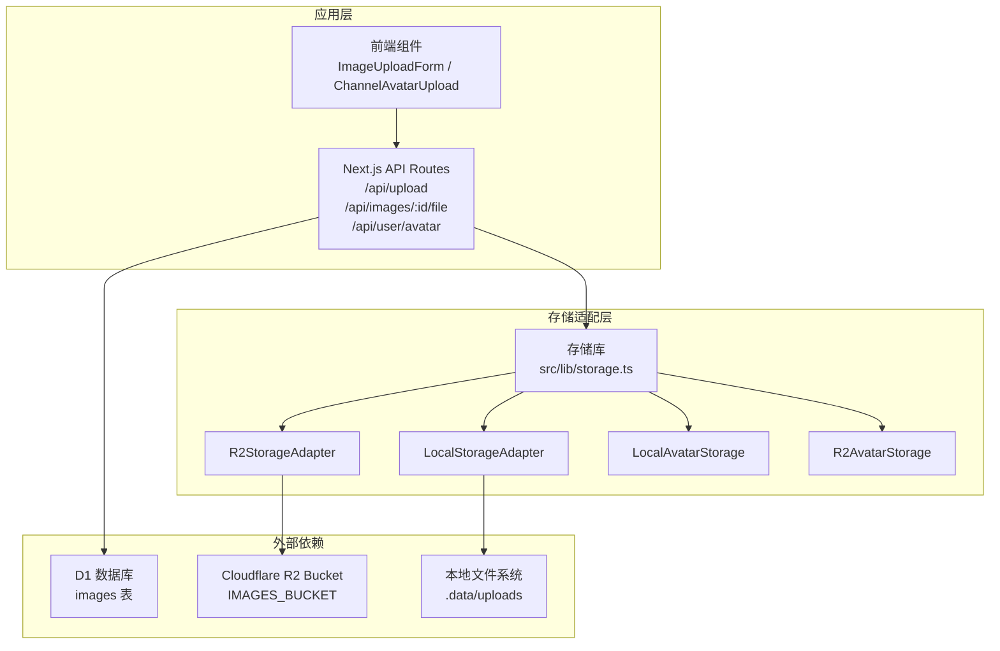
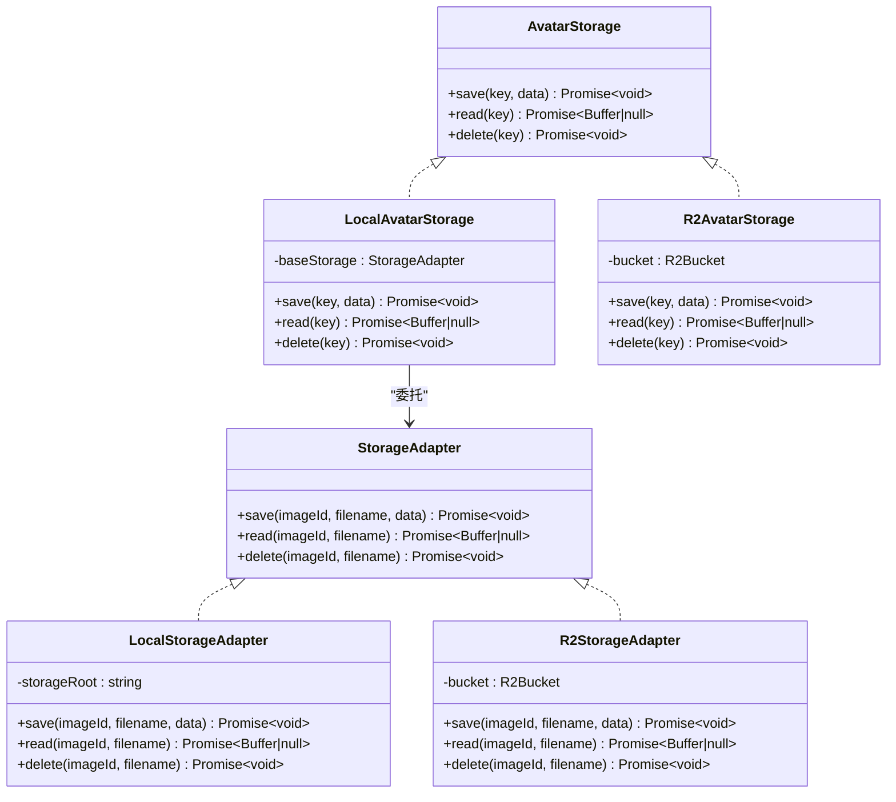
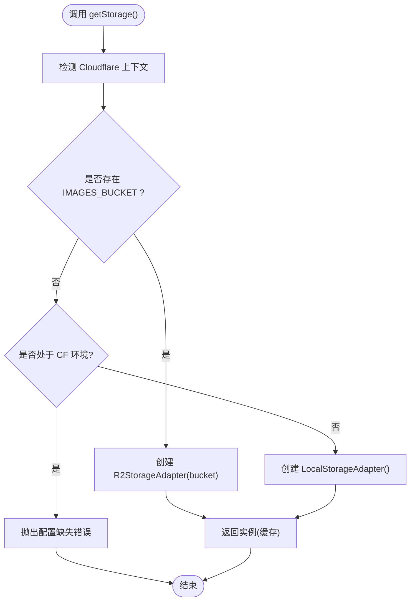
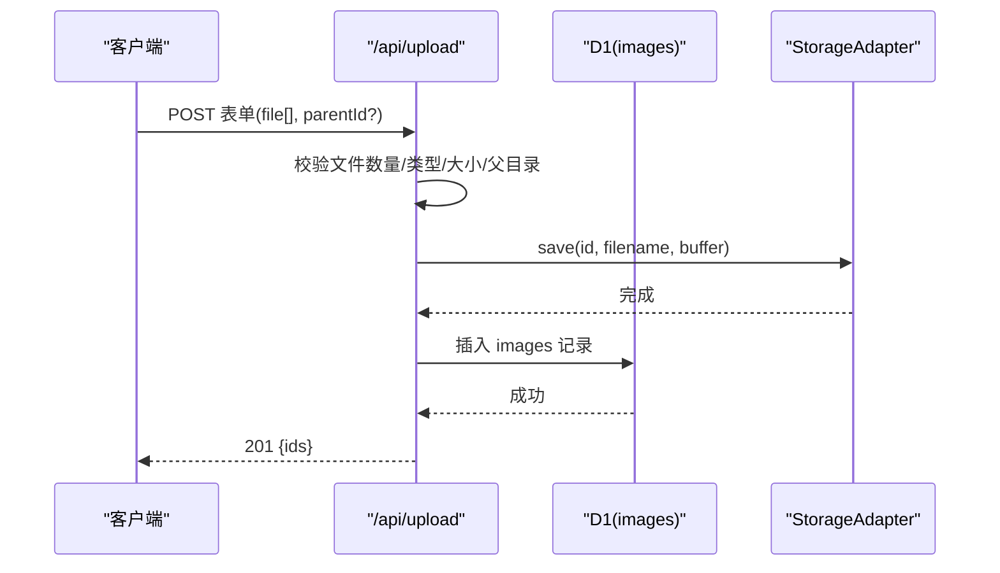
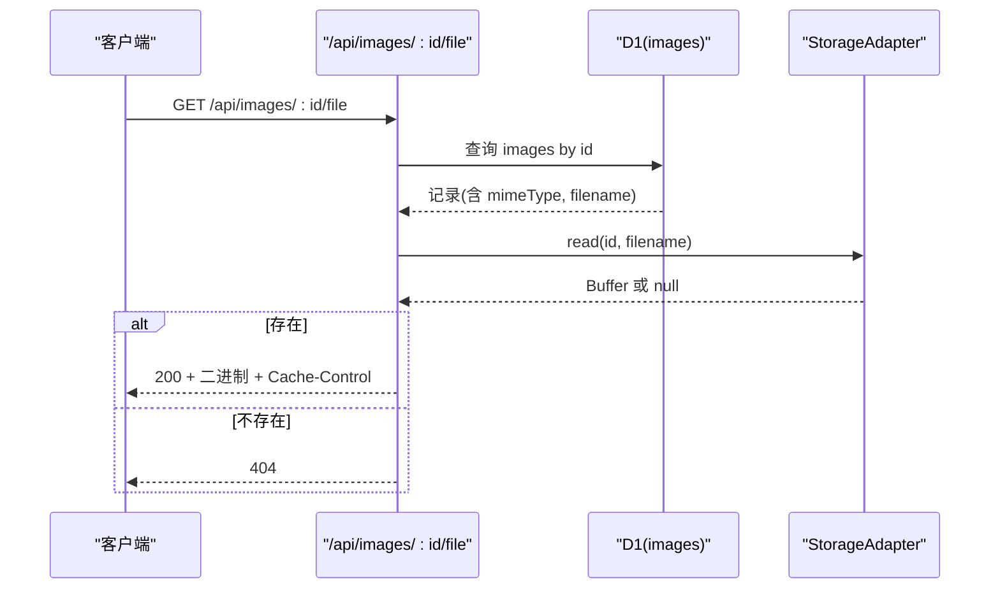
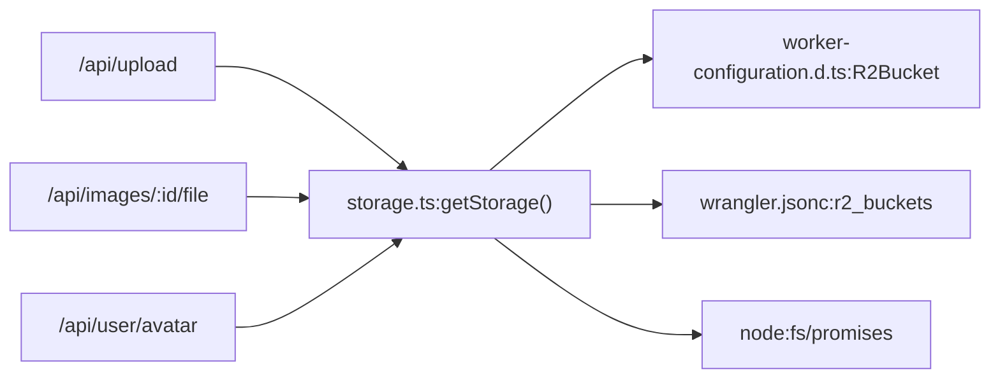

# 存储架构设计

<cite>
**本文引用的文件**   
- [src/lib/storage.ts](file://src/lib/storage.ts)
- [wrangler.jsonc](file://wrangler.jsonc)
- [worker-configuration.d.ts](file://worker-configuration.d.ts)
- [src/app/api/upload/route.ts](file://src/app/api/upload/route.ts)
- [src/app/api/images/[imageId]/file/route.ts](file://src/app/api/images/[imageId]/file/route.ts)
- [src/app/api/user/avatar/route.ts](file://src/app/api/user/avatar/route.ts)
- [src/app/api/user/avatar/[userId]/route.ts](file://src/app/api/user/avatar/[userId]/route.ts)
- [src/db/schema.ts](file://src/db/schema.ts)
- [open-next.config.ts](file://open-next.config.ts)
</cite>

## 目录
1. [简介](#简介)
2. [项目结构](#项目结构)
3. [核心组件](#核心组件)
4. [架构总览](#架构总览)
5. [详细组件分析](#详细组件分析)
6. [依赖关系分析](#依赖关系分析)
7. [性能与缓存策略](#性能与缓存策略)
8. [故障排查指南](#故障排查指南)
9. [结论](#结论)
10. [附录：扩展新存储后端指南](#附录扩展新存储后端指南)

## 简介
本文件为 Weable 应用的“存储架构设计”文档，聚焦于适配器模式在存储系统中的实现，涵盖本地文件系统与 Cloudflare R2 两种后端的抽象接口、运行时切换机制、配置管理、错误处理策略，以及文件上传流程、元数据管理与缓存策略。同时提供架构图、调用序列图与流程图，并给出如何扩展新的存储后端（如 S3、OSS 等）的实践指南。

## 项目结构
存储相关代码集中在以下位置：
- 存储抽象与实现：src/lib/storage.ts
- 环境绑定与类型声明：wrangler.jsonc、worker-configuration.d.ts
- 业务 API 路由（使用存储）：src/app/api/upload/route.ts、src/app/api/images/[imageId]/file/route.ts、src/app/api/user/avatar/route.ts、src/app/api/user/avatar/[userId]/route.ts
- 元数据模型：src/db/schema.ts
- 增量缓存配置（可选）：open-next.config.ts

图表来源
- [src/lib/storage.ts:1-214](file://src/lib/storage.ts#L1-L214)
- [wrangler.jsonc:23-32](file://wrangler.jsonc#L23-L32)
- [worker-configuration.d.ts:26-35](file://worker-configuration.d.ts#L26-L35)
- [src/app/api/upload/route.ts:1-75](file://src/app/api/upload/route.ts#L1-L75)
- [src/app/api/images/[imageId]/file/route.ts:1-48](file://src/app/api/images/[imageId]/file/route.ts#L1-L48)
- [src/app/api/user/avatar/route.ts:1-34](file://src/app/api/user/avatar/route.ts#L1-L34)
- [src/app/api/user/avatar/[userId]/route.ts:1-28](file://src/app/api/user/avatar/[userId]/route.ts#L1-L28)
- [src/db/schema.ts:46-69](file://src/db/schema.ts#L46-L69)

章节来源
- [src/lib/storage.ts:1-214](file://src/lib/storage.ts#L1-L214)
- [wrangler.jsonc:1-34](file://wrangler.jsonc#L1-L34)
- [worker-configuration.d.ts:1-38](file://worker-configuration.d.ts#L1-L38)
- [src/app/api/upload/route.ts:1-75](file://src/app/api/upload/route.ts#L1-L75)
- [src/app/api/images/[imageId]/file/route.ts:1-48](file://src/app/api/images/[imageId]/file/route.ts#L1-L48)
- [src/app/api/user/avatar/route.ts:1-34](file://src/app/api/user/avatar/route.ts#L1-L34)
- [src/app/api/user/avatar/[userId]/route.ts:1-28](file://src/app/api/user/avatar/[userId]/route.ts#L1-L28)
- [src/db/schema.ts:1-100](file://src/db/schema.ts#L1-L100)
- [open-next.config.ts:1-9](file://open-next.config.ts#L1-L9)

## 核心组件
- 存储接口定义
  - StorageAdapter：统一图片存储的 save/read/delete 三件套，参数包含 imageId 与 filename，返回 Buffer 或 null。
  - AvatarStorage：头像存储的简化接口，仅以 key 作为唯一标识。
- 具体实现类
  - LocalStorageAdapter：基于本地文件系统的实现，路径由 IMAGE_STORAGE_PATH 环境变量决定，默认 ./.data/uploads。
  - R2StorageAdapter：基于 Cloudflare R2 的对象存储实现，通过 IMAGES_BUCKET 绑定访问。
  - LocalAvatarStorage：对 StorageAdapter 的包装，将头像统一写入 __avatar__ 命名空间。
  - R2AvatarStorage：直接操作 R2 bucket，头像对象键前缀为 avatar/。
- 工厂与实例化
  - getStorage()：根据运行环境自动选择 R2 或本地实现，并在 Cloudflare 环境中未配置 R2 时抛出明确错误。
  - getAvatarStorage()：同理，优先使用 R2AvatarStorage，否则回退到 LocalAvatarStorage(getStorage())。

章节来源
- [src/lib/storage.ts:3-13](file://src/lib/storage.ts#L3-L13)
- [src/lib/storage.ts:61-136](file://src/lib/storage.ts#L61-L136)
- [src/lib/storage.ts:138-179](file://src/lib/storage.ts#L138-L179)
- [src/lib/storage.ts:184-213](file://src/lib/storage.ts#L184-L213)

## 架构总览
存储系统采用适配器模式，将业务逻辑与具体存储后端解耦。运行时通过 getStorage()/getAvatarStorage() 获取对应实现，从而屏蔽底层差异。

图表来源
- [src/lib/storage.ts:3-13](file://src/lib/storage.ts#L3-L13)
- [src/lib/storage.ts:61-136](file://src/lib/storage.ts#L61-L136)
- [src/lib/storage.ts:138-179](file://src/lib/storage.ts#L138-L179)

## 详细组件分析

### 存储适配器与工厂
- 安全校验
  - 所有路径片段（imageId、filename、key）均经过 assertSafeSegment 校验，防止目录穿越与非法字符。
- 路径与键解析
  - 本地路径：storageRoot/imageId/filename
  - R2 对象键：imageId/filename；头像键：avatar/key 或 __avatar__/key
- 运行时切换
  - getR2BucketBinding() 尝试从 @opennextjs/cloudflare 获取 Cloudflare 上下文与环境变量 IMAGES_BUCKET。
  - 若存在 bucket，则使用 R2 实现；否则在 CF 环境下抛错提示配置缺失；本地开发回退到 LocalStorageAdapter。
- 单例缓存
  - storageInstance 与 avatarStorageInstance 模块级缓存，避免重复构造。

图表来源
- [src/lib/storage.ts:46-53](file://src/lib/storage.ts#L46-L53)
- [src/lib/storage.ts:184-197](file://src/lib/storage.ts#L184-L197)

章节来源
- [src/lib/storage.ts:15-33](file://src/lib/storage.ts#L15-L33)
- [src/lib/storage.ts:46-53](file://src/lib/storage.ts#L46-L53)
- [src/lib/storage.ts:184-213](file://src/lib/storage.ts#L184-L213)

### 本地文件存储实现
- save：递归创建目录并写入文件。
- read：读取文件，若 ENOENT 返回 null，其他错误向上抛出。
- delete：删除文件，ENOENT 视为成功，其他错误向上抛出。
- 路径构建：使用 node:path 动态导入，避免非 Node 环境引入失败。

章节来源
- [src/lib/storage.ts:61-114](file://src/lib/storage.ts#L61-L114)

### Cloudflare R2 存储实现
- save：将 Buffer 转为 Uint8Array 后 put 到 bucket。
- read：get 对象后 arrayBuffer 转 Buffer，不存在返回 null。
- delete：按对象键删除。
- 对象键：imageId/filename，确保片段安全。

章节来源
- [src/lib/storage.ts:116-136](file://src/lib/storage.ts#L116-L136)

### 头像存储适配器
- LocalAvatarStorage：复用基础 StorageAdapter，统一以 __avatar__/key 命名空间存放。
- R2AvatarStorage：直接使用 R2 bucket，对象键前缀 avatar/。

章节来源
- [src/lib/storage.ts:138-179](file://src/lib/storage.ts#L138-L179)

### 文件上传流程（API 路由）
- 入口：POST /api/upload
- 校验：文件数量、MIME 前缀、大小限制、父目录权限校验。
- 存储：生成 id，写入 Buffer，调用 storage.save(id, filename, buffer)。
- 元数据：插入 images 表，记录 title、filename、mimeType、size 等。
- 响应：返回 ids 列表。

图表来源
- [src/app/api/upload/route.ts:14-74](file://src/app/api/upload/route.ts#L14-L74)
- [src/db/schema.ts:46-69](file://src/db/schema.ts#L46-L69)

章节来源
- [src/app/api/upload/route.ts:1-75](file://src/app/api/upload/route.ts#L1-L75)
- [src/db/schema.ts:46-69](file://src/db/schema.ts#L46-L69)

### 文件下载流程（API 路由）
- 入口：GET /api/images/:imageId/file
- 鉴权与校验：验证 imageId 格式，查询 images 表确认存在且非目录。
- 读取：调用 storage.read(imageId, filename)，不存在返回 404。
- 响应：返回二进制流，设置 Content-Type 与强缓存头。

图表来源
- [src/app/api/images/[imageId]/file/route.ts:12-47](file://src/app/api/images/[imageId]/file/route.ts#L12-L47)

章节来源
- [src/app/api/images/[imageId]/file/route.ts:1-48](file://src/app/api/images/[imageId]/file/route.ts#L1-L48)

### 头像上传与读取
- 上传：POST /api/user/avatar，校验类型与大小，调用 getAvatarStorage().save(user_key, buffer)。
- 读取：GET /api/user/avatar/:userId，按 user_key=user_{userId} 读取并返回图片。

章节来源
- [src/app/api/user/avatar/route.ts:1-34](file://src/app/api/user/avatar/route.ts#L1-L34)
- [src/app/api/user/avatar/[userId]/route.ts:1-28](file://src/app/api/user/avatar/[userId]/route.ts#L1-L28)

## 依赖关系分析
- 运行时绑定
  - wrangler.jsonc 中 r2_buckets 定义了 IMAGES_BUCKET 绑定名称与桶名。
  - worker-configuration.d.ts 声明了 R2Bucket、R2ObjectBody、CloudflareEnv 等类型。
- 模块耦合
  - API 路由仅依赖 getStorage()/getAvatarStorage()，不感知具体实现。
  - 存储库内部依赖 @opennextjs/cloudflare 获取上下文，Node 环境使用 fs/promises。

图表来源
- [wrangler.jsonc:23-32](file://wrangler.jsonc#L23-L32)
- [worker-configuration.d.ts:26-35](file://worker-configuration.d.ts#L26-L35)
- [src/lib/storage.ts:1-2](file://src/lib/storage.ts#L1-L2)

章节来源
- [wrangler.jsonc:1-34](file://wrangler.jsonc#L1-L34)
- [worker-configuration.d.ts:1-38](file://worker-configuration.d.ts#L1-L38)
- [src/lib/storage.ts:1-2](file://src/lib/storage.ts#L1-L2)

## 性能与缓存策略
- 浏览器缓存
  - 图片读取接口设置了 immutable 的强缓存头，减少重复请求。
  - 头像读取接口设置了合理的 max-age，兼顾更新与缓存命中。
- 增量缓存（可选）
  - open-next.config.ts 提供了启用 R2 作为增量缓存的注释选项，可按需开启以提升 SSR/静态资源命中率。
- I/O 优化
  - 本地实现按需动态导入 fs/promises，避免不必要的模块加载。
  - R2 实现直接转换 ArrayBuffer/Buffer，减少中间拷贝。
- 建议
  - 大文件上传可考虑分片与断点续传（当前实现为一次性上传）。
  - 热点图片可在 CDN 层做边缘缓存，结合 ETag/Last-Modified 提升命中率。
  - 本地开发时可调整 IMAGE_STORAGE_PATH 指向高性能磁盘。

章节来源
- [src/app/api/images/[imageId]/file/route.ts:41-46](file://src/app/api/images/[imageId]/file/route.ts#L41-L46)
- [src/app/api/user/avatar/[userId]/route.ts:22-27](file://src/app/api/user/avatar/[userId]/route.ts#L22-L27)
- [open-next.config.ts:1-9](file://open-next.config.ts#L1-L9)

## 故障排查指南
- 常见问题
  - Cloudflare 环境未配置 IMAGES_BUCKET：getStorage()/getAvatarStorage() 会抛出明确错误，检查 wrangler.jsonc 的 r2_buckets 绑定。
  - 文件不存在：read 返回 null，API 层返回 404，检查上传是否成功与文件名一致性。
  - 路径安全问题：assertSafeSegment 会拒绝包含 “.”、“..”、“/”、“\” 的片段，确保传入的 imageId/filename/key 合法。
- 定位步骤
  - 查看 API 路由的错误返回码与消息。
  - 检查 D1 数据库中 images 记录是否存在且字段正确。
  - 检查存储后端（本地文件或 R2）是否可写可读。
  - 在 CF 环境确认 IMAGES_BUCKET 绑定生效。

章节来源
- [src/lib/storage.ts:15-25](file://src/lib/storage.ts#L15-L25)
- [src/lib/storage.ts:184-213](file://src/lib/storage.ts#L184-L213)
- [src/app/api/upload/route.ts:21-35](file://src/app/api/upload/route.ts#L21-L35)
- [src/app/api/images/[imageId]/file/route.ts:15-28](file://src/app/api/images/[imageId]/file/route.ts#L15-L28)

## 结论
Weable 的存储架构通过清晰的适配器模式实现了本地文件与 R2 的统一抽象，配合运行时自动切换与严格的安全校验，既满足本地开发便捷性，又具备云端可扩展性与高可用能力。API 层与存储层解耦良好，便于后续扩展更多后端（如 S3、OSS、Azure Blob 等），并通过缓存策略与 I/O 优化提升整体性能。

## 附录：扩展新存储后端指南
- 目标
  - 新增一个支持新对象存储（例如 AWS S3、阿里云 OSS、腾讯云 COS）的实现类，无缝接入现有系统。
- 步骤
  1. 定义实现类
     - 新建类实现 StorageAdapter 或 AvatarStorage 接口，遵循 save/read/delete 方法契约。
     - 注意对象键/路径规则与安全校验（复用 assertSafeSegment）。
  2. 数据转换
     - 将 Buffer 转换为 SDK 所需的数据类型（如 Uint8Array、Blob、ReadableStream）。
     - 读取时将 SDK 返回的字节流转换为 Buffer。
  3. 错误处理
     - 对“不存在”的情况返回 null（read）或忽略（delete ENOENT 等价语义）。
     - 其他异常向上抛出，交由上层统一处理。
  4. 工厂集成
     - 在 getStorage()/getAvatarStorage() 中增加条件分支，根据环境变量或运行时特征选择新实现。
     - 建议在 wrangler.jsonc 或环境变量中暴露新后端所需的绑定/密钥。
  5. 测试与验证
     - 单元测试覆盖 save/read/delete 的正常与异常路径。
     - 集成测试验证 API 路由上传与下载流程。
  6. 文档与配置
     - 更新 wrangler.jsonc 或环境变量说明，标注新绑定的名称与用途。
     - 在 README 或内部文档中补充配置与部署步骤。

- 注意事项
  - 保持接口一致，避免破坏现有调用方。
  - 谨慎处理并发与幂等性（尤其是上传重试场景）。
  - 合理设置缓存头与 CDN 策略，提升读取性能。
  - 对敏感信息（密钥、端点）进行安全注入，避免硬编码。

[本节为概念性指导，不直接分析具体文件]