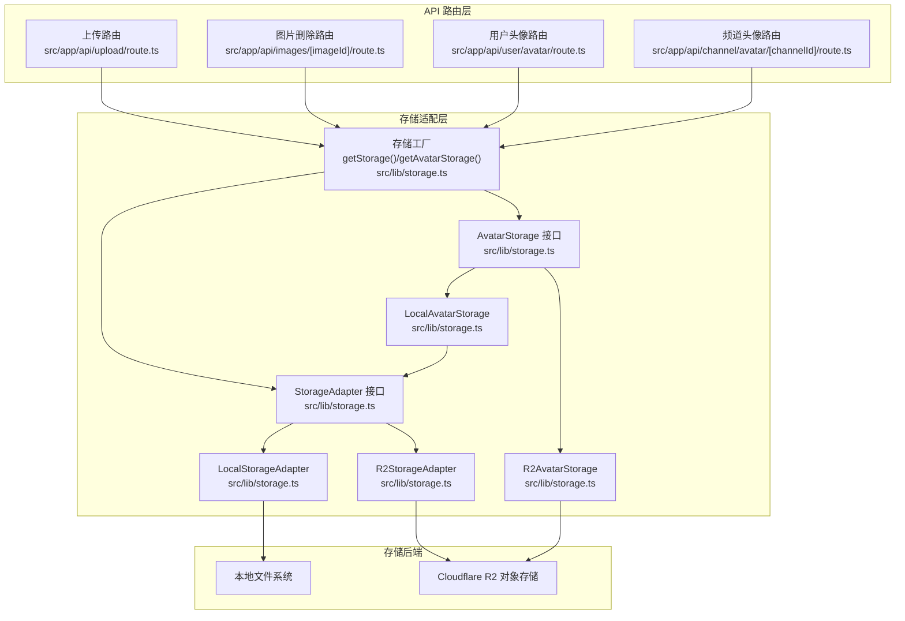
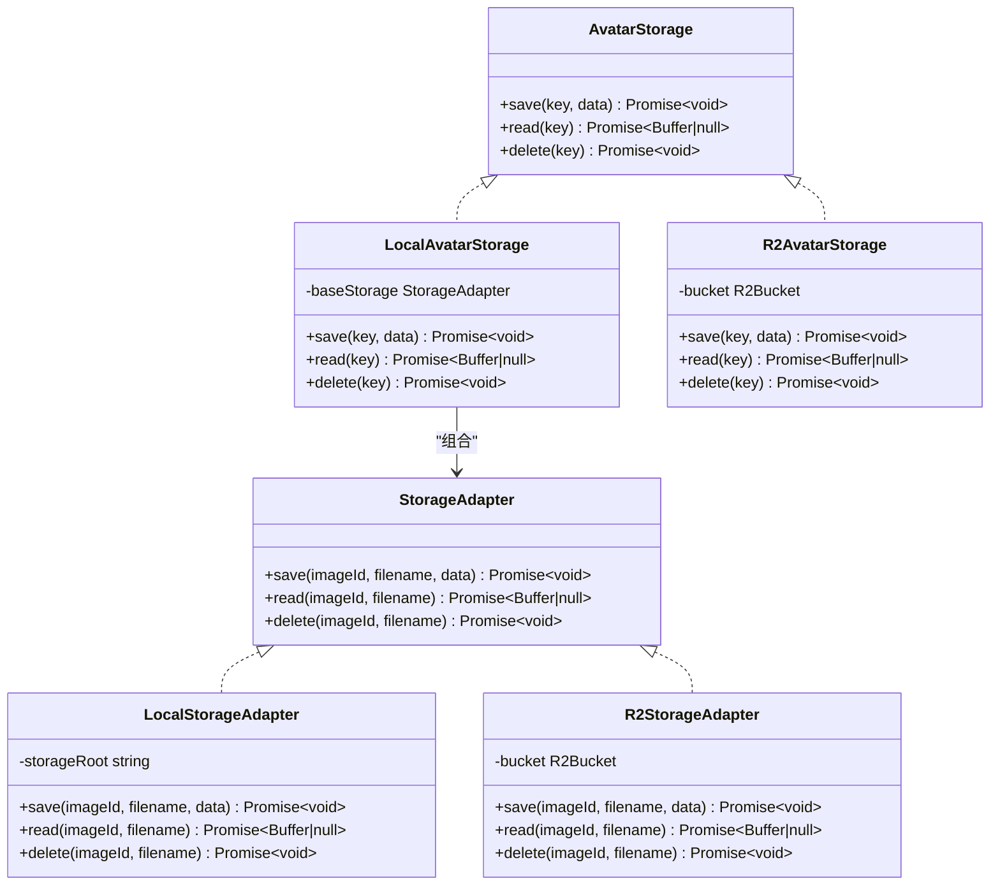
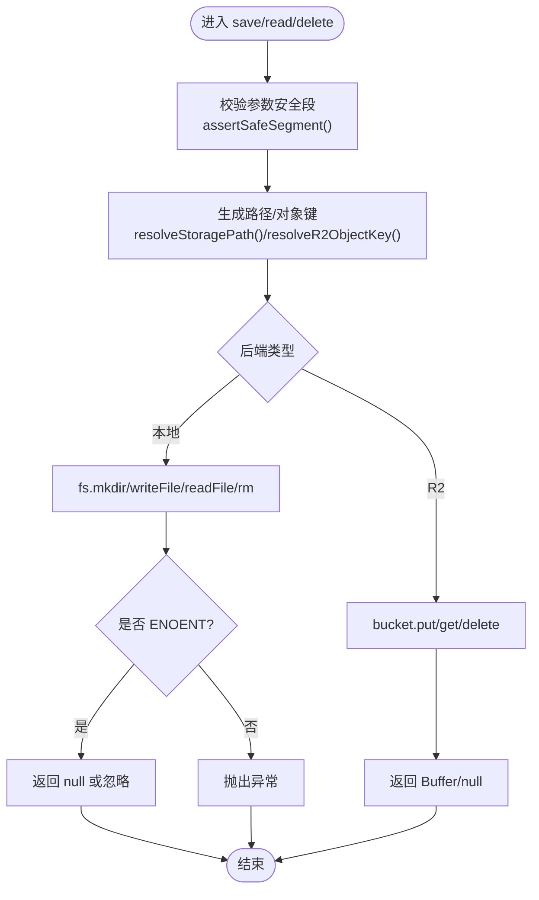
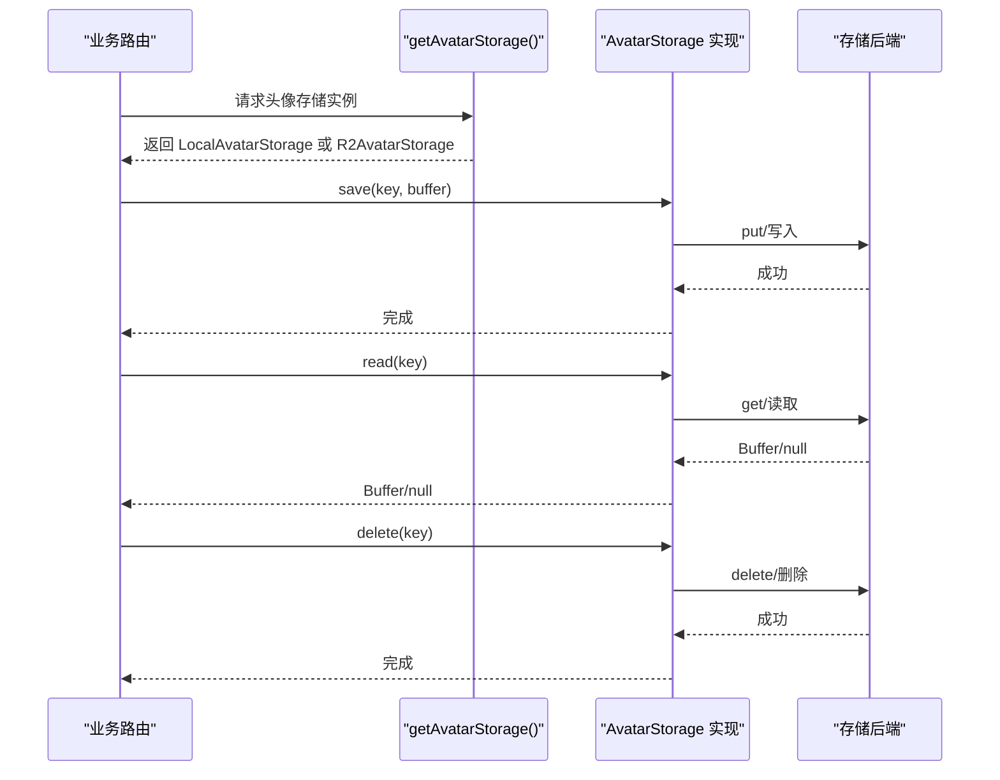
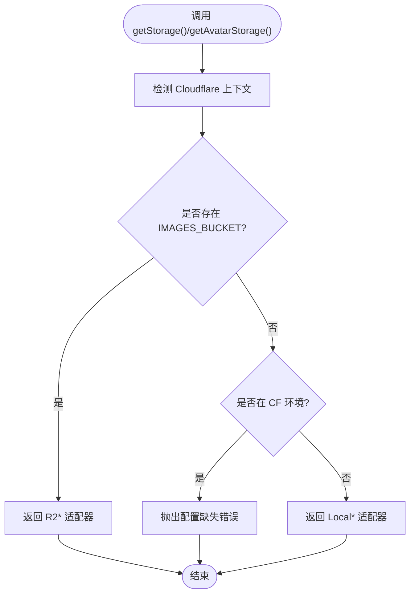
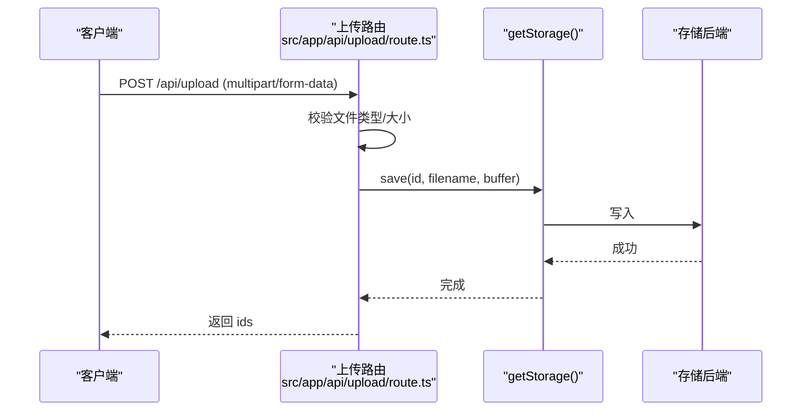
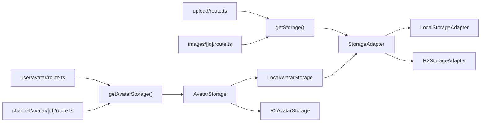

# 存储适配器模式设计

<cite>
**本文引用的文件**   
- [src/lib/storage.ts](file://src/lib/storage.ts)
- [src/app/api/upload/route.ts](file://src/app/api/upload/route.ts)
- [src/app/api/images/[imageId]/route.ts](file://src/app/api/images/[imageId]/route.ts)
- [src/app/api/user/avatar/route.ts](file://src/app/api/user/avatar/route.ts)
- [src/app/api/channel/avatar/[channelId]/route.ts](file://src/app/api/channel/avatar/[channelId]/route.ts)
</cite>

## 目录
1. [简介](#简介)
2. [项目结构](#项目结构)
3. [核心组件](#核心组件)
4. [架构总览](#架构总览)
5. [详细组件分析](#详细组件分析)
6. [依赖关系分析](#依赖关系分析)
7. [性能考量](#性能考量)
8. [故障排查指南](#故障排查指南)
9. [结论](#结论)
10. [附录：新存储后端开发指南](#附录新存储后端开发指南)

## 简介
本文件围绕 Weable 应用的“存储适配器模式”进行系统化文档化，重点解释 StorageAdapter 与 AvatarStorage 两个接口的设计思想、抽象层次与扩展性。通过适配器模式将业务逻辑与具体存储实现解耦，统一了本地文件系统与云对象存储（R2）的访问方式，并提供统一的错误处理策略与实例获取机制。文档包含架构图、类图、时序图与流程图，以及面向新存储后端的完整实现指南和最佳实践。

## 项目结构
存储相关代码集中在 src/lib/storage.ts，业务 API 路由通过 getStorage() 与 getAvatarStorage() 获取具体实现，从而屏蔽底层差异。上传与头像相关的 API 路由分别使用两类适配器：
- 图片元数据与文件内容：StorageAdapter（Local/R2）
- 头像内容：AvatarStorage（LocalAvatarStorage / R2AvatarStorage）

**图表来源** 
- [src/lib/storage.ts:3-13](file://src/lib/storage.ts#L3-L13)
- [src/lib/storage.ts:61-136](file://src/lib/storage.ts#L61-L136)
- [src/lib/storage.ts:138-179](file://src/lib/storage.ts#L138-L179)
- [src/lib/storage.ts:184-213](file://src/lib/storage.ts#L184-L213)
- [src/app/api/upload/route.ts:51-58](file://src/app/api/upload/route.ts#L51-L58)
- [src/app/api/images/[imageId]/route.ts:32-33](file://src/app/api/images/[imageId]/route.ts#L32-L33)
- [src/app/api/user/avatar/route.ts:29-30](file://src/app/api/user/avatar/route.ts#L29-L30)
- [src/app/api/channel/avatar/[channelId]/route.ts:19-20](file://src/app/api/channel/avatar/[channelId]/route.ts#L19-L20)

**章节来源**
- [src/lib/storage.ts:1-214](file://src/lib/storage.ts#L1-L214)
- [src/app/api/upload/route.ts:1-75](file://src/app/api/upload/route.ts#L1-L75)
- [src/app/api/images/[imageId]/route.ts:1-84](file://src/app/api/images/[imageId]/route.ts#L1-L84)
- [src/app/api/user/avatar/route.ts:1-34](file://src/app/api/user/avatar/route.ts#L1-L34)
- [src/app/api/channel/avatar/[channelId]/route.ts:1-64](file://src/app/api/channel/avatar/[channelId]/route.ts#L1-L64)

## 核心组件
- StorageAdapter 接口：定义图片文件的通用操作（保存、读取、删除），参数包含 imageId 与 filename，返回 Promise<void>/Promise<Buffer|null>。
- AvatarStorage 接口：定义头像内容的通用操作（保存、读取、删除），参数为 key 与 Buffer，返回 Promise<void>/Promise<Buffer|null>。
- 适配器实现：
  - LocalStorageAdapter：基于本地文件系统，路径由 storageRoot + imageId + filename 组成。
  - R2StorageAdapter：基于 Cloudflare R2 对象存储，键名由 imageId/filename 组成。
  - LocalAvatarStorage：复用 StorageAdapter，以固定前缀 "__avatar__" 作为 imageId，实现头像存储。
  - R2AvatarStorage：直接操作 R2，键名前缀为 avatar/。
- 工厂函数：
  - getStorage()：根据运行环境自动选择 R2 或本地实现。
  - getAvatarStorage()：根据运行环境自动选择 R2 头像存储或基于本地文件系统的头像存储。

**章节来源**
- [src/lib/storage.ts:3-13](file://src/lib/storage.ts#L3-L13)
- [src/lib/storage.ts:61-136](file://src/lib/storage.ts#L61-L136)
- [src/lib/storage.ts:138-179](file://src/lib/storage.ts#L138-L179)
- [src/lib/storage.ts:184-213](file://src/lib/storage.ts#L184-L213)

## 架构总览
适配器模式将业务逻辑与存储实现解耦：
- 业务层仅依赖接口（StorageAdapter/AvatarStorage），不关心具体实现。
- 工厂函数在运行时决定使用哪种实现，便于在不同部署环境切换。
- 安全校验与路径/键名解析在适配器内部完成，避免上层重复实现。

**图表来源** 
- [src/lib/storage.ts:3-13](file://src/lib/storage.ts#L3-L13)
- [src/lib/storage.ts:61-136](file://src/lib/storage.ts#L61-L136)
- [src/lib/storage.ts:138-179](file://src/lib/storage.ts#L138-L179)

## 详细组件分析

### StorageAdapter 接口与实现
- 设计要点：
  - 方法签名清晰，统一输入输出类型，便于上层调用。
  - 读操作返回 null 表示不存在，删除操作对不存在资源幂等处理。
- 本地实现（LocalStorageAdapter）：
  - 路径解析使用安全段校验，防止目录穿越。
  - 读/删时对 ENOENT 错误进行特殊处理，保证幂等性与空值语义。
- 云实现（R2StorageAdapter）：
  - 对象键由 imageId/filename 拼接，同样进行安全段校验。
  - 读操作将 ArrayBuffer 转换为 Buffer 返回。

**图表来源** 
- [src/lib/storage.ts:15-33](file://src/lib/storage.ts#L15-L33)
- [src/lib/storage.ts:55-59](file://src/lib/storage.ts#L55-L59)
- [src/lib/storage.ts:66-113](file://src/lib/storage.ts#L66-L113)
- [src/lib/storage.ts:119-135](file://src/lib/storage.ts#L119-L135)

**章节来源**
- [src/lib/storage.ts:61-136](file://src/lib/storage.ts#L61-L136)

### AvatarStorage 接口与实现
- 设计要点：
  - 简化键名管理，上层只需提供 key，适配器负责命名空间隔离。
  - LocalAvatarStorage 复用 StorageAdapter，通过固定 imageId="__avatar__" 实现命名空间隔离。
  - R2AvatarStorage 直接使用 bucket，键名前缀为 avatar/。
- 错误处理：
  - 读操作返回 null 表示不存在；删除操作对不存在资源幂等处理。

**图表来源** 
- [src/lib/storage.ts:138-179](file://src/lib/storage.ts#L138-L179)
- [src/lib/storage.ts:199-213](file://src/lib/storage.ts#L199-L213)

**章节来源**
- [src/lib/storage.ts:138-179](file://src/lib/storage.ts#L138-L179)

### 工厂函数与环境检测
- getStorage()：
  - 优先尝试从 Cloudflare 上下文获取 R2 绑定；若存在则返回 R2StorageAdapter。
  - 否则在非 CF 环境下回退到 LocalStorageAdapter；若在 CF 环境且未配置 IMAGES_BUCKET 则抛出错误。
- getAvatarStorage()：
  - 优先返回 R2AvatarStorage（当可用）。
  - 否则返回 LocalAvatarStorage，并注入当前 StorageAdapter 实例。

**图表来源** 
- [src/lib/storage.ts:46-53](file://src/lib/storage.ts#L46-L53)
- [src/lib/storage.ts:184-213](file://src/lib/storage.ts#L184-L213)

**章节来源**
- [src/lib/storage.ts:46-53](file://src/lib/storage.ts#L46-L53)
- [src/lib/storage.ts:184-213](file://src/lib/storage.ts#L184-L213)

### 业务集成示例（上传与头像）
- 图片上传：
  - 路由接收表单文件，校验类型与大小，构造 Buffer，调用 getStorage().save(id, name, buffer)。
- 图片删除：
  - 路由先校验权限与记录存在性，再调用 getStorage().delete(imageId, filename)，最后删除数据库记录。
- 头像上传/读取：
  - 路由使用 getAvatarStorage()，按 key 进行保存与读取，读取时返回 Uint8Array 响应。

**图表来源** 
- [src/app/api/upload/route.ts:51-58](file://src/app/api/upload/route.ts#L51-L58)
- [src/lib/storage.ts:184-197](file://src/lib/storage.ts#L184-L197)

**章节来源**
- [src/app/api/upload/route.ts:1-75](file://src/app/api/upload/route.ts#L1-L75)
- [src/app/api/images/[imageId]/route.ts:32-33](file://src/app/api/images/[imageId]/route.ts#L32-L33)
- [src/app/api/user/avatar/route.ts:29-30](file://src/app/api/user/avatar/route.ts#L29-L30)
- [src/app/api/channel/avatar/[channelId]/route.ts:19-20](file://src/app/api/channel/avatar/[channelId]/route.ts#L19-L20)

## 依赖关系分析
- 模块耦合：
  - 业务路由仅依赖接口与工厂函数，不感知具体实现，降低耦合度。
  - LocalAvatarStorage 组合 StorageAdapter，体现适配器模式的组合复用。
- 外部依赖：
  - Cloudflare 上下文用于检测 R2 绑定。
  - Node.js fs/promises 与 path 用于本地文件系统操作。
- 潜在循环依赖：
  - 无直接循环依赖；工厂函数与适配器之间为单向依赖。

**图表来源** 
- [src/app/api/upload/route.ts:51-58](file://src/app/api/upload/route.ts#L51-L58)
- [src/app/api/images/[imageId]/route.ts:32-33](file://src/app/api/images/[imageId]/route.ts#L32-L33)
- [src/app/api/user/avatar/route.ts:29-30](file://src/app/api/user/avatar/route.ts#L29-L30)
- [src/app/api/channel/avatar/[channelId]/route.ts:19-20](file://src/app/api/channel/avatar/[channelId]/route.ts#L19-L20)
- [src/lib/storage.ts:184-213](file://src/lib/storage.ts#L184-L213)

**章节来源**
- [src/lib/storage.ts:184-213](file://src/lib/storage.ts#L184-L213)

## 性能考量
- 内存与缓冲：
  - 读写均使用 Buffer，避免频繁转换带来的额外开销。
  - R2 读取时将 ArrayBuffer 转为 Buffer，注意大文件时的内存峰值。
- I/O 模型：
  - 本地文件系统采用异步 I/O，避免阻塞事件循环。
  - R2 网络请求为异步，建议在上层进行并发控制与重试策略。
- 缓存与过期：
  - 头像读取设置 Cache-Control 头，提升 CDN/浏览器缓存命中率。
- 可扩展性：
  - 新增存储后端只需实现对应接口，无需改动业务路由。

[本节为通用指导，不涉及具体文件分析]

## 故障排查指南
- 常见问题与定位：
  - 未配置 R2 绑定：在 Cloudflare 环境中调用 getStorage()/getAvatarStorage() 会抛出配置缺失错误。检查 wrangler.jsonc 中 R2 绑定与 IMAGES_BUCKET 环境变量。
  - 文件不存在：读操作返回 null，删除操作对不存在资源幂等处理。确保上层正确处理 null 与异常。
  - 路径/键名非法：安全段校验失败会抛出错误。检查传入的 imageId、filename、key 是否包含非法字符或路径穿越片段。
- 调试建议：
  - 在本地开发时确认 IMAGE_STORAGE_PATH 指向有效目录。
  - 观察日志中的错误码（如 ENOENT）与异常堆栈，快速定位问题。

**章节来源**
- [src/lib/storage.ts:184-213](file://src/lib/storage.ts#L184-L213)
- [src/lib/storage.ts:75-113](file://src/lib/storage.ts#L75-L113)
- [src/lib/storage.ts:15-33](file://src/lib/storage.ts#L15-L33)

## 结论
Weable 应用通过 StorageAdapter 与 AvatarStorage 两个接口实现了存储后端的解耦，结合工厂函数与环境检测，使得同一套业务逻辑可在本地与云存储间无缝切换。适配器内部的安全校验、路径/键名解析与错误处理策略保证了健壮性与一致性。该设计具备良好的扩展性，便于未来接入更多存储后端。

[本节为总结性内容，不涉及具体文件分析]

## 附录：新存储后端开发指南
- 目标：新增一个存储后端（例如 S3、OSS、MinIO 等），需实现 StorageAdapter 或 AvatarStorage 接口。
- 步骤：
  1. 定义适配器类并实现接口方法（save/read/delete），遵循以下规范：
     - 参数校验：对 imageId、filename、key 进行安全段校验，防止路径穿越与非法字符。
     - 返回值：read 返回 Buffer 或 null；delete 对不存在资源幂等处理。
     - 错误处理：非预期错误应抛出异常，允许上层捕获与重试。
  2. 如需命名空间隔离（如头像），可参考 LocalAvatarStorage 的组合方式或直接实现 AvatarStorage。
  3. 注册与选择：
     - 在工厂函数中增加对新实现的判断逻辑，依据环境变量或运行时上下文选择实现。
     - 保持向后兼容，默认行为不变。
- 最佳实践：
  - 使用异步 I/O，避免阻塞事件循环。
  - 对大文件进行流式处理以降低内存占用。
  - 设置合理的超时与重试策略，提高稳定性。
  - 在读取响应中设置合适的缓存头（如 Cache-Control）。
  - 编写单元测试覆盖正常路径与边界条件（不存在、非法参数、网络异常等）。

[本节为通用指导，不涉及具体文件分析]