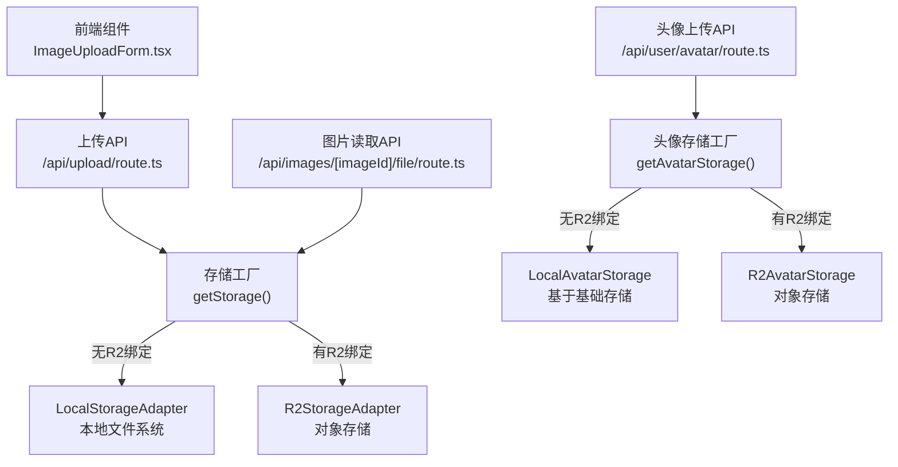
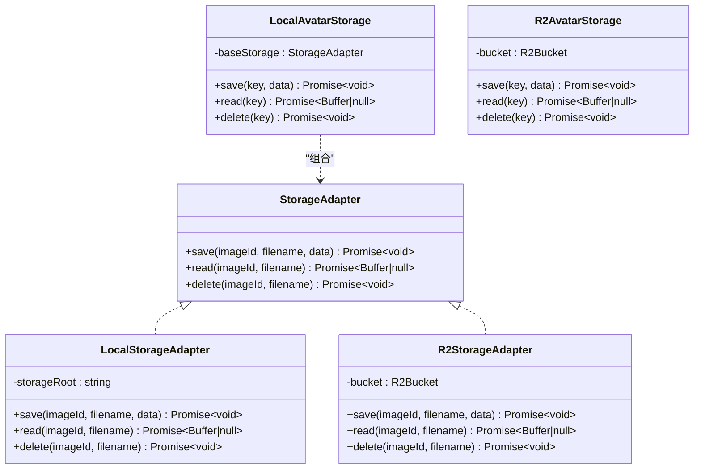
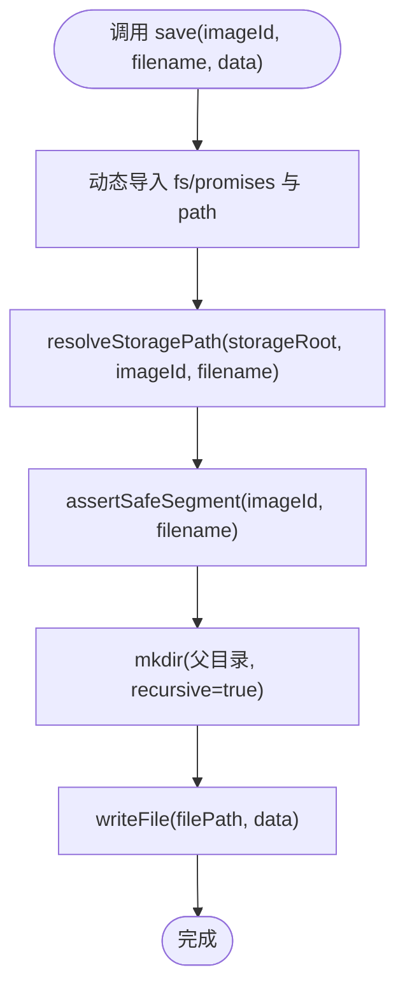
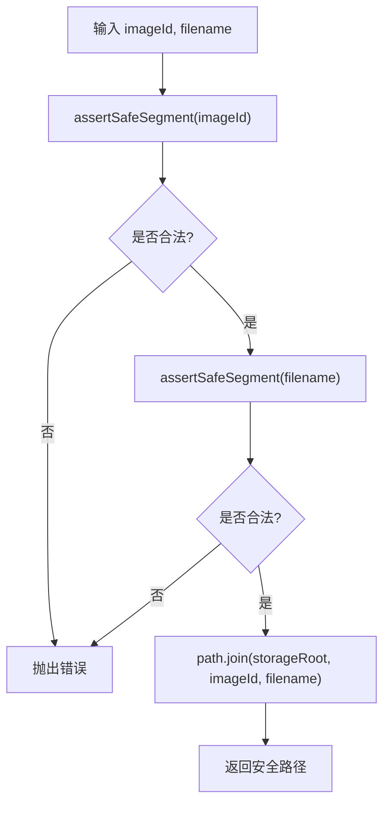
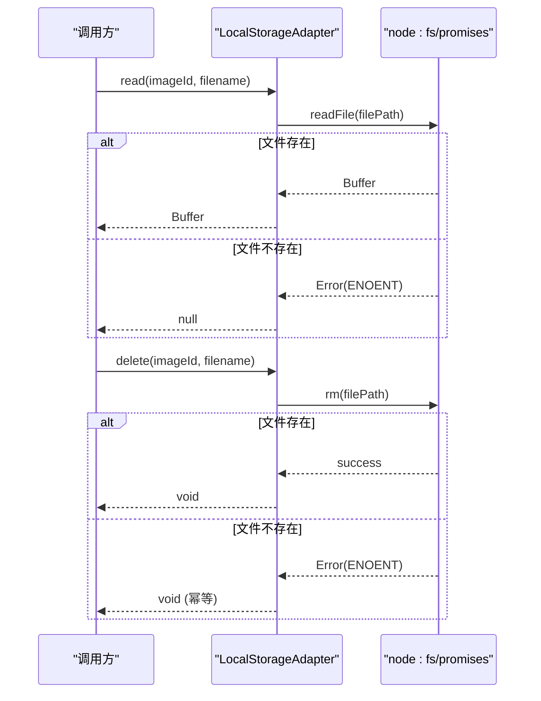
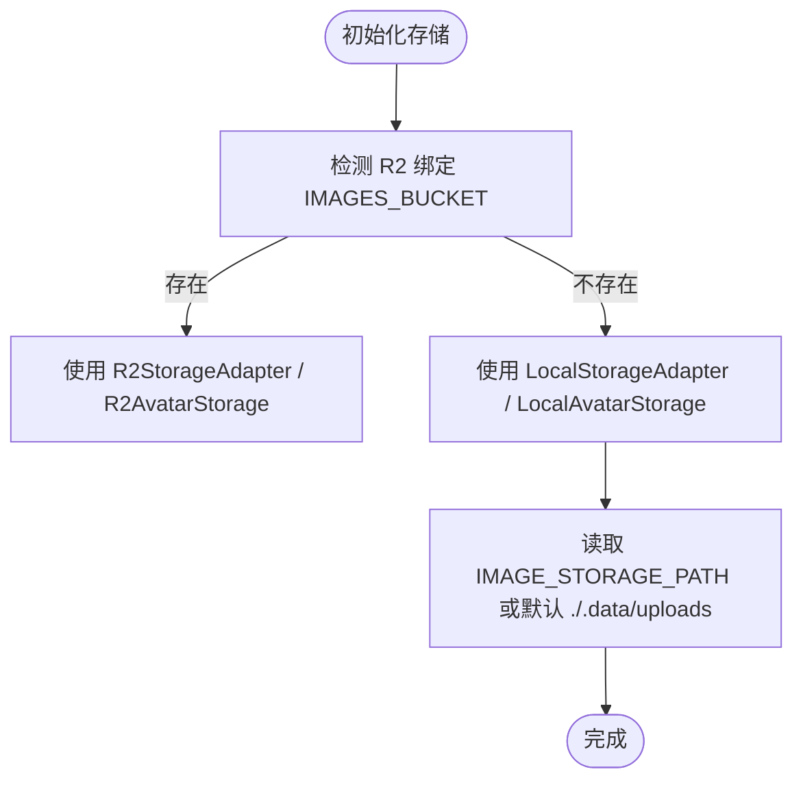
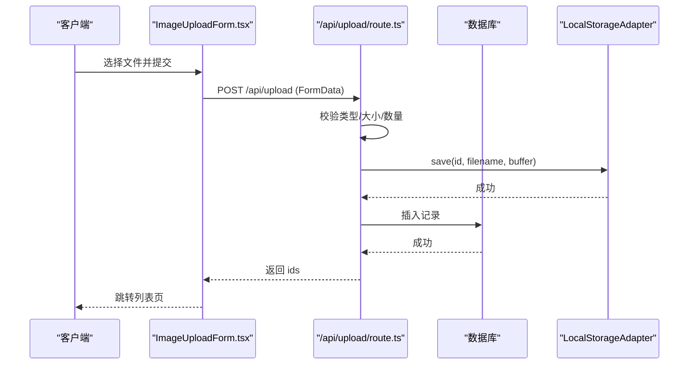
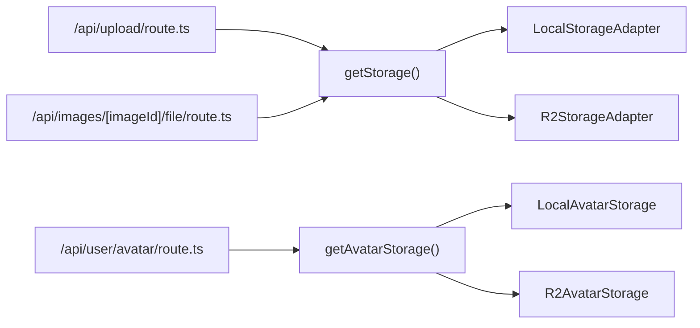

# 本地文件存储实现

<cite>
**本文引用的文件**   
- [src/lib/storage.ts](file://src/lib/storage.ts)
- [src/app/api/upload/route.ts](file://src/app/api/upload/route.ts)
- [src/app/api/images/[imageId]/file/route.ts](file://src/app/api/images/[imageId]/file/route.ts)
- [src/app/api/user/avatar/route.ts](file://src/app/api/user/avatar/route.ts)
- [wrangler.jsonc](file://wrangler.jsonc)
- [src/components/ImageUploadForm.tsx](file://src/components/ImageUploadForm.tsx)
</cite>

## 目录
1. [简介](#简介)
2. [项目结构](#项目结构)
3. [核心组件](#核心组件)
4. [架构总览](#架构总览)
5. [详细组件分析](#详细组件分析)
6. [依赖关系分析](#依赖关系分析)
7. [性能考量](#性能考量)
8. [故障排查指南](#故障排查指南)
9. [结论](#结论)
10. [附录](#附录)

## 简介
本文件为 LocalStorageAdapter 类的详细实现文档，聚焦于本地文件系统存储的工作原理与集成方式。内容涵盖：
- 文件路径解析、目录结构管理、安全验证机制
- 保存、读取、删除操作的异步处理与错误恢复策略
- 存储根目录配置、路径安全检查与权限注意事项
- 文件上传流程的完整示例与业务集成要点
- 性能优化建议与常见问题排查

## 项目结构
本项目采用 Next.js App Router，后端 API 路由通过统一的存储适配器接口访问底层存储。LocalStorageAdapter 是默认的文件系统实现，当未配置 Cloudflare R2 时自动回退到本地磁盘。

图表来源
- [src/lib/storage.ts:184-213](file://src/lib/storage.ts#L184-L213)
- [src/app/api/upload/route.ts:1-75](file://src/app/api/upload/route.ts#L1-L75)
- [src/app/api/images/[imageId]/file/route.ts:1-48](file://src/app/api/images/[imageId]/file/route.ts#L1-L48)
- [src/app/api/user/avatar/route.ts:1-34](file://src/app/api/user/avatar/route.ts#L1-L34)
- [src/components/ImageUploadForm.tsx:1-105](file://src/components/ImageUploadForm.tsx#L1-L105)

章节来源
- [src/lib/storage.ts:1-214](file://src/lib/storage.ts#L1-L214)
- [src/app/api/upload/route.ts:1-75](file://src/app/api/upload/route.ts#L1-L75)
- [src/app/api/images/[imageId]/file/route.ts:1-48](file://src/app/api/images/[imageId]/file/route.ts#L1-L48)
- [src/app/api/user/avatar/route.ts:1-34](file://src/app/api/user/avatar/route.ts#L1-L34)
- [wrangler.jsonc:1-33](file://wrangler.jsonc#L1-L33)
- [src/components/ImageUploadForm.tsx:1-105](file://src/components/ImageUploadForm.tsx#L1-L105)

## 核心组件
- StorageAdapter 接口：定义 save/read/delete 三个方法，统一抽象不同存储后端。
- LocalStorageAdapter：基于 Node.js 文件系统的实现，负责本地磁盘读写。
- R2StorageAdapter：Cloudflare R2 对象存储实现（用于对比与切换）。
- LocalAvatarStorage/R2AvatarStorage：头像专用存储封装，复用基础存储或对象存储。
- getStorage()/getAvatarStorage()：工厂函数，根据运行环境选择具体实现。

章节来源
- [src/lib/storage.ts:3-13](file://src/lib/storage.ts#L3-L13)
- [src/lib/storage.ts:61-114](file://src/lib/storage.ts#L61-L114)
- [src/lib/storage.ts:116-136](file://src/lib/storage.ts#L116-L136)
- [src/lib/storage.ts:138-179](file://src/lib/storage.ts#L138-L179)
- [src/lib/storage.ts:184-213](file://src/lib/storage.ts#L184-L213)

## 架构总览
LocalStorageAdapter 通过 resolveStoragePath 生成安全的文件路径，使用 node:fs/promises 进行异步 I/O。在读取和删除操作中，对 ENOENT 错误进行特殊处理，保证“不存在即空”的语义。工厂函数根据是否存在 R2 绑定决定使用本地还是对象存储。

图表来源
- [src/lib/storage.ts:3-13](file://src/lib/storage.ts#L3-L13)
- [src/lib/storage.ts:61-114](file://src/lib/storage.ts#L61-L114)
- [src/lib/storage.ts:116-136](file://src/lib/storage.ts#L116-L136)
- [src/lib/storage.ts:138-179](file://src/lib/storage.ts#L138-L179)

## 详细组件分析

### LocalStorageAdapter 类
- 构造参数 storageRoot：优先使用环境变量 IMAGE_STORAGE_PATH，否则默认 ./.data/uploads。
- 路径解析：resolveStoragePath 对 imageId 与 filename 进行安全校验，拼接 storageRoot/imageId/filename。
- 保存操作：动态导入 fs/promises 与 path，确保按需加载；创建父目录（递归），写入 Buffer。
- 读取操作：捕获 ENOENT 返回 null，其他错误向上抛出。
- 删除操作：捕获 ENOENT 视为成功（幂等），其他错误向上抛出。

图表来源
- [src/lib/storage.ts:66-73](file://src/lib/storage.ts#L66-L73)
- [src/lib/storage.ts:27-33](file://src/lib/storage.ts#L27-L33)
- [src/lib/storage.ts:15-25](file://src/lib/storage.ts#L15-L25)

章节来源
- [src/lib/storage.ts:61-114](file://src/lib/storage.ts#L61-L114)
- [src/lib/storage.ts:27-33](file://src/lib/storage.ts#L27-L33)
- [src/lib/storage.ts:15-25](file://src/lib/storage.ts#L15-L25)

### 路径解析与安全校验
- assertSafeSegment：拒绝空值、点号、双点号、包含斜杠或反斜杠的值，防止路径穿越攻击。
- resolveStoragePath：将 storageRoot、imageId、filename 安全拼接为绝对路径。

图表来源
- [src/lib/storage.ts:15-25](file://src/lib/storage.ts#L15-L25)
- [src/lib/storage.ts:27-33](file://src/lib/storage.ts#L27-L33)

章节来源
- [src/lib/storage.ts:15-25](file://src/lib/storage.ts#L15-L25)
- [src/lib/storage.ts:27-33](file://src/lib/storage.ts#L27-L33)

### 读取与删除的错误恢复策略
- read：当文件不存在（ENOENT）返回 null，避免上层逻辑因缺失文件而中断。
- delete：当文件不存在（ENOENT）视为成功，保证删除操作的幂等性。

图表来源
- [src/lib/storage.ts:75-93](file://src/lib/storage.ts#L75-L93)
- [src/lib/storage.ts:95-113](file://src/lib/storage.ts#L95-L113)

章节来源
- [src/lib/storage.ts:75-93](file://src/lib/storage.ts#L75-L93)
- [src/lib/storage.ts:95-113](file://src/lib/storage.ts#L95-L113)

### 存储根目录配置与环境切换
- 本地模式：IMAGE_STORAGE_PATH 为空或未设置时，默认 ./.data/uploads。
- 云模式：若检测到 R2 绑定 IMAGES_BUCKET，则使用 R2StorageAdapter；否则回退到本地。
- 头像存储：LocalAvatarStorage 以固定前缀 "__avatar__" 复用基础存储。

图表来源
- [src/lib/storage.ts:184-213](file://src/lib/storage.ts#L184-L213)
- [wrangler.jsonc:23-32](file://wrangler.jsonc#L23-L32)

章节来源
- [src/lib/storage.ts:184-213](file://src/lib/storage.ts#L184-L213)
- [wrangler.jsonc:23-32](file://wrangler.jsonc#L23-L32)

### 文件上传流程与业务集成
- 前端：ImageUploadForm 收集文件并发送到 /api/upload。
- 后端：upload/route.ts 校验类型、大小、数量，持久化到数据库，并通过 getStorage().save() 写入存储。
- 读取：images/[imageId]/file/route.ts 查询数据库获取文件名，再通过 getStorage().read() 返回二进制数据。
- 头像：user/avatar/route.ts 使用 getAvatarStorage() 保存用户头像。

图表来源
- [src/components/ImageUploadForm.tsx:26-72](file://src/components/ImageUploadForm.tsx#L26-L72)
- [src/app/api/upload/route.ts:14-74](file://src/app/api/upload/route.ts#L14-L74)
- [src/lib/storage.ts:66-73](file://src/lib/storage.ts#L66-L73)

章节来源
- [src/components/ImageUploadForm.tsx:1-105](file://src/components/ImageUploadForm.tsx#L1-L105)
- [src/app/api/upload/route.ts:1-75](file://src/app/api/upload/route.ts#L1-L75)
- [src/app/api/images/[imageId]/file/route.ts:1-48](file://src/app/api/images/[imageId]/file/route.ts#L1-L48)
- [src/app/api/user/avatar/route.ts:1-34](file://src/app/api/user/avatar/route.ts#L1-L34)

## 依赖关系分析
- 运行时依赖：Node.js 的 fs/promises 与 path 模块，仅在需要时动态导入，降低冷启动开销。
- 环境依赖：Cloudflare R2 绑定 IMAGES_BUCKET，若存在则优先使用对象存储。
- 应用层依赖：Next.js API 路由与数据库 ORM（Drizzle）配合完成业务逻辑。

图表来源
- [src/app/api/upload/route.ts:51-58](file://src/app/api/upload/route.ts#L51-L58)
- [src/app/api/images/[imageId]/file/route.ts:34-35](file://src/app/api/images/[imageId]/file/route.ts#L34-L35)
- [src/app/api/user/avatar/route.ts:29-30](file://src/app/api/user/avatar/route.ts#L29-L30)
- [src/lib/storage.ts:184-213](file://src/lib/storage.ts#L184-L213)

章节来源
- [src/app/api/upload/route.ts:1-75](file://src/app/api/upload/route.ts#L1-L75)
- [src/app/api/images/[imageId]/file/route.ts:1-48](file://src/app/api/images/[imageId]/file/route.ts#L1-L48)
- [src/app/api/user/avatar/route.ts:1-34](file://src/app/api/user/avatar/route.ts#L1-L34)
- [src/lib/storage.ts:184-213](file://src/lib/storage.ts#L184-L213)

## 性能考量
- 动态导入：fs/promises 与 path 模块按需加载，减少初始包体积与冷启动时间。
- 目录创建：使用 recursive 选项一次性创建多级目录，避免多次系统调用。
- 错误短路：ENOENT 快速返回 null 或忽略，避免不必要的异常处理开销。
- 并发写入：在高并发场景下，建议结合队列或限流控制写入频率，避免频繁 mkdir/writeFile 竞争。
- 缓存策略：读取接口已设置 Cache-Control，提升静态资源命中；可考虑 CDN 缓存与浏览器缓存协同。
- 内存占用：大文件传输建议使用流式处理，当前实现将文件转为 Buffer，注意内存峰值。

[本节为通用性能建议，不直接分析具体文件]

## 故障排查指南
- 路径安全问题
  - 现象：上传失败或路径异常。
  - 排查：确认 imageId 与 filename 不含 “.”、“..”、“/”、“\”，否则会触发 assertSafeSegment 抛错。
  - 参考：[src/lib/storage.ts:15-25](file://src/lib/storage.ts#L15-L25)

- 存储根目录未创建
  - 现象：写入时报权限或找不到目录。
  - 排查：检查 IMAGE_STORAGE_PATH 指向的目录是否存在且可写；若无设置，默认 ./.data/uploads 需具备写入权限。
  - 参考：[src/lib/storage.ts:63](file://src/lib/storage.ts#L63)

- 读取返回 null
  - 现象：请求图片返回 404。
  - 排查：确认数据库中记录的 filename 与实际文件名一致；检查文件是否存在于 storageRoot/imageId/filename。
  - 参考：[src/lib/storage.ts:75-93](file://src/lib/storage.ts#L75-L93)

- 删除幂等性
  - 现象：删除不存在的文件报错。
  - 排查：删除 ENOENT 被视作成功，若仍报错请检查上层逻辑是否正确捕获异常。
  - 参考：[src/lib/storage.ts:95-113](file://src/lib/storage.ts#L95-L113)

- 环境切换问题
  - 现象：部署后无法写入或读取。
  - 排查：确认 wrangler.jsonc 中 R2 绑定 IMAGES_BUCKET 是否配置；未配置时将回退到本地存储。
  - 参考：[wrangler.jsonc:23-32](file://wrangler.jsonc#L23-L32)、[src/lib/storage.ts:184-213](file://src/lib/storage.ts#L184-L213)

- 权限问题
  - 现象：写入失败，提示权限不足。
  - 排查：确保运行用户对 storageRoot 具有读写权限；容器或服务器环境中检查挂载卷权限。
  - 参考：[src/lib/storage.ts:63](file://src/lib/storage.ts#L63)

章节来源
- [src/lib/storage.ts:15-25](file://src/lib/storage.ts#L15-L25)
- [src/lib/storage.ts:63](file://src/lib/storage.ts#L63)
- [src/lib/storage.ts:75-93](file://src/lib/storage.ts#L75-L93)
- [src/lib/storage.ts:95-113](file://src/lib/storage.ts#L95-L113)
- [wrangler.jsonc:23-32](file://wrangler.jsonc#L23-L32)
- [src/lib/storage.ts:184-213](file://src/lib/storage.ts#L184-L213)

## 结论
LocalStorageAdapter 提供了简单可靠的本地文件存储实现，通过严格的路径安全校验与合理的错误恢复策略，确保上传、读取、删除操作的稳定性。结合工厂函数与环境检测，可在本地开发与云端部署之间无缝切换。建议在大规模场景中引入流式处理与并发控制，进一步提升性能与可扩展性。

[本节为总结性内容，不直接分析具体文件]

## 附录
- 环境变量
  - IMAGE_STORAGE_PATH：本地存储根目录，未设置时默认为 ./.data/uploads。
- 关键 API 路由
  - /api/upload：批量上传图片，校验类型、大小、数量，写入存储与数据库。
  - /api/images/[imageId]/file：按 ID 读取图片二进制，设置缓存头。
  - /api/user/avatar：上传用户头像，使用头像存储适配。
- 配置文件
  - wrangler.jsonc：R2 绑定 IMAGES_BUCKET，启用对象存储模式。

章节来源
- [src/lib/storage.ts:63](file://src/lib/storage.ts#L63)
- [src/app/api/upload/route.ts:14-74](file://src/app/api/upload/route.ts#L14-L74)
- [src/app/api/images/[imageId]/file/route.ts:12-47](file://src/app/api/images/[imageId]/file/route.ts#L12-L47)
- [src/app/api/user/avatar/route.ts:10-33](file://src/app/api/user/avatar/route.ts#L10-L33)
- [wrangler.jsonc:23-32](file://wrangler.jsonc#L23-L32)