# 数据流设计

<cite>
**本文引用的文件**   
- [src/db/schema.ts](file://src/db/schema.ts)
- [src/db/index.ts](file://src/db/index.ts)
- [src/lib/storage.ts](file://src/lib/storage.ts)
- [src/app/api/images/route.ts](file://src/app/api/images/route.ts)
- [src/app/api/upload/route.ts](file://src/app/api/upload/route.ts)
- [src/app/api/images/[imageId]/route.ts](file://src/app/api/images/[imageId]/route.ts)
- [src/app/api/images/[imageId]/file/route.ts](file://src/app/api/images/[imageId]/file/route.ts)
- [src/app/api/directories/route.ts](file://src/app/api/directories/route.ts)
- [src/app/api/channels/[channelId]/route.ts](file://src/app/api/channels/[channelId]/route.ts)
- [src/app/api/user/profile/route.ts](file://src/app/api/user/profile/route.ts)
- [src/lib/auth.ts](file://src/lib/auth.ts)
- [drizzle.config.ts](file://drizzle.config.ts)
- [src/db/migrate.ts](file://src/db/migrate.ts)
</cite>

## 目录
1. [简介](#简介)
2. [项目结构](#项目结构)
3. [核心组件](#核心组件)
4. [架构总览](#架构总览)
5. [详细组件分析](#详细组件分析)
6. [依赖关系分析](#依赖关系分析)
7. [性能考虑](#性能考虑)
8. [故障排查指南](#故障排查指南)
9. [结论](#结论)
10. [附录](#附录)

## 简介
本文件为 Weable 应用的数据流设计文档，聚焦从用户请求到数据持久化的完整路径：API 路由处理、业务逻辑执行、数据库操作与存储操作。重点说明 Drizzle ORM 的使用模式、查询构建与事务策略；数据验证、转换与缓存策略；错误处理、数据一致性与性能优化；以及数据迁移与版本管理的最佳实践。

## 项目结构
Weable 采用 Next.js App Router 的 API Routes 组织接口层，使用 Drizzle ORM 进行数据建模与访问，结合本地文件系统或 Cloudflare R2 作为对象存储后端，SQLite/D1 作为关系型存储后端。

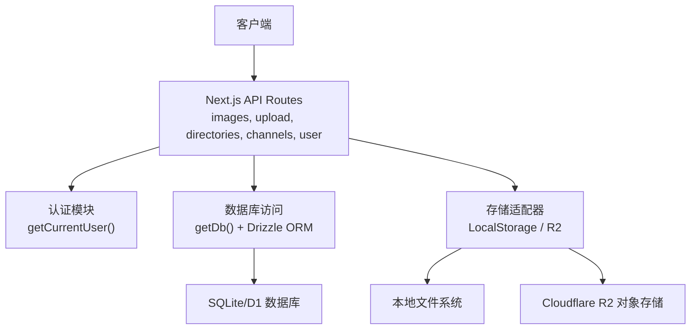

**图示来源** 
- [src/app/api/images/route.ts:1-66](file://src/app/api/images/route.ts#L1-L66)
- [src/app/api/upload/route.ts:1-75](file://src/app/api/upload/route.ts#L1-L75)
- [src/app/api/directories/route.ts:1-95](file://src/app/api/directories/route.ts#L1-L95)
- [src/app/api/channels/[channelId]/route.ts](file://src/app/api/channels/[channelId]/route.ts#L1-L44)
- [src/app/api/user/profile/route.ts:1-31](file://src/app/api/user/profile/route.ts#L1-L31)
- [src/lib/auth.ts:1-118](file://src/lib/auth.ts#L1-L118)
- [src/db/index.ts:1-61](file://src/db/index.ts#L1-L61)
- [src/lib/storage.ts:1-214](file://src/lib/storage.ts#L1-L214)

**章节来源**
- [src/app/api/images/route.ts:1-66](file://src/app/api/images/route.ts#L1-L66)
- [src/app/api/upload/route.ts:1-75](file://src/app/api/upload/route.ts#L1-L75)
- [src/app/api/directories/route.ts:1-95](file://src/app/api/directories/route.ts#L1-L95)
- [src/app/api/channels/[channelId]/route.ts:1-44](file://src/app/api/channels/[channelId]/route.ts#L1-L44)
- [src/app/api/user/profile/route.ts:1-31](file://src/app/api/user/profile/route.ts#L1-L31)
- [src/lib/auth.ts:1-118](file://src/lib/auth.ts#L1-L118)
- [src/db/index.ts:1-61](file://src/db/index.ts#L1-L61)
- [src/lib/storage.ts:1-214](file://src/lib/storage.ts#L1-L214)

## 核心组件
- 数据模型与关系：users、channels、images 三表，包含主键、外键与级联删除策略，并提供自引用父子关系（images.parentId -> images.id）。
- 数据库访问：getDb() 根据运行环境自动选择 D1（Cloudflare）或本地 SQLite，统一暴露 Drizzle 实例。
- 存储适配：StorageAdapter 抽象出 save/read/delete 能力，提供 LocalStorageAdapter 与 R2StorageAdapter 两种实现；头像存储通过 AvatarStorage 封装。
- 认证：getCurrentUser() 解析 Cloudflare Access JWT 或本地 Cookie，确保用户存在并返回当前用户信息。
- API 路由：RESTful 接口覆盖图片列表、上传、元数据更新、文件读取、目录创建、频道删除、用户资料更新等。

**章节来源**
- [src/db/schema.ts:1-100](file://src/db/schema.ts#L1-L100)
- [src/db/index.ts:1-61](file://src/db/index.ts#L1-L61)
- [src/lib/storage.ts:1-214](file://src/lib/storage.ts#L1-L214)
- [src/lib/auth.ts:1-118](file://src/lib/auth.ts#L1-L118)
- [src/app/api/images/route.ts:1-66](file://src/app/api/images/route.ts#L1-L66)
- [src/app/api/upload/route.ts:1-75](file://src/app/api/upload/route.ts#L1-L75)
- [src/app/api/images/[imageId]/route.ts:1-L84](file://src/app/api/images/[imageId]/route.ts#L1-L84)
- [src/app/api/images/[imageId]/file/route.ts:1-L48](file://src/app/api/images/[imageId]/file/route.ts#L1-L48)
- [src/app/api/directories/route.ts:1-95](file://src/app/api/directories/route.ts#L1-L95)
- [src/app/api/channels/[channelId]/route.ts:1-L44](file://src/app/api/channels/[channelId]/route.ts#L1-L44)
- [src/app/api/user/profile/route.ts:1-31](file://src/app/api/user/profile/route.ts#L1-L31)

## 架构总览
下图展示典型请求在 Weable 中的数据流向：请求进入 API 路由，经过认证与参数校验，调用 Drizzle ORM 读写数据库，必要时通过存储适配器读写对象存储，最终返回响应。

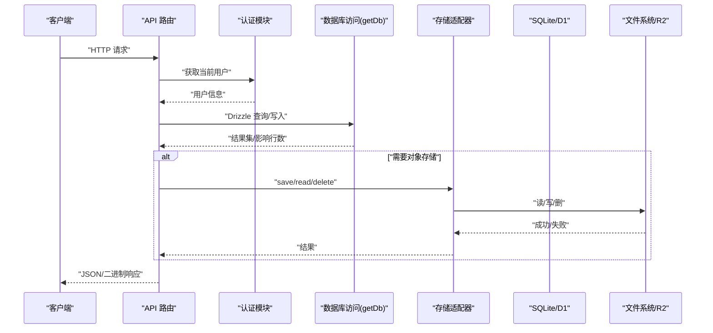

**图示来源** 
- [src/app/api/upload/route.ts:1-75](file://src/app/api/upload/route.ts#L1-L75)
- [src/app/api/images/[imageId]/file/route.ts:1-L48](file://src/app/api/images/[imageId]/file/route.ts#L1-L48)
- [src/app/api/images/[imageId]/route.ts:1-L84](file://src/app/api/images/[imageId]/route.ts#L1-L84)
- [src/app/api/directories/route.ts:1-95](file://src/app/api/directories/route.ts#L1-L95)
- [src/lib/auth.ts:1-118](file://src/lib/auth.ts#L1-L118)
- [src/db/index.ts:1-61](file://src/db/index.ts#L1-L61)
- [src/lib/storage.ts:1-214](file://src/lib/storage.ts#L1-L214)

## 详细组件分析

### 数据模型与关系（Drizzle Schema）
- users：用户基本信息，id 使用 Base58 编码的 UUIDv7 生成。
- channels：频道，关联用户，支持公开标记与时间戳。
- images：媒体条目，支持目录类型（mimeType=directory），具备父子层级（parentId）、所属频道（channelId）、发布状态（isPublished）与尺寸信息。
- relations：定义用户-频道、用户-图片、频道-图片、图片-父/子关系。

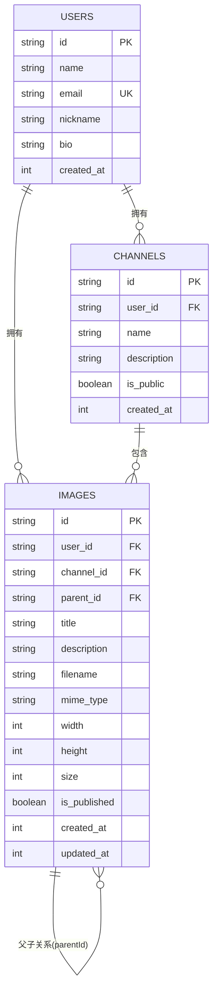

**图示来源** 
- [src/db/schema.ts:1-100](file://src/db/schema.ts#L1-L100)

**章节来源**
- [src/db/schema.ts:1-100](file://src/db/schema.ts#L1-L100)

### 数据库访问与环境切换
- getDb() 优先检测 Cloudflare D1 binding，若可用则返回 D1 驱动的 Drizzle 实例；否则回退到本地 SQLite 实例。
- 本地开发时自动创建数据库目录，避免启动失败。
- drizzle.config.ts 指定 schema 与 migrations 输出目录，dialect 为 sqlite。

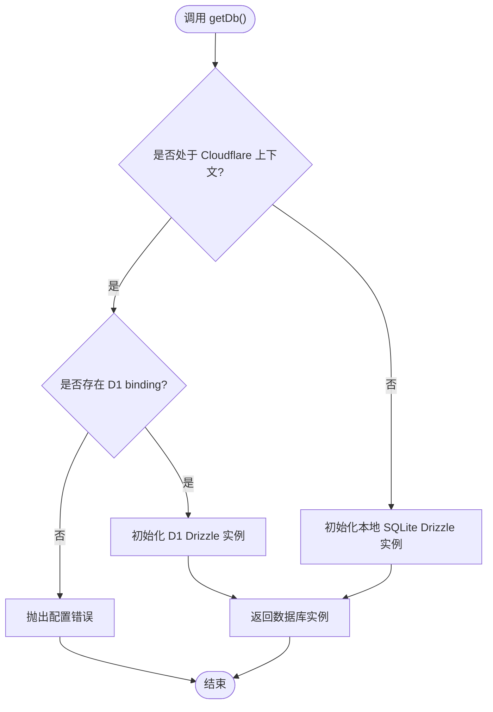

**图示来源** 
- [src/db/index.ts:1-61](file://src/db/index.ts#L1-L61)
- [drizzle.config.ts:1-8](file://drizzle.config.ts#L1-L8)

**章节来源**
- [src/db/index.ts:1-61](file://src/db/index.ts#L1-L61)
- [drizzle.config.ts:1-8](file://drizzle.config.ts#L1-L8)

### 存储适配器（对象存储）
- StorageAdapter 抽象 save/read/delete，提供 LocalStorageAdapter（基于 node:fs）与 R2StorageAdapter（基于 Cloudflare R2）。
- 路径安全校验防止目录穿越攻击。
- 头像存储通过 LocalAvatarStorage 与 R2AvatarStorage 包装基础存储，分别以固定命名空间隔离。

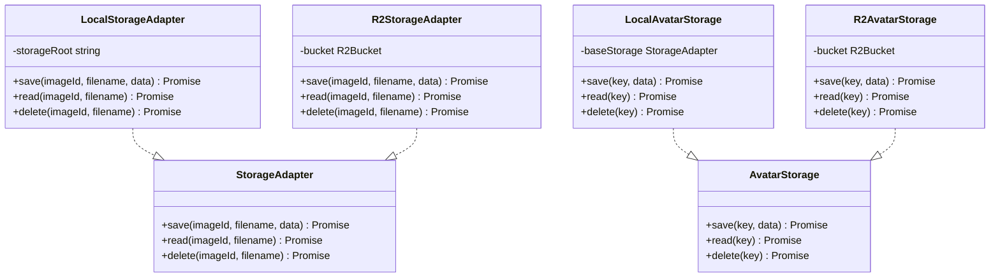

**图示来源** 
- [src/lib/storage.ts:1-214](file://src/lib/storage.ts#L1-L214)

**章节来源**
- [src/lib/storage.ts:1-214](file://src/lib/storage.ts#L1-L214)

### 认证流程
- getCurrentUser() 优先解析 Cloudflare Access JWT，其次尝试本地 Cookie，最后在生产环境严格失败，开发环境提供默认用户。
- ensureUserRow() 保证用户记录存在，不存在则插入后返回。

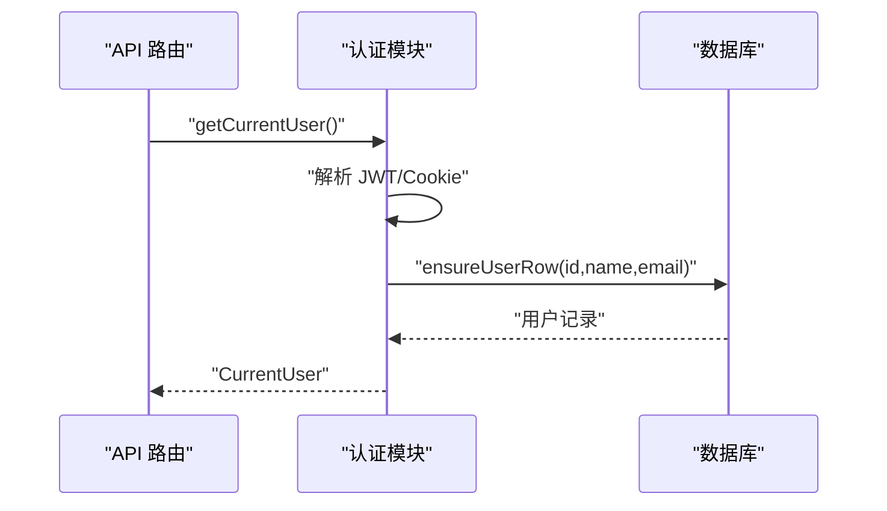

**图示来源** 
- [src/lib/auth.ts:1-118](file://src/lib/auth.ts#L1-L118)

**章节来源**
- [src/lib/auth.ts:1-118](file://src/lib/auth.ts#L1-L118)

### API 路由与数据流

#### 图片列表 GET /api/images
- 鉴权后按 parentId 过滤，目录优先排序，再按更新时间倒序。
- 仅返回必要字段，避免泄露敏感信息。

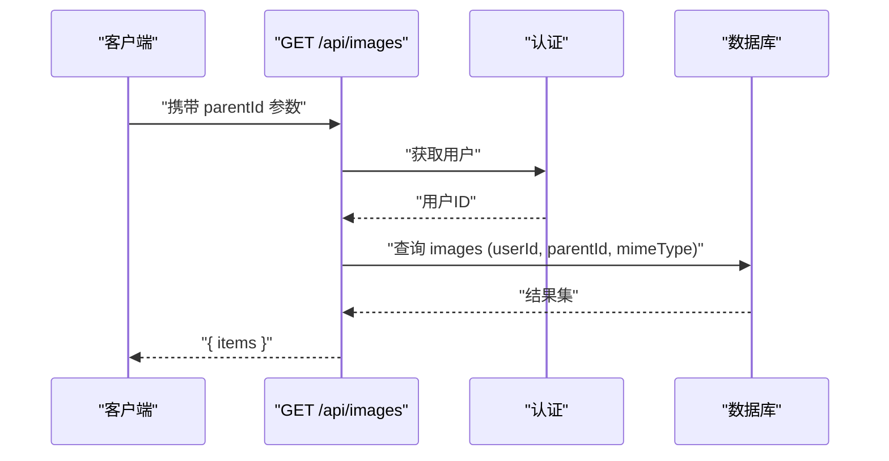

**图示来源** 
- [src/app/api/images/route.ts:1-66](file://src/app/api/images/route.ts#L1-L66)

**章节来源**
- [src/app/api/images/route.ts:1-66](file://src/app/api/images/route.ts#L1-L66)

#### 批量上传 POST /api/upload
- 校验文件数量、MIME 前缀、大小限制。
- 可选 parentId 校验（必须为用户拥有的目录项）。
- 先写对象存储，再批量插入元数据到数据库。

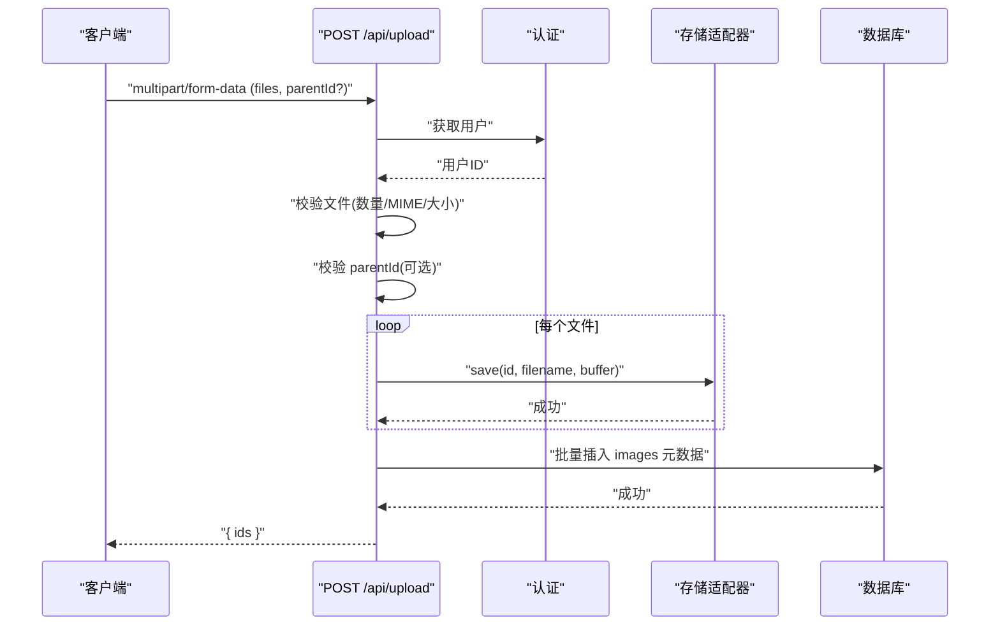

**图示来源** 
- [src/app/api/upload/route.ts:1-75](file://src/app/api/upload/route.ts#L1-L75)
- [src/lib/storage.ts:1-214](file://src/lib/storage.ts#L1-L214)

**章节来源**
- [src/app/api/upload/route.ts:1-75](file://src/app/api/upload/route.ts#L1-L75)

#### 元数据更新 PATCH /api/images/[imageId]
- 白名单更新字段：title、description、channelId、isPublished，同时更新 updatedAt。
- 权限校验：仅允许更新属于当前用户的资源。

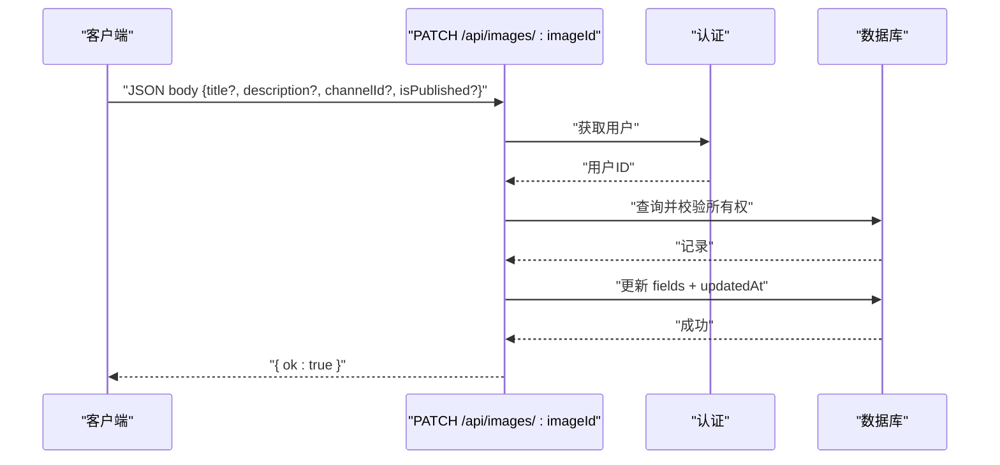

**图示来源** 
- [src/app/api/images/[imageId]/route.ts:1-L84](file://src/app/api/images/[imageId]/route.ts#L1-L84)

**章节来源**
- [src/app/api/images/[imageId]/route.ts:1-L84](file://src/app/api/images/[imageId]/route.ts#L1-L84)

#### 文件读取 GET /api/images/[imageId]/file
- 校验 imageId 格式，查询元数据，排除目录类型。
- 从存储适配器读取二进制数据，设置强缓存头。

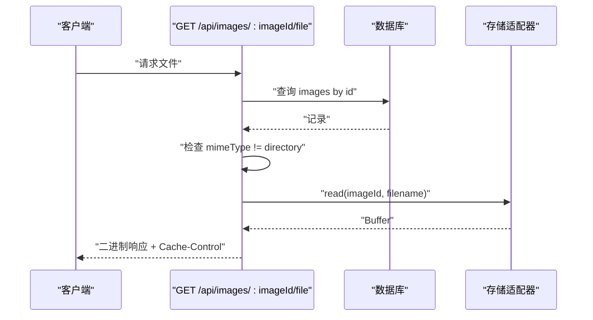

**图示来源** 
- [src/app/api/images/[imageId]/file/route.ts:1-L48](file://src/app/api/images/[imageId]/file/route.ts#L1-L48)

**章节来源**
- [src/app/api/images/[imageId]/file/route.ts:1-L48](file://src/app/api/images/[imageId]/file/route.ts#L1-L48)

#### 删除图片 DELETE /api/images/[imageId]
- 校验所有权后删除对象存储文件（忽略缺失错误），再删除数据库记录。

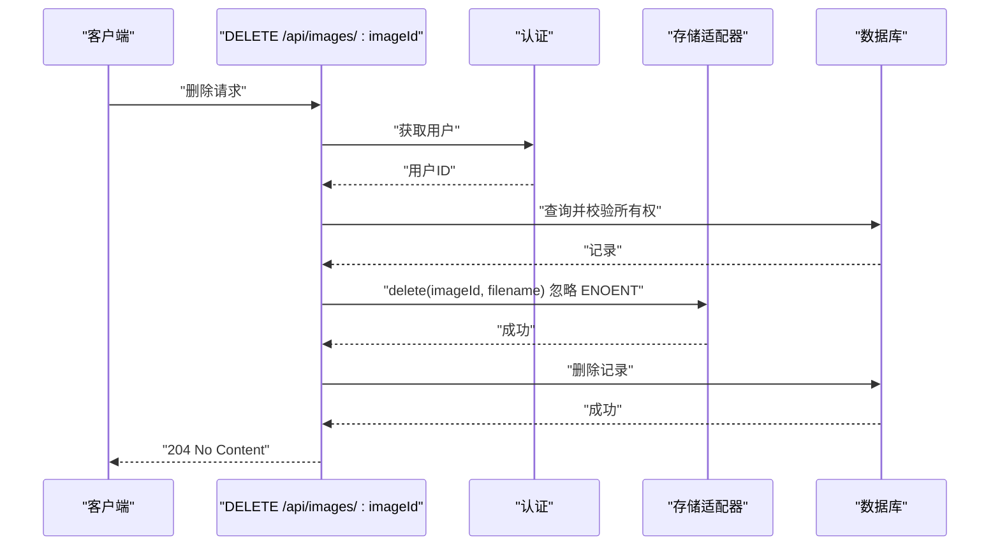

**图示来源** 
- [src/app/api/images/[imageId]/route.ts:1-L84](file://src/app/api/images/[imageId]/route.ts#L1-L84)

**章节来源**
- [src/app/api/images/[imageId]/route.ts:1-L84](file://src/app/api/images/[imageId]/route.ts#L1-L84)

#### 目录创建 POST /api/directories
- 校验标题字符、长度、重复性（同父目录下唯一）。
- 可选 parentId 校验（必须为用户拥有的目录项）。
- 插入目录记录（mimeType=directory，size=0）。

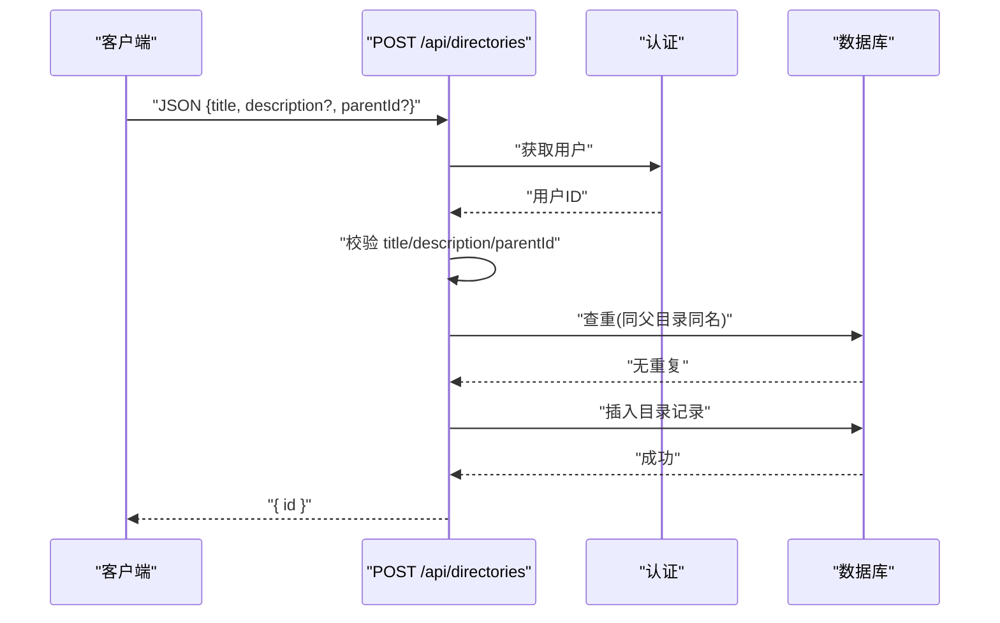

**图示来源** 
- [src/app/api/directories/route.ts:1-95](file://src/app/api/directories/route.ts#L1-L95)

**章节来源**
- [src/app/api/directories/route.ts:1-95](file://src/app/api/directories/route.ts#L1-L95)

#### 频道删除 DELETE /api/channels/[channelId]
- 校验所有权后，统计已发布的图片数量，若大于 0 则拒绝删除。
- 满足条件后删除频道。

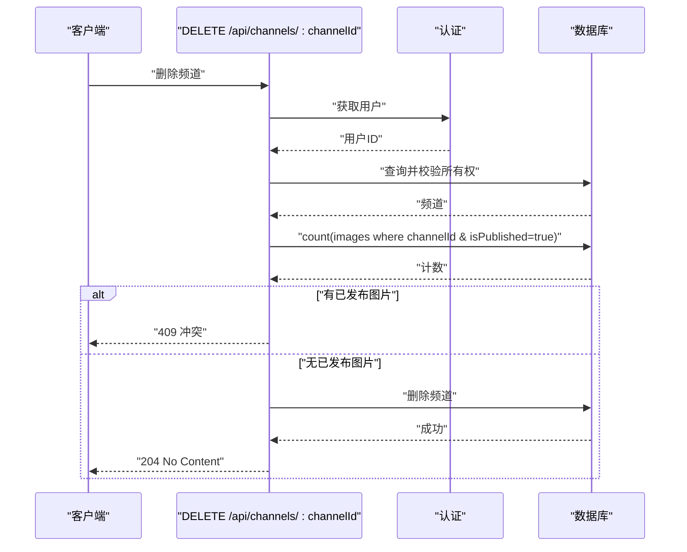

**图示来源** 
- [src/app/api/channels/[channelId]/route.ts:1-L44](file://src/app/api/channels/[channelId]/route.ts#L1-L44)

**章节来源**
- [src/app/api/channels/[channelId]/route.ts:1-L44](file://src/app/api/channels/[channelId]/route.ts#L1-L44)

#### 用户资料更新 PATCH /api/user/profile
- 白名单更新 nickname/bio，并进行长度裁剪与空值处理。
- 若无有效字段则返回 400。

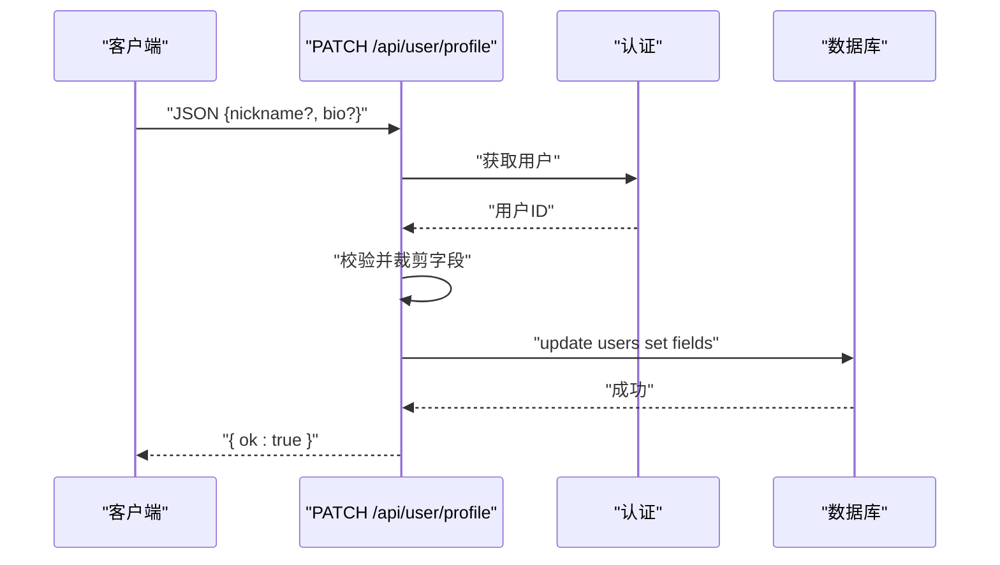

**图示来源** 
- [src/app/api/user/profile/route.ts:1-31](file://src/app/api/user/profile/route.ts#L1-L31)

**章节来源**
- [src/app/api/user/profile/route.ts:1-31](file://src/app/api/user/profile/route.ts#L1-L31)

## 依赖关系分析
- API 路由依赖认证模块与数据库访问层，部分路由依赖存储适配器。
- 存储适配器根据运行环境自动选择本地或 R2。
- 数据库访问层根据运行环境自动选择 D1 或 SQLite。

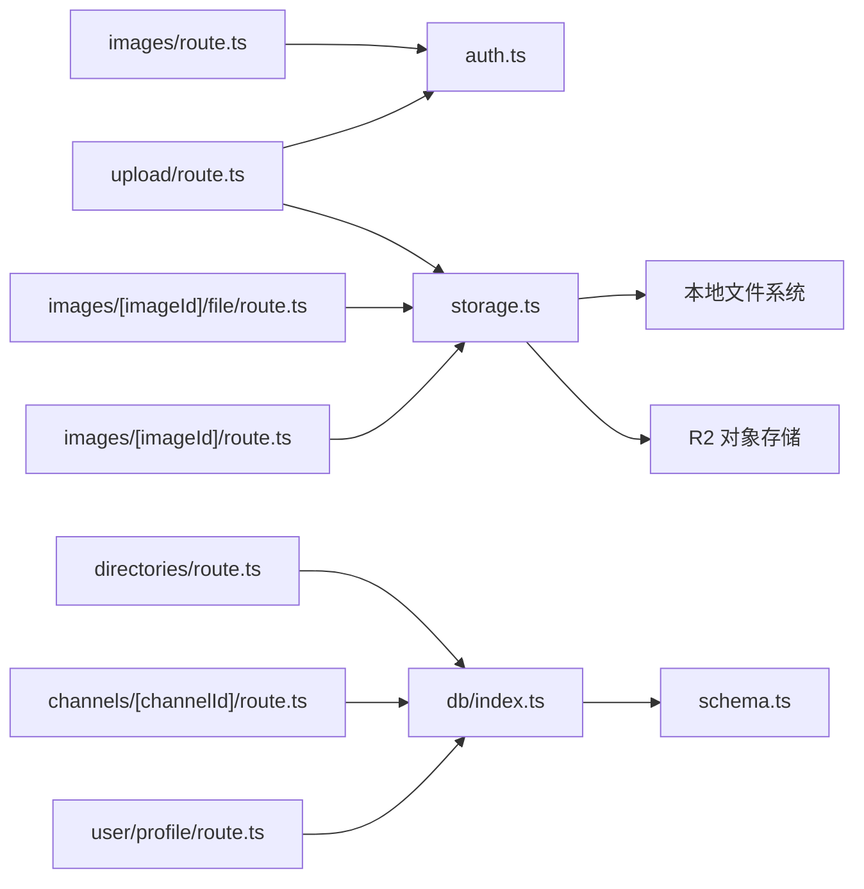

**图示来源** 
- [src/app/api/images/route.ts:1-66](file://src/app/api/images/route.ts#L1-L66)
- [src/app/api/upload/route.ts:1-75](file://src/app/api/upload/route.ts#L1-L75)
- [src/app/api/images/[imageId]/route.ts:1-L84](file://src/app/api/images/[imageId]/route.ts#L1-L84)
- [src/app/api/images/[imageId]/file/route.ts:1-L48](file://src/app/api/images/[imageId]/file/route.ts#L1-L48)
- [src/app/api/directories/route.ts:1-95](file://src/app/api/directories/route.ts#L1-L95)
- [src/app/api/channels/[channelId]/route.ts:1-L44](file://src/app/api/channels/[channelId]/route.ts#L1-L44)
- [src/app/api/user/profile/route.ts:1-31](file://src/app/api/user/profile/route.ts#L1-L31)
- [src/lib/auth.ts:1-118](file://src/lib/auth.ts#L1-L118)
- [src/db/index.ts:1-61](file://src/db/index.ts#L1-L61)
- [src/lib/storage.ts:1-214](file://src/lib/storage.ts#L1-L214)
- [src/db/schema.ts:1-100](file://src/db/schema.ts#L1-L100)

**章节来源**
- [src/app/api/images/route.ts:1-66](file://src/app/api/images/route.ts#L1-L66)
- [src/app/api/upload/route.ts:1-75](file://src/app/api/upload/route.ts#L1-L75)
- [src/app/api/images/[imageId]/route.ts:1-L84](file://src/app/api/images/[imageId]/route.ts#L1-L84)
- [src/app/api/images/[imageId]/file/route.ts:1-L48](file://src/app/api/images/[imageId]/file/route.ts#L1-L48)
- [src/app/api/directories/route.ts:1-95](file://src/app/api/directories/route.ts#L1-L95)
- [src/app/api/channels/[channelId]/route.ts:1-L44](file://src/app/api/channels/[channelId]/route.ts#L1-L44)
- [src/app/api/user/profile/route.ts:1-31](file://src/app/api/user/profile/route.ts#L1-L31)
- [src/lib/auth.ts:1-118](file://src/lib/auth.ts#L1-L118)
- [src/db/index.ts:1-61](file://src/db/index.ts#L1-L61)
- [src/lib/storage.ts:1-214](file://src/lib/storage.ts#L1-L214)
- [src/db/schema.ts:1-100](file://src/db/schema.ts#L1-L100)

## 性能考虑
- 对象存储缓存：文件读取接口设置强缓存头（public, max-age=31536000, immutable），适合静态资源长期缓存。
- 批量写入：上传接口对多个文件先落盘再批量插入元数据，减少数据库往返次数。
- 查询优化：列表接口使用 CASE WHEN 排序将目录置顶，并按更新时间降序，提升常用场景体验。
- 环境适配：getDb() 与 getStorage() 均按需初始化单例，避免重复开销。
- 建议优化方向：
  - 引入分页与游标，避免大数据量全量返回。
  - 对热点目录或热门图片增加 Redis/内存缓存层。
  - 上传链路引入分片与断点续传，降低大文件失败重试成本。
  - 数据库层面为 userId、parentId、updatedAt、isPublished 建立索引以提升查询效率。

[本节为通用性能指导，不直接分析具体文件]

## 故障排查指南
- 认证失败：
  - 检查 Cloudflare Access JWT 或本地 Cookie 是否正确传递。
  - 生产环境未解析到用户会抛出错误，需确认身份来源。
- 数据库连接错误：
  - Cloudflare 环境下缺少 D1 binding 会抛错，检查 wrangler.jsonc 配置。
  - 本地环境确保 DB_PATH 指向有效目录。
- 存储读取失败：
  - 文件不存在时返回 404；删除时忽略 ENOENT 以避免幂等问题。
  - R2 环境下缺少 IMAGES_BUCKET 会抛错，检查绑定配置。
- 数据一致性：
  - 删除图片时先删对象存储再删数据库，若存储删除失败应记录日志并补偿重试。
  - 上传流程中若存储成功但数据库写入失败，需引入补偿机制（如延迟任务或消息队列）。
- 迁移问题：
  - 运行迁移脚本前确保 migrations 目录与 schema 同步，避免不一致。

**章节来源**
- [src/lib/auth.ts:1-118](file://src/lib/auth.ts#L1-L118)
- [src/db/index.ts:1-61](file://src/db/index.ts#L1-L61)
- [src/lib/storage.ts:1-214](file://src/lib/storage.ts#L1-L214)
- [src/app/api/images/[imageId]/route.ts:1-L84](file://src/app/api/images/[imageId]/route.ts#L1-L84)
- [src/app/api/images/[imageId]/file/route.ts:1-L48](file://src/app/api/images/[imageId]/file/route.ts#L1-L48)

## 结论
Weable 的数据流围绕 Next.js API Routes、Drizzle ORM 与可插拔存储适配器构建，具备良好的环境适配能力与清晰的职责划分。通过严格的输入校验、所有权控制与合理的缓存策略，系统在易用性与性能之间取得平衡。未来可在分页、缓存层、分片上传与索引优化等方面持续改进，进一步提升可扩展性与稳定性。

[本节为总结性内容，不直接分析具体文件]

## 附录

### Drizzle ORM 使用模式与查询构建
- 模型定义：sqliteTable 定义表结构与字段约束，relations 声明实体关系。
- 查询构建：使用 and/eql/isNull/sql 组合条件，orderBy 支持自定义排序表达式。
- 事务处理：当前代码未显式使用事务，建议在关键写入（如上传+元数据插入、删除图片+存储删除）中使用事务保障一致性。
- 推荐实践：
  - 对高频查询字段建立索引（userId、parentId、updatedAt、isPublished）。
  - 使用 onConflictDoNothing 避免重复插入用户记录。
  - 批量 insert/update 减少往返次数。

**章节来源**
- [src/db/schema.ts:1-100](file://src/db/schema.ts#L1-L100)
- [src/app/api/images/route.ts:1-66](file://src/app/api/images/route.ts#L1-L66)
- [src/app/api/upload/route.ts:1-75](file://src/app/api/upload/route.ts#L1-L75)
- [src/lib/auth.ts:1-118](file://src/lib/auth.ts#L1-L118)

### 数据迁移与版本管理最佳实践
- 使用 drizzle-kit 管理迁移，schema 变更通过 CLI 生成 SQL 迁移文件。
- 部署前运行迁移脚本，确保数据库结构与代码一致。
- 建议：
  - 每次变更提交独立的迁移文件，保持可追溯性。
  - 在 CI/CD 中集成迁移步骤，失败即阻断部署。
  - 针对大表变更采用增量策略，避免长时间锁表。

**章节来源**
- [drizzle.config.ts:1-8](file://drizzle.config.ts#L1-L8)
- [src/db/migrate.ts:1-24](file://src/db/migrate.ts#L1-L24)