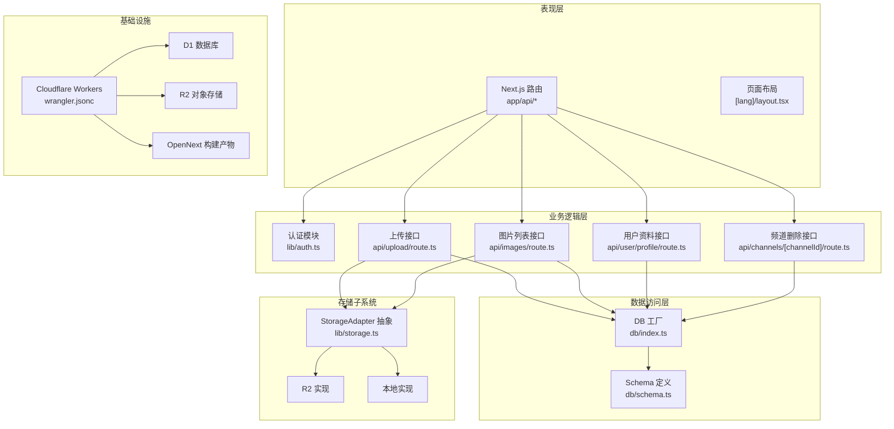
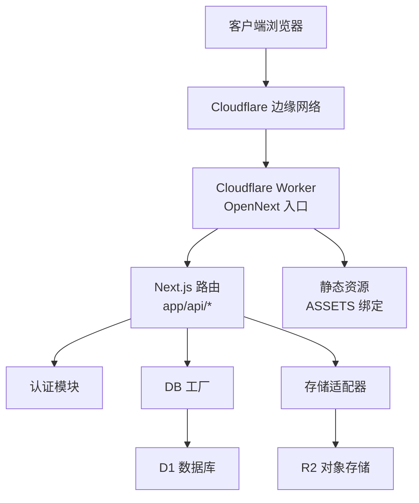
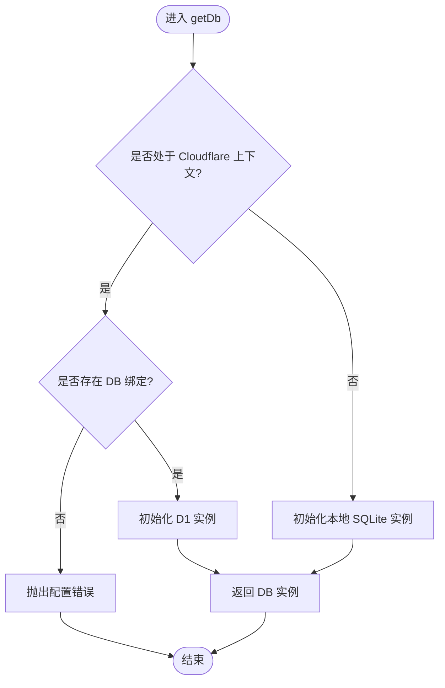
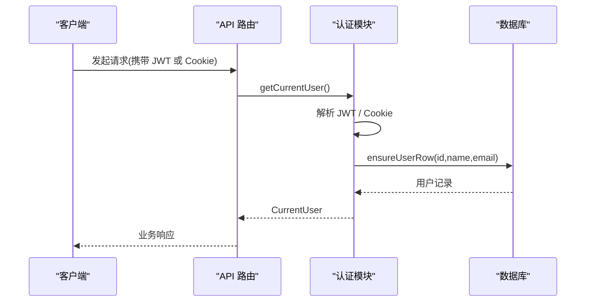
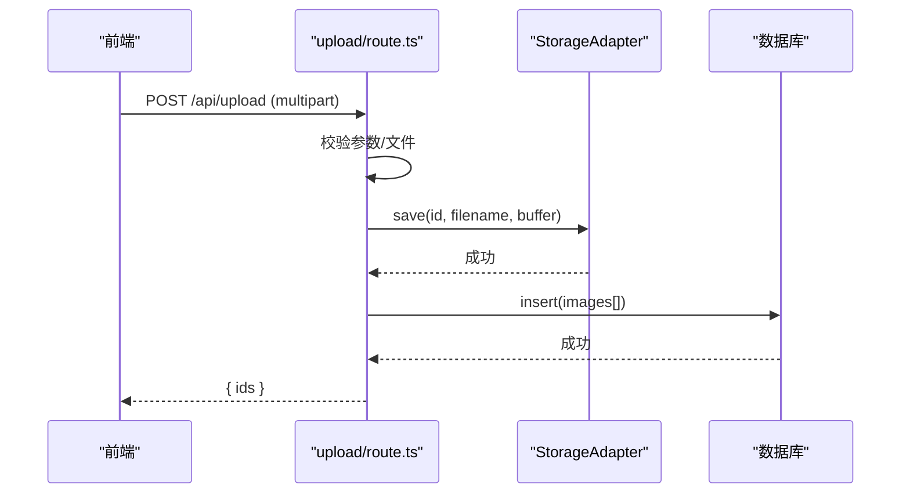
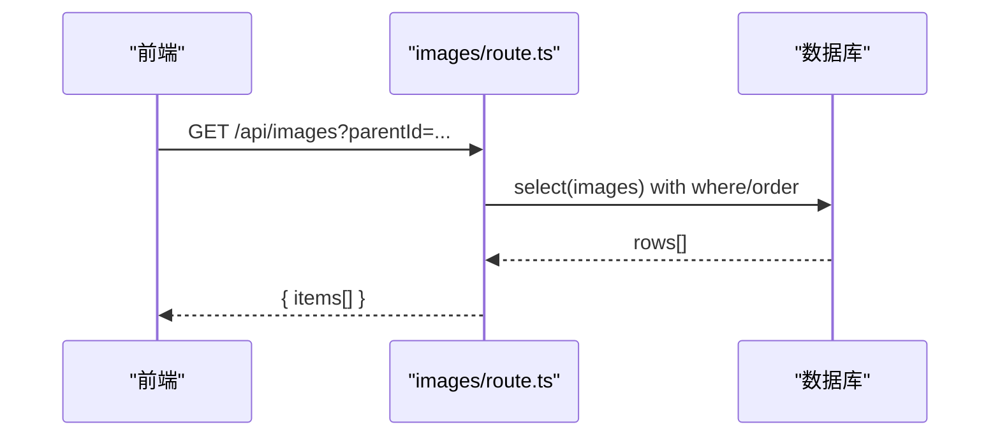
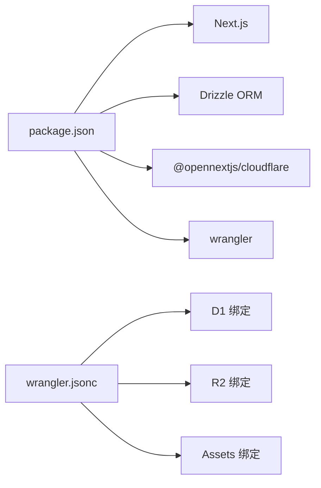
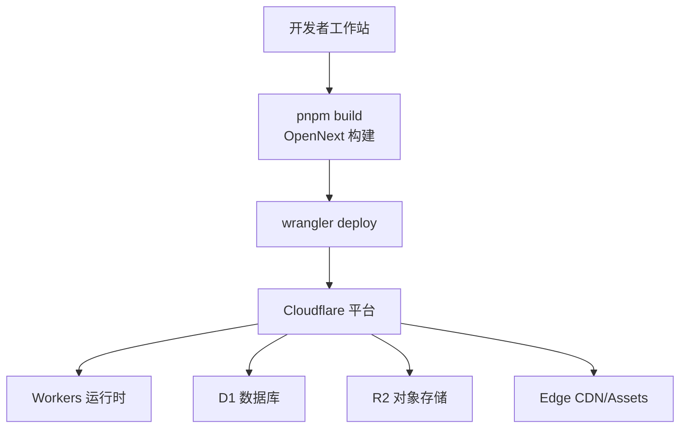

# 架构设计

<cite>
**本文引用的文件**
- [package.json](file://package.json)
- [wrangler.jsonc](file://wrangler.jsonc)
- [open-next.config.ts](file://open-next.config.ts)
- [drizzle.config.ts](file://drizzle.config.ts)
- [README.md](file://README.md)
- [src/db/schema.ts](file://src/db/schema.ts)
- [src/db/index.ts](file://src/db/index.ts)
- [src/lib/storage.ts](file://src/lib/storage.ts)
- [src/lib/auth.ts](file://src/lib/auth.ts)
- [src/app/api/images/route.ts](file://src/app/api/images/route.ts)
- [src/app/api/upload/route.ts](file://src/app/api/upload/route.ts)
- [src/app/api/user/profile/route.ts](file://src/app/api/user/profile/route.ts)
- [src/app/api/channels/[channelId]/route.ts](file://src/app/api/channels/[channelId]/route.ts)
- [src/app/[lang]/layout.tsx](file://src/app/[lang]/layout.tsx)
- [src/lib/i18n.ts](file://src/lib/i18n.ts)
- [worker-configuration.d.ts](file://worker-configuration.d.ts)
</cite>

## 目录
1. [简介](#简介)
2. [项目结构](#项目结构)
3. [核心组件](#核心组件)
4. [架构总览](#架构总览)
5. [详细组件分析](#详细组件分析)
6. [依赖关系分析](#依赖关系分析)
7. [性能考量](#性能考量)
8. [故障排查指南](#故障排查指南)
9. [结论](#结论)
10. [附录](#附录)

## 简介
Weable 是一个部署在 Cloudflare Workers 上的图片管理应用，基于 Next.js（通过 @opennextjs/cloudflare）运行于无服务器环境。系统采用分层架构（表现层、业务逻辑层、数据访问层），在存储子系统使用适配器模式以支持本地与 R2 对象存储的无缝切换；数据库层通过 Drizzle ORM 适配 D1（Cloudflare 边缘 SQL）与本地 SQLite，实现开发与生产环境的统一接口。整体架构遵循云原生理念：事件驱动、边缘计算、可观测性开启、静态资源托管与增量缓存可选。

## 项目结构
- 表现层：Next.js App Router 路由与页面布局，提供国际化与多语言元数据生成。
- 业务逻辑层：API 路由处理请求校验、鉴权、调用数据访问与存储适配器。
- 数据访问层：Drizzle ORM 封装 D1/SQLite 访问，schema 定义实体与关系。
- 存储子系统：StorageAdapter 抽象 + Local/R2 实现，AvatarStorage 抽象 + Local/R2 实现。
- 配置与基础设施：wrangler.jsonc 绑定 D1/R2/Assets，open-next 配置，drizzle-kit 迁移。

**图示来源**
- [wrangler.jsonc:1-34](file://wrangler.jsonc#L1-L34)
- [src/app/api/upload/route.ts:1-75](file://src/app/api/upload/route.ts#L1-L75)
- [src/app/api/images/route.ts:1-66](file://src/app/api/images/route.ts#L1-L66)
- [src/app/api/user/profile/route.ts:1-31](file://src/app/api/user/profile/route.ts#L1-L31)
- [src/app/api/channels/[channelId]/route.ts:1-44](file://src/app/api/channels/[channelId]/route.ts#L1-L44)
- [src/db/index.ts:1-61](file://src/db/index.ts#L1-L61)
- [src/db/schema.ts:1-100](file://src/db/schema.ts#L1-L100)
- [src/lib/storage.ts:1-214](file://src/lib/storage.ts#L1-L214)
- [src/lib/auth.ts:1-118](file://src/lib/auth.ts#L1-L118)
- [src/app/[lang]/layout.tsx:1-48](file://src/app/[lang]/layout.tsx#L1-L48)

**章节来源**
- [README.md:1-1](file://README.md#L1-L1)
- [package.json:1-40](file://package.json#L1-L40)
- [wrangler.jsonc:1-34](file://wrangler.jsonc#L1-L34)
- [open-next.config.ts:1-10](file://open-next.config.ts#L1-L10)
- [drizzle.config.ts:1-8](file://drizzle.config.ts#L1-L8)

## 核心组件
- 认证模块：解析 Cloudflare Access JWT 或 Cookie，确保用户存在并返回当前用户上下文。
- 存储适配器：统一 save/read/delete 接口，自动选择 R2 或本地文件系统；头像存储复用基础适配器。
- 数据库工厂：优先使用 D1 绑定，缺失时回退到本地 SQLite，保证开发/生产一致性。
- API 路由：上传、列表、用户资料更新、频道管理等 RESTful 接口，统一鉴权与参数校验。
- 国际化：按路由参数选择语言，生成 SEO 元信息。

**章节来源**
- [src/lib/auth.ts:1-118](file://src/lib/auth.ts#L1-L118)
- [src/lib/storage.ts:1-214](file://src/lib/storage.ts#L1-L214)
- [src/db/index.ts:1-61](file://src/db/index.ts#L1-L61)
- [src/app/api/upload/route.ts:1-75](file://src/app/api/upload/route.ts#L1-L75)
- [src/app/api/images/route.ts:1-66](file://src/app/api/images/route.ts#L1-L66)
- [src/app/api/user/profile/route.ts:1-31](file://src/app/api/user/profile/route.ts#L1-L31)
- [src/app/api/channels/[channelId]/route.ts:1-44](file://src/app/api/channels/[channelId]/route.ts#L1-L44)
- [src/app/[lang]/layout.tsx:1-48](file://src/app/[lang]/layout.tsx#L1-L48)
- [src/lib/i18n.ts:1-28](file://src/lib/i18n.ts#L1-L28)

## 架构总览
系统采用“边缘无服务器 + 分层架构”的云原生设计：
- 表现层：Next.js 应用由 OpenNext 编译为 Worker 入口，静态资源通过 Assets 绑定。
- 业务层：API 路由负责鉴权、输入校验、事务编排（如上传先写存储再落库）。
- 数据层：Drizzle ORM 屏蔽 D1/SQLite 差异，schema 集中定义实体与关系。
- 存储层：StorageAdapter 抽象 + R2/Local 实现，支持平滑切换与降级。
- 基础设施：wrangler.jsonc 声明 D1、R2、Assets 绑定；observability 开启可观测性。

**图示来源**
- [wrangler.jsonc:1-34](file://wrangler.jsonc#L1-L34)
- [open-next.config.ts:1-10](file://open-next.config.ts#L1-L10)
- [worker-configuration.d.ts:1-38](file://worker-configuration.d.ts#L1-L38)

## 详细组件分析

### 存储子系统（适配器模式）
- 抽象接口：StorageAdapter（save/read/delete）、AvatarStorage（save/read/delete）。
- 实现类：LocalStorageAdapter（本地 FS）、R2StorageAdapter（R2 Bucket）；头像存储分别包装基础适配器或直接操作 R2。
- 工厂函数：getStorage/getAvatarStorage 根据运行时环境自动选择实现，并在缺少绑定时抛出明确错误。

```mermaid
classDiagram
class StorageAdapter {
+save(imageId, filename, data) Promise~void~
+read(imageId, filename) Promise~Buffer|null~
+delete(imageId, filename) Promise~void~
}
class AvatarStorage {
+save(key, data) Promise~void~
+read(key) Promise~Buffer|null~
+delete(key) Promise~void~
}
class LocalStorageAdapter {
-storageRoot string
+save(imageId, filename, data) Promise~void~
+read(imageId, filename) Promise~Buffer|null~
+delete(imageId, filename) Promise~void~
}
class R2StorageAdapter {
-bucket R2Bucket
+save(imageId, filename, data) Promise~void~
+read(imageId, filename) Promise~Buffer|null~
+delete(imageId, filename) Promise~void~
}
class LocalAvatarStorage {
-baseStorage StorageAdapter
+save(key, data) Promise~void~
+read(key) Promise~Buffer|null~
+delete(key) Promise~void~
}
class R2AvatarStorage {
-bucket R2Bucket
+save(key, data) Promise~void~
+read(key) Promise~Buffer|null~
+delete(key) Promise~void~
}
StorageAdapter <|.. LocalStorageAdapter
StorageAdapter <|.. R2StorageAdapter
AvatarStorage <|.. LocalAvatarStorage
AvatarStorage <|.. R2AvatarStorage
LocalAvatarStorage --> StorageAdapter : "组合"
```

**图示来源**
- [src/lib/storage.ts:1-214](file://src/lib/storage.ts#L1-L214)

**章节来源**
- [src/lib/storage.ts:1-214](file://src/lib/storage.ts#L1-L214)

### 数据库层（D1/SQLite 双适配）
- Schema：users、channels、images 三表及关系定义，包含级联删除与自引用父子关系。
- 工厂：getDb() 优先使用 D1 绑定，缺失则回退到本地 SQLite，确保开发/构建/生产一致。
- 迁移：drizzle-kit 配置指向 schema 与 migrations 目录，dialect 为 sqlite。

**图示来源**
- [src/db/index.ts:1-61](file://src/db/index.ts#L1-L61)

**章节来源**
- [src/db/schema.ts:1-100](file://src/db/schema.ts#L1-L100)
- [src/db/index.ts:1-61](file://src/db/index.ts#L1-L61)
- [drizzle.config.ts:1-8](file://drizzle.config.ts#L1-L8)

### 认证模块（Cloudflare Access JWT / Cookie）
- 解析流程：优先从请求头/Cookie 获取 CF Access JWT，解码 payload 提取身份；否则回退到 user_id Cookie；开发环境允许默认用户。
- 用户保障：ensureUserRow 幂等写入 users 表，避免重复创建。

**图示来源**
- [src/lib/auth.ts:1-118](file://src/lib/auth.ts#L1-L118)

**章节来源**
- [src/lib/auth.ts:1-118](file://src/lib/auth.ts#L1-L118)

### 上传流程（先存后写）
- 校验：限制文件数量、MIME 前缀、大小上限。
- 存储：调用 StorageAdapter.save 将二进制写入 R2/本地。
- 落库：批量插入 images 元数据，返回 ID 列表。

**图示来源**
- [src/app/api/upload/route.ts:1-75](file://src/app/api/upload/route.ts#L1-L75)
- [src/lib/storage.ts:1-214](file://src/lib/storage.ts#L1-L214)

**章节来源**
- [src/app/api/upload/route.ts:1-75](file://src/app/api/upload/route.ts#L1-L75)

### 图片列表查询（目录优先+时间排序）
- 条件：按 userId 过滤，可选 parentId 限定目录。
- 排序：目录项优先，其次按 updatedAt 降序。
- 输出：字段映射为轻量 DTO。

**图示来源**
- [src/app/api/images/route.ts:1-66](file://src/app/api/images/route.ts#L1-L66)

**章节来源**
- [src/app/api/images/route.ts:1-66](file://src/app/api/images/route.ts#L1-L66)

### 用户资料更新（PATCH）
- 字段白名单：nickname、bio 长度与类型校验。
- 更新：按 userId 更新对应字段，返回 ok。

**章节来源**
- [src/app/api/user/profile/route.ts:1-31](file://src/app/api/user/profile/route.ts#L1-L31)

### 频道删除（权限与约束）
- 权限：仅频道所有者可删。
- 约束：若存在已发布图片则拒绝删除。
- 结果：删除成功返回 204。

**章节来源**
- [src/app/api/channels/[channelId]/route.ts:1-44](file://src/app/api/channels/[channelId]/route.ts#L1-L44)

### 国际化与元数据
- 路由参数 lang 决定语言，generateMetadata 动态设置标题与描述。
- i18n 模块集中加载多语言包并提供 t 函数。

**章节来源**
- [src/app/[lang]/layout.tsx:1-48](file://src/app/[lang]/layout.tsx#L1-L48)
- [src/lib/i18n.ts:1-28](file://src/lib/i18n.ts#L1-L28)

## 依赖关系分析
- 运行时依赖：Next.js、React、Drizzle ORM、better-sqlite3（本地）、@opennextjs/cloudflare（Worker 适配）。
- 工具链：wrangler、drizzle-kit、tsx、TailwindCSS。
- 外部服务：Cloudflare D1、R2、Workers、Observability。

**图示来源**
- [package.json:1-40](file://package.json#L1-L40)
- [wrangler.jsonc:1-34](file://wrangler.jsonc#L1-L34)

**章节来源**
- [package.json:1-40](file://package.json#L1-L40)
- [wrangler.jsonc:1-34](file://wrangler.jsonc#L1-L34)

## 性能考量
- 边缘执行：OpenNext 将 Next.js 编译为 Worker，减少冷启动延迟，靠近用户。
- 缓存策略：open-next.config.ts 预留 R2 增量缓存开关，可按需启用以提升 SSR/ISR 性能。
- 数据库：D1 具备低延迟与高并发特性；本地 SQLite 用于开发/构建期，避免 IO 阻塞。
- 存储：R2 对象存储具备高吞吐与全球分发能力；本地 FS 仅用于开发。
- 资源优化：静态资源通过 ASSETS 绑定直接由边缘 CDN 分发。

[本节为通用指导，不直接分析具体文件]

## 故障排查指南
- 缺少 D1 绑定：当处于 Cloudflare 上下文但未配置 DB 绑定时，getDb() 会抛出明确错误。检查 wrangler.jsonc 的 d1_databases 配置。
- 缺少 R2 绑定：getStorage()/getAvatarStorage() 在 Cloudflare 上下文中未找到 IMAGES_BUCKET 时会抛出错误。检查 r2_buckets 绑定名称与 bucket_name。
- 上传失败：确认 MIME 前缀、文件大小限制与父目录存在性校验；查看日志定位存储或数据库写入异常。
- 鉴权失败：确认 CF Access JWT 或 Cookie 是否正确传递；开发环境可通过环境变量注入默认用户。

**章节来源**
- [src/db/index.ts:1-61](file://src/db/index.ts#L1-L61)
- [src/lib/storage.ts:1-214](file://src/lib/storage.ts#L1-L214)
- [src/lib/auth.ts:1-118](file://src/lib/auth.ts#L1-L118)
- [wrangler.jsonc:1-34](file://wrangler.jsonc#L1-L34)

## 结论
Weable 通过分层架构与适配器模式实现了清晰的职责分离与良好的可扩展性；借助 Cloudflare Workers、D1、R2 与 OpenNext，达成云原生的边缘化部署与高性能体验。系统在安全（JWT/Cookie 鉴权）、可观测性（observability 开启）、可维护性（Drizzle schema/migrations）方面具备完善实践。未来可在 R2 增量缓存、CDN 缓存策略、限流与审计等方面进一步增强。

[本节为总结性内容，不直接分析具体文件]

## 附录

### 技术决策与权衡
- 选择 Cloudflare Workers：边缘就近执行、低延迟、按需扩展；配合 OpenNext 获得全栈 Next.js 能力。
- 选择 D1：SQL 语义与 Drizzle ORM 生态契合，适合结构化元数据；本地 SQLite 降低开发门槛。
- 选择 R2：对象存储天然适合图片等大文件，具备高可用与全球分发；适配器模式便于替换实现。
- 资产托管：ASSETS 绑定使静态资源走 CDN，提升首屏性能。

**章节来源**
- [package.json:1-40](file://package.json#L1-L40)
- [wrangler.jsonc:1-34](file://wrangler.jsonc#L1-L34)
- [open-next.config.ts:1-10](file://open-next.config.ts#L1-L10)

### 基础设施需求与部署拓扑
- 必需服务：Cloudflare Workers、D1 数据库、R2 对象存储、OpenNext 构建产物。
- 配置要点：wrangler.jsonc 中正确声明 DB、IMAGES_BUCKET、NEXT_INC_CACHE_R2_BUCKET、ASSETS 绑定。
- 可观测性：observability.enabled=true，便于追踪请求与错误。

**图示来源**
- [wrangler.jsonc:1-34](file://wrangler.jsonc#L1-L34)
- [package.json:1-40](file://package.json#L1-L40)

### 安全、监控与灾难恢复
- 安全：JWT/Cookie 鉴权、路径段安全校验（防目录穿越）、MIME/大小限制。
- 监控：observability 开启，结合 Cloudflare 日志与指标进行问题定位。
- 灾难恢复：D1 快照与 R2 版本控制（建议开启），定期备份 schema 与关键数据。

**章节来源**
- [src/lib/auth.ts:1-118](file://src/lib/auth.ts#L1-L118)
- [src/lib/storage.ts:1-214](file://src/lib/storage.ts#L1-L214)
- [wrangler.jsonc:1-34](file://wrangler.jsonc#L1-L34)