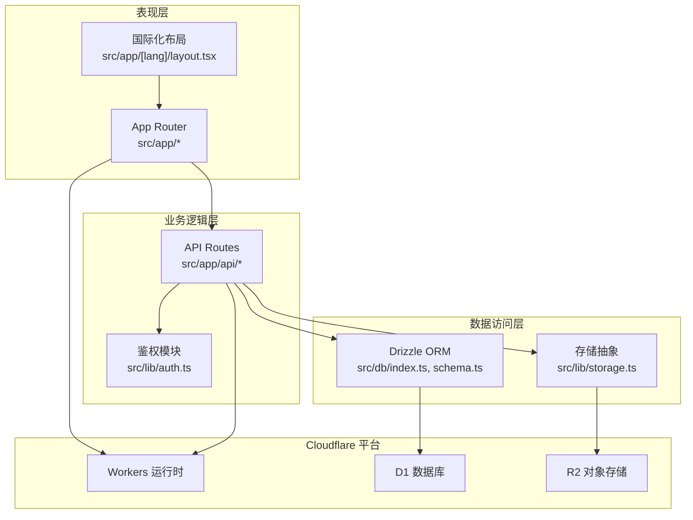
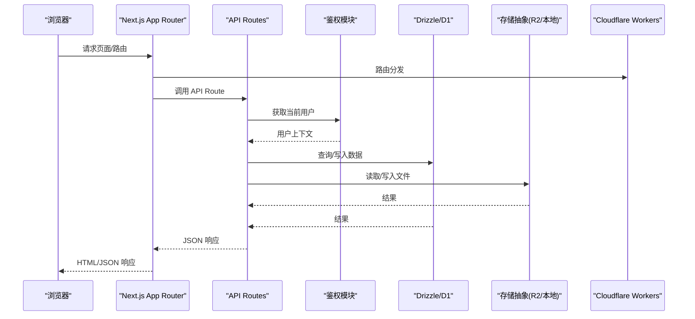
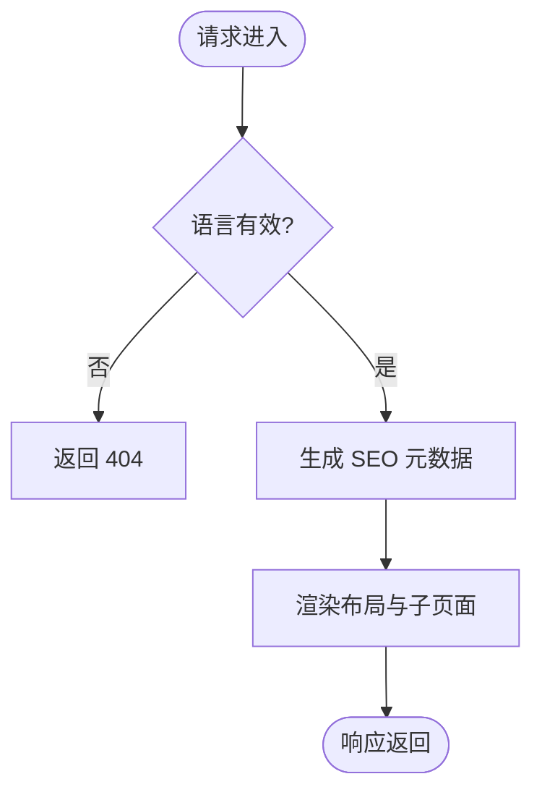
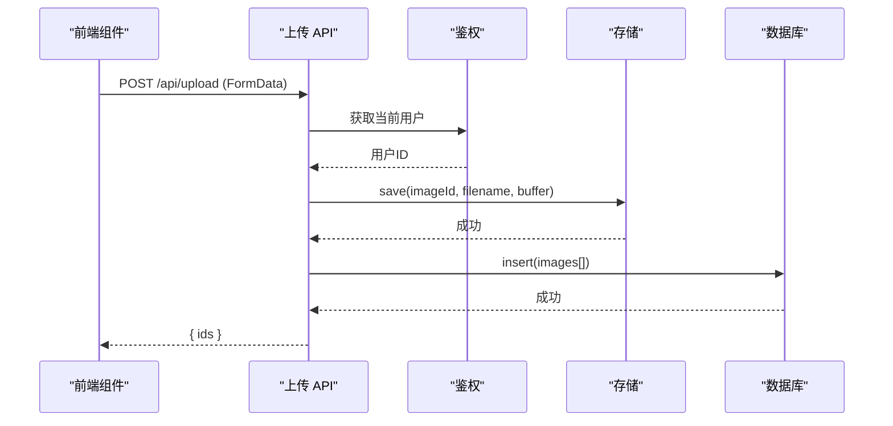
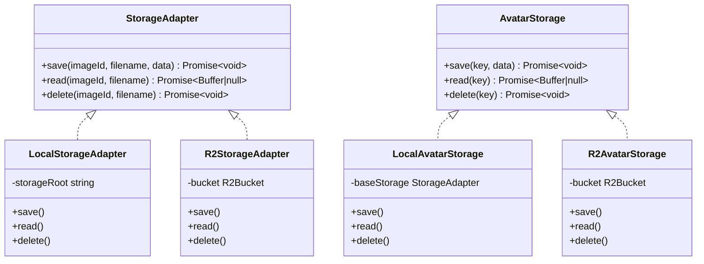
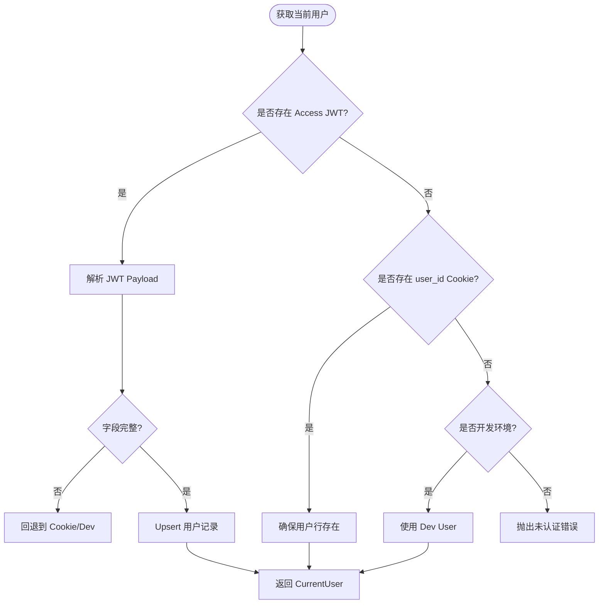
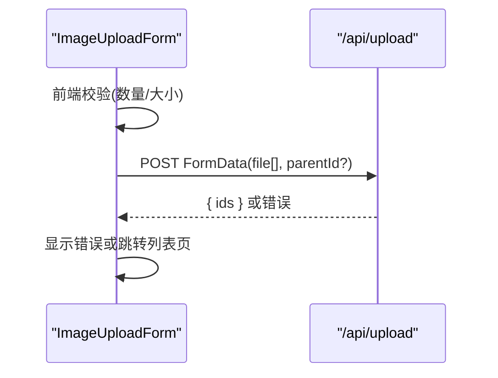
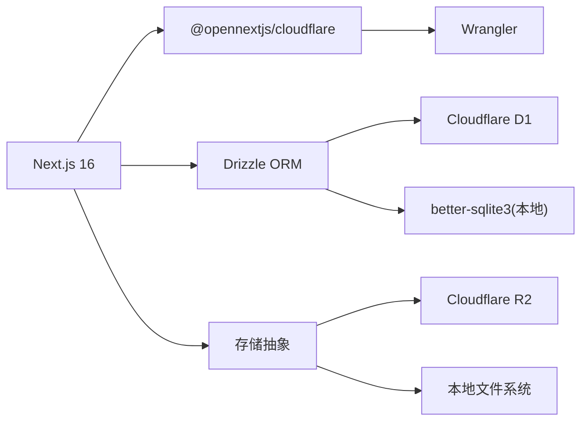
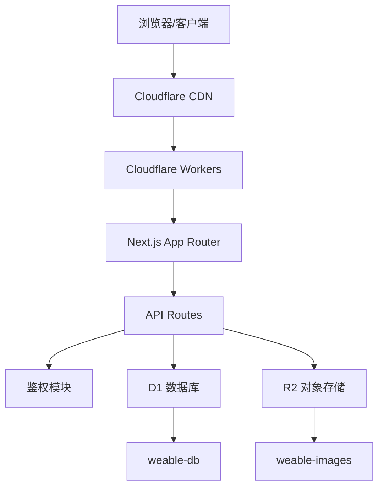

# 系统架构概览

<cite>
**本文引用的文件**   
- [package.json](file://package.json)
- [next.config.ts](file://next.config.ts)
- [wrangler.jsonc](file://wrangler.jsonc)
- [open-next.config.ts](file://open-next.config.ts)
- [drizzle.config.ts](file://drizzle.config.ts)
- [src/app/layout.tsx](file://src/app/layout.tsx)
- [src/app/[lang]/layout.tsx](file://src/app/[lang]/layout.tsx)
- [src/db/index.ts](file://src/db/index.ts)
- [src/db/schema.ts](file://src/db/schema.ts)
- [src/lib/storage.ts](file://src/lib/storage.ts)
- [src/lib/auth.ts](file://src/lib/auth.ts)
- [src/app/api/images/route.ts](file://src/app/api/images/route.ts)
- [src/app/api/upload/route.ts](file://src/app/api/upload/route.ts)
- [src/components/ImageUploadForm.tsx](file://src/components/ImageUploadForm.tsx)
- [migrations/0000_cynical_mordo.sql](file://migrations/0000_cynical_mordo.sql)
- [README.md](file://README.md)
</cite>

## 目录
1. [简介](#简介)
2. [项目结构](#项目结构)
3. [核心组件](#核心组件)
4. [架构总览](#架构总览)
5. [详细组件分析](#详细组件分析)
6. [依赖关系分析](#依赖关系分析)
7. [性能考量](#性能考量)
8. [故障排查指南](#故障排查指南)
9. [结论](#结论)
10. [附录](#附录)

## 简介
本文件为 Weable 应用的系统架构概览，面向产品、研发与运维读者。Weable 是一个部署在 Cloudflare Workers 上的图片管理应用，采用 Next.js App Router 作为表现层，API Routes 承载业务逻辑，Drizzle ORM 对接 Cloudflare D1（SQLite）与 R2（对象存储），并通过 OpenNext + Wrangler 将 Next.js 应用适配到 Serverless 运行时。文档重点说明分层架构、云原生设计、技术栈选型原因以及客户端、服务器端、数据库与存储之间的交互关系。

## 项目结构
Weable 采用“按功能域”组织源码：
- 表现层：src/app 下的 App Router 页面与布局，支持多语言路由 [lang]
- 业务逻辑层：src/app/api 下的 API Routes，封装鉴权、数据校验与业务流程
- 数据访问层：src/db 下的 Drizzle Schema 与数据库连接适配；src/lib/storage.ts 提供统一存储抽象
- 组件层：src/components 下的 React 客户端组件
- 配置与部署：wrangler.jsonc、open-next.config.ts、next.config.ts、drizzle.config.ts、package.json

图表来源 
- [next.config.ts:1-15](file://next.config.ts#L1-L15)
- [wrangler.jsonc:1-34](file://wrangler.jsonc#L1-L34)
- [src/app/[lang]/layout.tsx:1-48](file://src/app/[lang]/layout.tsx#L1-L48)
- [src/db/index.ts:1-61](file://src/db/index.ts#L1-L61)
- [src/lib/storage.ts:1-214](file://src/lib/storage.ts#L1-L214)

章节来源
- [package.json:1-40](file://package.json#L1-L40)
- [next.config.ts:1-15](file://next.config.ts#L1-L15)
- [wrangler.jsonc:1-34](file://wrangler.jsonc#L1-L34)
- [open-next.config.ts:1-10](file://open-next.config.ts#L1-L10)
- [drizzle.config.ts:1-8](file://drizzle.config.ts#L1-L8)

## 核心组件
- 表现层（Next.js App Router）
  - 根布局与多语言布局：定义站点元信息、字符集与基础样式，支持按 [lang] 生成静态参数与 SEO 元数据
  - 页面路由：通过 App Router 的目录约定实现页面与 API 的统一入口
- 业务逻辑层（API Routes）
  - 图片上传：POST /api/upload，负责表单校验、MIME 类型与大小限制、写入 R2/本地存储并落库
  - 图片列表：GET /api/images，按用户与父目录过滤，返回树形结构所需字段
- 数据访问层（Drizzle ORM + D1/R2）
  - 数据库连接：根据运行环境自动选择 D1（生产）或 SQLite（本地开发）
  - Schema 与迁移：users/channels/images 三表模型，含外键与时间戳，使用 uuidv7 + base58 生成短 ID
  - 存储抽象：LocalStorageAdapter 与 R2StorageAdapter 统一接口，支持头像与图片两类存储策略
- 鉴权模块
  - 优先解析 Cloudflare Access JWT（Header/Cookie），回退到本地会话 Cookie，非生产环境支持 Dev User 快速登录

章节来源
- [src/app/[lang]/layout.tsx:1-48](file://src/app/[lang]/layout.tsx#L1-L48)
- [src/app/api/upload/route.ts:1-75](file://src/app/api/upload/route.ts#L1-L75)
- [src/app/api/images/route.ts:1-66](file://src/app/api/images/route.ts#L1-L66)
- [src/db/index.ts:1-61](file://src/db/index.ts#L1-L61)
- [src/db/schema.ts:1-100](file://src/db/schema.ts#L1-L100)
- [src/lib/storage.ts:1-214](file://src/lib/storage.ts#L1-L214)
- [src/lib/auth.ts:1-118](file://src/lib/auth.ts#L1-L118)

## 架构总览
Weable 采用“表现层—业务逻辑层—数据访问层”的分层架构，结合 Cloudflare Workers 的 Serverless 特性，实现高可用、弹性伸缩与全球就近分发。OpenNext 将 Next.js 应用编译为 Worker 可执行产物，Wrangler 负责绑定 D1/R2 等资源。

图表来源 
- [src/app/[lang]/layout.tsx:1-48](file://src/app/[lang]/layout.tsx#L1-L48)
- [src/app/api/upload/route.ts:1-75](file://src/app/api/upload/route.ts#L1-L75)
- [src/app/api/images/route.ts:1-66](file://src/app/api/images/route.ts#L1-L66)
- [src/lib/auth.ts:1-118](file://src/lib/auth.ts#L1-L118)
- [src/db/index.ts:1-61](file://src/db/index.ts#L1-L61)
- [src/lib/storage.ts:1-214](file://src/lib/storage.ts#L1-L214)
- [wrangler.jsonc:1-34](file://wrangler.jsonc#L1-L34)

## 详细组件分析

### 表现层：Next.js App Router 与多语言布局
- 根布局与语言布局：设置字符集、视口、SEO 元信息与语言切换；通过 generateStaticParams 预渲染多语言路径
- 资源与构建：启用 pageExtensions 以支持 md/mdx；reactStrictMode 开启严格模式；允许本地开发跨域

图表来源 
- [src/app/[lang]/layout.tsx:1-48](file://src/app/[lang]/layout.tsx#L1-L48)
- [next.config.ts:1-15](file://next.config.ts#L1-L15)

章节来源
- [src/app/layout.tsx:1-8](file://src/app/layout.tsx#L1-L8)
- [src/app/[lang]/layout.tsx:1-48](file://src/app/[lang]/layout.tsx#L1-L48)
- [next.config.ts:1-15](file://next.config.ts#L1-L15)

### 业务逻辑层：API Routes（上传与列表）
- 上传接口 POST /api/upload
  - 校验：文件数量上限、MIME 前缀、单文件大小限制
  - 流程：先写存储（R2/本地），再批量插入 images 表，返回新 ID 列表
- 列表接口 GET /api/images
  - 鉴权：基于 getCurrentUser 限定 userId
  - 查询：按 parentId 过滤，目录优先并按更新时间倒序

图表来源 
- [src/app/api/upload/route.ts:1-75](file://src/app/api/upload/route.ts#L1-L75)
- [src/lib/auth.ts:1-118](file://src/lib/auth.ts#L1-L118)
- [src/lib/storage.ts:1-214](file://src/lib/storage.ts#L1-L214)
- [src/db/schema.ts:1-100](file://src/db/schema.ts#L1-L100)

章节来源
- [src/app/api/upload/route.ts:1-75](file://src/app/api/upload/route.ts#L1-L75)
- [src/app/api/images/route.ts:1-66](file://src/app/api/images/route.ts#L1-L66)

### 数据访问层：Drizzle ORM + D1/R2
- 数据库连接策略
  - 检测 Cloudflare Context，若存在且绑定 DB，则使用 D1；否则回退至本地 SQLite
  - 本地开发时自动创建 .data/weable.db 目录
- Schema 与迁移
  - users/channels/images 三表，包含外键约束与级联删除
  - 使用 uuidv7 + bs58 生成短 ID，便于 URL 友好展示
- 存储抽象
  - StorageAdapter：save/read/delete 统一接口
  - LocalStorageAdapter：基于文件系统，适合本地调试
  - R2StorageAdapter：基于 Cloudflare R2，适合生产
  - AvatarStorage：对头像存储进行命名空间隔离（__avatar__/avatar/）

图表来源 
- [src/lib/storage.ts:1-214](file://src/lib/storage.ts#L1-L214)

章节来源
- [src/db/index.ts:1-61](file://src/db/index.ts#L1-L61)
- [src/db/schema.ts:1-100](file://src/db/schema.ts#L1-L100)
- [src/lib/storage.ts:1-214](file://src/lib/storage.ts#L1-L214)
- [drizzle.config.ts:1-8](file://drizzle.config.ts#L1-L8)
- [migrations/0000_cynical_mordo.sql:1-38](file://migrations/0000_cynical_mordo.sql#L1-L38)

### 鉴权模块：Cloudflare Access JWT 与本地回退
- 优先级：Cloudflare Access JWT（Header/Cookie）→ 本地 user_id Cookie → 开发环境 Dev User
- 行为：确保用户行存在（upsert），返回标准化 CurrentUser

图表来源 
- [src/lib/auth.ts:1-118](file://src/lib/auth.ts#L1-L118)

章节来源
- [src/lib/auth.ts:1-118](file://src/lib/auth.ts#L1-L118)

### 前端组件：图片上传表单
- 职责：前端校验（数量、大小）、构造 FormData、提交到 /api/upload、成功后跳转列表页
- 交互：错误提示、上传中状态、多文件选择与 MIME 限制提示

图表来源 
- [src/components/ImageUploadForm.tsx:1-105](file://src/components/ImageUploadForm.tsx#L1-L105)
- [src/app/api/upload/route.ts:1-75](file://src/app/api/upload/route.ts#L1-L75)

章节来源
- [src/components/ImageUploadForm.tsx:1-105](file://src/components/ImageUploadForm.tsx#L1-L105)

## 依赖关系分析
- 运行时与框架
  - Next.js 16 + React 19 + TypeScript：现代前端生态，App Router 提供强大的服务端渲染与路由能力
  - @opennextjs/cloudflare：将 Next.js 应用转换为 Cloudflare Workers 兼容产物
  - wrangler：Cloudflare 官方 CLI，用于绑定 D1/R2、发布与观测
- 数据与存储
  - drizzle-orm：类型安全的 SQL 构建器，同时支持 better-sqlite3 与 d1
  - D1：Serverless 友好的 SQLite 数据库，低延迟、强一致
  - R2：S3 兼容对象存储，适合图片等大文件
- 其他
  - uuidv7 + bs58：生成短小、URL 友好的 ID
  - marked/sanitize-html：Markdown 渲染与 XSS 防护（按需使用）

图表来源 
- [package.json:1-40](file://package.json#L1-L40)
- [open-next.config.ts:1-10](file://open-next.config.ts#L1-L10)
- [wrangler.jsonc:1-34](file://wrangler.jsonc#L1-L34)
- [src/db/index.ts:1-61](file://src/db/index.ts#L1-L61)
- [src/lib/storage.ts:1-214](file://src/lib/storage.ts#L1-L214)

章节来源
- [package.json:1-40](file://package.json#L1-L40)
- [open-next.config.ts:1-10](file://open-next.config.ts#L1-L10)
- [wrangler.jsonc:1-34](file://wrangler.jsonc#L1-L34)

## 性能考量
- 冷启动与边缘缓存
  - OpenNext 支持增量缓存（可选 R2 缓存），可减少重复渲染开销
  - 静态资源由 ASSETS 绑定提供，CDN 就近分发
- 数据库与存储
  - D1 具备低延迟与强一致性，适合读多写少的元数据场景
  - R2 适合大文件对象存储，避免频繁 IO 阻塞
- 并发与限流
  - 上传接口限制单次文件数量与大小，防止滥用
  - 建议在生产开启速率限制与请求体大小限制（平台侧）
- 构建与部署
  - 使用 pnpm 与 Turborepo 加速开发体验
  - 合理拆分页面与组件，减少首屏包体积

[本节为通用指导，不直接分析具体文件]

## 故障排查指南
- 数据库绑定缺失
  - 现象：运行时报错提示 D1 绑定未配置
  - 处理：检查 wrangler.jsonc 的 d1_databases 配置与环境变量
- 对象存储绑定缺失
  - 现象：运行时报错提示 R2 绑定 IMAGES_BUCKET 未配置
  - 处理：检查 wrangler.jsonc 的 r2_buckets 配置与绑定名
- 上传失败
  - 现象：前端提示上传错误或后端返回错误码
  - 处理：确认 MIME 类型前缀、文件大小限制、parentId 有效性
- 鉴权失败
  - 现象：无法解析当前用户
  - 处理：检查 Cloudflare Access JWT 是否注入，或本地 Cookie/user_id 是否正确

章节来源
- [src/db/index.ts:1-61](file://src/db/index.ts#L1-L61)
- [src/lib/storage.ts:1-214](file://src/lib/storage.ts#L1-L214)
- [src/lib/auth.ts:1-118](file://src/lib/auth.ts#L1-L118)
- [wrangler.jsonc:1-34](file://wrangler.jsonc#L1-L34)

## 结论
Weable 通过 Next.js App Router、API Routes 与 Drizzle ORM 构建了清晰的分层架构，借助 OpenNext + Wrangler 无缝运行于 Cloudflare Workers，充分利用 D1/R2 的 Serverless 优势。该架构具备良好的可扩展性、低成本与全球分发能力，适合图片管理与内容托管类应用。未来可在缓存策略、权限细化与监控告警方面持续优化。

[本节为总结性内容，不直接分析具体文件]

## 附录
- 技术栈选型理由
  - Next.js 16：App Router、SSR/SSG 一体化，生态成熟
  - React 19：最新特性与性能改进
  - TypeScript：类型安全提升可维护性
  - Drizzle ORM：类型安全、轻量、跨数据库适配
  - Cloudflare Workers/D1/R2：Serverless 原生、边缘计算、低成本高可用
- 系统上下文图（客户端、服务器端、数据库与存储）

图表来源 
- [wrangler.jsonc:1-34](file://wrangler.jsonc#L1-L34)
- [src/app/api/upload/route.ts:1-75](file://src/app/api/upload/route.ts#L1-L75)
- [src/app/api/images/route.ts:1-66](file://src/app/api/images/route.ts#L1-L66)
- [src/db/index.ts:1-61](file://src/db/index.ts#L1-L61)
- [src/lib/storage.ts:1-214](file://src/lib/storage.ts#L1-L214)