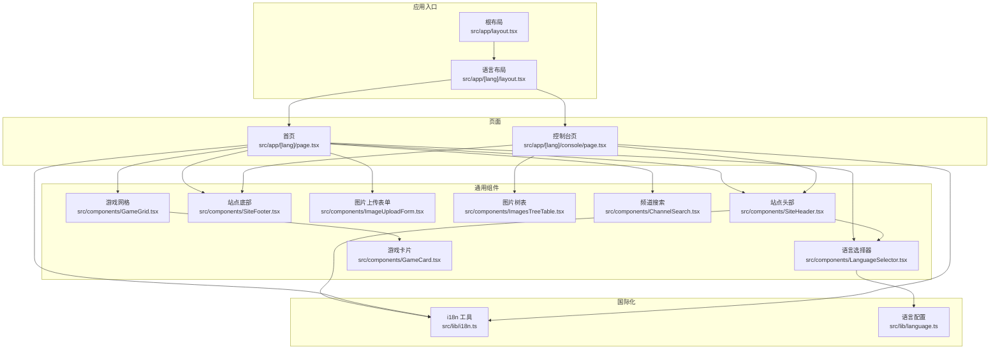
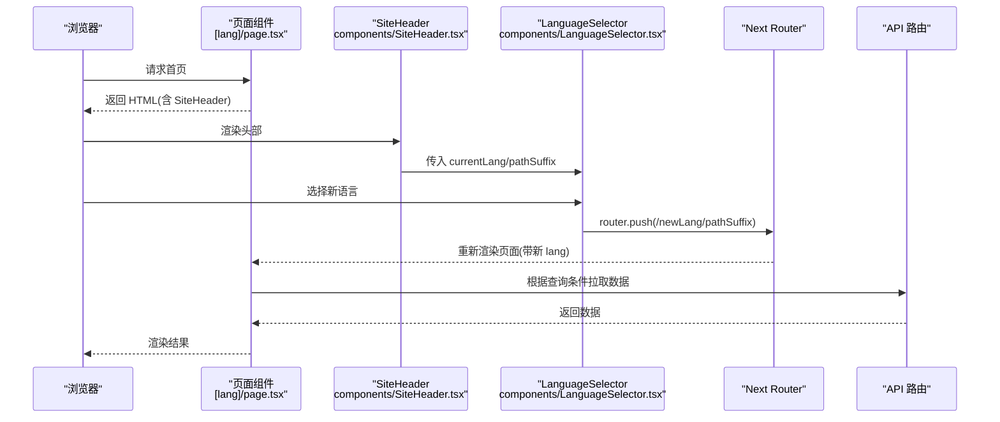
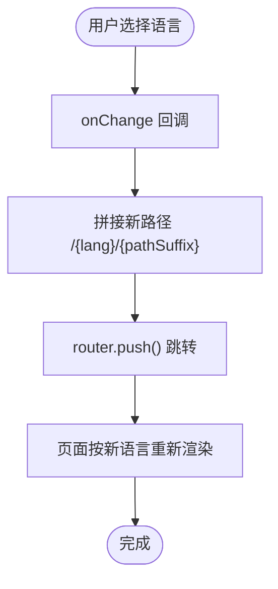
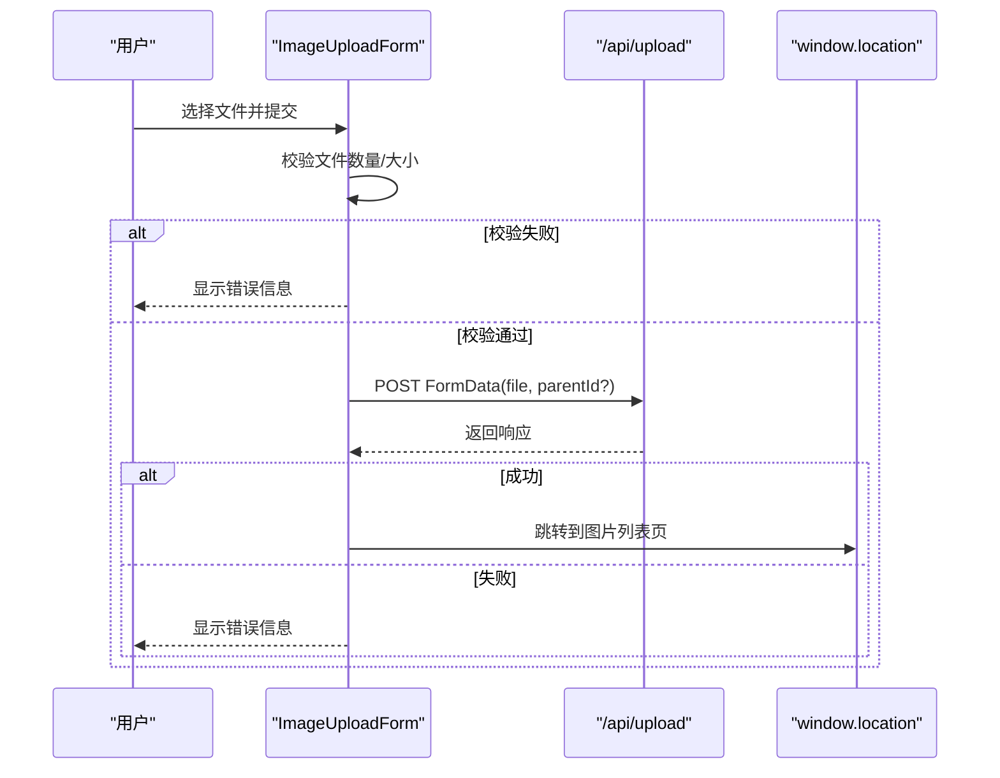
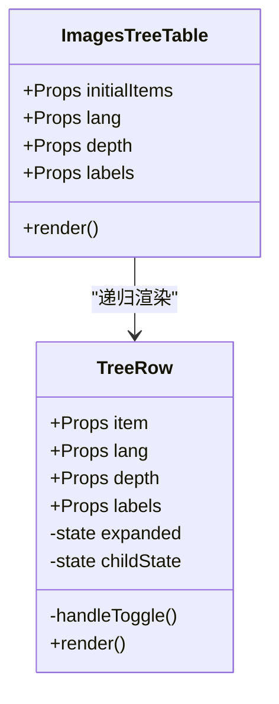
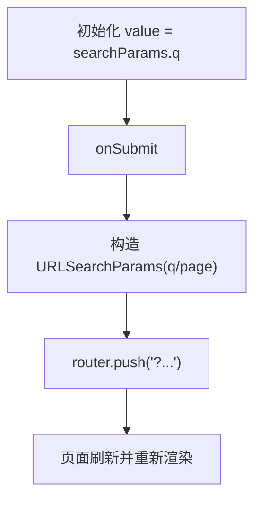
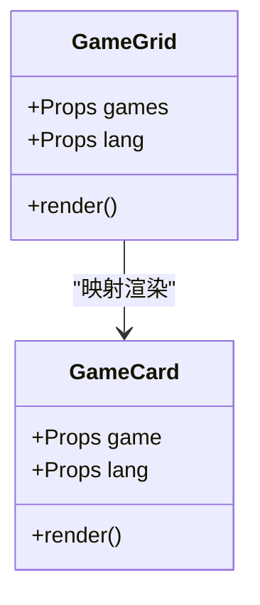
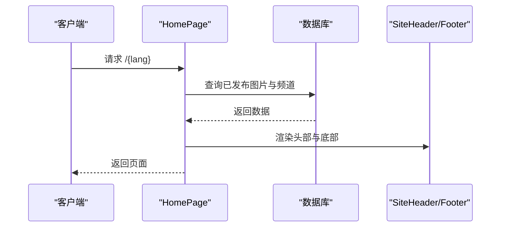
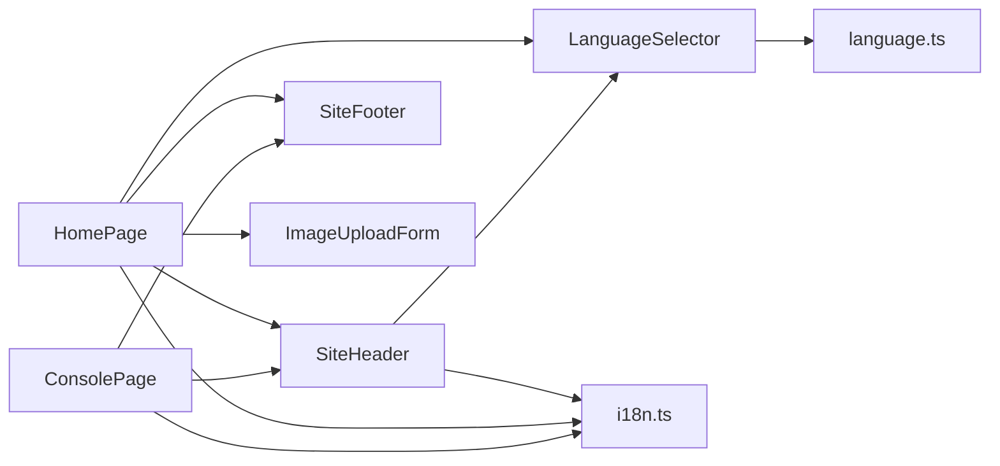

# 组件交互设计

<cite>
**本文引用的文件**   
- [src/app/layout.tsx](file://src/app/layout.tsx)
- [src/app/[lang]/layout.tsx](file://src/app/[lang]/layout.tsx)
- [src/app/[lang]/page.tsx](file://src/app/[lang]/page.tsx)
- [src/app/[lang]/console/page.tsx](file://src/app/[lang]/console/page.tsx)
- [src/components/SiteHeader.tsx](file://src/components/SiteHeader.tsx)
- [src/components/SiteFooter.tsx](file://src/components/SiteFooter.tsx)
- [src/components/LanguageSelector.tsx](file://src/components/LanguageSelector.tsx)
- [src/components/ImageUploadForm.tsx](file://src/components/ImageUploadForm.tsx)
- [src/components/ImagesTreeTable.tsx](file://src/components/ImagesTreeTable.tsx)
- [src/components/ChannelSearch.tsx](file://src/components/ChannelSearch.tsx)
- [src/components/GameGrid.tsx](file://src/components/GameGrid.tsx)
- [src/components/GameCard.tsx](file://src/components/GameCard.tsx)
- [src/lib/i18n.ts](file://src/lib/i18n.ts)
- [src/lib/language.ts](file://src/lib/language.ts)
</cite>

## 目录
1. [简介](#简介)
2. [项目结构](#项目结构)
3. [核心组件](#核心组件)
4. [架构总览](#架构总览)
5. [详细组件分析](#详细组件分析)
6. [依赖关系分析](#依赖关系分析)
7. [性能考虑](#性能考虑)
8. [故障排查指南](#故障排查指南)
9. [结论](#结论)
10. [附录](#附录)

## 简介
本文件面向 Weable 应用的 React 组件交互设计，聚焦以下方面：
- 组件通信模式：props 传递、事件处理、状态管理与副作用处理
- 组件层次结构与职责划分：父子、兄弟与跨层级协作
- 自定义 Hooks 使用模式与复用策略（结合 Next.js 内置 Hook）
- 关键业务流程的组件协作图
- 组件测试策略、性能优化与可访问性建议
- 组件开发规范与最佳实践

## 项目结构
Weable 基于 Next.js App Router，页面级布局位于 app 目录，通用 UI 组件位于 components 目录，国际化能力集中在 lib 目录。整体采用“页面负责数据获取与路由，组件负责展示与交互”的分层方式。

图表来源
- [src/app/layout.tsx:1-8](file://src/app/layout.tsx#L1-L8)
- [src/app/[lang]/layout.tsx:1-48](file://src/app/[lang]/layout.tsx#L1-L48)
- [src/app/[lang]/page.tsx:1-172](file://src/app/[lang]/page.tsx#L1-L172)
- [src/app/[lang]/console/page.tsx:1-68](file://src/app/[lang]/console/page.tsx#L1-L68)
- [src/components/SiteHeader.tsx:1-46](file://src/components/SiteHeader.tsx#L1-L46)
- [src/components/SiteFooter.tsx:1-17](file://src/components/SiteFooter.tsx#L1-L17)
- [src/components/LanguageSelector.tsx:1-34](file://src/components/LanguageSelector.tsx#L1-L34)
- [src/components/ImageUploadForm.tsx:1-105](file://src/components/ImageUploadForm.tsx#L1-L105)
- [src/components/ImagesTreeTable.tsx:1-216](file://src/components/ImagesTreeTable.tsx#L1-L216)
- [src/components/ChannelSearch.tsx:1-45](file://src/components/ChannelSearch.tsx#L1-L45)
- [src/components/GameGrid.tsx:1-19](file://src/components/GameGrid.tsx#L1-L19)
- [src/components/GameCard.tsx:1-72](file://src/components/GameCard.tsx#L1-L72)
- [src/lib/i18n.ts:1-28](file://src/lib/i18n.ts#L1-L28)
- [src/lib/language.ts:1-49](file://src/lib/language.ts#L1-L49)

章节来源
- [src/app/layout.tsx:1-8](file://src/app/layout.tsx#L1-L8)
- [src/app/[lang]/layout.tsx:1-48](file://src/app/[lang]/layout.tsx#L1-L48)

## 核心组件
- SiteHeader：站点导航与语言切换入口，通过 props.lang 驱动文案与链接前缀；内部集成 LanguageSelector。
- SiteFooter：静态版权信息，依赖 i18n 文案。
- LanguageSelector：客户端组件，使用 Next.js useRouter 进行语言切换路由跳转。
- ImageUploadForm：客户端上传表单，包含前端校验、上传状态与错误提示，完成后跳转列表页。
- ImagesTreeTable：递归渲染的图片/目录树表，支持按需加载子节点、展开/折叠与错误态。
- ChannelSearch：基于 URL searchParams 的搜索输入，提交后更新查询参数并刷新页面。
- GameGrid / GameCard：游戏列表与卡片展示，纯展示型组件，通过 props 接收数据与语言。

章节来源
- [src/components/SiteHeader.tsx:1-46](file://src/components/SiteHeader.tsx#L1-L46)
- [src/components/SiteFooter.tsx:1-17](file://src/components/SiteFooter.tsx#L1-L17)
- [src/components/LanguageSelector.tsx:1-34](file://src/components/LanguageSelector.tsx#L1-L34)
- [src/components/ImageUploadForm.tsx:1-105](file://src/components/ImageUploadForm.tsx#L1-L105)
- [src/components/ImagesTreeTable.tsx:1-216](file://src/components/ImagesTreeTable.tsx#L1-L216)
- [src/components/ChannelSearch.tsx:1-45](file://src/components/ChannelSearch.tsx#L1-L45)
- [src/components/GameGrid.tsx:1-19](file://src/components/GameGrid.tsx#L1-L19)
- [src/components/GameCard.tsx:1-72](file://src/components/GameCard.tsx#L1-L72)

## 架构总览
Weable 的组件架构遵循“服务端页面 + 客户端交互组件”的组合：
- 服务端页面负责数据获取、SEO 元信息与路由参数解析
- 客户端组件负责用户交互、本地状态与副作用（如网络请求、路由跳转）
- 国际化通过统一的 t(lang, key) 函数注入到各组件

图表来源
- [src/app/[lang]/page.tsx:1-172](file://src/app/[lang]/page.tsx#L1-L172)
- [src/components/SiteHeader.tsx:1-46](file://src/components/SiteHeader.tsx#L1-L46)
- [src/components/LanguageSelector.tsx:1-34](file://src/components/LanguageSelector.tsx#L1-L34)

## 详细组件分析

### 语言切换流程（LanguageSelector）
- 触发点：select onChange
- 副作用：router.push 跳转到新语言路径
- 数据流：currentLang -> 新语言 -> 路由 -> 页面重新渲染

图表来源
- [src/components/LanguageSelector.tsx:1-34](file://src/components/LanguageSelector.tsx#L1-L34)

章节来源
- [src/components/LanguageSelector.tsx:1-34](file://src/components/LanguageSelector.tsx#L1-L34)

### 图片上传流程（ImageUploadForm）
- 触发点：form submit
- 校验：文件数量、大小限制
- 副作用：FormData 构建、fetch 调用、错误状态、成功后跳转列表页
- 状态：error、uploading

图表来源
- [src/components/ImageUploadForm.tsx:1-105](file://src/components/ImageUploadForm.tsx#L1-L105)

章节来源
- [src/components/ImageUploadForm.tsx:1-105](file://src/components/ImageUploadForm.tsx#L1-L105)

### 图片树表（ImagesTreeTable）
- 数据结构：ImageEntry（区分目录与文件）
- 交互：点击展开按钮按需加载子节点，维护 childState（idle/loading/loaded/error）
- 渲染：递归渲染 TreeRow，缩进由 depth 控制

图表来源
- [src/components/ImagesTreeTable.tsx:1-216](file://src/components/ImagesTreeTable.tsx#L1-L216)

章节来源
- [src/components/ImagesTreeTable.tsx:1-216](file://src/components/ImagesTreeTable.tsx#L1-L216)

### 频道搜索（ChannelSearch）
- 数据来源：useSearchParams 读取 q 参数
- 交互：提交时更新 URL 查询参数并跳转
- 副作用：router.push 刷新页面

图表来源
- [src/components/ChannelSearch.tsx:1-45](file://src/components/ChannelSearch.tsx#L1-L45)

章节来源
- [src/components/ChannelSearch.tsx:1-45](file://src/components/ChannelSearch.tsx#L1-L45)

### 游戏网格与卡片（GameGrid / GameCard）
- 数据流：父组件传入 games 数组与 lang
- 渲染：GameGrid 遍历生成 GameCard，GameCard 负责详情链接与外部跳转
- 交互：无复杂状态，纯展示

图表来源
- [src/components/GameGrid.tsx:1-19](file://src/components/GameGrid.tsx#L1-L19)
- [src/components/GameCard.tsx:1-72](file://src/components/GameCard.tsx#L1-L72)

章节来源
- [src/components/GameGrid.tsx:1-19](file://src/components/GameGrid.tsx#L1-L19)
- [src/components/GameCard.tsx:1-72](file://src/components/GameCard.tsx#L1-L72)

### 页面与布局（Home / Console）
- HomePage：服务端数据获取（数据库查询）、分页与搜索、渲染 SiteHeader/Footer 与内容区
- ConsolePage：服务端鉴权与统计计数、渲染控制台概览
- 共同点：均通过 i18n 注入文案，使用 SiteHeader/Footer 统一布局

图表来源
- [src/app/[lang]/page.tsx:1-172](file://src/app/[lang]/page.tsx#L1-L172)
- [src/app/[lang]/console/page.tsx:1-68](file://src/app/[lang]/console/page.tsx#L1-L68)

章节来源
- [src/app/[lang]/page.tsx:1-172](file://src/app/[lang]/page.tsx#L1-L172)
- [src/app/[lang]/console/page.tsx:1-68](file://src/app/[lang]/console/page.tsx#L1-L68)

## 依赖关系分析
- 页面依赖布局与通用组件，组件之间通过 props 单向传递数据
- 国际化模块被多处引用，保证文案一致性
- 客户端组件依赖 Next.js 路由与搜索参数 Hook，避免全局状态管理

图表来源
- [src/app/[lang]/page.tsx:1-172](file://src/app/[lang]/page.tsx#L1-L172)
- [src/app/[lang]/console/page.tsx:1-68](file://src/app/[lang]/console/page.tsx#L1-L68)
- [src/components/SiteHeader.tsx:1-46](file://src/components/SiteHeader.tsx#L1-L46)
- [src/components/SiteFooter.tsx:1-17](file://src/components/SiteFooter.tsx#L1-L17)
- [src/components/LanguageSelector.tsx:1-34](file://src/components/LanguageSelector.tsx#L1-L34)
- [src/components/ImageUploadForm.tsx:1-105](file://src/components/ImageUploadForm.tsx#L1-L105)
- [src/lib/i18n.ts:1-28](file://src/lib/i18n.ts#L1-L28)
- [src/lib/language.ts:1-49](file://src/lib/language.ts#L1-L49)

章节来源
- [src/lib/i18n.ts:1-28](file://src/lib/i18n.ts#L1-L28)
- [src/lib/language.ts:1-49](file://src/lib/language.ts#L1-L49)

## 性能考虑
- 服务端渲染优先：页面数据在服务端获取，减少首屏时间
- 客户端副作用最小化：仅在必要组件中使用 useState/useRef/useEffect，避免不必要的重渲染
- 懒加载与按需请求：ImagesTreeTable 按需加载子节点，降低初始负载
- 路由跳转优化：使用 Next.js 内置 router，避免手动 DOM 操作
- 图片资源优化：使用固定尺寸容器与 object-cover，避免布局抖动

## 故障排查指南
- 上传失败：检查 ImageUploadForm 的错误分支与 API 响应处理
- 语言切换无效：确认 LanguageSelector 的路径拼接与 router.push 调用
- 搜索不生效：检查 ChannelSearch 对 searchParams 的读写逻辑
- 树表加载错误：查看 ImagesTreeTable 的 childState 与错误分支
- 国际化缺失：确认 i18n.ts 中对应键值存在且语言有效

章节来源
- [src/components/ImageUploadForm.tsx:1-105](file://src/components/ImageUploadForm.tsx#L1-L105)
- [src/components/LanguageSelector.tsx:1-34](file://src/components/LanguageSelector.tsx#L1-L34)
- [src/components/ChannelSearch.tsx:1-45](file://src/components/ChannelSearch.tsx#L1-L45)
- [src/components/ImagesTreeTable.tsx:1-216](file://src/components/ImagesTreeTable.tsx#L1-L216)
- [src/lib/i18n.ts:1-28](file://src/lib/i18n.ts#L1-L28)

## 结论
Weable 的组件交互以“服务端页面 + 客户端组件”为核心，通过 props 与 Next.js 内置 Hook 实现清晰的职责边界与数据流。语言切换、上传与树表等关键流程均采用副作用最小化与按需加载策略，兼顾性能与可维护性。建议在后续迭代中继续强化类型约束、错误边界与可访问性，以提升用户体验与健壮性。

## 附录
- 组件测试策略
  - 单元测试：针对纯展示组件（如 GameCard）进行快照与断言
  - 交互测试：对客户端组件（LanguageSelector、ChannelSearch、ImageUploadForm）进行事件模拟与路由验证
  - 集成测试：端到端验证上传、搜索与语言切换流程
- 可访问性建议
  - 为交互元素提供语义化标签与 aria-label
  - 确保键盘可达性与焦点顺序合理
  - 图片提供 alt 文本，颜色对比度符合 WCAG
- 开发规范与最佳实践
  - 组件命名与文件组织保持一致
  - Props 定义使用 TypeScript 接口，明确可选与必填字段
  - 副作用集中于客户端组件，服务端页面保持幂等与可缓存
  - 国际化文案集中管理，避免硬编码字符串