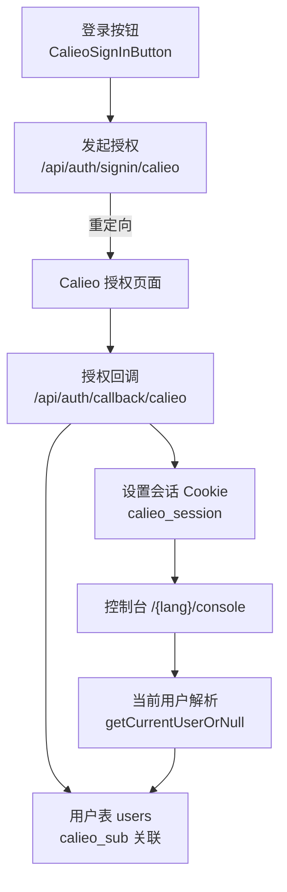
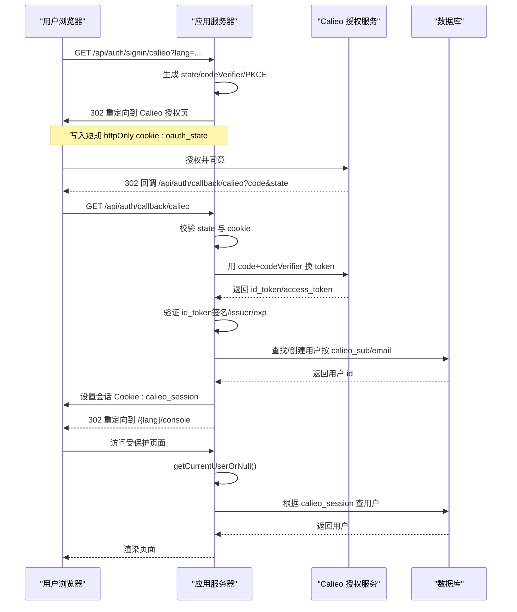
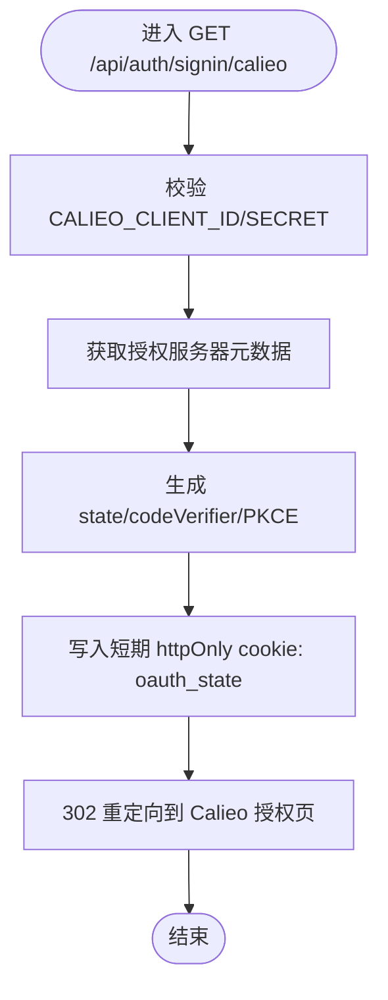
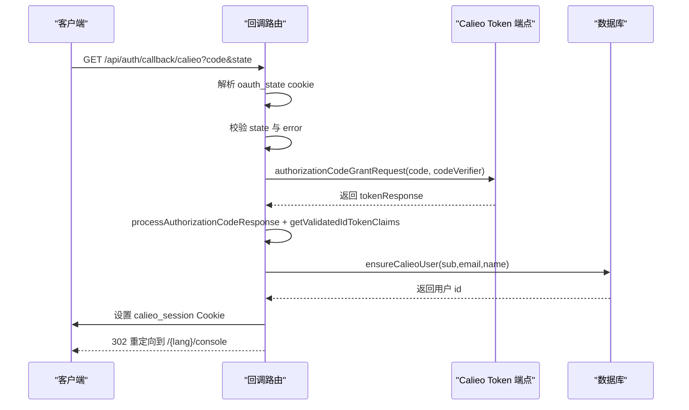
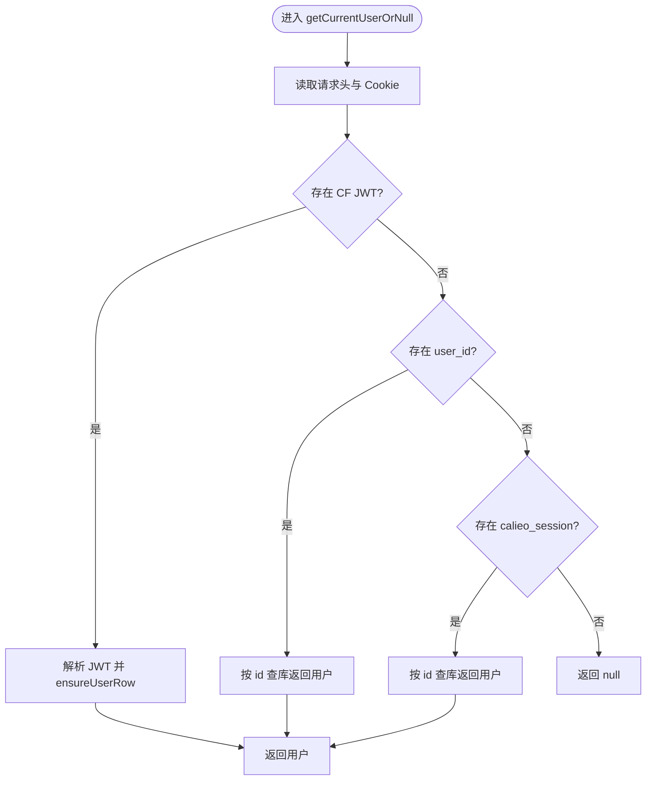
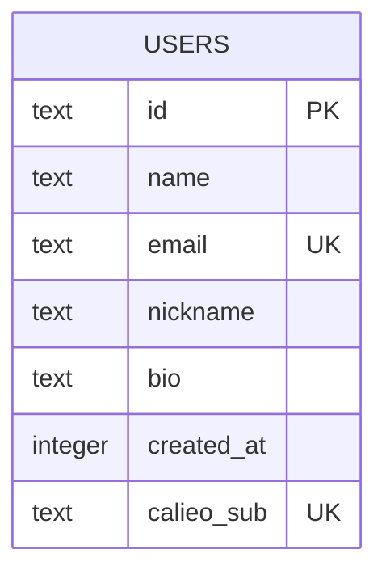
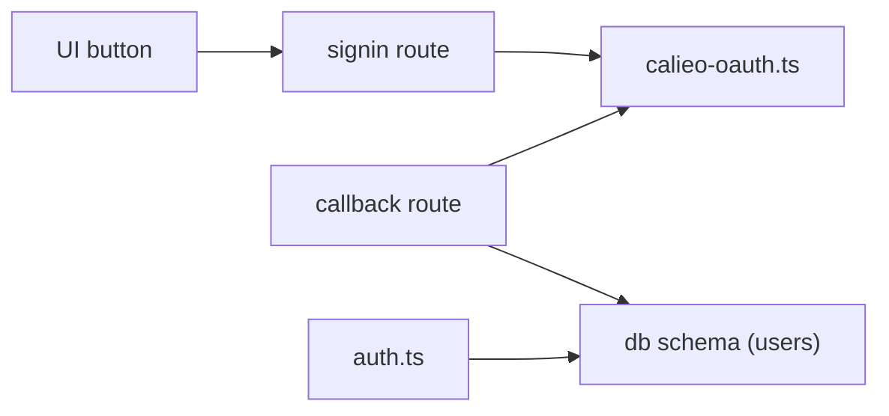

# Calieo OAuth2/OIDC 认证集成

<cite>
**本文引用的文件**
- [src/lib/auth.ts](file://src/lib/auth.ts)
- [src/lib/calieo-oauth.ts](file://src/lib/calieo-oauth.ts)
- [src/app/api/auth/signin/calieo/route.ts](file://src/app/api/auth/signin/calieo/route.ts)
- [src/app/api/auth/callback/calieo/route.ts](file://src/app/api/auth/callback/calieo/route.ts)
- [src/components/CalieoSignInButton.tsx](file://src/components/CalieoSignInButton.tsx)
- [src/app/[lang]/account/signin/page.tsx](file://src/app/[lang]/account/signin/page.tsx)
- [src/app/[lang]/account/signin/actions.ts](file://src/app/[lang]/account/signin/actions.ts)
- [src/db/schema.ts](file://src/db/schema.ts)
- [migrations/0002_gorgeous_storm.sql](file://migrations/0002_gorgeous_storm.sql)
- [specs/007-calieo-oauth2-signin/data-model.md](file://specs/007-calieo-oauth2-signin/data-model.md)
- [specs/007-calieo-oauth2-signin/contracts/callback-route.md](file://specs/007-calieo-oauth2-signin/contracts/callback-route.md)
- [specs/007-calieo-oauth2-signin/contracts/signin-route.md](file://specs/007-calieo-oauth2-signin/contracts/signin-route.md)
</cite>

## 目录
1. [简介](#简介)
2. [项目结构](#项目结构)
3. [核心组件](#核心组件)
4. [架构总览](#架构总览)
5. [详细组件分析](#详细组件分析)
6. [依赖关系分析](#依赖关系分析)
7. [性能与安全考量](#性能与安全考量)
8. [故障排查指南](#故障排查指南)
9. [结论](#结论)
10. [附录](#附录)

## 简介
本仓库实现了与 Calieo 的 OAuth2/OIDC 登录集成，采用 PKCE（S256）流程，使用 oauth4webapi 完成授权码交换、id_token 验证与用户信息提取。登录后通过 httpOnly 会话 Cookie 维持用户状态，并在后续请求中解析当前用户身份。系统同时保留开发环境的模拟登录能力，便于本地调试。

## 项目结构
围绕 Calieo OAuth2/OIDC 的关键路径如下：
- 前端入口按钮：[src/components/CalieoSignInButton.tsx](file://src/components/CalieoSignInButton.tsx)
- 发起授权：GET /api/auth/signin/calieo → [src/app/api/auth/signin/calieo/route.ts](file://src/app/api/auth/signin/calieo/route.ts)
- 授权回调：GET /api/auth/callback/calieo → [src/app/api/auth/callback/calieo/route.ts](file://src/app/api/auth/callback/calieo/route.ts)
- 认证库：PKCE、OIDC 发现、令牌交换 → [src/lib/calieo-oauth.ts](file://src/lib/calieo-oauth.ts)
- 当前用户解析：Cookie/JWT 解析与用户落库 → [src/lib/auth.ts](file://src/lib/auth.ts)
- 登录页与错误提示：[src/app/[lang]/account/signin/page.tsx](file://src/app/[lang]/account/signin/page.tsx)
- 开发环境模拟登录：[src/app/[lang]/account/signin/actions.ts](file://src/app/[lang]/account/signin/actions.ts)
- 数据模型与迁移：[src/db/schema.ts](file://src/db/schema.ts)、[migrations/0002_gorgeous_storm.sql](file://migrations/0002_gorgeous_storm.sql)
- 规范文档：data-model、signin-route、callback-route → [specs/007-calieo-oauth2-signin](file://specs/007-calieo-oauth2-signin)

图表来源
- [src/components/CalieoSignInButton.tsx:7-15](file://src/components/CalieoSignInButton.tsx#L7-L15)
- [src/app/api/auth/signin/calieo/route.ts:12-46](file://src/app/api/auth/signin/calieo/route.ts#L12-L46)
- [src/app/api/auth/callback/calieo/route.ts:50-126](file://src/app/api/auth/callback/calieo/route.ts#L50-L126)
- [src/lib/auth.ts:87-135](file://src/lib/auth.ts#L87-L135)
- [src/db/schema.ts:26-34](file://src/db/schema.ts#L26-L34)

章节来源
- [src/components/CalieoSignInButton.tsx:7-15](file://src/components/CalieoSignInButton.tsx#L7-L15)
- [src/app/api/auth/signin/calieo/route.ts:12-46](file://src/app/api/auth/signin/calieo/route.ts#L12-L46)
- [src/app/api/auth/callback/calieo/route.ts:50-126](file://src/app/api/auth/callback/calieo/route.ts#L50-L126)
- [src/lib/auth.ts:87-135](file://src/lib/auth.ts#L87-L135)
- [src/db/schema.ts:26-34](file://src/db/schema.ts#L26-L34)

## 核心组件
- 授权发起端点：生成 state、codeVerifier、PKCE challenge，写入短期 httpOnly cookie，重定向到 Calieo 授权页。
- 授权回调端点：校验 state，用 code + codeVerifier 换取 token，验证 id_token，查找或创建用户，写入长期会话 Cookie，重定向至控制台。
- 认证库：封装 OIDC 发现、客户端配置、PKCE、授权码交换与 claims 解析。
- 当前用户解析：按优先级从 CF Access JWT、开发模拟 Cookie、Calieo 会话 Cookie 解析并返回用户对象。
- 数据模型：users 表新增 calieo_sub 字段用于绑定外部 sub；会话通过 Cookie 管理。

章节来源
- [src/app/api/auth/signin/calieo/route.ts:12-46](file://src/app/api/auth/signin/calieo/route.ts#L12-L46)
- [src/app/api/auth/callback/calieo/route.ts:50-126](file://src/app/api/auth/callback/calieo/route.ts#L50-L126)
- [src/lib/calieo-oauth.ts:8-95](file://src/lib/calieo-oauth.ts#L8-L95)
- [src/lib/auth.ts:87-135](file://src/lib/auth.ts#L87-L135)
- [src/db/schema.ts:26-34](file://src/db/schema.ts#L26-L34)

## 架构总览
下图展示了从点击“使用 Calieo 登录”到进入控制台的完整调用链，包括安全参数传递、令牌交换与会话建立。

图表来源
- [src/app/api/auth/signin/calieo/route.ts:12-46](file://src/app/api/auth/signin/calieo/route.ts#L12-L46)
- [src/app/api/auth/callback/calieo/route.ts:50-126](file://src/app/api/auth/callback/calieo/route.ts#L50-L126)
- [src/lib/calieo-oauth.ts:8-95](file://src/lib/calieo-oauth.ts#L8-L95)
- [src/lib/auth.ts:87-135](file://src/lib/auth.ts#L87-L135)
- [src/db/schema.ts:26-34](file://src/db/schema.ts#L26-L34)

## 详细组件分析

### 授权发起端点：/api/auth/signin/calieo
- 职责：校验环境变量、获取授权服务器元数据、生成 state/codeVerifier/PKCE challenge、写入短期 httpOnly cookie、重定向到 Calieo 授权页。
- 关键要点：
  - 使用 oauth4webapi 生成安全的随机 state 与 codeVerifier，并通过 S256 计算 challenge。
  - 将 state、codeVerifier、语言代码以固定格式存入短期 cookie，便于回调时校验。
  - 生产环境启用 secure 标志，确保仅 HTTPS 传输。

图表来源
- [src/app/api/auth/signin/calieo/route.ts:12-46](file://src/app/api/auth/signin/calieo/route.ts#L12-L46)
- [src/lib/calieo-oauth.ts:8-49](file://src/lib/calieo-oauth.ts#L8-L49)

章节来源
- [src/app/api/auth/signin/calieo/route.ts:12-46](file://src/app/api/auth/signin/calieo/route.ts#L12-L46)
- [specs/007-calieo-oauth2-signin/contracts/signin-route.md:1-66](file://specs/007-calieo-oauth2-signin/contracts/signin-route.md#L1-L66)

### 授权回调端点：/api/auth/callback/calieo
- 职责：校验 state、处理 provider 错误、用 code 换 token、验证 id_token、查找或创建用户、写入会话 Cookie、重定向控制台。
- 关键要点：
  - 严格校验 state 防 CSRF，失败立即清除临时 cookie 并重定向错误。
  - 使用 oauth4webapi 进行授权码交换与 id_token 验证（签名、issuer、audience、exp）。
  - 用户匹配策略：优先按 calieo_sub，其次按 email 并回填 sub，最后新建用户。
  - 成功后清除临时 cookie，写入长期 httpOnly 会话 Cookie（30 天），并跳转控制台。

图表来源
- [src/app/api/auth/callback/calieo/route.ts:50-126](file://src/app/api/auth/callback/calieo/route.ts#L50-L126)
- [src/lib/calieo-oauth.ts:57-95](file://src/lib/calieo-oauth.ts#L57-L95)
- [src/db/schema.ts:26-34](file://src/db/schema.ts#L26-L34)

章节来源
- [src/app/api/auth/callback/calieo/route.ts:50-126](file://src/app/api/auth/callback/calieo/route.ts#L50-L126)
- [specs/007-calieo-oauth2-signin/contracts/callback-route.md:1-117](file://specs/007-calieo-oauth2-signin/contracts/callback-route.md#L1-L117)

### 当前用户解析：getCurrentUserOrNull / getCurrentUser
- 职责：按优先级解析当前用户身份，支持 CF Access JWT、开发模拟登录、Calieo 会话三种方式。
- 关键要点：
  - 优先读取 cf-access-jwt-assertion 或 CF_Authorization cookie，解析 Cloudflare Identity JWT 并落库。
  - 若不存在，则尝试 user_id（开发模拟）与 calieo_session（生产会话）两种 Cookie。
  - 成功解析后统一返回 CurrentUser 对象，供页面与服务端逻辑使用。

图表来源
- [src/lib/auth.ts:87-135](file://src/lib/auth.ts#L87-L135)

章节来源
- [src/lib/auth.ts:87-135](file://src/lib/auth.ts#L87-L135)

### 数据模型与迁移
- users 表新增 calieo_sub 字段，唯一约束，用于绑定外部 sub。
- 迁移文件已提供，执行后可在 SQLite 中生效。

图表来源
- [src/db/schema.ts:26-34](file://src/db/schema.ts#L26-L34)
- [migrations/0002_gorgeous_storm.sql:1-2](file://migrations/0002_gorgeous_storm.sql#L1-L2)

章节来源
- [src/db/schema.ts:26-34](file://src/db/schema.ts#L26-L34)
- [migrations/0002_gorgeous_storm.sql:1-2](file://migrations/0002_gorgeous_storm.sql#L1-L2)
- [specs/007-calieo-oauth2-signin/data-model.md:7-57](file://specs/007-calieo-oauth2-signin/data-model.md#L7-L57)

### 前端登录按钮与登录页
- 登录按钮：跳转到 /api/auth/signin/calieo?lang=...，携带语言参数。
- 登录页：展示错误消息映射，生产环境隐藏开发模拟登录表单，始终显示 Calieo 登录按钮。

章节来源
- [src/components/CalieoSignInButton.tsx:7-15](file://src/components/CalieoSignInButton.tsx#L7-L15)
- [src/app/[lang]/account/signin/page.tsx:11-61](file://src/app/[lang]/account/signin/page.tsx#L11-L61)

### 开发环境模拟登录
- 通过邮箱匹配已有用户或新建用户，写入 user_id Cookie，并跳转控制台。
- 该模式仅在非生产环境显示，避免在生产误用。

章节来源
- [src/app/[lang]/account/signin/actions.ts:16-51](file://src/app/[lang]/account/signin/actions.ts#L16-L51)

## 依赖关系分析
- 授权发起与回调均依赖 oauth4webapi 提供的 OIDC 工具函数，确保符合标准且安全。
- 回调端点依赖数据库操作（Drizzle ORM）进行用户查找/创建与会话持久化。
- 当前用户解析依赖 Next.js headers/cookies API 与 Drizzle ORM。
- 环境变量：CALIEO_CLIENT_ID、CALIEO_CLIENT_SECRET、BASE_URL 等必须正确配置。

图表来源
- [src/app/api/auth/signin/calieo/route.ts:12-46](file://src/app/api/auth/signin/calieo/route.ts#L12-L46)
- [src/app/api/auth/callback/calieo/route.ts:50-126](file://src/app/api/auth/callback/calieo/route.ts#L50-L126)
- [src/lib/calieo-oauth.ts:8-95](file://src/lib/calieo-oauth.ts#L8-L95)
- [src/lib/auth.ts:87-135](file://src/lib/auth.ts#L87-L135)
- [src/db/schema.ts:26-34](file://src/db/schema.ts#L26-L34)

章节来源
- [src/app/api/auth/signin/calieo/route.ts:12-46](file://src/app/api/auth/signin/calieo/route.ts#L12-L46)
- [src/app/api/auth/callback/calieo/route.ts:50-126](file://src/app/api/auth/callback/calieo/route.ts#L50-L126)
- [src/lib/calieo-oauth.ts:8-95](file://src/lib/calieo-oauth.ts#L8-L95)
- [src/lib/auth.ts:87-135](file://src/lib/auth.ts#L87-L135)
- [src/db/schema.ts:26-34](file://src/db/schema.ts#L26-L34)

## 性能与安全考量
- 性能
  - 授权服务器元数据缓存于进程级变量，减少冷启动开销。
  - 会话使用 httpOnly Cookie，服务端无需额外鉴权中间件，降低请求延迟。
  - 用户查找/创建采用最小查询与冲突忽略策略，避免重复插入。
- 安全
  - 使用 PKCE S256 防止授权码拦截。
  - state 校验与临时 cookie 立即清除，防止 CSRF 与重放攻击。
  - id_token 由 oauth4webapi 自动验证签名、issuer、audience、exp。
  - 会话 Cookie 设置 HttpOnly、SameSite=Lax，生产环境启用 Secure。
  - 错误路径不泄露敏感信息，统一重定向到登录页并附带错误码。

[本节为通用指导，不直接分析具体文件]

## 故障排查指南
- 常见错误码与含义
  - invalid_state：state 不匹配或过期，检查 oauth_state cookie 是否被清理或跨域丢失。
  - token_invalid：id_token 验证失败，检查 issuer、audience、签名与有效期。
  - missing_claims：缺少必要 claims（如 email），检查 Calieo 返回的 claims。
  - access_denied：用户取消授权，引导重新发起登录。
- 排查步骤
  - 确认环境变量 CALIEO_CLIENT_ID、CALIEO_CLIENT_SECRET、BASE_URL 配置正确。
  - 检查回调 URL 是否与 Calieo 注册一致（含协议与域名）。
  - 查看浏览器网络面板，确认 state、code 是否正确传递。
  - 检查 Cookie 属性（HttpOnly、SameSite、Secure）是否符合预期。
  - 若出现数据库相关错误，检查 users 表结构与迁移是否已执行。

章节来源
- [src/app/api/auth/callback/calieo/route.ts:56-124](file://src/app/api/auth/callback/calieo/route.ts#L56-L124)
- [src/app/[lang]/account/signin/page.tsx:11-17](file://src/app/[lang]/account/signin/page.tsx#L11-L17)
- [specs/007-calieo-oauth2-signin/contracts/callback-route.md:102-117](file://specs/007-calieo-oauth2-signin/contracts/callback-route.md#L102-L117)

## 结论
本项目基于标准 OAuth2/OIDC 与 PKCE 实现与 Calieo 的安全集成，具备完善的错误处理、会话管理与可维护的数据模型。通过短期临时 Cookie 与长期会话 Cookie 的组合，既保证了安全性又提升了用户体验。建议在部署前严格校验环境变量与回调地址，并确保迁移文件正确执行。

[本节为总结性内容，不直接分析具体文件]

## 附录
- 环境变量清单
  - CALIEO_CLIENT_ID：Calieo 客户端 ID
  - CALIEO_CLIENT_SECRET：Calieo 客户端密钥
  - BASE_URL：应用基础地址，用于构建 redirect_uri
- 相关规范
  - 数据模型：[specs/007-calieo-oauth2-signin/data-model.md](file://specs/007-calieo-oauth2-signin/data-model.md)
  - 发起授权合约：[specs/007-calieo-oauth2-signin/contracts/signin-route.md](file://specs/007-calieo-oauth2-signin/contracts/signin-route.md)
  - 回调合约：[specs/007-calieo-oauth2-signin/contracts/callback-route.md](file://specs/007-calieo-oauth2-signin/contracts/callback-route.md)

[本节为补充信息，不直接分析具体文件]