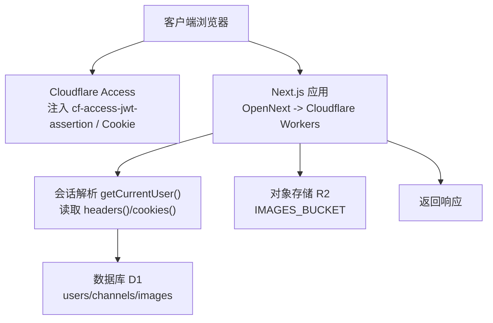
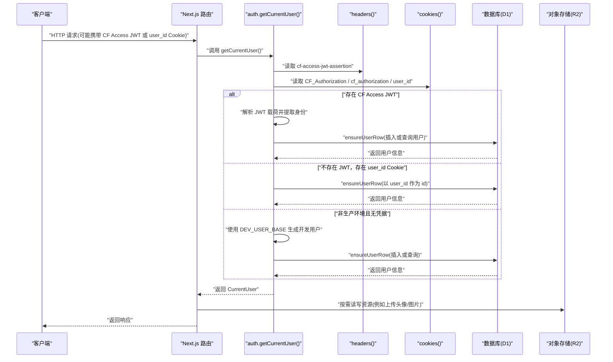
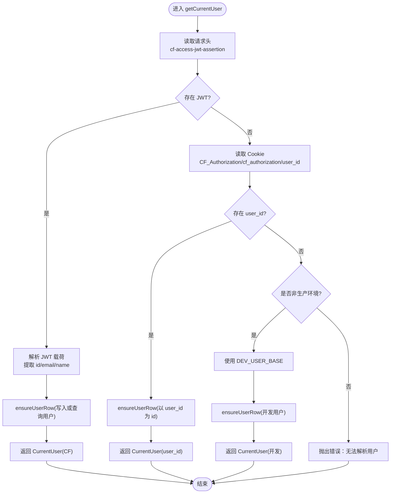
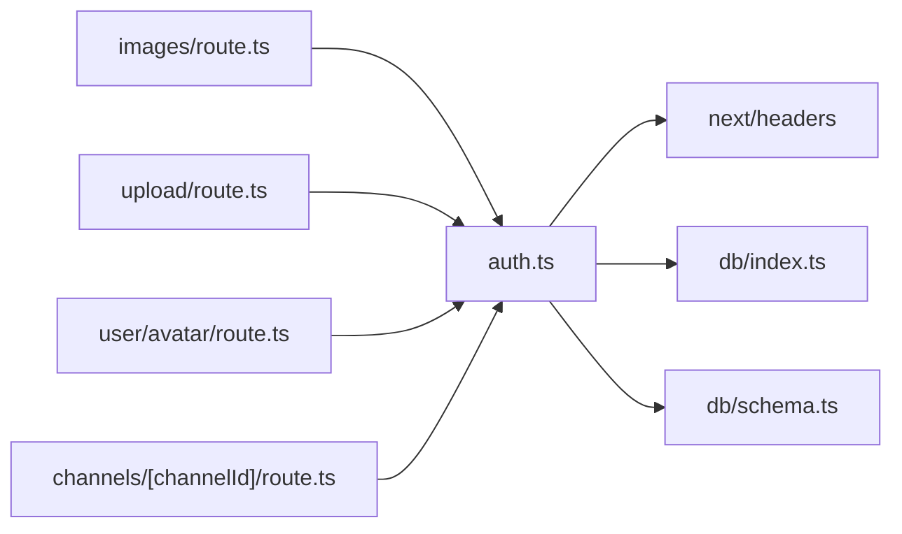
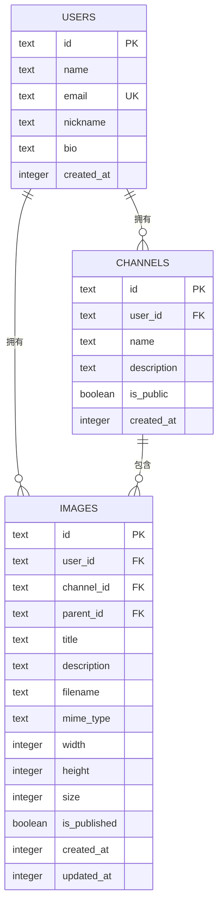

# 会话处理机制

<cite>
**本文引用的文件**
- [src/lib/auth.ts](file://src/lib/auth.ts)
- [src/app/api/user/profile/route.ts](file://src/app/api/user/profile/route.ts)
- [src/app/api/user/avatar/route.ts](file://src/app/api/user/avatar/route.ts)
- [src/app/api/channels/[channelId]/route.ts](file://src/app/api/channels/[channelId]/route.ts)
- [src/app/api/images/route.ts](file://src/app/api/images/route.ts)
- [src/app/api/upload/route.ts](file://src/app/api/upload/route.ts)
- [src/db/schema.ts](file://src/db/schema.ts)
- [wrangler.jsonc](file://wrangler.jsonc)
- [package.json](file://package.json)
</cite>

## 目录
1. [简介](#简介)
2. [项目结构](#项目结构)
3. [核心组件](#核心组件)
4. [架构总览](#架构总览)
5. [详细组件分析](#详细组件分析)
6. [依赖关系分析](#依赖关系分析)
7. [性能考量](#性能考量)
8. [故障排查指南](#故障排查指南)
9. [结论](#结论)
10. [附录](#附录)

## 简介
本文件系统化梳理 Weable 应用的会话处理机制，重点说明：
- Next.js cookies API 的使用方式与 cookieStore.get() 的调用模式
- 不同认证源的会话存储策略：Cloudflare Access JWT（请求头与特定 Cookie）与传统 user_id Cookie
- 会话生命周期管理：创建、验证、清理
- 开发环境与生产环境的差异
- 在无服务器环境（Cloudflare Workers/OpenNext）中维护用户状态的方法
- 会话调试与故障排查最佳实践

## 项目结构
与会话处理直接相关的代码主要分布在以下位置：
- 认证与会话解析：src/lib/auth.ts
- 使用会话的 API 路由：src/app/api/*（如 images、upload、user 等）
- 数据模型：src/db/schema.ts（users、channels、images）
- 部署配置：wrangler.jsonc（D1/R2/Assets）
- 运行环境与依赖：package.json（Next.js、OpenNext Cloudflare 适配器）

图表来源
- [src/lib/auth.ts:93-117](file://src/lib/auth.ts#L93-L117)
- [wrangler.jsonc:16-32](file://wrangler.jsonc#L16-L32)

章节来源
- [src/lib/auth.ts:93-117](file://src/lib/auth.ts#L93-L117)
- [wrangler.jsonc:16-32](file://wrangler.jsonc#L16-L32)

## 核心组件
- 会话解析器 getCurrentUser()
  - 从请求头与 Cookie 中获取认证凭据
  - 优先解析 Cloudflare Access JWT；失败则回退到 user_id Cookie
  - 非生产环境提供开发用户兜底
  - 最终通过 ensureUserRow() 确保用户记录存在并返回当前用户信息

- 数据模型 users
  - 用于持久化用户标识与基本信息，供后续资源访问控制使用

章节来源
- [src/lib/auth.ts:93-117](file://src/lib/auth.ts#L93-L117)
- [src/db/schema.ts:26-33](file://src/db/schema.ts#L26-L33)

## 架构总览
下图展示了从客户端请求到会话解析、再到数据与存储访问的整体流程。

图表来源
- [src/lib/auth.ts:93-117](file://src/lib/auth.ts#L93-L117)
- [src/app/api/upload/route.ts:14-74](file://src/app/api/upload/route.ts#L14-L74)

## 详细组件分析

### 会话解析器 getCurrentUser()
- 输入来源优先级
  1) 请求头 cf-access-jwt-assertion
  2) Cookie CF_Authorization
  3) Cookie cf_authorization
  4) Cookie user_id（传统认证）
  5) 非生产环境下的开发用户兜底
- 输出
  - 始终返回一个包含 id/name/email/nickname/bio 的 CurrentUser 对象
- 关键行为
  - 对 JWT 进行 Base64Url 解码与 JSON 解析，提取 sub/email/name 等字段
  - 使用 ensureUserRow() 保证用户记录存在，避免重复写入
  - 生产环境若无任何有效凭据，抛出错误

图表来源
- [src/lib/auth.ts:93-117](file://src/lib/auth.ts#L93-L117)

章节来源
- [src/lib/auth.ts:93-117](file://src/lib/auth.ts#L93-L117)

### Next.js cookies API 使用模式
- 获取 Cookie Store
  - 在 Server Components 或 API Route 中通过 await cookies() 获取 cookieStore
- 读取单个 Cookie
  - 使用 cookieStore.get("name")?.value 安全取值
- 典型用法
  - 读取 CF_Authorization、cf_authorization、user_id
- 注意
  - 在 OpenNext/Workers 环境中，Cookie 由运行时注入或透传，需确保名称一致
  - 避免直接操作未经验证的 Cookie 值，应配合业务校验

章节来源
- [src/lib/auth.ts:94-110](file://src/lib/auth.ts#L94-L110)

### Cloudflare Access JWT 会话策略
- 来源
  - 请求头 cf-access-jwt-assertion
  - Cookie CF_Authorization 或 cf_authorization
- 解析
  - 将 JWT 载荷进行 Base64Url 解码，提取 sub、email、name/preferred_username/common_name
- 落库
  - ensureUserRow() 保证用户记录存在，避免重复写入
- 适用场景
  - 企业级访问控制、统一身份认证

章节来源
- [src/lib/auth.ts:64-78](file://src/lib/auth.ts#L64-L78)
- [src/lib/auth.ts:97-105](file://src/lib/auth.ts#L97-L105)

### 传统认证 user_id Cookie 策略
- 来源
  - Cookie user_id
- 解析
  - 直接使用 user_id 作为用户标识，邮箱构造为 user_id@local
- 适用场景
  - 简单本地测试或内部工具

章节来源
- [src/lib/auth.ts:107-110](file://src/lib/auth.ts#L107-L110)

### 开发环境与生产环境差异
- 开发环境
  - 若未检测到任何凭据，自动使用 DEV_USER_BASE（可通过环境变量覆盖）
- 生产环境
  - 必须提供有效的 CF Access JWT 或 user_id Cookie，否则抛出错误
- 建议
  - 在生产禁用开发兜底，避免误用

章节来源
- [src/lib/auth.ts:112-117](file://src/lib/auth.ts#L112-L117)

### 无服务器环境中的用户状态维护
- 运行时
  - OpenNext 将 Next.js 应用编译为 Cloudflare Workers 入口
  - 每个请求独立执行，状态不跨请求保留
- 状态保持
  - 通过 Cookie/请求头传递会话标识（CF Access JWT 或 user_id）
  - 服务端每次请求重新解析并落库确保用户存在
- 存储
  - 数据库：D1（SQLite）
  - 对象存储：R2（IMAGES_BUCKET）

章节来源
- [wrangler.jsonc:16-32](file://wrangler.jsonc#L16-L32)
- [package.json:12-18](file://package.json#L12-L18)

### API 路由中的会话使用示例
- 图片列表 GET /api/images
  - 调用 getCurrentUser() 获取用户，按 userId 过滤资源
- 上传 POST /api/upload
  - 调用 getCurrentUser() 鉴权后写入 R2 与数据库
- 头像上传 POST /api/user/avatar
  - 调用 getCurrentUser() 鉴权后保存头像至 R2
- 频道删除 DELETE /api/channels/[channelId]
  - 调用 getCurrentUser() 鉴权并校验归属

章节来源
- [src/app/api/images/route.ts:9-11](file://src/app/api/images/route.ts#L9-L11)
- [src/app/api/upload/route.ts:14-16](file://src/app/api/upload/route.ts#L14-L16)
- [src/app/api/user/avatar/route.ts:10-11](file://src/app/api/user/avatar/route.ts#L10-L11)
- [src/app/api/channels/[channelId]/route.ts:18](file://src/app/api/channels/[channelId]/route.ts#L18)

## 依赖关系分析
- auth.ts 依赖
  - next/headers：读取请求头与 Cookie
  - drizzle-orm：数据库操作
  - db/index：获取数据库实例
  - db/schema：用户表结构
- API 路由依赖
  - 均依赖 getCurrentUser() 进行鉴权
  - 部分路由依赖 storage（R2）进行文件存取

图表来源
- [src/lib/auth.ts:1-6](file://src/lib/auth.ts#L1-L6)
- [src/app/api/images/route.ts:1-5](file://src/app/api/images/route.ts#L1-L5)
- [src/app/api/upload/route.ts:1-6](file://src/app/api/upload/route.ts#L1-L6)
- [src/app/api/user/avatar/route.ts:1-4](file://src/app/api/user/avatar/route.ts#L1-L4)
- [src/app/api/channels/[channelId]/route.ts:1-5](file://src/app/api/channels/[channelId]/route.ts#L1-L5)

章节来源
- [src/lib/auth.ts:1-6](file://src/lib/auth.ts#L1-L6)

## 性能考量
- 减少不必要的数据库写入
  - ensureUserRow() 使用 onConflictDoNothing，避免重复插入
- 最小化请求开销
  - 仅在需要时读取 Cookie/请求头，避免冗余解析
- 缓存策略
  - 可在上层对只读数据进行短期缓存（如用户资料），但需注意一致性
- 大文件上传
  - 限制文件大小与类型，避免内存峰值过高

[本节为通用指导，无需引用具体文件]

## 故障排查指南
- 常见问题
  - 未解析到用户：检查请求是否携带 cf-access-jwt-assertion、CF_Authorization/cf_authorization 或 user_id
  - 开发环境异常：确认 NODE_ENV 是否为 production，必要时设置 DEV_USER_* 环境变量
  - 上传失败：检查文件格式、大小限制与 R2 绑定是否正确
- 定位步骤
  - 在 API 路由中打印请求头与 Cookie 的关键字段
  - 检查 D1 中是否存在对应用户记录
  - 检查 R2 桶名与绑定名称是否符合 wrangler.jsonc 配置
- 日志与监控
  - 启用 Wrangler 可观测性，收集请求链路日志

章节来源
- [src/lib/auth.ts:93-117](file://src/lib/auth.ts#L93-L117)
- [wrangler.jsonc:6-11](file://wrangler.jsonc#L6-L11)

## 结论
Weable 的会话处理以 getCurrentUser() 为核心，统一了 Cloudflare Access JWT 与传统 user_id Cookie 两种认证源，并通过 ensureUserRow() 保证用户记录存在。该设计适配无服务器环境，每次请求独立解析会话，结合 D1 与 R2 实现稳定的用户状态与资源管理。建议在开发阶段充分利用开发用户兜底，在生产严格依赖外部认证或明确的 session cookie，并完善日志与监控以便快速定位问题。

[本节为总结，无需引用具体文件]

## 附录

### 会话生命周期管理
- 创建
  - 首次访问时，根据传入的 CF Access JWT 或 user_id Cookie 创建/确保用户记录
- 验证
  - 每次请求通过 getCurrentUser() 重新解析并验证凭据
- 清理
  - 会话本身无服务端持久状态；如需登出，前端清除相关 Cookie 或依赖 CF Access 的会话过期策略

章节来源
- [src/lib/auth.ts:93-117](file://src/lib/auth.ts#L93-L117)

### 数据模型概览

图表来源
- [src/db/schema.ts:26-69](file://src/db/schema.ts#L26-L69)