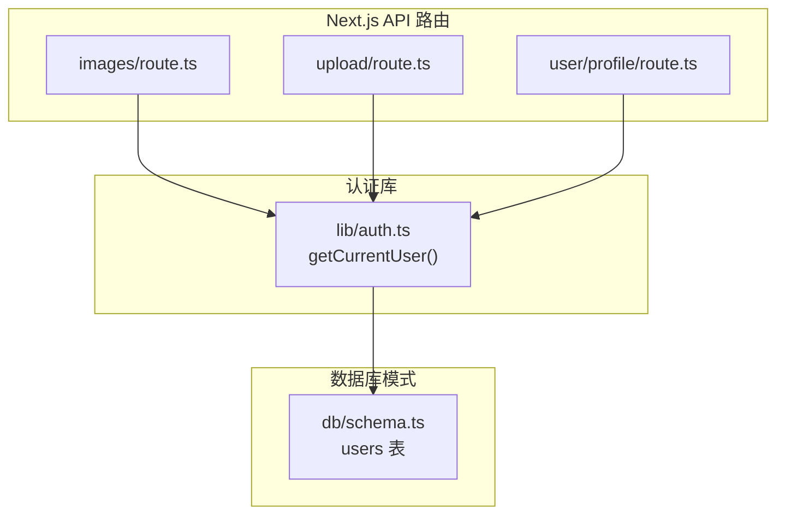
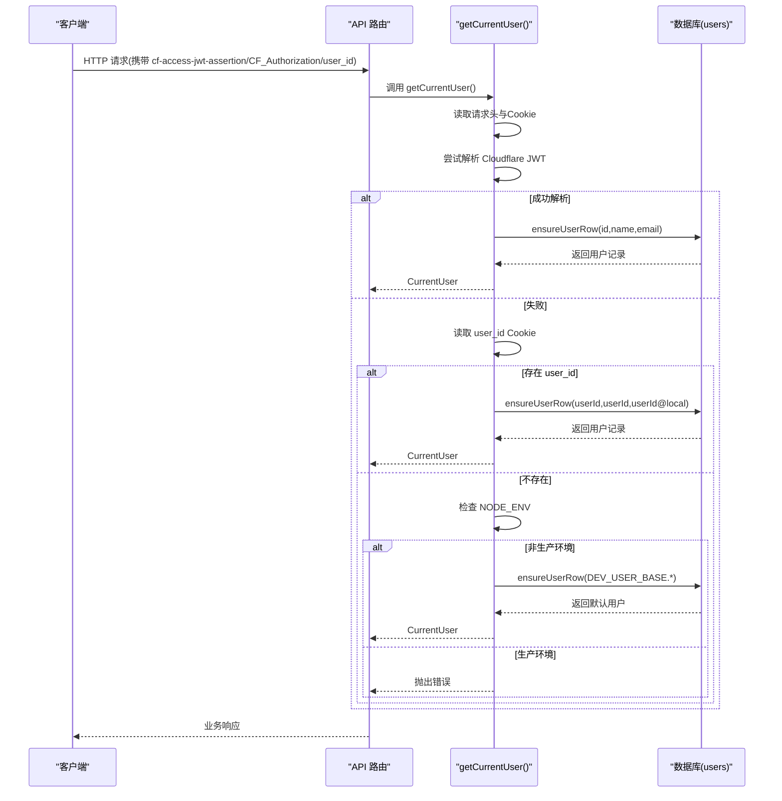
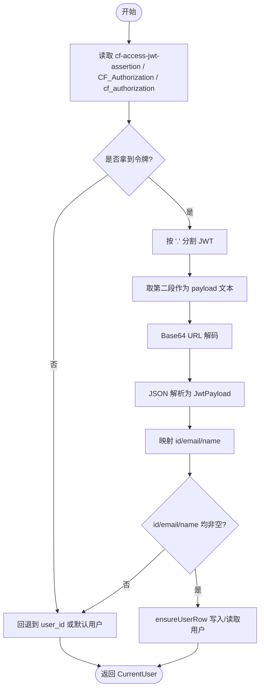
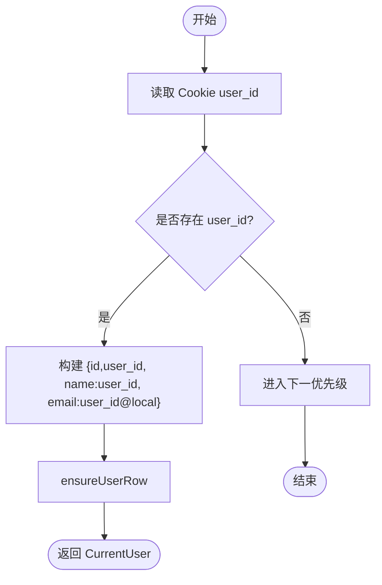
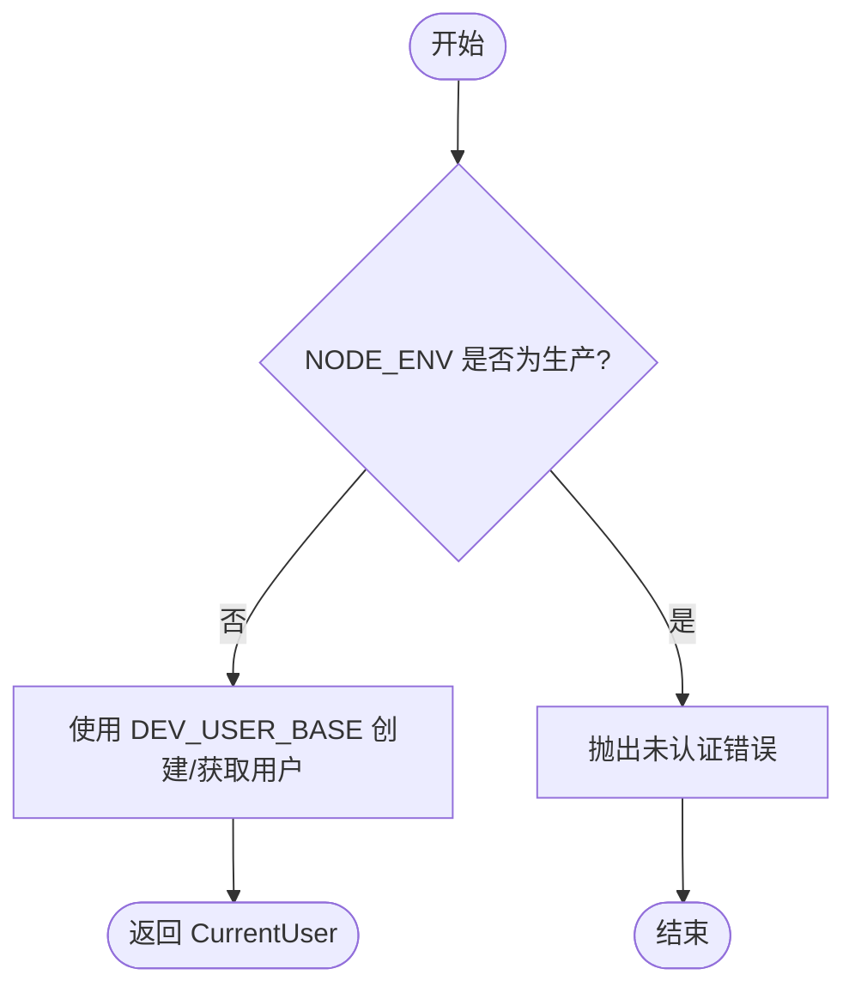
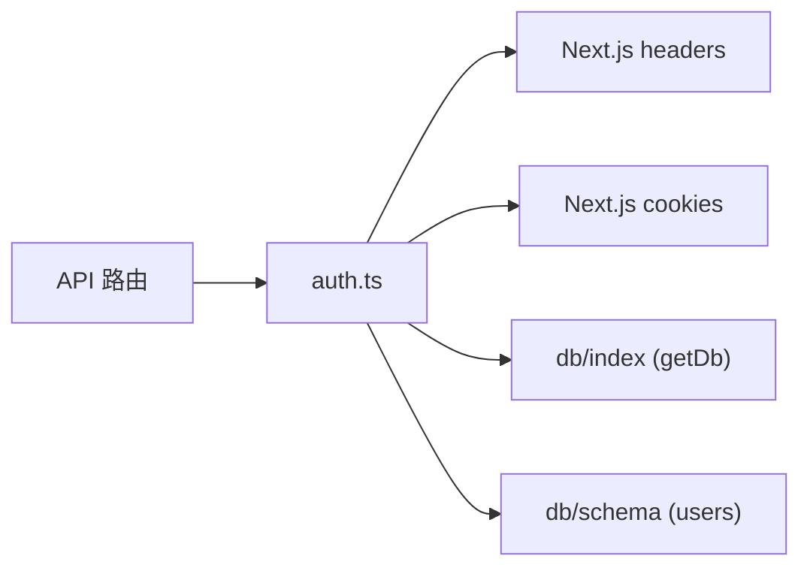
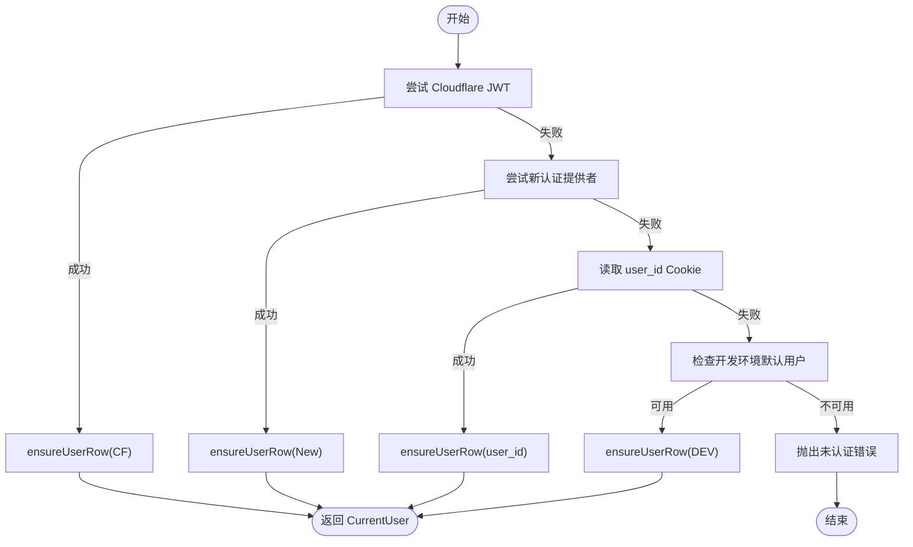

# 多源认证机制

<cite>
**本文引用的文件**   
- [src/lib/auth.ts](file://src/lib/auth.ts)
- [src/db/schema.ts](file://src/db/schema.ts)
- [src/app/api/user/profile/route.ts](file://src/app/api/user/profile/route.ts)
- [src/app/api/images/route.ts](file://src/app/api/images/route.ts)
- [src/app/api/upload/route.ts](file://src/app/api/upload/route.ts)
- [wrangler.jsonc](file://wrangler.jsonc)
</cite>

## 目录
1. [简介](#简介)
2. [项目结构](#项目结构)
3. [核心组件](#核心组件)
4. [架构总览](#架构总览)
5. [详细组件分析](#详细组件分析)
6. [依赖关系分析](#依赖关系分析)
7. [性能考量](#性能考量)
8. [故障排查指南](#故障排查指南)
9. [结论](#结论)
10. [附录：集成新认证提供者示例](#附录：集成新认证提供者示例)

## 简介
本文件系统化梳理 Weable 应用的多源认证机制，重点解释 Cloudflare Access JWT 认证与传统 Cookie 认证的实现原理与优先级策略。文档涵盖以下关键点：
- Cloudflare Identity 的获取与解析（cf-access-jwt-assertion 头或 CF_Authorization/cf_authorization cookie）
- Base64 URL 解码与 JWT Payload 解析
- 用户信息映射到内部 CurrentUser
- 回退策略：user_id cookie → 开发环境默认用户
- 错误处理与边界情况
- 如何在 API 路由中集成并扩展新的认证提供者

## 项目结构
认证相关代码集中在服务端库与数据模型层，API 路由通过统一的认证入口获取当前用户。

图表来源
- [src/app/api/images/route.ts:1-66](file://src/app/api/images/route.ts#L1-L66)
- [src/app/api/upload/route.ts:1-75](file://src/app/api/upload/route.ts#L1-L75)
- [src/app/api/user/profile/route.ts:1-31](file://src/app/api/user/profile/route.ts#L1-L31)
- [src/lib/auth.ts:1-118](file://src/lib/auth.ts#L1-L118)
- [src/db/schema.ts:26-33](file://src/db/schema.ts#L26-L33)

章节来源
- [src/lib/auth.ts:1-118](file://src/lib/auth.ts#L1-L118)
- [src/db/schema.ts:26-33](file://src/db/schema.ts#L26-L33)

## 核心组件
- 当前用户接口与类型定义：CurrentUser
- Cloudflare Access JWT 解析：Base64 URL 解码、Payload 解析、字段映射
- 用户行保障：ensureUserRow（幂等插入 + 查询）
- 统一入口：getCurrentUser（按优先级解析身份）

章节来源
- [src/lib/auth.ts:7-13](file://src/lib/auth.ts#L7-L13)
- [src/lib/auth.ts:29-56](file://src/lib/auth.ts#L29-L56)
- [src/lib/auth.ts:64-78](file://src/lib/auth.ts#L64-L78)
- [src/lib/auth.ts:80-91](file://src/lib/auth.ts#L80-L91)
- [src/lib/auth.ts:93-117](file://src/lib/auth.ts#L93-L117)

## 架构总览
下图展示了请求进入 API 路由后，如何通过 getCurrentUser 完成多源认证，并最终落到数据库中的 users 表。

图表来源
- [src/lib/auth.ts:93-117](file://src/lib/auth.ts#L93-L117)
- [src/lib/auth.ts:80-91](file://src/lib/auth.ts#L80-L91)
- [src/db/schema.ts:26-33](file://src/db/schema.ts#L26-L33)

## 详细组件分析

### 1) Cloudflare Access JWT 认证
- 令牌来源优先级：
  - 请求头 cf-access-jwt-assertion
  - Cookie CF_Authorization
  - Cookie cf_authorization
- 解析流程：
  - 将 JWT 按点号分割，取第二段为 payload
  - Base64 URL 解码（支持 Buffer 与 atob）
  - JSON 反序列化为 JwtPayload
  - 提取 id/email/name（name 优先 name/preferred_username/common_name，否则回退 email）
- 校验规则：
  - id、email、name 必须为非空字符串
  - 任一缺失则视为无效，继续回退流程

图表来源
- [src/lib/auth.ts:97-105](file://src/lib/auth.ts#L97-L105)
- [src/lib/auth.ts:46-56](file://src/lib/auth.ts#L46-L56)
- [src/lib/auth.ts:29-44](file://src/lib/auth.ts#L29-L44)
- [src/lib/auth.ts:64-78](file://src/lib/auth.ts#L64-L78)

章节来源
- [src/lib/auth.ts:97-105](file://src/lib/auth.ts#L97-L105)
- [src/lib/auth.ts:46-56](file://src/lib/auth.ts#L46-L56)
- [src/lib/auth.ts:29-44](file://src/lib/auth.ts#L29-L44)
- [src/lib/auth.ts:64-78](file://src/lib/auth.ts#L64-L78)

### 2) 传统 Cookie 认证（user_id）
- 当 Cloudflare JWT 不可用时，从 Cookie 中读取 user_id
- 若存在，则以 user_id 作为 id/name，email 构造为 user_id@local
- 随后调用 ensureUserRow 确保用户记录存在并返回

图表来源
- [src/lib/auth.ts:107-110](file://src/lib/auth.ts#L107-L110)

章节来源
- [src/lib/auth.ts:107-110](file://src/lib/auth.ts#L107-L110)

### 3) 开发环境默认用户
- 当以上两种来源均不可用时，在非生产环境使用 DEV_USER_BASE
- 默认值来自环境变量 DEV_USER_ID、DEV_USER_NAME、DEV_USER_EMAIL，并提供合理默认值
- 用于本地开发与调试，避免阻塞功能验证

图表来源
- [src/lib/auth.ts:112-114](file://src/lib/auth.ts#L112-L114)
- [src/lib/auth.ts:15-19](file://src/lib/auth.ts#L15-L19)

章节来源
- [src/lib/auth.ts:112-114](file://src/lib/auth.ts#L112-L114)
- [src/lib/auth.ts:15-19](file://src/lib/auth.ts#L15-L19)

### 4) 用户信息映射与持久化
- ensureUserRow 保证用户记录存在：
  - 先执行“插入或忽略”操作，避免重复写入
  - 再按 id 查询返回完整用户信息（包含 nickname、bio）
- 该设计简化了首次登录的用户初始化逻辑

图表来源
- [src/lib/auth.ts:80-91](file://src/lib/auth.ts#L80-L91)

章节来源
- [src/lib/auth.ts:80-91](file://src/lib/auth.ts#L80-L91)

### 5) API 路由中的认证使用
- 所有需要鉴权的 API 路由在入口处调用 getCurrentUser()
- 典型用法：
  - 读取当前用户
  - 基于 user.id 进行数据权限过滤
  - 对输入参数进行校验与更新

示例路径参考：
- [src/app/api/images/route.ts:10](file://src/app/api/images/route.ts#L10)
- [src/app/api/upload/route.ts:15](file://src/app/api/upload/route.ts#L15)
- [src/app/api/user/profile/route.ts:10](file://src/app/api/user/profile/route.ts#L10)

章节来源
- [src/app/api/images/route.ts:1-66](file://src/app/api/images/route.ts#L1-L66)
- [src/app/api/upload/route.ts:1-75](file://src/app/api/upload/route.ts#L1-L75)
- [src/app/api/user/profile/route.ts:1-31](file://src/app/api/user/profile/route.ts#L1-L31)

## 依赖关系分析
- 认证库依赖 Next.js headers/cookies API 获取请求上下文
- 依赖 Drizzle ORM 访问数据库（getDb、users schema）
- 运行时环境由 OpenNext/Wrangler 提供 Node.js 兼容层

图表来源
- [src/lib/auth.ts:1-5](file://src/lib/auth.ts#L1-L5)
- [src/db/schema.ts:26-33](file://src/db/schema.ts#L26-L33)
- [wrangler.jsonc:1-34](file://wrangler.jsonc#L1-L34)

章节来源
- [src/lib/auth.ts:1-5](file://src/lib/auth.ts#L1-L5)
- [wrangler.jsonc:1-34](file://wrangler.jsonc#L1-L34)

## 性能考量
- Base64 URL 解码与 JSON 解析均为轻量操作，开销可忽略
- ensureUserRow 采用“插入或忽略 + 单条查询”，避免重复写入与额外事务
- 建议在高频路径上复用已解析的 CurrentUser（例如中间件或页面级缓存），减少重复解析与数据库访问
- 在生产环境中，建议结合 Cloudflare 侧的会话管理优化 Cookie 大小与传输频率

[本节为通用指导，不直接分析具体文件]

## 故障排查指南
- 常见错误：
  - 无法解析 JWT：检查 cf-access-jwt-assertion 头或 CF_Authorization/cf_authorization cookie 是否正确传递
  - 缺少必要字段：确认 JWT payload 中包含 sub、email、name/preferred_username/common_name
  - 无可用身份：生产环境下既无 Cloudflare JWT 也无 user_id 会抛出错误
- 定位方法：
  - 在 API 路由中打印或记录 headers/cookies 的关键键值
  - 检查 NODE_ENV 是否为 production
  - 确认数据库连接与 users 表结构正确

章节来源
- [src/lib/auth.ts:93-117](file://src/lib/auth.ts#L93-L117)

## 结论
Weable 的多源认证以 Cloudflare Access JWT 为主、传统 Cookie 为辅，并在开发环境提供默认用户，形成稳定可靠的身份解析链路。通过统一的 getCurrentUser 入口，各 API 路由可以一致地获取当前用户并进行权限控制。该设计具备良好的可扩展性，便于接入更多认证提供者。

[本节为总结，不直接分析具体文件]

## 附录：集成新认证提供者示例
目标：在不破坏现有流程的前提下，新增一个认证提供者（例如第三方 OAuth 的 access_token）。

步骤概览：
1. 在 getCurrentUser 中增加新的令牌来源读取逻辑（如请求头或 Cookie）
2. 编写解析函数，将外部令牌转换为 {id, name, email}
3. 在优先级链中插入新的解析结果（通常放在 Cloudflare JWT 之后、user_id 之前）
4. 复用 ensureUserRow 完成用户记录保障
5. 在 API 路由中无需改动，自动生效

示意流程图（概念性）：

注意事项：
- 保持字段映射的一致性（id、name、email）
- 对异常输入做防御性处理（空值、非法格式）
- 在测试环境配置新提供者的模拟数据，确保端到端可用

[本节为概念性说明，不直接分析具体文件]