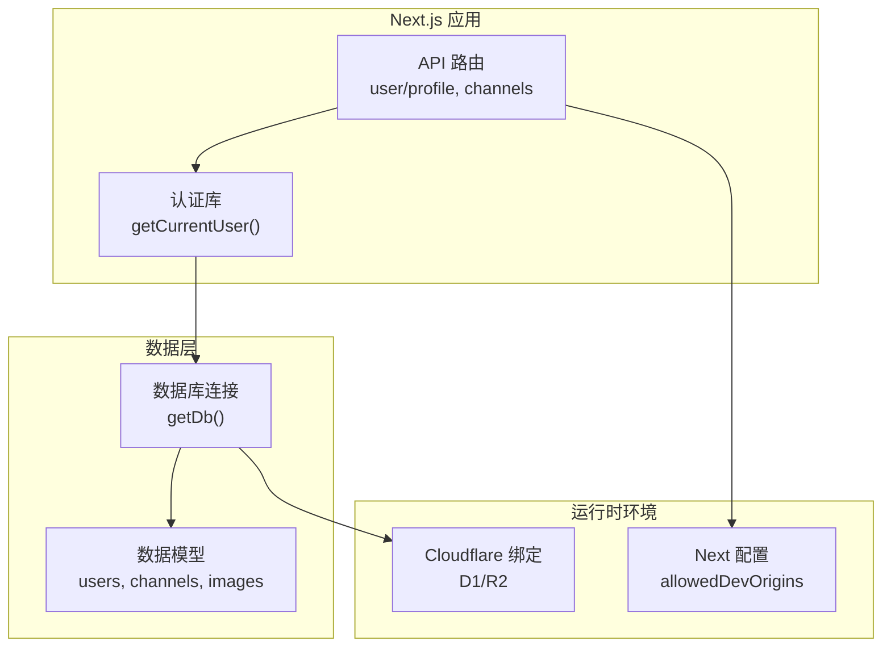
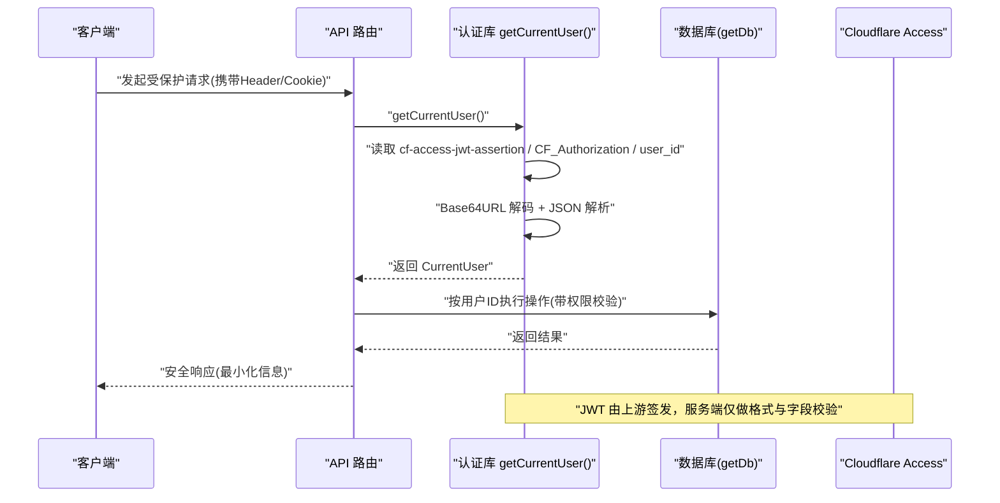
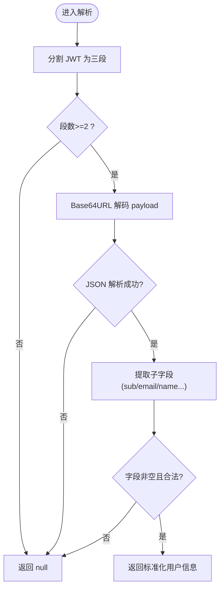
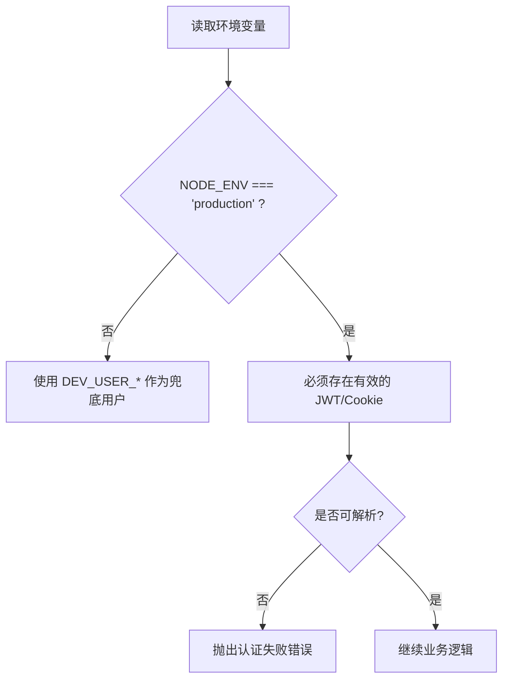
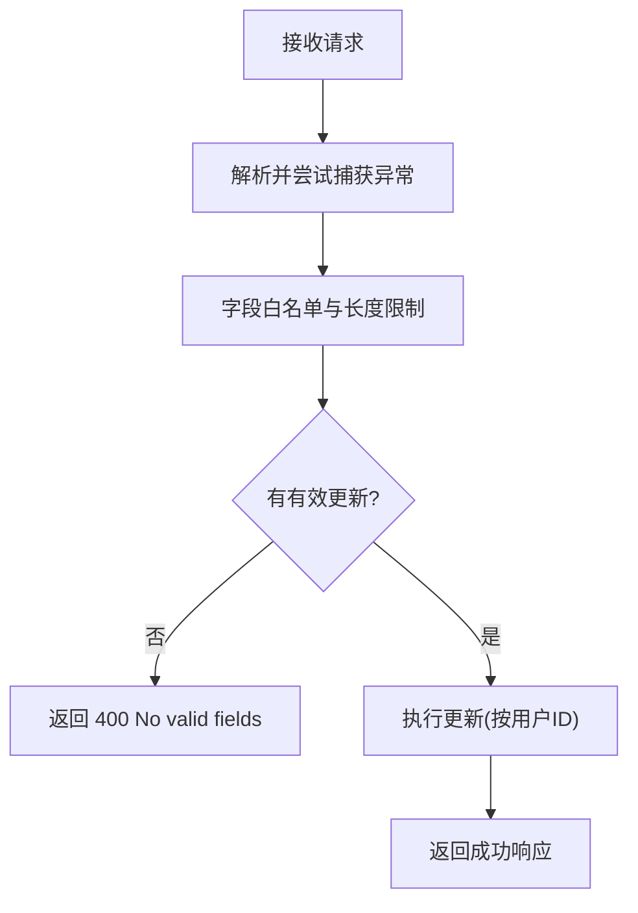
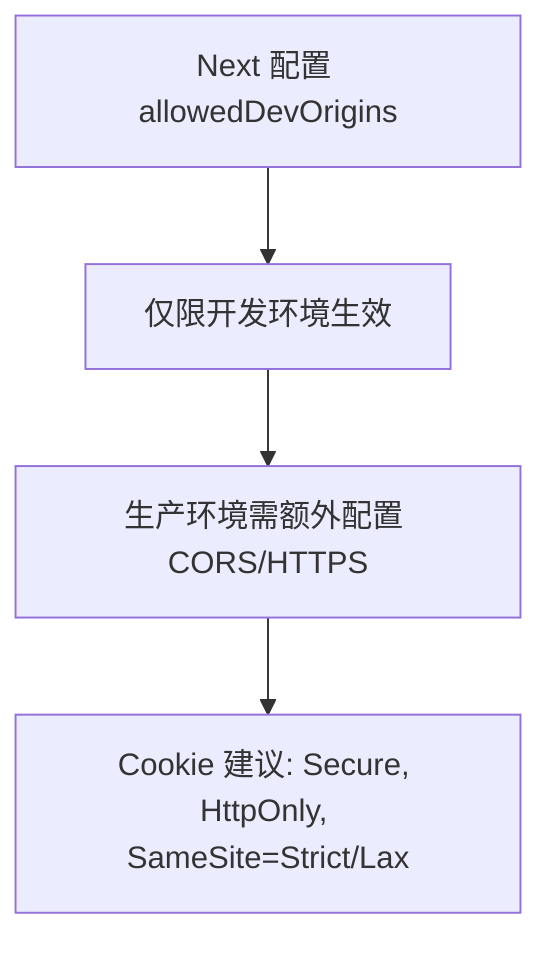
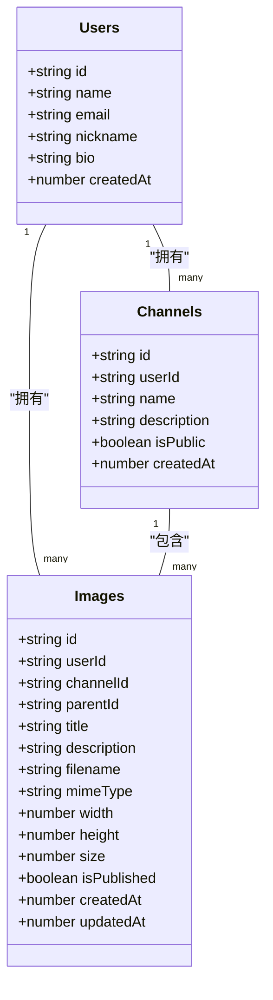
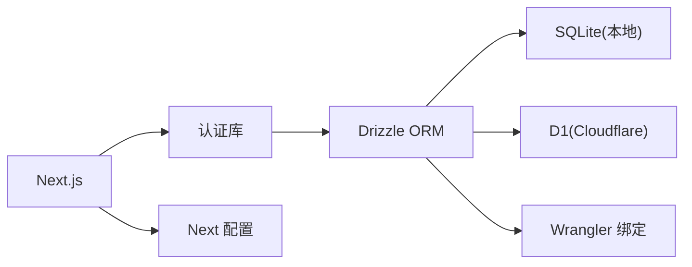

# 安全最佳实践

<cite>
**本文引用的文件**   
- [src/lib/auth.ts](file://src/lib/auth.ts)
- [src/app/api/user/profile/route.ts](file://src/app/api/user/profile/route.ts)
- [src/app/api/channels/[channelId]/route.ts](file://src/app/api/channels/[channelId]/route.ts)
- [src/db/schema.ts](file://src/db/schema.ts)
- [src/db/index.ts](file://src/db/index.ts)
- [next.config.ts](file://next.config.ts)
- [wrangler.jsonc](file://wrangler.jsonc)
- [package.json](file://package.json)
</cite>

## 目录
1. [简介](#简介)
2. [项目结构](#项目结构)
3. [核心组件](#核心组件)
4. [架构总览](#架构总览)
5. [详细组件分析](#详细组件分析)
6. [依赖分析](#依赖分析)
7. [性能考虑](#性能考虑)
8. [故障排查指南](#故障排查指南)
9. [结论](#结论)
10. [附录](#附录)

## 简介
本文件面向 Weable 应用的安全实践，聚焦以下方面：
- JWT 令牌的安全处理：Base64 URL 解码的安全性、令牌格式校验与恶意输入防护
- 环境变量配置安全：DEV_USER_BASE 等敏感信息的配置管理与保护
- 错误处理策略：认证失败时的安全响应与用户隐私保护
- 跨域请求安全配置：CORS/开发源限制、Cookie 安全属性与传输层安全要求
- 安全审计清单与常见漏洞防护
- 安全测试用例与渗透测试建议

## 项目结构
Weable 基于 Next.js（App Router）构建，认证逻辑集中在库模块中，API 路由通过中间件式调用获取当前用户；数据库使用 Drizzle ORM，本地 SQLite 或 Cloudflare D1。

图表来源 
- [src/app/api/user/profile/route.ts:1-31](file://src/app/api/user/profile/route.ts#L1-L31)
- [src/app/api/channels/[channelId]/route.ts:1-44](file://src/app/api/channels/[channelId]/route.ts#L1-L44)
- [src/lib/auth.ts:1-118](file://src/lib/auth.ts#L1-L118)
- [src/db/index.ts:1-61](file://src/db/index.ts#L1-L61)
- [src/db/schema.ts:1-100](file://src/db/schema.ts#L1-L100)
- [next.config.ts:1-15](file://next.config.ts#L1-L15)
- [wrangler.jsonc:1-34](file://wrangler.jsonc#L1-L34)

章节来源
- [src/lib/auth.ts:1-118](file://src/lib/auth.ts#L1-L118)
- [src/app/api/user/profile/route.ts:1-31](file://src/app/api/user/profile/route.ts#L1-L31)
- [src/app/api/channels/[channelId]/route.ts:1-44](file://src/app/api/channels/[channelId]/route.ts#L1-L44)
- [src/db/index.ts:1-61](file://src/db/index.ts#L1-L61)
- [src/db/schema.ts:1-100](file://src/db/schema.ts#L1-L100)
- [next.config.ts:1-15](file://next.config.ts#L1-L15)
- [wrangler.jsonc:1-34](file://wrangler.jsonc#L1-L34)

## 核心组件
- 认证库（auth.ts）
  - 负责从请求头或 Cookie 中提取 Cloudflare Access JWT 或会话标识，解析并构造当前用户对象
  - 提供 Base64 URL 解码、JWT payload 解析、字段白名单提取、用户行“存在即返回”的幂等写入
- API 路由
  - 用户资料更新：严格校验与裁剪输入字段，避免注入与越权
  - 频道删除：参数白名单校验、所有权校验、发布状态检查
- 数据库层
  - 统一 getDb() 抽象，自动选择本地 SQLite 或 Cloudflare D1
  - 数据模型定义 users/channels/images，含外键约束与默认值

章节来源
- [src/lib/auth.ts:1-118](file://src/lib/auth.ts#L1-L118)
- [src/app/api/user/profile/route.ts:1-31](file://src/app/api/user/profile/route.ts#L1-L31)
- [src/app/api/channels/[channelId]/route.ts:1-44](file://src/app/api/channels/[channelId]/route.ts#L1-L44)
- [src/db/index.ts:1-61](file://src/db/index.ts#L1-L61)
- [src/db/schema.ts:1-100](file://src/db/schema.ts#L1-L100)

## 架构总览
下图展示认证与鉴权的端到端流程，包括 JWT 解析、用户落库与资源访问控制。

图表来源 
- [src/app/api/user/profile/route.ts:1-31](file://src/app/api/user/profile/route.ts#L1-L31)
- [src/app/api/channels/[channelId]/route.ts:1-44](file://src/app/api/channels/[channelId]/route.ts#L1-L44)
- [src/lib/auth.ts:1-118](file://src/lib/auth.ts#L1-L118)
- [src/db/index.ts:1-61](file://src/db/index.ts#L1-L61)

## 详细组件分析

### JWT 令牌安全处理
- Base64 URL 解码安全性
  - 实现了对 Base64 URL 字符集的正则替换与填充补齐，捕获异常并返回空值，避免崩溃与未定义行为
  - 优先使用 Node Buffer，回退到 atob，确保多环境兼容
- 令牌格式验证
  - 严格拆分三段式 JWT，仅对 payload 进行解码与 JSON 解析，失败均返回 null
  - 字段提取采用白名单与类型断言，空字符串与空白被过滤
- 恶意输入防护
  - 所有外部输入在解析后经过 trim 与长度限制，避免注入与超长载荷
  - 非生产环境才启用开发用户兜底，生产环境无法解析时抛出明确错误

图表来源 
- [src/lib/auth.ts:29-78](file://src/lib/auth.ts#L29-L78)

章节来源
- [src/lib/auth.ts:29-78](file://src/lib/auth.ts#L29-L78)

### 环境变量与敏感信息管理
- DEV_USER_BASE
  - 通过 process.env.DEV_USER_ID/NAME/EMAIL 注入，提供开发环境免登兜底
  - 仅在非生产环境生效，生产环境若无有效凭证将直接报错
- 数据库路径与环境变量
  - DB_PATH 用于本地 SQLite 路径，IMAGE_STORAGE_PATH 用于上传根目录
  - 建议在部署平台以密钥管理方式注入，避免写入代码仓库

图表来源 
- [src/lib/auth.ts:15-19](file://src/lib/auth.ts#L15-L19)
- [src/lib/auth.ts:112-117](file://src/lib/auth.ts#L112-L117)
- [src/db/index.ts:24-32](file://src/db/index.ts#L24-L32)

章节来源
- [src/lib/auth.ts:15-19](file://src/lib/auth.ts#L15-L19)
- [src/lib/auth.ts:112-117](file://src/lib/auth.ts#L112-L117)
- [src/db/index.ts:24-32](file://src/db/index.ts#L24-L32)

### 错误处理与隐私保护
- 认证失败
  - 生产环境无法解析用户时抛出错误，避免泄露内部细节
  - 前端应捕获并显示通用错误提示，不暴露堆栈或内部状态
- 输入校验失败
  - 用户资料更新接口对 nickname/bio 进行类型与长度限制，非法字段将被忽略
  - 频道删除接口对 channelId 进行正则白名单校验，防止路径穿越与注入

图表来源 
- [src/app/api/user/profile/route.ts:9-30](file://src/app/api/user/profile/route.ts#L9-L30)

章节来源
- [src/app/api/user/profile/route.ts:9-30](file://src/app/api/user/profile/route.ts#L9-L30)
- [src/app/api/channels/[channelId]/route.ts:11-43](file://src/app/api/channels/[channelId]/route.ts#L11-L43)

### 跨域请求与安全配置
- 开发源限制
  - next.config.ts 中 allowedDevOrigins 限定开发阶段允许的源，降低本地调试风险
- Cookie 安全属性
  - 当前实现读取 Cookie 但未显式设置 SameSite/Secure/HttpOnly，建议在生产环境强制启用
- 传输层安全
  - 生产环境应强制 HTTPS，避免 Cookie 与 JWT 明文传输

图表来源 
- [next.config.ts:8-12](file://next.config.ts#L8-L12)

章节来源
- [next.config.ts:8-12](file://next.config.ts#L8-L12)

### 数据库与存储安全
- 连接选择
  - getDb() 自动检测 Cloudflare 上下文，优先使用 D1，否则回退至本地 SQLite
  - 若检测到 Cloudflare 上下文但缺少 D1 绑定，抛出配置错误
- 数据模型
  - users/channels/images 包含外键与级联删除，保证数据一致性
  - 使用 uuidv7 + bs58 生成短 ID，减少枚举与猜测风险

图表来源 
- [src/db/schema.ts:26-69](file://src/db/schema.ts#L26-L69)

章节来源
- [src/db/index.ts:34-60](file://src/db/index.ts#L34-L60)
- [src/db/schema.ts:26-69](file://src/db/schema.ts#L26-L69)

## 依赖分析
- 关键依赖
  - Next.js 应用框架与 App Router
  - Drizzle ORM 与 better-sqlite3（本地）/ d1（Cloudflare）
  - sanitize-html（用于内容清洗，未在认证链路中使用）
  - bs58、uuidv7（ID 生成）
- 运行环境与绑定
  - wrangler.jsonc 声明 D1 与 R2 绑定名称，便于部署时注入

图表来源 
- [package.json:11-24](file://package.json#L11-L24)
- [wrangler.jsonc:16-32](file://wrangler.jsonc#L16-L32)

章节来源
- [package.json:11-24](file://package.json#L11-L24)
- [wrangler.jsonc:16-32](file://wrangler.jsonc#L16-L32)

## 性能考虑
- JWT 解析开销较小，主要成本在数据库查询；ensureUserRow 先插入再查询，利用 onConflictDoNothing 保证幂等
- 本地 SQLite 适合开发与小规模场景；生产建议使用 D1 以获得更好的并发与扩展性
- 输入校验与裁剪在前端与后端双重保障，减少无效写入

[本节为通用指导，无需特定文件引用]

## 故障排查指南
- 认证失败
  - 检查请求是否携带 cf-access-jwt-assertion 或 CF_Authorization/cf_authorization
  - 确认 NODE_ENV 与 DEV_USER_* 环境变量是否正确
  - 查看 getDb() 是否成功选择 D1 或 SQLite
- 输入校验失败
  - 检查 nickname/bio 的类型与长度限制
  - 频道 ID 是否符合白名单正则
- 日志与错误信息
  - 生产环境避免输出敏感信息，统一错误响应格式

章节来源
- [src/lib/auth.ts:93-117](file://src/lib/auth.ts#L93-L117)
- [src/app/api/user/profile/route.ts:9-30](file://src/app/api/user/profile/route.ts#L9-L30)
- [src/app/api/channels/[channelId]/route.ts:11-43](file://src/app/api/channels/[channelId]/route.ts#L11-L43)
- [src/db/index.ts:53-56](file://src/db/index.ts#L53-L56)

## 结论
Weable 的认证与数据处理实现了基础的安全边界：严格的 JWT 解析、输入白名单与长度限制、幂等用户落库以及明确的错误分支。为进一步强化安全，建议在生产环境完善 Cookie 安全属性、强制 HTTPS、引入速率限制与更完善的审计日志，并开展定期安全审计与渗透测试。

[本节为总结，无需特定文件引用]

## 附录

### 安全审计清单
- 认证与授权
  - JWT 仅做格式与字段校验，不信任任何客户端输入
  - 生产环境禁用开发用户兜底
  - 所有写操作均需校验资源归属（userId）
- 输入与输出
  - 所有外部输入进行类型、长度与白名单校验
  - 错误响应不包含堆栈或内部状态
- 配置与密钥
  - 环境变量通过部署平台注入，禁止提交到版本库
  - 数据库路径与存储路径不在代码中硬编码
- 传输与网络
  - 生产强制 HTTPS
  - Cookie 设置 Secure/HttpOnly/SameSite
  - 限制开发源，生产配置最小化 CORS
- 数据与存储
  - 使用外键与级联约束保证一致性
  - 敏感数据加密存储（如需要）
- 监控与审计
  - 记录认证失败与异常事件
  - 定期审查访问日志与错误日志

[本节为通用清单，无需特定文件引用]

### 常见安全漏洞与防护措施
- 注入攻击（SQL/命令）
  - 使用参数化查询与 ORM，避免拼接 SQL
  - 对用户输入进行严格校验与转义
- XSS
  - 对用户渲染内容进行清洗（sanitize-html），避免直接渲染不可信 HTML
- CSRF
  - 对状态变更接口启用 SameSite Cookie 与 CSRF Token（如需）
- 越权访问
  - 所有资源操作校验 userId 与资源归属
- 信息泄露
  - 错误响应最小化，不暴露内部细节
  - 日志脱敏

[本节为通用防护建议，无需特定文件引用]

### 安全测试用例建议
- 认证流程
  - 无 JWT/Cookie 请求应拒绝访问
  - 伪造 JWT（无效签名/过期/字段缺失）应被拒绝
  - 开发环境与非生产环境行为差异验证
- 输入校验
  - nickname/bio 超长、空字符串、特殊字符、HTML 注入
  - channelId 非法字符与路径穿越尝试
- 权限控制
  - 尝试删除他人频道/图片应失败
  - 同一用户多次 ensureUserRow 应幂等
- 传输安全
  - 非 HTTPS 下 Cookie 不应被允许
  - 跨域请求被正确拦截

[本节为测试建议，无需特定文件引用]

### 渗透测试建议
- 针对 JWT 解析路径进行畸形输入与超大载荷测试
- 对 API 路由进行参数篡改、重复提交与并发竞争条件测试
- 检查环境变量是否意外泄露（错误页面、日志、源码）
- 评估 Cookie 安全属性与跨站脚本风险
- 验证存储路径与文件上传是否存在任意文件读写风险

[本节为渗透建议，无需特定文件引用]