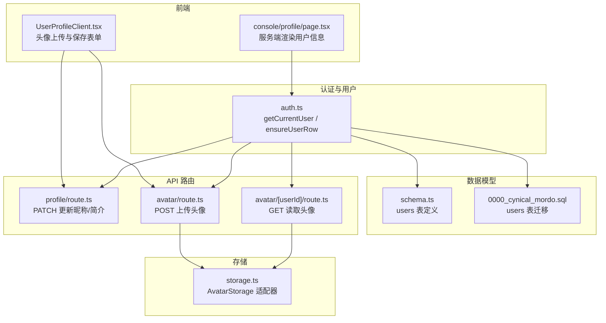
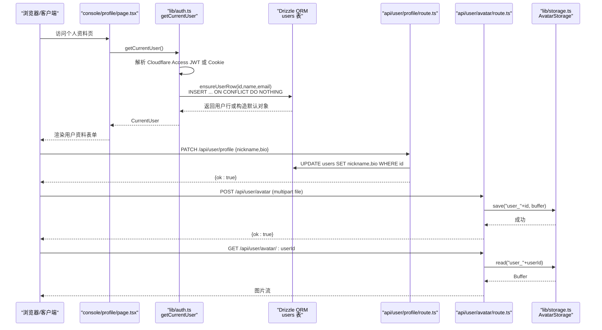
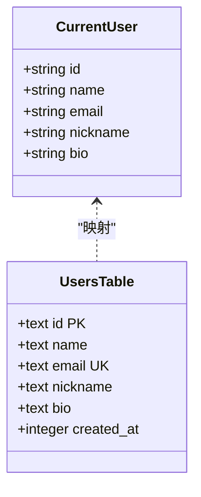
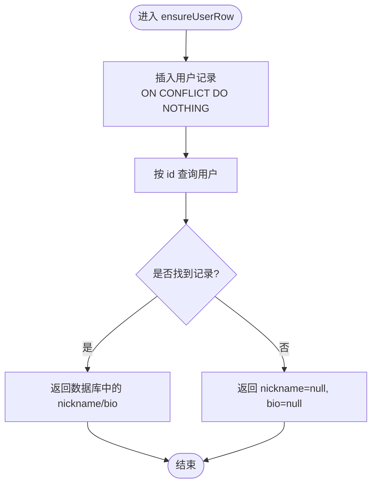
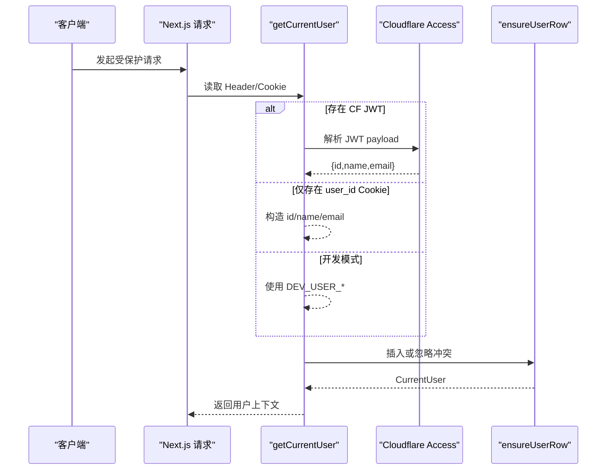
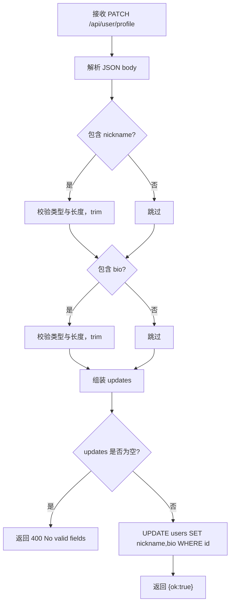
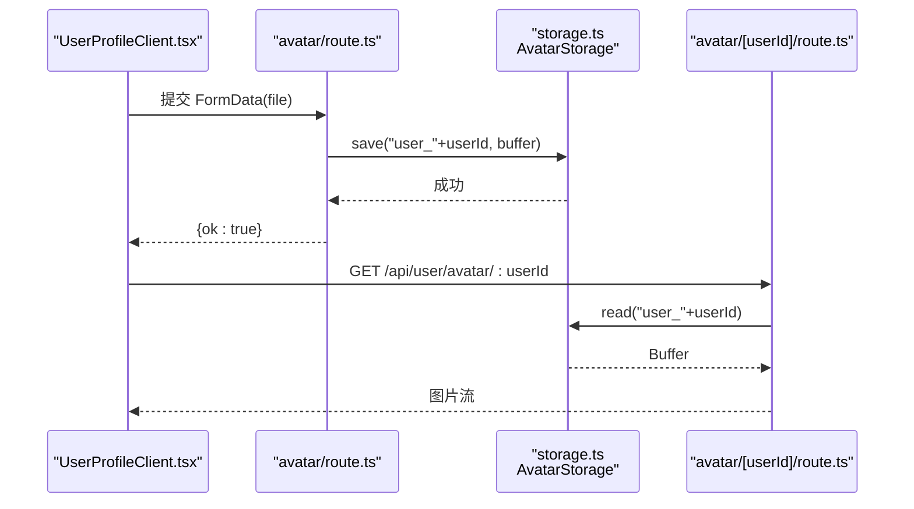
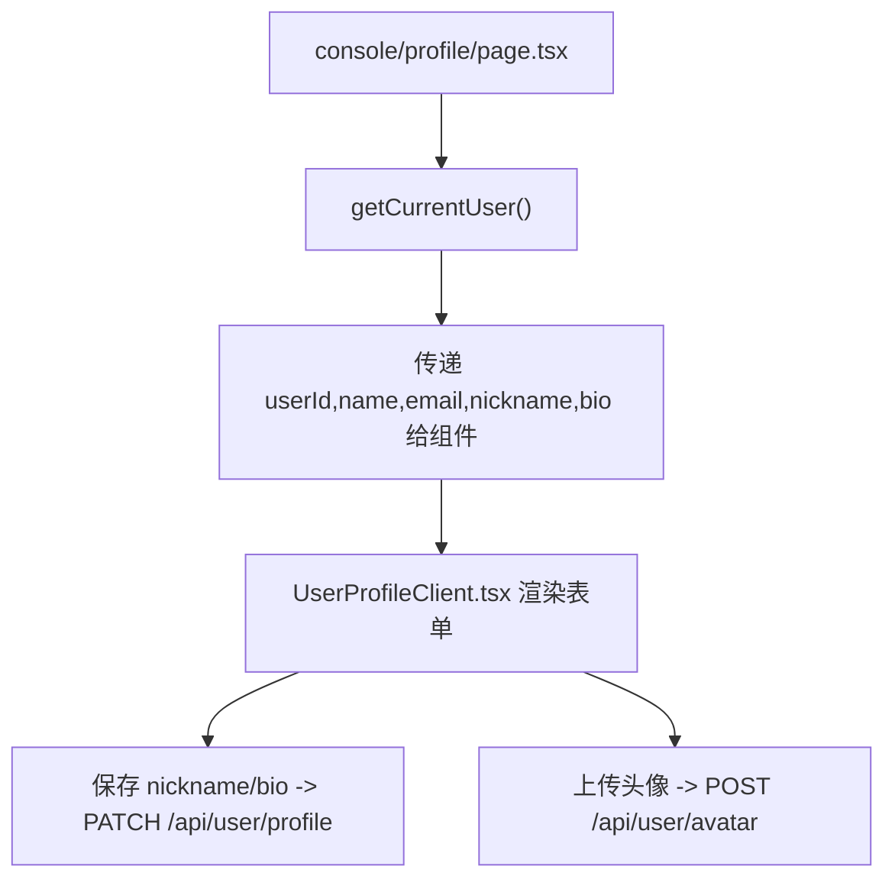
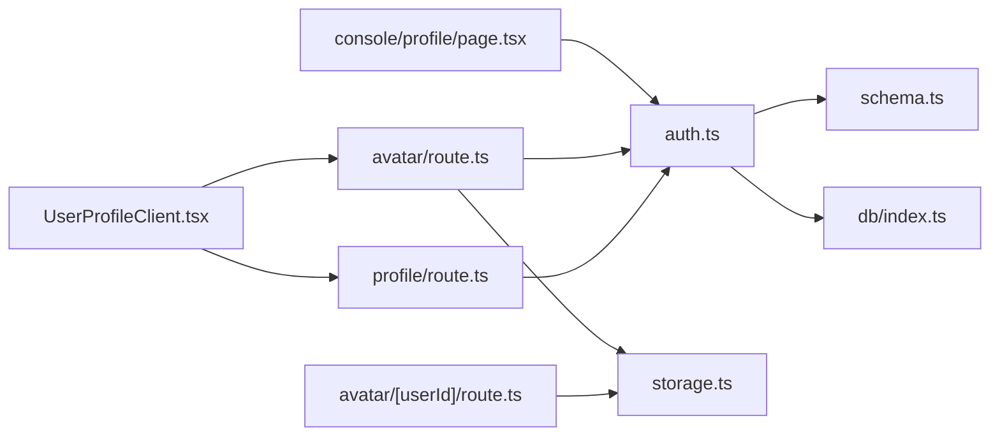
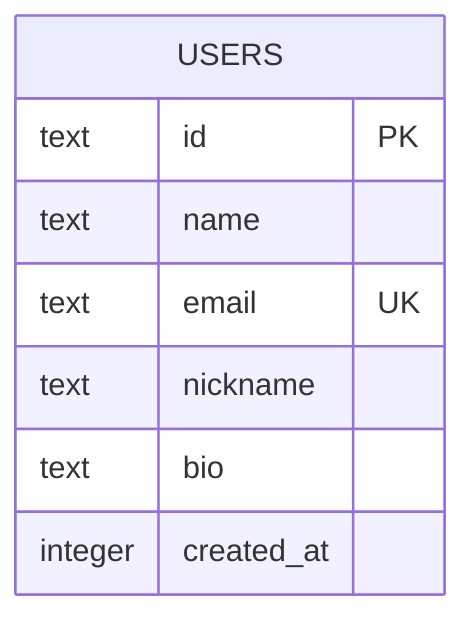

# 用户信息管理

<cite>
**本文引用的文件**   
- [src/lib/auth.ts](file://src/lib/auth.ts)
- [src/db/schema.ts](file://src/db/schema.ts)
- [migrations/0000_cynical_mordo.sql](file://migrations/0000_cynical_mordo.sql)
- [src/app/api/user/profile/route.ts](file://src/app/api/user/profile/route.ts)
- [src/app/api/user/avatar/route.ts](file://src/app/api/user/avatar/route.ts)
- [src/app/api/user/avatar/[userId]/route.ts](file://src/app/api/user/avatar/[userId]/route.ts)
- [src/components/UserProfileClient.tsx](file://src/components/UserProfileClient.tsx)
- [src/app/[lang]/console/profile/page.tsx](file://src/app/[lang]/console/profile/page.tsx)
- [src/lib/storage.ts](file://src/lib/storage.ts)
</cite>

## 目录
1. [简介](#简介)
2. [项目结构](#项目结构)
3. [核心组件](#核心组件)
4. [架构总览](#架构总览)
5. [详细组件分析](#详细组件分析)
6. [依赖关系分析](#依赖关系分析)
7. [性能考虑](#性能考虑)
8. [故障排查指南](#故障排查指南)
9. [结论](#结论)
10. [附录](#附录)

## 简介
本文件面向 Weable 应用的用户管理系统，聚焦以下目标：
- 详细说明 CurrentUser 接口设计及其字段含义与数据类型。
- 解释用户数据的持久化策略，包括 ensureUserRow 的实现逻辑、数据库插入操作与冲突处理机制。
- 文档化用户信息的自动创建过程：认证时如何确保数据库中有一条用户记录。
- 说明用户数据与认证系统的集成方式，以及如何扩展用户属性以支持更多业务需求。
- 提供用户数据模型图与常见操作示例（以路径引用代替代码片段）。

## 项目结构
围绕用户管理的关键文件组织如下：
- 认证与当前用户解析：src/lib/auth.ts
- 数据库模型定义：src/db/schema.ts
- 数据库迁移脚本：migrations/0000_cynical_mordo.sql
- 用户资料 API：src/app/api/user/profile/route.ts
- 头像上传与读取 API：src/app/api/user/avatar/route.ts、src/app/api/user/avatar/[userId]/route.ts
- 前端用户资料页面与客户端组件：src/app/[lang]/console/profile/page.tsx、src/components/UserProfileClient.tsx
- 存储适配层（本地/R2）：src/lib/storage.ts

图表来源
- [src/lib/auth.ts:1-118](file://src/lib/auth.ts#L1-L118)
- [src/db/schema.ts:26-33](file://src/db/schema.ts#L26-L33)
- [migrations/0000_cynical_mordo.sql:29-36](file://migrations/0000_cynical_mordo.sql#L29-L36)
- [src/app/api/user/profile/route.ts:1-31](file://src/app/api/user/profile/route.ts#L1-L31)
- [src/app/api/user/avatar/route.ts:1-34](file://src/app/api/user/avatar/route.ts#L1-L34)
- [src/app/api/user/avatar/[userId]/route.ts:1-29](file://src/app/api/user/avatar/[userId]/route.ts#L1-L29)
- [src/app/[lang]/console/profile/page.tsx:1-51](file://src/app/[lang]/console/profile/page.tsx#L1-L51)
- [src/components/UserProfileClient.tsx:1-99](file://src/components/UserProfileClient.tsx#L1-L99)
- [src/lib/storage.ts:1-214](file://src/lib/storage.ts#L1-L214)

章节来源
- [src/lib/auth.ts:1-118](file://src/lib/auth.ts#L1-L118)
- [src/db/schema.ts:26-33](file://src/db/schema.ts#L26-L33)
- [migrations/0000_cynical_mordo.sql:29-36](file://migrations/0000_cynical_mordo.sql#L29-L36)

## 核心组件
- CurrentUser 接口
  - id: string — 用户唯一标识（由系统生成或认证提供方提供）
  - name: string — 用户名（来自认证 JWT 或回退值）
  - email: string — 邮箱（来自认证 JWT 或回退值）
  - nickname: string | null — 昵称，可选
  - bio: string | null — 个人简介，可选
- 用户表 users
  - id: text, 主键，默认使用 createId() 生成 Base58 编码的 UUIDv7
  - name: text, notNull
  - email: text, notNull, unique
  - nickname: text, 可为空
  - bio: text, 可为空
  - created_at: integer, notNull, 默认当前时间戳

章节来源
- [src/lib/auth.ts:7-13](file://src/lib/auth.ts#L7-L13)
- [src/db/schema.ts:26-33](file://src/db/schema.ts#L26-L33)
- [migrations/0000_cynical_mordo.sql:29-36](file://migrations/0000_cynical_mordo.sql#L29-L36)

## 架构总览
下图展示了从认证到用户数据落库、再到前端展示与头像存取的整体流程。

图表来源
- [src/app/[lang]/console/profile/page.tsx:14-49](file://src/app/[lang]/console/profile/page.tsx#L14-L49)
- [src/lib/auth.ts:93-117](file://src/lib/auth.ts#L93-L117)
- [src/lib/auth.ts:80-91](file://src/lib/auth.ts#L80-L91)
- [src/app/api/user/profile/route.ts:9-30](file://src/app/api/user/profile/route.ts#L9-L30)
- [src/app/api/user/avatar/route.ts:10-33](file://src/app/api/user/avatar/route.ts#L10-L33)
- [src/app/api/user/avatar/[userId]/route.ts:8-28](file://src/app/api/user/avatar/[userId]/route.ts#L8-L28)
- [src/lib/storage.ts:199-213](file://src/lib/storage.ts#L199-L213)

## 详细组件分析

### CurrentUser 接口与数据模型
- CurrentUser 是服务层向 UI 暴露的最小用户信息集合，包含身份标识、显示名、邮箱以及可选的昵称与简介。
- 数据库 users 表通过 Drizzle schema 与 SQL 迁移共同保证结构与约束一致，email 唯一索引避免重复注册。

图表来源
- [src/lib/auth.ts:7-13](file://src/lib/auth.ts#L7-L13)
- [src/db/schema.ts:26-33](file://src/db/schema.ts#L26-L33)
- [migrations/0000_cynical_mordo.sql:29-36](file://migrations/0000_cynical_mordo.sql#L29-L36)

章节来源
- [src/lib/auth.ts:7-13](file://src/lib/auth.ts#L7-L13)
- [src/db/schema.ts:26-33](file://src/db/schema.ts#L26-L33)
- [migrations/0000_cynical_mordo.sql:29-36](file://migrations/0000_cynical_mordo.sql#L29-L36)

### 用户数据持久化与 ensureUserRow 实现逻辑
- 目标：在每次获取当前用户时，确保数据库存在该用户的记录；若不存在则插入，并返回完整用户对象。
- 关键步骤
  - 尝试插入用户记录，使用 onConflictDoNothing 避免唯一键冲突（如 email 已存在）。
  - 查询该用户是否存在；若存在则返回数据库中的 nickname/bio（可能为 null），否则返回空值。
- 复杂度与一致性
  - 插入与查询均为 O(1) 级别（基于主键/唯一索引）。
  - 并发场景下，onConflictDoNothing 保证幂等性，最终一致性由数据库约束保障。

图表来源
- [src/lib/auth.ts:80-91](file://src/lib/auth.ts#L80-L91)

章节来源
- [src/lib/auth.ts:80-91](file://src/lib/auth.ts#L80-L91)

### 认证系统集成与自动创建用户
- 认证来源优先级
  - Cloudflare Access JWT：优先从 cf-access-jwt-assertion 头或 CF_Authorization/cf_authorization Cookie 中解析。
  - 本地会话：回退到 user_id Cookie。
  - 开发环境：使用环境变量提供的 DEV_USER_* 作为默认用户。
- 自动创建流程
  - 解析出 id/name/email 后调用 ensureUserRow，确保用户存在后再返回 CurrentUser。
  - 生产环境若无任何认证信息将抛出错误，防止匿名访问。

图表来源
- [src/lib/auth.ts:93-117](file://src/lib/auth.ts#L93-L117)
- [src/lib/auth.ts:64-78](file://src/lib/auth.ts#L64-L78)
- [src/lib/auth.ts:80-91](file://src/lib/auth.ts#L80-L91)

章节来源
- [src/lib/auth.ts:93-117](file://src/lib/auth.ts#L93-L117)
- [src/lib/auth.ts:64-78](file://src/lib/auth.ts#L64-L78)
- [src/lib/auth.ts:80-91](file://src/lib/auth.ts#L80-L91)

### 用户资料更新 API（昵称与简介）
- 端点：PATCH /api/user/profile
- 输入校验
  - nickname：字符串或 null，长度限制 50，空白字符会被 trim。
  - bio：字符串或 null，长度限制 500，空白字符会被 trim。
  - 无有效字段时返回 400。
- 更新逻辑
  - 根据当前用户 id 执行单字段或部分字段更新。
- 响应
  - 成功返回 { ok: true }。

图表来源
- [src/app/api/user/profile/route.ts:9-30](file://src/app/api/user/profile/route.ts#L9-L30)

章节来源
- [src/app/api/user/profile/route.ts:9-30](file://src/app/api/user/profile/route.ts#L9-L30)

### 头像上传与读取
- 上传端点：POST /api/user/avatar
  - 校验文件类型（jpeg/png/gif/webp）、大小（≤2MB）。
  - 使用 AvatarStorage.save(key="user_"+userId, data)。
- 读取端点：GET /api/user/avatar/:userId
  - 校验 userId 格式。
  - 使用 AvatarStorage.read(key="user_"+userId) 返回图片流。
- 存储适配
  - 本地：LocalAvatarStorage 委托给 LocalStorageAdapter，统一前缀 __avatar__。
  - R2：R2AvatarStorage 直接写入 bucket，key 前缀 avatar/。

图表来源
- [src/components/UserProfileClient.tsx:31-54](file://src/components/UserProfileClient.tsx#L31-L54)
- [src/app/api/user/avatar/route.ts:10-33](file://src/app/api/user/avatar/route.ts#L10-L33)
- [src/app/api/user/avatar/[userId]/route.ts:8-28](file://src/app/api/user/avatar/[userId]/route.ts#L8-L28)
- [src/lib/storage.ts:138-179](file://src/lib/storage.ts#L138-L179)

章节来源
- [src/app/api/user/avatar/route.ts:10-33](file://src/app/api/user/avatar/route.ts#L10-L33)
- [src/app/api/user/avatar/[userId]/route.ts:8-28](file://src/app/api/user/avatar/[userId]/route.ts#L8-L28)
- [src/lib/storage.ts:138-179](file://src/lib/storage.ts#L138-L179)

### 前端用户资料页面与交互
- 服务端页面 console/profile/page.tsx
  - 调用 getCurrentUser 获取用户信息并传递给客户端组件。
- 客户端组件 UserProfileClient.tsx
  - 展示头像、用户名、邮箱、昵称、简介。
  - 支持头像上传与昵称/简介保存。

图表来源
- [src/app/[lang]/console/profile/page.tsx:14-49](file://src/app/[lang]/console/profile/page.tsx#L14-L49)
- [src/components/UserProfileClient.tsx:24-54](file://src/components/UserProfileClient.tsx#L24-L54)

章节来源
- [src/app/[lang]/console/profile/page.tsx:14-49](file://src/app/[lang]/console/profile/page.tsx#L14-L49)
- [src/components/UserProfileClient.tsx:24-54](file://src/components/UserProfileClient.tsx#L24-L54)

## 依赖关系分析
- 模块耦合
  - auth.ts 依赖 db/index.ts 获取数据库连接，依赖 schema.ts 的 users 表定义。
  - profile/avatar API 依赖 auth.ts 获取当前用户，依赖 storage.ts 进行头像存取。
  - 前端页面依赖 auth.ts 与服务端 API。
- 外部依赖
  - Cloudflare Access JWT 用于身份解析。
  - Drizzle ORM 用于数据库操作。
  - Node.js 文件系统或 Cloudflare R2 用于存储。

图表来源
- [src/lib/auth.ts:1-118](file://src/lib/auth.ts#L1-L118)
- [src/db/schema.ts:1-33](file://src/db/schema.ts#L1-L33)
- [src/app/api/user/profile/route.ts:1-31](file://src/app/api/user/profile/route.ts#L1-L31)
- [src/app/api/user/avatar/route.ts:1-34](file://src/app/api/user/avatar/route.ts#L1-L34)
- [src/app/api/user/avatar/[userId]/route.ts:1-29](file://src/app/api/user/avatar/[userId]/route.ts#L1-L29)
- [src/app/[lang]/console/profile/page.tsx:1-51](file://src/app/[lang]/console/profile/page.tsx#L1-L51)
- [src/components/UserProfileClient.tsx:1-99](file://src/components/UserProfileClient.tsx#L1-L99)
- [src/lib/storage.ts:1-214](file://src/lib/storage.ts#L1-L214)

章节来源
- [src/lib/auth.ts:1-118](file://src/lib/auth.ts#L1-L118)
- [src/db/schema.ts:1-33](file://src/db/schema.ts#L1-L33)
- [src/app/api/user/profile/route.ts:1-31](file://src/app/api/user/profile/route.ts#L1-L31)
- [src/app/api/user/avatar/route.ts:1-34](file://src/app/api/user/avatar/route.ts#L1-L34)
- [src/app/api/user/avatar/[userId]/route.ts:1-29](file://src/app/api/user/avatar/[userId]/route.ts#L1-L29)
- [src/app/[lang]/console/profile/page.tsx:1-51](file://src/app/[lang]/console/profile/page.tsx#L1-L51)
- [src/components/UserProfileClient.tsx:1-99](file://src/components/UserProfileClient.tsx#L1-L99)
- [src/lib/storage.ts:1-214](file://src/lib/storage.ts#L1-L214)

## 性能考虑
- 数据库操作
  - ensureUserRow 的插入使用 onConflictDoNothing，避免重复写入与锁竞争。
  - 查询按主键 id 精确匹配，O(1) 查找。
- 存储读写
  - 头像读取设置 Cache-Control 提升缓存命中率。
  - 本地与 R2 两种后端按需选择，减少不必要的 I/O。
- 前端优化
  - 头像 URL 带时间戳参数避免浏览器缓存旧图。
  - 表单提交状态反馈降低重复提交概率。

[本节为通用指导，不直接分析具体文件]

## 故障排查指南
- 无法解析当前用户
  - 检查请求头 cf-access-jwt-assertion 或 Cookie CF_Authorization/cf_authorization 是否存在且有效。
  - 非生产环境下确认 NODE_ENV 与 DEV_USER_* 环境变量配置正确。
- 更新昵称/简介失败
  - 确认请求体包含 nickname 或 bio 字段之一，且类型与长度符合限制。
  - 检查服务器日志中是否有“无有效字段”的错误响应。
- 头像上传失败
  - 校验文件类型与大小是否符合允许列表与上限。
  - 确认存储绑定（R2）或本地路径可用。
- 头像读取 404
  - 确认 userId 合法且已上传过头像。
  - 检查存储 key 是否正确拼接为 user_+userId。

章节来源
- [src/lib/auth.ts:93-117](file://src/lib/auth.ts#L93-L117)
- [src/app/api/user/profile/route.ts:22-24](file://src/app/api/user/profile/route.ts#L22-L24)
- [src/app/api/user/avatar/route.ts:20-26](file://src/app/api/user/avatar/route.ts#L20-L26)
- [src/app/api/user/avatar/[userId]/route.ts:11-19](file://src/app/api/user/avatar/[userId]/route.ts#L11-L19)
- [src/lib/storage.ts:199-213](file://src/lib/storage.ts#L199-L213)

## 结论
Weable 的用户管理以 CurrentUser 为核心抽象，结合 Cloudflare Access 认证与 Drizzle ORM 的数据模型，实现了简洁可靠的“认证即建账”机制。通过 ensureUserRow 的幂等插入与唯一约束，保证了用户数据的一致性与可扩展性。头像上传与读取通过统一的 AvatarStorage 接口屏蔽底层存储差异，便于未来扩展。整体架构清晰、职责分离明确，适合在现有基础上继续扩展用户属性与业务能力。

[本节为总结性内容，不直接分析具体文件]

## 附录

### 用户数据模型图

图表来源
- [src/db/schema.ts:26-33](file://src/db/schema.ts#L26-L33)
- [migrations/0000_cynical_mordo.sql:29-36](file://migrations/0000_cynical_mordo.sql#L29-L36)

### 常见操作示例（以路径引用代替代码）
- 获取当前用户
  - 参考：[getCurrentUser:93-117](file://src/lib/auth.ts#L93-L117)
- 确保用户存在并返回用户对象
  - 参考：[ensureUserRow:80-91](file://src/lib/auth.ts#L80-L91)
- 更新昵称与简介
  - 参考：[PATCH /api/user/profile:9-30](file://src/app/api/user/profile/route.ts#L9-L30)
- 上传头像
  - 参考：[POST /api/user/avatar:10-33](file://src/app/api/user/avatar/route.ts#L10-L33)
- 读取头像
  - 参考：[GET /api/user/avatar/:userId:8-28](file://src/app/api/user/avatar/[userId]/route.ts#L8-L28)
- 渲染用户资料页
  - 参考：[console/profile 页面:14-49](file://src/app/[lang]/console/profile/page.tsx#L14-L49)
  - 参考：[UserProfileClient 组件:24-54](file://src/components/UserProfileClient.tsx#L24-L54)

章节来源
- [src/lib/auth.ts:80-117](file://src/lib/auth.ts#L80-L117)
- [src/app/api/user/profile/route.ts:9-30](file://src/app/api/user/profile/route.ts#L9-L30)
- [src/app/api/user/avatar/route.ts:10-33](file://src/app/api/user/avatar/route.ts#L10-L33)
- [src/app/api/user/avatar/[userId]/route.ts:8-28](file://src/app/api/user/avatar/[userId]/route.ts#L8-L28)
- [src/app/[lang]/console/profile/page.tsx:14-L49](file://src/app/[lang]/console/profile/page.tsx#L14-L49)
- [src/components/UserProfileClient.tsx:24-54](file://src/components/UserProfileClient.tsx#L24-L54)