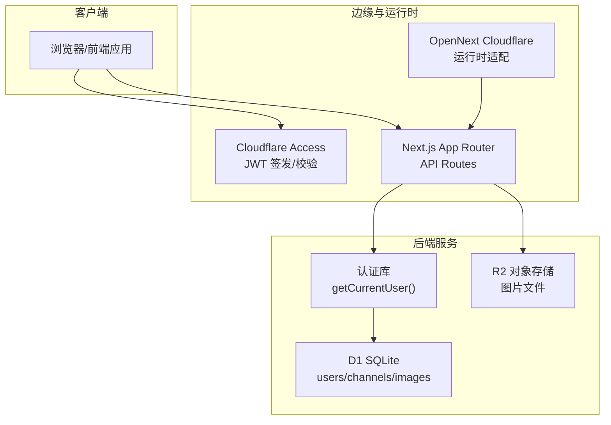
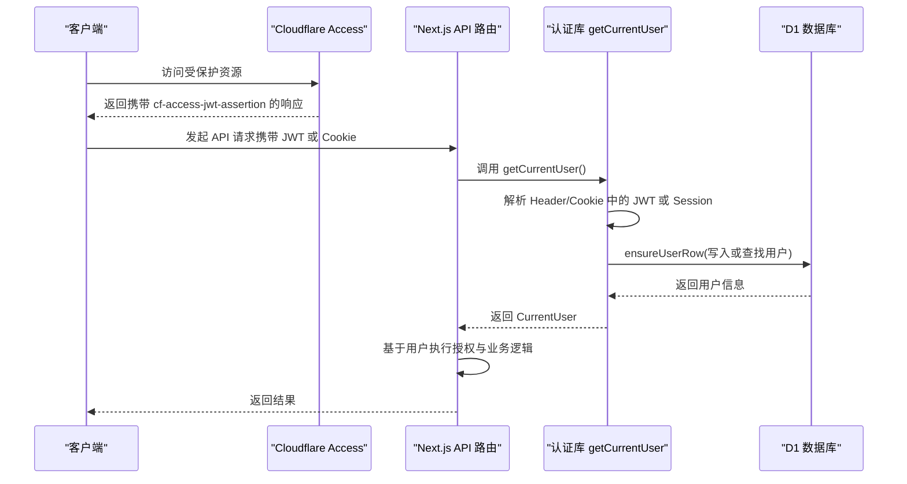
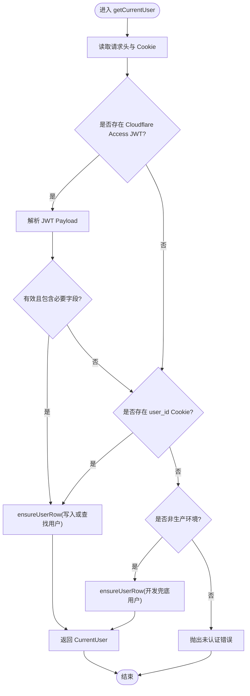
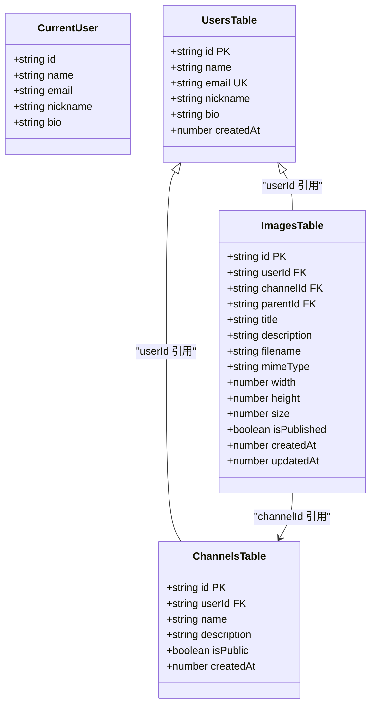
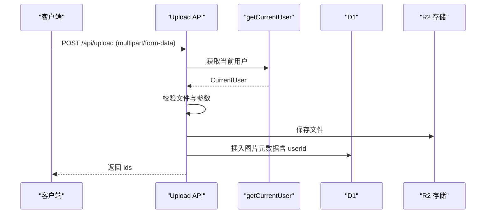
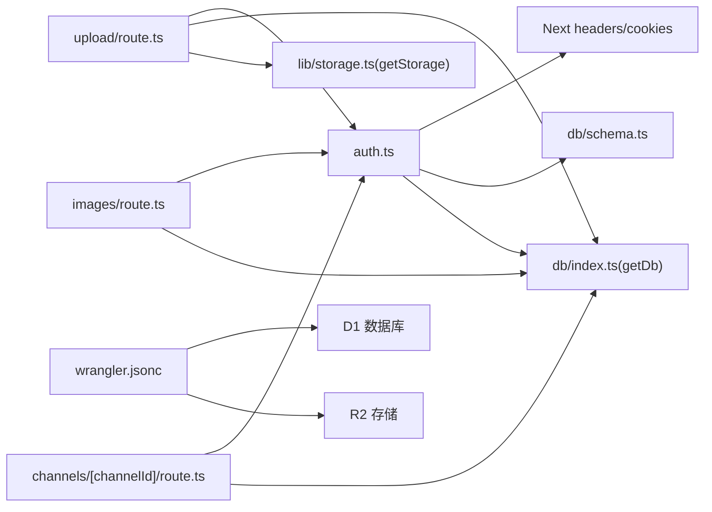

# 认证架构设计

<cite>
**本文引用的文件**
- [src/lib/auth.ts](file://src/lib/auth.ts)
- [src/db/schema.ts](file://src/db/schema.ts)
- [src/app/api/user/profile/route.ts](file://src/app/api/user/profile/route.ts)
- [src/app/api/upload/route.ts](file://src/app/api/upload/route.ts)
- [src/app/api/images/route.ts](file://src/app/api/images/route.ts)
- [src/app/api/channels/[channelId]/route.ts](file://src/app/api/channels/[channelId]/route.ts)
- [wrangler.jsonc](file://wrangler.jsonc)
- [next.config.ts](file://next.config.ts)
</cite>

## 目录
1. [简介](#简介)
2. [项目结构](#项目结构)
3. [核心组件](#核心组件)
4. [架构总览](#架构总览)
5. [详细组件分析](#详细组件分析)
6. [依赖关系分析](#依赖关系分析)
7. [性能考虑](#性能考虑)
8. [故障排查指南](#故障排查指南)
9. [结论](#结论)
10. [附录](#附录)

## 简介
本文件为 Weable 应用的认证架构设计文档，重点说明多源认证机制的实现与集成：Cloudflare Access JWT 认证与传统 Cookie 会话认证的融合策略；用户信息管理、会话处理与权限控制的设计模式；认证流程、令牌验证、用户状态管理与安全最佳实践。同时提供架构图、扩展新认证方式的指引，以及错误处理与日志记录策略建议。

## 项目结构
Weable 基于 Next.js（App Router）构建，认证逻辑集中在服务端库中，并通过 API 路由统一鉴权。关键路径如下：
- 认证核心：src/lib/auth.ts
- 数据模型与用户表：src/db/schema.ts
- 受保护 API：src/app/api/*（如 user/profile、upload、images、channels）
- 部署配置：wrangler.jsonc（Cloudflare Workers/D1/R2）
- Next 配置：next.config.ts

图表来源
- [src/lib/auth.ts:93-117](file://src/lib/auth.ts#L93-L117)
- [wrangler.jsonc:16-32](file://wrangler.jsonc#L16-L32)
- [next.config.ts:8-12](file://next.config.ts#L8-L12)

章节来源
- [src/lib/auth.ts:1-118](file://src/lib/auth.ts#L1-L118)
- [src/db/schema.ts:26-33](file://src/db/schema.ts#L26-L33)
- [wrangler.jsonc:1-34](file://wrangler.jsonc#L1-L34)
- [next.config.ts:1-15](file://next.config.ts#L1-L15)

## 核心组件
- 认证入口 getCurrentUser：统一从请求头或 Cookie 解析身份，优先 Cloudflare Access JWT，其次传统 session cookie，最后开发环境兜底用户。
- 用户模型 CurrentUser：包含 id、name、email、nickname、bio，持久化到 users 表。
- 数据库模式 users/channels/images：定义用户、频道、图片等实体及关系。
- API 路由鉴权：所有需要鉴权的 API 均调用 getCurrentUser 获取当前用户上下文，再进行业务操作。

章节来源
- [src/lib/auth.ts:7-13](file://src/lib/auth.ts#L7-L13)
- [src/lib/auth.ts:93-117](file://src/lib/auth.ts#L93-L117)
- [src/db/schema.ts:26-33](file://src/db/schema.ts#L26-L33)
- [src/app/api/user/profile/route.ts:1-31](file://src/app/api/user/profile/route.ts#L1-L31)
- [src/app/api/upload/route.ts:1-75](file://src/app/api/upload/route.ts#L1-L75)
- [src/app/api/images/route.ts:1-66](file://src/app/api/images/route.ts#L1-L66)
- [src/app/api/channels/[channelId]/route.ts:1-44](file://src/app/api/channels/[channelId]/route.ts#L1-L44)

## 架构总览
下图展示认证提供者、中间件（由 Next 路由与库函数承担）、业务逻辑之间的交互关系。Cloudflare Access 负责签发 JWT，Next 路由通过 getCurrentUser 解析并保证用户存在，随后执行业务逻辑。

图表来源
- [src/lib/auth.ts:93-117](file://src/lib/auth.ts#L93-L117)
- [src/app/api/upload/route.ts:14-16](file://src/app/api/upload/route.ts#L14-L16)
- [src/app/api/images/route.ts:9-11](file://src/app/api/images/route.ts#L9-L11)
- [src/app/api/channels/[channelId]/route.ts:11-19](file://src/app/api/channels/[channelId]/route.ts#L11-L19)

## 详细组件分析

### 认证库与多源认证流程
- 优先级顺序：
  1) Cloudflare Access JWT（Header: cf-access-jwt-assertion，或 Cookie: CF_Authorization/cf_authorization）
  2) 传统 Cookie 会话（user_id）
  3) 开发环境兜底用户（DEV_USER_*）
- JWT 解析：对 payload 进行 Base64Url 解码与 JSON 解析，提取 sub/email/name 等字段，容错处理缺失字段。
- 用户保障：ensureUserRow 确保用户存在于 users 表，不存在则插入后返回；避免重复写入使用 onConflictDoNothing。
- 错误处理：生产环境无法解析用户时抛出异常，阻止未认证访问。

图表来源
- [src/lib/auth.ts:29-78](file://src/lib/auth.ts#L29-L78)
- [src/lib/auth.ts:80-91](file://src/lib/auth.ts#L80-L91)
- [src/lib/auth.ts:93-117](file://src/lib/auth.ts#L93-L117)

章节来源
- [src/lib/auth.ts:1-118](file://src/lib/auth.ts#L1-L118)

### 用户信息与权限控制
- 用户信息 CurrentUser：id、name、email、nickname、bio。nickname/bio 可选，默认 null。
- 权限控制模式：
  - 资源隔离：所有查询与更新均以 userId 作为过滤条件，确保用户只能访问自己的数据。
  - 示例：上传、列表、删除频道等操作均在业务层校验 userId 匹配。
- 用户资料更新：PATCH /api/user/profile 仅允许更新 nickname 与 bio，并进行长度与类型校验。

图表来源
- [src/db/schema.ts:26-69](file://src/db/schema.ts#L26-L69)

章节来源
- [src/db/schema.ts:26-69](file://src/db/schema.ts#L26-L69)
- [src/app/api/user/profile/route.ts:9-30](file://src/app/api/user/profile/route.ts#L9-L30)
- [src/app/api/images/route.ts:33-47](file://src/app/api/images/route.ts#L33-L47)
- [src/app/api/channels/[channelId]/route.ts:21-25](file://src/app/api/channels/[channelId]/route.ts#L21-L25)

### 认证流程在 API 中的使用
- 上传接口 POST /api/upload：
  - 调用 getCurrentUser 获取用户
  - 校验文件数量、MIME 类型、大小
  - 校验父目录所有权（parentId 归属当前用户）
  - 写入存储与数据库
- 图片列表 GET /api/images：
  - 调用 getCurrentUser 获取用户
  - 按 userId 过滤，支持 parentId 筛选与排序
- 频道删除 DELETE /api/channels/[channelId]：
  - 调用 getCurrentUser 获取用户
  - 校验频道所有权与发布状态

图表来源
- [src/app/api/upload/route.ts:14-74](file://src/app/api/upload/route.ts#L14-L74)
- [src/lib/auth.ts:93-117](file://src/lib/auth.ts#L93-L117)

章节来源
- [src/app/api/upload/route.ts:1-75](file://src/app/api/upload/route.ts#L1-L75)
- [src/app/api/images/route.ts:1-66](file://src/app/api/images/route.ts#L1-L66)
- [src/app/api/channels/[channelId]/route.ts:1-44](file://src/app/api/channels/[channelId]/route.ts#L1-L44)

### 扩展新的认证方式
- 在 getCurrentUser 中增加新的认证源解析逻辑（例如 OAuth、SAML、企业 IDP），遵循以下原则：
  - 明确优先级与回退策略，避免覆盖现有行为
  - 对输入进行严格校验与白名单限制
  - 确保 ensureUserRow 能正确映射新来源的用户属性
- 新增认证源需配套：
  - 环境变量与密钥管理
  - 错误码与日志记录
  - 单元测试与集成测试

章节来源
- [src/lib/auth.ts:93-117](file://src/lib/auth.ts#L93-L117)

## 依赖关系分析
- 认证库依赖：
  - Next.js headers/cookies API
  - Drizzle ORM 与数据库 schema
- API 路由依赖：
  - 认证库 getCurrentUser
  - 数据库 getDb
  - 存储 getStorage（R2）
- 部署依赖：
  - wrangler.jsonc 绑定 D1 与 R2
  - next.config.ts 指定运行时与开发选项

图表来源
- [src/lib/auth.ts:1-6](file://src/lib/auth.ts#L1-L6)
- [src/db/schema.ts:1-6](file://src/db/schema.ts#L1-L6)
- [src/app/api/upload/route.ts:1-7](file://src/app/api/upload/route.ts#L1-L7)
- [wrangler.jsonc:16-32](file://wrangler.jsonc#L16-L32)

章节来源
- [src/lib/auth.ts:1-6](file://src/lib/auth.ts#L1-L6)
- [src/db/schema.ts:1-6](file://src/db/schema.ts#L1-L6)
- [src/app/api/upload/route.ts:1-7](file://src/app/api/upload/route.ts#L1-L7)
- [wrangler.jsonc:16-32](file://wrangler.jsonc#L16-L32)

## 性能考虑
- JWT 解析开销较小，但应避免重复解析；可在上层缓存解析结果（若跨多个 handler）。
- ensureUserRow 使用 onConflictDoNothing 减少重复写入，提升并发安全性。
- 数据库查询以 userId 过滤，利用索引（如唯一约束 email）提高查询效率。
- 上传流程先写存储再写元数据，失败时可快速回滚；注意大文件处理的内存占用。

[本节为通用指导，不直接分析具体文件]

## 故障排查指南
- 常见错误：
  - 未认证：生产环境无法解析用户时抛出异常，检查请求头/cookie 是否正确传递
  - 权限不足：资源查询未匹配 userId，检查业务层过滤逻辑
  - 上传失败：文件类型/大小校验失败，检查表单字段与限制常量
- 调试建议：
  - 在非生产环境启用 DEV_USER_* 快速验证流程
  - 打印 JWT payload 关键字段（脱敏）确认解析成功
  - 检查 D1/R2 绑定与环境变量配置

章节来源
- [src/lib/auth.ts:112-117](file://src/lib/auth.ts#L112-L117)
- [src/app/api/upload/route.ts:21-35](file://src/app/api/upload/route.ts#L21-L35)
- [src/app/api/images/route.ts:16-31](file://src/app/api/images/route.ts#L16-L31)
- [wrangler.jsonc:16-32](file://wrangler.jsonc#L16-L32)

## 结论
Weable 的认证架构以 getCurrentUser 为核心，统一处理 Cloudflare Access JWT 与传统 Cookie 会话，确保用户身份一致性与资源隔离。通过 Drizzle ORM 与 D1/R2 的紧密集成，实现高效的数据与文件管理。扩展新认证方式时，应遵循严格的输入校验与优先级策略，并完善错误处理与日志记录。

[本节为总结性内容，不直接分析具体文件]

## 附录
- 安全最佳实践：
  - 仅在 HTTPS 环境下传输 JWT/Cookie，设置 HttpOnly、Secure、SameSite
  - 最小权限原则：API 仅暴露必要字段与操作
  - 定期轮换密钥与令牌有效期
  - 审计敏感操作（上传、删除）并记录日志
- 部署注意事项：
  - 确认 wrangler.jsonc 中 D1/R2 绑定正确
  - Next 运行时设置为 nodejs，确保兼容性与性能

章节来源
- [wrangler.jsonc:16-32](file://wrangler.jsonc#L16-L32)
- [next.config.ts:7-12](file://next.config.ts#L7-L12)