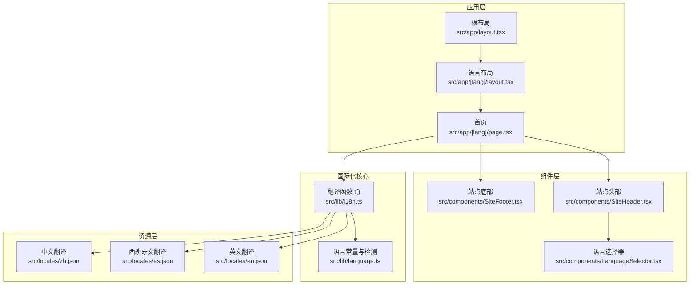
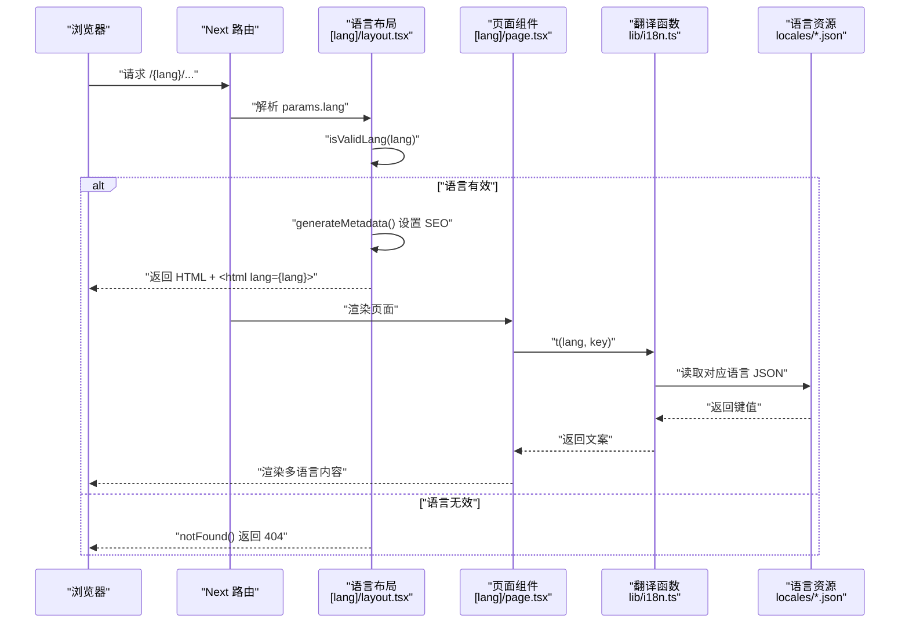
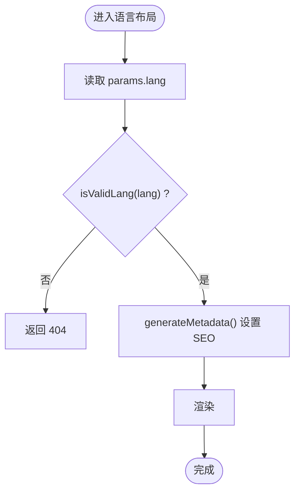
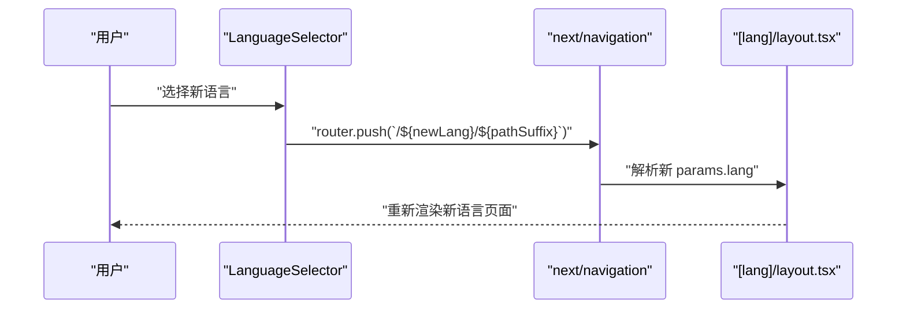
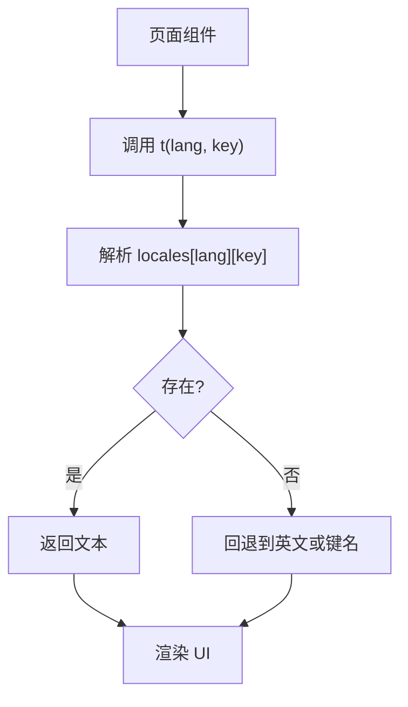
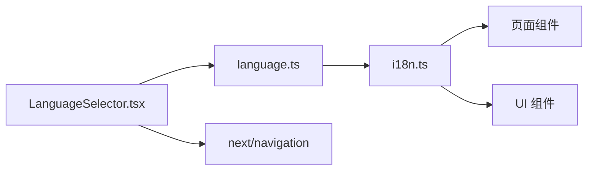

# 国际化系统

<cite>
**本文引用的文件**
- [src/lib/i18n.ts](file://src/lib/i18n.ts)
- [src/lib/language.ts](file://src/lib/language.ts)
- [src/components/LanguageSelector.tsx](file://src/components/LanguageSelector.tsx)
- [src/app/[lang]/layout.tsx](file://src/app/[lang]/layout.tsx)
- [src/app/layout.tsx](file://src/app/layout.tsx)
- [src/app/[lang]/page.tsx](file://src/app/[lang]/page.tsx)
- [src/components/SiteHeader.tsx](file://src/components/SiteHeader.tsx)
- [src/components/SiteFooter.tsx](file://src/components/SiteFooter.tsx)
- [src/locales/en.json](file://src/locales/en.json)
- [src/locales/es.json](file://src/locales/es.json)
- [src/locales/zh.json](file://src/locales/zh.json)
</cite>

## 更新摘要
**所做更改**
- 更新了支持的语言列表，从8种语言简化为3种语言（英语、西班牙语、中文）
- 移除了已删除的翻译文件引用（de-DE.json、fr.json、ja.json、pt-PT.json、zh-TW.json）
- 更新了语言配置文档以反映当前的语言支持状态
- 保持了整体文档结构和一致性

## 目录
1. [简介](#简介)
2. [项目结构](#项目结构)
3. [核心组件](#核心组件)
4. [架构总览](#架构总览)
5. [详细组件分析](#详细组件分析)
6. [依赖关系分析](#依赖关系分析)
7. [性能考量](#性能考量)
8. [故障排查指南](#故障排查指南)
9. [结论](#结论)
10. [附录](#附录)

## 简介
本文件为 Weable 的国际化（i18n）系统提供全面文档，涵盖动态多语言支持、语言检测与解析、翻译加载、缓存策略、语言包组织与文件格式、支持语言列表与键值管理、组件内使用方式（基础翻译、参数化、复数扩展）、语言切换与默认语言设置、区域格式化、新增语言步骤、翻译工作流、SEO 优化策略，以及与 Next.js App Router 的集成和客户端渲染优化。

**更新** 当前系统支持3种语言：英语（en）、西班牙语（es）和简体中文（zh），相比之前的8种语言进行了精简优化。

## 项目结构
Weable 采用基于路由前缀的多语言路由模式：所有页面位于 src/app/[lang] 下，通过 URL 中的 lang 段决定当前语言。翻译资源以 JSON 文件形式存放于 src/locales，按语言代码命名。核心 i18n 逻辑集中在 src/lib 下的 i18n.ts 与 language.ts。



**图表来源**
- [src/app/layout.tsx:1-8](file://src/app/layout.tsx#L1-L8)
- [src/app/[lang]/layout.tsx:1-48](file://src/app/[lang]/layout.tsx#L1-L48)
- [src/app/[lang]/page.tsx:1-172](file://src/app/[lang]/page.tsx#L1-L172)
- [src/components/SiteHeader.tsx:1-46](file://src/components/SiteHeader.tsx#L1-L46)
- [src/components/SiteFooter.tsx:1-17](file://src/components/SiteFooter.tsx#L1-L17)
- [src/components/LanguageSelector.tsx:1-34](file://src/components/LanguageSelector.tsx#L1-L34)
- [src/lib/i18n.ts:1-18](file://src/lib/i18n.ts#L1-L18)
- [src/lib/language.ts:1-34](file://src/lib/language.ts#L1-L34)

**章节来源**
- [src/app/layout.tsx:1-8](file://src/app/layout.tsx#L1-L8)
- [src/app/[lang]/layout.tsx:1-48](file://src/app/[lang]/layout.tsx#L1-L48)
- [src/lib/i18n.ts:1-18](file://src/lib/i18n.ts#L1-L18)
- [src/lib/language.ts:1-34](file://src/lib/language.ts#L1-L34)

## 核心组件
- 语言常量与检测（language.ts）
  - 定义支持的语言键与名称，导出默认语言、未知语言标记、受支持语言列表。
  - 使用 accept-language 库对请求头或输入字符串进行语言匹配，返回目标语言或回退语言。
  - 提供 isValidLang 类型守卫，确保传入语言键有效。

- 翻译函数（i18n.ts）
  - 静态导入各语言 JSON 文件，构建语言到消息对象的映射。
  - 暴露 t(lang, key) 函数：优先返回指定语言的键值；若缺失则回退至英文；仍缺失则返回键名本身。
  - 通过 TypeScript 类型约束保证键的类型安全。

- 语言选择器（LanguageSelector.tsx）
  - 客户端组件，使用 next/navigation 的 router.push 实现无刷新跳转至新语言路径。
  - 根据 currentLang 与 pathSuffix 生成目标 URL，保持页面片段一致。

- 语言布局（[lang]/layout.tsx）
  - 校验语言有效性，无效时返回 404。
  - 通过 generateMetadata 设置每个语言的 SEO 元信息（标题、描述、OpenGraph）。
  - 通过 generateStaticParams 预生成所有支持语言的静态路由。
  - 设置 html.lang 属性，提升可访问性与 SEO。

- 页面与组件中的翻译使用
  - 在服务器组件中直接调用 t(lang, key) 获取文案。
  - 在客户端组件中通过 props 传递 lang 并调用 t。
  - 示例包括首页、频道页以及站点头部/底部等。

**章节来源**
- [src/lib/language.ts:1-34](file://src/lib/language.ts#L1-L34)
- [src/lib/i18n.ts:1-18](file://src/lib/i18n.ts#L1-L18)
- [src/components/LanguageSelector.tsx:1-34](file://src/components/LanguageSelector.tsx#L1-L34)
- [src/app/[lang]/layout.tsx:1-48](file://src/app/[lang]/layout.tsx#L1-L48)
- [src/app/[lang]/page.tsx:1-172](file://src/app/[lang]/page.tsx#L1-L172)
- [src/components/SiteHeader.tsx:1-46](file://src/components/SiteHeader.tsx#L1-L46)
- [src/components/SiteFooter.tsx:1-17](file://src/components/SiteFooter.tsx#L1-L17)

## 架构总览
下图展示了从浏览器请求到翻译渲染的关键流程，包括语言检测、路由解析、元数据生成、翻译加载与渲染。



**图表来源**
- [src/app/[lang]/layout.tsx:1-48](file://src/app/[lang]/layout.tsx#L1-L48)
- [src/app/[lang]/page.tsx:1-172](file://src/app/[lang]/page.tsx#L1-L172)
- [src/lib/i18n.ts:1-18](file://src/lib/i18n.ts#L1-L18)
- [src/lib/language.ts:1-34](file://src/lib/language.ts#L1-L34)

## 详细组件分析

### 语言检测与路由解析
- 语言检测
  - 使用 accept-language 对原始语言字符串进行匹配，结合 supportedKeys 判断是否受支持。
  - getTargetLang(rawLang, fallback) 返回匹配到的语言或回退语言。
  - isValidLang(lang) 用于类型守卫与路由校验。

- 路由解析
  - [lang]/layout.tsx 中通过 await params 获取 lang，并使用 notFound() 处理无效语言。
  - generateStaticParams() 预生成所有支持语言的静态路由，利于 SSR 与 SEO。



**图表来源**
- [src/app/[lang]/layout.tsx:1-48](file://src/app/[lang]/layout.tsx#L1-L48)
- [src/lib/language.ts:1-34](file://src/lib/language.ts#L1-L34)

**章节来源**
- [src/app/[lang]/layout.tsx:1-48](file://src/app/[lang]/layout.tsx#L1-L48)
- [src/lib/language.ts:1-34](file://src/lib/language.ts#L1-L34)

### 翻译加载与回退机制
- 翻译加载
  - i18n.ts 静态导入各语言 JSON，构建 locales 映射。
  - t(lang, key) 优先取目标语言键值，缺失则回退英文，再缺失返回键名。

- 类型安全
  - 通过 TypeScript 类型约束，确保 key 与语言对象字段一致。

```mermaid
classDiagram
class I18n {
+t(lang, key) string
-locales : Record~LangKey, LocaleMessages~
}
class Language {
+supportedLanguages : {key,name}[]
+defaultLanguage : LangKey
+getTargetLang(rawLang, fallback) string
+isValidLang(lang) bool
}
class LocaleMessages {
<<interface>>
+siteName : string
+homeTitle : string
+... : any
}
I18n --> Language : "使用 LangKey 类型"
I18n --> LocaleMessages : "映射语言到消息"
```

**图表来源**
- [src/lib/i18n.ts:1-18](file://src/lib/i18n.ts#L1-L18)
- [src/lib/language.ts:1-34](file://src/lib/language.ts#L1-L34)

**章节来源**
- [src/lib/i18n.ts:1-18](file://src/lib/i18n.ts#L1-L18)
- [src/locales/en.json:1-82](file://src/locales/en.json#L1-L82)
- [src/locales/es.json:1-82](file://src/locales/es.json#L1-L82)
- [src/locales/zh.json:1-82](file://src/locales/zh.json#L1-L82)

### 语言切换与客户端导航
- LanguageSelector 组件
  - 使用 next/navigation 的 router.push 将用户重定向到新的语言路径。
  - 支持 pathSuffix 参数，保持页面片段不变。

- 使用场景
  - 站点头部包含语言选择器，用户可在任意页面切换语言。



**图表来源**
- [src/components/LanguageSelector.tsx:1-34](file://src/components/LanguageSelector.tsx#L1-L34)
- [src/app/[lang]/layout.tsx:1-48](file://src/app/[lang]/layout.tsx#L1-L48)

**章节来源**
- [src/components/LanguageSelector.tsx:1-34](file://src/components/LanguageSelector.tsx#L1-L34)
- [src/components/SiteHeader.tsx:1-46](file://src/components/SiteHeader.tsx#L1-L46)

### 页面与组件中的翻译使用
- 服务器组件
  - 在页面组件中直接调用 t(lang, key)，如首页、频道页。
  - 通过 generateMetadata 设置 SEO 元数据。

- 客户端组件
  - 通过 props 接收 lang，并在组件内部调用 t。
  - 搜索框、站点头部/底部等均使用此模式。



**图表来源**
- [src/app/[lang]/page.tsx:1-172](file://src/app/[lang]/page.tsx#L1-L172)
- [src/components/SiteHeader.tsx:1-46](file://src/components/SiteHeader.tsx#L1-L46)
- [src/components/SiteFooter.tsx:1-17](file://src/components/SiteFooter.tsx#L1-L17)

**章节来源**
- [src/app/[lang]/page.tsx:1-172](file://src/app/[lang]/page.tsx#L1-L172)
- [src/components/SiteHeader.tsx:1-46](file://src/components/SiteHeader.tsx#L1-L46)
- [src/components/SiteFooter.tsx:1-17](file://src/components/SiteFooter.tsx#L1-L17)

## 依赖关系分析
- 模块耦合
  - i18n.ts 依赖 language.ts 的 LangKey 类型与语言常量。
  - 页面与组件依赖 i18n.ts 的 t 函数。
  - LanguageSelector 依赖 next/navigation 与 language.ts 的支持语言列表。

- 外部依赖
  - accept-language 用于语言检测。
  - next/navigation 用于客户端路由跳转。



**图表来源**
- [src/lib/language.ts:1-34](file://src/lib/language.ts#L1-L34)
- [src/lib/i18n.ts:1-18](file://src/lib/i18n.ts#L1-L18)
- [src/components/LanguageSelector.tsx:1-34](file://src/components/LanguageSelector.tsx#L1-L34)

**章节来源**
- [src/lib/language.ts:1-34](file://src/lib/language.ts#L1-L34)
- [src/lib/i18n.ts:1-18](file://src/lib/i18n.ts#L1-L18)
- [src/components/LanguageSelector.tsx:1-34](file://src/components/LanguageSelector.tsx#L1-L34)

## 性能考量
- 静态导入语言资源
  - i18n.ts 使用静态 import 加载 JSON，便于打包工具进行 tree-shaking 与按需加载。
  - 建议仅引入需要的语言文件，减少包体积。

- 回退机制
  - 当目标语言缺少键值时，自动回退到英文或键名，避免运行时错误。
  - 建议在开发阶段启用缺失键检查，确保翻译完整性。

- 客户端导航
  - LanguageSelector 使用客户端路由跳转，避免全量刷新，提升用户体验。
  - 注意避免频繁的路由切换导致不必要的重渲染。

- SEO 优化
  - generateMetadata 在每个语言路由上设置独立的 title、description 与 OpenGraph。
  - html.lang 属性提升搜索引擎对多语言内容的识别。

**章节来源**
- [src/lib/i18n.ts:1-18](file://src/lib/i18n.ts#L1-L18)
- [src/app/[lang]/layout.tsx:1-48](file://src/app/[lang]/layout.tsx#L1-L48)
- [src/components/LanguageSelector.tsx:1-34](file://src/components/LanguageSelector.tsx#L1-L34)

## 故障排查指南
- 语言无效导致 404
  - 现象：访问 /xxx/ 时返回 404。
  - 原因：params.lang 不在 supportedLanguages 列表中。
  - 解决：检查语言常量定义与路由参数。

- 翻译键缺失
  - 现象：显示英文或键名而非预期文案。
  - 原因：目标语言 JSON 中缺少对应键。
  - 解决：在对应语言文件中添加缺失键，或检查键名拼写。

- 客户端路由跳转失败
  - 现象：点击语言选择器后页面未更新。
  - 原因：pathSuffix 参数错误或 router.push 调用异常。
  - 解决：检查组件 props 与路由拼接逻辑。

**章节来源**
- [src/app/[lang]/layout.tsx:1-48](file://src/app/[lang]/layout.tsx#L1-L48)
- [src/lib/i18n.ts:1-18](file://src/lib/i18n.ts#L1-L18)
- [src/components/LanguageSelector.tsx:1-34](file://src/components/LanguageSelector.tsx#L1-L34)

## 结论
Weable 的国际化系统基于 Next.js App Router 与静态 JSON 资源，实现了简洁高效的多语言支持。通过语言检测、翻译加载与回退机制，确保了良好的用户体验与 SEO 表现。当前系统支持3种核心语言（英语、西班牙语、中文），未来可扩展更多语言或增加参数化翻译、复数形式处理与缓存机制，进一步提升灵活性与性能。

## 附录

### 支持的语言列表
- 英语（en）- 默认语言
- 西班牙语（es）
- 简体中文（zh）

**更新** 系统已从原来的8种语言精简为3种核心语言，专注于主要市场的需求。

**章节来源**
- [src/lib/language.ts:1-34](file://src/lib/language.ts#L1-L34)

### 翻译键值对管理
- 键命名规范：使用小写字母与驼峰命名，如 siteName、homeTitle。
- 层级结构：扁平化 JSON 结构，便于维护与查找。
- 类型安全：通过 TypeScript 类型约束确保键的有效性。

**章节来源**
- [src/locales/en.json:1-82](file://src/locales/en.json#L1-L82)
- [src/locales/es.json:1-82](file://src/locales/es.json#L1-L82)
- [src/locales/zh.json:1-82](file://src/locales/zh.json#L1-L82)

### 组件中使用翻译函数的示例
- 基础翻译：t(lang, "siteName")
- SEO 元数据：generateMetadata 中调用 t 设置标题与描述
- 客户端组件：通过 props 传递 lang 并调用 t

**章节来源**
- [src/app/[lang]/page.tsx:1-172](file://src/app/[lang]/page.tsx#L1-L172)
- [src/components/SiteHeader.tsx:1-46](file://src/components/SiteHeader.tsx#L1-L46)

### 新增语言步骤指南
1. 在 src/lib/language.ts 中添加新语言常量与名称。
2. 在 src/locales 目录下创建新语言 JSON 文件，复制现有键值并翻译。
3. 在 src/lib/i18n.ts 中导入新语言文件并添加到 locales 映射。
4. 测试语言切换与翻译显示。

**章节来源**
- [src/lib/language.ts:1-34](file://src/lib/language.ts#L1-L34)
- [src/lib/i18n.ts:1-18](file://src/lib/i18n.ts#L1-L18)

### 翻译工作流程
- 设计阶段：确定翻译键与层级结构。
- 开发阶段：在组件中调用 t 函数，确保键名一致。
- 测试阶段：验证各语言显示效果与回退机制。
- 发布阶段：同步更新所有语言文件，确保一致性。

**章节来源**
- [src/lib/i18n.ts:1-18](file://src/lib/i18n.ts#L1-L18)
- [src/components/SiteHeader.tsx:1-46](file://src/components/SiteHeader.tsx#L1-L46)

### SEO 优化策略
- 每个语言路由设置独立的 title、description 与 OpenGraph。
- 使用 html.lang 属性标识页面语言。
- 预生成静态路由以提升爬虫抓取效率。

**章节来源**
- [src/app/[lang]/layout.tsx:1-48](file://src/app/[lang]/layout.tsx#L1-L48)

### 与 Next.js App Router 的集成
- 使用 [lang] 动态路由段实现多语言路径。
- 通过 generateStaticParams 预生成静态路由。
- 在服务器组件中直接使用 t 函数，避免客户端开销。

**章节来源**
- [src/app/[lang]/layout.tsx:1-48](file://src/app/[lang]/layout.tsx#L1-L48)
- [src/app/[lang]/page.tsx:1-172](file://src/app/[lang]/page.tsx#L1-L172)

### 客户端渲染优化
- 使用 "use client" 标记客户端组件，如 LanguageSelector。
- 通过 next/navigation 实现无刷新路由跳转。
- 避免在客户端重复加载语言资源，利用静态导入优化性能。

**章节来源**
- [src/components/LanguageSelector.tsx:1-34](file://src/components/LanguageSelector.tsx#L1-L34)
- [src/lib/i18n.ts:1-18](file://src/lib/i18n.ts#L1-L18)