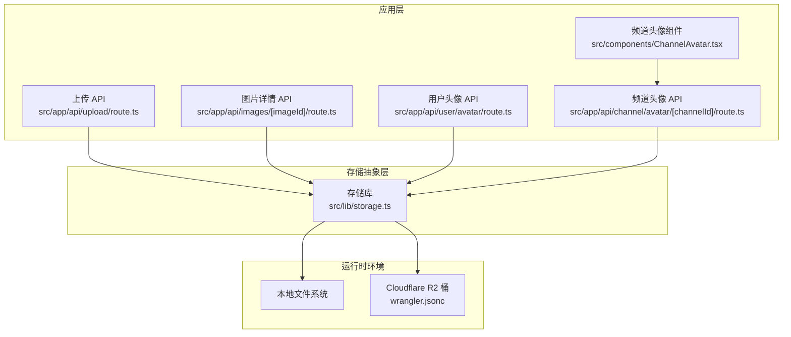
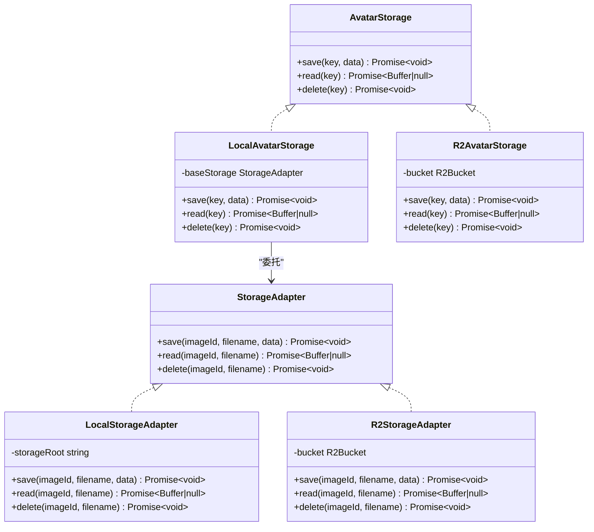
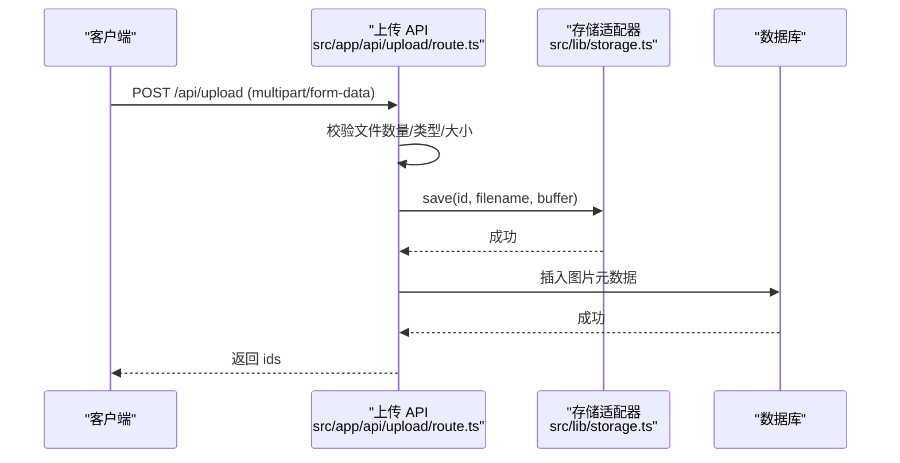
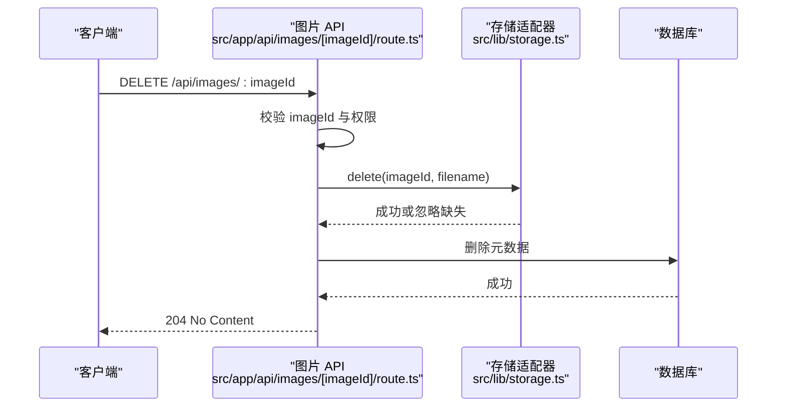
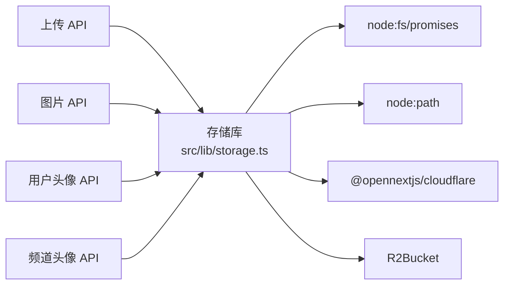

# 存储系统

<cite>
**本文引用的文件**   
- [src/lib/storage.ts](file://src/lib/storage.ts)
- [wrangler.jsonc](file://wrangler.jsonc)
- [src/app/api/upload/route.ts](file://src/app/api/upload/route.ts)
- [src/app/api/images/[imageId]/route.ts](file://src/app/api/images/[imageId]/route.ts)
- [src/app/api/user/avatar/route.ts](file://src/app/api/user/avatar/route.ts)
- [src/app/api/channel/avatar/[channelId]/route.ts](file://src/app/api/channel/avatar/[channelId]/route.ts)
- [src/components/ChannelAvatar.tsx](file://src/components/ChannelAvatar.tsx)
</cite>

## 目录
1. [简介](#简介)
2. [项目结构](#项目结构)
3. [核心组件](#核心组件)
4. [架构总览](#架构总览)
5. [详细组件分析](#详细组件分析)
6. [依赖关系分析](#依赖关系分析)
7. [性能考量](#性能考量)
8. [故障排查指南](#故障排查指南)
9. [结论](#结论)
10. [附录：使用示例与配置说明](#附录使用示例与配置说明)

## 简介
本文件为 Weable 的存储系统提供系统化文档，重点阐述存储适配器的设计模式与实现原理，包括 StorageAdapter 与 AvatarStorage 接口定义、LocalStorageAdapter 与 R2StorageAdapter 的具体实现、头像存储适配器 LocalAvatarStorage 与 R2AvatarStorage 的设计思路，以及存储实例的单例模式与环境自动检测逻辑。同时给出 API 层的使用方式、配置选项说明、性能优化建议与常见问题解决方案，帮助读者快速理解并正确使用该存储子系统。

## 项目结构
存储系统的核心代码集中在 src/lib/storage.ts，通过统一的接口暴露给上层 API 路由与组件使用。R2 绑定在 wrangler.jsonc 中声明，用于 Cloudflare Workers 环境下的对象存储访问。API 路由负责接收请求、校验参数、调用存储接口完成读写操作。

图表来源 
- [src/lib/storage.ts:1-214](file://src/lib/storage.ts#L1-L214)
- [wrangler.jsonc:1-34](file://wrangler.jsonc#L1-L34)
- [src/app/api/upload/route.ts:1-75](file://src/app/api/upload/route.ts#L1-L75)
- [src/app/api/images/[imageId]/route.ts:1-84](file://src/app/api/images/[imageId]/route.ts#L1-L84)
- [src/app/api/user/avatar/route.ts:1-34](file://src/app/api/user/avatar/route.ts#L1-L34)
- [src/app/api/channel/avatar/[channelId]/route.ts:1-64](file://src/app/api/channel/avatar/[channelId]/route.ts#L1-L64)
- [src/components/ChannelAvatar.tsx:1-30](file://src/components/ChannelAvatar.tsx#L1-L30)

章节来源
- [src/lib/storage.ts:1-214](file://src/lib/storage.ts#L1-L214)
- [wrangler.jsonc:1-34](file://wrangler.jsonc#L1-L34)

## 核心组件
- 存储适配器接口 StorageAdapter：定义 save、read、delete 三个方法，统一对“图片”类资源的增删改查。
- 头像存储接口 AvatarStorage：定义 save、read、delete 三个方法，专门针对头像资源（key 语义不同）。
- 本地存储适配器 LocalStorageAdapter：基于 Node.js 文件系统实现，路径解析包含安全段验证与目录创建。
- R2 存储适配器 R2StorageAdapter：基于 Cloudflare R2 对象存储实现，键名生成包含安全段验证。
- 头像存储适配器 LocalAvatarStorage：复用底层 StorageAdapter，将头像 key 映射到固定命名空间。
- 头像存储适配器 R2AvatarStorage：直接操作 R2 桶，头像 key 前缀为 avatar/。
- 单例工厂函数 getStorage() 与 getAvatarStorage()：根据运行环境自动选择后端，并在进程内缓存实例。

章节来源
- [src/lib/storage.ts:3-13](file://src/lib/storage.ts#L3-L13)
- [src/lib/storage.ts:61-114](file://src/lib/storage.ts#L61-L114)
- [src/lib/storage.ts:116-136](file://src/lib/storage.ts#L116-L136)
- [src/lib/storage.ts:138-152](file://src/lib/storage.ts#L138-L152)
- [src/lib/storage.ts:154-179](file://src/lib/storage.ts#L154-L179)
- [src/lib/storage.ts:181-214](file://src/lib/storage.ts#L181-L214)

## 架构总览
存储系统采用适配器模式，屏蔽底层存储差异（本地文件系统 vs R2），向上层 API 提供一致的操作接口。getStorage() 与 getAvatarStorage() 作为工厂函数，依据环境变量和运行时上下文自动选择具体实现，并通过模块级变量实现单例缓存，避免重复初始化开销。

图表来源 
- [src/lib/storage.ts:3-13](file://src/lib/storage.ts#L3-L13)
- [src/lib/storage.ts:61-114](file://src/lib/storage.ts#L61-L114)
- [src/lib/storage.ts:116-136](file://src/lib/storage.ts#L116-L136)
- [src/lib/storage.ts:138-152](file://src/lib/storage.ts#L138-L152)
- [src/lib/storage.ts:154-179](file://src/lib/storage.ts#L154-L179)

## 详细组件分析

### StorageAdapter 与 AvatarStorage 接口
- StorageAdapter：面向“图片”资源，以 imageId 与 filename 定位文件；返回 Buffer 或 null。
- AvatarStorage：面向“头像”资源，以 key 定位；返回 Buffer 或 null。
- 两者均提供 save/read/delete 三件套，便于上层统一处理。

章节来源
- [src/lib/storage.ts:3-13](file://src/lib/storage.ts#L3-L13)

### LocalStorageAdapter（本地文件系统）
- 路径解析：通过 resolveStoragePath 拼接 storageRoot、imageId、filename，并进行安全段校验，防止目录穿越。
- 写入：递归创建目录后写入文件。
- 读取：捕获 ENOENT 错误返回 null，其他错误抛出。
- 删除：捕获 ENOENT 错误视为成功，其他错误抛出。
- 性能：按需动态导入 fs/promises 与 path，减少冷启动开销。

章节来源
- [src/lib/storage.ts:27-33](file://src/lib/storage.ts#L27-L33)
- [src/lib/storage.ts:61-114](file://src/lib/storage.ts#L61-L114)

### R2StorageAdapter（Cloudflare R2）
- 键名生成：resolveR2ObjectKey 拼接 imageId/filename，并进行安全段校验。
- 写入：将 Buffer 转为 Uint8Array 后 put 到桶。
- 读取：获取对象并转换为 ArrayBuffer，再转回 Buffer；不存在返回 null。
- 删除：直接 delete 对象键。

章节来源
- [src/lib/storage.ts:46-59](file://src/lib/storage.ts#L46-L59)
- [src/lib/storage.ts:116-136](file://src/lib/storage.ts#L116-L136)

### LocalAvatarStorage（头像-本地）
- 通过 baseStorage 委托底层 StorageAdapter，将头像 key 映射到固定命名空间 "__avatar__"。
- 简化了头像存储的 key 管理，无需关心底层路径细节。

章节来源
- [src/lib/storage.ts:138-152](file://src/lib/storage.ts#L138-L152)

### R2AvatarStorage（头像-R2）
- 键名前缀为 avatar/，并对 key 进行安全段校验。
- 读写流程与 R2StorageAdapter 类似，但针对头像场景优化键空间隔离。

章节来源
- [src/lib/storage.ts:154-179](file://src/lib/storage.ts#L154-L179)

### 单例与环境自动检测
- getStorage()：优先尝试从 Cloudflare Context 获取 IMAGES_BUCKET 绑定；若存在则返回 R2StorageAdapter 实例；否则在 CF 环境下抛错提示未配置；非 CF 环境返回 LocalStorageAdapter 实例。
- getAvatarStorage()：同理，优先 R2AvatarStorage，否则在 CF 环境抛错；非 CF 环境返回 LocalAvatarStorage(getStorage())。
- 模块级变量缓存实例，确保单例。

章节来源
- [src/lib/storage.ts:181-214](file://src/lib/storage.ts#L181-L214)
- [wrangler.jsonc:23-32](file://wrangler.jsonc#L23-L32)

### API 层使用示例

#### 图片上传（批量）
- 入口：POST /api/upload
- 校验：限制 MIME 前缀、最大文件数、单文件大小。
- 存储：遍历文件，生成 id，保存至存储后端，然后写入数据库元数据。

图表来源 
- [src/app/api/upload/route.ts:14-74](file://src/app/api/upload/route.ts#L14-L74)
- [src/lib/storage.ts:61-114](file://src/lib/storage.ts#L61-L114)
- [src/lib/storage.ts:116-136](file://src/lib/storage.ts#L116-L136)

章节来源
- [src/app/api/upload/route.ts:1-75](file://src/app/api/upload/route.ts#L1-L75)

#### 图片删除
- 入口：DELETE /api/images/:imageId
- 校验：imageId 格式与权限。
- 存储：调用 storage.delete(imageId, filename)，忽略缺失错误。
- 数据库：删除元数据记录。

图表来源 
- [src/app/api/images/[imageId]/route.ts:12-38](file://src/app/api/images/[imageId]/route.ts#L12-L38)
- [src/lib/storage.ts:61-114](file://src/lib/storage.ts#L61-L114)
- [src/lib/storage.ts:116-136](file://src/lib/storage.ts#L116-L136)

章节来源
- [src/app/api/images/[imageId]/route.ts:1-84](file://src/app/api/images/[imageId]/route.ts#L1-L84)

#### 用户头像上传
- 入口：POST /api/user/avatar
- 校验：MIME 类型、大小限制。
- 存储：getAvatarStorage().save(`user_${userId}`, buffer)。

章节来源
- [src/app/api/user/avatar/route.ts:1-34](file://src/app/api/user/avatar/route.ts#L1-L34)

#### 频道头像读取与上传
- 读取：GET /api/channel/avatar/:channelId，返回二进制流，设置缓存头。
- 上传：POST /api/channel/avatar/:channelId，校验 channelId 与权限，保存头像。

章节来源
- [src/app/api/channel/avatar/[channelId]/route.ts:1-64](file://src/app/api/channel/avatar/[channelId]/route.ts#L1-L64)

#### 前端组件使用
- ChannelAvatar 组件通过 img 标签请求 /api/channel/avatar/:channelId，失败时显示首字母占位。

章节来源
- [src/components/ChannelAvatar.tsx:1-30](file://src/components/ChannelAvatar.tsx#L1-L30)

## 依赖关系分析
- 存储库依赖 node:fs/promises、node:path（本地实现）、@opennextjs/cloudflare（CF 上下文获取）、R2Bucket（R2 实现）。
- API 路由依赖存储库提供的 getStorage()/getAvatarStorage() 工厂函数。
- 运行时环境由 wrangler.jsonc 声明 R2 绑定名称与桶名。

图表来源 
- [src/lib/storage.ts:1-53](file://src/lib/storage.ts#L1-L53)
- [wrangler.jsonc:23-32](file://wrangler.jsonc#L23-L32)
- [src/app/api/upload/route.ts:1-75](file://src/app/api/upload/route.ts#L1-L75)
- [src/app/api/images/[imageId]/route.ts:1-84](file://src/app/api/images/[imageId]/route.ts#L1-L84)
- [src/app/api/user/avatar/route.ts:1-34](file://src/app/api/user/avatar/route.ts#L1-L34)
- [src/app/api/channel/avatar/[channelId]/route.ts:1-64](file://src/app/api/channel/avatar/[channelId]/route.ts#L1-L64)

章节来源
- [src/lib/storage.ts:1-53](file://src/lib/storage.ts#L1-L53)
- [wrangler.jsonc:23-32](file://wrangler.jsonc#L23-L32)

## 性能考量
- 懒加载模块：fs/promises、path 等按需 import，降低冷启动时间。
- 单例缓存：getStorage()/getAvatarStorage() 在进程内缓存实例，避免重复构造。
- 流式处理：头像读取返回 Uint8Array，适合浏览器直接渲染。
- 并发上传：上传 API 支持批量文件，注意服务端限流与内存占用控制。
- 缓存策略：头像读取设置 Cache-Control，提升 CDN/浏览器缓存命中率。
- I/O 优化：本地存储递归创建目录，避免多次 mkdir 调用；R2 写入直接 put，减少中间转换。

[本节为通用指导，不直接分析具体文件]

## 故障排查指南
- R2 绑定未配置
  - 现象：在 CF 环境中调用 getStorage()/getAvatarStorage() 抛错提示未配置 IMAGES_BUCKET。
  - 排查：检查 wrangler.jsonc 的 r2_buckets 配置与 binding 名称是否匹配。
  - 参考：[wrangler.jsonc:23-32](file://wrangler.jsonc#L23-L32)、[src/lib/storage.ts:186-193](file://src/lib/storage.ts#L186-L193)、[src/lib/storage.ts:201-208](file://src/lib/storage.ts#L201-L208)

- 文件路径安全问题
  - 现象：imageId 或 filename 包含 “.”、“..”、“/”、“\” 导致抛错。
  - 排查：确保传入的 imageId 与 filename 仅包含安全字符；查看 assertSafeSegment 校验逻辑。
  - 参考：[src/lib/storage.ts:15-25](file://src/lib/storage.ts#L15-L25)、[src/lib/storage.ts:27-33](file://src/lib/storage.ts#L27-L33)、[src/lib/storage.ts:55-59](file://src/lib/storage.ts#L55-L59)

- 读取不到文件或删除报错
  - 现象：read 返回 null；delete 抛错。
  - 排查：确认文件是否存在；本地存储 ENOENT 被吞掉视为成功；其他错误需检查权限与路径。
  - 参考：[src/lib/storage.ts:75-93](file://src/lib/storage.ts#L75-L93)、[src/lib/storage.ts:95-113](file://src/lib/storage.ts#L95-L113)

- 上传类型或大小限制
  - 现象：上传被拒绝，返回 400。
  - 排查：检查 ALLOWED_TYPES/MIME_PREFIXES 与 MAX_SIZE/MAX_FILE_SIZE_BYTES；确认前端表单字段名为 file。
  - 参考：[src/app/api/user/avatar/route.ts:7-8](file://src/app/api/user/avatar/route.ts#L7-L8)、[src/app/api/channel/avatar/[channelId]/route.ts:7-8](file://src/app/api/channel/avatar/[channelId]/route.ts#L7-L8)、[src/app/api/upload/route.ts:10-12](file://src/app/api/upload/route.ts#L10-L12)

- 频道 ID 校验失败
  - 现象：GET/POST 频道头像返回 400。
  - 排查：确保 channelId 符合 /^[a-zA-Z0-9_-]+$/ 正则。
  - 参考：[src/app/api/channel/avatar/[channelId]/route.ts:15-17](file://src/app/api/channel/avatar/[channelId]/route.ts#L15-L17)、[src/app/api/channel/avatar/[channelId]/route.ts:37-39](file://src/app/api/channel/avatar/[channelId]/route.ts#L37-L39)

章节来源
- [src/lib/storage.ts:15-25](file://src/lib/storage.ts#L15-L25)
- [src/lib/storage.ts:75-113](file://src/lib/storage.ts#L75-L113)
- [src/lib/storage.ts:186-208](file://src/lib/storage.ts#L186-L208)
- [wrangler.jsonc:23-32](file://wrangler.jsonc#L23-L32)
- [src/app/api/user/avatar/route.ts:7-8](file://src/app/api/user/avatar/route.ts#L7-L8)
- [src/app/api/channel/avatar/[channelId]/route.ts:7-8](file://src/app/api/channel/avatar/[channelId]/route.ts#L7-L8)
- [src/app/api/upload/route.ts:10-12](file://src/app/api/upload/route.ts#L10-L12)

## 结论
Weable 的存储系统通过清晰的接口设计与适配器模式，实现了本地文件系统与 Cloudflare R2 的统一抽象。单例工厂与环境自动检测确保了在不同部署环境下的无缝切换。API 层对输入进行严格校验，结合安全段验证与错误处理机制，提升了系统的健壮性与可维护性。在生产环境中建议启用 R2 以获得更好的可扩展性与可用性，并结合缓存策略与限流机制优化性能。

[本节为总结，不直接分析具体文件]

## 附录：使用示例与配置说明

### 使用不同的存储后端
- 默认行为：在 CF 环境且配置了 IMAGES_BUCKET 时使用 R2；否则在非 CF 环境使用本地文件系统。
- 头像存储：同样遵循上述规则，自动选择 R2AvatarStorage 或 LocalAvatarStorage。
- 示例路径：
  - 图片上传：[src/app/api/upload/route.ts:51-58](file://src/app/api/upload/route.ts#L51-L58)
  - 图片删除：[src/app/api/images/[imageId]/route.ts:32-33](file://src/app/api/images/[imageId]/route.ts#L32-L33)
  - 用户头像上传：[src/app/api/user/avatar/route.ts:28-30](file://src/app/api/user/avatar/route.ts#L28-L30)
  - 频道头像读取/上传：[src/app/api/channel/avatar/[channelId]/route.ts:19-21](file://src/app/api/channel/avatar/[channelId]/route.ts#L19-L21)、[src/app/api/channel/avatar/[channelId]/route.ts:58-60](file://src/app/api/channel/avatar/[channelId]/route.ts#L58-L60)

### 配置选项说明
- R2 绑定：在 wrangler.jsonc 中声明 r2_buckets，binding 名称必须与代码中使用的 IMAGERS_BUCKET 一致。
- 本地存储根路径：LocalStorageAdapter 构造函数默认使用 process.env.IMAGE_STORAGE_PATH 或 "./.data/uploads"。
- 上传限制：各 API 定义了允许的类型与大小上限，可按业务需求调整。

章节来源
- [wrangler.jsonc:23-32](file://wrangler.jsonc#L23-L32)
- [src/lib/storage.ts:62-64](file://src/lib/storage.ts#L62-L64)
- [src/app/api/upload/route.ts:10-12](file://src/app/api/upload/route.ts#L10-L12)
- [src/app/api/user/avatar/route.ts:7-8](file://src/app/api/user/avatar/route.ts#L7-L8)
- [src/app/api/channel/avatar/[channelId]/route.ts:7-8](file://src/app/api/channel/avatar/[channelId]/route.ts#L7-L8)

### 性能优化建议
- 启用 R2 并使用 CDN 缓存头像读取响应（已设置 Cache-Control）。
- 批量上传时限制并发与总大小，避免内存峰值过高。
- 本地存储建议使用 SSD 磁盘以提升 I/O 性能。
- 对高频读写的头像资源考虑引入边缘缓存或对象存储的分片下载。

[本节为通用指导，不直接分析具体文件]