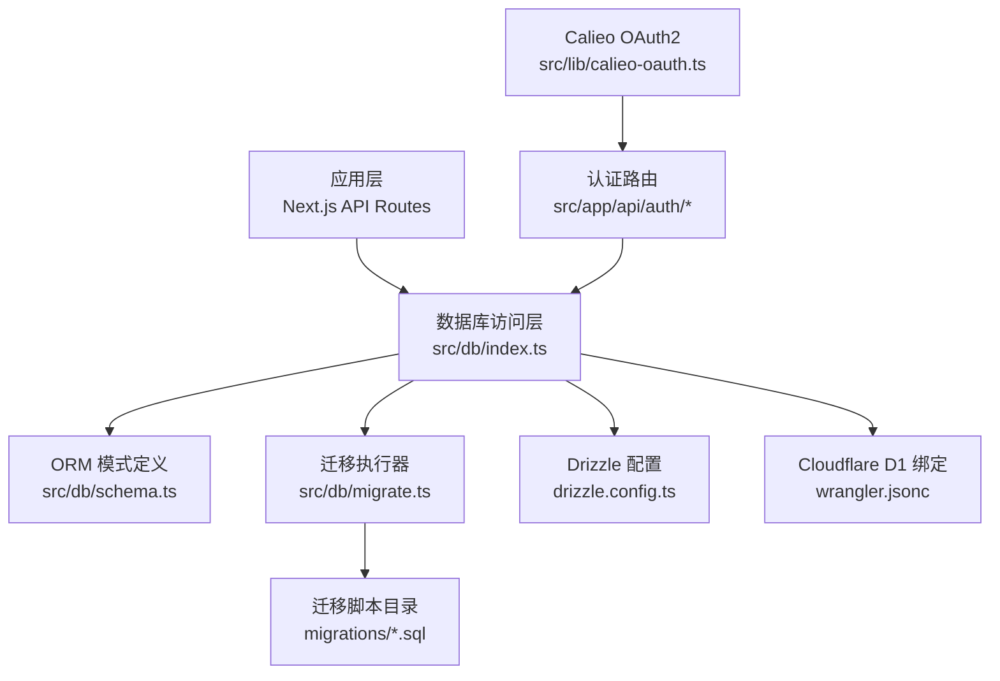
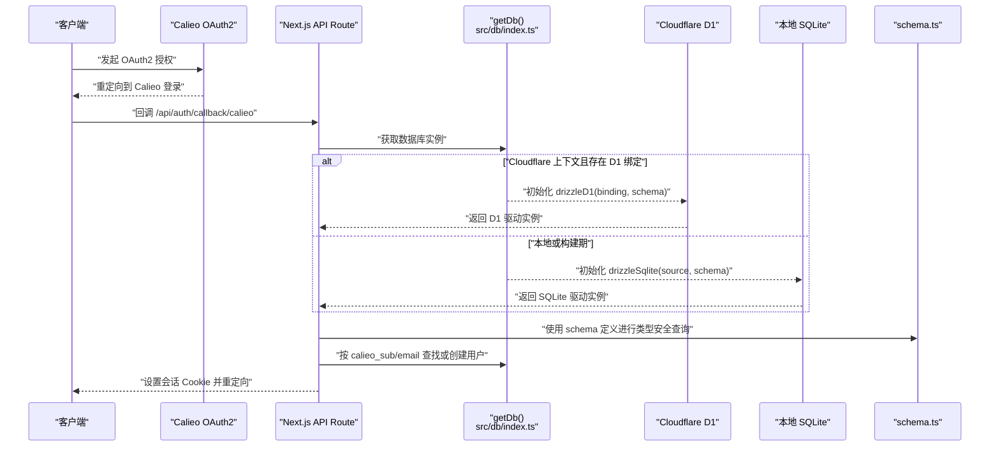
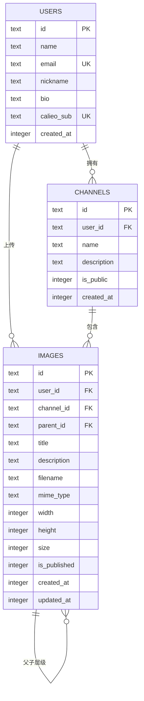
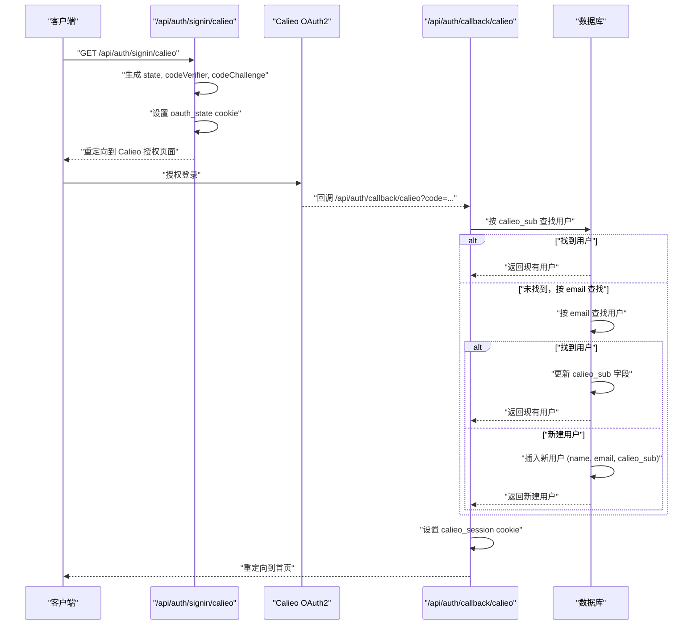
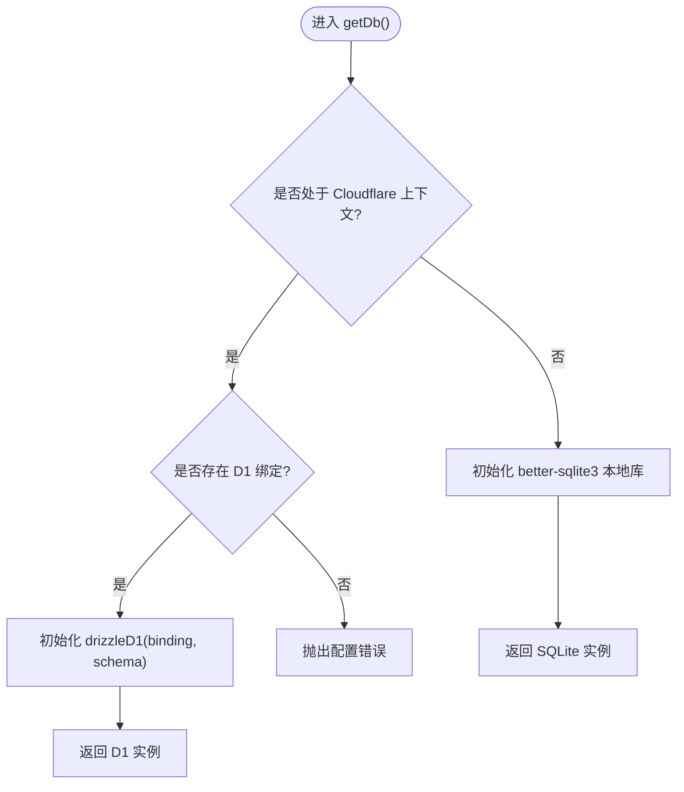
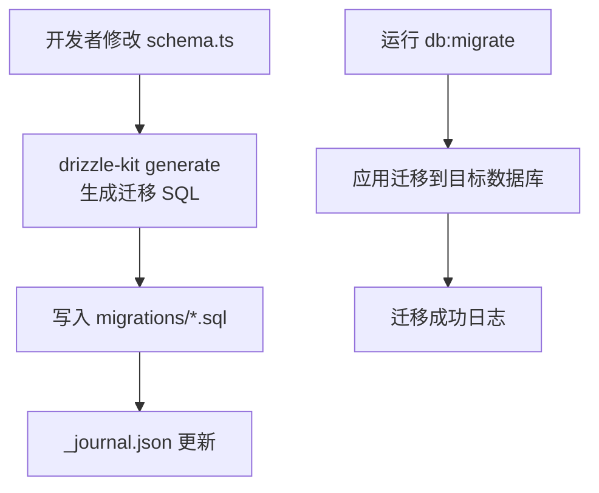
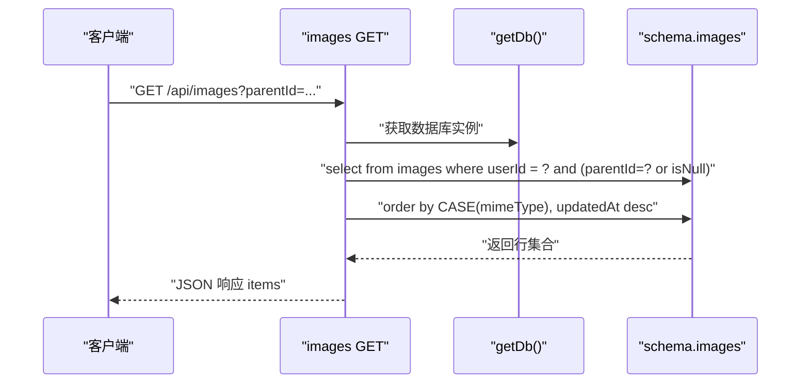
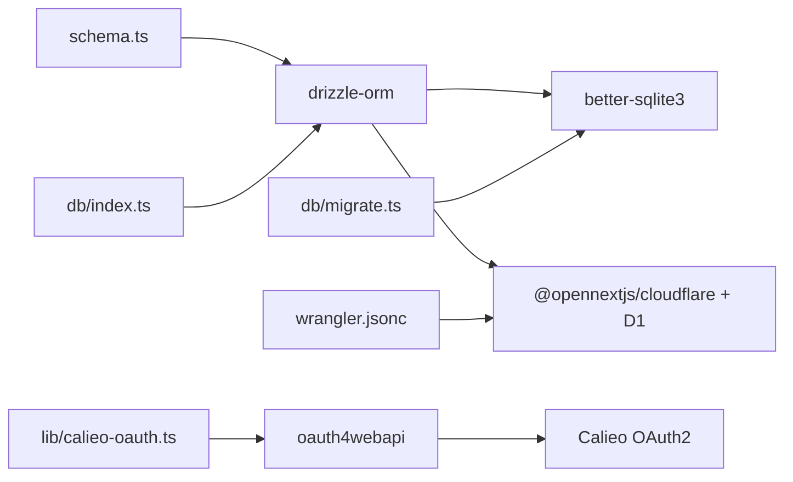

# 数据库设计

<cite>
**本文引用的文件**   
- [src/db/schema.ts](file://src/db/schema.ts)
- [src/db/index.ts](file://src/db/index.ts)
- [src/db/migrate.ts](file://src/db/migrate.ts)
- [drizzle.config.ts](file://drizzle.config.ts)
- [migrations/0000_cynical_mordo.sql](file://migrations/0000_cynical_mordo.sql)
- [migrations/0001_happy_the_phantom.sql](file://migrations/0001_happy_the_phantom.sql)
- [migrations/0002_gorgeous_storm.sql](file://migrations/0002_gorgeous_storm.sql)
- [migrations/meta/_journal.json](file://migrations/meta/_journal.json)
- [wrangler.jsonc](file://wrangler.jsonc)
- [package.json](file://package.json)
- [src/app/api/auth/callback/calieo/route.ts](file://src/app/api/auth/callback/calieo/route.ts)
- [src/app/api/auth/signin/calieo/route.ts](file://src/app/api/auth/signin/calieo/route.ts)
- [src/lib/calieo-oauth.ts](file://src/lib/calieo-oauth.ts)
</cite>

## 更新摘要
**变更内容**   
- 新增 users 表的 calieo_sub 字段，用于存储 Calieo OAuth2 用户的唯一标识符
- 添加 Calieo OAuth2 认证集成的完整实现
- 更新用户查找与创建逻辑，支持通过 calieo_sub、email 或新建用户的方式处理认证流程
- 增强数据模型以支持第三方身份认证场景

## 目录
1. [简介](#简介)
2. [项目结构](#项目结构)
3. [核心组件](#核心组件)
4. [架构总览](#架构总览)
5. [详细组件分析](#详细组件分析)
6. [依赖关系分析](#依赖关系分析)
7. [性能与优化](#性能与优化)
8. [故障排查指南](#故障排查指南)
9. [结论](#结论)
10. [附录](#附录)

## 简介
本文件面向 Weable 项目的数据库设计与实现，围绕基于 Drizzle ORM 的数据模型、表结构与关系映射、迁移机制、Cloudflare D1 集成、查询范式、缓存策略、性能优化以及备份恢复与监控维护进行系统化说明。文档以代码级事实为依据，提供可视化图示与可操作的实践建议，帮助开发者快速理解并高效使用数据库能力。

**最新更新**：新增了 Calieo OAuth2 集成，在 users 表中添加了 calieo_sub 字段用于存储第三方认证用户的唯一标识符，实现了完整的第三方登录流程。

## 项目结构
Weable 的数据库相关代码集中在 src/db 目录，配合 migrations 目录完成版本化迁移；运行时通过 drizzle.config.ts 配置 Drizzle Kit；部署到 Cloudflare Workers 时通过 wrangler.jsonc 绑定 D1 数据库实例。API 路由中统一通过 getDb() 获取数据库连接，并在业务逻辑中使用 Drizzle 的类型安全 API 进行数据操作。

图表来源
- [src/db/index.ts:1-61](file://src/db/index.ts#L1-L61)
- [src/db/schema.ts:1-101](file://src/db/schema.ts#L1-L101)
- [src/db/migrate.ts:1-24](file://src/db/migrate.ts#L1-L24)
- [drizzle.config.ts:1-8](file://drizzle.config.ts#L1-L8)
- [wrangler.jsonc:16-22](file://wrangler.jsonc#L16-L22)
- [src/lib/calieo-oauth.ts:1-96](file://src/lib/calieo-oauth.ts#L1-L96)

章节来源
- [src/db/index.ts:1-61](file://src/db/index.ts#L1-L61)
- [src/db/schema.ts:1-101](file://src/db/schema.ts#L1-L101)
- [src/db/migrate.ts:1-24](file://src/db/migrate.ts#L1-L24)
- [drizzle.config.ts:1-8](file://drizzle.config.ts#L1-L8)
- [wrangler.jsonc:16-22](file://wrangler.jsonc#L16-L22)
- [src/lib/calieo-oauth.ts:1-96](file://src/lib/calieo-oauth.ts#L1-L96)

## 核心组件
- 数据模型与关系：users（含 calieo_sub 字段）、channels、images 三张核心表及其关联关系（一对多、自引用父子树）。
- 数据库连接：本地 SQLite 与 Cloudflare D1 的双模适配，自动选择运行环境。
- 迁移管理：基于 Drizzle Kit 的版本化迁移与回滚策略。
- Calieo OAuth2 集成：完整的第三方认证流程，包括授权、回调处理和用户关联逻辑。
- API 查询示例：类型安全的 select/update/delete/count/order by 等用法。

章节来源
- [src/db/schema.ts:26-101](file://src/db/schema.ts#L26-L101)
- [src/db/index.ts:24-60](file://src/db/index.ts#L24-L60)
- [src/db/migrate.ts:6-19](file://src/db/migrate.ts#L6-L19)
- [src/app/api/auth/callback/calieo/route.ts:28-48](file://src/app/api/auth/callback/calieo/route.ts#L28-L48)
- [src/lib/calieo-oauth.ts:51-95](file://src/lib/calieo-oauth.ts#L51-L95)

## 架构总览
下图展示了从 API 请求到数据库访问的整体流程，包括本地 SQLite 与 Cloudflare D1 的选择逻辑，以及 Drizzle ORM 在其中的作用。同时包含了新的 Calieo OAuth2 认证流程。

图表来源
- [src/db/index.ts:34-60](file://src/db/index.ts#L34-L60)
- [src/db/schema.ts:1-101](file://src/db/schema.ts#L1-L101)
- [src/app/api/auth/callback/calieo/route.ts:28-48](file://src/app/api/auth/callback/calieo/route.ts#L28-L48)

## 详细组件分析

### 数据模型与关系映射
- 用户 users
  - 字段：id（主键，默认生成）、name（非空）、email（唯一）、nickname、bio、**calieoSub（唯一，用于存储 Calieo OAuth2 用户的 sub 标识）**、createdAt（时间戳）
  - 索引：email 唯一索引、calieo_sub 唯一索引
  - 关系：一个用户拥有多个频道与图片
- 频道 channels
  - 字段：id（主键，默认生成）、userId（外键，级联删除）、name（非空）、description、isPublic（布尔）、createdAt
  - 关系：属于一个用户，包含多张图片
- 图片 images
  - 字段：id（主键，默认生成）、userId（外键，级联删除）、channelId（外键，删除置空）、parentId（自引用，删除置空）、title（非空）、description（默认空）、filename（非空）、mimeType（非空）、width、height、size（非空）、isPublished（布尔，默认 false）、createdAt、updatedAt
  - 关系：属于一个用户，可选归属一个频道，支持父子层级（自引用）

图表来源
- [src/db/schema.ts:26-101](file://src/db/schema.ts#L26-L101)
- [migrations/0000_cynical_mordo.sql:1-38](file://migrations/0000_cynical_mordo.sql#L1-L38)
- [migrations/0001_happy_the_phantom.sql:1-1](file://migrations/0001_happy_the_phantom.sql#L1-L1)
- [migrations/0002_gorgeous_storm.sql:1-2](file://migrations/0002_gorgeous_storm.sql#L1-L2)

章节来源
- [src/db/schema.ts:26-101](file://src/db/schema.ts#L26-L101)
- [migrations/0000_cynical_mordo.sql:1-38](file://migrations/0000_cynical_mordo.sql#L1-L38)
- [migrations/0001_happy_the_phantom.sql:1-1](file://migrations/0001_happy_the_phantom.sql#L1-L1)
- [migrations/0002_gorgeous_storm.sql:1-2](file://migrations/0002_gorgeous_storm.sql#L1-L2)

### Calieo OAuth2 认证流程
新增的 Calieo OAuth2 集成提供了完整的第三方认证功能：

- **授权流程**：通过 `/api/auth/signin/calieo` 发起授权，生成 state、codeVerifier 和 codeChallenge，存储在 httpOnly cookie 中
- **回调处理**：通过 `/api/auth/callback/calieo` 处理授权回调，验证状态码并交换 token
- **用户关联逻辑**：按优先级查找用户：calieo_sub → email → 新建用户
- **会话管理**：认证成功后设置 calieo_session cookie，包含用户 ID

图表来源
- [src/app/api/auth/signin/calieo/route.ts:12-47](file://src/app/api/auth/signin/calieo/route.ts#L12-L47)
- [src/app/api/auth/callback/calieo/route.ts:28-48](file://src/app/api/auth/callback/calieo/route.ts#L28-L48)
- [src/lib/calieo-oauth.ts:51-95](file://src/lib/calieo-oauth.ts#L51-L95)

章节来源
- [src/app/api/auth/signin/calieo/route.ts:12-47](file://src/app/api/auth/signin/calieo/route.ts#L12-L47)
- [src/app/api/auth/callback/calieo/route.ts:28-48](file://src/app/api/auth/callback/calieo/route.ts#L28-L48)
- [src/lib/calieo-oauth.ts:51-95](file://src/lib/calieo-oauth.ts#L51-L95)

### 数据库连接与环境适配
- 本地开发：优先使用 better-sqlite3 驱动，数据库文件路径由环境变量 DB_PATH 控制，默认位于 .data/weable.db，自动创建目录。
- Cloudflare 生产：检测 Cloudflare 上下文，若存在 D1 绑定则使用 drizzle-orm/d1 驱动；否则抛出配置错误提示检查 wrangler.jsonc 的 D1 配置。
- 单例缓存：分别缓存 sqliteDb 与 d1Db 实例，避免重复初始化开销。

图表来源
- [src/db/index.ts:34-60](file://src/db/index.ts#L34-L60)

章节来源
- [src/db/index.ts:14-32](file://src/db/index.ts#L14-L32)
- [src/db/index.ts:34-60](file://src/db/index.ts#L34-L60)

### 迁移管理与版本控制
- 配置文件：drizzle.config.ts 指定 schema 路径、输出目录为 migrations、方言为 sqlite。
- 迁移脚本：migrations 目录下按序号命名 SQL 文件，_journal.json 记录迁移元数据（版本、标签、时间戳、断点信息）。
- 执行方式：通过 npm script db:migrate 调用 tsx 执行 migrate.ts，该脚本根据 DB_PATH 定位数据库文件并应用迁移。
- 回滚策略：当前实现未内置回滚命令；如需回滚，应基于 _journal.json 与历史快照进行逆向操作，或在测试环境中重建数据库。

**最新迁移**：0002_gorgeous_storm.sql 添加了 calieo_sub 字段和唯一索引。

图表来源
- [drizzle.config.ts:1-8](file://drizzle.config.ts#L1-L8)
- [migrations/meta/_journal.json:1-27](file://migrations/meta/_journal.json#L1-L27)
- [src/db/migrate.ts:6-19](file://src/db/migrate.ts#L6-L19)
- [package.json:12](file://package.json#L12)

章节来源
- [drizzle.config.ts:1-8](file://drizzle.config.ts#L1-L8)
- [migrations/meta/_journal.json:1-27](file://migrations/meta/_journal.json#L1-L27)
- [src/db/migrate.ts:6-19](file://src/db/migrate.ts#L6-L19)
- [package.json:12](file://package.json#L12)

### 查询示例与类型安全 ORM 使用
- 列表查询与排序：images 列表接口根据 mimeType 将目录置顶，再按 updatedAt 降序排列，支持 parentId 过滤。
- 条件删除与计数校验：删除频道前统计已发布图片数量，防止误删。
- 更新用户资料：PATCH 接口对 nickname/bio 做输入清洗与长度限制后更新。
- **新增**：Calieo OAuth2 用户查找逻辑，支持按 calieo_sub、email 查找或创建用户。

图表来源
- [src/app/api/images/route.ts:33-47](file://src/app/api/images/route.ts#L33-L47)
- [src/db/index.ts:43-60](file://src/db/index.ts#L43-L60)
- [src/db/schema.ts:46-69](file://src/db/schema.ts#L46-L69)

章节来源
- [src/app/api/images/route.ts:9-65](file://src/app/api/images/route.ts#L9-L65)
- [src/app/api/channels/[channelId]/route.ts:21-40](file://src/app/api/channels/[channelId]/route.ts#L21-L40)
- [src/app/api/user/profile/route.ts:26-27](file://src/app/api/user/profile/route.ts#L26-L27)
- [src/app/api/auth/callback/calieo/route.ts:28-48](file://src/app/api/auth/callback/calieo/route.ts#L28-L48)

## 依赖关系分析
- ORM 与方言：drizzle-orm 同时支持 better-sqlite3 与 d1，根据运行环境动态选择。
- 外部依赖：bs58 用于 ID 编码，uuidv7 用于生成有序 UUID，better-sqlite3 用于本地 SQLite，oauth4webapi 用于 Calieo OAuth2 认证。
- 部署绑定：wrangler.jsonc 声明 D1 与 R2 绑定名称与实例 ID。

图表来源
- [src/db/index.ts:1-6](file://src/db/index.ts#L1-L6)
- [src/db/schema.ts:1-6](file://src/db/schema.ts#L1-L6)
- [src/db/migrate.ts:1-3](file://src/db/migrate.ts#L1-L3)
- [wrangler.jsonc:16-22](file://wrangler.jsonc#L16-L22)
- [src/lib/calieo-oauth.ts:1-2](file://src/lib/calieo-oauth.ts#L1-L2)

章节来源
- [src/db/index.ts:1-6](file://src/db/index.ts#L1-L6)
- [src/db/schema.ts:1-6](file://src/db/schema.ts#L1-L6)
- [src/db/migrate.ts:1-3](file://src/db/migrate.ts#L1-L3)
- [wrangler.jsonc:16-22](file://wrangler.jsonc#L16-L22)
- [src/lib/calieo-oauth.ts:1-2](file://src/lib/calieo-oauth.ts#L1-L2)

## 性能与优化
- 索引设计
  - users.email 唯一索引：保证邮箱唯一性与查询效率。
  - **新增** users.calieo_sub 唯一索引：确保 Calieo 用户标识的唯一性，提升 OAuth2 登录时的查找性能。
  - 建议补充索引：images.userId、images.channelId、images.parentId、images.updatedAt、images.isPublished，以提升常见过滤与排序性能。
- 查询优化
  - 使用精确 where 条件与 limit 减少不必要数据量。
  - 复杂排序使用 sql 表达式（如目录置顶）时注意索引利用情况。
  - **新增** Calieo OAuth2 用户查找采用三级优先级查询，避免全表扫描。
- 连接复用
  - 单例缓存 DbInstance，避免每次请求重新建立连接。
- 存储分离
  - 图片二进制存储在 R2，数据库仅保存元数据，降低数据库负载。
- 事务与一致性
  - 批量写操作建议使用事务确保一致性（当前代码未显式使用事务，可在需要时引入）。

## 故障排查指南
- D1 绑定缺失
  - 现象：在 Cloudflare 上下文但无 D1 绑定时抛出配置错误。
  - 处理：检查 wrangler.jsonc 的 d1_databases 配置，确保 binding 名称与代码一致。
- 本地数据库路径问题
  - 现象：无法创建 .data 目录或写入失败。
  - 处理：确认 DB_PATH 环境变量指向有效路径，并确保进程具备写权限。
- 迁移失败
  - 现象：迁移脚本执行报错。
  - 处理：查看 _journal.json 与对应迁移文件，必要时回滚或重建数据库。
- 查询异常
  - 现象：类型错误或字段不存在。
  - 处理：核对 schema.ts 字段名与 API 使用的字段一致，确保编译阶段类型检查通过。
- **新增** Calieo OAuth2 配置问题
  - 现象：OAuth2 授权失败或回调错误。
  - 处理：检查 wrangler.jsonc 中的 CALIEO_CLIENT_ID 配置，确保环境变量正确设置。
- **新增** 用户关联冲突
  - 现象：同一 calieo_sub 或 email 的用户重复创建。
  - 处理：检查迁移是否正确应用，确认唯一约束生效。

章节来源
- [src/db/index.ts:53-56](file://src/db/index.ts#L53-L56)
- [src/db/migrate.ts:6-19](file://src/db/migrate.ts#L6-L19)
- [wrangler.jsonc:16-22](file://wrangler.jsonc#L16-L22)
- [src/app/api/auth/signin/calieo/route.ts:12-18](file://src/app/api/auth/signin/calieo/route.ts#L12-L18)

## 结论
Weable 的数据库设计以 Drizzle ORM 为核心，结合 Cloudflare D1 与本地 SQLite 的双模适配，提供了类型安全、易于维护的数据访问层。三张核心表清晰表达用户、频道与图片的关系，并通过迁移机制保障版本演进。**最新的 Calieo OAuth2 集成扩展了用户认证能力，通过 calieo_sub 字段支持第三方身份认证，提供了完整的授权流程和用户关联逻辑**。建议在现有基础上完善索引策略、引入事务与更完善的回滚流程，进一步提升性能与可靠性。

## 附录

### 表结构与字段定义
- users
  - id: text，主键，默认函数生成
  - name: text，非空
  - email: text，唯一
  - nickname: text，可选
  - bio: text，可选
  - **calieoSub: text，唯一，用于存储 Calieo OAuth2 用户的 sub 标识符**
  - createdAt: integer，非空，默认当前时间
- channels
  - id: text，主键，默认函数生成
  - userId: text，非空，外键 references(users.id)，onDelete cascade
  - name: text，非空
  - description: text，可选
  - isPublic: integer（boolean），非空，默认 false
  - createdAt: integer，非空，默认当前时间
- images
  - id: text，主键，默认函数生成
  - userId: text，非空，外键 references(users.id)，onDelete cascade
  - channelId: text，外键 references(channels.id)，onDelete set null
  - parentId: text，自引用 references(images.id)，onDelete set null
  - title: text，非空
  - description: text，非空，默认 ""
  - filename: text，非空
  - mimeType: text，非空
  - width: integer，可选
  - height: integer，可选
  - size: integer，非空
  - isPublished: integer（boolean），非空，默认 false
  - createdAt: integer，非空，默认当前时间
  - updatedAt: integer，非空，默认当前时间

章节来源
- [src/db/schema.ts:26-101](file://src/db/schema.ts#L26-L101)
- [migrations/0000_cynical_mordo.sql:1-38](file://migrations/0000_cynical_mordo.sql#L1-L38)
- [migrations/0001_happy_the_phantom.sql:1-1](file://migrations/0001_happy_the_phantom.sql#L1-L1)
- [migrations/0002_gorgeous_storm.sql:1-2](file://migrations/0002_gorgeous_storm.sql#L1-L2)

### 索引与约束
- users.email 唯一索引
- **users.calieo_sub 唯一索引**
- 外键约束：
  - channels.user_id -> users.id（cascade 删除）
  - images.user_id -> users.id（cascade 删除）
  - images.channel_id -> channels.id（set null 删除）
  - images.parent_id -> images.id（set null 删除）

章节来源
- [migrations/0000_cynical_mordo.sql:1-38](file://migrations/0000_cynical_mordo.sql#L1-L38)
- [migrations/0002_gorgeous_storm.sql:1-2](file://migrations/0002_gorgeous_storm.sql#L1-L2)

### 数据库连接配置与迁移机制
- 连接选择
  - Cloudflare 上下文：使用 drizzle-orm/d1，绑定名称为 DB。
  - 本地开发：使用 better-sqlite3，数据库路径由 DB_PATH 控制，默认 .data/weable.db。
- 迁移执行
  - 通过 package.json 脚本 db:migrate 调用 src/db/migrate.ts。
  - 迁移脚本存放于 migrations 目录，_journal.json 记录版本与元数据。
- 版本控制与回滚
  - 当前未内置回滚命令；建议通过 _journal.json 与历史快照进行逆向操作或重建数据库。

章节来源
- [src/db/index.ts:34-60](file://src/db/index.ts#L34-L60)
- [src/db/migrate.ts:6-19](file://src/db/migrate.ts#L6-L19)
- [drizzle.config.ts:1-8](file://drizzle.config.ts#L1-L8)
- [migrations/meta/_journal.json:1-27](file://migrations/meta/_journal.json#L1-L27)
- [package.json:12](file://package.json#L12)

### 与 Cloudflare D1 的集成与最佳实践
- 绑定配置
  - wrangler.jsonc 中声明 d1_databases，binding 名称为 DB，database_name 与 database_id 需与实际一致。
- 运行时选择
  - getDb() 自动检测上下文与绑定可用性，缺失时抛出明确错误提示。
- 最佳实践
  - 保持 schema.ts 与迁移文件同步，避免漂移。
  - 在生产环境启用观测性（observability.enabled=true）。
  - 合理设置连接池与超时参数（根据实际负载调整）。

章节来源
- [wrangler.jsonc:16-22](file://wrangler.jsonc#L16-L22)
- [src/db/index.ts:34-60](file://src/db/index.ts#L34-L60)

### 数据访问模式与查询示例
- 读取列表与排序
  - 使用 select 与 orderBy，结合 sql 表达式实现目录置顶与更新时间排序。
- 条件删除与前置校验
  - 删除频道前统计已发布图片数量，避免不一致状态。
- 更新用户资料
  - 对输入进行清洗与长度限制后执行 update。
- **新增** Calieo OAuth2 用户查找
  - 按优先级：calieo_sub → email → 新建用户，确保用户关联的正确性。

章节来源
- [src/app/api/images/route.ts:33-47](file://src/app/api/images/route.ts#L33-L47)
- [src/app/api/channels/[channelId]/route.ts:31-40](file://src/app/api/channels/[channelId]/route.ts#L31-L40)
- [src/app/api/user/profile/route.ts:26-27](file://src/app/api/user/profile/route.ts#L26-L27)
- [src/app/api/auth/callback/calieo/route.ts:28-48](file://src/app/api/auth/callback/calieo/route.ts#L28-L48)

### 备份恢复、监控与维护
- 备份
  - 本地 SQLite：直接复制 .data/weable.db 文件。
  - Cloudflare D1：使用 Wrangler CLI 导出/导入数据库快照（例如 wrangler d1 export/import）。
- 恢复
  - 本地：替换数据库文件并重启服务。
  - D1：通过导入快照恢复至目标实例。
- 监控
  - 启用 observability 指标，关注慢查询与错误率。
- 维护
  - 定期评估索引使用情况，清理无用索引。
  - 监控磁盘空间与 I/O 延迟，必要时扩容或优化查询。

### Calieo OAuth2 集成配置
- **认证服务器配置**
  - Issuer: https://portal.calieo.xyz
  - 客户端 ID 和密钥通过环境变量配置
- **Cookie 管理**
  - oauth_state: 临时状态存储，包含 state、codeVerifier、lang
  - calieo_session: 会话 Cookie，包含用户 ID，有效期 30 天
- **用户关联逻辑**
  - 优先按 calieo_sub 查找用户
  - 其次按 email 查找并关联 calieo_sub
  - 最后创建新用户并设置 calieo_sub

章节来源
- [src/lib/calieo-oauth.ts:3-25](file://src/lib/calieo-oauth.ts#L3-L25)
- [src/app/api/auth/signin/calieo/route.ts:33-43](file://src/app/api/auth/signin/calieo/route.ts#L33-L43)
- [src/app/api/auth/callback/calieo/route.ts:28-48](file://src/app/api/auth/callback/calieo/route.ts#L28-L48)