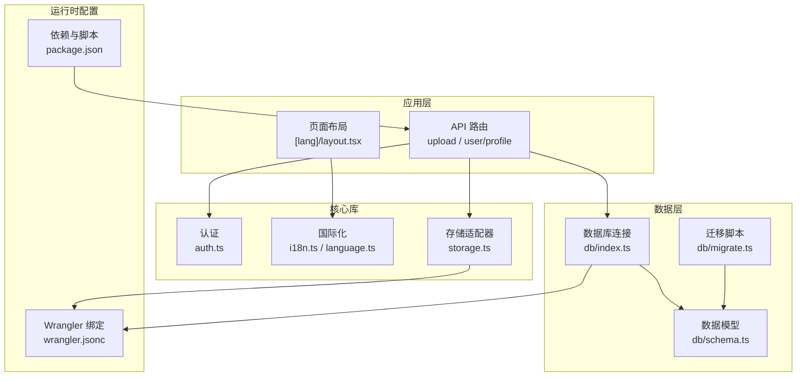
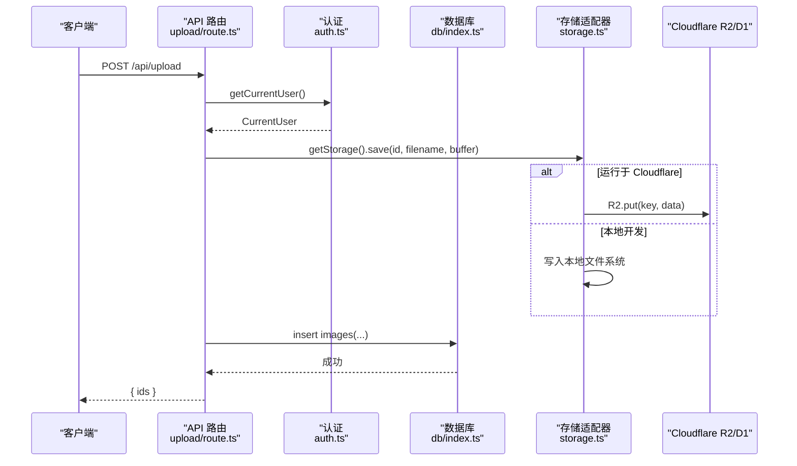
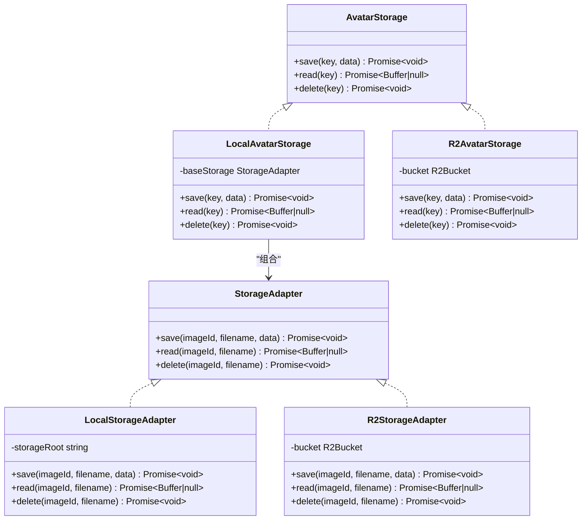
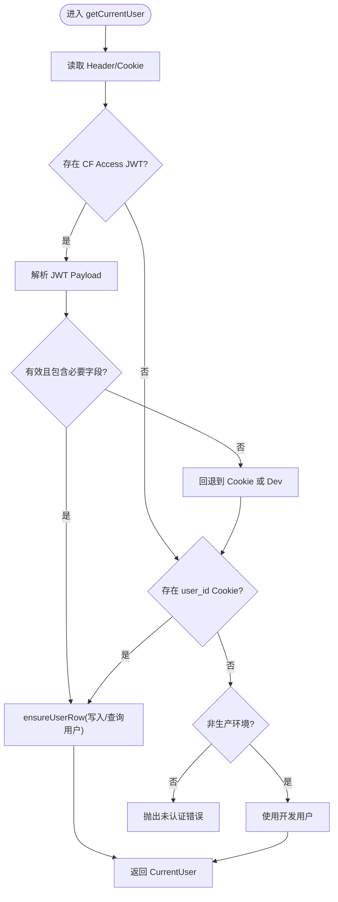
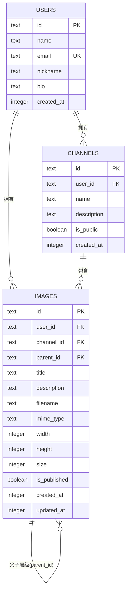
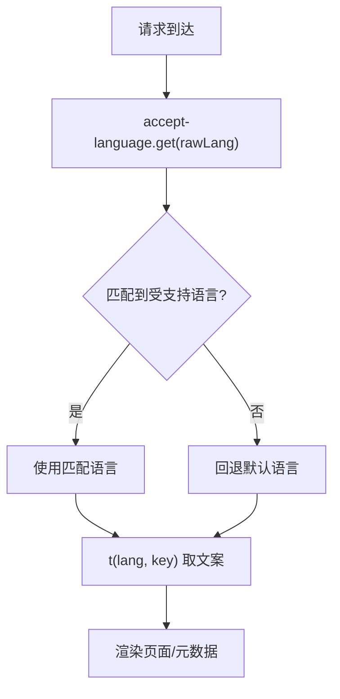
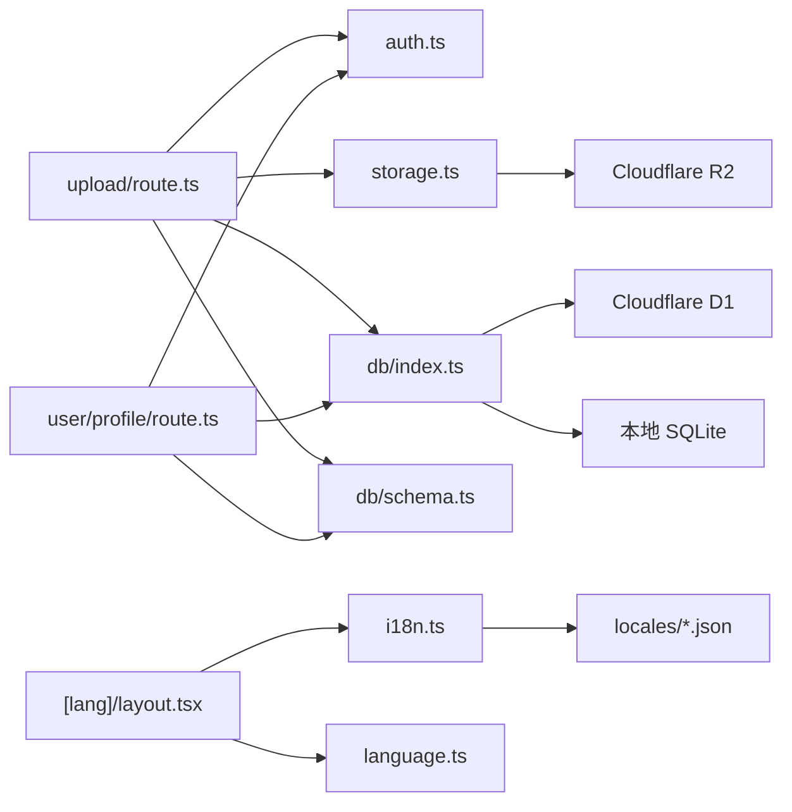

# 核心模块

<cite>
**本文引用的文件**   
- [src/lib/storage.ts](file://src/lib/storage.ts)
- [src/lib/auth.ts](file://src/lib/auth.ts)
- [src/db/schema.ts](file://src/db/schema.ts)
- [src/db/index.ts](file://src/db/index.ts)
- [drizzle.config.ts](file://drizzle.config.ts)
- [wrangler.jsonc](file://wrangler.jsonc)
- [package.json](file://package.json)
- [migrations/0000_cynical_mordo.sql](file://migrations/0000_cynical_mordo.sql)
- [migrations/0001_happy_the_phantom.sql](file://migrations/0001_happy_the_phantom.sql)
- [src/db/migrate.ts](file://src/db/migrate.ts)
- [src/app/api/upload/route.ts](file://src/app/api/upload/route.ts)
- [src/app/api/user/profile/route.ts](file://src/app/api/user/profile/route.ts)
- [src/lib/i18n.ts](file://src/lib/i18n.ts)
- [src/lib/language.ts](file://src/lib/language.ts)
- [src/app/[lang]/layout.tsx](file://src/app/[lang]/layout.tsx)
</cite>

## 目录
1. [简介](#简介)
2. [项目结构](#项目结构)
3. [核心组件](#核心组件)
4. [架构总览](#架构总览)
5. [详细组件分析](#详细组件分析)
6. [依赖关系分析](#依赖关系分析)
7. [性能考量](#性能考量)
8. [故障排查指南](#故障排查指南)
9. [结论](#结论)
10. [附录](#附录)

## 简介
本文件为 Weable 的核心模块文档，聚焦以下四大子系统：
- 存储系统：统一的 StorageAdapter 抽象与本地/R2 双实现；头像专用 AvatarStorage 适配。
- 认证系统：多源身份解析（Cloudflare Access JWT、Cookie），并自动落库用户信息。
- 数据库设计：Drizzle ORM + SQLite/D1 模型定义、关系映射与迁移管理。
- 国际化系统：基于 accept-language 的动态语言检测与 t() 翻译函数。

文档同时给出架构图、类图、时序图与流程图，说明模块间依赖与交互方式，并提供常见问题与优化建议。

## 项目结构
Weable 采用 Next.js App Router 组织路由与 API，核心能力集中在 src/lib 与 src/db 两个目录：
- src/lib：存储适配器、认证、国际化、语言工具等通用库。
- src/db：数据库连接、Schema 定义、迁移脚本。
- src/app/api：RESTful 接口，调用上述库完成业务逻辑。
- src/app/[lang]：按语言分发的页面布局与元数据生成。

图表来源 
- [src/app/api/upload/route.ts:1-75](file://src/app/api/upload/route.ts#L1-L75)
- [src/app/api/user/profile/route.ts:1-31](file://src/app/api/user/profile/route.ts#L1-L31)
- [src/lib/auth.ts:1-118](file://src/lib/auth.ts#L1-L118)
- [src/lib/storage.ts:1-214](file://src/lib/storage.ts#L1-L214)
- [src/db/index.ts:1-61](file://src/db/index.ts#L1-L61)
- [src/db/schema.ts:1-100](file://src/db/schema.ts#L1-L100)
- [src/db/migrate.ts:1-24](file://src/db/migrate.ts#L1-L24)
- [wrangler.jsonc:1-34](file://wrangler.jsonc#L1-L34)
- [package.json:1-40](file://package.json#L1-L40)

章节来源
- [src/app/api/upload/route.ts:1-75](file://src/app/api/upload/route.ts#L1-L75)
- [src/app/api/user/profile/route.ts:1-31](file://src/app/api/user/profile/route.ts#L1-L31)
- [src/lib/storage.ts:1-214](file://src/lib/storage.ts#L1-L214)
- [src/lib/auth.ts:1-118](file://src/lib/auth.ts#L1-L118)
- [src/db/index.ts:1-61](file://src/db/index.ts#L1-L61)
- [src/db/schema.ts:1-100](file://src/db/schema.ts#L1-L100)
- [src/db/migrate.ts:1-24](file://src/db/migrate.ts#L1-L24)
- [wrangler.jsonc:1-34](file://wrangler.jsonc#L1-L34)
- [package.json:1-40](file://package.json#L1-L40)

## 核心组件
- 存储适配器：统一接口 StorageAdapter（save/read/delete）与 AvatarStorage（头像专用）。提供 LocalStorageAdapter、R2StorageAdapter、LocalAvatarStorage、R2AvatarStorage 四种实现，并通过 getStorage()/getAvatarStorage() 自动选择后端。
- 认证系统：getCurrentUser() 支持 Cloudflare Access JWT（Header/Cookie）与自定义 user_id Cookie，非生产环境支持开发用户回退，最终确保用户行存在并返回 CurrentUser。
- 数据库层：Db 工厂根据运行环境选择 D1 或本地 SQLite；Schema 使用 Drizzle 定义 users/channels/images 三表及关系；迁移脚本集中管理 SQL 变更。
- 国际化：language.ts 声明支持语言与默认值，i18n.ts 聚合各语言包并提供 t(lang, key) 函数；页面布局根据 URL 参数设置 html lang 与 SEO 元数据。

章节来源
- [src/lib/storage.ts:1-214](file://src/lib/storage.ts#L1-L214)
- [src/lib/auth.ts:1-118](file://src/lib/auth.ts#L1-L118)
- [src/db/index.ts:1-61](file://src/db/index.ts#L1-L61)
- [src/db/schema.ts:1-100](file://src/db/schema.ts#L1-L100)
- [src/db/migrate.ts:1-24](file://src/db/migrate.ts#L1-L24)
- [src/lib/i18n.ts:1-28](file://src/lib/i18n.ts#L1-L28)
- [src/lib/language.ts:1-49](file://src/lib/language.ts#L1-L49)
- [src/app/[lang]/layout.tsx:1-48](file://src/app/[lang]/layout.tsx#L1-L48)

## 架构总览
下图展示从请求到存储/数据库的端到端流程，以及国际化在页面渲染中的作用。

图表来源 
- [src/app/api/upload/route.ts:1-75](file://src/app/api/upload/route.ts#L1-L75)
- [src/lib/auth.ts:1-118](file://src/lib/auth.ts#L1-L118)
- [src/lib/storage.ts:1-214](file://src/lib/storage.ts#L1-L214)
- [src/db/index.ts:1-61](file://src/db/index.ts#L1-L61)
- [wrangler.jsonc:1-34](file://wrangler.jsonc#L1-L34)

## 详细组件分析

### 存储系统
- 设计模式：策略模式 + 工厂式获取。通过 StorageAdapter 抽象统一 save/read/delete 语义，根据运行环境自动选择 R2 或本地实现；头像存储通过 AvatarStorage 包装底层存储。
- 关键实现要点：
  - 路径安全校验：对 imageId/filename/key 进行白名单校验，防止路径穿越。
  - 类型转换：Buffer/Uint8Array/ArrayBuffer 之间安全转换。
  - 环境探测：优先尝试 Cloudflare 上下文中的 R2 绑定，缺失时回退本地存储；若处于 CF 上下文但缺少绑定则抛出明确错误。
  - 单例缓存：getStorage()/getAvatarStorage() 缓存实例，避免重复创建。

图表来源 
- [src/lib/storage.ts:1-214](file://src/lib/storage.ts#L1-L214)

使用模式与配置选项
- 上传接口调用示例路径：[src/app/api/upload/route.ts:1-75](file://src/app/api/upload/route.ts#L1-L75)
- 环境变量与绑定：
  - IMAGE_STORAGE_PATH：本地存储根目录（可选）。
  - wrangler.jsonc 中 IMAGES_BUCKET 绑定用于 R2。
- 典型用法：
  - 获取存储实例：getStorage()
  - 获取头像存储实例：getAvatarStorage()

章节来源
- [src/lib/storage.ts:1-214](file://src/lib/storage.ts#L1-L214)
- [src/app/api/upload/route.ts:1-75](file://src/app/api/upload/route.ts#L1-L75)
- [wrangler.jsonc:1-34](file://wrangler.jsonc#L1-L34)

### 认证系统
- 多源解析优先级：
  1) Cloudflare Access JWT（Header cf-access-jwt-assertion 或 Cookie CF_Authorization/cf_authorization）
  2) 自定义 Cookie user_id
  3) 非生产环境的开发用户回退
- 行为：
  - 解析 JWT payload，提取 id/name/email 等字段。
  - ensureUserRow 保证用户存在（upsert），并返回 CurrentUser。
  - 生产环境未解析到任何身份将抛错。

图表来源 
- [src/lib/auth.ts:1-118](file://src/lib/auth.ts#L1-L118)

章节来源
- [src/lib/auth.ts:1-118](file://src/lib/auth.ts#L1-L118)

### 数据库设计与关系映射
- 引擎与环境：
  - Cloudflare 环境优先使用 D1，否则回退到本地 better-sqlite3。
  - 本地数据库路径由 DB_PATH 控制，默认 .data/weable.db。
- 模型与关系：
  - users：用户基本信息，id 使用 uuidv7 + base58 编码。
  - channels：频道，归属用户，支持公开标记。
  - images：图片资源，归属用户，可归属频道，支持父子层级（parent_id）。
  - relations：定义 one/many 双向关系，便于 ORM 查询。
- 迁移：
  - drizzle-kit 配置指向 schema 与 migrations 目录。
  - 迁移脚本包含建表与增量 ALTER。

图表来源 
- [src/db/schema.ts:1-100](file://src/db/schema.ts#L1-L100)
- [migrations/0000_cynical_mordo.sql:1-38](file://migrations/0000_cynical_mordo.sql#L1-L38)
- [migrations/0001_happy_the_phantom.sql:1-1](file://migrations/0001_happy_the_phantom.sql#L1-L1)

章节来源
- [src/db/index.ts:1-61](file://src/db/index.ts#L1-L61)
- [src/db/schema.ts:1-100](file://src/db/schema.ts#L1-L100)
- [drizzle.config.ts:1-8](file://drizzle.config.ts#L1-L8)
- [migrations/0000_cynical_mordo.sql:1-38](file://migrations/0000_cynical_mordo.sql#L1-L38)
- [migrations/0001_happy_the_phantom.sql:1-1](file://migrations/0001_happy_the_phantom.sql#L1-L1)
- [src/db/migrate.ts:1-24](file://src/db/migrate.ts#L1-L24)

### 国际化系统
- 语言检测：accept-language 根据请求头匹配受支持语言集合。
- 消息字典：i18n.ts 静态导入各语言 JSON，t(lang, key) 提供键值查找与回退英文。
- 页面集成：[lang]/layout.tsx 根据 URL 参数设置 html lang 与 SEO 元数据，generateStaticParams 预生成所有语言路由。

图表来源 
- [src/lib/language.ts:1-49](file://src/lib/language.ts#L1-L49)
- [src/lib/i18n.ts:1-28](file://src/lib/i18n.ts#L1-L28)
- [src/app/[lang]/layout.tsx:1-48](file://src/app/[lang]/layout.tsx#L1-L48)

章节来源
- [src/lib/language.ts:1-49](file://src/lib/language.ts#L1-L49)
- [src/lib/i18n.ts:1-28](file://src/lib/i18n.ts#L1-L28)
- [src/app/[lang]/layout.tsx:1-48](file://src/app/[lang]/layout.tsx#L1-L48)

## 依赖关系分析
- API 路由依赖：
  - upload/route.ts 依赖 auth、storage、db、schema。
  - user/profile/route.ts 依赖 auth、db、schema。
- 存储与数据库：
  - storage.ts 依赖 @opennextjs/cloudflare 以探测 R2 绑定。
  - db/index.ts 依赖 @opennextjs/cloudflare 以探测 D1 绑定。
- 国际化：
  - i18n.ts 静态导入 locales/*.json。
  - language.ts 依赖 accept-language。

图表来源 
- [src/app/api/upload/route.ts:1-75](file://src/app/api/upload/route.ts#L1-L75)
- [src/app/api/user/profile/route.ts:1-31](file://src/app/api/user/profile/route.ts#L1-L31)
- [src/lib/storage.ts:1-214](file://src/lib/storage.ts#L1-L214)
- [src/db/index.ts:1-61](file://src/db/index.ts#L1-L61)
- [src/lib/i18n.ts:1-28](file://src/lib/i18n.ts#L1-L28)
- [src/lib/language.ts:1-49](file://src/lib/language.ts#L1-L49)
- [src/app/[lang]/layout.tsx:1-48](file://src/app/[lang]/layout.tsx#L1-L48)

章节来源
- [src/app/api/upload/route.ts:1-75](file://src/app/api/upload/route.ts#L1-L75)
- [src/app/api/user/profile/route.ts:1-31](file://src/app/api/user/profile/route.ts#L1-L31)
- [src/lib/storage.ts:1-214](file://src/lib/storage.ts#L1-L214)
- [src/db/index.ts:1-61](file://src/db/index.ts#L1-L61)
- [src/lib/i18n.ts:1-28](file://src/lib/i18n.ts#L1-L28)
- [src/lib/language.ts:1-49](file://src/lib/language.ts#L1-L49)
- [src/app/[lang]/layout.tsx:1-48](file://src/app/[lang]/layout.tsx#L1-L48)

## 性能考量
- 存储层
  - 使用 Uint8Array 直接写入 R2，减少 Buffer 拷贝开销。
  - 本地文件系统读写采用异步 fs/promises，避免阻塞事件循环。
  - 单例缓存 getStorage()/getAvatarStorage() 避免重复初始化。
- 认证层
  - JWT 解析仅做 Base64Url 解码与 JSON 解析，无外部签名验证（适用于内部信任场景）。
  - ensureUserRow 使用 onConflictDoNothing 降低冲突写入成本。
- 数据库层
  - 优先使用 D1（Serverless 友好），本地开发回退 SQLite，提升开发体验。
  - 使用 uuidv7 生成有序 ID，有利于索引与范围扫描。
- 国际化
  - 语言包静态导入，避免运行时动态加载；t() 为 O(1) 查找。
- 建议
  - 大文件上传考虑流式处理与分片（当前实现为内存缓冲）。
  - 热点头像可引入 CDN 或对象存储公共访问链接。
  - 数据库查询尽量利用索引（如 userId、channelId、parentId）。

## 故障排查指南
- Cloudflare 绑定缺失
  - 现象：启动或运行时报“D1/R2 binding 未配置”的错误。
  - 排查：检查 wrangler.jsonc 中 d1_databases 与 r2_buckets 的 binding 名称是否与代码一致（DB、IMAGES_BUCKET）。
  - 参考：[src/db/index.ts:43-61](file://src/db/index.ts#L43-L61)、[src/lib/storage.ts:184-214](file://src/lib/storage.ts#L184-L214)、[wrangler.jsonc:16-32](file://wrangler.jsonc#L16-L32)
- 认证失败
  - 现象：生产环境未携带 CF Access JWT 或 user_id Cookie 时抛错。
  - 排查：确认请求头/cookie 是否包含 cf-access-jwt-assertion 或 CF_Authorization/cf_authorization；或在开发环境启用 DEV_USER_* 环境变量。
  - 参考：[src/lib/auth.ts:93-118](file://src/lib/auth.ts#L93-L118)
- 上传失败
  - 现象：MIME 类型不被允许、文件大小超限、父目录不存在。
  - 排查：检查 file.type 前缀、file.size、parentId 是否存在且属于当前用户。
  - 参考：[src/app/api/upload/route.ts:14-49](file://src/app/api/upload/route.ts#L14-L49)
- 数据库迁移问题
  - 现象：本地数据库结构与迁移不一致。
  - 排查：执行 pnpm db:migrate，确保 migrations 目录与 schema 同步。
  - 参考：[src/db/migrate.ts:1-24](file://src/db/migrate.ts#L1-L24)、[drizzle.config.ts:1-8](file://drizzle.config.ts#L1-L8)

章节来源
- [src/db/index.ts:43-61](file://src/db/index.ts#L43-L61)
- [src/lib/storage.ts:184-214](file://src/lib/storage.ts#L184-L214)
- [wrangler.jsonc:16-32](file://wrangler.jsonc#L16-L32)
- [src/lib/auth.ts:93-118](file://src/lib/auth.ts#L93-L118)
- [src/app/api/upload/route.ts:14-49](file://src/app/api/upload/route.ts#L14-L49)
- [src/db/migrate.ts:1-24](file://src/db/migrate.ts#L1-L24)
- [drizzle.config.ts:1-8](file://drizzle.config.ts#L1-L8)

## 结论
Weable 的核心模块围绕“可扩展存储、多源认证、强类型 ORM 与动态国际化”构建：
- 存储适配器以策略模式屏蔽底层差异，天然支持本地与 R2 无缝切换。
- 认证系统兼容 Cloudflare Access 与轻量 Cookie，兼顾安全性与易用性。
- 数据库层通过 Drizzle 与迁移脚本保障模型演进的可维护性。
- 国际化系统简洁高效，满足多语言站点需求。
在生产部署时，务必正确配置 wrangler 绑定，并在上传与鉴权环节做好输入校验与错误提示。

## 附录
- 常用命令
  - 开发：pnpm dev
  - 构建：pnpm build
  - 迁移：pnpm db:migrate
- 关键依赖
  - next、better-sqlite3、drizzle-orm、@opennextjs/cloudflare、accept-language、bs58、uuidv7
- 相关脚本与配置
  - package.json scripts
  - drizzle.config.ts
  - wrangler.jsonc

章节来源
- [package.json:1-40](file://package.json#L1-L40)
- [drizzle.config.ts:1-8](file://drizzle.config.ts#L1-L8)
- [wrangler.jsonc:1-34](file://wrangler.jsonc#L1-L34)